国 家 电 网 有 限 公 司 企 业 标 准

Q/XXX XXXXX—XXXX

# 物理层通信协议

physical layer protocal

（XX 稿）

2025 年 8 月

XXXX - XX - XX 发布 XXXX - XX - XX 实施

国家电网公司 发 布

## 目 次

目次....I
前言....II
物理层通信协议....3
1 范围....3
2 规范性引用文件....3
3 术语和定义....3
4 缩略语....3
5 高速载波物理层....4
6 无线物理层....32
附录 A （规范性附录）高速载波数据载荷分集拷贝参数定义与计算....56
附录 B （规范性附录）高速无线 PHR 与 PSDU 分集拷贝参数定义与计算....60
附录 C （资料性附录）高速载波相位表及窗函数....64
附录 D （资料性附录）无线物理层数据映射相位表....75

## 前 言

为规范电力用户用电信息采集系统双模通信的物理层通信协议要求，包括频段的选择、前向纠错码、星座点映射、符号生成等内容，制定本部分。

《技术规范》标准分为6个部分：

——第1部分：总则；

——第2部分：技术要求；

——第3部分：检验方法；

——第4—1部分：物理层通信协议；

——第4—2部分：数据链路层通信协议；

——第4—3部分：应用层通信协议。

本部分是《技术规范》标准的第4-1部分。

本部分由国家电网有限公司营销部提出并解释。

本部分由国家电网有限公司科技部归口。

本部分起草单位：。

本部分主要起草人：。

本部分首次发布。

本部分在执行过程中的意见或建议反馈至国家电网有限公司科技部。

# 物理层通信协议

## 1 范围

本文件规定了双模通信系统的物理层通信协议及服务。

本文件适用于双模通信系统通信单元之间的物理层数据交换。

## 2 规范性引用文件

下列文件对于本文件的应用是必不可少的。凡是注日期的引用文件，仅注日期的版本适用于本文件。凡是不注日期的引用文件，其最新版本（包括所有的修改单）适用于本文件。

本文件没有规范性引用文件。

## 3 术语和定义

## 3.1

协议数据单元 protocol data unit

两个对等实体之间交换的数据单元。

## 3.2

## 站点 station

通信网络中的从节点角色，其对应的设备实体为通信单元，包括电能表双模通信单元、I型采集器双模通信单元或双模II型采集器。

## 4 缩略语

以下缩略语适用于本文件。

BRU：基础资源单位（Basic Resource Unit）

CRC：循环冗余校验（Cyclic Redundancy Check）

eFC: 扩展帧控制（extend Frame Control）

FC：帧控制（Frame Control）

FFT：快速傅里叶变换（Fast Fourier Transformation）

FL：帧长（Frame Length）

LSB：最低位（Least Significant Bit）

LTF：长训练域（Long Training Field）

MCS：调制编码序列（Modulation and Coding Scheme）

OFDM：正交频分复用（Orthogonal Frequency Division Multiplexing）

OFDMA：正交频分多址（Orthogonal Frequency Division Multiple Access）PAD：填充比特（Pad Bits）PB：物理块（PHY Block）PHR：物理帧头（Physical Header）PHY：物理层（Physical Layer）PN: 随机噪声（Pseudo Noise）PPDU：物理层协议数据单元（Physical Layer Protocol Data Unit）PSDU：物理层服务数据单元（PHY Service Data Unit）RI：滚降间隔（Roll off Interval）RU：资源单元（Resource Unit）SACK：选择确认（Selective Acknowledgement）SIG: PHR 控制字（PHR Control Signal）SNR：信噪比（Signal-to-Noise Ratio）STF：短训练域（Short Training Field）TDA: 时域聚合（Time Domain Aggregation）TF：训练域（Training Field）TMI：传输模式指示（Transfer Mode Indication）

## 5 高速载波物理层

## 5.1 高速载波物理层一般要求

## 5.1.1 概述

高速载波在单站点通信的上下行链路中，应支持采用OFDM模式进行报文传输，且数据载荷的加载方式应支持非动态加载与动态加载两种模式。其中，动态加载模式进一步细分为子载波选择模式和比特加载模式。单站点接收端应具备同时检测两个通信频段的能力。

高速载波在多站点的下行链路中，应支持OFDMA模式或者TDA模式进行报文传输，且数据载荷的调制方式应支持分集拷贝方式。

## 5.1.2 单站点物理层架构

## 5.1.2.1 单站点传输物理层架构

单站点传输物理层架构应符合错误!未找到引用源。要求。

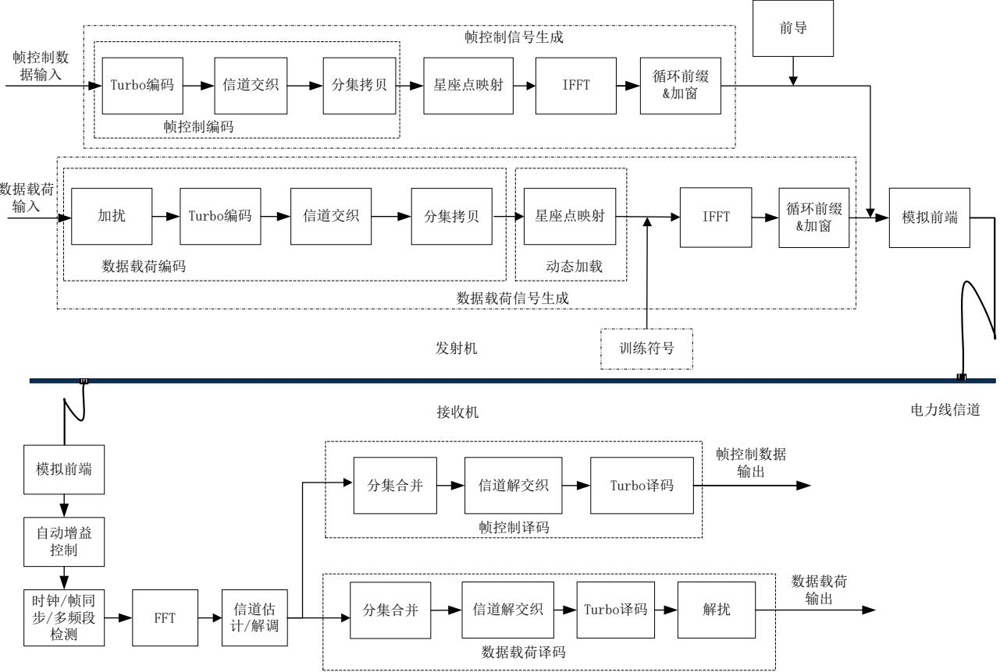  
图 1 高速载波单站点传输物理层架构图

## 5.1.2.2 单站点发射端流程

对于发送单站点OFDM信号的发射机，发送端从数据链路层获取的帧控制数据与数据载荷，应按照图 1发射机的流程生成信号。

帧控制OFDM信号生成流程应符合以下要求：

a）发送端从数据链路层接收帧控制数据后，应按序经过Turbo编码、信道交织与帧控制分集拷贝的帧控制编码流程。其中，Turbo编码应符合5.1.6.2节所述要求；信道交织应符合5.1.6.3节所述要求；帧控制分集拷贝应符合5.1.6.4节所述要求。

b）帧控制编码后的帧控制数据应依据帧控制分集拷贝模式中的调制方式进行星座点映射。

c）映射后的数据应进行IFFT变换并添加循环前缀及进行加窗处理，生成帧控制OFDM信号。

数据载荷OFDM信号生成流程应符合以下要求：

a) 发送端从数据链路层接收数据载荷后，应按序经过数据载荷扰码、Turbo编码、信道交织与数据载荷分集拷贝的数据载荷编码流程。其中，数据载荷扰码应符合 所述要求； 编码应符合节所述要求；信道交织应符合5.1.8.4节所述要求；分集拷贝应符合5.1.8.5节所述要求。

数据载荷编码后的数据应进行星座点映射，若当前数据载荷为非动态加载模式时，应依据数据载荷分集拷贝模式中的加载方式进行子载波星座点映射；若当前数据载荷调制方式为动态加载模式时，应依据动态加载配置表进行星座点映射。

c) 星座点映射后的数据依据站点发送配置的通信频段进行IFFT变换并添加循环前缀，生成数据载荷OFDM信号。

发送端应依据帧控制字段中是否配置训练域，决定是否进行训练信号的处理。如果配置训练信号，则应将训练域经过IFFT变换，并添加循环前缀，从而生成相应的训练信号。

在上述生成的帧控制OFDM信号之前插入前导信号，并根据帧控制字段指示的训练域插入位置，插入训练信号。

前导、帧控制、训练信号、数据载荷信号应按5.1.5.2节所述要求构成完整的OFDM帧结构，经模拟前端处理后，可通过电力线信道进行传输。

## 5.1.2.3 单站点接收端流程

对于接收单站点OFDM信号的接收机来说，应按照图 1接收机的接收处理流程进行处理，应符合以下要求：

a) 接收端针对进入接收机的电力线信号进行自动增益控制调整，并完成通信频段的同步检测。

b) 根据同步到的通信频段进行帧控制信号的解调与译码处理，获取到帧控制信息。

c) 根据帧控制信息中所携带的数据载荷的通信频段、解调与译码参数信息完成数据载荷的解调与译码，最终将电力线上的载波信号还原为原始数据信息并传至数据链路层。

## 5.1.3 多站点 OFDMA 物理层架构

## 5.1.3.1 多站点 OFDMA 传输物理层架构

多站点下行链路OFDMA传输物理层架构应符合错误!未找到引用源。要求。

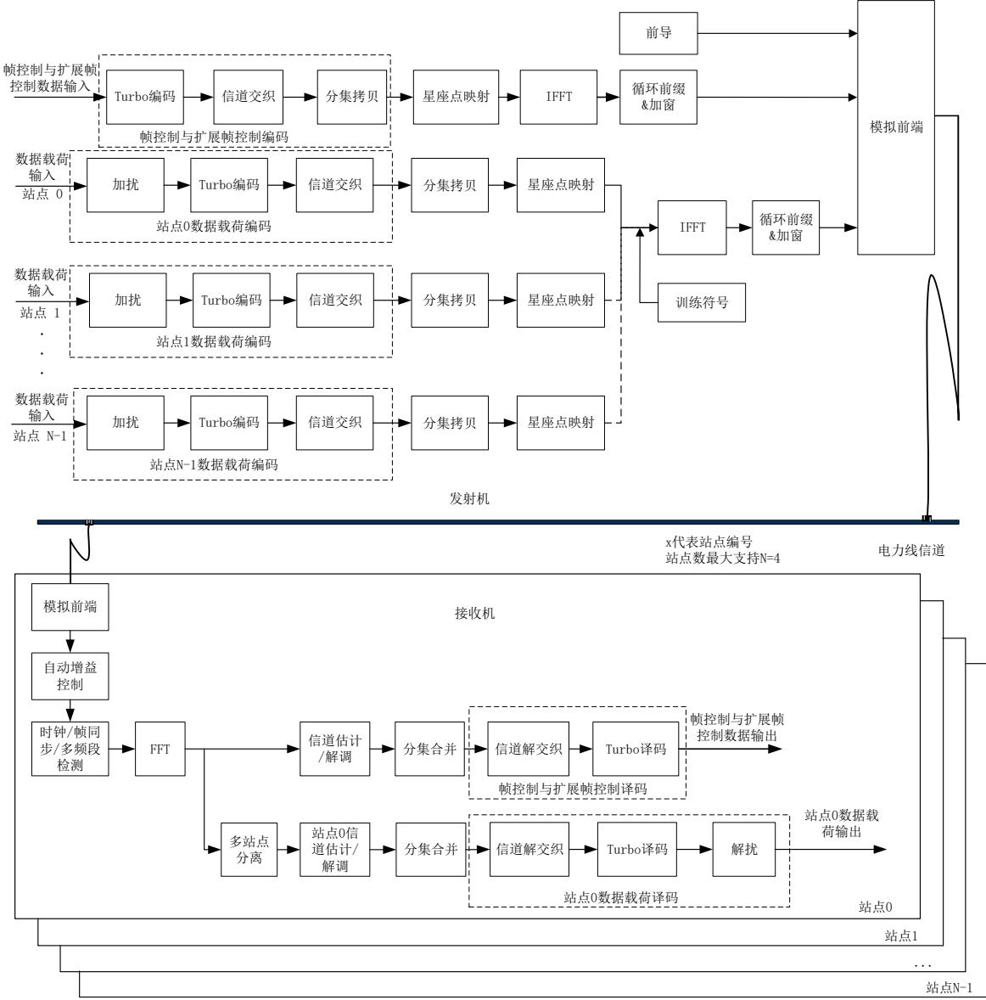

图 2 高速载波多站点 OFDMA 传输物理层架构图

## 5.1.3.2 多站点 OFDMA 发射端流程

对于发送多站点下行OFDMA信号的发射机来说，其发送端从数据链路层获取的帧控制与扩展帧控制数据和各站点数据载荷应按照图 2发射机的流程生成信号。

帧控制与扩展帧控制数据处理流程与单站点帧控制数据处理流程相同。

各站点数据载荷OFDMA信号生成流程应符合以下要求：

a) 发送端从数据链路层获取各个站点数据载荷分别进行各站点数据载荷编码，各站点数据载荷编 码方式及流程与单站点数据载荷编码方式及流程相同。

b) 针对各站点数据载荷编码后的数据，根据每个站点分配的分集拷贝模式进行分集拷贝及子载波星座点映射，并分别根据各个站点分配的频段资源单元 信息，将星座映射后的符号分配至对应的子载波并一同进行IFFT变换生成OFDM符号，然后添加循环前缀及进行加窗处理形成各站点的数据数据载荷信号。

各个站点应根据其分配的频段资源单元RU信息对训练域进行IFFT变换后并添加循环前缀生成相应的训练信号。

在上述流程中生成的帧控制信号之前插入前导信号，在扩展帧控制信号之后插入训练信号与数据载荷信号，并应按5.1.5.3节所述要求构成完整的多站点OFDMA帧结构，经模拟前端处理后，可通过电力线信道进行传输。

## 5.1.3.3 多站点 OFDMA 接收端流程

对于接收多站点下行OFDMA信号的接收机来说，其接收处理流程应按照图2接收机的接收流程进行处理，应符合以下要求：

a) 各站点接收机分别从电力线检测到信号后，分别完成帧控制与扩展帧控制信号的解析。

b) 各站点接收机应基于帧控制与扩展帧控制信息，获取相应站点的数据载荷所对应的频段资源单元以及解调、译码所需的参数信息，并据此进行相应的解码与解调处理，最终将电力线上的载波信号还原为原始数据信息并传至数据链路层。

## 5.1.4 多站点 TDA 物理层架构

## 5.1.4.1 多站点 TDA 传输物理层架构

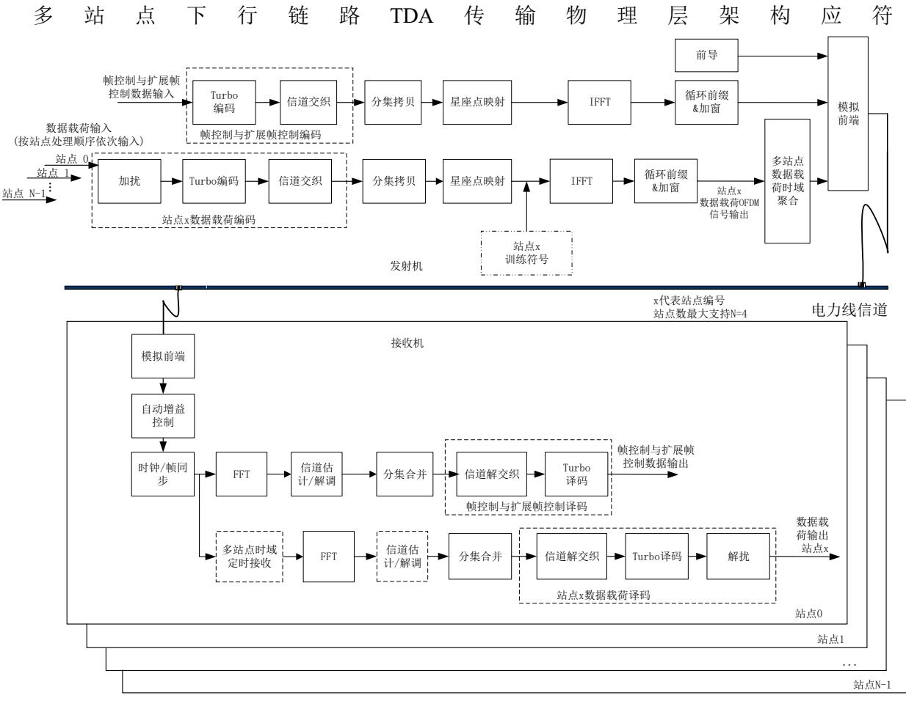  
图 3要求。

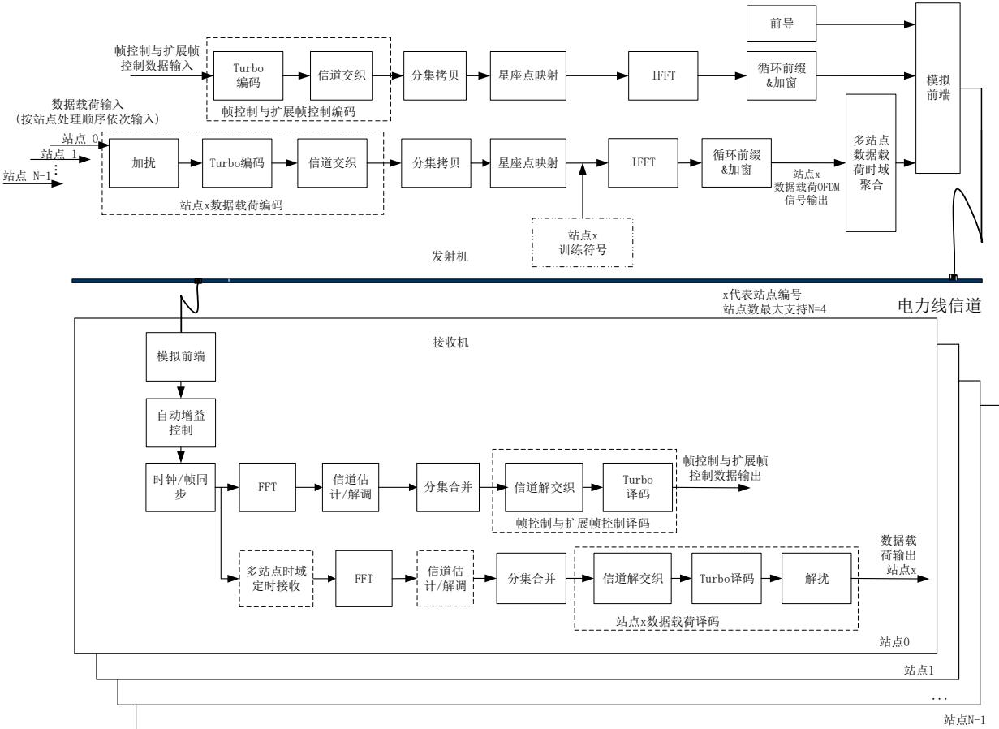  
图 3 高速载波多站点 TDA 传输物理层架构图

## 5.1.4.2 多站点 TDA 发射端流程

对于发送多站点下行TDA信号的发射机来说，其发送端从数据链路层获取的帧控制与扩展帧控制数据和各站点数据载荷应按照图3发射机的流程生成信号。

帧控制与扩展帧控制数据处理流程与单站点帧控制数据处理流程相同。

各站点数据载荷TDA信号生成流程应符合以下要求：

a) 发送端从数据链路层获取各个站点数据载荷并分别按照站点发送序号分别进行数据载荷编码，数据载荷编码方式及流程与单站点数据载荷编码方式及流程相同。

b) 针对编码后数据，依据当前站点分配的分集拷贝方式进行分集拷贝与子载波星座映射；

c) 针对子载波星座映射后的符号依据当前站点分配的通信频段，进行IFFT变换并添加循环前缀及进行加窗处理，生成当前站点的数据载荷OFDM信号。

d) 分别对各个站点生成的数据载荷OFDM信号进行时域聚合流程处理。

各个站点应依据其是否配置训练域以及分配的通信频段来进行训练信号的处理，如果配置训练信号则应将训练域经过IFFT变换并添加循环前缀生成训练信号。

在上述流程中生成的帧控制信号之前插入前导信号，在扩展帧控制信号之后依次按序插入各个站点的训练信号（如有）与数据载荷信号，并应按5.1.5.4 节所述要求构成完整的多站点 TDA 帧结构，经模拟前端处理后，可通过电力线信道进行传输。

## 5.1.4.3 多站点 TDA 接收端流程

对于接收多站点下行TDA信号的接收机来说，其接收处理流程应按照图3接收机的接收流程进行处理，应符合以下要求：

a) 各站点接收机分别从电力线检测到信号后，分别完成帧控制与扩展帧控制信号的解析。

b) 各站点接收机应基于帧控制与扩展帧控制信息，获取相应站点的数据载荷所对应的报文接收时序、通信频段以及解调、译码所需的参数信息，并据此进行相应的解码与解调处理，最终将电力线上的载波信号还原为原始数据信息并传至数据链路层。

## 5.1.5 物理层帧结构

## 5.1.5.1 前导结构

前导格式应如图 4要求，应由同步前缀序列和同步后缀序列两部分组成，同步前缀序列长度应为5.5至10.5个SYNCP符号；同步后缀序列长度应为2.5个SYNCM符号。其中0.5个符号为加窗滚降间隔RI。

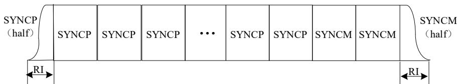  
图 4 前导格式示意图

## 5.1.5.2 物理层单站点帧结构

单站点OFDM帧应用于单站点之间的报文传输，其帧结构应包括数据载荷非变频段、数据载荷变频段和无数据载荷三种类型。

数据载荷非变频段帧结构示意图应符合图 5-1，图 5-2 要求，前导、帧控制和数据载荷的工作频段应相同。具体帧结构应符合图 8要求。

数据载荷变频段帧结构示意图应符合错误!未找到引用源。-1、图 6-2要求，在数据载荷前，应插入与其处于相同工作频段的训练域（TF），且训练域、数据载荷与前导及帧控制的工作频段不应相同。具体帧结构应符合图 9要求。

无数据载荷帧结构示意图应符合图 7 所示，其帧具体结构应符合图 10要求。

数据载荷调制方式应支持分集拷贝和动态加载两种模式。动态加载模式的启用应由帧控制（FC）字段中的相应比特位进行指示，在此模式下，物理块（PB）大小应由帧控制中相应字段指定。

为支持鲁棒信道探测，错误!未找到引用源。-1及图 6-2结构示意图中的数据载荷应可配置为训练序列（TF），且TF符号的总个数应不超过128个。

  
图 5-1 单站点数据载荷非变频段帧结构示意图 1

  
图 5-2 单站点数据载荷非变频段帧结构示意图 2

  
图 6-1 单站点数据载荷变频段帧结构示意图 1

  
图 6-2 单站点数据载荷变频段帧结构示意图 2

  
图 7 单站点无数据载荷帧结构示意图

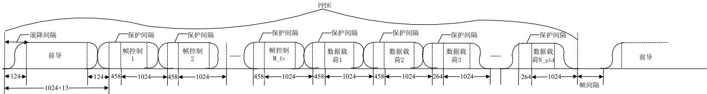

图 8 单站点数据载荷非变频段帧结构组成图  
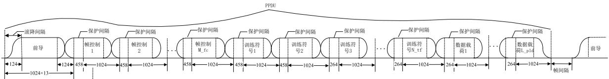  
图 9 单站点数据载荷变频段帧结构组成图

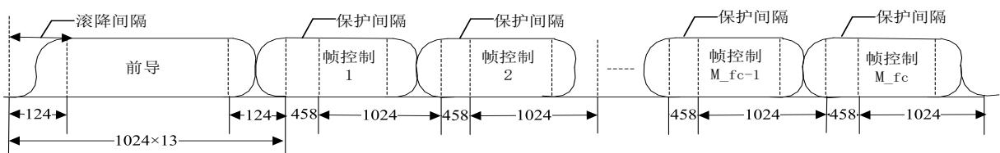  
图 10 单站点无数据载荷帧结构组成图

## 5.1.5.3 物理层多站点 OFDMA 帧结构

物理层多站点 帧应用于单站点对多站点之间的报文传输，其帧结构示意图应符合图 所示，其具体帧结构应符合图 12要求。数据帧应为每个用户配置对应的训练域（TF）。

OFDMA帧应最多支持同时向 4个站点发送信号，每个站点应最多支持2 个物理块，物理块大小应仅支持 PB72 和 PB136。

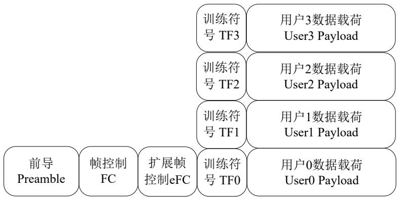  
图 11 多站点 OFDMA 数据帧结构示意图

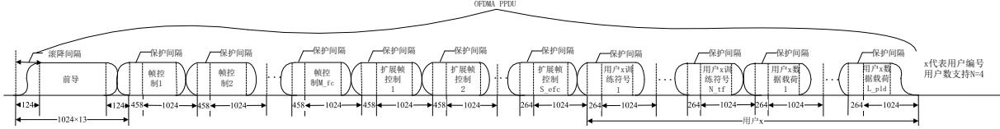  
图 12 多站点 OFDMA 数据帧结构组成图

## 5.1.5.4 物理层多站点 TDA 帧结构

物理层多站点 帧应用于单站点与多站点之间的报文传输，其帧结构应包括数据载荷非变频段与数据载荷变频段两种帧结构。数据载荷非变频段帧结构示意图应符合图 13 所示，数据载荷变频段帧结构示意图应符合图 14所示，这两种帧的具体帧结构应符合图 15的要求。其中，扩展帧控制（eFC）与训练域（ ）的添加应按照站点配置进行设置。不同站点的训练域长度应相同，并应由帧控制字段统一指定。

TDA 帧应最多支持同时向 4 个站点发送信号，每个用户应只支持 1 个物理块。前导、帧控制以及扩展帧控制（eFC）应采用相同频段发送，同一用户的训练域和数据载荷应采用相同的工作频段。当第一个站点不进行扩频段配置时，其训练域（TF）可被省略。此省略状态应由帧控制（FC）字段中的相应比特位进行指示。


图 13 多站点 TDA 数据载荷非变频段帧结构示意图  
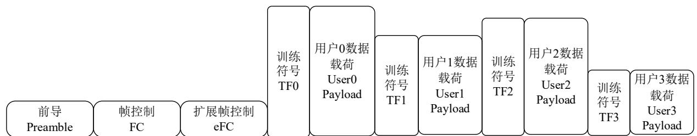  
图 14 多站点 TDA 数据载荷变频段帧结构示意图

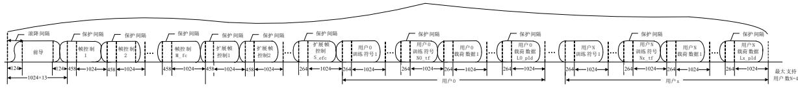  
图 15 多站点 TDA 数据帧结构组成图

## 5.1.5.5 相对功率

PPDU 中各组成部分子载波相对功率应如表 1 所示。其中，动态加载帧模式标识为子载波选择模式时，数据载荷相对功率应在 2.2\~5.2dB 范围内调整，应通过 FC 字段中载荷子载波增益指示；其它模式下，数据载荷相对功率应为 2.2dB。

表 1 前导、帧控制、扩展帧控制、训练域和数据载荷相对功率表

<table><tr><td>类型</td><td>相对功率(dB)</td></tr><tr><td>前导</td><td>3</td></tr><tr><td>帧控制</td><td>3</td></tr><tr><td>扩展帧控制</td><td>3</td></tr><tr><td>训练域</td><td>3</td></tr><tr><td>数据载荷</td><td>2.2~5.2</td></tr></table>

## 5.1.6 帧控制前向纠错码（矽久）

## 5.1.6.1 帧控制前向纠错码流程

帧控制前向纠错码的生成流程应由Turbo编码、信道交织以及分集拷贝三部分构成。

在物理层 OFDM 系统中，帧控制符号应承载 128 比特的信息位。在发送端，帧控制的 128 比特信息位应首先通过Turbo编码生成 256比特的编码序列，随后应对该256比特序列依次进行信道交织和分集拷贝。帧控制前向纠错码流程应符合图 16的规定。

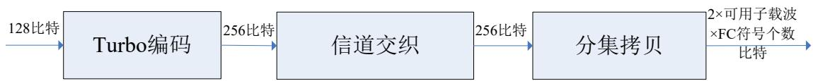  
图 16 帧控制前向纠错码流程图

## 5.1.6.2 帧控制 Turbo 编码

帧控制应采用码块长度 PB16 与码率1/2 的Turbo编码，最终输出的Turbo编码序列应为256比特。其中前128比特应为信息码，后 128比特应为校验码。

具体方法应符合5.1.8.3节要求。

## 5.1.6.3 帧控制信道交织

帧控制的信道交织应在多次拷贝及信号传送到信道之前，对Turbo编码器输出的 256比特的编码序列进行随机化处理。

具体方法应符合5.1.8.4章节要求。

## 5.1.6.4 帧控制分集拷贝

帧控制的分集拷贝应为后续星座点映射提供支持，其应将输入的256比特数据拷贝至频域子载波，所有帧控制符号均应采用QPSK调制方式。

帧控制（FC）长度应支持短 FC、标准FC和长FC三种模式，并可动态调整具体模式。频段1、频段 2、频段 4 及频段 6 的信标帧和 SOF 帧对应的三种 FC 长度应分别为 8、12 和 16；频段 0 和频段 5的信标帧和SOF帧对应的三种 FC长度应分别为2、4 和8；选择确认帧和网间协调帧的 FC长度应为标准FC 长度。FC长度的具体值应符合 QGDWXXX.42 帧控制域要求。

对于频段 0，可用载波数量为 411，子载波编号范围应为 80 至490；对于频段 1，帧控制可用载波数为 131，子载波编号范围应为 100至230；频段2 可用载波数为89，子载波编号范围应为 32至120；频段 4可用载波数为199，子载波编号范围应为32至230；频段5可用载波数为 459，子载波编号范围应为 32至490；频段6可用载波数为241，子载波编号范围应为 250至 490；

帧控制各符号具体拷贝方式应符合以下规则：每个符号的 路和 路应在输入比特流（ 比特）基础上加上对应的偏置后按顺序拷贝至对应载波，直至完成当前可用载波的填充。即有效子载波上顺序填充的比特编号为（c+128）mod256，c 为对应偏置值，取值范围 0 至 255。不同符号 I 路/Q 路的偏置值具体如表 2所示。

表 2 帧控制分集拷贝不同符号I路/Q路偏置表

<table><tr><td>I路/Q路</td><td>符号1</td><td>符号2</td><td>符号3</td><td>符号4</td><td>符号5</td><td>符号6</td><td>符号7</td><td>符号8</td></tr><tr><td>I路</td><td>0</td><td>192</td><td>160</td><td>96</td><td>144</td><td>80</td><td>48</td><td>240</td></tr><tr><td>Q路</td><td>128</td><td>64</td><td>32</td><td>224</td><td>16</td><td>208</td><td>176</td><td>112</td></tr><tr><td>I路/Q路</td><td>符号9</td><td>符号10</td><td>符号11</td><td>符号12</td><td>符号13</td><td>符号14</td><td>符号15</td><td>符号16</td></tr><tr><td>I路</td><td>24</td><td>184</td><td>136</td><td>40</td><td>232</td><td>72</td><td>248</td><td>88</td></tr><tr><td>Q路</td><td>152</td><td>56</td><td>8</td><td>168</td><td>104</td><td>200</td><td>120</td><td>216</td></tr></table>

## 5.1.7 扩展帧控制前向纠错码（鲁软）

## 5.1.7.1 扩展帧控制前向纠错码流程

扩展帧控制前向纠错码流程应与帧控制前向纠错码流程一致，具体流程应符合 5.1.6.1 节的要求。

## 5.1.7.2 扩展帧控制 Turbo 编码

扩展帧控制的Turbo编码块长度应为PB16，码率应为 1/2，最终输出的Turbo编码序列应为256比特。其中前 比特应为信息码，后 比特应为校验码。

具体Turbo编码方法应符合5.1.6.2 节的要求。

## 5.1.7.3 扩展帧控制信道交织

扩展帧控制的信道交织用于在多次拷贝及信号传送到信道之前，对 编码器输出的比特位置进行随机化处理。

具体信道交织方法应符合5.1.6.3 节的要求。

## 5.1.7.4 扩展帧控制分集拷贝

扩展帧控制所占用的频段应与帧控制一致，其符号数量应由帧控制字段指定，且不超过帧控制的符号数。所有扩展帧控制符号应采用QPSK调制方式。

具体分集拷贝方法应符合5.1.6.4 节的要求。

## 5.1.8 数据载荷前向纠错码（鲁软）

## 5.1.8.1 数据载荷前向纠错码流程

数据载荷前向纠错码的生成流程应由加扰、Turbo 编码、信道交织和分集拷贝四个部分构成，具体处理流程应如图 17所示。

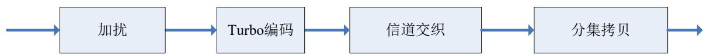  
图 17 数据载荷前向纠错码流程图

## 5.1.8.2 数据载荷扰码

数据载荷流应与一个重复伪随机噪声序列进行“异或”运算，该重复伪随机噪声序列应由公式（错误!未找到引用源。）表示的扰码多项式产生。

$$
S (x) = x ^ {1 0} + x ^ {3} + 1\tag{1}
$$

具体的扰码流程应符合以下要求：

a) 在开始处理每个PB时，伪随机噪声序列产生器的初始值应全部设置为1；

b) 每输入一个数据比特，扰码多项式应左移一位；

c) 应将扰码多项式的第3位和第10位做异或运算，输出的结果与输入数据应再做异或运算，即可得到输出数据。加扰实现流程如图 18所示。

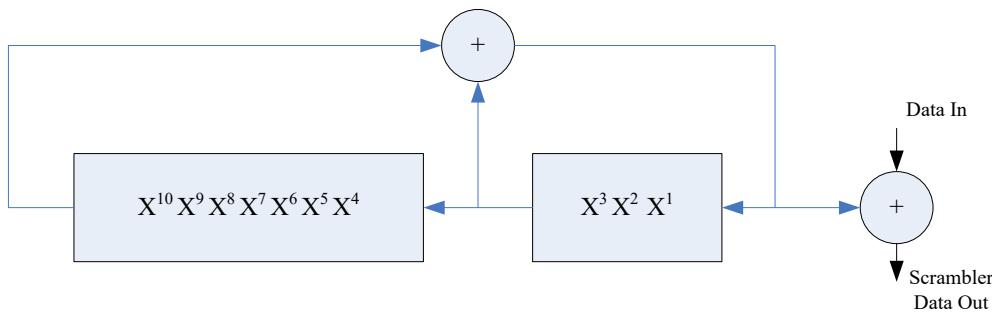  
图 18 加扰流程图

## 5.1.8.3 数据载荷 Turbo 编码

## 5.1.8.3.1 Turbo 编码模式

数据载荷应支持PB72，PB136，PB264，PB520 四种模式。数据载荷调制方式为比特加载模式时，应只支持 1/2 码率；其它模式下，PB72，PB136，PB264 三种模式应支持1/2 码率，PB520 模式应支持1/2 码率和 16/18 两种码率。

## 5.1.8.3.2 编码模块

Turbo编码应由2个相同的分量编码器（ENC1，ENC2）组成，每输入一对信息比特 $( u _ { 1 } , \ u _ { 2 } )$ 应输出系统比特 $( u _ { 1 } , \ u _ { 2 } )$ 和校验比特 $( \ p \ , \ q )$ 。Turbo编码器架构如图 19所示。

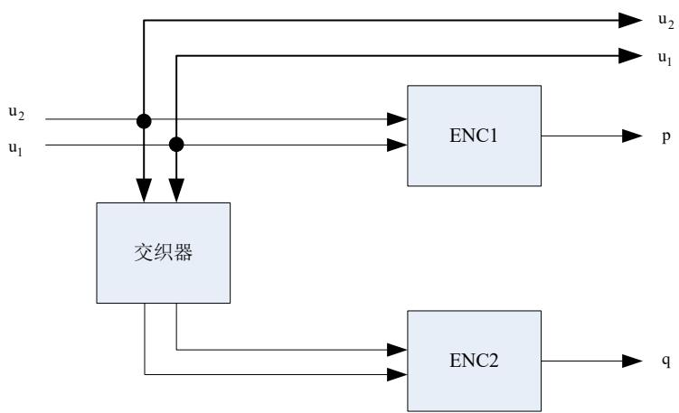  
图 19 Turbo 编码器架构

ENC1和ENC2应使用8状态编码器，输入数据流的第一个比特位应映射到 $u _ { 1 }$ ，第二个比特位应映射到 $u _ { 2 }$ ，以此类推，在一个ENC中，每一对比特位应对应输出一个校验位。校验 $( \ p \ , \ q )$ 的计算应根据图 20确定。

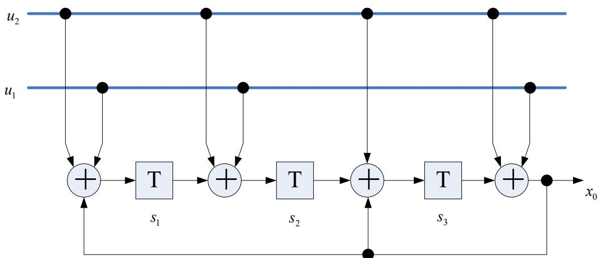  
图 20 ENC1/ENC2 编码架构

每个分量编码器的寄存器状态可由公式（2）所示的行向量来表示, 其中 表示时刻，可定义 $S ( 0 )$ 表示寄存器的初始状态， $S ( N )$ 表示寄存器的末状态。

$$
S (n) = \left[ S _ {1} (n), S _ {2} (n), S _ {3} (n) \right]\tag{2}
$$

具体的编码流程，应符合以下要求：

a) 应设置寄存器初始状态为 $\mathbf { \ell } ( 0 ) = [ 0 , 0 , 0 ]$

b) 应输入信息比特至分量编码器（ENC2输入的是交织后的信息比特），直至最后一位，用于得到编码结束的末状态 ；

c) 应定义矩阵 , 当PB大小为16（用于帧控制），72和520时， 应由公式（错误!未找到引用源。）定义，当PB大小为136时， 应由公式（错误!未找到引用源。）定义，当PB大小为264时， 应由公式（错误!未找到引用源。）定义；

$$
M = \left[ \begin{array}{c c c} 0 & 0 & 1 \\ 1 & 0 & 1 \\ 1 & 1 & 1 \end{array} \right]\tag{3}
$$

$$
M = \left[ \begin{array}{c c c} 0 & 1 & 1 \\ 1 & 0 & 0 \\ 0 & 1 & 0 \end{array} \right]\tag{4}
$$

$$
M = \left[ \begin{array}{c c c} 1 & 0 & 1 \\ 1 & 1 & 1 \\ 1 & 1 & 0 \end{array} \right]\tag{5}
$$

d) 应将信息比特重新输入至分量编码器，分量编码器的初始状态 应由公式（错误!未找到引用源。） 算出，再经过一次编码后，分量编码器的末状态为 ，且 $S ( N ) ^ { \prime } = S ( 0 )$ ，从而可以得到Turbo编码校验位。

$$
S (0) ^ {\prime} = S (N) \times M\tag{6}
$$

## 5.1.8.3.3 Turbo 交织模块

Turbo交织器用于将原始数据交织后作为第二个成员码的输入，Turbo交织应按照双比特为单位进行，交织器长度等于原始数据块长度的双比特数量，Turbo交织的参数如表 3定义，不同的PB长度，应采用不同的参数，包含PB16（帧控制），PB72，PB136，PB264，PB520五种。

表 3 Turbo 交织参数表

<table><tr><td>物理块(字节数)</td><td>S表长度(N)</td><td>双比特交织长度除以S表长度(M)</td><td>双比特的交织长度(L)</td></tr><tr><td>16</td><td>8</td><td>8</td><td>64</td></tr><tr><td>72</td><td>18</td><td>16</td><td>288</td></tr><tr><td>136</td><td>34</td><td>16</td><td>544</td></tr><tr><td>264</td><td>33</td><td>32</td><td>1056</td></tr><tr><td>520</td><td>40</td><td>52</td><td>2080</td></tr></table>

首先规定Turbo交织的地址映射 定义见公式（错误!未找到引用源。），

$$
I (x) = \left[ S (\mathrm{xmod} N) - (\mathrm{xdiv} N) ^ {*} N + L \right] \mod L \text {for} x = 0, 1, \dots , L - 1
$$

（7）

公式（7）中使用的运算符应定义如下：

—查找表；

—查找表长度；

—模运算；

—整除运算。

对 $\mathbb { F } x = 0 , 1 , \dots , L - 1$ ，地址映射 用于Turbo交织的具体算法应符合如下要求：

a) 当 结果为0时，交织器输出应使用公式（8）计算。

$$
\left\{ \begin{array}{l} I n t D a t a (2 \cdot x) = D a t a (2 \cdot I (x) + 1) \\ I n t D a t a (2 \cdot x + 1) = D a t a (2 \cdot I (x)) \end{array} \right.\tag{8}
$$

b) 当 结果为1时，交织器输出应使用公式（错误!未找到引用源。）计算。

$$
\left\{ \begin{array}{l} \text {   IntData   } (2 \cdot x) = D a t a (2 \cdot I (x)) \\ \text {   IntData   } (2 \cdot x + 1) = D a t a (2 \cdot I (x) + 1) \end{array} \right.\tag{9}
$$

公式（8）和（错误!未找到引用源。）中的参数含义如下：

—交织器输入；

—交织器输出。

需要注意的是，当交织器输出地址为偶数时，对应的交织后的信息比特对的第0和第1比特应交换。

表 4 PB16 的 S 查找表

<table><tr><td>x</td><td>0</td><td>1</td><td>2</td><td>3</td><td>4</td><td>5</td><td>6</td><td>7</td></tr><tr><td>S(x)</td><td>53</td><td>20</td><td>9</td><td>32</td><td>62</td><td>39</td><td>51</td><td>18</td></tr></table>

表 5 PB72 的 S 查找表

<table><tr><td>x</td><td>0</td><td>1</td><td>2</td><td>3</td><td>4</td><td>5</td><td>6</td><td>7</td></tr><tr><td>S(x)</td><td>1</td><td>200</td><td>255</td><td>166</td><td>221</td><td>132</td><td>187</td><td>98</td></tr><tr><td>x</td><td>8</td><td>9</td><td>10</td><td>11</td><td>12</td><td>13</td><td>14</td><td>15</td></tr><tr><td>S(x)</td><td>153</td><td>64</td><td>119</td><td>30</td><td>85</td><td>284</td><td>51</td><td>250</td></tr><tr><td>x</td><td>16</td><td>17</td><td>-</td><td>-</td><td>-</td><td>-</td><td>-</td><td>-</td></tr><tr><td>S(x)</td><td>17</td><td>216</td><td>-</td><td>-</td><td>-</td><td>-</td><td>-</td><td>-</td></tr></table>

表 6 PB136 的 S 查找表

<table><tr><td>x</td><td>0</td><td>1</td><td>2</td><td>3</td><td>4</td><td>5</td><td>6</td><td>7</td></tr><tr><td>S(x)</td><td>383</td><td>68</td><td>262</td><td>180</td><td>484</td><td>363</td><td>302</td><td>152</td></tr><tr><td>x</td><td>8</td><td>9</td><td>10</td><td>11</td><td>12</td><td>13</td><td>14</td><td>15</td></tr><tr><td>S(x)</td><td>405</td><td>529</td><td>97</td><td>11</td><td>333</td><td>509</td><td>40</td><td>198</td></tr><tr><td>x</td><td>16</td><td>17</td><td>18</td><td>19</td><td>20</td><td>21</td><td>22</td><td>23</td></tr><tr><td>S(x)</td><td>236</td><td>454</td><td>428</td><td>124</td><td>273</td><td>493</td><td>73</td><td>389</td></tr><tr><td>x</td><td>24</td><td>25</td><td>26</td><td>27</td><td>28</td><td>29</td><td>30</td><td>31</td></tr><tr><td>S(x)</td><td>162</td><td>293</td><td>2</td><td>211</td><td>467</td><td>252</td><td>411</td><td>183</td></tr><tr><td>x</td><td>32</td><td>33</td><td>-</td><td>-</td><td>-</td><td>-</td><td>-</td><td>-</td></tr><tr><td>S(x)</td><td>310</td><td>86</td><td>-</td><td>-</td><td>-</td><td>-</td><td>-</td><td>-</td></tr></table>

表 7 PB264 的 S 查找表

<table><tr><td>x</td><td>0</td><td>1</td><td>2</td><td>3</td><td>4</td><td>5</td><td>6</td><td>7</td></tr><tr><td>S(x)</td><td>309</td><td>175</td><td>737</td><td>667</td><td>1024</td><td>224</td><td>622</td><td>962</td></tr><tr><td>x</td><td>8</td><td>9</td><td>10</td><td>11</td><td>12</td><td>13</td><td>14</td><td>15</td></tr><tr><td>S(x)</td><td>527</td><td>845</td><td>926</td><td>1052</td><td>366</td><td>54</td><td>249</td><td>784</td></tr><tr><td>x</td><td>16</td><td>17</td><td>18</td><td>19</td><td>20</td><td>21</td><td>22</td><td>23</td></tr><tr><td>S(x)</td><td>108</td><td>551</td><td>410</td><td>479</td><td>823</td><td>866</td><td>442</td><td>654</td></tr><tr><td>x</td><td>24</td><td>25</td><td>26</td><td>27</td><td>28</td><td>29</td><td>30</td><td>31</td></tr><tr><td>S(x)</td><td>321</td><td>33</td><td>85</td><td>610</td><td>730</td><td>765</td><td>1038</td><td>352</td></tr><tr><td>x</td><td>32</td><td>-</td><td>-</td><td>-</td><td>-</td><td>-</td><td>-</td><td>-</td></tr><tr><td>S(x)</td><td>954</td><td>-</td><td>-</td><td>-</td><td>-</td><td>-</td><td>-</td><td>-</td></tr></table>

表 8 PB520 的 S 查找表

<table><tr><td>x</td><td>0</td><td>1</td><td>2</td><td>3</td><td>4</td><td>5</td><td>6</td><td>7</td></tr><tr><td>S(x)</td><td>1183</td><td>32</td><td>425</td><td>1434</td><td>165</td><td>331</td><td>1574</td><td>1039</td></tr><tr><td>x</td><td>8</td><td>9</td><td>10</td><td>11</td><td>12</td><td>13</td><td>14</td><td>15</td></tr><tr><td>S(x)</td><td>1084</td><td>1332</td><td>1513</td><td>536</td><td>213</td><td>1908</td><td>761</td><td>1231</td></tr><tr><td>x</td><td>16</td><td>17</td><td>18</td><td>19</td><td>20</td><td>21</td><td>22</td><td>23</td></tr><tr><td>S(x)</td><td>1659</td><td>476</td><td>1842</td><td>809</td><td>2007</td><td>895</td><td>1717</td><td>1950</td></tr><tr><td>x</td><td>24</td><td>25</td><td>26</td><td>27</td><td>28</td><td>29</td><td>30</td><td>31</td></tr><tr><td>S(x)</td><td>101</td><td>937</td><td>618</td><td>1606</td><td>704</td><td>1786</td><td>570</td><td>843</td></tr><tr><td>x</td><td>32</td><td>33</td><td>34</td><td>35</td><td>36</td><td>37</td><td>38</td><td>39</td></tr><tr><td>S(x)</td><td>349</td><td>2038</td><td>1102</td><td>1260</td><td>235</td><td>40</td><td>648</td><td>1347</td></tr></table>

## 5.1.8.3.4 打孔模块

打孔模块即根据所需码率，对Turbo编码比特进行打孔输出。

信息位不应做打孔处理，打孔模块只是对ENC1和ENC2输出的p和q奇偶位做打孔处理，并应按原始顺序写入到奇偶输出缓存。对于不同的码率，打孔模式应如表 9和表 10所示。

表 9 码率为 1/2 时的打孔模式

<table><tr><td>p</td><td>1111111111111111</td></tr><tr><td>q</td><td>1111111111111111</td></tr></table>

表 10 码率为 16/18 时的打孔模式

<table><tr><td>p</td><td>1000000010000000</td></tr><tr><td>q</td><td>1000000010000000</td></tr></table>

打孔的具体算法应符合以下流程：

a) 根据码率，设置打孔模式；

b) 根据打孔模式，应按从右（低位）到左（高位）顺序对 Turbo编码比特中的校验比特进行打孔处理，最后将打孔剩下的Turbo编码比特排列输出，应先依次输出信息位，再输出校验位。

## 5.1.8.4 数据载荷信道交织

## 5.1.8.4.1 信道交织步骤

Turbo编码后数据应保持编码前顺序，信息位在前，校验位在后（校验位p、q交错，p在前，q在后）。信道交织应包含下述4个步骤，其中K代表信息比特的数量，N-K代表校验比特的数量，K个信息比特会分成4个子块，每个子块的大小为K/4比特， N-K个校验比特分成4个子块，每个子块的大小为(N-K)/4比特。

## 5.1.8.4.2 信息码的交织

信息码的交织应符合如下流程：

a) 应将Turbo编码器输出的信息比特按列存入维度为K/4 行4 列的矩阵中，即该矩阵的第 1列存储的是编码器输出的前 K/4 个比特，定义为区块 1，第 2 列存储的是编码器输出的第 K/4+1 到第K/2 个比特，定义为区块2，以此类推；

b) 应按行读取上述矩阵中的信息，每行 4个比特同时读出，第一轮读取时行地址应为（0, StepSize,2\*StepSize, …），第二轮读取时行地址应为（1, 1+StepSize, 1+2\*StepSize, …），以此类推，经过StepSize轮后全部行应读取完毕。

## 5.1.8.4.3 校验码交织

校验码的交织应符合如下流程：

a) 定义 T=(N-K)/4，类似于信息码的交织，应将 Turbo 编码器输出的校验比特按列存入维度为 T行4列的矩阵中；

b) 对于1/2码率，校验比特的读取应按步骤 c)进行，对于16/18码率，校验比特的读取应按步骤d)进行；

c) 应按行读取校验比特，第一轮读取时行地址应为 (offset， (offset+StepSize) mod T，(offset+2\*StepSize) mod T， …)，每轮读出 T/StepSize 行数据，然后第二轮首行应加 1，再重复 StepSize-1 轮，最后经过 StepSize 轮，共计读取 T 行数据；

d) 应按行读取校验比特，每轮读完不初始化行地址，而是从开始持续读取(offset，(offset+StepSize)mod T， (offset+2\*StepSize)mod T，…)，一直到 T 行读取完毕。信道交织用到的参数如表 11定义。

表 11 信道交织参数

<table><tr><td>物理块大小(字节数)</td><td>码率</td><td>交织偏移值</td><td>交织步长</td></tr><tr><td>16</td><td>1/2</td><td>16</td><td>4</td></tr><tr><td>72</td><td>1/2</td><td>72</td><td>16</td></tr><tr><td>136</td><td>1/2</td><td>136</td><td>16</td></tr><tr><td>264</td><td>1/2</td><td>264</td><td>16</td></tr><tr><td>520</td><td>1/2</td><td>520</td><td>16</td></tr><tr><td>520</td><td>16/18</td><td>60</td><td>11</td></tr></table>

## 5.1.8.4.4 信息码和校验码之间的交织

对于1/2码率，输出的前4比特应为信息码，接着4比特应为校验码，以此类推。对于16/18码率，首先应是3个4位的信息比特，然后应是4位的校验比特，最后应是5个4位的信息比特，重复这一模式。

## 5.1.8.4.5 半字节移位

半字节移位应以4比特为单位进行移位，不论信息比特还是校验比特，每两个半字节应调整一次顺序，b0表示比特来自信息或者校验比特的区块1，以此类推，b1表示t来自区块2，b2表示来自区块3，b表示来自区块4。比特串行输出时，4个比特中最左边的比特应先输出，从左向右。规则应如表 12所示。

表 12 半字节移位

<table><tr><td>输出半字节序号</td><td>移位模式</td></tr><tr><td>1 or 2</td><td>b0b1b2b3</td></tr><tr><td>3 or 4</td><td>b3 b0b1b2</td></tr><tr><td>5 or 6</td><td>b2b3 b0b1</td></tr><tr><td>7 or 8</td><td>b1b2b3 b0</td></tr><tr><td>9or 10</td><td>b0b1b2b3</td></tr></table>

## 5.1.8.5 数据载荷分集拷贝

## 5.1.8.5.1 分集拷贝流程

分集拷贝用于将原始信号进行分集处理和映射。

当启用动态加载模式，且模式标识为比特加载模式时，分集拷贝次数应固定为1，并根据比特加载表指示的映射方式（0/1/2/3分别对应不调制/BPSK/QPSK/16QAM）将经过信道交织后的比特流按照子载波序号从低到高、OFDM符号序号从小到大的顺序依次映射至子载波上。若最后一个OFDM符号的子载波未填满，则应生成填充比特以完成该符号的子载波映射。在存在多个PB的情况下，应统一处理多个PB，并仅在最后一个未填满的OFDM符号上进行填充，具体填充方法应符合5.1.8.5.3 节的要求。

在其它场景下，各PB应独立进行处理，当分集次数为1时，若最后一个符号的子载波没有填满，则应从原始数据的第0比特开始，按照顺序对剩余子载波进行填充，直至本符号的子载波填满。

分集拷贝应根据所选的模式中不同的拷贝次数，将原始数据按照数据载荷分集拷贝过程分别进行处理。如果InData(i)表示信道交织器输出的比特，分集拷贝输出的比特序列OutData(i)应由下面得出。分集拷贝参数的图示如图 21所示，其中相关参数的定义及相关计算应符合附录A要求。

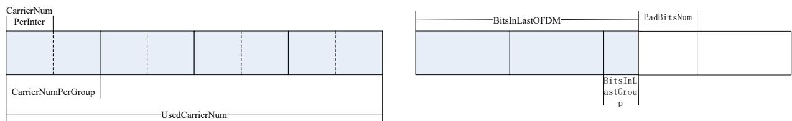  
图 21 分集拷贝参数的图示

在每个分集中，最终没有填满的group应用PadBitsNum个比特填充，具体的数据如下：第1个分集的数据应来自原始数据的第0\~PadBitsNum-1个比特，第2个分集的数据应来自原始数据的第PadBitsNum\~2\*PadBitsNum-1个比特，依次类推至第N个分集。若原始数据不够pad填充，则应对原始数据从头开始循环取数进行填充。

## 5.1.8.5.2 分集交织

如图 22所示，G1\~G6表示信道交织输出后经过PadBitsNum个比特填充的数据，G1表示第1个Group中的所有数据(BitsPerGroup)，I1表示InterOutAddr 中的第一组交织器生成的载波地址。例如，按照4次分 集 ， Group 的 循 环 移 位 参 数 为 GroupShiftNum(1,2,3,4)= (0,0,1,1) ， 每 个 Group 需 要 两 个 交 织 器(InterNumPerGroup=2)。

在第一次分集中，每个Group中的数据分别采用2个交织器进行交织，交织参数为InterOutAddr (:,1)和 InterOutAddr (:,2)，交织后的结果为G1(I1)、G1(I2)，并且G1(I1)、G1(I2)按照GroupShiftNum[1]=0按照BitsPerGroup步长进行循环移位；

在第二次分集中，每个Group中的数据分别采用2个交织器进行交织，交织参数为InterOutAddr (:,3)和 InterOutAddr (:,4)，交织后的结果为G1(I3)、G1(I4)，并且G1(I3)、G1(I4)按照GroupShiftNum[2]=0，按照BitsPerGroup步长进行循环移位；

在第三次分集中，每个Group中的数据分别采用2个交织器进行交织，交织参数为InterOutAddr (:,5)和 InterOutAddr (:,6)，交织后的结果为G1(I5)、G1(I6)，并且G1(I5)、G1(I6)按照GroupShiftNum[3]=1，按照BitsPerGroup步长进行循环移位；

在第四次分集中，每个Group中的数据分别采用2个交织器进行交织，交织参数为InterOutAddr (:,7)和 InterOutAddr (:,8)，交织后的结果为G1(I7)、G1(I8)，并且G1(I7)、G1(I8)按照GroupShiftNum[4]=1，按照BitsPerGroup步长进行循环移位。

完成4次分集拷贝后，形成的分集拷贝数据用于星座点映射。

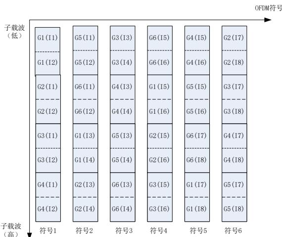  
图 22 分集拷贝示意图

## 5.1.8.5.3 比特填充

当启用动态加载模式，且模式标识为比特加载模式时，如果最后一个OFDM符号未填满，则应按照5.1.8.2 节所描述的伪随机噪声序列发生器产生填充比特，具体填充方法应符合以下流程：

a) 应设置伪随机噪声序列发生器的初始状态为全 1。

b) 当某个子载波需要填充时（假设需要p 个填充比特），随机序列发生器应移动一位，从其状态寄存器中提取最低位的p个比特以完成填充和星座点映射。

c) 对每个子载波重复以上过程，直至最后一个OFDM符号中的所有子载波均被填满。

对于下行 帧，经过上述分集拷贝流程后，各用户载荷的 符号数可能不同，因此应把每个用户的数据载荷符号数都填充到多个用户中的最大载荷符号数。所需填充比特应来源于5.1.8.2节描述的伪随机噪声序列发生器，具体填充方法应符合以下要求：

a) 应设置伪随机噪声序列发生器的初始状态为全 1；

b) 对于每个子载波，伪随机序列发生器移动一位，应从其状态寄存器中自低到高取出相应数量（即1/2/4）的比特以实现 BPSK/QPSK/16QAM 调制方式下的数据填充；

c) 各用户应独立产生并填充伪随机比特，直至各用户载荷的 OFDM符号数达到最大值。

## 5.1.9 物理层OFDM符号生成（智芯）

## 5.1.9.1 OFDM 符号格式

物理层OFDM符号格式应符合图 23的规定，OFDM符号时域采样应基于25MHz的时钟采样率。对于每个OFDM符号，数据应经过1024点IFFT变换后，取其实数，并添加由滚降间隔和保护间隔组成的循环前缀，从而形成完整的OFDM符号。

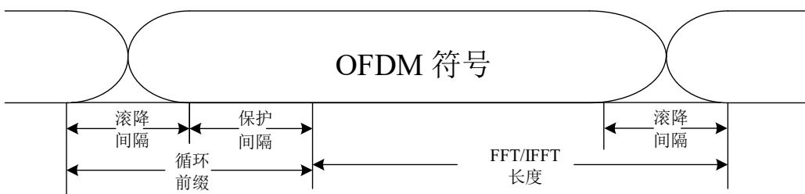  
图 23 数据 OFDM 符号格式  
OFDM符号特性应符合表 13的规定。

表 13 OFDM 符号特性

<table><tr><td>符号参数</td><td>时域点数</td><td>时间(us)</td></tr><tr><td>前导IFFT长度</td><td>1024</td><td>40.96</td></tr><tr><td>帧控制/数据载荷/训练域IFFT长度</td><td>1024</td><td>40.96</td></tr><tr><td>滚降间隔</td><td>124</td><td>4.96</td></tr><tr><td>帧控制的保护间隔</td><td>458</td><td>18.32</td></tr><tr><td>帧控制后(包括扩展帧控制、训练域TF、数据载荷)的第1个和第2个符号的保护间隔</td><td>458</td><td>18.32</td></tr><tr><td>帧控制后(包括扩展帧控制、训练域TF、数据载荷)的第3个及之后符号的保护间隔</td><td>264</td><td>10.56</td></tr></table>

## 5.1.9.2 星座点映射方式

帧控制、扩展帧控制及数据载荷应采用不同的映射方式， 其中帧控制和扩展帧控制应使用QPSK进行映射；数据载荷应使用BPSK、QPSK或16QAM的调制方式进行映射。帧控制、扩展帧控制及数据载荷采用不同调制方式时，每个子载波所能承载的比特数应符合表 14的规定。

表 14 调制特性表

<table><tr><td>数据信息类型</td><td>调制方式</td><td>每子载波承载比特数</td></tr><tr><td>帧控制、扩展帧控制</td><td>QPSK</td><td>2</td></tr><tr><td rowspan="3">数据载荷</td><td>BPSK</td><td>1</td></tr><tr><td>QPSK</td><td>2</td></tr><tr><td>16-QAM</td><td>4</td></tr></table>

## 5.1.9.3 星座点映射表

每种星座映射方式对应的比特值应符合表 15要求，输入比特到I/Q的映射应符合表 16要求。其中，x0，x1，x2，x3比特顺序由低到高，星座图映射模块输入比特流中最先输入的比特应分配给x0，其余x1，x2，x3应依次输入。

表 15 星座点映射表

<table><tr><td>映射值</td><td>16-QAM(x1x0)(x3x2)</td><td>QPSK(x1)(x0)</td><td>BPSK(x0)(---)</td></tr><tr><td>+3</td><td>11</td><td>-</td><td>-</td></tr><tr><td>+1</td><td>10</td><td>1</td><td>1</td></tr><tr><td>-1</td><td>00</td><td>0</td><td>0</td></tr><tr><td>-3</td><td>01</td><td>-</td><td>-</td></tr></table>

表 16 比特到 I/Q 映射的表

<table><tr><td>调制模式</td><td>输入比特</td><td>I 路</td><td>Q 路</td></tr><tr><td>BPSK</td><td>x0</td><td>x0</td><td>-</td></tr><tr><td>QPSK</td><td>x1x0</td><td>x0</td><td>x1</td></tr><tr><td>16-QAM</td><td>x3x2x1x0</td><td>x1x0</td><td>x3x2</td></tr></table>

## 5.1.9.4 星座点映射相位表

星座点映射相位用于对帧控制、扩展帧控制和数据载荷符号进行相位旋转，1号载波到511号载波对应的相位编号应符合附录C.1的要求。实际的相位应为每个载波对应的相位编号乘以π/4。

## 5.1.9.5 数据载荷加载模式

## 5.1.9.5.1 加载模式

单站点之间通信时，数据载荷的加载方式应支持非动态加载与动态加载两种模式。其中，动态加载模式进一步细分为子载波选择模式和比特加载模式。

以上三种模式的调制方式应符合以下要求：

分集拷贝模式：应使用TMI表确定调制参数，载荷功率应固定；

子载波选择模式：应使用TMI表确定调制参数，使用子载波选择表确定所使用的子载波，使用载荷增益字段进行载荷功率统一调整；

比特加载模式：拷贝次数应固定为 ，码率固定为 ，码块大小复用帧控制中载荷调制参数字段进行指定，应使用比特加载表确定各子载波组的使用以及调制阶数情况，载荷功率应固定；

## 5.1.9.5.2 动态加载配置表

动态加载配置表应包含实现数据载荷动态加载技术所需的参数。通过信道探测机制以及信道评估参数反馈报文，实现参数的配置选择和收发两端之间参数的握手交互。该配置表对子载波实施分组管理，每组至少应包含4个连续子载波，应支持每组4、6、8或12个子载波的配置方式。在发送的数据载荷为动态加载模式时，发送端应依据该动态加载配置表对数据载荷进行调制与发送。

## 5.1.9.5.3 子载波选择表

子载波选择表应用于子载波选择模式，即每个子载波组应使用相同的调制方式。

子载波组索引通过子载波下标计算，计算公式应为：

$$
\text { GroupIndex } = \text { floor } (\text { CarrierIndex } / \text { GroupSize })\tag{10}
$$

频段中第一个子载波对应的分组索引应按照公式（11）定义：

$$
\text { FirstGroupIndex } = \text { floor(FirstCarrierIndex / GroupSize) }\tag{11}
$$

最后一个子载波对应的分组索引应按照公式（12）定义：

$$
\text { LastGroupIndex } = \text { floor } (\text { LastCarrierIndex } / \text { GroupSize })\tag{12}
$$

在子载波选择表中，每个子载波组应对应一个比特位，当该比特值为0时，表示不应使用该子载波组；当值为1时，表示应使用该子载波组，即为有效子载波组。

## 5.1.9.5.4 比特加载表

比特加载表用于比特加载模式，用于对每个子载波组的调制方式进行独立配置。其中，取值为0表示不使用该子载波组，取值1/2/3分别对应BPSK、QPSK和16QAM调制方式。发送端应按照有效子载波从低频至高频的顺序，依据比特加载表的配置信息，承载相应的比特数。

## 5.1.9.6 星座点映射功率归一化

发送端应采用归一化因子，对不同调制方式得到的星座点数据进行功率归一化，功率归一化因子应符合表 17的要求。

表 17 功率归一化因子

<table><tr><td>映射方式</td><td>归一化因子</td></tr><tr><td>BPSK</td><td> $1/\sqrt{1}$ </td></tr><tr><td>QPSK</td><td> $1/\sqrt{2}$ </td></tr><tr><td>16-QAM</td><td> $1/\sqrt{10}$ </td></tr></table>

## 5.1.9.7 数据载荷分集拷贝模式

数据载荷支持的分集拷贝模式应如表 18所示。分集拷贝模式表示这一帧的载荷中的物理块类型、分集拷贝次数、调制方式和编码码率。分集拷贝模式编号应在帧控制或者扩展帧控制中指定。

表 18 分集拷贝模式

<table><tr><td>模式编号</td><td>分集拷贝模式名称</td><td>物理块类型(字节)</td><td>分集次数</td><td>调制方式</td><td>码率</td></tr><tr><td>0</td><td>模式 0</td><td>520</td><td>13</td><td>BPSK</td><td>0.5</td></tr><tr><td>1</td><td>模式1</td><td>264</td><td>13</td><td>BPSK</td><td>0.5</td></tr><tr><td>2</td><td>模式2</td><td>136</td><td>13</td><td>BPSK</td><td>0.5</td></tr><tr><td>3</td><td>模式3</td><td>72</td><td>13</td><td>BPSK</td><td>0.5</td></tr><tr><td>4</td><td>模式4</td><td>520</td><td>7</td><td>BPSK</td><td>0.5</td></tr><tr><td>5</td><td>模式5</td><td>264</td><td>7</td><td>BPSK</td><td>0.5</td></tr><tr><td>6</td><td>模式6</td><td>136</td><td>7</td><td>BPSK</td><td>0.5</td></tr><tr><td>7</td><td>模式7</td><td>72</td><td>7</td><td>BPSK</td><td>0.5</td></tr><tr><td>8</td><td>模式8</td><td>520</td><td>7</td><td>QPSK</td><td>0.5</td></tr><tr><td>9</td><td>模式9</td><td>264</td><td>7</td><td>QPSK</td><td>0.5</td></tr><tr><td>10</td><td>模式10</td><td>136</td><td>7</td><td>QPSK</td><td>0.5</td></tr><tr><td>11</td><td>模式11</td><td>72</td><td>7</td><td>QPSK</td><td>0.5</td></tr><tr><td>12</td><td>模式12</td><td>520</td><td>4</td><td>QPSK</td><td>0.5</td></tr><tr><td>13</td><td>模式13</td><td>264</td><td>4</td><td>QPSK</td><td>0.5</td></tr><tr><td>14</td><td>模式14</td><td>136</td><td>4</td><td>QPSK</td><td>0.5</td></tr><tr><td>15</td><td>模式15</td><td>72</td><td>4</td><td>QPSK</td><td>0.5</td></tr><tr><td>16</td><td>模式16</td><td>520</td><td>2</td><td>QPSK</td><td>0.5</td></tr><tr><td>17</td><td>模式17</td><td>264</td><td>2</td><td>QPSK</td><td>0.5</td></tr><tr><td>18</td><td>模式18</td><td>136</td><td>2</td><td>QPSK</td><td>0.5</td></tr><tr><td>19</td><td>模式19</td><td>72</td><td>2</td><td>QPSK</td><td>0.5</td></tr><tr><td>20</td><td>模式20</td><td>520</td><td>1</td><td>QPSK</td><td>0.5</td></tr><tr><td>21</td><td>模式21</td><td>264</td><td>1</td><td>QPSK</td><td>0.5</td></tr><tr><td>22</td><td>模式22</td><td>136</td><td>1</td><td>QPSK</td><td>0.5</td></tr><tr><td>23</td><td>模式23</td><td>72</td><td>1</td><td>QPSK</td><td>0.5</td></tr><tr><td>24</td><td>模式24</td><td>520</td><td>1</td><td>16QAM</td><td>0.5</td></tr><tr><td>25</td><td>模式25</td><td>264</td><td>1</td><td>16QAM</td><td>0.5</td></tr><tr><td>26</td><td>模式26</td><td>136</td><td>1</td><td>16QAM</td><td>0.5</td></tr><tr><td>27</td><td>模式27</td><td>72</td><td>1</td><td>16QAM</td><td>0.5</td></tr><tr><td>28</td><td>模式28</td><td>520</td><td>1</td><td>16QAM</td><td>16/18</td></tr><tr><td colspan="6">注:子频段物理块数应不大于4,且同时保证载荷符号数不超过511。</td></tr></table>

## 5.1.9.8 前导符号生成

前导应由SYNCP与SYNCM两部分组成，除OFDMA-SACK、TDA-SACK的SYNCP符号数应固定为10.5个外，其余帧结构的SYNCP符号数应在5.5至10.5个的范围内可配，SYNCM符号数应固定为2.5个。SYNCP的定义应如公式（13）所示。

$$
S _ {\text {synCP}} (n) = \frac {1 0 ^ {3 / 2 0}}{\sqrt {\mathrm{N}}} \sum_ {k \in C} \cos \left(\frac {2 \pi n k}{N} + \frac {\pi}{8} \varphi ((\mathrm{k} + \mathrm{m}) \% 5 1 2) \right.\tag{13}
$$

其中， 为可用的载波集合，N取1024。m为初始相位标号，不同频段的具体m值应符合表 19的规定。

另外，前导SYNCP也可通过IFFT产生，IFFT的公式见公式（14），

$$
x (n) = \frac {1}{N} \sum_ {k = 0} ^ {N - 1} X (k) e ^ {j \frac {2 \pi n k}{N}}, \quad 0 \leq n \leq N - 1\tag{14}
$$

取复信号，见公式（错误!未找到引用源。），

$$
X (k) = \left\{ \begin{array}{l l} e ^ {j \frac {\pi}{8} \varphi ((k + m) \% 5 1 2)} & \text { if } k \in C, 0 \leq k \leq N - 1 \\ 0 & \text { else } \end{array} \right.\tag{15}
$$

可以得到公式（错误!未找到引用源。），

$$
S _ {s y n C P} (n) = 1 0 ^ {3 / 2 0} \cdot \sqrt {N} \cdot \operatorname{Re} \left\{I F F T (X (k)) \right\}\tag{16}
$$

即，SYNCP可由X(k)的IFFT变换取实部得到。

SYNCM=-SYNCP。其中，前导开始的0.5个SYNCP应是SYNCP的后半部分，最后的0.5个SYNCM应是SYNCM的前半部分。

## 5.1.9.9 前导相位表

前导相位用于对前导的SYNCP进行相位旋转，从1号载波到511号载波的相位编号应如附录C.2所示。实际的相位应为每个载波对应的相位编号乘以 。

## 5.1.9.10 训练域结构及生成

训练域 TF 用于不同的帧结构中，应由 OFDM 符号加入循环前缀后组成，OFDM 符号数量由帧控制字段指定，带载荷的帧结构中 TF 最多可支持12个符号。TF 结构示意图应如图 24所示。

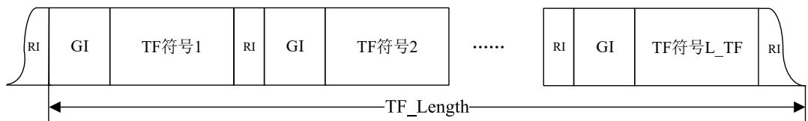  
图 24 TF 训练域结构示意图

TF的每个OFDM符号均应使用前导相位表做子载波相位旋转。为区别于前导，应引入子载波上的循环移位机制，即训练域的第i个子载波的相位应取自前导的第mod(k+m,512)个子载波的相位，其中k=0,1,2…511。循环移位子载波偏移量m应为466。

## 5.1.9.11 窗函数

前导、帧控制、扩展帧控制、训练域及数据载荷的前RI个数据与后RI个数据应做加窗处理，窗函数的定义应符合附录C.3的要求。

对于前导的数据，应对整个数据（SYNCP加SYNCM）加窗，其前部的RI个数据应乘以 $w _ { r i s e } [ n ]$ 且不与任何信号重叠，其后部的RI个数据应乘以 $w _ { \it f a l l } [ n ]$ 并与帧控制第一个OFDM符号的前部的RI个数据乘以 $w _ { r i s e } [ n ]$ 相加；对于帧控制、扩展帧控制、训练域以及数据载荷是每个OFDM符号都应加CP并加窗，加窗操作应包含IFFT块和它的循环前缀的整个OFDM符号，每个OFDM符号的前部的RI个数据乘以$w _ { r i s e } [ n ]$ 和它前面一个OFDM符号的后部的RI个数据乘以 $w _ { \it f a l l } [ n ]$ ，作加法累加到一起，即前后OFDM符号有重叠，最后一个OFDM符号的后部的RI个数据应乘以 $w _ { \it f a l l } [ n ]$ 且不与任何信号重叠。

## 5.1.10 通信频段表 （智芯）

## 5.1.10.1 通信频段与载波屏蔽表

高速载波通信支持的频段应符合表 19要求。

表 19 通信频段

<table><tr><td>频段</td><td>频段范围(MHz)</td><td>载波起始编号</td><td>载波截止编号</td><td>初始相位标号 m</td></tr><tr><td>0</td><td>1.953~11.96</td><td>80</td><td>490</td><td>346</td></tr><tr><td>1</td><td>2.441~5.615</td><td>100</td><td>230</td><td>0</td></tr><tr><td>2</td><td>0.781~2.930</td><td>32</td><td>120</td><td>0</td></tr><tr><td>3</td><td>保留</td><td>-</td><td>-</td><td>-</td></tr><tr><td>4</td><td>0.781~5.615</td><td>32</td><td>230</td><td>113</td></tr><tr><td>5</td><td>0.781~11.96</td><td>32</td><td>490</td><td>375</td></tr><tr><td>6</td><td>6.08~11.96</td><td>250</td><td>490</td><td>254</td></tr><tr><td>7</td><td>保留</td><td>-</td><td>-</td><td>-</td></tr></table>

前导、帧控制以及扩展帧控制的工作频段宜支持频段1、2和4。

接收端应具备在两个频段上同时检测同步信号的能力，其中两个频段的组合宜包括频段1和频段2、频段1和频段4、频段2和频段4，并优先选用频段1与频段2的组合。

设备应能够支持载波的任意组合配置。载波屏蔽表用于定义可用于数据调制的频段范围，其覆盖范围应包含前导、帧控制、扩展帧控制、训练域及数据载荷等帧结构的所有组成部分。在电力站点用电信息采集系统的高速载波通信方案中，支持承载有效数据的子载波数量最大为490个，该数值仅统计有用子载波，屏蔽掉的子载波不计入总数。其中 号子载波及 号子载波不应使用。载波屏蔽表定义为一个包含 个元素的一维数组，对应编号 到 的 个子载波。数组元素值为 表示对应子载波启用，值为0则表示该子载波被屏蔽。

推荐采用的一组子载波配置为连续启用80号至490号子载波，中间无屏蔽。此外，还推荐五组扩展配置方案，分别为： 号至 号、 号至 号、 号至 号、 号至 号、以及 号至 号子载波，上述各组均采用连续启用方式，未对中间任意子载波进行屏蔽处理。在被屏蔽的子载波上不应发送任何信号，以节约发射功率，并有效避免对其它通信系统的干扰。具体调制方式和码率应由分集拷贝模式决定。

## 5.1.10.2 DL-OFDMA 的 RU 定义

DL\_OFDMA 机制应把电力线载波最大可用频段 0.7MHz\~12MHz（对应子载波编号 32\~490）划分成最小基础资源单位(Basic Resource Unit，简称BRU)，不同BRU 之间无需预留保护频率间隔。系统实际使用的资源单位为 RU(Resource Unit，简称 RU)，不同的 RU 可分配给不同的站点。基础 BRU 为BRU0\~BRU7，作为信道探测基本单元使用。系统实际分配的RU 应包括两个或者两个以上BRU。系统实际分配的 RU 应为 RU0-RU15。

BRU和RU的划分应符合图 25的规定：

<table><tr><td colspan="9">RU索引和子载波索引范围</td><td></td></tr><tr><td>基础RU站点信道SNR评估</td><td>BRU0[32,79]</td><td colspan="2">BRU1[80,120]</td><td>BRU2[121,175]</td><td>BRU3[176,230]</td><td>BRU4[231,295]</td><td>BRU5[296,360]</td><td>BRU6[361,425]</td><td>BRU7[426,490]</td></tr><tr><td rowspan="7">OFDMA多站点的RU分配</td><td colspan="3">RU0[32,120]</td><td colspan="2">RU1[121,230]</td><td colspan="2">RU2[231,360]</td><td colspan="2">RU3[361,490]</td></tr><tr><td></td><td colspan="3">RU4[80,175]</td><td colspan="2">RU5[176,295]</td><td colspan="2">RU6[296,425]</td><td></td></tr><tr><td colspan="4">RU7[32,175]</td><td colspan="3">RU8[176,360]</td><td colspan="2"></td></tr><tr><td></td><td colspan="4">RU9[80,230]</td><td colspan="3">RU10[231,425]</td><td></td></tr><tr><td colspan="2"></td><td colspan="4">RU11[121,295]</td><td colspan="3">RU12[296,490]</td></tr><tr><td colspan="5">RU13[32,230]</td><td colspan="4">RU14[231,490]</td></tr><tr><td colspan="2"></td><td colspan="5">RU15[121,360]</td><td colspan="2"></td></tr></table>

图 25 OFDMA BRU 和 RU 划分示意图  
其中，具体BRU 载波范围应符合表 20的定义：

表 20 BRU 频率范围定义

<table><tr><td colspan="4">基础 BRU 参数表</td></tr><tr><td>BRU 索引</td><td>起始载波索引</td><td>终止载波索引</td><td>BRUSize</td></tr><tr><td>0</td><td>32</td><td>79</td><td>48</td></tr><tr><td>1</td><td>80</td><td>120</td><td>41</td></tr><tr><td>2</td><td>121</td><td>175</td><td>55</td></tr><tr><td>3</td><td>176</td><td>230</td><td>55</td></tr><tr><td>4</td><td>231</td><td>295</td><td>65</td></tr><tr><td>5</td><td>296</td><td>360</td><td>65</td></tr><tr><td>6</td><td>361</td><td>425</td><td>65</td></tr><tr><td>7</td><td>426</td><td>490</td><td>65</td></tr></table>

其中，具体RU载波范围应符合表 21的定义：

表 21 RU 频率范围定义

<table><tr><td>RU索引</td><td>起始载波索引</td><td>终止载波索引</td><td>起始频率/MHz</td><td>结束频率/MHz</td><td>子载波数</td><td>带宽/MHz</td></tr><tr><td>RU0</td><td>32</td><td>120</td><td>0.781</td><td>2.93</td><td>89</td><td>2.173</td></tr><tr><td>RU1</td><td>121</td><td>230</td><td>2.954</td><td>5.615</td><td>110</td><td>2.686</td></tr><tr><td>RU2</td><td>231</td><td>360</td><td>5.64</td><td>8.789</td><td>130</td><td>3.174</td></tr><tr><td>RU3</td><td>361</td><td>490</td><td>8.814</td><td>11.9629</td><td>130</td><td>3.174</td></tr><tr><td>RU4</td><td>80</td><td>175</td><td>1.953</td><td>4.273</td><td>96</td><td>2.344</td></tr><tr><td>RU5</td><td>176</td><td>295</td><td>4.297</td><td>7.202</td><td>120</td><td>2.930</td></tr><tr><td>RU6</td><td>296</td><td>425</td><td>7.227</td><td>10.376</td><td>130</td><td>3.174</td></tr><tr><td>RU7</td><td>32</td><td>175</td><td>0.781</td><td>4.273</td><td>144</td><td>3.516</td></tr><tr><td>RU8</td><td>176</td><td>360</td><td>4.297</td><td>8.789</td><td>185</td><td>4.517</td></tr><tr><td>RU9</td><td>80</td><td>230</td><td>1.953</td><td>5.615</td><td>151</td><td>3.687</td></tr><tr><td>RU10</td><td>231</td><td>425</td><td>5.640</td><td>10.376</td><td>195</td><td>4.761</td></tr><tr><td>RU11</td><td>121</td><td>295</td><td>2.954</td><td>7.202</td><td>175</td><td>4.272</td></tr><tr><td>RU12</td><td>296</td><td>490</td><td>7.227</td><td>11.963</td><td>195</td><td>4.761</td></tr><tr><td>RU13</td><td>32</td><td>230</td><td>0.781</td><td>5.615</td><td>199</td><td>4.858</td></tr><tr><td>RU14</td><td>231</td><td>490</td><td>5.640</td><td>11.963</td><td>260</td><td>6.348</td></tr><tr><td>RU15</td><td>121</td><td>360</td><td>2.954</td><td>8.789</td><td>240</td><td>5.859</td></tr></table>

## 5.2 高速载波物理层服务

## 5.2.1 高速载波物理层服务参考模型

高速载波物理层应由接收/发送机获取高速载波物理层常量（包括高速载波物理层服务信息、可维可测信息等），并通过高速载波物理层服务管理与数据链路层进行交互。高速载波物理层服务模型如图26所示。

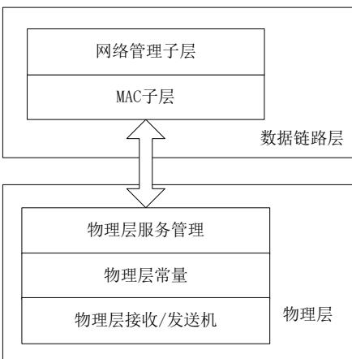  
图 26 高速载波物理层服务模型

## 5.2.2 高速载波物理层基本服务

## 5.2.2.1 发射机信号开始发送状态原语

在发射端发送第一个时域数据时，应将发送状态上报给MAC层，发送状态定义应符合表 22要求。

表 22 发射机信号开始发送状态原语

<table><tr><td>名称</td><td>类型</td><td>有效范围</td><td>描述</td></tr><tr><td>发送状态</td><td>布尔</td><td>0或1</td><td>当前发射机是否开始进行数据发送:1表示开始发送第一点数据;0表示其他状态</td></tr></table>

## 5.2.2.2 发射机信号发送完成状态原语

在发射端发送数据完成时，应将发送完成状态上报给MAC层，发送完成状态定义应符合表 23要求。

表 23 发射机信号发送完成状态原语

<table><tr><td>名称</td><td>类型</td><td>有效范围</td><td>描述</td></tr><tr><td>发送完成标志</td><td>布尔</td><td>0 或 1</td><td>当前发射机是否完成数据发送:1 表示完成数据发送;0 表示其他状态</td></tr></table>

## 5.2.2.3 接收机信号接收开始状态原语

当接收机检测到前导时，应将状态上报给MAC层，检测信号标志状态定义应符合表 24要求。

表 24 接收机信号接收开始状态原语

<table><tr><td>名称</td><td>类型</td><td>有效范围</td><td>描述</td></tr><tr><td>检测信号标志</td><td>布尔</td><td>0 或 1</td><td>当前接收机是否接收到信号:1 表示接收机检测到前导;0 表示其他状态</td></tr></table>

## 5.2.2.4 接收机帧控制接收完成原语

当接收机完成帧控制接收后，应将帧控制译码状态及帧控制报文上报给MAC层，接收机帧控制接收完成状态定义应符合表 25要求。

表 25 接收机帧控制接收完成原语

<table><tr><td>名称</td><td>类型</td><td>有效范围</td><td>描述</td></tr><tr><td>帧控制完成标志</td><td>布尔</td><td>0 或 1</td><td>1 表示帧控制报文 CRC 校验正确;0 表示其他状态</td></tr><tr><td>帧控制报文</td><td>字节</td><td>-</td><td>帧控制内容</td></tr></table>

## 5.2.2.5 接收机数据载荷接收完成原语

当接收机完成数据载荷接收后，应将状态及数据载荷报文上报给MAC层，接收机数据载荷完成状态定义应符合表 26要求。

表 26 接收机数据载荷接收完成原语

<table><tr><td>名称</td><td>类型</td><td>有效范围</td><td>描述</td></tr><tr><td>数据载荷接收完成标志</td><td>布尔</td><td>0或1</td><td>1表示数据载荷CRC校验正确;0表示其他状态</td></tr><tr><td>数据载荷</td><td>字节</td><td>-</td><td>数据载荷内容,不同长度的数据载荷上报数据大小不同</td></tr></table>

## 5.2.2.6 噪声功率原语

统计网络空闲或静默时的噪声功率，应上报给MAC层。噪声功率的取值范围和含义应符合表 27要求。

表 27 噪声功率原语

<table><tr><td>名称</td><td>类型</td><td>有效范围</td><td>描述</td></tr><tr><td>噪声功率</td><td>1 字节</td><td>0~255</td><td>噪声功率</td></tr></table>

## 5.2.2.7 信号传输衰减原语

获取信号在两个站点间传输过程的信号传输衰减，应上报给MAC层。信号传输衰减的格式应符合表 28要求。

表 28 信号传输衰减原语

<table><tr><td>名称</td><td>类型</td><td>有效范围</td><td>描述</td></tr><tr><td>信号传输衰减</td><td>512字节</td><td>-</td><td>每个载波的信号能量衰减</td></tr></table>

## 5.2.2.8 信噪比/平均信噪比原语

通过前导序列在频域上计算载波上信号与噪声功率之比，可以得到每个可用载波上的信噪比（ ），再计算出平均信噪比，同时上报给 层。每个子载波的信噪比和平均信噪比的格式应符合表 29要求。

表 29 信噪比/平均信噪比原语

<table><tr><td>名称</td><td>类型</td><td>有效范围</td><td>描述</td></tr><tr><td>平均信噪比</td><td>1字节</td><td>-31~+31</td><td>通信使用载波范围的平均信噪比</td></tr><tr><td>每个载波的信噪比</td><td>512字节</td><td>-</td><td>每个载波的信噪比</td></tr></table>

## 5.2.2.9 时钟偏差估计结果原语

在站点未入网状态下，应通过高速载波物理层估计时钟偏差；在站点已入网状态下，应通过高速载波物理层网络时钟，估计本站点与网络时钟的偏差，并上报给 层。上报的时钟偏差估计结果的取值范围和含义应符合表 30要求。

表 30 时钟偏差估计结果原语

<table><tr><td>名称</td><td>类型</td><td>有效范围</td></tr><tr><td>高速载波物理层时钟偏差估计结果</td><td>2字节</td><td>-200~+200</td></tr></table>

## 6 无线物理层

## 6.1 无线物理层一般要求

## 6.1.1 概述（门海）

发送端：从数据链路层接收数据，经过系列的信号处理和变换，应采用OFDM调制方式对编码后的数据进行处理并将形成的OFDM信号送入模拟前端并发送到空中；

接收端：将接收到的信号做相应的解调解码处理，最终将模拟信号还原为解码后数据信息，并送到数据链路层进行后续协议解析。

## 6.1.2 物理层整体架构（门海）

## 6.1.2.1 物理层收发架构

物理层收发架构如图 27所示。

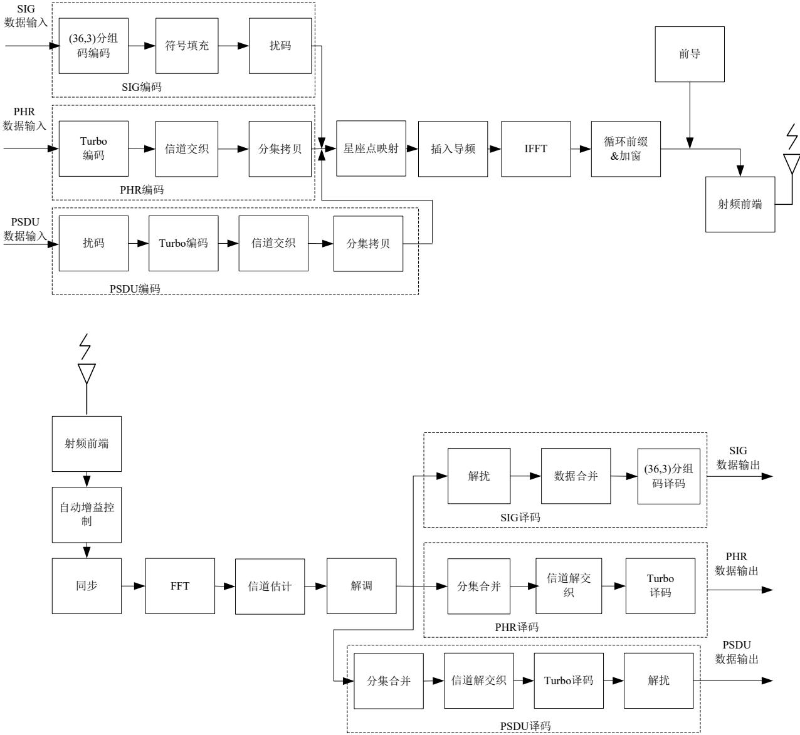  
图 27 物理层整体架构框图

## 6.1.2.2 发射端流程

无线发送端流程，应符合以下要求：

a）发送端从数据链路层接收数据后，应通过三条独立的链路分别对SIG域数据、PHR数据和PSDU数据进行处理；

b）将SIG域信息按照分组码进行编码、符号填充和加扰处理；

c）将PHR信息进行Turbo编码、打孔、交织、分集拷贝处理；

d）将PSDU信息进行加扰、Turbo编码、打孔、交织、分集拷贝处理；

e）将经过处理的SIG、PHR、PSDU信息进行映射、加导频载波（Pilot）、直流（DC）载波和两端保护载波（Guard Tones）、做N点IFFT，完成频域到时域的变换；

f）加入前导后，加入循环前缀；

g）进行加窗、DAC，经过上变频和功放，最后通过天线发送出去。

## 6.1.2.3 接收端流程

无线接收端流程，应符合以下要求：

a）接收数据经过LNA、下变频、滤波、得到基带数据；

b）完成同步，进行FFT变换得到频域数据；

c）使用频域数据（训练序列、导频）进行信道估计和频偏估计；

d）进行数据解调；

e）SIG域经过数据合并、（36,3）分组译码、解扰、解码后得到对应信息；

f）PHR经过分集合并、解交织、解打孔、Turbo译码，最终得到PHR信息；

g）PSDU经过分集合并、解交织、解打孔、Turbo译码、解扰，得到PSDU信息。

## 6.1.3 通信模式和带宽（门海）

物理层OFDM符号应支持三种模式，Option1的FFT点数为128，Option2的FFT点数为64，Option3的FFT点数为32，三种OFDM模式的符号长度应都为122.88 微秒。物理层3种通信模式的通信带宽、FFT点数及有效载波等参数应符合表 31要求。

表 31 通信模式和带宽

<table><tr><td>Parameter</td><td>Option 1</td><td>Option 2</td><td>Option 3</td></tr><tr><td>Nominal bandwidth(kHz)</td><td>854.5</td><td>431.3</td><td>170.9</td></tr><tr><td>Channel spacing(kHz)</td><td>1000</td><td>500</td><td>200</td></tr><tr><td>FFT Size</td><td>128</td><td>64</td><td>32</td></tr><tr><td>Active tones</td><td>104</td><td>52</td><td>20</td></tr><tr><td>#Pilot tones</td><td>8</td><td>4</td><td>2</td></tr><tr><td>#Data tones</td><td>96</td><td>48</td><td>18</td></tr></table>

## 6.1.4 物理层数据结构（海思）

## 6.1.4.1 物理层帧结构

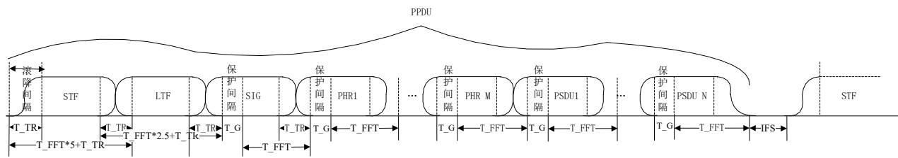  
图 28 PPDU 帧结构图

物理层发送的PPDU信号帧结构应如图 28所示。PPDU应由前导、SIG、PHR以及PSDU组成。其中，前导应分为短训练域（ ）和长训练域（ ）两部分，二者均应为周期序列。 信号应支持三种工作模式，分别为：Option1对应1MHz带宽，Option2对应500KHz带宽，Option3对应200KHz带宽。

## 6.1.4.2 相对功率

PPDU中各组成部分有效子载波平均功率相对PSDU数据载波平均功率提升应符合表 32要求。

表 32 相对功率表

<table><tr><td>类型</td><td>相对功率(dB)</td></tr><tr><td>STF</td><td>4</td></tr><tr><td>LTF</td><td>2</td></tr><tr><td>Pilot</td><td>2</td></tr></table>

## 6.1.5 SIG前向纠错码（海思）

SIG携带3-bit信息，用于指示PHR的调制编码方式，比特定义应如表 33所示。

表 33 SIG 内容与 PHR 的调制编码方式

<table><tr><td>SIG 内容</td><td>PHR_MCS</td><td>分集次数</td><td>调制方式</td><td>码率</td></tr><tr><td>000</td><td>0</td><td>6</td><td>BPSK</td><td>1/2</td></tr><tr><td>001</td><td>1</td><td>4</td><td>BPSK</td><td>1/2</td></tr><tr><td>010</td><td>2</td><td>3</td><td>BPSK</td><td>1/2</td></tr><tr><td>011</td><td>3</td><td>2</td><td>BPSK</td><td>1/2</td></tr><tr><td>100</td><td>4</td><td>2</td><td>QPSK</td><td>1/2</td></tr><tr><td>101</td><td>5</td><td>1</td><td>QPSK</td><td>1/2</td></tr><tr><td>110</td><td>6</td><td>1</td><td>QPSK</td><td>4/5</td></tr><tr><td>111</td><td>保留字</td><td>-</td><td>-</td><td>-</td></tr></table>

SIG前向纠错码为(36,3)分组码生成矩阵应如图 29所示。

$$
\begin{array}{l} 1 0 1 0 0 0 1 1 0 0 1 1 1 0 0 1 1 0 1 1 0 0 1 0 0 1 1 1 1 1 0 1 1 0 1 1 \\ 0 1 1 0 1 0 0 1 1 1 1 1 0 1 1 1 0 1 1 0 0 1 1 1 0 0 0 0 1 0 1 0 0 0 1 1 \\ 0 0 1 1 1 1 0 0 1 0 0 0 1 0 1 1 1 0 1 0 1 0 1 1 1 1 0 1 0 0 1 0 1 1 1 0 \end{array}
$$

图 29 SIG(36, 3)分组纠错码生成矩阵  
SIG前向纠错码流程应如图 30所示。

<table><tr><td>3比特</td><td>(36,3)分组编码</td><td>36比特</td><td>符号填充</td><td>可用子载波数×SIG帧符号个数比特</td><td>加扰</td><td>可用子载波数×SIG帧符号个数比特</td></tr></table>

图 30 SIG 前向纠错码流程图

SIG编码调制方式应符合表 34的要求。SIG在编码后为36比特,应在每个Option中，都应直接重复到填满所用的 符号。

表 34 SIG 的调制编码方式

<table><tr><td>参数</td><td>Option1</td><td>Option2</td><td>Option3</td></tr><tr><td>数据载波数</td><td>96</td><td>48</td><td>18</td></tr><tr><td>SIG 的调制编码方式</td><td>(36,3), BPSK</td><td>(36,3), BPSK</td><td>(36,3), BPSK</td></tr><tr><td>SIG 符号数</td><td>1</td><td>2</td><td>2</td></tr></table>

SIG经过编码和填充符号后的比特需加扰，扰码方法应按照6.1.7.2的要求执行，初始种子应为全1。SIG中，两个带CP的OFDM符号的交界处应加窗，加窗方法应符合6.1.9.5节要求SIG采用BPSK模式，星座点映射应符合6.1.8.2节要求，相位映射应符合6.1.8.4节要求。

## 6.1.6 PHR前向纠错码（海思）

## 6.1.6.1 PHR 前向纠错码组成及流程

PHR前向纠错码应由Turbo编码、信道交织和分集拷贝组成。

在物理层OFDM系统中，PHR符号传输的信息位应为128比特。PHR前向纠错码流程应如图 31所示。

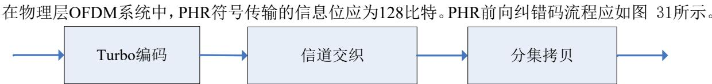  
图 31 PHR 前向纠错码流程图

## 6.1.6.2 PHR Turbo 编码

的 编码块长度应为 ，应支持 和 两种码率。其中前 比特应为信息码，后面应为校验码。

具体编码流程应符合6.1.7.3节的要求。

## 6.1.6.3 PHR 的 MCS 模式

PHR的MCS模式应符合6.1.5节中表 33的要求，每种OFDM模式和MCS模式PHR的数据速率见表35。

表 35 PHR 的数据速率

<table><tr><td>Parameters</td><td>Option 1</td><td>Option 2</td><td>Option 3</td></tr><tr><td>PHR MCS0(kb/s)</td><td>52.1</td><td>26</td><td>-</td></tr><tr><td>PHR MCS1(kb/s)</td><td>78.1</td><td>39.1</td><td>-</td></tr><tr><td>PHR MCS2(kb/s)</td><td>104.2</td><td>52.1</td><td>19.5</td></tr><tr><td>PHR MCS3(kb/s)</td><td>156.2</td><td>78.1</td><td>29.3</td></tr><tr><td>PHR MCS4(kb/s)</td><td>312.5</td><td>156.2</td><td>58.6</td></tr><tr><td>PHR MCS5(kb/s)</td><td>625</td><td>312.5</td><td>117.2</td></tr><tr><td>PHR MCS6(kb/s)</td><td>1000</td><td>500</td><td>187.5</td></tr></table>

## 6.1.6.4 PHR 信道交织

在多次拷贝和传送到信道之前，PHR信道交织应将Turbo编码器输出的信息比特和校验比特进行随机化。

信息比特应分成4个子块，每个子块大小为K/4比特。信息比特按列写入K/4行4列的矩阵，按行读出。第一轮读(0, StepSize, 2\*StepSize…)行直到矩阵尾部；第二轮读(1, 1+StepSize, 1+2\*StepSize…)行直到矩阵尾部；经过StepSize轮后全部行读取完毕。

校验比特的交织：校验比特分成4个子块，每个子块大小为T=(N-K)/4比特。校验比特按列写入T行4列的矩阵，按行读出。第一轮读(offset, offset+StepSize, offset+2\*StepSize…) mod T行；第二轮读(offset+1,offset+1+StepSize, offset+1+2\*StepSize…) mod T行，每轮读T/StepSize行，经过StepSize轮后全部T行读取完毕。

信道交织中使用的参数应满足表 36要求，其中PHR应为PB16模式，PSDU应兼容所有PB模式。

表 36 信息比特交织参数表

<table><tr><td rowspan="2">PB(byte)</td><td colspan="4">1/2 码率</td><td colspan="4">4/5 码率</td></tr><tr><td>编码块 (byte)</td><td>T=(N-K)/4</td><td>交织偏移</td><td>交织步长</td><td>编码块 (byte)</td><td>T=(N-K)/4</td><td>交织偏移</td><td>交织步长</td></tr><tr><td>16</td><td>32</td><td>32</td><td>16</td><td>4</td><td>20</td><td>8</td><td>4</td><td>4</td></tr><tr><td>40</td><td>80</td><td>80</td><td>40</td><td>4</td><td>50</td><td>20</td><td>10</td><td>5</td></tr><tr><td>72</td><td>144</td><td>144</td><td>72</td><td>16</td><td>90</td><td>36</td><td>18</td><td>18</td></tr><tr><td>136</td><td>272</td><td>272</td><td>136</td><td>16</td><td>170</td><td>68</td><td>34</td><td>17</td></tr><tr><td>264</td><td>528</td><td>528</td><td>264</td><td>16</td><td>330</td><td>132</td><td>66</td><td>12</td></tr><tr><td>520</td><td>1040</td><td>1040</td><td>520</td><td>16</td><td>650</td><td>260</td><td>130</td><td>13</td></tr></table>

注：信息比特数为 K，编码比特数为N，校验比特数为N-K，T=(N-K)/4。

信息比特和校验比特之间的交织：对于1/2码率，前4位应为信息比特，后4位应为校验比特，以此类推；对于4/5码率，首先应是2个4位的信息比特，然后应是1个4位的校验比特，最后应是2个4位的信息比特，以此类推。

半字节移位：无论信息比特还是校验比特，每两个半字节调整一次顺序，应符合表 37要求。

表 37 半字节移位

<table><tr><td>输出半字节序号</td><td>移位模式</td></tr><tr><td>1 or 2</td><td>b0b1b2b3</td></tr><tr><td>3 or 4</td><td>b3b0b1b2</td></tr><tr><td>5 or 6</td><td>b2b3b0b1</td></tr><tr><td>7 or 8</td><td>b1b2b3b0</td></tr><tr><td colspan="2">注:b0表示比特来自区块1,b1表示比特来自区块2,b2表示比特来自区块3,b3表示比特来自区块4。比特串行输出时,从左向右依次输出。</td></tr></table>

## 6.1.6.5 PHR 分集拷贝

## 6.1.6.5.1 分集拷贝流程

分集拷贝用于将原始信号进行分集和映射。

当分集次数为 时，如果最后 个 符号没有填满，则应利用重复数据将其填满。具体填充步骤如下：假设最后的 符号可填入 个比特，则将数据最开始的 个比特依次填入剩余子载波。

分集拷贝根据所选的模式中不同的拷贝次数，应将原始数据按照数据载荷分集拷贝过程进行处理。如果InData(i)表示信道交织器输出的比特，分集拷贝输出的比特序列OutData(i)将由下面得出。分集拷贝参数图示如图 32所示，具体参数定义以及相关参数运算参见附录B。

在每个分集中，最终没有填满的group应用PadBitsNum个比特填充，具体的数据如下：第1个分集的数据来自原始数据的第0\~PadBitsNum-1个比特，第2个分集的数据来自原始数据的第PadBitsNum\~2\*PadBitsNum-1个比特，依次类推至第N个分集。

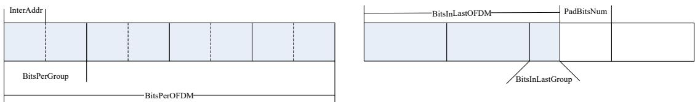  
图 32 分集拷贝参数的图示

## 6.1.6.5.2 分集交织

如图 33所示，G1表示第1个Group中的所有数据(BitsPerGroup)，I1表示InterOutAddr 中的第一组交织器生成的载波地址。例如，若按照4次分集，Group的循环移位参数为GroupShiftNum(1,2,3,4)=(0,0,1,1)，每个Group需要两个交织器(InterNumPerGroup=2)。

在第一次分集中，每个Group中的数据分别采用2个交织器进行交织，交织参数为InterOutAddr (:,1)和 InterOutAddr (:,2)，交织后的结果为G1(I1)、G1(I2)，并且G1(I1)、G1(I2)按照GroupShiftNum[1]=0按照BitsPerGroup步长进行循环移位；

在第二次分集中，每个Group中的数据分别采用2个交织器进行交织，交织参数为InterOutAddr (:,3)和 InterOutAddr (:,4)，交织后的结果为G1(I3)、G1(I4)，并且G1(I3)、G1(I4)按照GroupShiftNum[2]=0，按照BitsPerGroup步长进行循环移位；

在第三次分集中，每个Group中的数据分别采用2个交织器进行交织，交织参数为InterOutAddr (:,5)和 InterOutAddr (:,6)，交织后的结果为G1(I5)、G1(I6)，并且G1(I5)、G1(I6)按照GroupShiftNum[3]=1，按照BitsPerGroup步长进行循环移位；

在第四次分集中，每个Group中的数据分别采用2个交织器进行交织，交织参数为InterOutAddr (:,7)和 InterOutAddr (:,8)，交织后的结果为G1(I7)、G1(I8)，并且G1(I7)、G1(I8)按照GroupShiftNum[4]=1，按照BitsPerGroup步长进行循环移位。

其中交织器地址InterOutAddr的计算详见附录B.4。

完成4次分集拷贝后，形成的分集拷贝数据用于星座点映射。

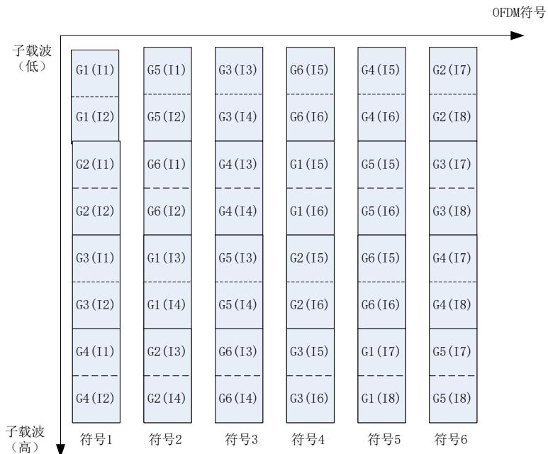  
图 33 分集拷贝示意图

## 6.1.7 PSDU前向纠错码（思凌科）

## 6.1.7.1 PSDU 前向纠错码组成及流程

PSDU的前向纠错码应由加扰、Turbo编码、信道交织和分集拷贝组成，其流程应符合图 34的要求。

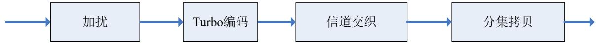  
图 34 PSDU 前向纠错码流程图

## 6.1.7.2 PSDU 扰码

PSDU应通过和重复伪随机噪声序列进行“异或”运算完成加扰，该序列应由公式（17）给出的扰码多项式生成。

$$
S (x) = x ^ {1 0} + x ^ {3} + 1\tag{17}
$$

在开始处理每个PSDU时，扰码多项式的初始值应全部设置为1，每输入一个数据，扰码多项式应左移一位，并将它的第3位和第10位做异或运算，输出的结果与输入数据应再做异或运算，即可得到输出数据。加扰实现流程应符合图 35要求。

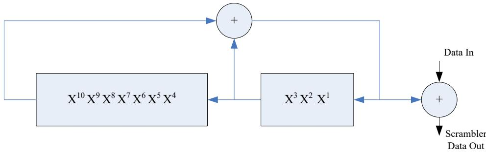

图 35 加扰流程图

## 6.1.7.3 PSDU Turbo 编码

PSDU应支持PB16，PB40，PB72，PB136，PB264，PB520六种模式，每个模式应支持1/2，4/5两种码率，且应仅支持1个PB块。

## （1） 编码模块

Turbo编码应由2个相同的分量编码器（ENC1，ENC2）组成，每输入一对信息比特 $( \begin{array} { l l } { u _ { 1 } } & { u _ { 2 } } \\ { } & { } \end{array} )$ 9应输出相应的系统比特 $( \begin{array} { l l } { u _ { 1 } } & { u _ { 2 } } \\ { } & { } \end{array} )$ 和校验比特 $( \begin{array} { l l } { p } & { , \ q } \\ { } & { } \end{array} )$ 。Turbo编码器架构应符合图 36要求。

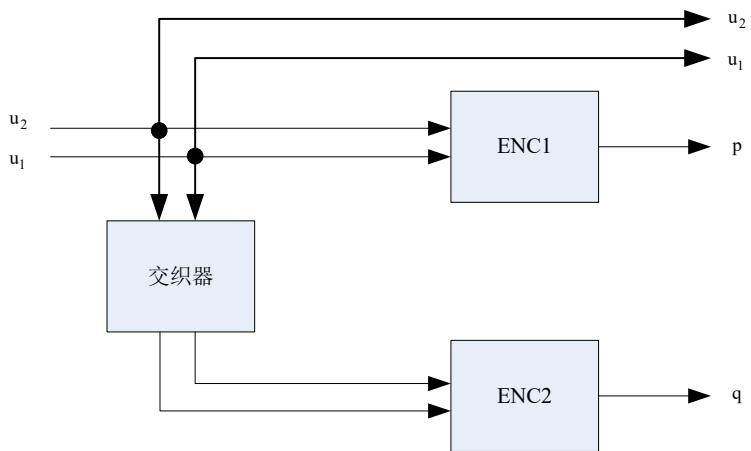  
图 36 Turbo 编码器架构

ENC1和ENC2应使用8状态编码器，输入数据流的第一个比特位应映射到 $u _ { 1 }$ ，第二个比特位应映射到 $u _ { 2 }$ ，后续比特位以此类推。在一个ENC中，每输入一对比特位，应对应输出一个校验位。校验位 ${ ( ~ p } { }$ ）的计算应符合图 37要求。

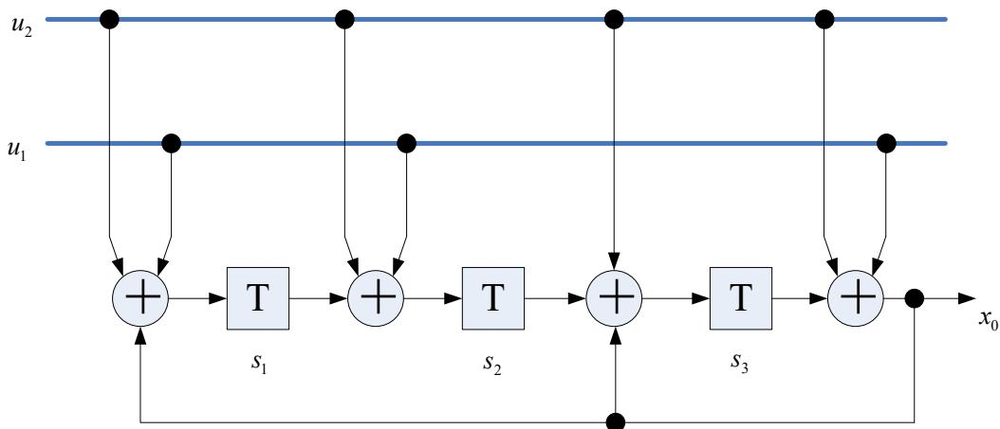  
图 37 ENC1/ENC2 编码架构  
每个成员码编码器应遵循下述算法：

a) 寄存器初始状态应按公式（18）进行设置，

$$
S 0 = \left[ S _ {0 1}, S _ {0 2}, S _ {0 3} \right]\tag{18}
$$

其初始状态应为 ；

b) 信息比特应持续输入至分量编码器（ENC2应输入交织后的信息比特），直至最后一位。此过程所得编码结束时的寄存器末状态应按公式（19）计算与定义。

$$
S N = \left[ S _ {N 1}, S _ {N 2}, S _ {N 3} \right]\tag{19}
$$

c) 定义矩阵M，当PB\_Size为520，72，16时，应按公式（20）定义：

$$
M = \left[ \begin{array}{c c c} 0 & 0 & 1 \\ 1 & 0 & 1 \\ 1 & 1 & 1 \end{array} \right]\tag{20}
$$

当PB\_Size为264，40时，应按公式（21）定义：

$$
M = \left[ \begin{array}{c c c} 1 & 0 & 1 \\ 1 & 1 & 1 \\ 1 & 1 & 0 \end{array} \right]\tag{21}
$$

当PB\_Size为136时，应公式（22）定义：

$$
M = \left[ \begin{array}{c c c} 0 & 1 & 1 \\ 1 & 0 & 0 \\ 0 & 1 & 0 \end{array} \right]\tag{22}
$$

d）复位初始状态 $S 0 ^ { \prime }$ 应按公式（23）计算，其中 SN是行向量，可通过查找表实现计算；

$$
S 0 ^ {\prime} = S N \times M\tag{23}
$$

e) 信息比特应重新输入至分量编码器，且编码器初始状态应设置为步骤d)中所计算的结果，此次编码后的末状态应符合公式（24）定义，

$$
S N ^ {\prime} = S 0 ^ {\prime}\tag{24}
$$

最终，Turbo编码的校验位应据此过程生成并输出。

（2） Turbo交织模块

Turbo交织器应用于将原始数据进行交织，交织后的数据作为第二个成员码编码器的输入，Turbo交织应以双比特为单位进行，交织器长度应等于原始数据块长度的双比特数量，Turbo交织的参数应符合表 38要求，对于不同的PB长度，应采用相应的参数设置，具体应包括PB16，PB40，PB72，PB136，PB264，PB520六种情况。

表 38 Turbo 交织参数表

<table><tr><td>物理块(字节数)</td><td>S 表长度</td><td>双比特交织长度除以 S 表长度</td><td>双比特的交织长度</td></tr><tr><td>16</td><td>8</td><td>8</td><td>64</td></tr><tr><td>40</td><td>8</td><td>20</td><td>160</td></tr><tr><td>72</td><td>18</td><td>16</td><td>288</td></tr><tr><td>136</td><td>34</td><td>16</td><td>544</td></tr><tr><td>264</td><td>33</td><td>32</td><td>1056</td></tr><tr><td>520</td><td>40</td><td>52</td><td>2080</td></tr></table>

Turbo交织的地址映射 $I ( x )$ 应符合公式（25）定义。

$$
I (x) = \left[ S (\mathrm{x} \mod N) - (\mathrm{x} d i v N) ^ {*} N + L \right] \mod L \text {for} x = 0, 1, \dots , L - 1\tag{25}
$$

其中 是一个查找表，应符合表 39-表 44要求，N是S表长度，M是双比特交织长度除以S表长度，见表 39至表 44，div表示整除，mod表示模运算。地址映射 用于Turbo交织的具体算法应按照公式（26）执行。

$$
\left. \begin{array}{l} i f x \bmod 2 = = 0 \\ \qquad \qquad \qquad I n t D a t a (2 \cdot x) \quad = D a t a (2 \cdot I (x) + 1) \\ \qquad \qquad \qquad I n t D a t a (2 \cdot x + 1) = D a t a (2 \cdot I (x)) \\ i f x \bmod 2 = = 1 \\ \qquad \qquad \qquad I n t D a t a (2 \cdot x) \quad = D a t a (2 \cdot I (x)) \\ \qquad \qquad \qquad I n t D a t a (2 \cdot x + 1) = D a t a (2 \cdot I (x) + 1) \end{array} \right\} f o r x = 0, 1, 2,..., L - 1\tag{26}
$$

其中 表示交织器输入，IntData()表示交织器输出，当交织器输出地址为偶数时，对应交织后信息比特对中的第0位和第1位应进行交换。

表 39 PB16 的 S 查找表

<table><tr><td>x</td><td>0</td><td>1</td><td>2</td><td>3</td><td>4</td><td>5</td><td>6</td><td>7</td></tr><tr><td>S(x)</td><td>53</td><td>20</td><td>9</td><td>32</td><td>62</td><td>39</td><td>51</td><td>18</td></tr></table>

表 40 PB40 的 S 查找表

<table><tr><td>x</td><td>0</td><td>1</td><td>2</td><td>3</td></tr><tr><td>S(x)</td><td>156</td><td>65</td><td>138</td><td>47</td></tr><tr><td>x</td><td>4</td><td>5</td><td>6</td><td>7</td></tr><tr><td>S(x)</td><td>86</td><td>13</td><td>99</td><td>112</td></tr></table>

表 41 PB72 的 S 查找表

<table><tr><td>x</td><td>0</td><td>1</td><td>2</td><td>3</td><td>4</td><td>5</td><td>6</td><td>7</td></tr><tr><td>S(x)</td><td>1</td><td>200</td><td>255</td><td>166</td><td>221</td><td>132</td><td>187</td><td>98</td></tr><tr><td>x</td><td>8</td><td>9</td><td>10</td><td>11</td><td>12</td><td>13</td><td>14</td><td>15</td></tr><tr><td>S(x)</td><td>153</td><td>64</td><td>119</td><td>30</td><td>85</td><td>284</td><td>51</td><td>250</td></tr><tr><td>x</td><td>16</td><td>17</td><td>-</td><td>-</td><td>-</td><td>-</td><td>-</td><td>-</td></tr><tr><td>S(x)</td><td>17</td><td>216</td><td>-</td><td>-</td><td>-</td><td>-</td><td>-</td><td>-</td></tr></table>

表 42 PB136 的 S 查找表

<table><tr><td>x</td><td>0</td><td>1</td><td>2</td><td>3</td><td>4</td><td>5</td><td>6</td><td>7</td></tr><tr><td>S(x)</td><td>383</td><td>68</td><td>262</td><td>180</td><td>484</td><td>363</td><td>302</td><td>152</td></tr><tr><td>x</td><td>8</td><td>9</td><td>10</td><td>11</td><td>12</td><td>13</td><td>14</td><td>15</td></tr><tr><td>S(x)</td><td>405</td><td>529</td><td>97</td><td>11</td><td>333</td><td>509</td><td>40</td><td>198</td></tr><tr><td>x</td><td>16</td><td>17</td><td>18</td><td>19</td><td>20</td><td>21</td><td>22</td><td>23</td></tr><tr><td>S(x)</td><td>236</td><td>454</td><td>428</td><td>124</td><td>273</td><td>493</td><td>73</td><td>389</td></tr><tr><td>x</td><td>24</td><td>25</td><td>26</td><td>27</td><td>28</td><td>29</td><td>30</td><td>31</td></tr><tr><td>S(x)</td><td>162</td><td>293</td><td>2</td><td>211</td><td>467</td><td>252</td><td>411</td><td>183</td></tr><tr><td>x</td><td>32</td><td>33</td><td>-</td><td>-</td><td>-</td><td>-</td><td>-</td><td>-</td></tr><tr><td>S(x)</td><td>310</td><td>86</td><td>-</td><td>-</td><td>-</td><td>-</td><td>-</td><td>-</td></tr></table>

表 43 PB264 的 S 查找表

<table><tr><td>x</td><td>0</td><td>1</td><td>2</td><td>3</td><td>4</td><td>5</td><td>6</td><td>7</td></tr><tr><td>S(x)</td><td>309</td><td>175</td><td>737</td><td>667</td><td>1024</td><td>224</td><td>622</td><td>962</td></tr><tr><td>x</td><td>8</td><td>9</td><td>10</td><td>11</td><td>12</td><td>13</td><td>14</td><td>15</td></tr><tr><td>S(x)</td><td>527</td><td>845</td><td>926</td><td>1052</td><td>366</td><td>54</td><td>249</td><td>784</td></tr><tr><td>x</td><td>16</td><td>17</td><td>18</td><td>19</td><td>20</td><td>21</td><td>22</td><td>23</td></tr><tr><td>S(x)</td><td>108</td><td>551</td><td>410</td><td>479</td><td>823</td><td>866</td><td>442</td><td>654</td></tr><tr><td>x</td><td>24</td><td>25</td><td>26</td><td>27</td><td>28</td><td>29</td><td>30</td><td>31</td></tr><tr><td>S(x)</td><td>321</td><td>33</td><td>85</td><td>610</td><td>730</td><td>765</td><td>1038</td><td>352</td></tr><tr><td>x</td><td>32</td><td>-</td><td>-</td><td>-</td><td>-</td><td>-</td><td>-</td><td>-</td></tr><tr><td>S(x)</td><td>954</td><td>-</td><td>-</td><td>-</td><td>-</td><td>-</td><td>-</td><td>-</td></tr></table>

表 44 PB520 的 S 查找表

<table><tr><td>x</td><td>0</td><td>1</td><td>2</td><td>3</td><td>4</td><td>5</td><td>6</td><td>7</td></tr><tr><td>S(x)</td><td>1183</td><td>32</td><td>425</td><td>1434</td><td>165</td><td>331</td><td>1574</td><td>1039</td></tr><tr><td>x</td><td>8</td><td>9</td><td>10</td><td>11</td><td>12</td><td>13</td><td>14</td><td>15</td></tr><tr><td>S(x)</td><td>1084</td><td>1332</td><td>1513</td><td>536</td><td>213</td><td>1908</td><td>761</td><td>1231</td></tr><tr><td>x</td><td>16</td><td>17</td><td>18</td><td>19</td><td>20</td><td>21</td><td>22</td><td>23</td></tr><tr><td>S(x)</td><td>1659</td><td>476</td><td>1842</td><td>809</td><td>2007</td><td>895</td><td>1717</td><td>1950</td></tr><tr><td>x</td><td>24</td><td>25</td><td>26</td><td>27</td><td>28</td><td>29</td><td>30</td><td>31</td></tr><tr><td>S(x)</td><td>101</td><td>937</td><td>618</td><td>1606</td><td>704</td><td>1786</td><td>570</td><td>843</td></tr><tr><td>x</td><td>32</td><td>33</td><td>34</td><td>35</td><td>36</td><td>37</td><td>38</td><td>39</td></tr><tr><td>S(x)</td><td>349</td><td>2038</td><td>1102</td><td>1260</td><td>235</td><td>40</td><td>648</td><td>1347</td></tr></table>

## （3） 打孔模块

打孔模块应根据所需码率，对Turbo编码比特进行打孔输出。

信息位不应进行打孔处理，打孔模块应仅对ENC1和 ENC2 输出的p和 $\mathsf { q }$ 奇偶位做打孔处理，并按原始顺序写入到奇偶输出缓存。对于不同的码率，打孔模式应符合表 45与表 46的要求。

表 45 码率为 1/2 时的打孔模式

<table><tr><td>p</td><td>11111111</td></tr><tr><td>q</td><td>11111111</td></tr></table>

表 46 码率为 4/5 时的打孔模式

<table><tr><td>p</td><td>10001000</td></tr><tr><td>q</td><td>10001000</td></tr></table>

打孔的具体算法应遵循以下流程：

a) 应根据码率，按表 45或表 46设置对应的打孔模式。

b) 应根据已设置的打孔模式，按从右（低位）到左（高位）顺序对 Turbo 编码比特中的校验比特进行打孔处理。

c) 最后将打孔剩下的Turbo编码比特排列输出，先依次输出信息位，再输出校验位。

## 6.1.7.4 PSDU 的 MCS 模式

PSDU 的 MCS 模式应符合表 47 要求，每种 OFDM Option 和 PSDU MCS 模式的数据速率应符合

表 48要求。

表 47 PSDU 的 MCS 定义

<table><tr><td>PSDU_MCS</td><td>分集次数</td><td>调制方式</td><td>码率</td></tr><tr><td>0</td><td>4</td><td>BPSK</td><td>1/2</td></tr><tr><td>1</td><td>2</td><td>BPSK</td><td>1/2</td></tr><tr><td>2</td><td>2</td><td>QPSK</td><td>1/2</td></tr><tr><td>3</td><td>1</td><td>QPSK</td><td>1/2</td></tr><tr><td>4</td><td>1</td><td>QPSK</td><td>4/5</td></tr><tr><td>5</td><td>1</td><td>16QAM</td><td>1/2</td></tr><tr><td>6</td><td>1</td><td>16QAM</td><td>4/5</td></tr></table>

表 48 PSDU 的数据速率

<table><tr><td>Parameters</td><td>OFDM Option 1</td><td>OFDM Option 2</td><td>OFDM Option 3</td></tr><tr><td>PSDU MCS0(kb/s)</td><td>78.1</td><td>39.1</td><td>-</td></tr><tr><td>PSDU MCS1(kb/s)</td><td>156.3</td><td>78.1</td><td>29.3</td></tr><tr><td>PSDU MCS2(kb/s)</td><td>312.5</td><td>156.3</td><td>58.6</td></tr><tr><td>PSDU MCS3(kb/s)</td><td>625</td><td>312.5</td><td>117.2</td></tr><tr><td>PSDU MCS4(kb/s)</td><td>1000</td><td>500</td><td>187.5</td></tr><tr><td>PSDU MCS5(kb/s)</td><td>1250</td><td>625</td><td>234.4</td></tr><tr><td>PSDU MCS6(kb/s)</td><td>2000</td><td>1000</td><td>375.0</td></tr></table>

## 6.1.7.5 PSDU 信道交织

PSDU的信道交织与PHR相同，具体实现方式应符合6.1.6.4节的规定。

## 6.1.7.6 PSDU 分集拷贝

PSDU的分集拷贝策略应与PHR相同，其区别在于PSDU的拷贝次数宜设定为1次、2次和4次，具体实现方式应符合6.1.6.5节的规定。

注：与PHR类似，交织器地址为载波编号，每个载波根据不同的调制模式承载对应的比特数，即若为BPSK调制，则1号载波承载数据比特1；若为QPSK调制，则1号载波承载数据比特1、2；若为16QAM调制，则1号载波承载数据比特1、2、3、4。

## 6.1.8 物理层符号（思凌科）

## 6.1.8.1 星座点映射

PHR和PSDU可采用相同或不同的映射方式， 其中SIG应采用BPSK进行映射，PHR可采用BPSK、QPSK进行映射；PSDU可采用BPSK、QPSK、16QAM进行映射。PHR和PSDU信息采用不同调制方式在每个数据子载波上所能承载的比特数应符合表 49要求。

表 49 调制特性表

<table><tr><td>数据信息类型</td><td>调制方式</td><td>每载波承载比特数</td></tr><tr><td rowspan="2">PHR</td><td>BPSK</td><td>1</td></tr><tr><td>QPSK</td><td>2</td></tr><tr><td rowspan="3">PSDU</td><td>BPSK</td><td>1</td></tr><tr><td>QPSK</td><td>2</td></tr><tr><td>16-QAM</td><td>4</td></tr></table>

## 6.1.8.2 星座点映射表

每种星座映射方式对应的比特数应符合表 51要求。其中，x0，x1，x2，x3比特顺序由低到高，星座图映射模块输入比特流中最先输入的比特分配给x0，其余x1，x2，x3依次输入，比特到I/Q映射应符合表 51要求。

表 50 星座点映射表

<table><tr><td>映射值</td><td>16-QAM(x1x0)(x3x2)</td><td>QPSK(x1)(x0)</td><td>BPSK(x0)(-)</td></tr><tr><td>+3</td><td>11</td><td>-</td><td>-</td></tr><tr><td>+1</td><td>10</td><td>1</td><td>1</td></tr><tr><td>-1</td><td>00</td><td>0</td><td>0</td></tr><tr><td>-3</td><td>01</td><td>-</td><td>-</td></tr></table>

表 51 比特到 I/Q 映射的表

<table><tr><td>调制模式</td><td>输入比特</td><td>I 路</td><td>Q 路</td></tr><tr><td>BPSK</td><td>x0</td><td>x0</td><td>-</td></tr><tr><td>QPSK</td><td>x1x0</td><td>x0</td><td>x1</td></tr><tr><td>16-QAM</td><td>x3x2x1x0</td><td>x1x0</td><td>x3x2</td></tr></table>

## 6.1.8.3 功率归一化

应采用归一化因子，对不同调制方式得到的星座点数据进行功率归一化，各调制方式对应的功率归一化因子值应符合表 52要求。

表 52 功率归一化因子

<table><tr><td>映射方式</td><td>归一化因子</td></tr><tr><td>BPSK</td><td>1</td></tr><tr><td>QPSK</td><td> $1/\sqrt{2}$ </td></tr><tr><td>16-QAM</td><td> $1/\sqrt{10}$ </td></tr></table>

## 6.1.8.4 星座点映射相位表

星座点映射相位应用于对 、 和 进行相位旋转（包括数据载波和导频）， 号载波到63号载波对应的相位编号应符合附录D要求。实际旋转的相位应为每个载波对应的相位编号值值乘以π/4。

## 6.1.9 符号生成（思凌科）

## 6.1.9.1 OFDM 符号

根据不同模式，数据经过IFFT后，应加入循环前缀，形成OFDM符号，循环前缀应由滚降间隔和保护间隔组成。OFDM符号格式应符合图 38要求，OFDM符号时间参数应符合表 53要求。

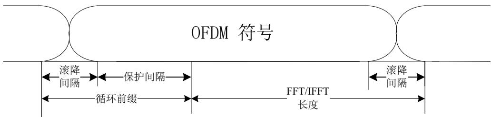  
图 38 OFDM 符号格式

表 53 OFDM 符号特性

<table><tr><td rowspan="2">符号参数</td><td colspan="2">Option 1</td><td colspan="2">Option 2</td><td colspan="2">Option 3</td></tr><tr><td>时域点数</td><td>时间(微秒)</td><td>时域点数</td><td>时间(微秒)</td><td>时域点数</td><td>时间(微秒)</td></tr><tr><td>前导 IFFT 长度</td><td>128</td><td>122.88</td><td>64</td><td>122.88</td><td>32</td><td>122.88</td></tr><tr><td>SIG/PHR/PSDUIFFT长度</td><td>128</td><td>122.88</td><td>64</td><td>122.88</td><td>32</td><td>122.88</td></tr><tr><td>滚降间隔</td><td>8</td><td>7.68</td><td>4</td><td>7.68</td><td>4</td><td>15.36</td></tr><tr><td>保护间隔</td><td>32</td><td>30.72</td><td>16</td><td>30.72</td><td>8</td><td>30.72</td></tr><tr><td>循环前缀</td><td>40</td><td>38.4</td><td>20</td><td>38.4</td><td>12</td><td>46.08</td></tr></table>

## 6.1.9.2 导频符号

不同OFDM模式Option1、Option2及Option3的导频子载波数、数据子载波数和导频组数应符合表 54要求。

表 54 不同 OFDM 模式的导频参数

<table><tr><td>参数</td><td>OFDM Option 1</td><td>OFDM Option 2</td><td>OFDM Option 3</td></tr><tr><td>可用载波数</td><td>104</td><td>52</td><td>20</td></tr><tr><td>导频载波数</td><td>8</td><td>4</td><td>2</td></tr><tr><td>数据载波数</td><td>96</td><td>48</td><td>18</td></tr><tr><td>直流载波数</td><td>1</td><td>1</td><td>1</td></tr><tr><td>导频组数</td><td>7</td><td>7</td><td>3</td></tr></table>

在LTF帧之后，从SIG开始至PSDU帧结束，每个OFDM符号应依次使用一组导频。Option1、Option2和Option3的子载波加载索引应分别符合表 55-表 57要求。

表 55 Option1 的导频组

<table><tr><td>Pilot Tone</td><td>#1</td><td>#2</td><td>#3</td><td>#4</td><td>#5</td><td>#6</td><td>#7</td><td>#8</td></tr><tr><td>Pilot set 1</td><td>-52</td><td>-38</td><td>-22</td><td>-10</td><td>2</td><td>14</td><td>30</td><td>42</td></tr><tr><td>Pilot set 2</td><td>-49</td><td>-34</td><td>-18</td><td>-6</td><td>18</td><td>26</td><td>34</td><td>46</td></tr><tr><td>Pilot set 3</td><td>-46</td><td>-30</td><td>-14</td><td>-2</td><td>6</td><td>22</td><td>38</td><td>49</td></tr><tr><td>Pilot set 4</td><td>-52</td><td>-42</td><td>-26</td><td>-10</td><td>10</td><td>26</td><td>42</td><td>52</td></tr><tr><td>Pilot set 5</td><td>-49</td><td>-38</td><td>-22</td><td>-6</td><td>2</td><td>14</td><td>30</td><td>46</td></tr><tr><td>Pilot set 6</td><td>-46</td><td>-34</td><td>-26</td><td>-18</td><td>6</td><td>18</td><td>34</td><td>49</td></tr><tr><td>Pilot set 7</td><td>-42</td><td>-30</td><td>-14</td><td>-2</td><td>10</td><td>22</td><td>38</td><td>52</td></tr></table>

表 56 Option2 的导频组

<table><tr><td>Pilot Tone</td><td>#1</td><td>#2</td><td>#3</td><td>#4</td></tr><tr><td>Pilot set 1</td><td>-26</td><td>-6</td><td>2</td><td>22</td></tr><tr><td>Pilot set 2</td><td>-18</td><td>-10</td><td>10</td><td>18</td></tr><tr><td>Pilot set 3</td><td>-22</td><td>-2</td><td>6</td><td>26</td></tr><tr><td>Pilot set 4</td><td>-14</td><td>-6</td><td>14</td><td>22</td></tr><tr><td>Pilot set 5</td><td>-26</td><td>-18</td><td>2</td><td>10</td></tr><tr><td>Pilot set 6</td><td>-10</td><td>-2</td><td>18</td><td>26</td></tr><tr><td>Pilot set 7</td><td>-22</td><td>-14</td><td>6</td><td>14</td></tr></table>

表 57 Option3 的导频组

<table><tr><td>Pilot Tone</td><td>#1</td><td>#2</td></tr><tr><td>Pilot set 1</td><td>-10</td><td>2</td></tr><tr><td>Pilot set 2</td><td>-2</td><td>10</td></tr><tr><td>Pilot set 3</td><td>-6</td><td>6</td></tr></table>

导频数据应由初始值全是1的PN10序列产生。PN序列的第1个输出比特应放在分组1、Pilot Tone为#1所对应的导频子载波上，后续比特应依次放置于#2，…，#End对应的导频子载波上。PN序列生成方式应符合6.1.7.2节规定。

导频子载波应统一采用BPSK调制方式，星座点映射应符合表 50要求。

## 6.1.9.3 STF

STF应由基础层和扰码层两层序列通过点乘得到。

Option1、Option2和Option3的STF序列不同。Option1的STF频域序列应符合表 58要求，归一化因子应为sqrt(104/12)。

表 58 Option1 的 STF 频域序列

<table><tr><td>Tone #</td><td>Value</td><td>Tone #</td><td>Value</td><td>Tone #</td><td>Value</td><td>Tone #</td><td>Value</td></tr><tr><td>-64</td><td>0</td><td>-32</td><td>-2.9439</td><td>0</td><td>0</td><td>32</td><td>-2.9439</td></tr><tr><td>-63</td><td>0</td><td>-31</td><td>0</td><td>1</td><td>0</td><td>33</td><td>0</td></tr><tr><td>-62</td><td>0</td><td>-30</td><td>0</td><td>2</td><td>0</td><td>34</td><td>0</td></tr><tr><td>-61</td><td>0</td><td>-29</td><td>0</td><td>3</td><td>0</td><td>35</td><td>0</td></tr><tr><td>-60</td><td>0</td><td>-28</td><td>0</td><td>4</td><td>0</td><td>36</td><td>0</td></tr><tr><td>-59</td><td>0</td><td>-27</td><td>0</td><td>5</td><td>0</td><td>37</td><td>0</td></tr><tr><td>-58</td><td>0</td><td>-26</td><td>0</td><td>6</td><td>0</td><td>38</td><td>0</td></tr><tr><td>-57</td><td>0</td><td>-25</td><td>0</td><td>7</td><td>0</td><td>39</td><td>0</td></tr><tr><td>-56</td><td>0</td><td>-24</td><td>-2.9439</td><td>8</td><td>-2.9439</td><td>40</td><td>2.9439</td></tr><tr><td>-55</td><td>0</td><td>-23</td><td>0</td><td>9</td><td>0</td><td>41</td><td>0</td></tr><tr><td>-54</td><td>0</td><td>-22</td><td>0</td><td>10</td><td>0</td><td>42</td><td>0</td></tr><tr><td>-53</td><td>0</td><td>-21</td><td>0</td><td>11</td><td>0</td><td>43</td><td>0</td></tr><tr><td>-52</td><td>0</td><td>-20</td><td>0</td><td>12</td><td>0</td><td>44</td><td>0</td></tr><tr><td>-51</td><td>0</td><td>-19</td><td>0</td><td>13</td><td>0</td><td>45</td><td>0</td></tr><tr><td>-50</td><td>0</td><td>-18</td><td>0</td><td>14</td><td>0</td><td>46</td><td>0</td></tr><tr><td>-49</td><td>0</td><td>-17</td><td>0</td><td>15</td><td>0</td><td>47</td><td>0</td></tr><tr><td>-48</td><td>-2.9439</td><td>-16</td><td>2.9439</td><td>16</td><td>2.9439</td><td>48</td><td>-2.9439</td></tr><tr><td>-47</td><td>0</td><td>-15</td><td>0</td><td>17</td><td>0</td><td>49</td><td>0</td></tr><tr><td>-46</td><td>0</td><td>-14</td><td>0</td><td>18</td><td>0</td><td>50</td><td>0</td></tr><tr><td>-45</td><td>0</td><td>-13</td><td>0</td><td>19</td><td>0</td><td>51</td><td>0</td></tr><tr><td>-44</td><td>0</td><td>-12</td><td>0</td><td>20</td><td>0</td><td>52</td><td>0</td></tr><tr><td>-43</td><td>0</td><td>-11</td><td>0</td><td>21</td><td>0</td><td>53</td><td>0</td></tr><tr><td>-42</td><td>0</td><td>-10</td><td>0</td><td>22</td><td>0</td><td>54</td><td>0</td></tr><tr><td>-41</td><td>0</td><td>-9</td><td>0</td><td>23</td><td>0</td><td>55</td><td>0</td></tr><tr><td>-40</td><td>-2.9439</td><td>-8</td><td>2.9439</td><td>24</td><td>2.9439</td><td>56</td><td>0</td></tr><tr><td>-39</td><td>0</td><td>-7</td><td>0</td><td>25</td><td>0</td><td>57</td><td>0</td></tr><tr><td>-38</td><td>0</td><td>-6</td><td>0</td><td>26</td><td>0</td><td>58</td><td>0</td></tr><tr><td>-37</td><td>0</td><td>-5</td><td>0</td><td>27</td><td>0</td><td>59</td><td>0</td></tr><tr><td>-36</td><td>0</td><td>-4</td><td>0</td><td>28</td><td>0</td><td>60</td><td>0</td></tr><tr><td>-35</td><td>0</td><td>-3</td><td>0</td><td>29</td><td>0</td><td>61</td><td>0</td></tr><tr><td>-34</td><td>0</td><td>-2</td><td>0</td><td>30</td><td>0</td><td>62</td><td>0</td></tr><tr><td>-33</td><td>0</td><td>-1</td><td>0</td><td>31</td><td>0</td><td>63</td><td>0</td></tr></table>

Option2的STF频域序列应符合表 59要求，归一化因子为sqrt(52/12)。

表 59 Option2 的 STF 频域序列

<table><tr><td>Tone #</td><td>Value</td><td>Tone #</td><td>Value</td><td>Tone #</td><td>Value</td><td>Tone #</td><td>Value</td></tr><tr><td>-32</td><td>0</td><td>-16</td><td>-2.0817</td><td>0</td><td>0</td><td>16</td><td>-2.0817</td></tr><tr><td>-31</td><td>0</td><td>-15</td><td>0</td><td>1</td><td>0</td><td>17</td><td>0</td></tr><tr><td>-30</td><td>0</td><td>-14</td><td>0</td><td>2</td><td>0</td><td>18</td><td>0</td></tr><tr><td>-29</td><td>0</td><td>-13</td><td>0</td><td>3</td><td>0</td><td>19</td><td>0</td></tr><tr><td>-28</td><td>0</td><td>-12</td><td>-2.0817</td><td>4</td><td>-2.0817</td><td>20</td><td>2.0817</td></tr><tr><td>-27</td><td>0</td><td>-11</td><td>0</td><td>5</td><td>0</td><td>21</td><td>0</td></tr><tr><td>-26</td><td>0</td><td>-10</td><td>0</td><td>6</td><td>0</td><td>22</td><td>0</td></tr><tr><td>-25</td><td>0</td><td>-9</td><td>0</td><td>7</td><td>0</td><td>23</td><td>0</td></tr><tr><td>-24</td><td>-2.0817</td><td>-8</td><td>2.0817</td><td>8</td><td>2.0817</td><td>24</td><td>-2.0817</td></tr><tr><td>-23</td><td>0</td><td>-7</td><td>0</td><td>9</td><td>0</td><td>25</td><td>0</td></tr><tr><td>-22</td><td>0</td><td>-6</td><td>0</td><td>10</td><td>0</td><td>26</td><td>0</td></tr><tr><td>-21</td><td>0</td><td>-5</td><td>0</td><td>11</td><td>0</td><td>27</td><td>0</td></tr><tr><td>-20</td><td>-2.0817</td><td>-4</td><td>2.0817</td><td>12</td><td>2.0817</td><td>28</td><td>0</td></tr><tr><td>-19</td><td>0</td><td>-3</td><td>0</td><td>13</td><td>0</td><td>29</td><td>0</td></tr><tr><td>-18</td><td>0</td><td>-2</td><td>0</td><td>14</td><td>0</td><td>30</td><td>0</td></tr><tr><td>-17</td><td>0</td><td>-1</td><td>0</td><td>15</td><td>0</td><td>31</td><td>0</td></tr></table>

Option3的STF频域序列应符合表 60要求，归一化因子为sqrt(20/10)。

表 60 Option3 的 STF 频域序列

<table><tr><td>Tone #</td><td>Value</td><td>Tone #</td><td>Value</td><td>Tone #</td><td>Value</td><td>Tone #</td><td>Value</td></tr><tr><td>-16</td><td>0</td><td>-8</td><td>-1.4142</td><td>0</td><td>0</td><td>8</td><td>-1.4142</td></tr><tr><td>-15</td><td>0</td><td>-7</td><td>0</td><td>1</td><td>0</td><td>9</td><td>0</td></tr><tr><td>-14</td><td>0</td><td>-6</td><td>1.4142</td><td>2</td><td>1.4142</td><td>10</td><td>-1.4142</td></tr><tr><td>-13</td><td>0</td><td>-5</td><td>0</td><td>3</td><td>0</td><td>11</td><td>0</td></tr><tr><td>-12</td><td>0</td><td>-4</td><td>-1.4142</td><td>4</td><td>-1.4142</td><td>12</td><td>0</td></tr><tr><td>-11</td><td>0</td><td>-3</td><td>0</td><td>5</td><td>0</td><td>13</td><td>0</td></tr><tr><td>-10</td><td>1.4142</td><td>-2</td><td>-1.4142</td><td>6</td><td>-1.4142</td><td>14</td><td>0</td></tr><tr><td>-9</td><td>0</td><td>-1</td><td>0</td><td>7</td><td>0</td><td>15</td><td>0</td></tr></table>

时域的基础层序列应通过对表 58-表 60中的数据进行IFFT变换得到。

STF基础层时域帧格式应符合图 39要求，STF序列中一共包含4个STF OFDM符号，其中，Option1和Option2每个OFDM符号前添加的CP长度应为1/4个OFDM符号长度，Option3直接进行OFDM符号复制，最终每个模式的STF长度都应为5个FFT长度。对于Option1，每个FFT长度的符号内应有8组重复的数据，对于Option2，每个FFT长度的符号内应有4组重复的数据，对于Option3，每个FFT长度的符号内应有2组重复的数据。

<table><tr><td></td><td colspan="9">STF OFDM Symbol</td><td colspan="9">STF OFDM Symbol</td><td colspan="9">STF OFDM Symbol</td><td colspan="9">STF OFDM Symbol</td></tr><tr><td>Option 11/8 Cycle</td><td>S</td><td>S</td><td>S</td><td>S</td><td>S</td><td>S</td><td>S</td><td>S</td><td>S</td><td>S</td><td>S</td><td>S</td><td>S</td><td>S</td><td>S</td><td>S</td><td>S</td><td>S</td><td>S</td><td>S</td><td>S</td><td>S</td><td>S</td><td>S</td><td>S</td><td>S</td><td>S</td><td>S</td><td>S</td><td>S</td><td>S</td><td>S</td><td>S</td><td>S</td><td>S</td><td>S</td></tr><tr><td>Option 21/4 Cycle</td><td colspan="2">S</td><td colspan="2">S</td><td colspan="2">S</td><td colspan="2">S</td><td colspan="2">S</td><td colspan="2">S</td><td colspan="2">S</td><td colspan="2">S</td><td colspan="2">S</td><td colspan="2">S</td><td colspan="2">S</td><td colspan="2">S</td><td colspan="2">S</td><td colspan="2">S</td><td colspan="2">S</td><td colspan="2">S</td><td colspan="2">S</td><td colspan="2">S</td></tr><tr><td>Option 31/2 Cycle</td><td colspan="4">S</td><td colspan="4">S</td><td colspan="4">S</td><td colspan="4">S</td><td colspan="4">S</td><td colspan="4">S</td><td colspan="4">S</td><td colspan="4">S</td><td colspan="2">S</td><td colspan="2">s</td></tr></table>

图 39 STF 基础层帧格式

扰码层应由一个10比特的序列构成，不区分OFDM模式。

扰码层序列应为[-1 -1-1-1 1 1 -1 -1 -1 1]。

各模式基础层和扰码层点乘后示意图应符合图 40要求。

<table><tr><td></td><td colspan="8">STF OFDM Symbol</td><td colspan="8">STF OFDM Symbol</td><td colspan="8">STF OFDM Symbol</td><td colspan="8">STF OFDM Symbol</td><td></td><td></td><td></td><td></td></tr><tr><td>Option 11/8 Cycle</td><td>- S</td><td>- S</td><td>- S</td><td>- S</td><td>- S</td><td>- S</td><td>- S</td><td>- S</td><td>- S</td><td>- S</td><td>- S</td><td>- S</td><td>- S</td><td>- S</td><td>- S</td><td>S</td><td>S</td><td>S</td><td>S</td><td>S</td><td>S</td><td>S</td><td>S</td><td>- S</td><td>- S</td><td>- S</td><td>- S</td><td>- S</td><td>- S</td><td>- S</td><td>- S</td><td>- S</td><td>S</td><td>S</td><td>S</td><td>S</td></tr><tr><td>Option 21/4 Cycle</td><td colspan="2">-S</td><td colspan="2">-S</td><td colspan="2">-S</td><td colspan="2">-S</td><td colspan="2">-S</td><td colspan="2">-S</td><td colspan="2">-S</td><td colspan="2">S</td><td colspan="2">S</td><td colspan="2">S</td><td colspan="2">S</td><td colspan="2">-S</td><td colspan="2">-S</td><td colspan="2">-S</td><td colspan="2">-S</td><td colspan="2">-S</td><td colspan="2">S</td><td>S</td><td></td></tr><tr><td>Option 31/2 Cycle</td><td colspan="3">-S</td><td colspan="3">-S</td><td colspan="3">-S</td><td colspan="3">-S</td><td colspan="2">-S</td><td colspan="3">S</td><td colspan="3">S</td><td colspan="3">-S</td><td colspan="3">-S</td><td colspan="2">-S</td><td colspan="3">-S</td><td colspan="3">S</td><td></td><td></td></tr></table>

图 40 STF 帧格式

最后，应对STF帧的开始数据和末尾数据进行加窗运算，具体方式应符合6.1.9.5节规定。

## 6.1.9.4 LTF

每个OFDM模式Option1、Option2及Option3的LTF序列不同。Option1的LTF频域序列应符合表 61要求。

表 61 Option1 的 LTF 频域序列

<table><tr><td>Tone #</td><td>Value</td><td>Tone #</td><td>Value</td><td>Tone #</td><td>Value</td><td>Tone #</td><td>Value</td></tr><tr><td>-64</td><td>0</td><td>-32</td><td>-1</td><td>0</td><td>0</td><td>32</td><td>-1</td></tr><tr><td>-63</td><td>0</td><td>-31</td><td>-1</td><td>1</td><td>-1</td><td>33</td><td>1</td></tr><tr><td>-62</td><td>0</td><td>-30</td><td>1</td><td>2</td><td>1</td><td>34</td><td>-1</td></tr><tr><td>-61</td><td>0</td><td>-29</td><td>-1</td><td>3</td><td>-1</td><td>35</td><td>-1</td></tr><tr><td>-60</td><td>0</td><td>-28</td><td>1</td><td>4</td><td>-1</td><td>36</td><td>-1</td></tr><tr><td>-59</td><td>0</td><td>-27</td><td>1</td><td>5</td><td>-1</td><td>37</td><td>-1</td></tr><tr><td>-58</td><td>0</td><td>-26</td><td>-1</td><td>6</td><td>1</td><td>38</td><td>-1</td></tr><tr><td>-57</td><td>0</td><td>-25</td><td>-1</td><td>7</td><td>1</td><td>39</td><td>1</td></tr><tr><td>-56</td><td>0</td><td>-24</td><td>-1</td><td>8</td><td>1</td><td>40</td><td>-1</td></tr><tr><td>-55</td><td>0</td><td>-23</td><td>-1</td><td>9</td><td>-1</td><td>41</td><td>1</td></tr><tr><td>-54</td><td>0</td><td>-22</td><td>1</td><td>10</td><td>-1</td><td>42</td><td>-1</td></tr><tr><td>-53</td><td>0</td><td>-21</td><td>-1</td><td>11</td><td>1</td><td>43</td><td>1</td></tr><tr><td>-52</td><td>-1</td><td>-20</td><td>-1</td><td>12</td><td>1</td><td>44</td><td>1</td></tr><tr><td>-51</td><td>1</td><td>-19</td><td>1</td><td>13</td><td>1</td><td>45</td><td>-1</td></tr><tr><td>-50</td><td>-1</td><td>-18</td><td>1</td><td>14</td><td>1</td><td>46</td><td>1</td></tr><tr><td>-49</td><td>-1</td><td>-17</td><td>-1</td><td>15</td><td>1</td><td>47</td><td>1</td></tr><tr><td>-48</td><td>-1</td><td>-16</td><td>-1</td><td>16</td><td>-1</td><td>48</td><td>-1</td></tr><tr><td>-47</td><td>1</td><td>-15</td><td>-1</td><td>17</td><td>-1</td><td>49</td><td>-1</td></tr><tr><td>-46</td><td>-1</td><td>-14</td><td>-1</td><td>18</td><td>1</td><td>50</td><td>1</td></tr><tr><td>-45</td><td>1</td><td>-13</td><td>1</td><td>19</td><td>-1</td><td>51</td><td>1</td></tr><tr><td>-44</td><td>1</td><td>-12</td><td>-1</td><td>20</td><td>1</td><td>52</td><td>1</td></tr><tr><td>-43</td><td>-1</td><td>-11</td><td>-1</td><td>21</td><td>-1</td><td>53</td><td>0</td></tr><tr><td>-42</td><td>1</td><td>-10</td><td>-1</td><td>22</td><td>1</td><td>54</td><td>0</td></tr><tr><td>-41</td><td>1</td><td>-9</td><td>1</td><td>23</td><td>1</td><td>55</td><td>0</td></tr><tr><td>-40</td><td>-1</td><td>-8</td><td>1</td><td>24</td><td>-1</td><td>56</td><td>0</td></tr><tr><td>-39</td><td>-1</td><td>-7</td><td>1</td><td>25</td><td>1</td><td>57</td><td>0</td></tr><tr><td>-38</td><td>-1</td><td>-6</td><td>-1</td><td>26</td><td>1</td><td>58</td><td>0</td></tr><tr><td>-37</td><td>-1</td><td>-5</td><td>1</td><td>27</td><td>-1</td><td>59</td><td>0</td></tr><tr><td>-36</td><td>-1</td><td>-4</td><td>1</td><td>28</td><td>1</td><td>60</td><td>0</td></tr><tr><td>-35</td><td>1</td><td>-3</td><td>-1</td><td>29</td><td>-1</td><td>61</td><td>0</td></tr><tr><td>-34</td><td>-1</td><td>-2</td><td>1</td><td>30</td><td>1</td><td>62</td><td>0</td></tr><tr><td>-33</td><td>-1</td><td>-1</td><td>1</td><td>31</td><td>-1</td><td>63</td><td>0</td></tr></table>

Option2的LTF频域序列应符合表 62要求。

表 62 Option2 的 LTF 频域序列

<table><tr><td>Tone #</td><td>Value</td><td>Tone #</td><td>Value</td><td>Tone #</td><td>Value</td><td>Tone #</td><td>Value</td></tr><tr><td>-32</td><td>0</td><td>-16</td><td>-1</td><td>0</td><td>0</td><td>16</td><td>1</td></tr><tr><td>-31</td><td>0</td><td>-15</td><td>1</td><td>1</td><td>1</td><td>17</td><td>-1</td></tr><tr><td>-30</td><td>0</td><td>-14</td><td>1</td><td>2</td><td>-1</td><td>18</td><td>1</td></tr><tr><td>-29</td><td>0</td><td>-13</td><td>1</td><td>3</td><td>1</td><td>19</td><td>-1</td></tr><tr><td>-28</td><td>0</td><td>-12</td><td>-1</td><td>4</td><td>-1</td><td>20</td><td>-1</td></tr><tr><td>-27</td><td>0</td><td>-11</td><td>-1</td><td>5</td><td>1</td><td>21</td><td>-1</td></tr><tr><td>-26</td><td>-1</td><td>-10</td><td>-1</td><td>6</td><td>-1</td><td>22</td><td>-1</td></tr><tr><td>-25</td><td>1</td><td>-9</td><td>1</td><td>7</td><td>1</td><td>23</td><td>1</td></tr><tr><td>-24</td><td>1</td><td>-8</td><td>-1</td><td>8</td><td>-1</td><td>24</td><td>1</td></tr><tr><td>-23</td><td>-1</td><td>-7</td><td>-1</td><td>9</td><td>-1</td><td>25</td><td>1</td></tr><tr><td>-22</td><td>-1</td><td>-6</td><td>-1</td><td>10</td><td>1</td><td>26</td><td>1</td></tr><tr><td>-21</td><td>1</td><td>-5</td><td>-1</td><td>11</td><td>-1</td><td>27</td><td>0</td></tr><tr><td>-20</td><td>-1</td><td>-4</td><td>1</td><td>12</td><td>-1</td><td>28</td><td>0</td></tr><tr><td>-19</td><td>-1</td><td>-3</td><td>1</td><td>13</td><td>-1</td><td>29</td><td>0</td></tr><tr><td>-18</td><td>1</td><td>-2</td><td>-1</td><td>14</td><td>-1</td><td>30</td><td>0</td></tr><tr><td>-17</td><td>-1</td><td>-1</td><td>1</td><td>15</td><td>-1</td><td>31</td><td>0</td></tr></table>

Option3的LTF频域序列应符合表 63要求。

表 63 Option3 的 LTF 频域序列

<table><tr><td>Tone #</td><td>Value</td><td>Tone #</td><td>Value</td><td>Tone #</td><td>Value</td><td>Tone #</td><td>Value</td></tr><tr><td>-16</td><td>0</td><td>-8</td><td>1</td><td>0</td><td>0</td><td>8</td><td>-1</td></tr><tr><td>-15</td><td>0</td><td>-7</td><td>-1</td><td>1</td><td>-1</td><td>9</td><td>1</td></tr><tr><td>-14</td><td>0</td><td>-6</td><td>-1</td><td>2</td><td>-1</td><td>10</td><td>-1</td></tr><tr><td>-13</td><td>0</td><td>-5</td><td>-1</td><td>3</td><td>1</td><td>11</td><td>0</td></tr><tr><td>-12</td><td>0</td><td>-4</td><td>1</td><td>4</td><td>1</td><td>12</td><td>0</td></tr><tr><td>-11</td><td>0</td><td>-3</td><td>-1</td><td>5</td><td>-1</td><td>13</td><td>0</td></tr><tr><td>-10</td><td>1</td><td>-2</td><td>-1</td><td>6</td><td>1</td><td>14</td><td>0</td></tr><tr><td>-9</td><td>1</td><td>-1</td><td>-1</td><td>7</td><td>-1</td><td>15</td><td>0</td></tr></table>

时域LTF序列应包含2个连续的LTF基础符号，在2个OFDM符号前添加1/2个符号长度的CP，产生的序列应符合图 41要求。

<table><tr><td>LTF</td><td>LTF</td></tr></table>

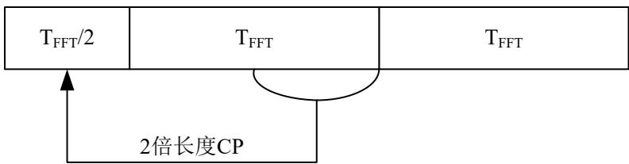  
图 41 LTF 结构

最后，应对LTF的开始数据和末尾数据进行加窗运算，具体方式应符合6.1.9.5节规定。

## 6.1.9.5 窗函数与加窗过程

Option1、Option2和Option3的窗函数定义应分别符合表 64\~表 66要求。

表 64 Option1 窗函数定义

<table><tr><td>n</td><td> $w_{rise}[n]$ </td><td> $w_{fall}[n]$ </td></tr><tr><td>1</td><td>0.058824</td><td>0.882353</td></tr><tr><td>2</td><td>0.176471</td><td>0.764706</td></tr><tr><td>3</td><td>0.294118</td><td>0.647059</td></tr><tr><td>4</td><td>0.411765</td><td>0.529412</td></tr><tr><td>5</td><td>0.529412</td><td>0.411765</td></tr><tr><td>6</td><td>0.647059</td><td>0.294118</td></tr><tr><td>7</td><td>0.764706</td><td>0.176471</td></tr><tr><td>8</td><td>0.882353</td><td>0.058824</td></tr></table>

表 65 Option2 窗函数定义

<table><tr><td>n</td><td> $w_{rise}[n]$ </td><td> $w_{fall}[n]$ </td></tr><tr><td>1</td><td>0.111111</td><td>0.777778</td></tr><tr><td>2</td><td>0.333333</td><td>0.555556</td></tr><tr><td>3</td><td>0.555556</td><td>0.333333</td></tr><tr><td>4</td><td>0.777778</td><td>0.111111</td></tr></table>

表 66 Option3 窗函数定义

<table><tr><td>n</td><td> $w_{rise}[n]$ </td><td> $w_{fall}[n]$ </td></tr><tr><td>1</td><td>0.270741</td><td>0.879998</td></tr><tr><td>2</td><td>0.436767</td><td>0.672605</td></tr><tr><td>3</td><td>0.672605</td><td>0.436767</td></tr><tr><td>4</td><td>0.879998</td><td>0.270741</td></tr></table>

时域加窗应主要用在两个带CP的OFDM符号的交界处，具体范围应包括：STF起始处、STF和LTF交界处、LTF和SIG交界处，SIG、PHR和PSDU之间以及内部两个带CP的OFDM符号交界处。在STF内部和LTF内部同样的OFDM符号重复时，可不进行加窗处理。

时域加窗应分别按以下方式实现：

STF应对整个数据（5个OFDM符号长度）加窗，加窗后的STF 长度应为 5×IFFT 长度+1×滚降间隔。其前部的滚降间隔数据应为 STF 尾部数据的拷贝，将其乘以 $w _ { r i s e } [ n ]$ 后不应与任何信号重叠；其后部的滚降间隔个数据乘以 $w _ { \it f a l l } [ n ]$ 后，应与LTF 的滚降间隔个数据乘以 $w _ { r i s e } [ n ]$ 后相加；

LTF应对整个数据（2.5个OFDM符号长度）加窗，加窗后的LTF长度应为2.5×IFFT长度+1×滚降间隔。其前部的滚降间隔 长度个数据应为 尾部数据的拷贝，将其前部滚降间隔个数据乘以$w _ { r i s e } [ n ]$ 后，应与STF后部的滚降间隔个数据乘以 $w _ { \it f a l l } [ n ]$ 后相加；前导LTF后部的滚降间隔个数据乘以$w _ { \it f a l l } [ n ]$ 后，应与第一个OFDM符号的前部的滚降间隔个数据乘以 $w _ { r i s e } [ n ]$ 后相加；

SIG、PHR和PSDU 的每个OFDM符号均应添加循环前缀并加窗，每个OFDM符号前部的滚降间隔个数据乘以 $w _ { r i s e } [ n ]$ 后，应与其前面一个OFDM符号后部的滚降间隔个数据乘以 $w _ { \it f a l l } [ n ]$ 后相加，最后一个OFDM符号的后部的滚降间隔个数据乘以 $w _ { f a l l } [ n ] _ { \scriptscriptstyle { \mathrm { E } } }$ ，不应与任何信号重叠。

## 6.1.9.6 通信频段

工作频段宜支持470MHz\~510MHz，应符合表 67要求。

表 67 工作频段、信道间隔与第一个信道中心频率

<table><tr><td>频段/MHz</td><td>总带宽/MHz</td><td>调制方式</td><td>信道间隔/MHz</td><td>信道中心频点/MHz</td></tr><tr><td rowspan="3">470~510</td><td rowspan="3">40</td><td>OFDM Option3</td><td>0.2</td><td>470.1</td></tr><tr><td>OFDM Option2</td><td>0.5</td><td>470.5</td></tr><tr><td>OFDM Option1</td><td>1.0</td><td>471</td></tr></table>

## 6.2 高速无线物理层服务

## 6.2.1 信号强度指示

接收端应基于每一个数据包计算出一个接收信号强度指示（RSSI）值，该值表征接收机前端在天线连接处的接收信号功率。

## 6.2.2 信噪比

接收端应基于每一个数据包计算出一个信噪比（SNR），该值表征接收信号功率与噪声功率的比值。

## 附 录 A（规范性附录）高速载波数据载荷分集拷贝参数定义与计算

## A.1 参数定义

高速载波数据载荷分集拷贝流程中，相关参数定义应应符合以下要求。

DataBitsLen：信道交织器输出的每个 PB 的数据比特数，应包括信息比特和校验比特。

ValidCarrierNum：有效子载波数，应根据表 19 中通信频段对应的子载波起始和截止编号计算得到，表示可以传输数据的子载波数；若使用动态加载帧，该参数应根据动态加载配置表中的子载波选择表或者比特加载表计算得到。

UsedCarrierNum：分集拷贝模式实际使用的子载波数目，若 UsedCarrierNum 不等于ValidCarrierNum，应选取低位编号子载波使用，并将未使用子载波能量置为0。

CopyNum：数据的分集拷贝次数；若使用动态加载帧的子载波选择模式，该参数应由动态加载配置表中的TMI决定。

BPC：每个子载波调制的比特数；若使用动态加载帧的子载波选择模式，该参数应由动态加载配置表中的TMI决定。

InterNum：交织器个数。

InterNumPerGroup：每个 Group 中的交织器个数。

InterNum、CopyNum 和 InterNumPerGroup 的关系应符合表 A.1 要求。

表 A.1 分集次数与交织个数映射表

<table><tr><td>CopyNum</td><td>2</td><td>4</td><td>7</td><td>13</td></tr><tr><td>InterNum</td><td>8</td><td>8</td><td>14</td><td>13</td></tr><tr><td>InterNumPerGroup</td><td>4</td><td>2</td><td>2</td><td>1</td></tr></table>

## A.2 变量计算

高速载波数据载荷分集拷贝流程中，相关变量运算应如下所示,其中 $x = \lfloor a \rfloor$ 表示x取值为小于等于a的最大整数，即下取整。

$$
\text { UsedCarrierNum } = \text { InterNum } \left\lfloor \frac {\text { ValidCarrierNum }}{\text { InterNum }} \right\rfloor
$$

$$
\text { CarrierNumPerGroup } = \left\lfloor \frac {\text { UsedCarrierNum }}{\text { CopyNum }} \right\rfloor
$$

$$
\text { CarrierNumPerInter } = \left\lfloor \frac {\text { ValidCarrierNum }}{\text { InterNum }} \right\rfloor
$$

$$
\text { BitsPerOFDM } = \text { BPC } \times \text { UsedCarrierNum }
$$

$$
\text { BitsPerGroup } = \text { BPC } \times \text { CarrierNumPerGroup }
$$

<div class="mineru-algorithm" style="white-space: pre-wrap; font-family:monospace;">
BitsInLastOFDM = DataBitsLen - BitsPerOFDM  $\left\lfloor \frac{DataBitsLen}{BitsPerOFDM} \right\rfloor$ 
if BitsInLastOFDM == 0
    BitsInLastOFDM = BitsPerOFDM
    BitsInLastGroup = BitsPerGroup
else
    BitsInLastGroup = BitsInLastOFDM - BitsPerGroup  $\left\lfloor \frac{BitsInLastOFDM-1}{BitsPerGroup} \right\rfloor$ 
end
PadBitsNum = BitsPerGroup - BitsInLastGroup
</div>

当拷贝次数为1次且动态加载帧使用比特加载模式时，

<div class="mineru-algorithm" style="white-space: pre-wrap; font-family:monospace;">
BitsPerOFDM =  $\sum_{i=0}^{UsedCarrierNUm-1} B[i]$
</div>

其中B[i]表示对应有效子载波所承载的比特数。

## A.3 参数运算

## A.3.1 分组循环移位值运算

高速载波数据载荷在每次分集拷贝时，应按照分组循环移位值（GroupShiftNum），并以BitsPerGroup为步长进行循环移位。GroupShiftNum应按以下逻辑运算：

```matlab
if CopyNum==1
    GroupShiftNum(1) = (0);
elseif CopyNum==2
    if BitsInLastOFDM<=BitsPerGroup
    GroupShiftNum(1, 2) = (0, 0);
    else
    GroupShiftNum(1, 2) = (0, 1);
    end
elseif CopyNum==4
    if BitsInLastOFDM<=BitsPerGroup
    GroupShiftNum(1, 2, 3, 4) = (0, 0, 0, 0);
    elseif BitsInLastOFDM<=2·BitsPerGroup
    GroupShiftNum(1, 2, 3, 4) = (0, 0, 1, 1);
    elseif BitsInLastOFDM<=3·BitsPerGroup
    GroupShiftNum(1, 2, 3, 4) = (0, 0, 0, 0);
    else
    GroupShiftNum(1, 2, 3, 4) = (0, 1, 2, 3);
    end
elseif CopyNum==7
```

```matlab
if BitsInLastOFDM <= 6·BitsPerGroup

GroupShiftNum(1, 2, 3, 4, 5, 6, 7) = (0, 0, 0, 0, 0, 0, 0);
else
GroupShiftNum(1, 2, 3, 4, 5, 6, 7) = (0, 1, 2, 3, 4, 5, 6);
end
elseif CopyNum == 13
if BitsInLastOFDM <= 12·BitsPerGroup

GroupShiftNum(1, 2, 3, 4, 5, 6, 7, 8, 9, 10, 11, 12, 13) = (0, 0, 0, 0, 0, 0, 0,
0, 0, 0, 0, 0, 0);
else
GroupShiftNum(1, 2, 3, 4, 5, 6, 7, 8, 9, 10, 11, 12, 13) = (0, 1, 2, 3, 4, 5, 6,
7, 8, 9, 10, 11, 12);
end
end
```

## A.3.2 交织器地址计算

```matlab
InterShiftStep: 交织器循环移位步长
InterShiftStep = floor(CarrierNumPerInter/(2*InterNum));
if InterShiftStep<1 InterShiftStep = 0;
elseif InterShiftStep<2 InterShiftStep = 1;
elseif InterShiftStep<4 InterShiftStep = 2;
elseif InterShiftStep<8 InterShiftStep = 4;
elseif InterShiftStep<16 InterShiftStep = 8;
end
```

对于InterNum个待交织块，需要设计InterNum个交织器，其中InterInAddr表示每个交织块中初始载波编号（每个交织块初始编号均从1开始），InterOutAddr为交织后的子载波编号。InterOutAddr具体生成方式如下所示（Matlab code）：

```matlab
for K = 1:InterNum
    If InterShiftStep == 0
    InterOutAddr(:,K) = circshift(InterInAddr',K-1);
    else
    M = K*InterShiftStep;
    N = floor(CarrierNumPerInter/M);
    InterPad = CarrierNumPerInter - M*N;
    matrix = zeros(N,M);
    for i = 1:N
    matrix(i,:) = InterInAddr((i-1)*M+1:i*M);
    end
```

```matlab
if InterPad ~= 0
    matrix(N+1,1:InterPad) = InterInAddr(end-InterPad+1:end);
end
for i = 1:M
    if InterPad >= i
    outtmp((i-1)*(N+1)+1:i*(N+1)) = matrix(:,i);
    else
    if InterPad ~= 0
    outtmp((i-1)*N+1+InterPad:i*N+InterPad) = matrix(1:end-1,i);
    else
    outtmp((i-1)*N+1+InterPad:i*N+InterPad) = matrix(1:end,i);
    end
    end
end
outtmp = circshift(outtmp',2*(K-1)*InterShiftStep);
InterOutAddr(:,K) = outtmp';
end
```

注：获得的地址为子载波编号，每个子载波根据不同的调制模式承载对应的比特数，即若采用BPSK调制，则单个子载波应承载1个比特；若采用QPSK调制，则单个子载波应承载2个比特；若采用16QAM调制，则单个子载波应承载4个比特。

end

## 附 录 B

## （规范性附录）

## 高速无线PHR与 PSDU分集拷贝参数定义与计算

## B.1 参数定义

高速无线PHR和PSDU分集拷贝流程中，相关参数定义应如下所示。

DataBitsLen：信道交织器输出的数据比特数，包括信息和校验比特；

ValidCarrierNum：有效子载波数，根据表 67 中通信频段所支持的子载波数来确定，表示可以传输数据的子载波数；

UsedCarrierNum：分集拷贝模式实际使用的子载波数目，若 UsedCarrierNum 不等于 ValidCarrierNum时，应选取低位编号子载波使用，并将未使用子载波的能量置为0。

CopyNum：数据的分集次数；

BPC：每个子载波调制的比特数；

InterNum：交织器个数。

InterNumPerGroup：每个 Group 中的交织器个数。

InterNum、CopyNum 和 InterNumPerGroup 的关系应符合错误!未找到引用源。要求

表 B.1 分集次数与交织个数映射表

<table><tr><td rowspan="3">Option1、Option2</td><td>CopyNum</td><td>2</td><td>3</td><td>4</td><td>6</td></tr><tr><td>InterNum</td><td>4</td><td>6</td><td>4</td><td>6</td></tr><tr><td>InterNumPerGroup</td><td>2</td><td>2</td><td>1</td><td>1</td></tr><tr><td rowspan="3">Option3</td><td>CopyNum</td><td>2</td><td>3</td><td>4</td><td>6</td></tr><tr><td>InterNum</td><td>2</td><td>6</td><td>4</td><td>6</td></tr><tr><td>InterNumPerGroup</td><td>1</td><td>2</td><td>1</td><td>1</td></tr></table>

## B.2 变量计算

高速无线PHR和PSDU分集拷贝流程中，相关变量计算应如下所示。其中 $x = \lfloor a \rfloor$ 表示x取值为小于等于a的最大整数，即下取整。

$$
\text { UsedCarrierNum } = \text { InterNum } \left\lfloor \frac {\text { ValidCarrierNum }}{\text { InterNum }} \right\rfloor
$$

$$
\text { CarrierNumPerGroup } = \left\lfloor \frac {\text { UsedCarrierNum }}{\text { CopyNum }} \right\rfloor
$$

$$
\text { CarrierNumPerInter } = \left\lfloor \frac {\text { ValidCarrierNum }}{\text { InterNum }} \right\rfloor
$$

$$
\text { BitsPerOFDM } = \text { BPC } \times \text { UsedCarrierNum }
$$

<div class="mineru-algorithm" style="white-space: pre-wrap; font-family:monospace;">
BitsPerGroup = BPC × CarrierNumPerGroup
BitsInLastOFDM = DataBitsLen - BitsPerOFDM  $\left\lfloor \frac{DataBitsLen}{BitsPerOFDM} \right\rfloor$ 
if BitsInLastOFDM == 0
    BitsInLastOFDM = BitsPerOFDM
    BitsInLastGroup = BitsPerGroup
else
    BitsInLastGroup = BitsInLastOFDM - BitsPerGroup  $\left\lfloor \frac{BitsInLastOFDM-1}{BitsPerGroup} \right\rfloor$ 
end
PadBitsNum = BitsPerGroup - BitsInLastGroup
</div>

## B.3 参数运算

## B.3.1 分组循环移位值运算

高速无线PHR和PSDU在每次分集拷贝时，应按照分组循环移位值（GroupShiftNum），并以BitsPerGroup为步长进行循环移位。GroupShiftNum应按以下逻辑运算：

```matlab
if CopyNum==1
    GroupShiftNum(1)=(0);
elseif CopyNum==2
    if BitsInLastOFDM<=BitsPerGroup
    GroupShiftNum(1, 2)=(0, 0);
    else
    GroupShiftNum(1, 2)=(0, 1);
    end
elseif CopyNum==3
    if BitsInLastOFDM<=2·BitsPerGroup
    GroupShiftNum(1, 2, 3)=(0, 0, 0);
    else
    GroupShiftNum(1, 2, 3)=(0, 1, 2);
    end
elseif CopyNum==4
    if BitsInLastOFDM<=BitsPerGroup
    GroupShiftNum(1, 2, 3, 4)=(0, 0, 0, 0);
    elseif BitsInLastOFDM<=2·BitsPerGroup
    GroupShiftNum(1, 2, 3, 4)=(0, 0, 1, 1);
    elseif BitsInLastOFDM<=3·BitsPerGroup
    GroupShiftNum(1, 2, 3, 4)=(0, 0, 0, 0);
    else
    GroupShiftNum(1, 2, 3, 4)=(0, 1, 2, 3);
    end
```

```matlab
elseif CopyNum==6
    if BitsInLastOFDM<=1·BitsPerGroup
    GroupShiftNum(1, 2, 3, 4, 5, 6)=(0, 0, 0, 0, 0, 0);
    elseif BitsInLastOFDM<=2·BitsPerGroup
    GroupShiftNum(1, 2, 3, 4, 5, 6)=(0, 0, 0, 1, 1, 1);
    elseif BitsInLastOFDM<=3·BitsPerGroup
    GroupShiftNum(1, 2, 3, 4, 5, 6)=(0, 0, 1, 1, 2, 2);
    elseif BitsInLastOFDM<=4·BitsPerGroup
    GroupShiftNum(1, 2, 3, 4, 5, 6)=(0, 0, 0, 1, 1, 1);
    elseif BitsInLastOFDM<=5·BitsPerGroup
    GroupShiftNum(1, 2, 3, 4, 5, 6)=(0, 0, 0, 0, 0, 0);
    else
    GroupShiftNum(1, 2, 3, 4, 5, 6)=(0, 1, 2, 3, 4, 5);
    end
end
```

## B.3.2 交织器地址运算

高速无线PHR和 PSDU分集拷贝流程中，交织器地址运算应如下：

```matlab
InterShiftStep: 交织器循环移位步长
InterShiftStep = floor(CarrierNumPerInter/(2*InterNum));
if InterShiftStep<1 InterShiftStep = 0;
elseif InterShiftStep<2 InterShiftStep = 1;
elseif InterShiftStep<4 InterShiftStep = 2;
elseif InterShiftStep<8 InterShiftStep = 4;
elseif InterShiftStep<16 InterShiftStep = 8;
end
```

对于InterNum个待交织块，需要设计InterNum个交织器，其中InterInAddr表示每个交织块中初始载波编号（每个交织块初始编号均从1开始），InterOutAddr为交织后的子载波编号。InterOutAddr具体生成方式应按以下逻辑运算：

```matlab
for K = 1:InterNum
    If InterShiftStep == 0
    InterOutAddr(:,K) = circshift(InterInAddr',K-1);
    else
    M = K*InterShiftStep;
    N = floor(CarrierNumPerInter/M);
    InterPad = CarrierNumPerInter - M*N;
    matrix = zeros(N,M);
    for i = 1:N
    matrix(i,:) = InterInAddr((i-1)*M+1:i*M);
    end
    if InterPad ~= 0
    matrix(N+1,1:InterPad) = InterInAddr(end-InterPad+1:end);
    end
```

$$
\begin{array}{l} \text { for } i = 1: M \\ \quad \text { if   InterPad>=i } \\ \quad \quad \quad \text { outtmp((i - 1)*(N + 1) + 1:i*(N + 1)) = matrix(:,i); } \\ \quad \text { else } \\ \quad \quad \quad \text { if   InterPad~\sim = 0} \\ \quad \quad \quad \quad \text { outtmp((i - 1)*N + 1+InterPad:i*N+InterPad) = matrix(1:end - 1,i);} \\ \quad \quad \quad \text { else } \\ \quad \quad \quad \quad \text { outtmp((i - 1)*N + 1+InterPad:i*N+InterPad) = matrix(1:end,i);} \\ \quad \quad \text { end } \\ \quad \text { end } \\ \text { end } \\ \text { outtmp = circshift(outtmp',2*(K - 1)*InterShiftStep)'; } \\ \text { InterOutAddr(:,K) = outtmp'; } \\ \end{array}
$$

注：获得的地址为载波编号，每个载波根据不同的调制模式承载对应的比特数，即若采用BPSK调制，则单个子载波应承载1个比特；若采用QPSK调制，则单个子载波应承载2个比特。

end

# 附 录 C

（资料性附录）

# 高速载波相位表及窗函数

## C.1 帧控制、扩展帧控制和数据载荷映射相位表

高速载波中帧控制、扩展帧控制和数据载荷映射相位应符合表C.1要求。

表 C.1 帧控制、扩展帧控制和数据载荷映射相位表

<table><tr><td>载波号</td><td>载波频率(MHz)</td><td>相位编号</td><td>载波号</td><td>载波频率(MHz)</td><td>相位编号</td><td>载波号</td><td>载波频率(MHz)</td><td>相位编号</td><td>载波号</td><td>载波频率(MHz)</td><td>相位编号</td></tr><tr><td>--</td><td>--</td><td>7</td><td>128</td><td>3.125000</td><td>5</td><td>256</td><td>6.250000</td><td>1</td><td>384</td><td>9.375000</td><td>6</td></tr><tr><td>1</td><td>0.024414</td><td>6</td><td>129</td><td>3.149414</td><td>1</td><td>257</td><td>6.274414</td><td>2</td><td>385</td><td>9.399414</td><td>4</td></tr><tr><td>2</td><td>0.048828</td><td>5</td><td>130</td><td>3.173828</td><td>4</td><td>258</td><td>6.298828</td><td>3</td><td>386</td><td>9.423828</td><td>1</td></tr><tr><td>3</td><td>0.073242</td><td>4</td><td>131</td><td>3.198242</td><td>2</td><td>259</td><td>6.323242</td><td>0</td><td>387</td><td>9.448242</td><td>5</td></tr><tr><td>4</td><td>0.097656</td><td>3</td><td>132</td><td>3.222656</td><td>4</td><td>260</td><td>6.347656</td><td>0</td><td>388</td><td>9.472656</td><td>6</td></tr><tr><td>5</td><td>0.122070</td><td>2</td><td>133</td><td>3.247070</td><td>0</td><td>261</td><td>6.372070</td><td>4</td><td>389</td><td>9.497070</td><td>4</td></tr><tr><td>6</td><td>0.146484</td><td>1</td><td>134</td><td>3.271484</td><td>4</td><td>262</td><td>6.396484</td><td>0</td><td>390</td><td>9.521484</td><td>6</td></tr><tr><td>7</td><td>0.170898</td><td>0</td><td>135</td><td>3.295898</td><td>5</td><td>263</td><td>6.420898</td><td>4</td><td>391</td><td>9.545898</td><td>6</td></tr><tr><td>8</td><td>0.195313</td><td>7</td><td>136</td><td>3.320313</td><td>3</td><td>264</td><td>6.445313</td><td>4</td><td>392</td><td>9.570313</td><td>6</td></tr><tr><td>9</td><td>0.219727</td><td>5</td><td>137</td><td>3.344727</td><td>5</td><td>265</td><td>6.469727</td><td>5</td><td>393</td><td>9.594727</td><td>2</td></tr><tr><td>10</td><td>0.244141</td><td>4</td><td>138</td><td>3.369141</td><td>5</td><td>266</td><td>6.494141</td><td>2</td><td>394</td><td>9.619141</td><td>2</td></tr><tr><td>11</td><td>0.268555</td><td>3</td><td>139</td><td>3.393555</td><td>1</td><td>267</td><td>6.518555</td><td>7</td><td>395</td><td>9.643555</td><td>7</td></tr><tr><td>12</td><td>0.292969</td><td>2</td><td>140</td><td>3.417969</td><td>5</td><td>268</td><td>6.542969</td><td>4</td><td>396</td><td>9.667969</td><td>3</td></tr><tr><td>13</td><td>0.317383</td><td>1</td><td>141</td><td>3.442383</td><td>1</td><td>269</td><td>6.567383</td><td>5</td><td>397</td><td>9.692383</td><td>0</td></tr><tr><td>14</td><td>0.341797</td><td>6</td><td>142</td><td>3.466797</td><td>5</td><td>270</td><td>6.591797</td><td>6</td><td>398</td><td>9.716797</td><td>6</td></tr><tr><td>15</td><td>0.366211</td><td>4</td><td>143</td><td>3.491211</td><td>5</td><td>271</td><td>6.616211</td><td>7</td><td>399</td><td>9.741211</td><td>5</td></tr><tr><td>16</td><td>0.390625</td><td>3</td><td>144</td><td>3.515625</td><td>2</td><td>272</td><td>6.640625</td><td>0</td><td>400</td><td>9.765625</td><td>1</td></tr><tr><td>17</td><td>0.415039</td><td>2</td><td>145</td><td>3.540039</td><td>4</td><td>273</td><td>6.665039</td><td>1</td><td>401</td><td>9.790039</td><td>6</td></tr><tr><td>18</td><td>0.439453</td><td>1</td><td>146</td><td>3.564453</td><td>2</td><td>274</td><td>6.689453</td><td>3</td><td>402</td><td>9.814453</td><td>0</td></tr><tr><td>19</td><td>0.463867</td><td>7</td><td>147</td><td>3.588867</td><td>2</td><td>275</td><td>6.713867</td><td>1</td><td>403</td><td>9.838867</td><td>7</td></tr><tr><td>20</td><td>0.488281</td><td>5</td><td>148</td><td>3.613281</td><td>3</td><td>276</td><td>6.738281</td><td>7</td><td>404</td><td>9.863281</td><td>0</td></tr><tr><td>21</td><td>0.512695</td><td>4</td><td>149</td><td>3.637695</td><td>1</td><td>277</td><td>6.762695</td><td>5</td><td>405</td><td>9.887695</td><td>1</td></tr><tr><td>22</td><td>0.537109</td><td>3</td><td>150</td><td>3.662109</td><td>3</td><td>278</td><td>6.787109</td><td>0</td><td>406</td><td>9.912109</td><td>0</td></tr><tr><td>23</td><td>0.561523</td><td>2</td><td>151</td><td>3.686523</td><td>7</td><td>279</td><td>6.811523</td><td>7</td><td>407</td><td>9.936523</td><td>5</td></tr><tr><td>24</td><td>0.585938</td><td>1</td><td>152</td><td>3.710938</td><td>0</td><td>280</td><td>6.835938</td><td>6</td><td>408</td><td>9.960938</td><td>5</td></tr><tr><td>25</td><td>0.610352</td><td>0</td><td>153</td><td>3.735352</td><td>3</td><td>281</td><td>6.860352</td><td>5</td><td>409</td><td>9.985352</td><td>2</td></tr><tr><td>26</td><td>0.634766</td><td>7</td><td>154</td><td>3.759766</td><td>7</td><td>282</td><td>6.884766</td><td>1</td><td>410</td><td>10.009766</td><td>6</td></tr><tr><td>27</td><td>0.659180</td><td>5</td><td>155</td><td>3.784180</td><td>1</td><td>283</td><td>6.909180</td><td>2</td><td>411</td><td>10.034180</td><td>5</td></tr><tr><td>28</td><td>0.683594</td><td>3</td><td>156</td><td>3.808594</td><td>2</td><td>284</td><td>6.933594</td><td>7</td><td>412</td><td>10.058594</td><td>4</td></tr><tr><td>29</td><td>0.708008</td><td>2</td><td>157</td><td>3.833008</td><td>6</td><td>285</td><td>6.958008</td><td>4</td><td>413</td><td>10.083008</td><td>2</td></tr><tr><td>30</td><td>0.732422</td><td>1</td><td>158</td><td>3.857422</td><td>0</td><td>286</td><td>6.982422</td><td>6</td><td>414</td><td>10.107422</td><td>7</td></tr><tr><td>31</td><td>0.756836</td><td>0</td><td>159</td><td>3.881836</td><td>4</td><td>287</td><td>7.006836</td><td>2</td><td>415</td><td>10.131836</td><td>5</td></tr><tr><td>32</td><td>0.781250</td><td>6</td><td>160</td><td>3.906250</td><td>1</td><td>288</td><td>7.031250</td><td>6</td><td>416</td><td>10.156250</td><td>1</td></tr><tr><td>33</td><td>0.805664</td><td>4</td><td>161</td><td>3.930664</td><td>6</td><td>289</td><td>7.055664</td><td>2</td><td>417</td><td>10.180664</td><td>7</td></tr><tr><td>34</td><td>0.830078</td><td>2</td><td>162</td><td>3.955078</td><td>3</td><td>290</td><td>7.080078</td><td>3</td><td>418</td><td>10.205078</td><td>1</td></tr><tr><td>35</td><td>0.854492</td><td>7</td><td>163</td><td>3.979492</td><td>3</td><td>291</td><td>7.104492</td><td>3</td><td>419</td><td>10.229492</td><td>3</td></tr><tr><td>36</td><td>0.878906</td><td>5</td><td>164</td><td>4.003906</td><td>2</td><td>292</td><td>7.128906</td><td>0</td><td>420</td><td>10.253906</td><td>6</td></tr><tr><td>37</td><td>0.903320</td><td>3</td><td>165</td><td>4.028320</td><td>0</td><td>293</td><td>7.153320</td><td>1</td><td>421</td><td>10.278320</td><td>3</td></tr><tr><td>38</td><td>0.927734</td><td>1</td><td>166</td><td>4.052734</td><td>1</td><td>294</td><td>7.177734</td><td>7</td><td>422</td><td>10.302734</td><td>3</td></tr><tr><td>39</td><td>0.952148</td><td>7</td><td>167</td><td>4.077148</td><td>3</td><td>295</td><td>7.202148</td><td>1</td><td>423</td><td>10.327148</td><td>2</td></tr><tr><td>40</td><td>0.976563</td><td>6</td><td>168</td><td>4.101563</td><td>6</td><td>296</td><td>7.226563</td><td>2</td><td>424</td><td>10.351563</td><td>3</td></tr><tr><td>41</td><td>1.000977</td><td>5</td><td>169</td><td>4.125977</td><td>1</td><td>297</td><td>7.250977</td><td>7</td><td>425</td><td>10.375977</td><td>4</td></tr><tr><td>42</td><td>1.025391</td><td>3</td><td>170</td><td>4.150391</td><td>7</td><td>298</td><td>7.275391</td><td>1</td><td>426</td><td>10.400391</td><td>2</td></tr><tr><td>43</td><td>1.049805</td><td>2</td><td>171</td><td>4.174805</td><td>6</td><td>299</td><td>7.299805</td><td>4</td><td>427</td><td>10.424805</td><td>3</td></tr><tr><td>44</td><td>1.074219</td><td>1</td><td>172</td><td>4.199219</td><td>1</td><td>300</td><td>7.324219</td><td>5</td><td>428</td><td>10.449219</td><td>6</td></tr><tr><td>45</td><td>1.098633</td><td>4</td><td>173</td><td>4.223633</td><td>3</td><td>301</td><td>7.348633</td><td>7</td><td>429</td><td>10.473633</td><td>2</td></tr><tr><td>46</td><td>1.123047</td><td>2</td><td>174</td><td>4.248047</td><td>7</td><td>302</td><td>7.373047</td><td>2</td><td>430</td><td>10.498047</td><td>5</td></tr><tr><td>47</td><td>1.147461</td><td>0</td><td>175</td><td>4.272461</td><td>7</td><td>303</td><td>7.397461</td><td>3</td><td>431</td><td>10.522461</td><td>6</td></tr><tr><td>48</td><td>1.171875</td><td>7</td><td>176</td><td>4.296875</td><td>4</td><td>304</td><td>7.421875</td><td>6</td><td>432</td><td>10.546875</td><td>0</td></tr><tr><td>49</td><td>1.196289</td><td>5</td><td>177</td><td>4.321289</td><td>1</td><td>305</td><td>7.446289</td><td>1</td><td>433</td><td>10.571289</td><td>5</td></tr><tr><td>50</td><td>1.220703</td><td>3</td><td>178</td><td>4.345703</td><td>0</td><td>306</td><td>7.470703</td><td>1</td><td>434</td><td>10.595703</td><td>1</td></tr><tr><td>51</td><td>1.245117</td><td>2</td><td>179</td><td>4.370117</td><td>6</td><td>307</td><td>7.495117</td><td>4</td><td>435</td><td>10.620117</td><td>0</td></tr><tr><td>52</td><td>1.269531</td><td>0</td><td>180</td><td>4.394531</td><td>2</td><td>308</td><td>7.519531</td><td>2</td><td>436</td><td>10.644531</td><td>3</td></tr><tr><td>53</td><td>1.293945</td><td>7</td><td>181</td><td>4.418945</td><td>2</td><td>309</td><td>7.543945</td><td>6</td><td>437</td><td>10.668945</td><td>3</td></tr><tr><td>54</td><td>1.318359</td><td>6</td><td>182</td><td>4.443359</td><td>3</td><td>310</td><td>7.568359</td><td>0</td><td>438</td><td>10.693359</td><td>3</td></tr><tr><td>55</td><td>1.342773</td><td>5</td><td>183</td><td>4.467773</td><td>5</td><td>311</td><td>7.592773</td><td>6</td><td>439</td><td>10.717773</td><td>5</td></tr><tr><td>56</td><td>1.367188</td><td>4</td><td>184</td><td>4.492188</td><td>1</td><td>312</td><td>7.617188</td><td>5</td><td>440</td><td>10.742188</td><td>1</td></tr><tr><td>57</td><td>1.391602</td><td>3</td><td>185</td><td>4.516602</td><td>6</td><td>313</td><td>7.641602</td><td>4</td><td>441</td><td>10.766602</td><td>3</td></tr><tr><td>58</td><td>1.416016</td><td>2</td><td>186</td><td>4.541016</td><td>4</td><td>314</td><td>7.666016</td><td>1</td><td>442</td><td>10.791016</td><td>0</td></tr><tr><td>59</td><td>1.440430</td><td>1</td><td>187</td><td>4.565430</td><td>5</td><td>315</td><td>7.690430</td><td>7</td><td>443</td><td>10.815430</td><td>6</td></tr><tr><td>60</td><td>1.464844</td><td>0</td><td>188</td><td>4.589844</td><td>7</td><td>316</td><td>7.714844</td><td>1</td><td>444</td><td>10.839844</td><td>1</td></tr><tr><td>61</td><td>1.489258</td><td>6</td><td>189</td><td>4.614258</td><td>0</td><td>317</td><td>7.739258</td><td>6</td><td>445</td><td>10.864258</td><td>6</td></tr><tr><td>62</td><td>1.513672</td><td>5</td><td>190</td><td>4.638672</td><td>6</td><td>318</td><td>7.763672</td><td>7</td><td>446</td><td>10.888672</td><td>3</td></tr><tr><td>63</td><td>1.538086</td><td>4</td><td>191</td><td>4.663086</td><td>0</td><td>319</td><td>7.788086</td><td>7</td><td>447</td><td>10.913086</td><td>1</td></tr><tr><td>64</td><td>1.562500</td><td>2</td><td>192</td><td>4.687500</td><td>4</td><td>320</td><td>7.812500</td><td>7</td><td>448</td><td>10.937500</td><td>6</td></tr><tr><td>65</td><td>1.586914</td><td>1</td><td>193</td><td>4.711914</td><td>1</td><td>321</td><td>7.836914</td><td>3</td><td>449</td><td>10.961914</td><td>7</td></tr><tr><td>66</td><td>1.611328</td><td>7</td><td>194</td><td>4.736328</td><td>4</td><td>322</td><td>7.861328</td><td>3</td><td>450</td><td>10.986328</td><td>6</td></tr><tr><td>67</td><td>1.635742</td><td>6</td><td>195</td><td>4.760742</td><td>4</td><td>323</td><td>7.885742</td><td>0</td><td>451</td><td>11.010742</td><td>1</td></tr><tr><td>68</td><td>1.660156</td><td>5</td><td>196</td><td>4.785156</td><td>1</td><td>324</td><td>7.910156</td><td>6</td><td>452</td><td>11.035156</td><td>4</td></tr><tr><td>69</td><td>1.684570</td><td>3</td><td>197</td><td>4.809570</td><td>0</td><td>325</td><td>7.934570</td><td>4</td><td>453</td><td>11.059570</td><td>0</td></tr><tr><td>70</td><td>1.708984</td><td>0</td><td>198</td><td>4.833984</td><td>4</td><td>326</td><td>7.958984</td><td>1</td><td>454</td><td>11.083984</td><td>4</td></tr><tr><td>71</td><td>1.733398</td><td>7</td><td>199</td><td>4.858398</td><td>2</td><td>327</td><td>7.983398</td><td>7</td><td>455</td><td>11.108398</td><td>4</td></tr><tr><td>72</td><td>1.757813</td><td>6</td><td>200</td><td>4.882813</td><td>1</td><td>328</td><td>8.007813</td><td>5</td><td>456</td><td>11.132813</td><td>5</td></tr><tr><td>73</td><td>1.782227</td><td>4</td><td>201</td><td>4.907227</td><td>4</td><td>329</td><td>8.032227</td><td>3</td><td>457</td><td>11.157227</td><td>6</td></tr><tr><td>74</td><td>1.806641</td><td>1</td><td>202</td><td>4.931641</td><td>5</td><td>330</td><td>8.056641</td><td>4</td><td>458</td><td>11.181641</td><td>3</td></tr><tr><td>75</td><td>1.831055</td><td>3</td><td>203</td><td>4.956055</td><td>6</td><td>331</td><td>8.081055</td><td>2</td><td>459</td><td>11.206055</td><td>2</td></tr><tr><td>76</td><td>1.855469</td><td>4</td><td>204</td><td>4.980469</td><td>5</td><td>332</td><td>8.105469</td><td>5</td><td>460</td><td>11.230469</td><td>6</td></tr><tr><td>77</td><td>1.879883</td><td>2</td><td>205</td><td>5.004883</td><td>5</td><td>333</td><td>8.129883</td><td>1</td><td>461</td><td>11.254883</td><td>2</td></tr><tr><td>78</td><td>1.904297</td><td>5</td><td>206</td><td>5.029297</td><td>5</td><td>334</td><td>8.154297</td><td>0</td><td>462</td><td>11.279297</td><td>3</td></tr><tr><td>79</td><td>1.928711</td><td>3</td><td>207</td><td>5.053711</td><td>2</td><td>335</td><td>8.178711</td><td>3</td><td>463</td><td>11.303711</td><td>6</td></tr><tr><td>80</td><td>1.953125</td><td>3</td><td>208</td><td>5.078125</td><td>7</td><td>336</td><td>8.203125</td><td>4</td><td>464</td><td>11.328125</td><td>2</td></tr><tr><td>81</td><td>1.977539</td><td>7</td><td>209</td><td>5.102539</td><td>6</td><td>337</td><td>8.227539</td><td>6</td><td>465</td><td>11.352539</td><td>7</td></tr><tr><td>82</td><td>2.001953</td><td>6</td><td>210</td><td>5.126953</td><td>1</td><td>338</td><td>8.251953</td><td>3</td><td>466</td><td>11.376953</td><td>1</td></tr><tr><td>83</td><td>2.026367</td><td>0</td><td>211</td><td>5.151367</td><td>7</td><td>339</td><td>8.276367</td><td>7</td><td>467</td><td>11.401367</td><td>1</td></tr><tr><td>84</td><td>2.050781</td><td>6</td><td>212</td><td>5.175781</td><td>5</td><td>340</td><td>8.300781</td><td>6</td><td>468</td><td>11.425781</td><td>4</td></tr><tr><td>85</td><td>2.075195</td><td>3</td><td>213</td><td>5.200195</td><td>3</td><td>341</td><td>8.325195</td><td>3</td><td>469</td><td>11.450195</td><td>5</td></tr><tr><td>86</td><td>2.099609</td><td>0</td><td>214</td><td>5.224609</td><td>6</td><td>342</td><td>8.349609</td><td>4</td><td>470</td><td>11.474609</td><td>3</td></tr><tr><td>87</td><td>2.124023</td><td>5</td><td>215</td><td>5.249023</td><td>4</td><td>343</td><td>8.374023</td><td>7</td><td>471</td><td>11.499023</td><td>4</td></tr><tr><td>88</td><td>2.148438</td><td>1</td><td>216</td><td>5.273438</td><td>7</td><td>344</td><td>8.398438</td><td>1</td><td>472</td><td>11.523438</td><td>2</td></tr><tr><td>89</td><td>2.172852</td><td>6</td><td>217</td><td>5.297852</td><td>2</td><td>345</td><td>8.422852</td><td>7</td><td>473</td><td>11.547852</td><td>7</td></tr><tr><td>90</td><td>2.197266</td><td>7</td><td>218</td><td>5.322266</td><td>4</td><td>346</td><td>8.447266</td><td>2</td><td>474</td><td>11.572266</td><td>2</td></tr><tr><td>91</td><td>2.221680</td><td>3</td><td>219</td><td>5.346680</td><td>5</td><td>347</td><td>8.471680</td><td>2</td><td>475</td><td>11.596680</td><td>5</td></tr><tr><td>92</td><td>2.246094</td><td>1</td><td>220</td><td>5.371094</td><td>6</td><td>348</td><td>8.496094</td><td>0</td><td>476</td><td>11.621094</td><td>3</td></tr><tr><td>93</td><td>2.270508</td><td>4</td><td>221</td><td>5.395508</td><td>7</td><td>349</td><td>8.520508</td><td>5</td><td>477</td><td>11.645508</td><td>3</td></tr><tr><td>94</td><td>2.294922</td><td>2</td><td>222</td><td>5.419922</td><td>7</td><td>350</td><td>8.544922</td><td>5</td><td>478</td><td>11.669922</td><td>7</td></tr><tr><td>95</td><td>2.319336</td><td>3</td><td>223</td><td>5.444336</td><td>3</td><td>351</td><td>8.569336</td><td>6</td><td>479</td><td>11.694336</td><td>0</td></tr><tr><td>96</td><td>2.343750</td><td>6</td><td>224</td><td>5.468750</td><td>2</td><td>352</td><td>8.593750</td><td>7</td><td>480</td><td>11.718750</td><td>7</td></tr><tr><td>97</td><td>2.368164</td><td>0</td><td>225</td><td>5.493164</td><td>6</td><td>353</td><td>8.618164</td><td>6</td><td>481</td><td>11.743164</td><td>5</td></tr><tr><td>98</td><td>2.392578</td><td>2</td><td>226</td><td>5.517578</td><td>1</td><td>354</td><td>8.642578</td><td>4</td><td>482</td><td>11.767578</td><td>6</td></tr><tr><td>99</td><td>2.416992</td><td>1</td><td>227</td><td>5.541992</td><td>7</td><td>355</td><td>8.666992</td><td>0</td><td>483</td><td>11.791992</td><td>2</td></tr><tr><td>100</td><td>2.441406</td><td>6</td><td>228</td><td>5.566406</td><td>7</td><td>356</td><td>8.691406</td><td>1</td><td>484</td><td>11.816406</td><td>4</td></tr><tr><td>101</td><td>2.465820</td><td>4</td><td>229</td><td>5.590820</td><td>4</td><td>357</td><td>8.715820</td><td>6</td><td>485</td><td>11.840820</td><td>0</td></tr><tr><td>102</td><td>2.490234</td><td>4</td><td>230</td><td>5.615234</td><td>0</td><td>358</td><td>8.740234</td><td>1</td><td>486</td><td>11.865234</td><td>1</td></tr><tr><td>103</td><td>2.514648</td><td>4</td><td>231</td><td>5.639648</td><td>6</td><td>359</td><td>8.764648</td><td>5</td><td>487</td><td>11.889648</td><td>1</td></tr><tr><td>104</td><td>2.539063</td><td>1</td><td>232</td><td>5.664063</td><td>2</td><td>360</td><td>8.789063</td><td>7</td><td>488</td><td>11.914063</td><td>4</td></tr><tr><td>105</td><td>2.563477</td><td>4</td><td>233</td><td>5.688477</td><td>6</td><td>361</td><td>8.813477</td><td>5</td><td>489</td><td>11.938477</td><td>7</td></tr><tr><td>106</td><td>2.587891</td><td>6</td><td>234</td><td>5.712891</td><td>6</td><td>362</td><td>8.837891</td><td>7</td><td>490</td><td>11.962891</td><td>6</td></tr><tr><td>107</td><td>2.612305</td><td>5</td><td>235</td><td>5.737305</td><td>7</td><td>363</td><td>8.862305</td><td>1</td><td>491</td><td>11.987305</td><td>7</td></tr><tr><td>108</td><td>2.636719</td><td>7</td><td>236</td><td>5.761719</td><td>1</td><td>364</td><td>8.886719</td><td>7</td><td>492</td><td>12.011719</td><td>6</td></tr><tr><td>109</td><td>2.661133</td><td>0</td><td>237</td><td>5.786133</td><td>5</td><td>365</td><td>8.911133</td><td>6</td><td>493</td><td>12.036133</td><td>3</td></tr><tr><td>110</td><td>2.685547</td><td>2</td><td>238</td><td>5.810547</td><td>2</td><td>366</td><td>8.935547</td><td>5</td><td>494</td><td>12.060547</td><td>6</td></tr><tr><td>111</td><td>2.709961</td><td>3</td><td>239</td><td>5.834961</td><td>7</td><td>367</td><td>8.959961</td><td>2</td><td>495</td><td>12.084961</td><td>0</td></tr><tr><td>112</td><td>2.734375</td><td>1</td><td>240</td><td>5.859375</td><td>7</td><td>368</td><td>8.984375</td><td>4</td><td>496</td><td>12.109375</td><td>7</td></tr><tr><td>113</td><td>2.758789</td><td>3</td><td>241</td><td>5.883789</td><td>7</td><td>369</td><td>9.008789</td><td>5</td><td>497</td><td>12.133789</td><td>7</td></tr><tr><td>114</td><td>2.783203</td><td>1</td><td>242</td><td>5.908203</td><td>0</td><td>370</td><td>9.033203</td><td>2</td><td>498</td><td>12.158203</td><td>5</td></tr><tr><td>115</td><td>2.807617</td><td>6</td><td>243</td><td>5.932617</td><td>5</td><td>371</td><td>9.057617</td><td>1</td><td>499</td><td>12.182617</td><td>6</td></tr><tr><td>116</td><td>2.832031</td><td>7</td><td>244</td><td>5.957031</td><td>6</td><td>372</td><td>9.082031</td><td>5</td><td>500</td><td>12.207031</td><td>6</td></tr><tr><td>117</td><td>2.856445</td><td>0</td><td>245</td><td>5.981445</td><td>0</td><td>373</td><td>9.106445</td><td>4</td><td>501</td><td>12.231445</td><td>5</td></tr><tr><td>118</td><td>2.880859</td><td>0</td><td>246</td><td>6.005859</td><td>5</td><td>374</td><td>9.130859</td><td>0</td><td>502</td><td>12.255859</td><td>0</td></tr><tr><td>119</td><td>2.905273</td><td>6</td><td>247</td><td>6.030273</td><td>7</td><td>375</td><td>9.155273</td><td>6</td><td>503</td><td>12.280273</td><td>4</td></tr><tr><td>120</td><td>2.929688</td><td>1</td><td>248</td><td>6.054688</td><td>5</td><td>376</td><td>9.179688</td><td>7</td><td>504</td><td>12.304688</td><td>6</td></tr><tr><td>121</td><td>2.954102</td><td>1</td><td>249</td><td>6.079102</td><td>7</td><td>377</td><td>9.204102</td><td>0</td><td>505</td><td>12.329102</td><td>4</td></tr><tr><td>122</td><td>2.978516</td><td>3</td><td>250</td><td>6.103516</td><td>4</td><td>378</td><td>9.228516</td><td>5</td><td>506</td><td>12.353516</td><td>7</td></tr><tr><td>123</td><td>3.002930</td><td>7</td><td>251</td><td>6.127930</td><td>7</td><td>379</td><td>9.252930</td><td>0</td><td>507</td><td>12.377930</td><td>1</td></tr><tr><td>124</td><td>3.027344</td><td>7</td><td>252</td><td>6.152344</td><td>2</td><td>380</td><td>9.277344</td><td>0</td><td>508</td><td>12.402344</td><td>4</td></tr><tr><td>125</td><td>3.051758</td><td>0</td><td>253</td><td>6.176758</td><td>5</td><td>381</td><td>9.301758</td><td>5</td><td>509</td><td>12.426758</td><td>2</td></tr><tr><td>126</td><td>3.076172</td><td>3</td><td>254</td><td>6.201172</td><td>4</td><td>382</td><td>9.326172</td><td>1</td><td>510</td><td>12.451172</td><td>4</td></tr><tr><td>127</td><td>3.100586</td><td>7</td><td>255</td><td>6.225586</td><td>4</td><td>383</td><td>9.350586</td><td>0</td><td>511</td><td>12.475586</td><td>1</td></tr></table>

## C.2 前导相位表

高速载波中前导相位应符合表C.2要求

表 C.2 前导相位表

<table><tr><td>载波号</td><td>载波频率(MHz)</td><td>相位编号</td><td>载波号</td><td>载波频率(MHz)</td><td>相位编号</td><td>载波号</td><td>载波频率(MHz)</td><td>相位编号</td><td>载波号</td><td>载波频率(MHz)</td><td>相位编号</td></tr><tr><td>--</td><td>--</td><td>0</td><td>128</td><td>3.125000</td><td>3</td><td>256</td><td>6.250000</td><td>12</td><td>384</td><td>9.375000</td><td>1</td></tr><tr><td>1</td><td>0.024414</td><td>7</td><td>129</td><td>3.149414</td><td>13</td><td>257</td><td>6.274414</td><td>13</td><td>385</td><td>9.399414</td><td>10</td></tr><tr><td>2</td><td>0.048828</td><td>10</td><td>130</td><td>3.173828</td><td>4</td><td>258</td><td>6.298828</td><td>15</td><td>386</td><td>9.423828</td><td>9</td></tr><tr><td>3</td><td>0.073242</td><td>15</td><td>131</td><td>3.198242</td><td>6</td><td>259</td><td>6.323242</td><td>0</td><td>387</td><td>9.448242</td><td>10</td></tr><tr><td>4</td><td>0.097656</td><td>11</td><td>132</td><td>3.222656</td><td>7</td><td>260</td><td>6.347656</td><td>12</td><td>388</td><td>9.472656</td><td>12</td></tr><tr><td>5</td><td>0.122070</td><td>9</td><td>133</td><td>3.247070</td><td>0</td><td>261</td><td>6.372070</td><td>11</td><td>389</td><td>9.497070</td><td>13</td></tr><tr><td>6</td><td>0.146484</td><td>2</td><td>134</td><td>3.271484</td><td>2</td><td>262</td><td>6.396484</td><td>7</td><td>390</td><td>9.521484</td><td>12</td></tr><tr><td>7</td><td>0.170898</td><td>5</td><td>135</td><td>3.295898</td><td>14</td><td>263</td><td>6.420898</td><td>6</td><td>391</td><td>9.545898</td><td>10</td></tr><tr><td>8</td><td>0.195313</td><td>10</td><td>136</td><td>3.320313</td><td>11</td><td>264</td><td>6.445313</td><td>5</td><td>392</td><td>9.570313</td><td>9</td></tr><tr><td>9</td><td>0.219727</td><td>2</td><td>137</td><td>3.344727</td><td>9</td><td>265</td><td>6.469727</td><td>2</td><td>393</td><td>9.594727</td><td>10</td></tr><tr><td>10</td><td>0.244141</td><td>15</td><td>138</td><td>3.369141</td><td>7</td><td>266</td><td>6.494141</td><td>13</td><td>394</td><td>9.619141</td><td>11</td></tr><tr><td>11</td><td>0.268555</td><td>11</td><td>139</td><td>3.393555</td><td>6</td><td>267</td><td>6.518555</td><td>12</td><td>395</td><td>9.643555</td><td>10</td></tr><tr><td colspan="12"></td></tr><tr><td>12</td><td>0.292969</td><td>13</td><td>140</td><td>3.417969</td><td>8</td><td>268</td><td>6.542969</td><td>1</td><td>396</td><td>9.667969</td><td>8</td></tr><tr><td>13</td><td>0.317383</td><td>0</td><td>141</td><td>3.442383</td><td>2</td><td>269</td><td>6.567383</td><td>6</td><td>397</td><td>9.692383</td><td>7</td></tr><tr><td>14</td><td>0.341797</td><td>13</td><td>142</td><td>3.466797</td><td>9</td><td>270</td><td>6.591797</td><td>11</td><td>398</td><td>9.716797</td><td>8</td></tr><tr><td>15</td><td>0.366211</td><td>14</td><td>143</td><td>3.491211</td><td>8</td><td>271</td><td>6.616211</td><td>0</td><td>399</td><td>9.741211</td><td>9</td></tr><tr><td>16</td><td>0.390625</td><td>13</td><td>144</td><td>3.515625</td><td>10</td><td>272</td><td>6.640625</td><td>1</td><td>400</td><td>9.765625</td><td>8</td></tr><tr><td>17</td><td>0.415039</td><td>12</td><td>145</td><td>3.540039</td><td>14</td><td>273</td><td>6.665039</td><td>7</td><td>401</td><td>9.790039</td><td>13</td></tr><tr><td>18</td><td>0.439453</td><td>7</td><td>146</td><td>3.564453</td><td>2</td><td>274</td><td>6.689453</td><td>10</td><td>402</td><td>9.814453</td><td>9</td></tr><tr><td>19</td><td>0.463867</td><td>9</td><td>147</td><td>3.588867</td><td>14</td><td>275</td><td>6.713867</td><td>7</td><td>403</td><td>9.838867</td><td>12</td></tr><tr><td>20</td><td>0.488281</td><td>14</td><td>148</td><td>3.613281</td><td>6</td><td>276</td><td>6.738281</td><td>4</td><td>404</td><td>9.863281</td><td>0</td></tr><tr><td>21</td><td>0.512695</td><td>7</td><td>149</td><td>3.637695</td><td>10</td><td>277</td><td>6.762695</td><td>8</td><td>405</td><td>9.887695</td><td>6</td></tr><tr><td>22</td><td>0.537109</td><td>8</td><td>150</td><td>3.662109</td><td>12</td><td>278</td><td>6.787109</td><td>0</td><td>406</td><td>9.912109</td><td>7</td></tr><tr><td>23</td><td>0.561523</td><td>5</td><td>151</td><td>3.686523</td><td>7</td><td>279</td><td>6.811523</td><td>11</td><td>407</td><td>9.936523</td><td>6</td></tr><tr><td>24</td><td>0.585938</td><td>0</td><td>152</td><td>3.710938</td><td>11</td><td>280</td><td>6.835938</td><td>1</td><td>408</td><td>9.960938</td><td>1</td></tr><tr><td>25</td><td>0.610352</td><td>11</td><td>153</td><td>3.735352</td><td>7</td><td>281</td><td>6.860352</td><td>8</td><td>409</td><td>9.985352</td><td>14</td></tr><tr><td>26</td><td>0.634766</td><td>6</td><td>154</td><td>3.759766</td><td>11</td><td>282</td><td>6.884766</td><td>0</td><td>410</td><td>10.009766</td><td>9</td></tr><tr><td>27</td><td>0.659180</td><td>2</td><td>155</td><td>3.784180</td><td>12</td><td>283</td><td>6.909180</td><td>7</td><td>411</td><td>10.034180</td><td>2</td></tr><tr><td>28</td><td>0.683594</td><td>15</td><td>156</td><td>3.808594</td><td>15</td><td>284</td><td>6.933594</td><td>11</td><td>412</td><td>10.058594</td><td>11</td></tr><tr><td>29</td><td>0.708008</td><td>1</td><td>157</td><td>3.833008</td><td>5</td><td>285</td><td>6.958008</td><td>0</td><td>413</td><td>10.083008</td><td>12</td></tr><tr><td>30</td><td>0.732422</td><td>12</td><td>158</td><td>3.857422</td><td>6</td><td>286</td><td>6.982422</td><td>2</td><td>414</td><td>10.107422</td><td>4</td></tr><tr><td>31</td><td>0.756836</td><td>6</td><td>159</td><td>3.881836</td><td>10</td><td>287</td><td>7.006836</td><td>12</td><td>415</td><td>10.131836</td><td>5</td></tr><tr><td>32</td><td>0.781250</td><td>0</td><td>160</td><td>3.906250</td><td>5</td><td>288</td><td>7.031250</td><td>4</td><td>416</td><td>10.156250</td><td>1</td></tr><tr><td>33</td><td>0.805664</td><td>9</td><td>161</td><td>3.930664</td><td>14</td><td>289</td><td>7.055664</td><td>9</td><td>417</td><td>10.180664</td><td>8</td></tr><tr><td>34</td><td>0.830078</td><td>13</td><td>162</td><td>3.955078</td><td>6</td><td>290</td><td>7.080078</td><td>0</td><td>418</td><td>10.205078</td><td>13</td></tr><tr><td>35</td><td>0.854492</td><td>6</td><td>163</td><td>3.979492</td><td>12</td><td>291</td><td>7.104492</td><td>5</td><td>419</td><td>10.229492</td><td>2</td></tr><tr><td>36</td><td>0.878906</td><td>15</td><td>164</td><td>4.003906</td><td>3</td><td>292</td><td>7.128906</td><td>10</td><td>420</td><td>10.253906</td><td>9</td></tr><tr><td>37</td><td>0.903320</td><td>7</td><td>165</td><td>4.028320</td><td>12</td><td>293</td><td>7.153320</td><td>15</td><td>421</td><td>10.278320</td><td>7</td></tr><tr><td>38</td><td>0.927734</td><td>0</td><td>166</td><td>4.052734</td><td>3</td><td>294</td><td>7.177734</td><td>7</td><td>422</td><td>10.302734</td><td>6</td></tr><tr><td>39</td><td>0.952148</td><td>2</td><td>167</td><td>4.077148</td><td>11</td><td>295</td><td>7.202148</td><td>10</td><td>423</td><td>10.327148</td><td>5</td></tr><tr><td>40</td><td>0.976563</td><td>12</td><td>168</td><td>4.101563</td><td>8</td><td>296</td><td>7.226563</td><td>1</td><td>424</td><td>10.351563</td><td>1</td></tr><tr><td>41</td><td>1.000977</td><td>4</td><td>169</td><td>4.125977</td><td>6</td><td>297</td><td>7.250977</td><td>5</td><td>425</td><td>10.375977</td><td>8</td></tr><tr><td>42</td><td>1.025391</td><td>3</td><td>170</td><td>4.150391</td><td>3</td><td>298</td><td>7.275391</td><td>10</td><td>426</td><td>10.400391</td><td>14</td></tr><tr><td>43</td><td>1.049805</td><td>4</td><td>171</td><td>4.174805</td><td>1</td><td>299</td><td>7.299805</td><td>15</td><td>427</td><td>10.424805</td><td>4</td></tr><tr><td>44</td><td>1.074219</td><td>9</td><td>172</td><td>4.199219</td><td>0</td><td>300</td><td>7.324219</td><td>5</td><td>428</td><td>10.449219</td><td>12</td></tr><tr><td>45</td><td>1.098633</td><td>11</td><td>173</td><td>4.223633</td><td>11</td><td>301</td><td>7.348633</td><td>14</td><td>429</td><td>10.473633</td><td>6</td></tr><tr><td>46</td><td>1.123047</td><td>8</td><td>174</td><td>4.248047</td><td>10</td><td>302</td><td>7.373047</td><td>8</td><td>430</td><td>10.498047</td><td>15</td></tr><tr><td>47</td><td>1.147461</td><td>14</td><td>175</td><td>4.272461</td><td>11</td><td>303</td><td>7.397461</td><td>14</td><td>431</td><td>10.522461</td><td>1</td></tr><tr><td>48</td><td>1.171875</td><td>9</td><td>176</td><td>4.296875</td><td>13</td><td>304</td><td>7.421875</td><td>7</td><td>432</td><td>10.546875</td><td>0</td></tr><tr><td>49</td><td>1.196289</td><td>3</td><td>177</td><td>4.321289</td><td>3</td><td>305</td><td>7.446289</td><td>14</td><td>433</td><td>10.571289</td><td>14</td></tr><tr><td>50</td><td>1.220703</td><td>9</td><td>178</td><td>4.345703</td><td>5</td><td>306</td><td>7.470703</td><td>7</td><td>434</td><td>10.595703</td><td>15</td></tr><tr><td>51</td><td>1.245117</td><td>7</td><td>179</td><td>4.370117</td><td>3</td><td>307</td><td>7.495117</td><td>0</td><td>435</td><td>10.620117</td><td>10</td></tr><tr><td>52</td><td>1.269531</td><td>14</td><td>180</td><td>4.394531</td><td>4</td><td>308</td><td>7.519531</td><td>5</td><td>436</td><td>10.644531</td><td>11</td></tr><tr><td>53</td><td>1.293945</td><td>7</td><td>181</td><td>4.418945</td><td>1</td><td>309</td><td>7.543945</td><td>8</td><td>437</td><td>10.668945</td><td>12</td></tr><tr><td>54</td><td>1.318359</td><td>15</td><td>182</td><td>4.443359</td><td>12</td><td>310</td><td>7.568359</td><td>6</td><td>438</td><td>10.693359</td><td>11</td></tr><tr><td>55</td><td>1.342773</td><td>5</td><td>183</td><td>4.467773</td><td>11</td><td>311</td><td>7.592773</td><td>11</td><td>439</td><td>10.717773</td><td>12</td></tr><tr><td>56</td><td>1.367188</td><td>11</td><td>184</td><td>4.492188</td><td>15</td><td>312</td><td>7.617188</td><td>15</td><td>440</td><td>10.742188</td><td>2</td></tr><tr><td>57</td><td>1.391602</td><td>3</td><td>185</td><td>4.516602</td><td>7</td><td>313</td><td>7.641602</td><td>11</td><td>441</td><td>10.766602</td><td>4</td></tr><tr><td>58</td><td>1.416016</td><td>8</td><td>186</td><td>4.541016</td><td>15</td><td>314</td><td>7.666016</td><td>6</td><td>442</td><td>10.791016</td><td>5</td></tr><tr><td>59</td><td>1.440430</td><td>11</td><td>187</td><td>4.565430</td><td>2</td><td>315</td><td>7.690430</td><td>4</td><td>443</td><td>10.815430</td><td>6</td></tr><tr><td>60</td><td>1.464844</td><td>10</td><td>188</td><td>4.589844</td><td>5</td><td>316</td><td>7.714844</td><td>7</td><td>444</td><td>10.839844</td><td>10</td></tr><tr><td>61</td><td>1.489258</td><td>9</td><td>189</td><td>4.614258</td><td>13</td><td>317</td><td>7.739258</td><td>8</td><td>445</td><td>10.864258</td><td>12</td></tr><tr><td>62</td><td>1.513672</td><td>7</td><td>190</td><td>4.638672</td><td>5</td><td>318</td><td>7.763672</td><td>11</td><td>446</td><td>10.888672</td><td>13</td></tr><tr><td>63</td><td>1.538086</td><td>0</td><td>191</td><td>4.663086</td><td>12</td><td>319</td><td>7.788086</td><td>15</td><td>447</td><td>10.913086</td><td>14</td></tr><tr><td>64</td><td>1.562500</td><td>13</td><td>192</td><td>4.687500</td><td>1</td><td>320</td><td>7.812500</td><td>11</td><td>448</td><td>10.937500</td><td>5</td></tr><tr><td>65</td><td>1.586914</td><td>1</td><td>193</td><td>4.711914</td><td>6</td><td>321</td><td>7.836914</td><td>4</td><td>449</td><td>10.961914</td><td>13</td></tr><tr><td>66</td><td>1.611328</td><td>4</td><td>194</td><td>4.736328</td><td>11</td><td>322</td><td>7.861328</td><td>9</td><td>450</td><td>10.986328</td><td>15</td></tr><tr><td>67</td><td>1.635742</td><td>15</td><td>195</td><td>4.760742</td><td>13</td><td>323</td><td>7.885742</td><td>15</td><td>451</td><td>11.010742</td><td>4</td></tr><tr><td>68</td><td>1.660156</td><td>5</td><td>196</td><td>4.785156</td><td>1</td><td>324</td><td>7.910156</td><td>12</td><td>452</td><td>11.035156</td><td>1</td></tr><tr><td>69</td><td>1.684570</td><td>11</td><td>197</td><td>4.809570</td><td>3</td><td>325</td><td>7.934570</td><td>4</td><td>453</td><td>11.059570</td><td>15</td></tr><tr><td>70</td><td>1.708984</td><td>3</td><td>198</td><td>4.833984</td><td>5</td><td>326</td><td>7.958984</td><td>15</td><td>454</td><td>11.083984</td><td>6</td></tr><tr><td>71</td><td>1.733398</td><td>4</td><td>199</td><td>4.858398</td><td>15</td><td>327</td><td>7.983398</td><td>7</td><td>455</td><td>11.108398</td><td>4</td></tr><tr><td>72</td><td>1.757813</td><td>9</td><td>200</td><td>4.882813</td><td>10</td><td>328</td><td>8.007813</td><td>1</td><td>456</td><td>11.132813</td><td>0</td></tr><tr><td>73</td><td>1.782227</td><td>10</td><td>201</td><td>4.907227</td><td>6</td><td>329</td><td>8.032227</td><td>14</td><td>457</td><td>11.157227</td><td>15</td></tr><tr><td>74</td><td>1.806641</td><td>1</td><td>202</td><td>4.931641</td><td>2</td><td>330</td><td>8.056641</td><td>15</td><td>458</td><td>11.181641</td><td>7</td></tr><tr><td>75</td><td>1.831055</td><td>10</td><td>203</td><td>4.956055</td><td>1</td><td>331</td><td>8.081055</td><td>1</td><td>459</td><td>11.206055</td><td>9</td></tr><tr><td>76</td><td>1.855469</td><td>0</td><td>204</td><td>4.980469</td><td>8</td><td>332</td><td>8.105469</td><td>2</td><td>460</td><td>11.230469</td><td>15</td></tr><tr><td>77</td><td>1.879883</td><td>9</td><td>205</td><td>5.004883</td><td>9</td><td>333</td><td>8.129883</td><td>11</td><td>461</td><td>11.254883</td><td>8</td></tr><tr><td>78</td><td>1.904297</td><td>1</td><td>206</td><td>5.029297</td><td>5</td><td>334</td><td>8.154297</td><td>9</td><td>462</td><td>11.279297</td><td>5</td></tr><tr><td>79</td><td>1.928711</td><td>0</td><td>207</td><td>5.053711</td><td>8</td><td>335</td><td>8.178711</td><td>11</td><td>463</td><td>11.303711</td><td>2</td></tr><tr><td>80</td><td>1.953125</td><td>5</td><td>208</td><td>5.078125</td><td>10</td><td>336</td><td>8.203125</td><td>1</td><td>464</td><td>11.328125</td><td>0</td></tr><tr><td>81</td><td>1.977539</td><td>3</td><td>209</td><td>5.102539</td><td>6</td><td>337</td><td>8.227539</td><td>5</td><td>465</td><td>11.352539</td><td>1</td></tr><tr><td>82</td><td>2.001953</td><td>0</td><td>210</td><td>5.126953</td><td>8</td><td>338</td><td>8.251953</td><td>10</td><td>466</td><td>11.376953</td><td>2</td></tr><tr><td>83</td><td>2.026367</td><td>1</td><td>211</td><td>5.151367</td><td>9</td><td>339</td><td>8.276367</td><td>6</td><td>467</td><td>11.401367</td><td>4</td></tr><tr><td>84</td><td>2.050781</td><td>13</td><td>212</td><td>5.175781</td><td>7</td><td>340</td><td>8.300781</td><td>5</td><td>468</td><td>11.425781</td><td>5</td></tr><tr><td>85</td><td>2.075195</td><td>6</td><td>213</td><td>5.200195</td><td>15</td><td>341</td><td>8.325195</td><td>4</td><td>469</td><td>11.450195</td><td>6</td></tr><tr><td>86</td><td>2.099609</td><td>8</td><td>214</td><td>5.224609</td><td>8</td><td>342</td><td>8.349609</td><td>0</td><td>470</td><td>11.474609</td><td>8</td></tr><tr><td>87</td><td>2.124023</td><td>11</td><td>215</td><td>5.249023</td><td>4</td><td>343</td><td>8.374023</td><td>10</td><td>471</td><td>11.499023</td><td>4</td></tr><tr><td>88</td><td>2.148438</td><td>1</td><td>216</td><td>5.273438</td><td>3</td><td>344</td><td>8.398438</td><td>14</td><td>472</td><td>11.523438</td><td>3</td></tr><tr><td>89</td><td>2.172852</td><td>10</td><td>217</td><td>5.297852</td><td>13</td><td>345</td><td>8.422852</td><td>0</td><td>473</td><td>11.547852</td><td>1</td></tr><tr><td>90</td><td>2.197266</td><td>8</td><td>218</td><td>5.322266</td><td>14</td><td>346</td><td>8.447266</td><td>7</td><td>474</td><td>11.572266</td><td>14</td></tr><tr><td>91</td><td>2.221680</td><td>14</td><td>219</td><td>5.346680</td><td>3</td><td>347</td><td>8.471680</td><td>11</td><td>475</td><td>11.596680</td><td>4</td></tr><tr><td>92</td><td>2.246094</td><td>13</td><td>220</td><td>5.371094</td><td>0</td><td>348</td><td>8.496094</td><td>15</td><td>476</td><td>11.621094</td><td>2</td></tr><tr><td>93</td><td>2.270508</td><td>12</td><td>221</td><td>5.395508</td><td>4</td><td>349</td><td>8.520508</td><td>6</td><td>477</td><td>11.645508</td><td>8</td></tr><tr><td>94</td><td>2.294922</td><td>8</td><td>222</td><td>5.419922</td><td>2</td><td>350</td><td>8.544922</td><td>9</td><td>478</td><td>11.669922</td><td>0</td></tr><tr><td>95</td><td>2.319336</td><td>14</td><td>223</td><td>5.444336</td><td>0</td><td>351</td><td>8.569336</td><td>11</td><td>479</td><td>11.694336</td><td>13</td></tr><tr><td>96</td><td>2.343750</td><td>10</td><td>224</td><td>5.468750</td><td>8</td><td>352</td><td>8.593750</td><td>7</td><td>480</td><td>11.718750</td><td>5</td></tr><tr><td>97</td><td>2.368164</td><td>5</td><td>225</td><td>5.493164</td><td>6</td><td>353</td><td>8.618164</td><td>2</td><td>481</td><td>11.743164</td><td>2</td></tr><tr><td>98</td><td>2.392578</td><td>1</td><td>226</td><td>5.517578</td><td>4</td><td>354</td><td>8.642578</td><td>9</td><td>482</td><td>11.767578</td><td>13</td></tr><tr><td>99</td><td>2.416992</td><td>11</td><td>227</td><td>5.541992</td><td>13</td><td>355</td><td>8.666992</td><td>4</td><td>483</td><td>11.791992</td><td>7</td></tr><tr><td>100</td><td>2.441406</td><td>0</td><td>228</td><td>5.566406</td><td>3</td><td>356</td><td>8.691406</td><td>11</td><td>484</td><td>11.816406</td><td>11</td></tr><tr><td>101</td><td>2.465820</td><td>1</td><td>229</td><td>5.590820</td><td>8</td><td>357</td><td>8.715820</td><td>15</td><td>485</td><td>11.840820</td><td>14</td></tr><tr><td>102</td><td>2.490234</td><td>10</td><td>230</td><td>5.615234</td><td>0</td><td>358</td><td>8.740234</td><td>11</td><td>486</td><td>11.865234</td><td>8</td></tr><tr><td>103</td><td>2.514648</td><td>3</td><td>231</td><td>5.639648</td><td>12</td><td>359</td><td>8.764648</td><td>12</td><td>487</td><td>11.889648</td><td>2</td></tr><tr><td>104</td><td>2.539063</td><td>4</td><td>232</td><td>5.664063</td><td>1</td><td>360</td><td>8.789063</td><td>0</td><td>488</td><td>11.914063</td><td>8</td></tr><tr><td>105</td><td>2.563477</td><td>7</td><td>233</td><td>5.688477</td><td>7</td><td>361</td><td>8.813477</td><td>13</td><td>489</td><td>11.938477</td><td>11</td></tr><tr><td>106</td><td>2.587891</td><td>3</td><td>234</td><td>5.712891</td><td>0</td><td>362</td><td>8.837891</td><td>11</td><td>490</td><td>11.962891</td><td>2</td></tr><tr><td>107</td><td>2.612305</td><td>11</td><td>235</td><td>5.737305</td><td>2</td><td>363</td><td>8.862305</td><td>9</td><td>491</td><td>11.987305</td><td>0</td></tr><tr><td>108</td><td>2.636719</td><td>3</td><td>236</td><td>5.761719</td><td>5</td><td>364</td><td>8.886719</td><td>2</td><td>492</td><td>12.011719</td><td>0</td></tr><tr><td>109</td><td>2.661133</td><td>4</td><td>237</td><td>5.786133</td><td>8</td><td>365</td><td>8.911133</td><td>9</td><td>493</td><td>12.036133</td><td>0</td></tr><tr><td>110</td><td>2.685547</td><td>2</td><td>238</td><td>5.810547</td><td>7</td><td>366</td><td>8.935547</td><td>0</td><td>494</td><td>12.060547</td><td>0</td></tr><tr><td>111</td><td>2.709961</td><td>11</td><td>239</td><td>5.834961</td><td>4</td><td>367</td><td>8.959961</td><td>5</td><td>495</td><td>12.084961</td><td>0</td></tr><tr><td>112</td><td>2.734375</td><td>0</td><td>240</td><td>5.859375</td><td>10</td><td>368</td><td>8.984375</td><td>6</td><td>496</td><td>12.109375</td><td>0</td></tr><tr><td>113</td><td>2.758789</td><td>1</td><td>241</td><td>5.883789</td><td>12</td><td>369</td><td>9.008789</td><td>11</td><td>497</td><td>12.133789</td><td>0</td></tr><tr><td>114</td><td>2.783203</td><td>15</td><td>242</td><td>5.908203</td><td>13</td><td>370</td><td>9.033203</td><td>13</td><td>498</td><td>12.158203</td><td>0</td></tr><tr><td>115</td><td>2.807617</td><td>11</td><td>243</td><td>5.932617</td><td>12</td><td>371</td><td>9.057617</td><td>2</td><td>499</td><td>12.182617</td><td>0</td></tr><tr><td>116</td><td>2.832031</td><td>6</td><td>244</td><td>5.957031</td><td>0</td><td>372</td><td>9.082031</td><td>12</td><td>500</td><td>12.207031</td><td>0</td></tr><tr><td>117</td><td>2.856445</td><td>10</td><td>245</td><td>5.981445</td><td>2</td><td>373</td><td>9.106445</td><td>10</td><td>501</td><td>12.231445</td><td>0</td></tr><tr><td>118</td><td>2.880859</td><td>14</td><td>246</td><td>6.005859</td><td>11</td><td>374</td><td>9.130859</td><td>8</td><td>502</td><td>12.255859</td><td>0</td></tr><tr><td>119</td><td>2.905273</td><td>9</td><td>247</td><td>6.030273</td><td>5</td><td>375</td><td>9.155273</td><td>11</td><td>503</td><td>12.280273</td><td>0</td></tr><tr><td>120</td><td>2.929688</td><td>12</td><td>248</td><td>6.054688</td><td>2</td><td>376</td><td>9.179688</td><td>7</td><td>504</td><td>12.304688</td><td>0</td></tr><tr><td>121</td><td>2.954102</td><td>13</td><td>249</td><td>6.079102</td><td>5</td><td>377</td><td>9.204102</td><td>11</td><td>505</td><td>12.329102</td><td>0</td></tr><tr><td>122</td><td>2.978516</td><td>1</td><td>250</td><td>6.103516</td><td>6</td><td>378</td><td>9.228516</td><td>15</td><td>506</td><td>12.353516</td><td>0</td></tr><tr><td>123</td><td>3.002930</td><td>5</td><td>251</td><td>6.127930</td><td>7</td><td>379</td><td>9.252930</td><td>9</td><td>507</td><td>12.377930</td><td>0</td></tr><tr><td>124</td><td>3.027344</td><td>11</td><td>252</td><td>6.152344</td><td>0</td><td>380</td><td>9.277344</td><td>1</td><td>508</td><td>12.402344</td><td>0</td></tr><tr><td>125</td><td>3.051758</td><td>7</td><td>253</td><td>6.176758</td><td>10</td><td>381</td><td>9.301758</td><td>10</td><td>509</td><td>12.426758</td><td>0</td></tr><tr><td>126</td><td>3.076172</td><td>0</td><td>254</td><td>6.201172</td><td>9</td><td>382</td><td>9.326172</td><td>1</td><td>510</td><td>12.451172</td><td>0</td></tr><tr><td>127</td><td>3.100586</td><td>10</td><td>255</td><td>6.225586</td><td>11</td><td>383</td><td>9.350586</td><td>9</td><td>511</td><td>12.475586</td><td>0</td></tr></table>

## C.3 窗函数

高速载波窗函数应符合表C.3要求。

表 C.3 窗函数定义

<table><tr><td>n</td><td> $w_{rise}[n]$ </td><td> $w_{fall}[n]$ </td></tr><tr><td>1</td><td>0</td><td>1</td></tr><tr><td>2</td><td>0.011764</td><td>0.988235</td></tr><tr><td>3</td><td>0.023529</td><td>0.976470</td></tr><tr><td>4</td><td>0.035294</td><td>0.964705</td></tr><tr><td>5</td><td>0.047058</td><td>0.952941</td></tr><tr><td>6</td><td>0.058823</td><td>0.941176</td></tr><tr><td>7</td><td>0.070588</td><td>0.929411</td></tr><tr><td>8</td><td>0.082352</td><td>0.917647</td></tr><tr><td>9</td><td>0.094117</td><td>0.905882</td></tr><tr><td>10</td><td>0.105882</td><td>0.894117</td></tr><tr><td>11</td><td>0.117647</td><td>0.882352</td></tr><tr><td>12</td><td>0.129411</td><td>0.870588</td></tr><tr><td>13</td><td>0.141176</td><td>0.858823</td></tr><tr><td>14</td><td>0.152941</td><td>0.847058</td></tr><tr><td>15</td><td>0.164705</td><td>0.835294</td></tr><tr><td>16</td><td>0.176470</td><td>0.823529</td></tr><tr><td>17</td><td>0.188235</td><td>0.811764</td></tr><tr><td>18</td><td>0.200000</td><td>0.800000</td></tr><tr><td>19</td><td>0.206741</td><td>0.793258</td></tr><tr><td>20</td><td>0.213483</td><td>0.786516</td></tr><tr><td>21</td><td>0.220224</td><td>0.779775</td></tr><tr><td>22</td><td>0.226966</td><td>0.773033</td></tr><tr><td>23</td><td>0.233707</td><td>0.766292</td></tr><tr><td>24</td><td>0.240449</td><td>0.759550</td></tr><tr><td>25</td><td>0.247191</td><td>0.752808</td></tr><tr><td>26</td><td>0.253932</td><td>0.746067</td></tr><tr><td>27</td><td>0.260674</td><td>0.739325</td></tr><tr><td>28</td><td>0.267415</td><td>0.732584</td></tr><tr><td>29</td><td>0.274157</td><td>0.725842</td></tr><tr><td>30</td><td>0.280898</td><td>0.719101</td></tr><tr><td>31</td><td>0.287640</td><td>0.712359</td></tr><tr><td>32</td><td>0.294382</td><td>0.705617</td></tr><tr><td>33</td><td>0.301123</td><td>0.698876</td></tr><tr><td>34</td><td>0.307865</td><td>0.692134</td></tr><tr><td>35</td><td>0.314606</td><td>0.685393</td></tr><tr><td>36</td><td>0.321348</td><td>0.678651</td></tr><tr><td>37</td><td>0.328089</td><td>0.671910</td></tr><tr><td>38</td><td>0.334831</td><td>0.665168</td></tr><tr><td>39</td><td>0.341573</td><td>0.658426</td></tr><tr><td>40</td><td>0.348314</td><td>0.651685</td></tr><tr><td>41</td><td>0.355056</td><td>0.644943</td></tr><tr><td>42</td><td>0.361797</td><td>0.638202</td></tr><tr><td>43</td><td>0.368539</td><td>0.631460</td></tr><tr><td>44</td><td>0.375280</td><td>0.624719</td></tr><tr><td>45</td><td>0.382022</td><td>0.617977</td></tr><tr><td>46</td><td>0.388764</td><td>0.611235</td></tr><tr><td>47</td><td>0.395505</td><td>0.604494</td></tr><tr><td>48</td><td>0.402247</td><td>0.597752</td></tr><tr><td>49</td><td>0.408988</td><td>0.591011</td></tr><tr><td>50</td><td>0.415730</td><td>0.584269</td></tr><tr><td>51</td><td>0.422471</td><td>0.577528</td></tr><tr><td>52</td><td>0.429213</td><td>0.570786</td></tr><tr><td>53</td><td>0.435955</td><td>0.564044</td></tr><tr><td>54</td><td>0.442696</td><td>0.557303</td></tr><tr><td>55</td><td>0.449438</td><td>0.550561</td></tr><tr><td>56</td><td>0.456179</td><td>0.543820</td></tr><tr><td>57</td><td>0.462921</td><td>0.537078</td></tr><tr><td>58</td><td>0.469662</td><td>0.530337</td></tr><tr><td>59</td><td>0.476404</td><td>0.523595</td></tr><tr><td>60</td><td>0.483146</td><td>0.516853</td></tr><tr><td>61</td><td>0.489887</td><td>0.510112</td></tr><tr><td>62</td><td>0.496629</td><td>0.503370</td></tr><tr><td>63</td><td>0.503370</td><td>0.496629</td></tr><tr><td>64</td><td>0.510112</td><td>0.489887</td></tr><tr><td>65</td><td>0.516853</td><td>0.483146</td></tr><tr><td>66</td><td>0.523595</td><td>0.476404</td></tr><tr><td>67</td><td>0.530337</td><td>0.469662</td></tr><tr><td>68</td><td>0.537078</td><td>0.462921</td></tr><tr><td>69</td><td>0.543820</td><td>0.456179</td></tr><tr><td>70</td><td>0.550561</td><td>0.449438</td></tr><tr><td>71</td><td>0.557303</td><td>0.442696</td></tr><tr><td>72</td><td>0.564044</td><td>0.435955</td></tr><tr><td>73</td><td>0.570786</td><td>0.429213</td></tr><tr><td>74</td><td>0.577528</td><td>0.422471</td></tr><tr><td>75</td><td>0.584269</td><td>0.415730</td></tr><tr><td>76</td><td>0.591011</td><td>0.408988</td></tr><tr><td>77</td><td>0.597752</td><td>0.402247</td></tr><tr><td>78</td><td>0.604494</td><td>0.395505</td></tr><tr><td>79</td><td>0.611235</td><td>0.388764</td></tr><tr><td>80</td><td>0.617977</td><td>0.382022</td></tr><tr><td>81</td><td>0.624719</td><td>0.375280</td></tr><tr><td>82</td><td>0.631460</td><td>0.368539</td></tr><tr><td>83</td><td>0.638202</td><td>0.361797</td></tr><tr><td>84</td><td>0.644943</td><td>0.355056</td></tr><tr><td>85</td><td>0.651685</td><td>0.348314</td></tr><tr><td>86</td><td>0.658426</td><td>0.341573</td></tr><tr><td>87</td><td>0.665168</td><td>0.334831</td></tr><tr><td>88</td><td>0.671910</td><td>0.328089</td></tr><tr><td>89</td><td>0.678651</td><td>0.321348</td></tr><tr><td>90</td><td>0.685393</td><td>0.314606</td></tr><tr><td>91</td><td>0.692134</td><td>0.307865</td></tr><tr><td>92</td><td>0.698876</td><td>0.301123</td></tr><tr><td>93</td><td>0.705617</td><td>0.294382</td></tr><tr><td>94</td><td>0.712359</td><td>0.287640</td></tr><tr><td>95</td><td>0.719101</td><td>0.280898</td></tr><tr><td>96</td><td>0.725842</td><td>0.274157</td></tr><tr><td>97</td><td>0.732584</td><td>0.267415</td></tr><tr><td>98</td><td>0.739325</td><td>0.260674</td></tr><tr><td>99</td><td>0.746067</td><td>0.253932</td></tr><tr><td>100</td><td>0.752808</td><td>0.247191</td></tr><tr><td>101</td><td>0.759550</td><td>0.240449</td></tr><tr><td>102</td><td>0.766292</td><td>0.233707</td></tr><tr><td>103</td><td>0.773033</td><td>0.226966</td></tr><tr><td>104</td><td>0.779775</td><td>0.220224</td></tr><tr><td>105</td><td>0.786516</td><td>0.213483</td></tr><tr><td>106</td><td>0.793258</td><td>0.206741</td></tr><tr><td>107</td><td>0.800000</td><td>0.200000</td></tr><tr><td>108</td><td>0.811764</td><td>0.188235</td></tr><tr><td>109</td><td>0.823529</td><td>0.176470</td></tr><tr><td>110</td><td>0.835294</td><td>0.164705</td></tr><tr><td>111</td><td>0.847058</td><td>0.152941</td></tr><tr><td>112</td><td>0.858823</td><td>0.141176</td></tr><tr><td>113</td><td>0.870588</td><td>0.129411</td></tr><tr><td>114</td><td>0.882352</td><td>0.117647</td></tr><tr><td>115</td><td>0.894117</td><td>0.105882</td></tr><tr><td>116</td><td>0.905882</td><td>0.094117</td></tr><tr><td>117</td><td>0.917647</td><td>0.082352</td></tr><tr><td>118</td><td>0.929411</td><td>0.070588</td></tr><tr><td>119</td><td>0.941176</td><td>0.058823</td></tr><tr><td>120</td><td>0.952941</td><td>0.047058</td></tr><tr><td>121</td><td>0.964705</td><td>0.035294</td></tr><tr><td>122</td><td>0.976470</td><td>0.023529</td></tr><tr><td>123</td><td>0.988235</td><td>0.011764</td></tr><tr><td>124</td><td>1</td><td>0</td></tr></table>

# 附 录 D

（资料性附录）

# 无线物理层数据映射相位表

无线物理层中数据映射相位表应符合表D.1要求。

表 D.1 数据映射相位表

<table><tr><td>载波编号</td><td>相位编号</td><td>载波编号</td><td>相位编号</td><td>载波编号</td><td>相位编号</td><td>载波编号</td><td>相位编号</td></tr><tr><td>-64</td><td>1</td><td>-32</td><td>0</td><td>0</td><td>1</td><td>32</td><td>7</td></tr><tr><td>-63</td><td>1</td><td>-31</td><td>3</td><td>1</td><td>6</td><td>33</td><td>2</td></tr><tr><td>-62</td><td>3</td><td>-30</td><td>7</td><td>2</td><td>4</td><td>34</td><td>4</td></tr><tr><td>-61</td><td>7</td><td>-29</td><td>1</td><td>3</td><td>5</td><td>35</td><td>5</td></tr><tr><td>-60</td><td>7</td><td>-28</td><td>2</td><td>4</td><td>7</td><td>36</td><td>6</td></tr><tr><td>-59</td><td>0</td><td>-27</td><td>6</td><td>5</td><td>0</td><td>37</td><td>7</td></tr><tr><td>-58</td><td>3</td><td>-26</td><td>0</td><td>6</td><td>6</td><td>38</td><td>7</td></tr><tr><td>-57</td><td>7</td><td>-25</td><td>4</td><td>7</td><td>0</td><td>39</td><td>3</td></tr><tr><td>-56</td><td>5</td><td>-24</td><td>1</td><td>8</td><td>4</td><td>40</td><td>2</td></tr><tr><td>-55</td><td>1</td><td>-23</td><td>6</td><td>9</td><td>1</td><td>41</td><td>6</td></tr><tr><td>-54</td><td>4</td><td>-22</td><td>3</td><td>10</td><td>4</td><td>42</td><td>1</td></tr><tr><td>-53</td><td>2</td><td>-21</td><td>3</td><td>11</td><td>4</td><td>43</td><td>7</td></tr><tr><td>-52</td><td>4</td><td>-20</td><td>2</td><td>12</td><td>1</td><td>44</td><td>7</td></tr><tr><td>-51</td><td>0</td><td>-19</td><td>0</td><td>13</td><td>0</td><td>45</td><td>4</td></tr><tr><td>-50</td><td>4</td><td>-18</td><td>1</td><td>14</td><td>4</td><td>46</td><td>0</td></tr><tr><td>-49</td><td>5</td><td>-17</td><td>3</td><td>15</td><td>2</td><td>47</td><td>6</td></tr><tr><td>-48</td><td>3</td><td>-16</td><td>6</td><td>16</td><td>1</td><td>48</td><td>2</td></tr><tr><td>-47</td><td>5</td><td>-15</td><td>1</td><td>17</td><td>4</td><td>49</td><td>6</td></tr><tr><td>-46</td><td>5</td><td>-14</td><td>7</td><td>18</td><td>5</td><td>50</td><td>6</td></tr><tr><td>-45</td><td>1</td><td>-13</td><td>6</td><td>19</td><td>6</td><td>51</td><td>7</td></tr><tr><td>-44</td><td>5</td><td>-12</td><td>1</td><td>20</td><td>5</td><td>52</td><td>1</td></tr><tr><td>-43</td><td>1</td><td>-11</td><td>3</td><td>21</td><td>5</td><td>53</td><td>5</td></tr><tr><td>-42</td><td>5</td><td>-10</td><td>7</td><td>22</td><td>5</td><td>54</td><td>2</td></tr><tr><td>-41</td><td>5</td><td>-9</td><td>7</td><td>23</td><td>2</td><td>55</td><td>7</td></tr><tr><td>-40</td><td>2</td><td>-8</td><td>4</td><td>24</td><td>7</td><td>56</td><td>7</td></tr><tr><td>-39</td><td>4</td><td>-7</td><td>1</td><td>25</td><td>6</td><td>57</td><td>7</td></tr><tr><td>-38</td><td>2</td><td>-6</td><td>0</td><td>26</td><td>1</td><td>58</td><td>0</td></tr><tr><td>-37</td><td>2</td><td>-5</td><td>6</td><td>27</td><td>7</td><td>59</td><td>5</td></tr><tr><td>-36</td><td>3</td><td>-4</td><td>2</td><td>28</td><td>5</td><td>60</td><td>6</td></tr><tr><td>-35</td><td>1</td><td>-3</td><td>2</td><td>29</td><td>3</td><td>61</td><td>0</td></tr><tr><td>-34</td><td>3</td><td>-2</td><td>3</td><td>30</td><td>6</td><td>62</td><td>5</td></tr><tr><td>-33</td><td>7</td><td>-1</td><td>5</td><td>31</td><td>4</td><td>63</td><td>7</td></tr></table>