Q/XXX XXXXX—XXXX

# 新一代载波通信互联互通技术规范 第4—3 部分：应用层通信协议

# Low voltage power line broadband communication interoperability technical specification part43: application layer protocol

（报批稿）

XXXX - XX - XX 发布 XXXX - XX - XX 实施

国家电网公司 发 布

## 目 次

目次....I
前言....II
新一代载波通信互联互通技术规范 第4-3部分：应用层通信协议....1
1 范围....1
2 规范性引用文件....1
3 术语和定义....1
4 缩略语....3
5 应用层....4
附录A（资料性附录）芯片ID信息格式要求....62
附录B（资料性附录）抄控器支持的诊断信息....62

## 前 言

为规范电力用户用电信息采集系统通信的协议要求，包括应用层报文格式、应用层报文优先级等内容，制定本部分。

《新一代载波通信互联互通技术规范》标准分为6个部分：

——第1部分：总则；

——第2部分：技术要求；

——第3部分：检验方法；

第4-1部分：物理层通信协议；

——第4-2部分：数据链路层通信协议；

——第4-3部分：应用层通信协议。

本部分是《新一代载波通信互联互通技术规范》标准的第4-3部分。

本部分由国家电网有限公司营销部提出并解释。

本部分由国家电网有限公司科技部归口。

本部分起草单位：。

本部分主要起草人：。

本部分首次发布。

本部分在执行过程中的意见或建议反馈至国家电网有限公司科技部。

# 新一代载波通信互联互通技术规范第4-3 部分：应用层通信协议

## 1 范围

本部分规定了电力用户用电信息采集系统新一代载波通信网络的应用层技术。

本部分适用于用电信息采集系统的终端新一代载波通信单元与电能表新一代载波通信单元、采集器新一代载波通信单元之间的数据交换。

## 2 规范性引用文件

下列文件对于本文件的应用是必不可少的。凡是注日期的引用文件，仅注日期的版本适用于本文件。凡是不注日期的引用文件，其最新版本（包括所有的修改单）适用于本文件。

Q/GDW10376.2—2019 电力用户用电信息采集系统通信协议 第 2部分：集中器本地通信模块接口协议

DL/T 645—2007 多功能电能表通信协议及其备案文件

DL/T 698.45 电能信息采集与管理系统 第 4—5部分：面向对象的互操作性数据交换协议

## 3 术语和定义

## 3.1

## 中央协调器 central coordinator

通信网络中的主节点角色，负责完成组网控制、网络维护管理等功能，其对应的设备实体为终端本地通信单元。

## 3.2

## 站点 station

通信网络中的从节点角色，其对应的设备实体为通信单元，包括电能表双模通信单元、I型采集器双模通信单元或双模II型采集器。

## 3.3

## 业务报文 service datagram

应用层产生的、用于与电表交互的数据报文。包括抄表报文、从节点注册报文、校时报文、事件报文、通信测试命令报文、确认/否认报文、升级报文、台区户变关系识别报文、精准校时报文、查询 ID信息报文、抄控器报文、分钟采集报文、数据汇聚压缩报文、单向业务报文、多用户应用聚合帧报文、温度告警门限配置报文。

## 3.4

抄表报文 meters reading datagram

业务报文的一种。用于读取电表数据，由 CCO 按任务策略发起抄读、STA 执行数据采集并回传。

## 3.5

并发抄表 parallel meters reading

终端连续向多个站点发送并发抄表命令，多个站点收到命令后向终端返回各自抄表内容的过程。

## 3.6

从节点注册报文 slave node registration datagram

业务报文的一种。用于从节点在网络中的合法接入与注册，为后续抄表、事件上报等业务通信提供基础。

## 3.7

校时报文 time synchronization datagram

业务报文的一种。由 CCO按既定周期或任务策略触发，STA 接收后同步电表时钟。

## 3.8

事件报文 event datagram

业务报文的一种。用于上报电表运行过程中的异常事件。

## 3.9

通信测试命令报文 communication test command datagram

业务报文的一种。CCO通过网络向从STA发送的通信测试报文。

## 3.10

确认/否认报文 ack/nack datagram

业务报文的一种。接收方（CCO 或 STA）在收到对端发送的控制命令、参数设置或数据请求后，按协议规范返回的执行结果反馈报文。

## 3.11

升级报文 firmware upgrade datagram

业务报文的一种。CCO通过网络向STA 发送的固件更新报文，或从节点返回的状态响应报文。

## 3.12

台区户变关系识别报文 transformer-consumer relation identification datagram

业务报文的一种。 向 发送的台区归属识别请求报文，或从节点响应并上报识别结果的报文。

## 3.13

查询ID信息报文 ID information query datagram

业务报文的一种。 向 发送的设备标识信息查询请求报文，或从节点返回其本地数据的响应报文。

## 3.14

抄控器报文 controller/debugger datagram

业务报文的一种。抄控器向目标通信单元（CCO或STA）发送的现场调试、检测及运维交互报文，或目标节点返回的响应报文。

## 3.15

分钟采集报文 minute-level acquisition datagram

业务报文的一种。CCO向STA发送的分钟级数据抄读请求/配置报文，或从节点响应并回传的分钟级冻结数据报文。

## 3.16

数据汇聚压缩报文 data aggregation and compression datagram

业务报文的一种。PCO对多个STA、多个采集项或周期内分散的数据进行汇聚整合与压缩处理后，向上一级节点发送的批量数据报文，或CCO下发的采集配置报文。

## 3.17

单向业务报文 one-way service datagram

业务报文的一种。由终端产生发送给电表交互，且不需要电表响应的业务报文。

## 3.18

多用户应用聚合帧报文 multi-user application aggregation frame datagram

业务报文的一种。CCO将多个用户终端的应用层数据按帧格式聚合封装后发送的批量业务报文。

## 3.19

温度告警门限配置报文 temperature alarm threshold configuration datagram

业务报文的一种。CCO向STA 发送的温度告警阈值参数设置报文，或从节点执行配置后返回的结果响应报文。

## 3.20

CRC-16/MODBUS

16 位循环冗余校验（Modbus 算法）,多项式为 G(x)=x^16+x^15+x^2+1，初始值为 0xFFFF，结果异或值 0x0000。

## 4 缩略语

下列缩略语适用于本文件。

BCD：二进制码十进制数（Binary Coded Decimal）

CCO：中央协调器（Central Coordinator）

CRC：循环冗余校验（Cyclic Redundancy Check）

LZ4：莱佩尔-齐夫 4 型无损压缩算法（Lempel Ziv 4）

LZMA：莱佩尔-齐夫-马尔可夫链压缩算法（Lempel Ziv Markov chain Algorithm）

MAC：媒介访问控制（Media Access Control）

PCO：代理中央协调器（Proxy Central Coordinator）

STA：站点（Station）

TDMA：时分多址（Time Division Multiple Access）

TEI：终端设备标识（Terminal Equipment Identifier）

VCS：虚拟载波侦听（Virtual Carrier Sensing）

VLAN：虚拟局域网（Virtual Local Area Network）

## 5 应用层

## 5.1 通用报文结构

## 5.1.1 通用报文格式字段

应用层报文应符合图 1格式要求。

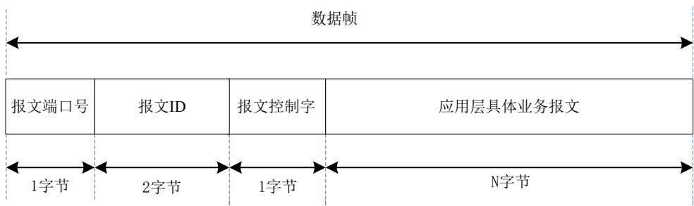  
图 1 通用报文格式

通用报文格式的字段应符合表 1要求。

表 1 通用报文格式字段说明

<table><tr><td>域</td><td>字节号</td><td>比特位</td><td>域大小(比特)</td><td>含义</td></tr><tr><td>报文端口号</td><td>0</td><td>0-7</td><td>8</td><td>CCO 与 STA 之间交互的应用层报文传输的端口号。</td></tr><tr><td>报文 ID</td><td>1-2</td><td>0-15</td><td>16</td><td>应用层报文 ID。</td></tr><tr><td>报文控制字</td><td>3</td><td>0-7</td><td>8</td><td>应默认设置为 0。</td></tr></table>

## 5.1.2 报文 ID

报文ID字段的取值应符合表 2要求，其中，使用报文ID的最高4位表示该报文附加了信道安全机制种类，最高 位取值 表示报文是明文传输；取值 表示报文采取了数据机密性保护模式；取值 表示报文采取了数据完整性保护模式；取值 表示报文采取了数据全面保护模式。例如，报文ID为0x2004表示采取了数据完整性保护模式的校时报文；报文ID为0x3032表示采取了数据全面保护模式的传输文件数据报文。

表 2 报文 ID

<table><tr><td>报文 ID</td><td>含义</td><td>报文端口号</td></tr><tr><td>0x0001</td><td>终端主动抄表</td><td>0x11</td></tr><tr><td>0x0002</td><td>路由主动抄表</td><td>0x11</td></tr><tr><td>0x0003</td><td>终端主动并发抄表</td><td>0x11</td></tr><tr><td>0x0004</td><td>校时</td><td>0x11</td></tr><tr><td>0x0005</td><td>单向业务报文</td><td>0x11</td></tr><tr><td>0x0006</td><td>通信测试</td><td>0x11</td></tr><tr><td>0x0008</td><td>事件上报</td><td>0x11</td></tr><tr><td>0x0011</td><td>查询从节点主动注册</td><td>0x11</td></tr><tr><td>0x0012</td><td>启动从节点主动注册</td><td>0x11</td></tr><tr><td>0x0013</td><td>停止从节点主动注册</td><td>0x11</td></tr><tr><td>0x0020</td><td>确认/否认</td><td>0x11</td></tr><tr><td>0x0030</td><td>开始升级</td><td>0x12</td></tr><tr><td>0x0031</td><td>停止升级</td><td>0x12</td></tr><tr><td>0x0032</td><td>传输文件数据</td><td>0x12</td></tr><tr><td>0x0033</td><td>传输文件数据(单播转本地广播)</td><td>0x12</td></tr><tr><td>0x0034</td><td>查询站点升级状态</td><td>0x12</td></tr><tr><td>0x0035</td><td>执行升级</td><td>0x12</td></tr><tr><td>0x0036</td><td>查询站点信息</td><td>0x12</td></tr><tr><td>0x0040</td><td>抄控器 CCO</td><td>0x11</td></tr><tr><td>0x0041</td><td>抄控器数据透传串口转发</td><td>0x11</td></tr><tr><td>0x00A0</td><td>鉴权安全</td><td>0x1A</td></tr><tr><td>0x00A1</td><td>台区户变关系识别</td><td>0x11</td></tr><tr><td>0x00A2</td><td>查询 ID 信息</td><td>0x11</td></tr><tr><td>0x00A3</td><td>精准校时</td><td>0x11</td></tr><tr><td>0x00E2</td><td>分钟采集任务配置</td><td>0x11</td></tr><tr><td>0x00E3</td><td>分钟采集任务数据读取</td><td>0x11</td></tr><tr><td>0x00E5</td><td>多用户应用聚合帧</td><td>0x11</td></tr><tr><td>0x00E6</td><td>告警温度门限配置</td><td>0x11</td></tr><tr><td>0x00E7</td><td>采集任务数据汇聚读取/设置</td><td>0x11</td></tr><tr><td>0x00E8</td><td>数据项抄读汇聚</td><td>0x11</td></tr></table>

## 5.2 抄表报文

## 5.2.1 下行报文格式

## 5.2.1.1 抄表下行报文格式

CCO向STA发送的抄表下行报文应符合图 2格式要求。

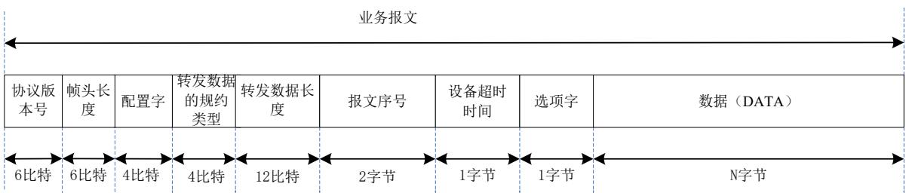  
图 2 抄表下行报文格式

抄表下行报文格式的字段应符合表 3要求。

表 3 抄表下行报文格式说明

<table><tr><td>域</td><td>字节号</td><td>比特位</td><td>域大小(比特)</td><td>含义</td></tr><tr><td>协议版本号</td><td rowspan="2">0</td><td>0-5</td><td>6</td><td>本版本取值应为1。</td></tr><tr><td rowspan="2">报文头长度</td><td>6-7</td><td rowspan="2">6</td><td rowspan="2">报文头(除数据域长度外)的长度。取值应为8。</td></tr><tr><td rowspan="4">1</td><td>0-3</td></tr><tr><td>未应答重试标志</td><td>4</td><td>1</td><td>0:不重试;1:重试;电能表未应答是否重发,该域仅对并发抄表有效,其他抄表方式置0。</td></tr><tr><td>否认重试标志</td><td>5</td><td>1</td><td>0:不重试;1:重试;STA收到否认报文是否重发,该域仅对并发抄表有效,其他抄表方式置0。</td></tr><tr><td>最大重试次数</td><td>6-7</td><td>2</td><td>该域仅对并发抄表有效,其他抄表方式置0。</td></tr><tr><td>转发数据的规约类型</td><td rowspan="2">2</td><td>0-3</td><td>4</td><td>0:透明传输;1:保留;2:DL/T 645—2007;3:DL/T 698.45;其他:保留。</td></tr><tr><td rowspan="2">转发数据长度</td><td>4-7</td><td rowspan="2">12</td><td rowspan="2">CCO发送给STA抄表数据的长度,即实际数据域的长度。</td></tr><tr><td>3</td><td>0-7</td></tr><tr><td>报文序号</td><td>4-5</td><td>0-15</td><td>16</td><td>CCO发送给STA数据报文的序号,STA应答时使用该序号返回。报文序号递增,重发请求报文的报文序号不增加。</td></tr><tr><td>设备超时时间</td><td>6</td><td>0-7</td><td>8</td><td>CCO指定,与电表通信超时时间;STA单位100ms;采集器单位200ms。</td></tr><tr><td>选项字</td><td>7</td><td>0-7</td><td>8</td><td>终端主动抄表、路由主动抄表:bit0:方向位;bit1~bit7保留。终端并发抄表:报文间间隔,单位10ms。</td></tr></table>

## 5.2.1.2 数据

数据字节长度可变，指由终端下发给CCO的抄表报文数据。终端采用主动并发抄表方式，规约类型为0x00或0x03时，报文内容应仅发送一条抄表报文；规约类型为0x02时，报文内容可有不超过13条DL/T 645-2007报文，但各报文的表地址应完全一致；规约类型为0x00/0x03时，报文内容总长度不超过2000字节，应符合图 3格式要求。

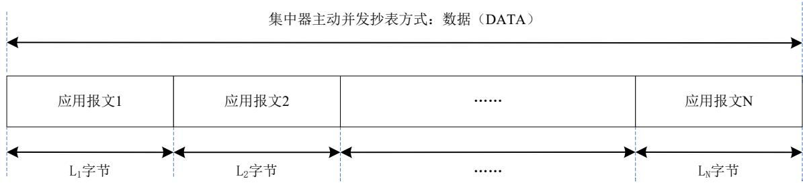  
图 3下行多帧数据格式

## 5.2.2 上行报文格式

## 5.2.2.1 抄表上行报文格式

STA向CCO应答抄表结果的上行报文应符合图 4格式要求。

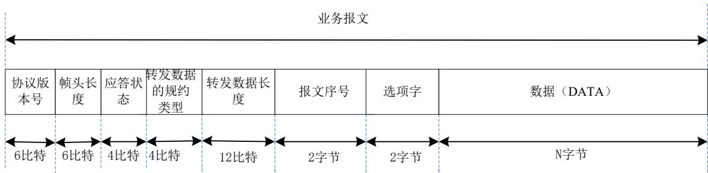  
图 4 抄表上行报文格式  
抄表上行报文数据格式的字段应符合表 4要求。

表 4 抄表上行报文格式说明

<table><tr><td>域</td><td>字节号</td><td>比特位</td><td>域大小(bit)</td><td>含义</td></tr><tr><td>协议版本号</td><td rowspan="2">0</td><td>0-5</td><td>6</td><td>本版本取值应为1。</td></tr><tr><td rowspan="2">报文头长度</td><td>6-7</td><td rowspan="2">6</td><td rowspan="2">报文头(除数据域长度外)的长度。取值应为8。</td></tr><tr><td rowspan="2">1</td><td>0-3</td></tr><tr><td>应答状态</td><td>4-7</td><td>4</td><td>取值应为0</td></tr><tr><td>转发数据的规约类型</td><td rowspan="2">2</td><td>0-3</td><td>4</td><td>0:透明传输;1:保留;2:DL/T 645—20073:DL/T 698.45其他:保留。</td></tr><tr><td rowspan="2">转发数据长度</td><td>4-7</td><td rowspan="2">12</td><td rowspan="2">抄表结果数据报文长度。</td></tr><tr><td>3</td><td>0-7</td></tr><tr><td>报文序号</td><td>4-5</td><td>0-15</td><td>16</td><td>应与下抄表报文一致。</td></tr><tr><td>选项字</td><td>6-7</td><td>0-15</td><td>16</td><td>终端主动抄表、路由主动抄表:byte0保留置0;byte1 bit0方向位、bit1-bit7保留。0:下行;1:上行终端并发抄表:bit0-bit15报文应答状态,1:有应答;0:无应答</td></tr></table>

## 5.2.2.2 数据

数据字节长度可变，指STA收到下接设备（如电能表、采集器）的抄表应答报文。

终端主动并发抄表方式时，根据“报文应答状态”字段， 数据可包含多帧应用报文，应符合图 5格式要求。

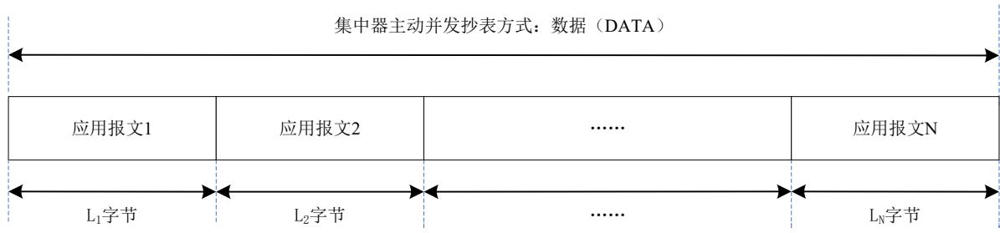  
图 5 上行多帧数据格式

## 5.2.3 抄表业务传输流程

CCO向STA发送的应用层抄表数据，STA通过电能表或采集器获取到抄表结果之后，将抄表结果应答给CCO。

终端主动抄表、路由主动抄表、终端主动并发抄表传输流程应符合图 6要求。

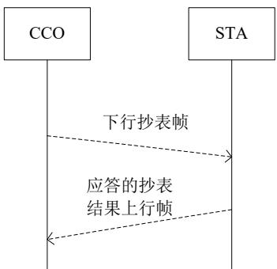  
图 6 抄表业务报文传输流程

## 5.3 从节点注册报文

## 5.3.1 启动从节点注册

## 5.3.1.1 下行报文格式

CCO收到终端的启动从节点主动注册命令后，CCO应向STA发送启动从节点主动注册命令，STA不应应答上行报文给CCO。

启动从节点主动注册命令的下行报文应符合图 7格式要求。

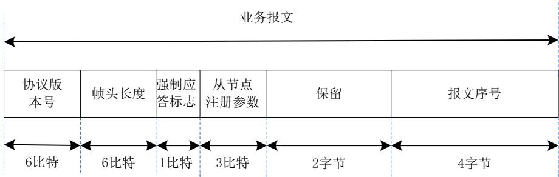  
图 7 从节点注册下行报文格式

启动从节点注册下行报文数据格式的字段应符合表 5要求。

表 5 从节点注册下行报文格式说明

<table><tr><td>域</td><td>字节号</td><td>比特位</td><td>域大小(比特)</td><td>含义</td></tr><tr><td>协议版本号</td><td rowspan="2">0</td><td>0-5</td><td>6</td><td>本版本取值应为1。</td></tr><tr><td rowspan="2">报文头长度</td><td>6-7</td><td rowspan="2">6</td><td rowspan="2">报文头(除数据域长度外)的长度。取值应为8。</td></tr><tr><td rowspan="3">1</td><td>0-3</td></tr><tr><td>强制应答标志</td><td>4</td><td>1</td><td>0:非强制应答;1:强制应答;取值应为0。</td></tr><tr><td>从节点注册参数</td><td>5-7</td><td>3</td><td>取值应为1。</td></tr><tr><td>保留</td><td>2-3</td><td>0-15</td><td>16</td><td></td></tr><tr><td>报文序号</td><td>4-7</td><td>0-7</td><td>32</td><td>序号递增,重发不变。</td></tr></table>

## 5.3.1.2 启动从节点注册传输流程

CCO向所有STA发送启动从节点主动注册命令，STA不应应答上行报文给CCO。从节点主动注册传输流程应符合图 8要求。

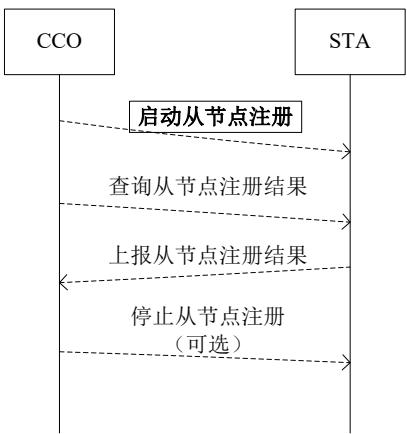  
图 8 从节点注册传输流程

## 5.3.2 查询从节点注册结果

## 5.3.2.1 下行报文格式

启动从节点主动注册结束后，CCO开始向STA发送查询从节点注册结果命令。

查询从节点注册结果命令的下行数据报文应符合图 9格式要求。

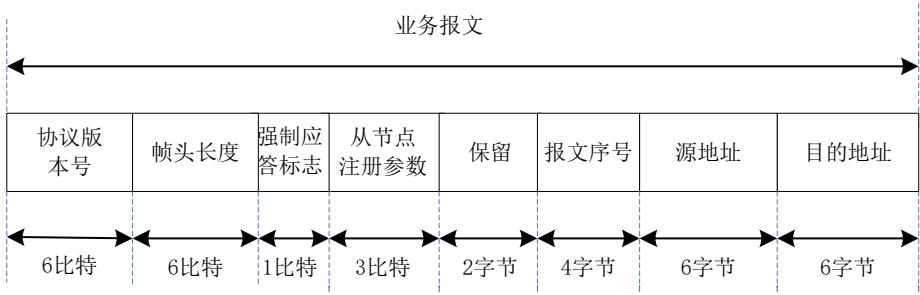  
图 9 查询从节点注册结果下行报文格式  
查询从节点注册下行报文数据格式的字段应符合表 6要求。

表 6 查询从节点注册结果下行报文格式说明

<table><tr><td>域</td><td>字节号</td><td>比特位</td><td>域大小(比特)</td><td>含义</td></tr><tr><td>协议版本号</td><td>0</td><td>0-5</td><td>6</td><td>本版本取值应为1。</td></tr><tr><td rowspan="2">报文头长度</td><td>0</td><td>6-7</td><td rowspan="2">6</td><td rowspan="2">报文头(除数据域长度外)的长度。取值应为20。</td></tr><tr><td rowspan="3">1</td><td>0-3</td></tr><tr><td>强制应答标志</td><td>4</td><td>1</td><td>0:STA正在搜表,不应答;搜表完成,应答;1:强制应答。</td></tr><tr><td>从节点注册参数</td><td>5-7</td><td>3</td><td>取值应为0。</td></tr><tr><td>保留</td><td>2-3</td><td>0-15</td><td>16</td><td></td></tr><tr><td>报文序号</td><td>4-7</td><td>0-7</td><td>32</td><td>序号递增,重发不变。</td></tr><tr><td>源MAC地址</td><td>8-13</td><td>0-47</td><td>48</td><td>CCO的MAC地址。</td></tr><tr><td>目的MAC地址</td><td>14-19</td><td>0-47</td><td>48</td><td>待查询站点的MAC地址。</td></tr></table>

## 5.3.2.2 上行报文格式

STA收到CCO下发的查询从节点注册结果命令后，应答从节点注册结果给CCO。上行报文格式应符合图 10格式要求。

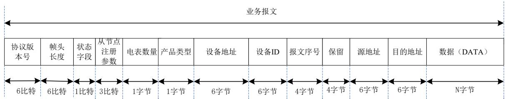  
图 10 查询从节点注册结果上行报文格式

图 10中数据的格式应符合图 11格式要求。

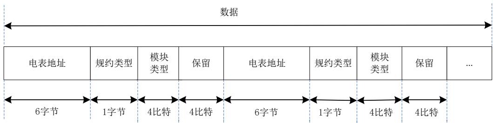  
图 11 数据域格式  
查询从节点注册上行报文数据格式的字段应符合表 7要求。

表 7 查询从节点注册结果上行报文格式说明

<table><tr><td>域</td><td>字节号</td><td>比特位</td><td>域大小(比特)</td><td>含义</td></tr><tr><td>协议版本号</td><td rowspan="2">0</td><td>0-5</td><td>6</td><td>本版本取值应为1。</td></tr><tr><td rowspan="2">报文头长度</td><td>6-7</td><td rowspan="2">6</td><td rowspan="2">报文头(除数据域长度外)的长度。取值应为36。</td></tr><tr><td>1</td><td>0-3</td></tr><tr><td>状态字段</td><td rowspan="2">1</td><td>4</td><td>1</td><td>1:STA正在搜表;0:STA搜表完成。</td></tr><tr><td>从节点注册参数</td><td>5-7</td><td>3</td><td>取值应为0。</td></tr><tr><td>电能表数量</td><td>2</td><td>0-7</td><td>8</td><td>STA搜到的电表数量。</td></tr><tr><td>产品类型</td><td>3</td><td>0-7</td><td>8</td><td>0:电能表;1:I型采集器;2:II型采集器;3-255:保留。</td></tr><tr><td>设备地址</td><td>4-9</td><td>0-47</td><td>48</td><td>电能表:电能表地址;采集器:采集器地址。</td></tr><tr><td>设备ID</td><td>10-15</td><td>0-47</td><td>48</td><td>STA本身唯一地址。</td></tr><tr><td>报文序号</td><td>16-19</td><td>0-31</td><td>32</td><td>应与下行报文一致。</td></tr><tr><td>保留</td><td>20-23</td><td>0-31</td><td>32</td><td></td></tr><tr><td>源MAC地址</td><td>24-29</td><td>0-47</td><td>48</td><td>发送站点MAC地址。</td></tr><tr><td>目的MAC地址</td><td>30-35</td><td>0-47</td><td>48</td><td>CCO的MAC地址。</td></tr></table>

## 5.3.2.3 查询从节点注册结果传输流程

CCO向所有STA发送启动从节点主动注册命令完成后，再发送查询从节点注册结果报文，STA将搜表结果上报给CCO。查询从节点注册结果传输流程应符合图 12要求。

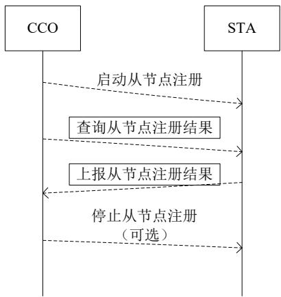  
图 12 查询从节点注册结果传输流程

## 5.3.3 停止从节点注册

## 5.3.3.1 下行报文格式

如果CCO正在从节点注册过程中接收到终端下发的停止从节点注册命令，CCO应向STA发送停止从节点注册报文，STA不应应答上行报文给CCO。停止从节点注册命令的下行报文应符合图 13格式要求。

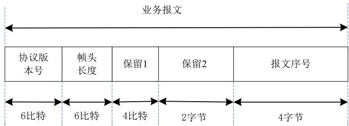  
图 13 停止从节点注册下行报文格式

停止从节点注册下行报文数据格式的字段应符合表 8要求。

表 8 停止从节点注册下行报文格式说明

<table><tr><td>域</td><td>字节号</td><td>比特位</td><td>域大小(比特)</td><td>含义</td></tr><tr><td>协议版本号</td><td rowspan="2">0</td><td>0-5</td><td>6</td><td>本版本取值应为1。</td></tr><tr><td rowspan="2">报文头长度</td><td>6-7</td><td rowspan="2">6</td><td rowspan="2">报文头(除数据域长度外)的长度。取值应为8。</td></tr><tr><td rowspan="2">1</td><td>0-3</td></tr><tr><td>保留1</td><td>4-7</td><td>4</td><td></td></tr><tr><td>保留2</td><td>2-3</td><td>0-15</td><td>16</td><td></td></tr><tr><td>报文序号</td><td>4-7</td><td>0-31</td><td>32</td><td>序号递增,重发不变。</td></tr></table>

## 5.3.3.2 停止从节点注册传输流程

CCO向所有STA发送停止从节点主动注册命令，STA不应回应上行报文给CCO。停止从节点注册传输流程应符合图 14要求。

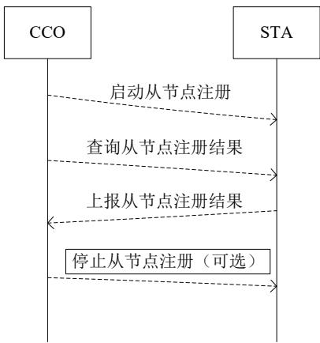  
图 14 停止从节点注册传输流程

## 5.4 校时报文

## 5.4.1 下行报文格式

CCO启动校时命令时，应将校时命令转发给所有的STA，再通过STA给电能表校时。校时下行报文应符合图 15格式要求。

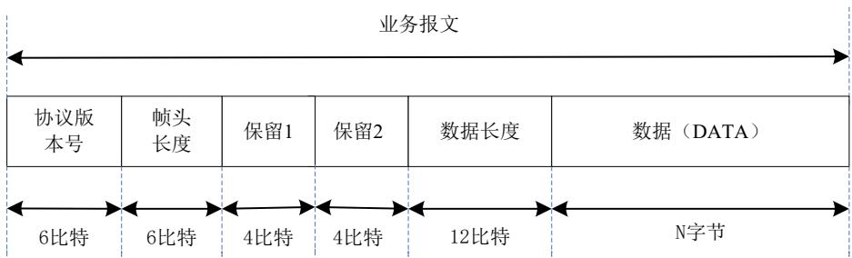  
图 15 校时下行报文格式

校时下行报文格式字段应符合表 9要求。

表 9 校时下行报文格式说明

<table><tr><td>域</td><td>字节号</td><td>比特位</td><td>域大小(比特)</td><td>含义</td></tr><tr><td>协议版本号</td><td rowspan="2">0</td><td>0-5</td><td>6</td><td>本版本取值应为1。</td></tr><tr><td rowspan="2">报文头长度</td><td>6-7</td><td rowspan="2">6</td><td rowspan="2">报文头(除数据域长度外)的长度。</td></tr><tr><td rowspan="2">1</td><td>0-3</td></tr><tr><td>保留1</td><td>4-7</td><td>4</td><td></td></tr><tr><td>保留2</td><td rowspan="2">2</td><td>0-3</td><td>4</td><td></td></tr><tr><td rowspan="2">数据长度</td><td>4-7</td><td rowspan="2">12</td><td rowspan="2">实际数据(DATA)域的长度。</td></tr><tr><td>3</td><td>0-7</td></tr></table>

## 5.4.2 校时报文传输流程

校时报文传输流程应符合图 16要求。

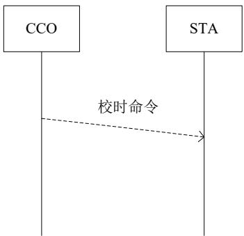  
图 16 校时报文传输流程

## 5.5 事件报文

## 5.5.1 报文格式

## 5.5.1.1 事件报文格式

STA事件上报分为电能表事件、停复电事件和即装即采事件，所有事件报文格式相同，数据域内容不同。事件报文的上行格式和下行格式相同，STA应将事件内容主动上报给CCO，CCO应答确认或缓冲区满下行报文给STA，CCO再将事件上报给终端。

事件报文应符合图 17格式要求。

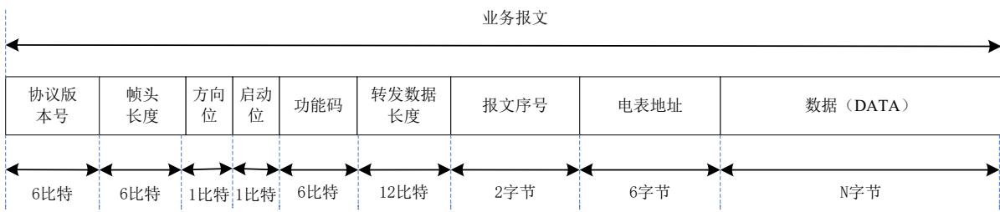  
图 17 事件报文格式  
事件报文数据格式的字段应符合表 10要求。

表 10 事件报文格式说明

<table><tr><td>域</td><td>字节号</td><td>比特位</td><td>域大小(比特)</td><td>含义</td></tr><tr><td>协议版本号</td><td rowspan="2">0</td><td>0-5</td><td>6</td><td>本版本取值应为1。</td></tr><tr><td rowspan="2">报文头长度</td><td>6-7</td><td rowspan="2">6</td><td rowspan="2">报文头(除数据(DATA)长度外)的长度。</td></tr><tr><td rowspan="4">1</td><td>0-3</td></tr><tr><td>方向位</td><td>4</td><td>1</td><td>0:下行;1:上行。</td></tr><tr><td>启动位</td><td>5</td><td>1</td><td>0:来自从动站;1:来自启动站。</td></tr><tr><td rowspan="2">功能码</td><td>6-7</td><td rowspan="2">6</td><td rowspan="2">应按表11功能码含义执行。</td></tr><tr><td rowspan="2">2</td><td>0-3</td></tr><tr><td>转发数据长度</td><td>4-70-7</td><td>12</td><td>数据域的长度。</td></tr><tr><td></td><td>3</td><td></td><td></td><td></td></tr><tr><td>报文序号</td><td>4-5</td><td>0-15</td><td>16</td><td>由STA分配,STA向CCO上报事件报文时,报文序号递增,重发时不增加,CCO应答时使用该序号返回。</td></tr><tr><td>电能表地址</td><td>6-11</td><td>0-7</td><td>48</td><td>发生事件的电能表地址。</td></tr></table>

功能码具体取值应符合表 11要求。

表 11 功能码含义

<table><tr><td>功能码含义</td><td>功能码的值</td><td>方向位</td></tr><tr><td>CCO 应答确认给 STA</td><td>1</td><td>下行</td></tr><tr><td>CCO 下发允许事件主动上报给 STA</td><td>2</td><td>下行</td></tr><tr><td>CCO 下发禁止事件主动上报给 STA</td><td>3</td><td>下行</td></tr><tr><td>CCO 应答事件缓存区满给 STA</td><td>4</td><td>下行</td></tr><tr><td>STA 主动上报事件给 CCO(电表触发)</td><td>1</td><td>上行</td></tr><tr><td>STA 主动上报事件给 CCO(模块触发)</td><td>2</td><td>上行</td></tr><tr><td>STA 主动上报事件给 CCO(采集器触发)</td><td>3</td><td>上行</td></tr></table>

## 5.5.1.2 电能表事件数据

电表触发的事件上行报文中的数据是应用报文中电能表应答的主动上报事件状态字报文。

## 5.5.1.3 停复电事件数据

对于 STA 停复电上报事件，报文扩展应分别支持位图和地址方式的停电和上电上报。对于电表停电事件上报，宜采用位图方式，采集器下电表的停电事件上报，应采用地址方式。位图方式数据字段应符合表 12要求。

表 12 位图方式数据域定义

<table><tr><td>数据子域</td><td>字节号</td><td>比特位</td><td>域大小(比特)</td><td>取值</td></tr><tr><td>STA上报事件类型</td><td>12</td><td>0-7</td><td>8</td><td>1:代表停电事件(位图);2:代表上电事件(位图)。</td></tr><tr><td>发生事件站点起始TEI</td><td>13-14</td><td>0-7</td><td>16</td><td>TEI。</td></tr><tr><td>发生事件的节点位图</td><td>可变长</td><td>0-7</td><td>可变长</td><td>对应的位置1,标志该位对应的TEI节点发生了该事件,第1个bit代表起始TEI,后续依次类推。</td></tr></table>

地址方式数据字段应符合表 13要求：

表 13 地址方式数据域定义

<table><tr><td>数据子域</td><td>字节号</td><td>比特位</td><td>域大小(比特)</td><td>取值</td></tr><tr><td>STA上报事件类型</td><td>12</td><td>0-7</td><td>8</td><td>3:代表停电事件(地址);4:代表上电事件(地址)。</td></tr><tr><td>发生事件的电表个数</td><td>13-14</td><td>0-7</td><td>16</td><td>发生事件电表个数。</td></tr><tr><td>发生事件的第1只电表地址</td><td>15-20</td><td>0-7</td><td>48</td><td>发生事件的电表地址。</td></tr><tr><td>发生事件的第1只电表带电状态</td><td>21</td><td>0-7</td><td>8</td><td>0:停电;1:未停电。</td></tr><tr><td>......</td><td></td><td></td><td></td><td></td></tr><tr><td>发生事件的第N只电表地址</td><td>21+7*(N-1)</td><td>0-7</td><td>48</td><td>发生事件的电表地址。</td></tr><tr><td>发生事件的第N只电表带电状态</td><td>21+7*(N-1)+6</td><td>0-7</td><td>8</td><td>0:停电;1:未停电。</td></tr></table>

## 5.5.1.4 温度越限事件数据

温度越限事件数据格式，应符合表 14要求：

表 14 温度越限事件数据域定义

<table><tr><td>数据子域</td><td>字节号</td><td>比特位</td><td>域大小(比特)</td><td>取值</td></tr><tr><td>STA上报事件类型</td><td>12</td><td>0-7</td><td>8</td><td>5:温度越限事件。</td></tr><tr><td>发生事件站点地址</td><td>13-18</td><td>0-7</td><td>48</td><td>上报事件的站点地址。</td></tr><tr><td>上报温度</td><td>19-20</td><td>0-7</td><td>16</td><td>BCD格式:XXX.X摄氏度,小端在前。</td></tr></table>

## 5.5.2 事件报文传输流程

STA将事件状态字主动上报给CCO，CCO能够处理时，应应答确认，CCO缓冲区满时，应应答缓冲区满给STA。

事件报文传输流程应符合图 18要求。

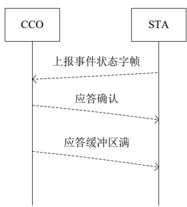

图 18 事件报文传输流程

## 5.5.3 即装即采业务

双模通信单元应支持即装即采业务功能。

## 5.6 通信测试命令报文

## 5.6.1 通信测试命令下行报文格式

CCO收到终端下发的通信测试报文后，应将报文中的测试数据发送给相应的STA，STA处理完成后不应应答上行报文给CCO。

通信测试下行报文符合图 19格式要求。

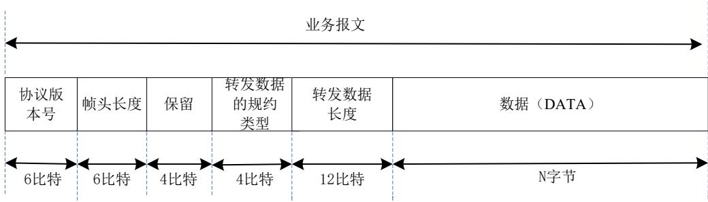  
图 19 通信测试下行报文格式  
报文数据格式的字段应符合表 15要求。

表 15 通信测试下行报文格式说明

<table><tr><td>域</td><td>字节号</td><td>比特位</td><td>域大小(比特)</td><td>含义</td></tr><tr><td>协议版本号</td><td>0</td><td>0-5</td><td>6</td><td>本版本取值应为1。</td></tr><tr><td rowspan="2">报文头长度</td><td>0</td><td>6-7</td><td rowspan="2">6</td><td rowspan="2">报文头(除数据(DATA)长度外)的长度。</td></tr><tr><td rowspan="2">1</td><td>0-3</td></tr><tr><td>保留</td><td>4-7</td><td>4</td><td></td></tr><tr><td>转发数据的规约类型</td><td rowspan="2">2</td><td>0-3</td><td>4</td><td>0:透明传输;1:保留;2:DL/T 645—2007;3:DL/T 698.45;其他:保留。</td></tr><tr><td rowspan="2">转发数据长度</td><td>4-7</td><td rowspan="2">12</td><td rowspan="2">实际数据(DATA)域的长度。</td></tr><tr><td>3</td><td>0-7</td></tr></table>

## 5.6.2 通信测试传输流程

CCO将通信测试报文发送给相应的STA，STA处理完成后不应应答上行报文给CCO。通信测试传输流程应符合图 20要求。

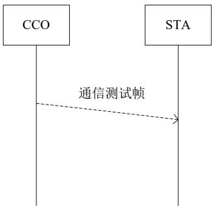  
图 20 通信测试传输流程

## 5.7 确认/否认报文

确认/否认上下行报文格式相同。

报文格式应符合图 21格式要求。

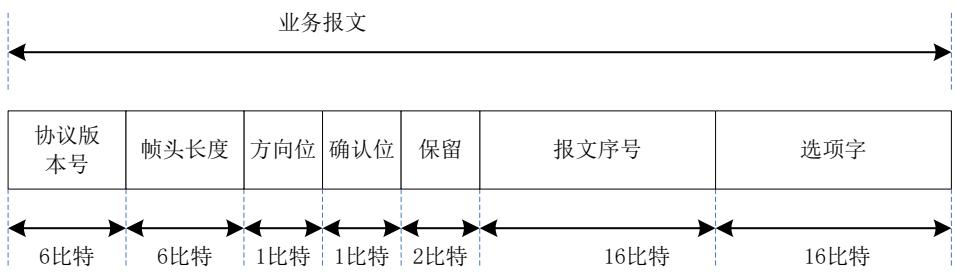  
图 21 确认/否认报文格式

确认/否认报文格式的字段应符合表 16要求。

表 16 确认/否认报文格式说明

<table><tr><td>域</td><td>字节号</td><td>比特位</td><td>域大小(比特)</td><td>含义</td></tr><tr><td>协议版本号</td><td rowspan="2">0</td><td>0-5</td><td>6</td><td>本版本取值应为1。</td></tr><tr><td rowspan="2">报文头长度</td><td>6-7</td><td rowspan="2">6</td><td rowspan="2">报文头(除数据(DATA)长度外)的长度。</td></tr><tr><td rowspan="4">1</td><td>0-3</td></tr><tr><td>方向位</td><td>4</td><td>1</td><td>0:下行;1:上行。</td></tr><tr><td>确认位</td><td>5</td><td>1</td><td>0:否认;1:确认。</td></tr><tr><td>保留</td><td>6-7</td><td>2</td><td></td></tr><tr><td>报文序号</td><td>2-3</td><td>0-15</td><td>16</td><td>CCO确认/否认帧应答时使用该序号返回。STA通过序号来判断接收到的确认/否认是否过期,即是否是上行报文所对应的确认/否认应答报文。</td></tr></table>

## 5.8 升级报文

## 5.8.1 下行报文格式

## 5.8.1.1 开始升级

CCO向STA发送的开始升级下行报文应符合图 22格式要求。

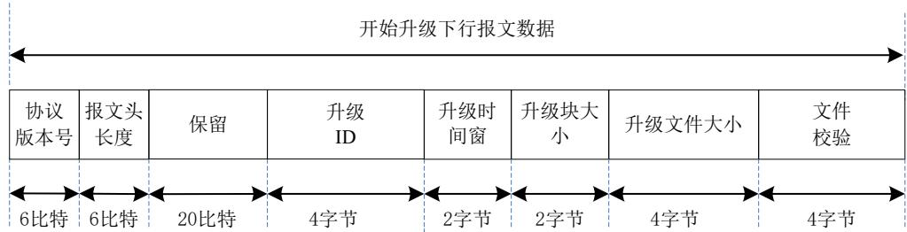  
图 22 开始升级下行报文数据格式  
开始升级下行报文数据字段应符合表 17要求。

表 17 开始升级下行报文数据字段说明

<table><tr><td>域</td><td>字节号</td><td>比特位</td><td>域大小(比特)</td><td>含义</td></tr><tr><td>协议版本号</td><td rowspan="2">0</td><td>0-5</td><td>6</td><td>本版本取值应为1。</td></tr><tr><td rowspan="2">报文头长度</td><td>6-7</td><td rowspan="2">6</td><td rowspan="2">报文头(除数据域长度外)的长度,用于接收方从报文头偏移报文头长度找到数据域的位置。</td></tr><tr><td rowspan="2">1</td><td>0-3</td></tr><tr><td rowspan="2">保留</td><td>4-7</td><td>4</td><td></td></tr><tr><td>2-3</td><td>0-15</td><td>16</td><td></td></tr><tr><td>升级ID</td><td>4-7</td><td>0-31</td><td>32</td><td>用于区分每次升级,即每次升级都应该有变化(可以递增,也可以随机变化)。STA端在收到开始升级报文时,需要保存此升级ID,在应答CCO时使用自身存储的升级ID,以此向CCO表明STA当前正工作在哪次升级流程中;CCO在查询STA时,根据STA应答的文件ID判断STA端是否正处于当前升级流程,并以此决定继续流程或者忽略此STA,如果当前STA不在升级状态,即空闲态,则回复0,如果在升级状态,回复真实升级ID。每次升级不应重复,且不应为0。下发停止升级命令时,使用0作为通用升级ID终止本次升级操作。</td></tr><tr><td>升级时间窗</td><td>8-9</td><td>0-15</td><td>16</td><td>表示升级过程的最长时间,超过该时间文件没有收全,本次传输STA自动放弃。单位:分钟。文件传输完毕后,CCO会通知站点重启,使新程序生效;如果STA识别到自身需要升级软件,且升级文件实际已全部收全,但在时间窗内没有收到过重启命令,则时间窗到期时自行重启。</td></tr><tr><td>升级块大小</td><td>10-11</td><td>0-15</td><td>16</td><td>表示升级包载荷中包含的数据块的大小,每个数据帧只传输一个数据块,除最后1个数据块外,每个数据块的大小应该相等。允许的取值为:100、200、300、400字节。</td></tr><tr><td>升级文件大小</td><td>12-15</td><td>0-31</td><td>32</td><td>表示升级文件包含的字节数。</td></tr><tr><td>文件 CRC 校验</td><td>16-19</td><td>0-31</td><td>32</td><td>表示文件所有内容的 CRC-32 校验。</td></tr></table>

## 5.8.1.2 停止升级

CCO向STA发送的停止升级下行报文数据格式应符合图 23格式要求。

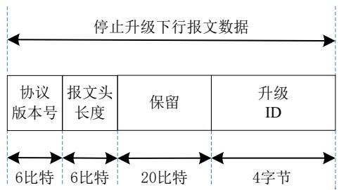  
图 23 停止升级下行报文数据格式  
停止升级下行报文数据字段应符合表 18要求。

表 18 停止升级下行报文数据字段说明

<table><tr><td>域</td><td>字节号</td><td>比特位</td><td>域大小(比特)</td><td>含义</td></tr><tr><td>协议版本号</td><td>0</td><td>0-5</td><td>6</td><td>本版本取值应为1。</td></tr><tr><td rowspan="2">报文头长度</td><td>0</td><td>6-7</td><td rowspan="2">6</td><td rowspan="2">报文头(除数据域长度外)的长度,用于接收方从报文头偏移报文头长度找到数据域的位置。</td></tr><tr><td>1</td><td>0-3</td></tr><tr><td rowspan="2">保留</td><td></td><td>4-7</td><td>4</td><td></td></tr><tr><td>2-3</td><td>0-15</td><td>16</td><td></td></tr><tr><td>升级ID</td><td>4-7</td><td>0-31</td><td>32</td><td>含义同表17相关介绍。</td></tr></table>

## 5.8.1.3 传输文件数据

CCO向STA发送的传输文件数据数据格式应符合图 24格式要求。

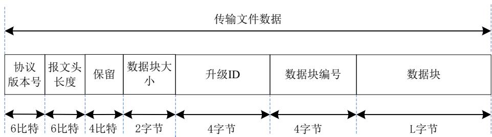  
图 24 传输文件数据下行报文数据格式  
传输文件数据数据字段应符合表 19要求。

表 19 传输文件数据下行报文字段说明

<table><tr><td>域</td><td>字节号</td><td>比特位</td><td>域大小(比特)</td><td>含义</td></tr><tr><td>协议版本号</td><td rowspan="2">0</td><td>0-5</td><td>6</td><td>本版本取值应为1。</td></tr><tr><td rowspan="2">报文头长度</td><td>6-7</td><td rowspan="2">6</td><td rowspan="2">报文头(除数据域长度外)的长度,用于接收方从报文头偏移报文头长度找到数据域的位置。</td></tr><tr><td rowspan="2">1</td><td>0-3</td></tr><tr><td>保留</td><td>4-7</td><td>4</td><td></td></tr><tr><td>数据块大小</td><td>2-3</td><td>0-15</td><td>16</td><td>表示数据块包含数据的字节数。</td></tr><tr><td>升级ID</td><td>4-7</td><td>0-31</td><td>32</td><td>含义同表17相关介绍。</td></tr><tr><td>数据块编号</td><td>8-11</td><td>0-31</td><td>32</td><td>每帧报文传输1个数据块,其编号递增。</td></tr><tr><td>数据块</td><td>变长</td><td>变长</td><td>变长</td><td>升级包内容,长度等于数据块大小。</td></tr></table>

## 5.8.1.4 查询站点升级状态

CCO向STA发送的查询站点升级状态下行报文应符合图 25格式要求。

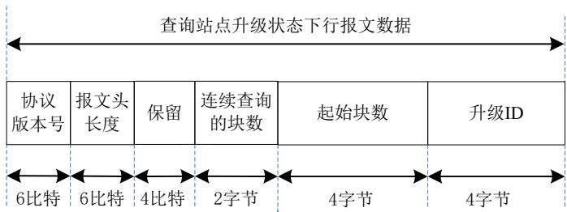  
图 25 查询站点升级状态下行报文数据格式

查询站点升级状态下行报文数据字段应符合表 20要求。

表 20 查询站点升级状态下行报文数据字段说明

<table><tr><td>域</td><td>字节号</td><td>比特位</td><td>域大小(比特)</td><td>含义</td></tr><tr><td>协议版本号</td><td rowspan="2">0</td><td>0-5</td><td>6</td><td>本版本取值应为1。</td></tr><tr><td rowspan="2">报文头长度</td><td>6-7</td><td rowspan="2">6</td><td rowspan="2">报文头(除数据域长度外)的长度,用于接收方从报文头偏移报文头长度找到数据域的位置。</td></tr><tr><td rowspan="2">1</td><td>0-3</td></tr><tr><td>保留</td><td>4-7</td><td>4</td><td></td></tr><tr><td>连续查询的块数</td><td>2-3</td><td>0-15</td><td>16</td><td>连续查询的块个数,0xFFFF表示查询所有的块状态。</td></tr><tr><td>起始块号</td><td>4-7</td><td>0-31</td><td>32</td><td>查询的起始块号。</td></tr><tr><td>升级ID</td><td>8-11</td><td>0-31</td><td>32</td><td>含义同表17相关介绍。</td></tr></table>

## 5.8.1.5 执行升级

CCO向STA发送的执行升级下行报文数据格式应符合图 26格式要求。

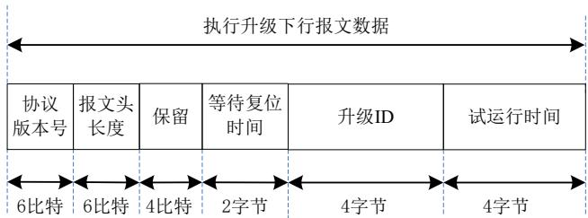  
图 26 执行升级下行报文数据格式

执行升级下行报文数据字段应符合表 21要求。

表 21 执行升级下行报文数据字段说明

<table><tr><td>域</td><td>字节号</td><td>比特位</td><td>域大小(比特)</td><td>含义</td></tr><tr><td>协议版本号</td><td rowspan="2">0</td><td>0-5</td><td>6</td><td>本版本取值应为1。</td></tr><tr><td rowspan="2">报文头长度</td><td>6-7</td><td rowspan="2">6</td><td rowspan="2">报文头(除数据域长度外)的长度,用于接收方从报文头偏移报文头长度找到数据域的位置。</td></tr><tr><td rowspan="2">1</td><td>0-3</td></tr><tr><td>保留</td><td>4-7</td><td>4</td><td></td></tr><tr><td>等待复位时间</td><td>2-3</td><td>0-15</td><td>16</td><td>站点收到此报文后等待该时间后重启,单位:秒。</td></tr><tr><td>升级ID</td><td>4-7</td><td>0-31</td><td>32</td><td>含义同表17相关介绍。</td></tr><tr><td>试运行时间</td><td>8-11</td><td>0-31</td><td>32</td><td>表示站点可以试运行新版程序多长时间,从重启的那一刻开始计时,若为0表示不需要试运行,单位:秒。</td></tr></table>

## 5.8.1.6 传输文件数据（单播转本地广播）

报文数据格式同“5.8.1.3 传输文件数据”。站点收到此报文后，应将报文ID修改为“传输文件数据（单播转本地广播）”的报文ID（0x0033），再本地广播修改后的报文。

## 5.8.1.7 查询站点信息

CCO向STA发送的查询站点信息下行报文数据格式应符合图 27格式要求。

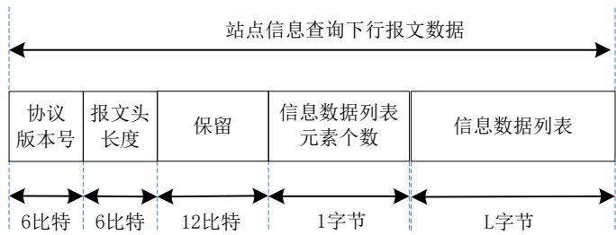  
图 27 查询站点信息下行报文数据格式

查询站点信息下行报文数据字段应符合表 22要求。

表 22 查询站点信息下行报文数据字段说明

<table><tr><td>域</td><td>字节号</td><td>比特位</td><td>域大小(比特)</td><td>含义</td></tr><tr><td>协议版本号</td><td rowspan="2">0</td><td>0-5</td><td>6</td><td>本版本取值应为1。</td></tr><tr><td rowspan="2">报文头长度</td><td>6-7</td><td rowspan="2">6</td><td rowspan="2">报文头(除数据域长度外)的长度,用于接收方从报文头偏移报文头长度找到数据域的位置。</td></tr><tr><td rowspan="2">1-2</td><td>0-3</td></tr><tr><td>保留</td><td>4-15</td><td>12</td><td></td></tr><tr><td>信息列表元素个数</td><td>3</td><td>0-7</td><td>8</td><td>信息列表中,元素的个数。</td></tr><tr><td>信息列表</td><td>变长</td><td>变长</td><td>变长</td><td>信息列表中可包括1个或多个信息元素,每个元素ID为1字节,应支持同时查询多个元素ID。信息列表元素ID如下所示:0x00:厂商编号,2字节ASCII;0x01:版本信息,2字节BCD码(硬件版本号和软件版本号各占一个字节);0x02:Bootloader,1字节BIN;0x03:CRC-32,4字节;0x04:文件长度,4字节;0x05:产品类型,参照表7产品类型域取值;其他:保留。</td></tr></table>

## 5.8.2 上行报文格式

## 5.8.2.1 开始升级

STA向CCO发送的开始升级上行报文数据格式应符合图 28格式要求。

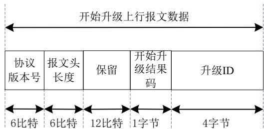  
图 28 开始升级上行报文数据格式

开始升级上行报文数据字段应符合表 23要求。

表 23 开始升级上行报文数据字段说明

<table><tr><td>域</td><td>字节号</td><td>比特位</td><td>域大小(比特)</td><td>含义</td></tr><tr><td>协议版本号</td><td>0</td><td>0-5</td><td>6</td><td>本版本取值应为1。</td></tr><tr><td rowspan="2">报文头长度</td><td>0</td><td>6-7</td><td rowspan="2">6</td><td rowspan="2">报文头(除数据域长度外)的长度,用于接收方从报文头偏移报文头长度找到数据域的位置。</td></tr><tr><td rowspan="2">1</td><td>0-3</td></tr><tr><td rowspan="2">保留</td><td>4-7</td><td>4</td><td></td></tr><tr><td>2</td><td>0-7</td><td>8</td><td></td></tr><tr><td>开始升级结果码</td><td>3</td><td>0-7</td><td>8</td><td>表示STA收到开始升级报文之后的处理结果错误码,0表示成功,其他值表示失败。</td></tr><tr><td>升级ID</td><td>4-7</td><td>0-31</td><td>32</td><td>含义同表17相关介绍。</td></tr></table>

## 5.8.2.2 停止升级

无上行报文。

## 5.8.2.3 传输文件数据（单播）

无上行报文。

## 5.8.2.4 查询站点升级状态

STA向CCO发送的查询站点升级状态上行报文应符合图 29格式要求。

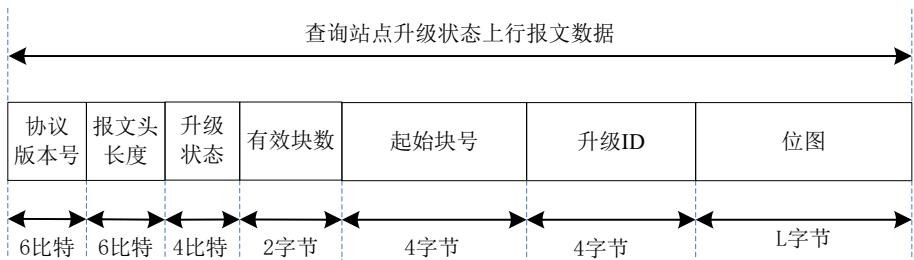  
图 29 查询站点升级状态上行报文数据格式

查询站点升级状态上行报文数据字段应符合表 24要求。

表 24 开始升级上行报文数据字段说明

<table><tr><td>域</td><td>字节号</td><td>比特位</td><td>域大小(比特)</td><td>含义</td></tr><tr><td>协议版本号</td><td rowspan="2">0</td><td>0-5</td><td>6</td><td>本版本取值应为1。</td></tr><tr><td rowspan="2">报文头长度</td><td>6-7</td><td rowspan="2">6</td><td rowspan="2">报文头(除数据域长度外)的长度,用于接收方从报文头偏移报文头长度找到数据域的位置。</td></tr><tr><td>1</td><td>0-3</td></tr><tr><td>升级状态</td><td></td><td>4-7</td><td>4</td><td>升级的进展情况,0-空闲态、1-接收进行态、2-接收完成态、3-升级进行态、4-试运行态。</td></tr><tr><td>有效块数</td><td>2-3</td><td>0-15</td><td>16</td><td>在位图中,有效的块数,从位图的第0个比特开始计算,当传输文件的块数不是8的整数倍时,最后有几个比特会无效。</td></tr><tr><td>起始块号</td><td>4-7</td><td>0-31</td><td>32</td><td>查询的起始块号。</td></tr><tr><td>升级ID</td><td>8-11</td><td>0-31</td><td>32</td><td>含义同表17相关介绍。</td></tr><tr><td>位图</td><td>变长</td><td>变长</td><td>变长</td><td>描述传输中接收到的文件块位图,0表示该块数据未收到,1表示该块数据已接收到。</td></tr></table>

## 5.8.2.5 执行升级

无上行报文。

## 5.8.2.6 传输文件数据（单播转本地广播）

无上行报文。

## 5.8.2.7 查询站点信息

STA应答CCO发送的查询站点信息上行报文应符合图 30格式要求。

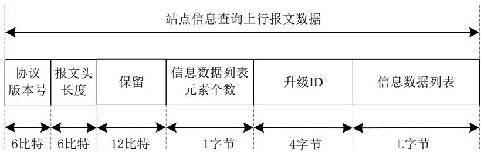  
图 30 查询站点信息上行报文数据格式

查询站点信息上行报文数据字段应符合表 25要求。

表 25 查询站点信息上行报文数据字段说明

<table><tr><td>域</td><td>字节号</td><td>比特位</td><td>域大小(比特)</td><td>含义</td></tr><tr><td>协议版本号</td><td rowspan="2">0</td><td>0-5</td><td>6</td><td>本版本取值应为1。</td></tr><tr><td rowspan="2">报文头长度</td><td>6-7</td><td rowspan="2">6</td><td rowspan="2">报文头(除数据域长度外)的长度,用于接收方从报文头偏移报文头长度找到数据域的位置。</td></tr><tr><td rowspan="2">1</td><td>0-3</td></tr><tr><td rowspan="2">保留</td><td>4-7</td><td>4</td><td></td></tr><tr><td>2</td><td>0-7</td><td>8</td><td></td></tr><tr><td>信息数据列表元素个数</td><td>3</td><td>0-7</td><td>8</td><td>信息数据列表中元素的个数。</td></tr><tr><td>升级ID</td><td>4-7</td><td>0-31</td><td>32</td><td>含义同表17相关介绍。</td></tr><tr><td>信息列表</td><td>变长</td><td>变长</td><td>变长</td><td>信息数据列表中,包括多个信息元素数据,每个信息元素数据的结构字段应符合表26要求。</td></tr></table>

表 26 信息列表元素字段说明

<table><tr><td>域</td><td>字节号</td><td>比特位</td><td>域大小(比特)</td></tr><tr><td>元素 ID</td><td>0</td><td>0-7</td><td>8</td></tr><tr><td>元素数据长度</td><td>1</td><td>0-7</td><td>8</td></tr><tr><td>元素数据</td><td>2-N</td><td>/</td><td>/</td></tr></table>

## 5.8.3 升级业务传输流程

站点的升级过程分为五种状态：空闲态、接收进行态、接收完成态、升级进行态、试运行态。

未进行在线升级时，处于空闲状态。 进行在线升级时，若正传输文件数据，且文件数据尚未传输完成，则处于接收进行态。STA进行在线升级时，若已完成文件数据传输，且文件数据CRC校验正确，则处于接收完成态。 进行在线升级时，若文件数据 校验正确，且收到执行升级命令，还未进行重启，则处于升级进行态。STA进行在线升级时，若已经重启，且未到试运行结束时刻，则处于试运行态。

站点各状态间的转移触发条件应符合表 27 要求。

表 27 在线升级状态转移表

<table><tr><td>当前状态</td><td>触发条件</td><td>输出</td><td>下一状态</td></tr><tr><td rowspan="7">空闲态</td><td>收到开始升级报文</td><td>开始升级应答报文</td><td>接收进行态</td></tr><tr><td>收到停止升级报文</td><td>忽略</td><td>空闲态</td></tr><tr><td>收到传输文件数据(单播)报文</td><td>忽略</td><td>空闲态</td></tr><tr><td>收到传输文件数据(单播转本地广播)报文</td><td>忽略</td><td>空闲态</td></tr><tr><td>收到查询站点升级状态报文</td><td>查询站点升级状态应答报文</td><td>空闲态</td></tr><tr><td>收到执行升级报文</td><td>忽略</td><td>空闲态</td></tr><tr><td>收到查询站点信息报文</td><td>查询站点信息应答报文</td><td>空闲态</td></tr><tr><td rowspan="8">接收进行态</td><td>收到开始升级报文</td><td>忽略</td><td>接收进行态</td></tr><tr><td>收到停止升级报文</td><td>/</td><td>空闲态</td></tr><tr><td>收到传输文件数据(单播)报文</td><td>处理接收到文件数据</td><td>接收进行态</td></tr><tr><td>收到传输文件数据(单播转本地广播)报文</td><td>处理接收到文件数据</td><td>接收进行态</td></tr><tr><td>收到查询站点升级状态报文</td><td>查询站点升级状态应答报文</td><td>接收进行态</td></tr><tr><td>收到执行升级报文</td><td>忽略</td><td>接收进行态</td></tr><tr><td>收到查询站点信息报文</td><td>查询站点信息应答报文</td><td>接收进行态</td></tr><tr><td>完成文件数据接收且CRC正确</td><td>/</td><td>接收完成态</td></tr><tr><td rowspan="2">接收完成态</td><td>收到开始升级报文</td><td>忽略</td><td>接收完成态</td></tr><tr><td>收到停止升级报文</td><td>/</td><td>空闲态</td></tr><tr><td rowspan="5">接收完成态</td><td>收到传输文件数据(单播)报文</td><td>忽略</td><td>接收完成态</td></tr><tr><td>收到传输文件数据(单播转本地广播)报文</td><td>忽略</td><td>接收完成态</td></tr><tr><td>收到查询站点升级状态报文</td><td>查询站点升级状态应答报文</td><td>接收完成态</td></tr><tr><td>收到执行升级报文</td><td>/</td><td>升级进行态</td></tr><tr><td>收到查询站点信息报文</td><td>查询站点信息应答报文</td><td>接收完成态</td></tr><tr><td rowspan="7">升级进行态</td><td>收到开始升级报文</td><td>忽略</td><td>升级进行态</td></tr><tr><td>收到停止升级报文</td><td>/</td><td>空闲态</td></tr><tr><td>收到传输文件数据(单播)报文</td><td>忽略</td><td>升级进行态</td></tr><tr><td>收到传输文件数据(单播转本地广播)报文</td><td>忽略</td><td>升级进行态</td></tr><tr><td>收到查询站点升级状态报文</td><td>查询站点升级状态应答报文</td><td>升级进行态</td></tr><tr><td>收到执行升级报文</td><td>忽略</td><td>升级进行态</td></tr><tr><td>收到查询站点信息报文</td><td>查询站点信息报文应答报文</td><td>升级进行态</td></tr><tr><td rowspan="8">试运行态</td><td>收到开始升级报文</td><td>忽略</td><td>试运行态</td></tr><tr><td>收到停止升级报文</td><td>/</td><td>空闲态</td></tr><tr><td>收到传输文件数据(单播)报文</td><td>忽略</td><td>试运行态</td></tr><tr><td>收到传输文件数据(单播转本地广播)报文</td><td>忽略</td><td>试运行态</td></tr><tr><td>收到查询站点升级状态报文</td><td>查询站点升级状态应答报文</td><td>试运行态</td></tr><tr><td>收到执行升级报文</td><td>忽略</td><td>试运行态</td></tr><tr><td>收到查询站点信息报文</td><td>查询站点信息报文应答报文</td><td>试运行态</td></tr><tr><td>试运行时间结束</td><td>/</td><td>空闲态</td></tr></table>

升级业务传输流程应符合图 31要求：

a) CCO 向 STA 发送开始升级命令，STA 收到后，应进入升级状态；

b) CCO向STA发送数据块，STA收到数据块后保持下来，并更新本地位图；

c) CCO查询STA状态， STA接收到后，应返回状态及接收到数据块位图情况；

d) 针对STA站点缺少的数据块，CCO应向STA 站点补包；

e) 重复第c）到d）步，直到STA收齐数据为止；

f) CCO向 STA 发送执行升级，STA接收到后，应验证升级包的完整性，并试运行成功后，本地保存接收到升级包的长度、CRC备查；如果失败，应将长度和CRC置为 0x00，

g) CCO查询站点信息，如果STA返回的长度和 CRC值与CCO 下发的相同，应认为站点升级成功，否则应判断升级失败。

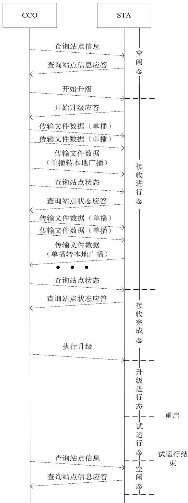  
图 31 升级传输流程

## 5.9 台区户变关系识别报文

## 5.9.1 报文格式

## 5.9.1.1 台区户变关系识别报文格式

台区户变关系识别，主要是对各类台区特征信息采集分析的过程，相关的报文格式，根据特征类型、采集类型的不同各有区别，报文的上下关系在不同的识别模式下也各有区别。

报文应符合图 32格式要求。

<table><tr><td colspan="9">台区户变关系识别报文头</td><td>数据(DATA)</td></tr><tr><td>协议版本号</td><td>帧头长度</td><td>方向位</td><td>启动位</td><td>相别</td><td>报文序号</td><td>MAC地址</td><td>特征类型</td><td>采集类型</td><td>数据(DATA)</td></tr><tr><td>6比特</td><td>6比特</td><td>1比特</td><td>1比特</td><td>2比特</td><td>2字节</td><td>6字节</td><td>1字节</td><td>1字节</td><td>变长</td></tr></table>

图 32 台区户变关系识别报文格式  
台区户变关系识别报文的字段应符合表 28要求。

表 28 台区特征信息采集报文格式说明

<table><tr><td>域</td><td>字节号</td><td>比特位</td><td>域大小(比特)</td><td>含义</td></tr><tr><td>协议版本号</td><td rowspan="2">0</td><td>0-5</td><td>6</td><td>本版本取值应为1。</td></tr><tr><td rowspan="2">报文头长度</td><td>6-7</td><td rowspan="2">6</td><td rowspan="2">描述报文头(除数据(DATA)长度外)的长度,用于接收方从报文头偏移报文头长度找到数据(DATA)的位置。</td></tr><tr><td rowspan="4">1</td><td>0-3</td></tr><tr><td>方向位</td><td>4</td><td>1</td><td>指下行报文为CCO发送给STA方向的报文,上行报文为STA上报CCO方向的报文,具体含义如下:0x00:下行方向;0x01:上行方向。</td></tr><tr><td>启动位</td><td>5</td><td>1</td><td>指当前节点收到的数据报文来自从动站或者启动站(启动站是指主动发起命令的一方,从动站是指被动接收命令的一方。),具体取值如下:0x00:来自从动站;0x01:来自启动站。</td></tr><tr><td>采集相位</td><td>6-7</td><td>2</td><td>指示当前报文相关的特征所对应的相位信息,具体定义如下:0x00:默认相位:0x01:CCO第一出线相位;0x02:CCO第二出线相位;0x03:CCO第三出线相位;注:取值为0时,下行CCO发的报文表示三相,上行STA发的报文表示站点所在相位。主要在下行告知台区特征时使用,应允许CCO在一帧报文中携带三个相位的台区特征信息。</td></tr><tr><td>报文序号</td><td>2-3</td><td>0-15</td><td>16</td><td>由启动站填写序号,序号具有递增特性,从动站应对该序号报文进行应答,上下文相关一对报文,这两个域是相同的内容。</td></tr><tr><td>MAC地址</td><td>4-9</td><td>0-7</td><td>48</td><td>标记后续台区特征相关命令和信息相关联的MAC地址,可以是STA的电表地址,也可以是CCO的主节点地址,是48比特的字段。应符合表29要求。MAC地址字节传输应按照“大端”序列。</td></tr><tr><td>特征类型</td><td>10</td><td>0-7</td><td>8</td><td>定义该报文相关的台区特征信息的类型,具体类型定义如下:0x01:工频电压特征;0x02:工频频率特征;0x03:工频周期特征;其他:保留。</td></tr><tr><td>采集类型</td><td>11</td><td>0-7</td><td>8</td><td>定义采集行为的类型,具体类型定义如下:0x01:台区特征采集启动;0x02:台区特征信息收集;0x03:台区特征信息告知;0x04:台区判别结果查询;0x05:台区判别结果信息;其他:保留。</td></tr><tr><td>数据</td><td>12-N</td><td>0-7</td><td>L(变长)</td><td></td></tr></table>

表 29MAC 地址格式说明

<table><tr><td>台区特征采集类型</td><td>报文发送方向</td><td>报文类型</td><td>MAC 地址内容</td></tr><tr><td>台区特征采集启动</td><td>CCO—&gt;STA</td><td>全网广播</td><td>CCO 主节点地址</td></tr><tr><td>台区特征信息收集</td><td>CCO—&gt;STA</td><td>单播</td><td>STA MAC 地址</td></tr><tr><td>台区特征信息告知</td><td>CCO—&gt;STA</td><td>全网广播</td><td>CCO 主节点地址</td></tr><tr><td>台区特征信息告知</td><td>STA—&gt;CCO</td><td>单播</td><td>STA MAC 地址</td></tr><tr><td>台区判别结果查询</td><td>CCO—&gt;STA</td><td>单播</td><td>STA MAC 地址</td></tr><tr><td>台区判别结果信息</td><td>STA—&gt;CCO</td><td>单播</td><td>STA MAC 地址</td></tr></table>

## 5.9.1.2 台区特征采集启动命令数据格式

当报文是台区特征采集启动命令时，数据域应符合表 30要求。

表 30 数据域定义

<table><tr><td>字段</td><td>字节号</td><td>比特位</td><td>域大小(字节)</td><td>含义</td></tr><tr><td>起始 NTB</td><td>0-3</td><td>0-31</td><td>4</td><td>全网开始采集时刻的 NTB。</td></tr><tr><td>采集周期</td><td>4</td><td>0-7</td><td>1</td><td>对于采集特征为“工频周期特征”的命令,该域应忽略,站点按其支持的沿采集数据,其它采集特征,该域有意义,单位秒,指示每隔此周期采集一次特征信息。</td></tr><tr><td>采集数量</td><td>5</td><td>0-7</td><td>1</td><td>连续采集特征信息的数量。</td></tr><tr><td>采集序列号</td><td>6</td><td>0-7</td><td>1</td><td>整个网络第几次启动采集,CCO 每启动一次采集累加一次,取值范围为0-255,循环使用。</td></tr><tr><td>保留</td><td>7</td><td>0-7</td><td>1</td><td></td></tr></table>

## 5.9.1.3 台区特征信息收集命令数据格式

该命令的采集类型标识为0x02，数据域应为空。

## 5.9.1.4 台区特征信息告知报文数据格式

该命令的采集类型标识为0x03,数据域应符合表 31要求。

表 31 台区特征信息告知报文数据域

<table><tr><td>定义字段</td><td>字节号</td><td>比特位</td><td>域大小(比特)</td><td>含义</td></tr><tr><td>TEI</td><td>0-1</td><td>0-11</td><td>12</td><td>如果报文为CCO向STA通知自身台区特征时,TEI为1,代表CCO发出;当报文是STA向CCO发送的台区特征信息时,TEI为STA的地址。</td></tr><tr><td>采集方式</td><td>1</td><td>12-13</td><td>2</td><td>本字段仅在特征类型为“工频周期”特征时有效。0保留,1下降沿采集,2上升沿采集,3双沿采集。当采集方式为上升沿或者下降沿时,不填写“起始采集NTB2”和台区特征信息序列2”字段;当为采集方式为双沿时,“起始采集NTB1”和“台区特征信息序列1”为下降沿数据,“起始采集NTB2”和“台区特征信息序列2”为上升沿数据。</td></tr><tr><td>保留</td><td>1</td><td>13-15</td><td>2</td><td></td></tr><tr><td>采集序列号</td><td>2</td><td>0-7</td><td>8</td><td>代表第几次采集活动。</td></tr><tr><td>告知总数量</td><td>3</td><td>0-7</td><td>8</td><td>代表台区特征信息序列包含的数据个数。</td></tr><tr><td>起始采集NTB1</td><td>4-7</td><td>0-31</td><td>32</td><td>代表本次采集的起始时刻,即第一个特征数据的采集时刻,和启动采集命令中的起始时刻有一定的差别。</td></tr><tr><td>台区特征信息序列1</td><td>8-N</td><td>0-7</td><td>(N-7)*8</td><td>根据台区特征信息的不同“台区特征信息序列的”内容定义略有不同。</td></tr><tr><td>起始采集NTB2(可选)</td><td>N+1-N+4</td><td>0-31</td><td>32</td><td>本字段仅在特征类型为“工频周期”特征时使用。定义同起始采集NTB1。</td></tr><tr><td>台区特征信息序列2(可选)</td><td>N+5-M</td><td>0-7</td><td>(M-N-4)*8</td><td>本字段仅在特征类型为“工频周期”特征时使用。定义同台区特征信息序列1。</td></tr></table>

下面描述不同类型“台区特征信息序列”定义。

当特征类型为“工频电压时”：特征序列应符合表 32 要求。

表 32 工频电压特征序列定义

<table><tr><td>字段</td><td>字节号</td><td>比特位</td><td>域大小(字节)</td><td>含义</td></tr><tr><td>保留</td><td>0</td><td>0-7</td><td>1</td><td></td></tr><tr><td>第一出线报告数量</td><td>1</td><td>0-7</td><td>1</td><td rowspan="3">第i出线报告数量,表示该相线告知的电压特征信息数量。</td></tr><tr><td>第二出线报告数量</td><td>2</td><td>0-7</td><td>1</td></tr><tr><td>第三出线报告数量</td><td>3</td><td>0-7</td><td>1</td></tr><tr><td>V1(第一个电压值)</td><td>4-5</td><td>0-15</td><td>2</td><td rowspan="6">Vi为第i次采集的电压值,采用BCD编码,两个字节表示,数据格式为“XXX.X”,保留一位小数。</td></tr><tr><td>V2(第二个电压值)</td><td>6-7</td><td>0-15</td><td>2</td></tr><tr><td>...</td><td>-</td><td>0-15</td><td>2</td></tr><tr><td>Vn(第n个电压值)</td><td>-</td><td>0-15</td><td>2</td></tr><tr><td>第二出线V1~Vn</td><td>-</td><td>-</td><td>-</td></tr><tr><td>第三出线V1-Vn</td><td>-</td><td>-</td><td>-</td></tr></table>

当特征类型为“工频频率”时，特征序列应符合表 33 要求。

表 33 工频频率特征序列定义

<table><tr><td>字段</td><td>字节号</td><td>比特位</td><td>域大小(字节)</td><td>含义</td></tr><tr><td>保留</td><td>0</td><td>0-7</td><td>1</td><td></td></tr><tr><td>第一出线报告数量</td><td>1</td><td>0-7</td><td>1</td><td rowspan="3">第i出线报告数量,表示该相线告知的工频频率信息数量。</td></tr><tr><td>第二出线报告数量</td><td>2</td><td>0-7</td><td>1</td></tr><tr><td>第三出线报告数量</td><td>3</td><td>0-7</td><td>1</td></tr><tr><td>F1(第一个工频频率值)</td><td>4-5</td><td>0-15</td><td>2</td><td rowspan="6">Fi为第i次采集的工频频率值,采用BCD编码,两个字节表示,数据格式为“XX.XX”,保留两位小数。</td></tr><tr><td>F2(第二个工频频率值)</td><td>6-7</td><td>0-15</td><td>2</td></tr><tr><td>...</td><td>-</td><td>0-15</td><td>2</td></tr><tr><td>Fn(第n个工频频率值)</td><td>-</td><td>0-15</td><td>2</td></tr><tr><td>第二出线F1~Fn</td><td>-</td><td>-</td><td>-</td></tr><tr><td>第三出线F1~Fn</td><td>-</td><td>-</td><td>-</td></tr></table>

当特征类型为“工频周期”时，特征序列应符合表 34 要求。

表 34 工频周期特征序列定义

<table><tr><td>字段</td><td>字节号</td><td>比特位</td><td>域大小(字节)</td><td>含义</td></tr><tr><td>保留</td><td>0</td><td>0-7</td><td>1</td><td></td></tr><tr><td>第一出线报告数量</td><td>1</td><td>0-7</td><td>1</td><td rowspan="3">第i出线报告数量,表示该相线告知的工频周期值个数。</td></tr><tr><td>第二出线报告数量</td><td>2</td><td>0-7</td><td>1</td></tr><tr><td>第三出线报告数量</td><td>3</td><td>0-7</td><td>1</td></tr><tr><td>T1(第一个工频周期值)</td><td>4-5</td><td>0-7</td><td>2</td><td rowspan="6">Ti为第i次采集的工频周期值与20ms理想周期的偏差,按照过零下降沿、上升沿或双沿采集工频周期信息,采用HEX格式,有符号整型数,每个周期值代表一个过零周期的时长和20ms的差值,两字节表示,计时单位为1/3125000S(计数频率为25MHz的8分频,</td></tr><tr><td>T2(第二个工频周期值)</td><td>6-7</td><td>0-7</td><td>2</td></tr><tr><td>...</td><td>-</td><td>0-7</td><td>2</td></tr><tr><td>Tn(第n个工频周期值)</td><td>-</td><td>0-7</td><td>2</td></tr><tr><td>第二出线T1~Tn</td><td>-</td><td>-</td><td>-</td></tr><tr><td>第三出线T1~Tn</td><td>-</td><td>-</td><td>-</td></tr><tr><td></td><td></td><td></td><td></td><td>即 3.125MHz)。在标准工频周期为 50Hz 的供电环境下,CCO 和 STA 的硬件系统应能检测到相邻周期发生小于 25us 以内的变化。</td></tr></table>

## 5.9.1.5 台区判别结果查询命令数据格式

该命令的采集类型为 0x04，数据域应为空。

## 5.9.1.6 台区判别结果信息报文数据格式

该命令的采集类型为 0x05，数据域应符合表 35要求。

表 35 台区识别结果数据域定义

<table><tr><td>字段</td><td>字节号</td><td>比特位</td><td>域大小(字节)</td><td>含义</td></tr><tr><td>TEI</td><td>0-1</td><td>0-7</td><td>2</td><td>代表STA的TEI标识。</td></tr><tr><td>台区判别过程结束标志</td><td>2</td><td>0-7</td><td>1</td><td>为1代表识别过程结束,为0代表识别进行中,其它取值保留。</td></tr><tr><td>台区识别结果</td><td>3</td><td>0-7</td><td>1</td><td>当台区识别过程未结束时,该域无意义,为0代表识别结果未知,为1代表是本台区,为2代表不是本台区,其它取值保留。</td></tr><tr><td>正确隶属CCO地址</td><td>4-9</td><td>0-7</td><td>6</td><td>当台区识别结果非本台区时,该数据域填充该STA正确隶属的CCO地址。STA融合多种台区特征信息,实现准确的户变隶属关系识别。</td></tr></table>

## 5.9.2 台区识别报文传输流程

## 5.9.2.1 集中式识别流程

集中式识别流程，首先是 CCO 向各个 STA 广播发送“台区特征采集启动”命令，各个 STA 按照采集规则进行台区特征的采集，之后CCO 依次向各个 STA单播发送“台区特征信息收集”命令，STA依次返回“台区特征信息告知”报文，具体流程应符合图 33要求。

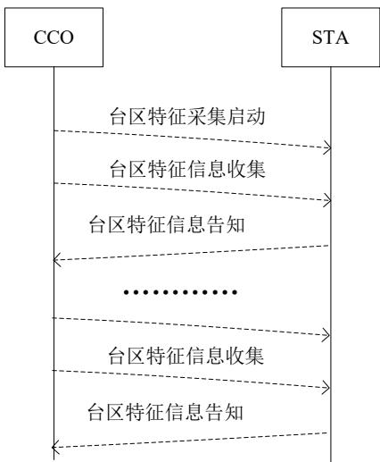  
图 33 CCO 集中式台区识别流程

## 5.9.2.2 分布式识别流程

分布式识别流程，首先是 CCO 向各个 STA 广播发送“台区特征采集启动”命令，各个 STA 按照采集规则进行台区特征的采集，之后 CCO 向各个 STA 广播、本地广播发送 CCO 的“台区特征信息告知”命令，STA本地进行台区隶属关系的判别，判别结果出来后，向CCO单播发送“台区判别信息”报文，具体流程应符合图 34要求。

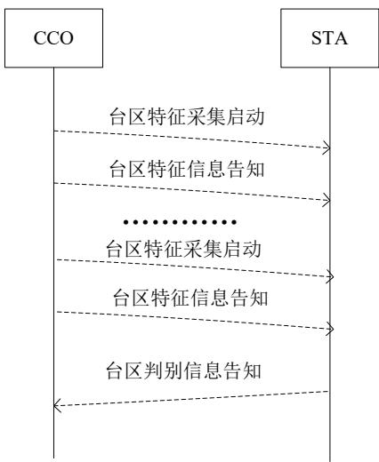  
图 34 STA分布式台区识别流程

## 5.9.2.3 台区识别结果查询流程

CCO可以随时查询STA的台区判别信息，具体流程应符合图 35 要求。

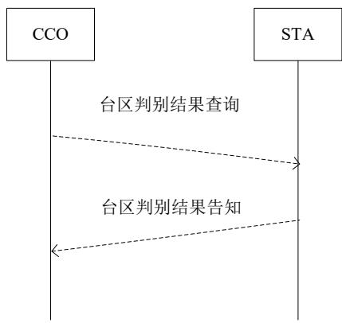  
图 35 台区识别结果查询流程

## 5.10 精准校时报文

## 5.10.1 精准校时下行报文格式

CCO向STA发送的精准校时下行报文格式应符合图 36格式要求。

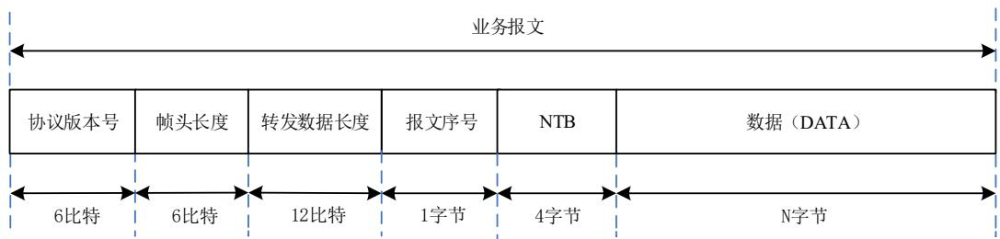  
图 36 精准校时下行报文格式

精准校时下行报文格式的字段应符合表 36要求。

表 36 精准校时下行报文格式说明

<table><tr><td>域</td><td>字节号</td><td>比特位</td><td>域大小(比特)</td><td>含义</td></tr><tr><td>协议版本号</td><td rowspan="2">0</td><td>0-5</td><td>6</td><td>本版本取值应为1。</td></tr><tr><td rowspan="2">报文头长度</td><td>6-7</td><td rowspan="2">6</td><td rowspan="2">报文头(除数据域长度外)长度。</td></tr><tr><td rowspan="2">1</td><td>0-3</td></tr><tr><td rowspan="2">转发数据长度</td><td>4-7</td><td rowspan="2">12</td><td rowspan="2">数据(DATA)的长度</td></tr><tr><td>2</td><td>0-7</td></tr><tr><td>报文序号</td><td>3</td><td>0-7</td><td>8</td><td>CCO分配,依次递增,重发不增加</td></tr><tr><td>NTB</td><td>4-7</td><td>0-7</td><td>32</td><td>CCO当前的NTB</td></tr><tr><td>数据(DATA)</td><td colspan="3">L(可变)</td><td>终端下发的校时报文</td></tr></table>

## 5.10.2 精准校时业务传输流程

CCO应将精准校时命令广播转发给所有的STA，无上行报文。

## 5.11 查询 ID 信息报文

## 5.11.1 查询ID 信息下行报文格式

CCO向STA发送下行报文格式应符合图 37格式要求。芯片ID信息格式定义详见附录A。

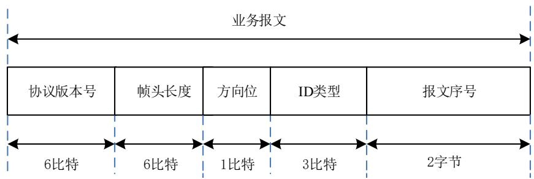  
图 37 查询 ID 信息下行报文格式  
报文格式字段应符合表 37要求。

表 37 查询 ID 信息下行报文格式说明

<table><tr><td>域</td><td>字节号</td><td>比特位</td><td>域大小(比特)</td><td>含义</td></tr><tr><td>协议版本号</td><td rowspan="2">0</td><td>0-5</td><td>6</td><td>本版本取值应为1。</td></tr><tr><td rowspan="2">帧头长度</td><td>6-7</td><td rowspan="2">6</td><td rowspan="2">报文头(除数据域长度外)长度。</td></tr><tr><td rowspan="3">1</td><td>0-3</td></tr><tr><td>方向位</td><td>4</td><td>1</td><td>0:下行(CCO到STA)1:上行(STA到CCO)。</td></tr><tr><td>ID类型</td><td>5-7</td><td>3</td><td>0x0:模块ID(同历史扩展协议兼容)0x1:表示芯片ID0x2:表示模块ID其他为保留。</td></tr><tr><td>报文序号</td><td>2-3</td><td>0-7</td><td>16</td><td>CCO发送给STA数据报文的序号,STA应答时使用该序号返回。</td></tr></table>

## 5.11.2 查询ID 信息上行报文格式

STA返回CCO的查询ID信息上行报文格式应符合图 38格式要求。

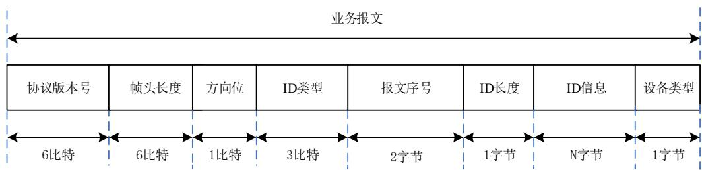  
图 38 查询 ID 信息上行报文格式  
上行报文格式的字段应符合表 38要求。

表 38 查询 ID 信息上行报文格式说明

<table><tr><td>域</td><td>字节号</td><td>比特位</td><td>域大小(比特)</td><td>含义</td></tr><tr><td>协议版本号</td><td rowspan="2">0</td><td>0-5</td><td>6</td><td>本版本取值应为1。</td></tr><tr><td rowspan="2">帧头长度</td><td>6-7</td><td rowspan="2">6</td><td rowspan="2">报文头(除数据域长度外)长度。</td></tr><tr><td rowspan="3">1</td><td>0-3</td></tr><tr><td>方向位</td><td>4</td><td>1</td><td>0:下行(CCO到STA)1:上行(STA到CCO)。</td></tr><tr><td>ID类型</td><td>5-7</td><td>3</td><td>0x0:模块ID(同历史扩展协议兼容)0x1表示芯片ID0x2表示模块ID其他为保留。</td></tr><tr><td>报文序号</td><td>2-3</td><td>0-7</td><td>16</td><td>CCO发送给STA数据报文的序号,STA应答时使用该序号返回。</td></tr><tr><td>ID长度N</td><td>4</td><td>0-7</td><td>8</td><td>芯片ID长度为24字节模块ID长度为11字节。</td></tr><tr><td>ID信息</td><td>5+N-1</td><td>0-7</td><td>L(可变长)</td><td>芯片ID信息。</td></tr><tr><td>设备类型</td><td>5+N</td><td>0-7</td><td>8</td><td>1:抄控器2:终端本地通信单元3:单相电表通信单元4:中继器5:II型采集器6:I型采集器单元7:三相电表通信单元。</td></tr></table>

## 5.11.3 查询 ID 信息流程

CCO向STA发送的查询ID信息报文，STA应答给CCO。查询ID信息流程应符合图 39要求。

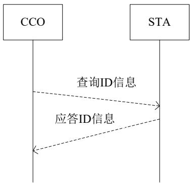  
图 39 查询 ID 信息报文传输流程

## 5.12 抄控器报文

## 5.12.1 抄控器-CCO 报文格式

抄控器下发与 应答的报文数据格式应符合图 40格式要求。抄控器支持的诊断信息详见附录 。

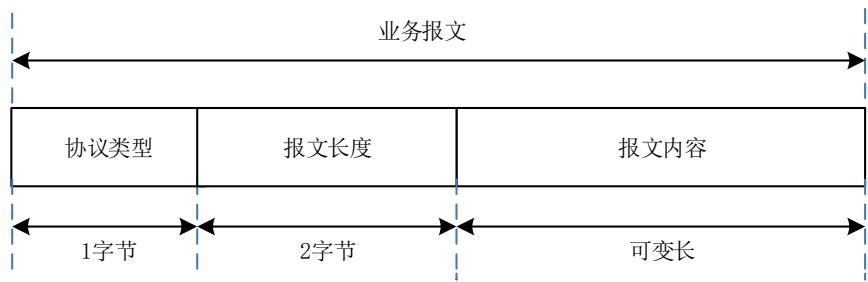  
图 40 抄控器-CCO 报文格式

报文格式字段应符合表 39要求。

表 39 抄控器-CCO 报文格式说明

<table><tr><td>域</td><td>字节号</td><td>比特位</td><td>域大小(比特)</td><td>含义</td></tr><tr><td>协议类型</td><td>0</td><td>0-7</td><td>8</td><td>0: Q/GDW10376.2—2019 协议其他: 保留</td></tr><tr><td>报文长度</td><td>1-2</td><td>0-7</td><td>16</td><td>交互报文内容长度</td></tr><tr><td>报文内容</td><td>3-N</td><td>0-7</td><td>L(可变长)</td><td>具体参考 Q/GDW10376.2—2019 协议</td></tr></table>

## 5.12.2 抄控器-STA 报文格式

抄控器针对故障电表模块诊断，应采用抄表报文格式。报文端口号应为0x11，报文ID应为0x0001（终端主动抄表），源TEI应为抄控器TEI。

## 5.12.3 抄控器数据透传串口转发格式

抄控器下发CCO/STA，以及CCO/STA应答上行报文数据格式应符合图 41格式要求。

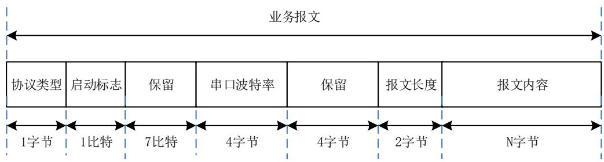  
图 41 抄控器数据透传串口转发报文格式

报文字段应符合表 40要求。

表 40 抄控器数据透传串口转发报文格式说明

<table><tr><td>域</td><td>字节号</td><td>比特位</td><td>域大小(比特)</td><td>含义</td></tr><tr><td>协议类型</td><td>0</td><td>0-7</td><td>8</td><td>0: 透明传输其他备用。</td></tr><tr><td>启动标志</td><td rowspan="2">1</td><td>0</td><td>1</td><td>0:无需转发到串口1:需要转发到串口。</td></tr><tr><td>保留</td><td>1-7</td><td>7</td><td></td></tr><tr><td>串口波特率</td><td>2-5</td><td>0-31</td><td>32</td><td>0:表示默认波特率;非0:按此波特率设置,转发后恢复原波特率。</td></tr><tr><td>保留</td><td>6-9</td><td>0-31</td><td>32</td><td></td></tr><tr><td>报文长度</td><td>10-11</td><td>0-15</td><td>16</td><td>交互报文内容长度。</td></tr><tr><td>报文内容</td><td>12-N</td><td>0-7</td><td>L(可变长)</td><td>CCO/STA需给终端/电表串口转发的数据内容。</td></tr></table>

## 5.13 分钟采集报文

## 5.13.1 分钟采集任务配置

## 5.13.1.1 下行报文格式

分钟采集任务配置下行报文数据格式应符合图 42格式要求。

<table><tr><td colspan="5">业务报文</td></tr><tr><td>协议版本号</td><td>报文头长度</td><td>保留</td><td>报文序号</td><td>任务配置信息</td></tr><tr><td>6比特</td><td>6比特</td><td>4比特</td><td>4字节</td><td>变长</td></tr></table>

图 42 分钟采集任务配置下行报文格式

分钟采集任务配置下行报文数据格式字段应符合表 41要求。

表 41 分钟采集任务配置下行报文格式说明

<table><tr><td>域</td><td>字节号</td><td>比特位</td><td>域大小(比特)</td><td>含义</td></tr><tr><td>协议版本号</td><td rowspan="2">0</td><td>0-5</td><td>6</td><td>本版本取值应为1。</td></tr><tr><td rowspan="2">报文头长度</td><td>6-7</td><td rowspan="2">6</td><td rowspan="2">报文头(除数据域长度外)的长度。取值应为16。</td></tr><tr><td rowspan="2">1</td><td>0-3</td></tr><tr><td>保留</td><td>4-7</td><td>4</td><td></td></tr><tr><td>报文序号</td><td>2-5</td><td>0-7</td><td>32</td><td></td></tr><tr><td>任务配置信息</td><td>6-N</td><td>0-7</td><td>L(变长)</td><td>任务配置信息内容。</td></tr></table>

分钟采集任务配置下行报文格式任务配置信息字段应符合表 42格式要求。

表 42 分钟采集任务配置下行报文任务配置信息字段格式说明

<table><tr><td>域</td><td>字节号</td><td>比特位</td><td>域大小(比特)</td><td>含义</td></tr><tr><td>目的MAC地址</td><td>6-11</td><td>0-7</td><td>48</td><td>模块MAC。</td></tr><tr><td>任务号</td><td>12</td><td>0-7</td><td>8</td><td>采集任务号,0~15有效,0xFF代表全部任务,其他保留。</td></tr><tr><td>启动/删除标志</td><td rowspan="4">13</td><td>0</td><td>1</td><td>0:删除;1:启用。</td></tr><tr><td>协议类型</td><td>1-3</td><td>3</td><td>2:DL/T 645—2007;3:DL/T 698.45;其他:保留。</td></tr><tr><td>表类型</td><td>4-5</td><td>2</td><td>0x00:单相表;0x01:三相表;0x02:其他表计;其他:保留。</td></tr><tr><td>保留</td><td>6-7</td><td>2</td><td></td></tr><tr><td>采集周期</td><td>14</td><td>0-7</td><td>8</td><td>采集周期,单位分钟。</td></tr><tr><td>数据项个数n</td><td>15</td><td>0-7</td><td>8</td><td></td></tr><tr><td>数据项1标识</td><td>16-19</td><td>0-7</td><td>32</td><td></td></tr><tr><td>数据项1回复长度</td><td>20</td><td>0-7</td><td>8</td><td></td></tr><tr><td>...</td><td>...</td><td>...</td><td>...</td><td>...</td></tr><tr><td>数据项n标识</td><td></td><td>0-7</td><td>32</td><td></td></tr><tr><td>数据项n回复长度</td><td></td><td>0-7</td><td>8</td><td></td></tr></table>

注1：删除任务时，数据项个数域填0，无后续数据项标识、数据项回复长度域；表类型中的其他表计针对光伏表、导轨表等其他类型的新型表计；  
注2：数据项个数n：最大为16个；  
注3：数据项1\~n回复长度：数据有效长度，如645协议电压为2字节。

## 5.13.1.2 上行报文格式

分钟采集任务配置上行报文数据格式应符合图 43格式要求。

<table><tr><td colspan="11">业务报文</td></tr><tr><td>协议版本号</td><td>报文头长度</td><td>保留</td><td>报文序号</td><td>源MAC地址</td><td>任务号</td><td>启动/删除标志</td><td>结果</td><td>保留</td><td>采集周期</td><td></td></tr><tr><td>6比特</td><td>6比特</td><td>4比特</td><td>4字节</td><td>6字节</td><td>1字节</td><td>1比特</td><td>1比特</td><td>6比特</td><td>1字节</td><td></td></tr></table>

图 43 分钟采集任务配置上行报文格式  
分钟采集任务配置上行报文数据格式字段应符合表 43要求。

表 43 分钟采集任务配置上行报文格式说明

<table><tr><td>域</td><td>字节号</td><td>比特位</td><td>域大小(比特)</td><td>含义</td></tr><tr><td>协议版本号</td><td rowspan="2">0</td><td>0-5</td><td>6</td><td>本版本取值应为1。</td></tr><tr><td rowspan="2">报文头长度</td><td>6-7</td><td rowspan="2">6</td><td rowspan="2">报文头(除数据域长度外)的长度。取值应为15。</td></tr><tr><td rowspan="2">1</td><td>0-3</td></tr><tr><td>保留</td><td>4-7</td><td>4</td><td></td></tr><tr><td>报文序号</td><td>2-5</td><td>0-7</td><td>32</td><td>应与下行报文序号保持一致。</td></tr><tr><td>源MAC地址</td><td>6-11</td><td>0-7</td><td>48</td><td>模块MAC。</td></tr><tr><td>任务号</td><td>12</td><td>0-7</td><td>8</td><td>采集任务号,0~15有效,0xFF代表全部任务,其他保留。</td></tr><tr><td>启动/删除标志</td><td rowspan="3">13</td><td>0</td><td>1</td><td>0:删除;1:启用。</td></tr><tr><td>结果</td><td>1</td><td>1</td><td>0:设置成功;1:设置失败。</td></tr><tr><td>保留</td><td>2-7</td><td>6</td><td></td></tr><tr><td>采集周期</td><td>14</td><td>0-7</td><td>8</td><td>单位:分钟。</td></tr></table>

注： 以单播发送采集任务配置下行报文， 以单播回复上行报文； 以广播发送采集任务配置下行报文时，STA不做回复。STA收到采集任务启用时，当存在相同任务号时，STA使用新配置替代旧配置；STA收到采集任务删除下行报文时，删除相关任务配置及采集数据，若任务号不存在不做处理。STA收到采集任务启用时，需要判断协议类型和表计类型是否与本地一致，不一致则回复设置失败。

## 5.13.1.3 分钟采集任务配置流程

CCO根据采集任务配置信息，将不同的采集任务配置下发至任务关联的STA，STA发送配置响应上行报文至 。分钟采集任务配置报文传输流程应符合图 44要求。

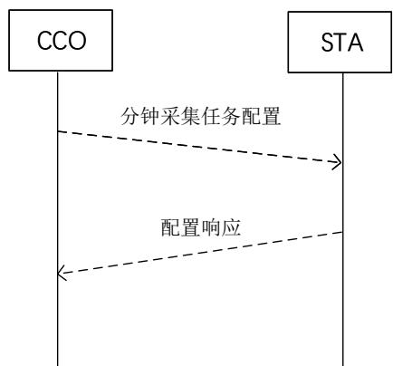  
图 44 分钟采集任务配置报文传输流程

## 5.13.2 分钟采集任务数据读取

## 5.13.2.1 下行报文格式

分钟采集任务数据读取下行报文应符合图 45格式要求。

<table><tr><td colspan="11">业务报文</td></tr><tr><td>协议版本号</td><td>报文头长度</td><td>方向位</td><td>保留</td><td>报文序号</td><td>协议类型</td><td>电表类型</td><td>保留</td><td>目的MAC地址</td><td>任务号</td><td>冻结时刻</td></tr><tr><td>6比特</td><td>6比特</td><td>1比特</td><td>3比特</td><td>4字节</td><td>3比特</td><td>2比特</td><td>3比特</td><td>6字节</td><td>1字节</td><td>6字节</td></tr></table>

图 45 分钟采集任务数据读取下行报文格式  
分钟采集任务数据读取下行报文数据格式字段应符合表 44要求。

表 44 分钟采集任务数据读取下行报文格式说明

<table><tr><td>域</td><td>字节号</td><td>比特位</td><td>域大小(比特)</td><td>含义</td></tr><tr><td>协议版本号</td><td rowspan="2">0</td><td>0-5</td><td>6</td><td>本版本取值应为1。</td></tr><tr><td rowspan="2">报文头长度</td><td>6-7</td><td rowspan="2">6</td><td rowspan="2">报文头(除数据域长度外)的长度。取值应为20。</td></tr><tr><td rowspan="3">1</td><td>0-3</td></tr><tr><td>方向位</td><td>4</td><td>1</td><td>0:下行;1:上行。</td></tr><tr><td>保留</td><td>5-7</td><td>3</td><td></td></tr><tr><td>报文序号</td><td>2-5</td><td>0-7</td><td>32</td><td></td></tr><tr><td>协议类型</td><td rowspan="3">6</td><td>0-2</td><td>3</td><td>2:DL/T 645—2007;3:DL/T 698.45;其他:保留。</td></tr><tr><td>电表类型</td><td>3-4</td><td>2</td><td>0:单相;1:三相;2:其他表计;其他:保留。</td></tr><tr><td>保留</td><td>5-7</td><td>3</td><td></td></tr><tr><td>目的MAC地址</td><td>7-12</td><td>0-7</td><td>48</td><td></td></tr><tr><td>任务号</td><td>13</td><td>0-7</td><td>8</td><td>采集任务号。</td></tr><tr><td>冻结时刻(BCD)</td><td>14-19</td><td>0-7</td><td>48</td><td>冻结时间点(YY-MM-DD-HH-MM-SS)。</td></tr></table>

## 5.13.2.2 上行报文格式

分钟采集任务数据读取上行报文应符合图 46所示格式要求。

<table><tr><td colspan="14">业务报文</td></tr><tr><td>协议版本号</td><td>报文头长度</td><td>方向位</td><td>保留</td><td>报文序号</td><td>协议类型</td><td>电表类型</td><td>响应结果</td><td>源MAC地址</td><td>任务号</td><td>冻结时刻</td><td>报文条数</td><td>数据长度</td><td>数据内容</td></tr><tr><td>6比特</td><td>6比特</td><td>1比特</td><td>3比特</td><td>4字节</td><td>3比特</td><td>2比特</td><td>3比特</td><td>6字节</td><td>1字节</td><td>6字节</td><td>1字节</td><td>2字节</td><td>变长</td></tr></table>

图 46 分钟采集任务数据读取上行报文格式

分钟采集任务数据读取上行报文数据格式的字段应符合表 45要求。

表 45 分钟采集任务数据读取上行报文格式说明

<table><tr><td>域</td><td>字节号</td><td>比特位</td><td>域大小(比特)</td><td>含义</td></tr><tr><td>协议版本号</td><td rowspan="2">0</td><td>0-5</td><td>6</td><td>本版本取值应为1。</td></tr><tr><td rowspan="2">报文头长度</td><td>6-7</td><td rowspan="2">6</td><td rowspan="2">报文头(除数据域长度外)的长度;取值应为23。</td></tr><tr><td rowspan="3">1</td><td>0-3</td></tr><tr><td>方向位</td><td>4</td><td>1</td><td>0:下行;1:上行。</td></tr><tr><td>保留</td><td>5-7</td><td>3</td><td></td></tr><tr><td>报文序号</td><td>2-5</td><td>0-7</td><td>32</td><td>与下行报文序号保持一致。</td></tr><tr><td>协议类型</td><td rowspan="3">6</td><td>0-2</td><td>3</td><td>2:DL/T 645—2007;3:DL/T 698.45;其他:保留。</td></tr><tr><td>电表类型</td><td>3-4</td><td>2</td><td>0:单相;1:三相;2:其他表计;其他:保留。</td></tr><tr><td>响应结果</td><td>5-7</td><td>3</td><td>0:响应成功;1:任务不存在;2:无冻结数据;3:其他原因。</td></tr><tr><td>源MAC地址</td><td>7-12</td><td>0-7</td><td>48</td><td>模块MAC。</td></tr><tr><td>任务号</td><td>13</td><td>0-7</td><td>8</td><td>采集任务号。</td></tr><tr><td>冻结时刻(BCD)</td><td>14-19</td><td>0-7</td><td>48</td><td>冻结时间点(YY-MM-DD-HH-MM-SS)。</td></tr><tr><td>报文条数</td><td>20</td><td>0-7</td><td>8</td><td>DL/T 645协议下,配置多个DI,会存在回复多条报文的情况,该字段表示报文个数,报文顺序和配置DI顺序一致。</td></tr><tr><td>数据长度</td><td>21-22</td><td>0-7</td><td>16</td><td></td></tr><tr><td>数据内容</td><td>变长</td><td>0-7</td><td></td><td></td></tr></table>

## 5.13.2.3 分钟采集任务数据读取流程

CCO在任务规定的时间自动启动并发抄表，进行任务数据读取，STA收到下行报文后，从自身的存储空间提取对应数据，并通过数据响应报文上报至CCO。分钟采集任务数据读取流程应符合图 47要求。

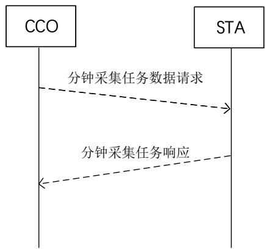  
图 47 分钟采集任务数据读取报文传输流程

## 5.13.3 采集业务描述

采集业务应符合图 48要求：

（1）集中器上电后，等待CCO上报本地通信模块运行模式信息，若未收到则主动下发查询“本地通信模块运行模式信息”主动获取，判断CCO是否支持分钟级采集功能。

（2）CCO上电后，首先上报本地通信模块运行模式信息，告知集中器是否支持分钟级采集功能。

（3）集中器与CCO完成同步档案流程后，若支持分钟级采集，将CCO串口波特率设置为115200bps，完成波特率适配流程，确保波特率完成切换。

（4）STA模块上电后，请求电表MAC地址，并进行关联入网，关联请求报文中携带“支持分钟级采集方案标志”信息，CCO需要进行该信息记录。

（5）CCO周期请求集中器时钟，通过万年历同步功能，完成对入网STA万年历同步。

（6）集中器等待组网完成后，对STA信息进行查询，获取STA是否支持分钟级采集功能。

（7）集中器向CCO下发采集任务配置，告知任务号、协议类型、数据项、采集周期和对应表号。采集时刻都按00分为起始，例如周期为5分钟，采集时刻则为00分、05分、10分...55分；周期为10分钟，采集时刻则为00分、10分、20分...50分；周期为1分钟，则每分钟执行采集（采集周期应该为以下值：1、2、5、10、15）。

（8）CCO根据采集任务配置信息，将不同的采集任务配置下发至任务关联的STA模块。

（ ） 模块根据采集任务配置的任务号、协议类型、数据项、采集周期，开辟 存储空间，并定时从电表获取数据进行存储。

（10）CCO在任务规定的时间自动启动并发抄表流程（宜为本采集时刻采集上一时刻的数据），进行数据采集，下行数据请求报文中携带任务号、协议类型、时间戳、MAC地址等必要信息。

（11）STA模块收到下行报文后，从自身的存储空间提取对应数据，并通过数据响应报文上报至CCO。

（12）CCO收到上行报文后形成主动上报报文，发送至集中器。

（13）集中器收到上报报文后回复确认帧，触发CCO后续抄读结果继续上报。

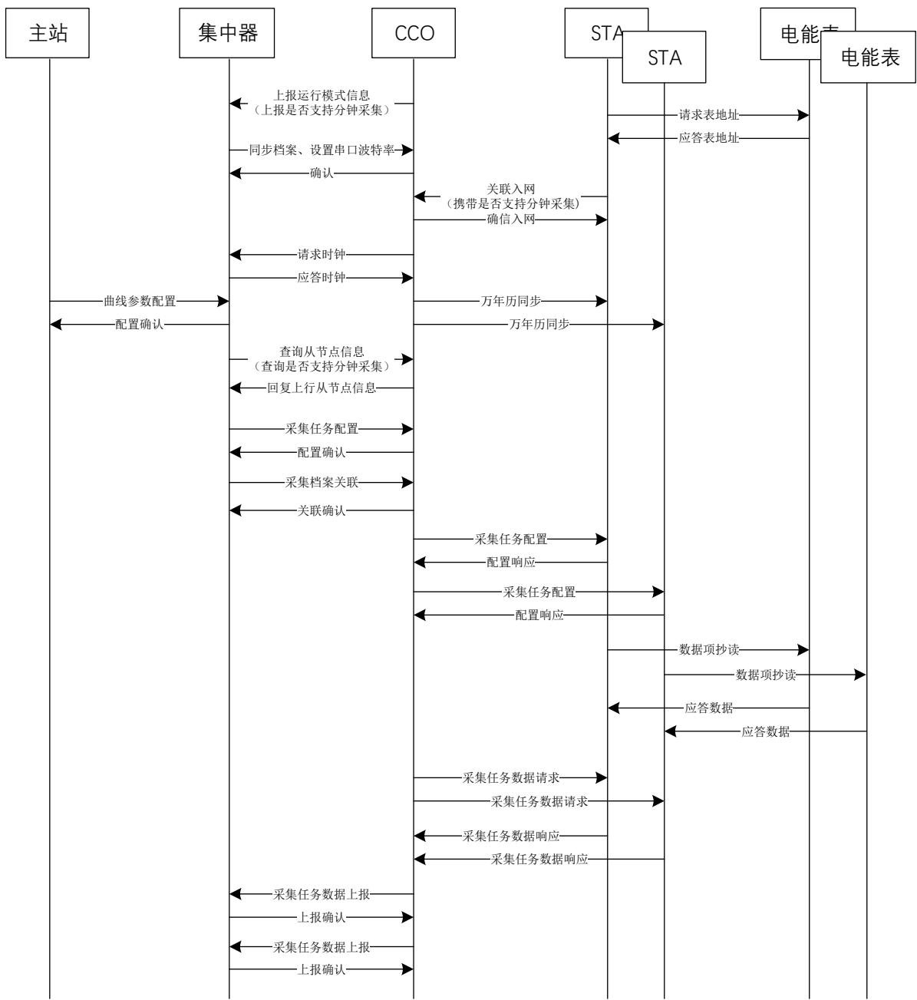  
图 48 分钟级采集方案流程图

## 5.14 数据汇聚压缩报文

## 5.14.1 采集任务数据汇聚设置

## 5.14.1.1 下行报文格式

下行报文格式应符合图 49要求。

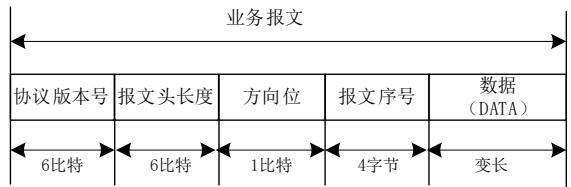  
图 49 采集任务设置下行报文数据格式  
采集任务设置下行报文格式应符合表 46要求。

表 46 采集任务设置下行报文格式说明

<table><tr><td>域</td><td>字节号</td><td>比特位</td><td>域大小(比特)</td><td>含义</td></tr><tr><td>协议版本号</td><td rowspan="2">0</td><td>0-5</td><td>6</td><td>取值应为0x01。</td></tr><tr><td rowspan="2">报文头长度</td><td>6-7</td><td rowspan="2">6</td><td rowspan="2">报文头(除数据域长度外)的长度。取值应为6。</td></tr><tr><td rowspan="2">1</td><td>0-3</td></tr><tr><td>保留</td><td>4-7</td><td>4</td><td></td></tr><tr><td>报文序号</td><td>2-5</td><td>0-7</td><td>32</td><td></td></tr><tr><td>数据域</td><td>6-N</td><td>0-7</td><td>L(变长)</td><td>采集任务数据汇聚读取下行报文数据域。</td></tr></table>

数据域格式应符合表 47要求。

表 47 采集任务设置下行报文数据域格式说明

<table><tr><td>域</td><td>字节号</td><td>比特位</td><td>域大小(比特)</td><td>含义</td></tr><tr><td>电表 MAC 地址</td><td>6-11</td><td>0-7</td><td>48</td><td>执行该采集任务的电表 MAC。</td></tr><tr><td>任务号</td><td>12</td><td>0-7</td><td>8</td><td>采集任务号0x00~0x0F 有效,0xFF 代表全部任务,其他保留。</td></tr><tr><td>添加/删除标志协议类型</td><td>13</td><td>01-3</td><td>13</td><td>0: 删除;1: 添加。0: DL/T 645—2007;1: DL/T 698.45;其他:保留。</td></tr><tr><td>设备类型</td><td rowspan="3"></td><td>4-5</td><td>2</td><td>0:电表;1:模块;其他:保留。</td></tr><tr><td>任务类型</td><td>6</td><td>1</td><td>0x00:被动抄读;0x01:主动上报。</td></tr><tr><td>保留</td><td>7</td><td>1</td><td></td></tr><tr><td>采集周期</td><td>14</td><td>0-7</td><td>8</td><td>任务类型为被动采集时该字段无实际意义;任务类型为主动上报时,该字段为采集周期,单位15秒。</td></tr><tr><td>数据项个数n</td><td>15</td><td>0-7</td><td>8</td><td></td></tr><tr><td>数据项1标识</td><td>16-19</td><td>0-31</td><td>32</td><td>含义参考协议类型。</td></tr><tr><td>数据项1回复长度</td><td>20</td><td>0-7</td><td>8</td><td></td></tr><tr><td>...</td><td>...</td><td>...</td><td>...</td><td>...</td></tr><tr><td>数据项n标识</td><td></td><td>0-31</td><td>32</td><td></td></tr><tr><td>数据项n回复长度</td><td></td><td>0-7</td><td>8</td><td></td></tr></table>

注：删除任务时，数据项个数域应为0，无后续数据项标识；表类型中的其他表计针对光伏表、导轨表等其他类型的新型表计。

## 5.14.1.2 上行报文格式

上行报文格式应符合图 50要求。

<table><tr><td colspan="11">业务报文</td></tr><tr><td>协议版本号</td><td>报文头长度</td><td>保留</td><td>报文序号</td><td>电表MAC地址</td><td>任务号</td><td>添加/删除标志</td><td>结果</td><td>保留</td><td>采集周期</td><td></td></tr><tr><td>6比特</td><td>6比特</td><td>4比特</td><td>4字节</td><td>6字节</td><td>1字节</td><td>1比特</td><td>1比特</td><td>6比特</td><td>1字节</td><td></td></tr></table>

图 50 采集任务设置上行报文数据格式

采集任务数据汇聚读取上行报文数据格式应符合表 48格式要求。

表 48 采集任务数据汇聚读取上行报文数据域格式说明

<table><tr><td>域</td><td>字节号</td><td>比特位</td><td>域大小(比特)</td><td>含义</td></tr><tr><td>协议版本号</td><td>0</td><td>0-5</td><td>6</td><td>取值应为 0x01。</td></tr><tr><td rowspan="2">报文头长度</td><td></td><td>6-7</td><td rowspan="2">6</td><td rowspan="2">报文头(除数据域长度外)的长度。取值应为15。</td></tr><tr><td rowspan="2">1</td><td>0-3</td></tr><tr><td>保留</td><td>4-7</td><td>4</td><td></td></tr><tr><td>报文序号</td><td>2-5</td><td>0-7</td><td>32</td><td>与下行报文序号保持一致。</td></tr><tr><td>电表 MAC 地址</td><td>6-11</td><td>0-7</td><td>48</td><td>执行该采集方案的电表 MAC。</td></tr><tr><td>任务号</td><td>12</td><td>0-7</td><td>8</td><td>采集任务号0x00~0x0F有效,0xFF代表全部任务,其他保留。</td></tr><tr><td>添加/删除标志</td><td rowspan="3">13</td><td>0</td><td>1</td><td>0:删除;1:添加。</td></tr><tr><td>结果</td><td>1</td><td>1</td><td>0:设置成功;1:设置失败。</td></tr><tr><td>保留</td><td>2-7</td><td>6</td><td></td></tr><tr><td>采集周期</td><td>14</td><td>0-7</td><td>8</td><td>单位:15秒。</td></tr></table>

注：CCO以单播发送采集任务配置下行报文，STA以单播回复上行报文；CCO以广播发送采集任务配置下行报文时，STA不做回复。STA收到采集任务启用时，当存在相同任务号时，STA使用新配置替代旧配置；STA收到采集任务删除下行报文时，删除相关任务配置及采集数据，若任务号不存在不做处理。STA收到采集任务启用时，需要判断协议类型和表计类型是否与本地一致，不一致则回复设置失败。

## 5.14.2 采集任务数据汇聚读取

## 5.14.2.1 下行报文格式

下行报文格式应符合图 51格式要求。

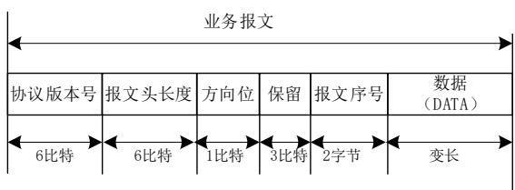  
图 51 采集任务数据汇聚读取报文数据格式

采集任务数据汇聚下行报文格式应符合表 49要求。

表 49 采集任务数据汇聚读取下行报文格式说明

<table><tr><td>域</td><td>字节号</td><td>比特位</td><td>域大小(比特)</td><td>含义</td></tr><tr><td>协议版本号</td><td rowspan="2">0</td><td>0-5</td><td>6</td><td>取值应为0x01。</td></tr><tr><td rowspan="2">报文头长度</td><td>6-7</td><td rowspan="2">6</td><td rowspan="2">报文头(除数据域长度外)的长度。取值应为4。</td></tr><tr><td rowspan="4">1</td><td>0-3</td></tr><tr><td rowspan="2">方向位</td><td rowspan="2">4</td><td rowspan="2">1</td><td>0:下行;</td></tr><tr><td>1:上行;</td></tr><tr><td>保留</td><td>5-7</td><td>3</td><td></td></tr><tr><td>报文序号</td><td>2-3</td><td>0-15</td><td>16</td><td></td></tr><tr><td>数据域</td><td>4-N</td><td>0-7</td><td>L(变长)</td><td>采集任务数据汇集读取下行报文数据域</td></tr></table>

数据域格式应符合表 50要求。

表 50 采集任务数据汇聚读取下行报文数据域格式说明

<table><tr><td>域</td><td>字节号</td><td>比特位</td><td>域大小(比特)</td><td>含义</td></tr><tr><td>冻结时标</td><td>4-9</td><td>0-47</td><td>48</td><td>冻结时间点(YY-MM-DD-HH-MM-SS)。</td></tr><tr><td>抄读表个数</td><td>10</td><td>0-7</td><td>8</td><td>本数据抄读的电表个数。</td></tr><tr><td>抄读表1的MAC地址</td><td>......</td><td>0-47</td><td>48</td><td>表1的MAC地址。</td></tr><tr><td>抄读表1的任务个数</td><td>......</td><td>0-7</td><td>8</td><td>表1的抄读任务个数。</td></tr><tr><td>抄读表1的任务号1</td><td>......</td><td>0-7</td><td>8</td><td>采集任务号。</td></tr><tr><td colspan="5">......</td></tr><tr><td>抄读表1的任务号n</td><td>......</td><td>0-7</td><td>8</td><td>采集任务号。</td></tr><tr><td colspan="5">......</td></tr><tr><td>抄读表n的MAC地址</td><td>......</td><td>0-47</td><td>48</td><td>表n的MAC地址。</td></tr><tr><td>抄读表n的任务个数</td><td>......</td><td>0-7</td><td>8</td><td>表n的抄读任务个数。</td></tr><tr><td>抄读表n任务号1</td><td>......</td><td>0-7</td><td>8</td><td>采集任务号。</td></tr><tr><td colspan="5">......</td></tr><tr><td>抄读表n任务号n</td><td>......</td><td>0-7</td><td>8</td><td>采集任务号。</td></tr></table>

## 5.14.2.2 上行报文格式

上行报文格式应符合图 52格式要求。

<table><tr><td colspan="11">业务报文</td></tr><tr><td>协议版本号</td><td>报文头长度</td><td>方向位</td><td>数据压缩标志</td><td>报文序号</td><td>冻结时标</td><td>CRC16校验</td><td>响应数据整体长度</td><td>电表1响应数据</td><td>电表2响应数据</td><td>...</td></tr><tr><td>6比特</td><td>6比特</td><td>1比特</td><td>3比特</td><td>2字节</td><td>6字节</td><td>2字节</td><td>2字节</td><td>变长</td><td>变长</td><td></td></tr></table>

图 52 采集任务数据汇聚上行报文数据格式

采集任务数据读取上行报文格式应符合表 51格式要求。

表 51 采集任务数据读取上行报文格式说明

<table><tr><td>域</td><td>字节号</td><td>比特位</td><td>域大小(比特)</td><td>含义</td></tr><tr><td>协议版本号</td><td rowspan="2">0</td><td>0-5</td><td>6</td><td>取值应为0x01。</td></tr><tr><td rowspan="2">报文头长度</td><td>6-7</td><td rowspan="2">6</td><td rowspan="2">报文头(除数据域长度外)的长度。取值应为14。</td></tr><tr><td rowspan="3">1</td><td>0-3</td></tr><tr><td>方向位</td><td>4</td><td>1</td><td>0:下行;1:上行。</td></tr><tr><td>数据压缩标志</td><td>5-7</td><td>3</td><td>压缩范围从第14字节即电表1响应数据开始到电表n响应数据结束,数据一起压缩;0:不启用;1:LZ4算法;2:LZMA;其他:保留。</td></tr><tr><td>报文序号</td><td>2-3</td><td>0-15</td><td>16</td><td>与下行报文序号保持一致。</td></tr><tr><td>冻结时标</td><td>4-9</td><td>0-47</td><td>48</td><td>冻结时间点(YY-MM-DD-HH-MM-SS)。</td></tr><tr><td>CRC16校验</td><td>10-11</td><td>0-15</td><td>16</td><td>采用CRC-16/MODBUS算法,范围从响应数据长度到数据结束。</td></tr><tr><td>响应数据整体长度</td><td>12-13</td><td>0-15</td><td>16</td><td>后面数据整体长度。</td></tr><tr><td>电表1响应数据</td><td>变长</td><td>......</td><td>......</td><td>电表1响应数据。</td></tr><tr><td>......</td><td>......</td><td>......</td><td>......</td><td></td></tr><tr><td>电表 n 响应数据</td><td>变长</td><td>......</td><td>......</td><td>电表 n 响应数据。</td></tr></table>

电表响应数据格式应符合表 52要求。

表 52 电表N 响应数据格式说明

<table><tr><td>域</td><td>字节号</td><td>比特位</td><td>域大小(比特)</td><td>含义</td></tr><tr><td>协议类型</td><td rowspan="3">0</td><td>0-3</td><td>4</td><td>0: DL/T 645—2007;1: DL/T 698.45;其他:保留。</td></tr><tr><td>设备类型</td><td>4</td><td>1</td><td>0:电表;1:模块。</td></tr><tr><td>保留</td><td>5-7</td><td>3</td><td></td></tr><tr><td>电表MAC地址</td><td>1-6</td><td>0-47</td><td>48</td><td>模块 MAC。</td></tr><tr><td>任务个数</td><td>7</td><td>0-7</td><td>8</td><td>电表任务个数。</td></tr><tr><td>任务1的任务号</td><td>8</td><td>0-7</td><td>8</td><td>采集任务号。</td></tr><tr><td>响应结果</td><td>9</td><td>0-7</td><td>8</td><td>0:响应成功;1:任务不存在;2:无冻结数据;其他:保留。</td></tr><tr><td>数据项1长度</td><td>10</td><td>0-7</td><td>8</td><td>任务1的数据项1的数据长度。</td></tr><tr><td>数据项1数据</td><td>变长</td><td></td><td></td><td>内容为数据项标识+数据,若不支持该数据项,则为数据项标识+几个字节的0xFF(字节数为任务配置中的数据项回复长度)。</td></tr><tr><td colspan="5">......</td></tr><tr><td>数据项n长度</td><td></td><td>0-7</td><td>8</td><td>...</td></tr><tr><td>数据项n数据</td><td>变长</td><td></td><td></td><td>...</td></tr><tr><td colspan="5">......</td></tr><tr><td>任务n的任务号</td><td>...</td><td>0-7</td><td>8</td><td>采集任务号。</td></tr><tr><td>响应结果</td><td></td><td>0-7</td><td>8</td><td>0:响应成功;1:任务不存在;2:无冻结数据;其他:保留。</td></tr><tr><td>数据项1长度</td><td>...</td><td>0-7</td><td>8</td><td>任务n数据项1的数据长度。</td></tr><tr><td>数据项1数据</td><td>变长</td><td></td><td></td><td>内容为数据项标识+数据,若不支持该数据项,则为数据项标识+几个字节的0xFF(字节数为任务配置中的数据项回复长度)。</td></tr><tr><td colspan="5">......</td></tr><tr><td>数据项n长度</td><td></td><td>0-7</td><td>8</td><td>...</td></tr><tr><td>数据项n数据</td><td>变长</td><td></td><td></td><td>...</td></tr></table>

## 5.14.3 数据项抄读汇聚

## 5.14.3.1 下行报文格式

CCO向STA发送的数据项抄读汇聚下行报文应符合图 53格式要求。

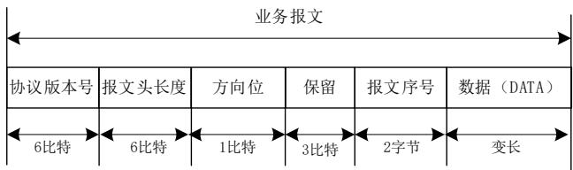  
图 53 数据项抄读汇聚下行报文格式

数据项抄读汇聚下行报文格式的字段应符合表 53要求。

表 53 数据项抄读汇聚下行报文格式说明

<table><tr><td>域</td><td>字节号</td><td>比特位</td><td>域大小(比特)</td><td>含义</td></tr><tr><td>协议版本号</td><td rowspan="2">0</td><td>0-5</td><td>6</td><td>取值应为 0x01</td></tr><tr><td rowspan="2">报文头长度</td><td>6-7</td><td rowspan="2">6</td><td rowspan="2">报文头(除数据域长度外)的长度。取值应为 4。</td></tr><tr><td rowspan="3">1</td><td>0-3</td></tr><tr><td>方向位</td><td>4</td><td>1</td><td>0:下行;1:上行。</td></tr><tr><td>保留</td><td>5-7</td><td>3</td><td></td></tr><tr><td>报文序号</td><td>2-3</td><td>0-15</td><td>16</td><td></td></tr><tr><td>数据域</td><td>4-N</td><td>0-7</td><td>L(变长)</td><td>数据项抄读汇聚下行报文数据域</td></tr></table>

数据格式应符合表 54要求。

表 54 数据项抄读汇聚下行报文数据域格式说明

<table><tr><td>域</td><td>字节号</td><td>比特位</td><td>域大小(比特)</td><td>含义</td></tr><tr><td>冻结时标</td><td>4-9</td><td>0-47</td><td>48</td><td>冻结时间点(YY-MM-DD-HH-MM-SS)。</td></tr><tr><td>抄读表个数</td><td>10</td><td>0-7</td><td>8</td><td>本数据抄读的电表个数。</td></tr><tr><td>抄读表1的MAC地址</td><td>......</td><td>0-47</td><td>48</td><td>表1的MAC地址。</td></tr><tr><td>数据项个数</td><td>......</td><td>0-7</td><td>8</td><td>表1的抄读任务个数。</td></tr><tr><td>数据项1标识</td><td>......</td><td>0-7</td><td>8</td><td>数据项1的标识。</td></tr><tr><td colspan="5">......</td></tr><tr><td>数据项n标识</td><td>......</td><td>0-7</td><td>8</td><td>数据项n的标识。</td></tr><tr><td colspan="5">......</td></tr><tr><td>抄读表n的MAC地址</td><td>......</td><td>0-47</td><td>48</td><td>表n的MAC地址。</td></tr><tr><td>数据项个数</td><td>......</td><td>0-7</td><td>8</td><td>表n的抄读任务个数。</td></tr><tr><td>数据项1标识</td><td>......</td><td>0-7</td><td>8</td><td>数据项1的标识。</td></tr><tr><td colspan="5">......</td></tr><tr><td>数据项n标识</td><td>......</td><td>0-7</td><td>8</td><td>数据项n的标识。</td></tr></table>

## 5.14.3.2 上行报文格式

STA向CCO应答数据项抄读汇聚的上行报文应符合图 54格式要求。

<table><tr><td colspan="11">业务报文</td></tr><tr><td>协议版本号</td><td>报文头长度</td><td>方向位</td><td>数据压缩标志</td><td>报文序号</td><td>冻结时标</td><td>CRC16校验</td><td>响应数据整体长度</td><td>电表1响应数据</td><td>电表2响应数据</td><td>...</td></tr><tr><td>6比特</td><td>6比特</td><td>1比特</td><td>3比特</td><td>2字节</td><td>6字节</td><td>2字节</td><td>2字节</td><td>变长</td><td>变长</td><td></td></tr></table>

图 54 数据项抄读汇聚上行报文格式

数据项抄读汇聚上行报文格式的字段应符合表 55要求。

表 55 数据项抄读汇聚上行报文格式说明

<table><tr><td>域</td><td>字节号</td><td>比特位</td><td>域大小(比特)</td><td>含义</td></tr><tr><td>协议版本号</td><td rowspan="2">0</td><td>0-5</td><td>6</td><td>取值应为 0x01。</td></tr><tr><td rowspan="2">报文头长度</td><td>6-7</td><td rowspan="2">6</td><td rowspan="2">报文头(除数据域长度外)的长度。取值应为12。</td></tr><tr><td>1</td><td>0-34</td></tr><tr><td>方向位</td><td rowspan="2"></td><td></td><td>1</td><td>0:下行;1:上行;</td></tr><tr><td>数据压缩标志</td><td>5-7</td><td>3</td><td>压缩范围从第14字节即电表1响应数据开始到电表n响应数据结束,数据一起压缩;0:不启用;1:LZ4算法;2:LZMA;其他:保留。</td></tr><tr><td>报文序号</td><td>2-3</td><td>0-15</td><td>16</td><td>与下行报文序号保持一致。</td></tr><tr><td>冻结时标</td><td>4-9</td><td>0-47</td><td>48</td><td>冻结时间点(YY-MM-DD-HH-MM-SS)。</td></tr><tr><td>CRC16校验</td><td>10-11</td><td>0-15</td><td>16</td><td>采用CRC-16/MODBUS算法,范围从响应数据长度到数据结束。</td></tr><tr><td>响应数据整体长度</td><td>12-13</td><td>0-15</td><td>16</td><td>后面数据段整体长度。</td></tr><tr><td>电表1响应数据</td><td>变长</td><td>......</td><td>......</td><td>电表响应数据。</td></tr><tr><td>......</td><td>......</td><td>......</td><td>......</td><td></td></tr><tr><td>电表n响应数据</td><td>变长</td><td>......</td><td>......</td><td></td></tr></table>

电表N响应数据报文格式应符合表 56要求。

表 56 电表N 响应数据报文格式说明

<table><tr><td>域</td><td>字节号</td><td>比特位</td><td>域大小(比特)</td><td>含义</td></tr><tr><td>协议类型</td><td rowspan="3">0</td><td>0-3</td><td>4</td><td>0: DL/T 645—2007;1: DL/T 698.45;其他:保留。</td></tr><tr><td>设备类型</td><td>4</td><td>1</td><td>0:电表;1:模块。</td></tr><tr><td>保留</td><td>5-7</td><td>3</td><td></td></tr><tr><td>电表 MAC 地址</td><td>1-6</td><td>0-47</td><td>48</td><td>模块 MAC。</td></tr><tr><td>数据项个数</td><td>7</td><td>0-7</td><td>8</td><td>抄读数据项个数。</td></tr><tr><td>数据项1的长度</td><td>...</td><td>0-7</td><td>8</td><td>数据项1的数据长度。</td></tr><tr><td>数据项1的数据</td><td>变长</td><td></td><td></td><td>内容为数据项标识+数据,若不支持该数据项,则为数据项标识+几个字节的0xFF(字节数为数据项要返回的实际长度)。</td></tr><tr><td colspan="5">......</td></tr><tr><td>数据项n的长度</td><td>...</td><td>0-7</td><td>8</td><td>数据项n的数据长度。</td></tr><tr><td>数据项n的数据</td><td>变长</td><td></td><td></td><td>内容为数据项标识+数据,若不支持该数据项,则为数据项标识+几个字节的0xFF(字节数为数据项要返回的实际长度)。</td></tr></table>

## 5.14.4 CCO主动抄读汇聚业务描述

CCO主动抄读汇聚业务流程应符合以下要求，如图 55所示：

a)终端给CCO下发采集任务配置，告知任务号、数据项、采集周期和对应表号;

b)CCO根据采集任务配置信息，将不同的采集任务配置下发至不同的STA模块；

c)CCO在任务规定的时间自动启动抄表流程，进行数据采集。CCO应能感知到各个PCO的直连子节点信息，对拥有相同PCO的子节点抄读请求应尽量聚合成一帧，由CCO单播下发给对应PCO，再由PCO本地广播发给STA;

d)STA收到抄读请求后，检查目标MAC地址列表是否有匹配自身地址，匹配上则获取电表数据后由STA单播上报给PCO;

e)PCO汇集本次所有抄读子节点的数据后，可选择进一步采用数据压缩算法对数据进行压缩处理后再发送给CCO;

f)STA抄读失败的节点，在超时时间内PCO可以重发抄读请求，抄读请求帧的目的MAC列表仅填写剩余抄读失败的节点;

g)CCO统一汇总PCO上报的数据，对于抄读失败的节点，CCO可以向PCO重发抄读请求，PCO应具备缓存其子节点数据的能力，以便CCO可直接从PCO侧重抄。

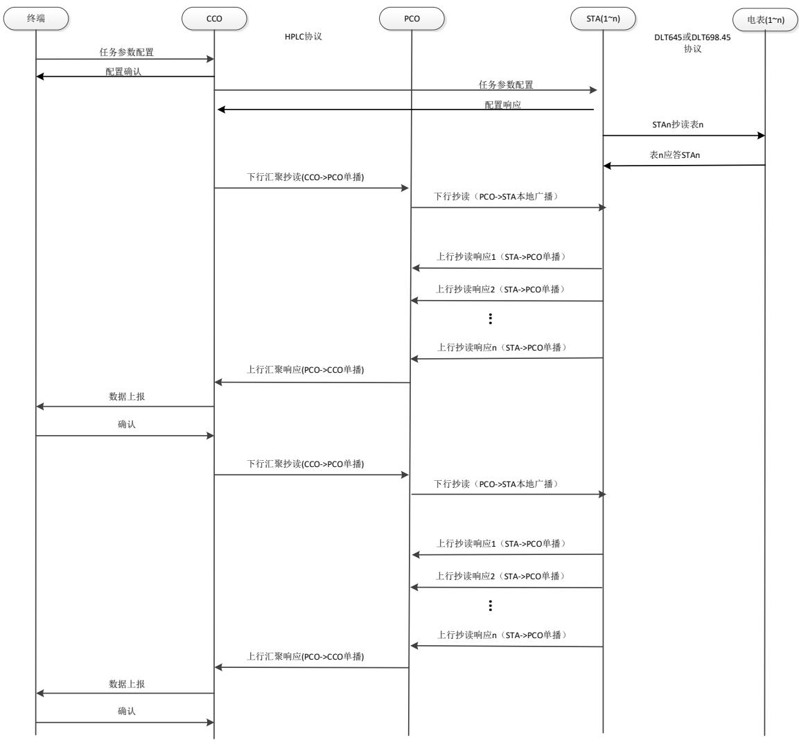  
图 55 CCO、STA、终端与电表的交互流程图

## 5.14.5 STA主动上报汇聚业务描述

STA主动上报汇聚业务流程应符合以下要求，如图 56所示：

a)终端给CCO下发采集任务配置，告知任务号、数据项、采集周期和对应表号；

b)CCO根据采集任务配置信息，将不同的采集任务配置下发至不同的STA模块;

c)STA根据配置的采集任务，在规定的时间通过单播方式上报给PCO;

d)在未收到PCO的SACK或者是否认的SACK时，则STA重新给PCO发送该报文。PCO收到STA上报的报文后，也同样通过单播的方式上报给其PCO，在未收到SACK或者是否认的SACK时，同样也要做重传;

e)CCO收到主动上报的报文后，主动上报给终端。CCO不应给目标STA回复应用层的下行报文;

f)对于未上报或者上报失败的数据，后期由终端统一通过并发抄表的方式进行补抄。

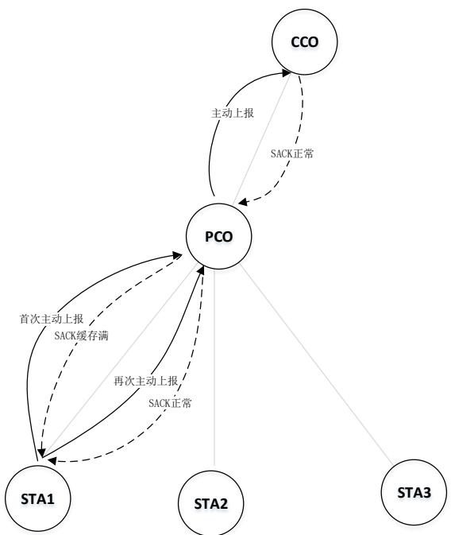  
图 56 STA主动上报示意图

## 5.15 单向业务报文

## 5.15.1 下行报文格式

CCO向STA发送的单向业务下发报文应符合图 57要求。

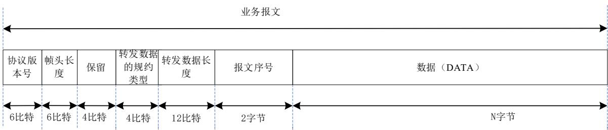  
图 57 单向业务下发报文格式

单向业务下发报文格式的字段应符合表 57要求。

表 57 单向业务下行报文格式说明

<table><tr><td>域</td><td>字节号</td><td>比特位</td><td>域大小(比特)</td><td>含义</td></tr><tr><td>协议版本号</td><td rowspan="2">0</td><td>0-5</td><td>6</td><td>本版本取值应为1。</td></tr><tr><td rowspan="2">报文头长度</td><td>6-7</td><td rowspan="2">6</td><td rowspan="2">报文头(除数据域长度外)的长度,用于接收方从报文头偏移报文头长度找到数据域的位置。</td></tr><tr><td rowspan="2">1</td><td>0-3</td></tr><tr><td>保留</td><td>4-7</td><td>4</td><td></td></tr><tr><td>转发数据的规约类型</td><td>2</td><td>0-3</td><td>4</td><td>指从CCO发送给STA数据的规约类型。规约类型值及其所代表的含义如下:0x00:透明传输;0x01:保留;0x02:DL/T 645—2007;0x03:DL/T 698.45;其他:保留。</td></tr><tr><td rowspan="2">转发数据长度</td><td></td><td>4-7</td><td rowspan="2">12</td><td rowspan="2">指从CCO发送给STA抄表数据的长度,即实际数据域的长度。</td></tr><tr><td>3</td><td>0-7</td></tr><tr><td>报文序号</td><td>4-5</td><td>0-15</td><td>16</td><td>指从CCO发送给STA数据报文的序号,STA应答时使用该序号返回,CCO通过序号来判断接收到的上行报文是否过期,即是否是本次CCO请求的上行应答报文。由CCO分配报文序号,CCO向STA发送请求数据报文时,报文序号递增,重发请求报文的报文序号不增加。</td></tr></table>

## 5.15.2 上行报文格式

应符合5.7确认/否认报文中确认报文的格式要求。

## 5.15.3 单向业务下发流程

CCO向STA发送的应用层业务数据，STA将数据发送至电能表之后，将确认信息返回给CCO，其流程应符合图 58要求。

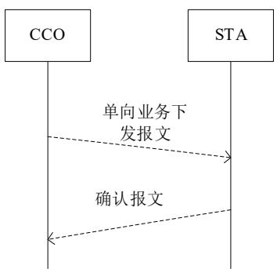  
图 58 单向业务下发报文传输流程

## 5.16 多用户应用聚合帧报文

## 5.16.1 下行报文格式

多用户应用聚合帧下行报文应符合图 59格式要求。

  
图 59 多用户应用聚合帧下行报文格式  
多用户应用聚合帧下行报文格式字段应符合表 58多用户应用聚合帧下行报文格式说明要求。

表 58 多用户应用聚合帧下行报文格式说明

<table><tr><td>域</td><td>字节号</td><td>比特位</td><td>域大小(比特)</td><td>含义</td></tr><tr><td>协议版本号</td><td rowspan="2">0</td><td>0-5</td><td>6</td><td>本版本取值应为1。</td></tr><tr><td rowspan="2">报文头长度</td><td>6-7</td><td rowspan="2">6</td><td rowspan="2">报文头(除数据域长度外)的长度。取值应为4。</td></tr><tr><td rowspan="2">1</td><td>0-3</td></tr><tr><td>保留</td><td>4-7</td><td>4</td><td></td></tr><tr><td>保留</td><td>2</td><td>0-7</td><td>8</td><td></td></tr><tr><td>聚合帧数量</td><td>3</td><td>0-7</td><td>8</td><td>聚合帧包含的应用层报文数量,用于PCO拆分数据。</td></tr></table>

多用户应用聚合帧数据（DATA）域格式应符合表 59要求。

表 59 数据域格式说明

<table><tr><td>数据内容</td><td>数据格式</td><td>字节数</td><td>含义</td></tr><tr><td>目的地址1</td><td>BIN</td><td>6</td><td>应用层报文1源目的地址。</td></tr><tr><td>长度1(L)</td><td>BIN</td><td>2</td><td>应用层报文1长度。</td></tr><tr><td>DATA1</td><td>BIN</td><td>L</td><td>应用层报文1。</td></tr><tr><td>目的地址2</td><td>BIN</td><td>6</td><td>应用层报文2源目的地址。</td></tr><tr><td>长度2(L)</td><td>BIN</td><td>2</td><td>应用层报文2长度。</td></tr><tr><td>DATA2...</td><td>BIN...</td><td>L...</td><td>应用层报文2。...</td></tr><tr><td>目的地址n</td><td>BIN</td><td>6</td><td>应用层报文n源目的地址。</td></tr><tr><td>长度n(L)</td><td>BIN</td><td>2</td><td>应用层报文n长度。</td></tr><tr><td>DATAn</td><td>BIN</td><td>L</td><td>应用层报文n。</td></tr></table>

## 5.16.2 多用户应用聚合帧传输流程

多用户应用聚合帧传输流程应符合以下要求，如图 60所示。

  
图 60 多用户应用聚合帧转发流程

a) 将发往不同 的多条应用层报文或者相同 的不同应用报文，进行聚合封装，通过下行信道向对应PCO发送1次应用聚合报文。

b) PCO接收聚合报文，对其进行拆分处理，还原为最初的多条独立应用层报文，并通过应用层目的地址与终端匹配。

c) PCO应根据信道评估结果和目标STA版本选择OFDMA/TDA/V1.0 SOF发送给STA，若目的地址为自身，则应直接上报应用层处理

## 5.17 温度告警门限配置报文

## 5.17.1 下行报文格式

CCO向STA发送的温度告警门限配置报文格式应符合图 61格式要求

  
图 61 温度告警门限配置报文数据格式

温度告警门限配置报文格式的字段应符合表 60 要求。

表 60 温度告警门限配置报文格式说明

<table><tr><td>域</td><td>字节号</td><td>比特位</td><td>域大小(比特)</td><td>含义</td></tr><tr><td>协议版本号</td><td rowspan="2">0</td><td>0-5</td><td>6</td><td>本版本取值应为1。</td></tr><tr><td rowspan="2">报文头长度</td><td>6-7</td><td rowspan="2">6</td><td rowspan="2">报文头(除数据域长度外)的长度。取值应为2。</td></tr><tr><td rowspan="2">1</td><td>0-3</td></tr><tr><td>保留</td><td>4-7</td><td>4</td><td></td></tr><tr><td>数据</td><td>2-3</td><td>0-7</td><td>16</td><td>报警门限值,大于等于该值时上报事件BCD格式:XXX.X摄氏度,小端在前</td></tr></table>

## 5.17.2 上行报文格式

应符合5.7确认/否认报文中确认报文的格式要求。

## 5.17.3 温度告警门限配置流程

CCO应将温度告警门限配置报文广播转发给所有的STA，也可将温度告警门限配置报文单播发给特定的STA。广播配置应无回复，单播配置应回复确认报文。其流程应符合图 62要求。

  
图 62 温度告警门限配置报文传输流程

## 附录A（资料性附录） 芯片ID信息格式要求

芯片ID信息应为24字节的字段，芯片ID信息数据单元格式应符合表A.1要求。

表 A.1 芯片 ID 数据单元

<table><tr><td>字节号</td><td>数据内容</td></tr><tr><td>1</td><td>固定值 0x01(十进制 1)</td></tr><tr><td>2</td><td>固定值 0x02(十进制 2)</td></tr><tr><td>3</td><td>固定值 0x9C(十进制 156)</td></tr><tr><td>4-6</td><td>固定值 0x01C1FB(十进制 115195),表示中国电力科学研究院</td></tr><tr><td>7</td><td>设备类型(如 0x01 表示窄带载波通信单元),0x02 表示高速载波通信单元,0x03 表示双模通信单元</td></tr><tr><td>8-9</td><td>厂商代码(十六进制,由国网计量中心分配)</td></tr><tr><td>10-11</td><td>芯片型号(十六进制,由国网计量中心分配)</td></tr><tr><td>12-16</td><td>设备序列号(十六进制,由国网计量中心分配)</td></tr><tr><td>17-24</td><td>校验码(十六进制,使用私有算法根据之前所有内容计算出的检验码,由计量中心生产)</td></tr></table>

## 附录B（资料性附录） 抄控器支持的诊断信息

抄控器对CCO的载波接管支持的诊断信息宜符合表B.1要求。

表 B.1 抄控器-CCO 诊断功能

<table><tr><td>诊断功能</td><td>功能描述</td><td>连接目标</td></tr><tr><td>网络拓扑查询</td><td>查询网络拓扑信息:节点TEI、入网地址、节点层级、代理TEI、产品形态、在网状态、相位信息、版本信息(厂商信息)。</td><td>CCO</td></tr><tr><td>网络基本信息</td><td>网络号、载波频段、无线信道</td><td>CCO</td></tr><tr><td>查询表档案</td><td>读取CCO内的表档案信息</td><td>CCO</td></tr><tr><td>配置网络号</td><td>配置网络号</td><td>CCO</td></tr><tr><td>配置载波频段</td><td>配置网络切换到指定载波频段工作</td><td>CCO</td></tr><tr><td>配置无线工作信道</td><td>配置网络切换到新指定无线信道工作</td><td>CCO</td></tr><tr><td>配置无线信道序列</td><td>配置网络工作的无线信道序列</td><td>CCO</td></tr><tr><td>配置认证</td><td>配置网络表档案认证开关</td><td>CCO</td></tr><tr><td>抄读功能</td><td>对指定电表进行抄读(时钟、正向有功电能)</td><td>CCO</td></tr><tr><td>厂商自定义维测命令</td><td>支持各厂商自定义的维测命令</td><td>CCO</td></tr><tr><td>全网升级</td><td>抄控器连接CCO后,向CCO传输升级文件,并且启动全网升级。</td><td>CCO</td></tr><tr><td>单点升级</td><td>抄控器连接目标节点,向目标节点传输升级文件,启动对目标节点的升级。</td><td>CCO</td></tr></table>

抄控器对STA的载波直抄支持的诊断信息宜符合表B.2要求。

表 B.2 抄控器-STA 诊断功能

<table><tr><td>诊断功能</td><td>功能描述</td><td>连接目标</td></tr><tr><td>网络基本信息</td><td>网络号、载波频段、无线信道</td><td>STA</td></tr><tr><td>配置无线信道序列</td><td>配置网络工作的无线信道序列</td><td>STA</td></tr><tr><td>点抄电表功能</td><td>点抄电表功能(时钟、正向有功电能)</td><td>STA</td></tr><tr><td>文件传输</td><td>抄控器连接STA,向STA所在的电表或采集器传输升级文件。</td><td>STA</td></tr><tr><td>厂商自定义维测命令</td><td>支持各厂商自定义的维测命令</td><td>STA</td></tr></table>

抄控器对CCO/STA串口透传支持的诊断功能宜符合表B.3所列要求。

表 B.3 抄控器-CCO/STA 诊断功能

<table><tr><td>诊断功能</td><td>功能描述</td><td>连接目标</td></tr><tr><td>终端时钟</td><td>与终端通信检测</td><td>CCO</td></tr><tr><td>透传抄读电表</td><td>透传抄读电表功能(时钟、正向有功电能)</td><td>STA</td></tr><tr><td>文件传输</td><td>抄控器连接STA,向STA所在的电表或采集器传输升级文件。</td><td>STA</td></tr><tr><td>厂商自定义维测命令</td><td>支持各厂商自定义的维测命令。</td><td>CCO/STA</td></tr></table>