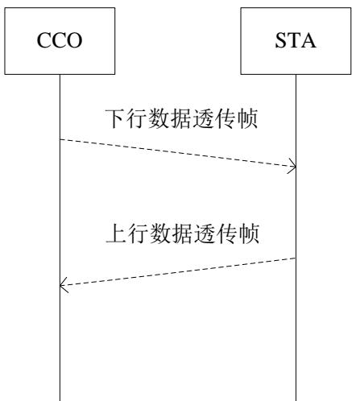
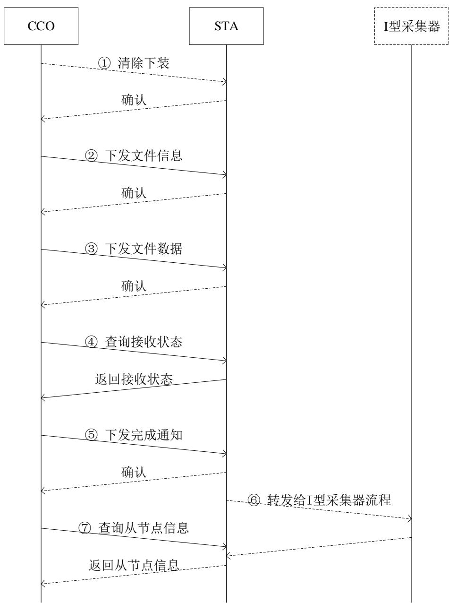
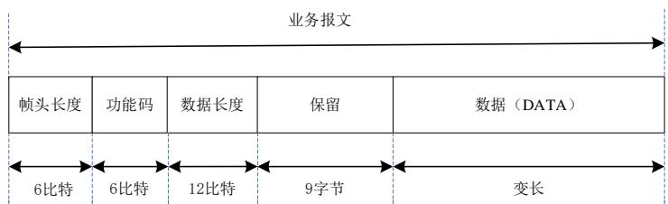
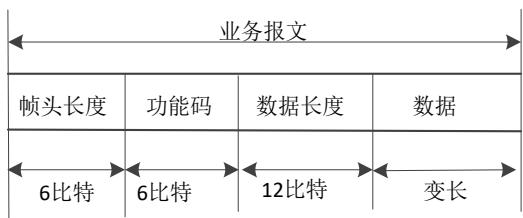
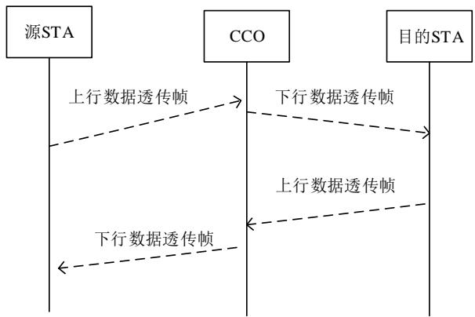

Q/CSG

# 中国南方电网有限责任公司企业标准

Q/XXX

# 低压电力线宽带载波通信规约第 6 部分：应用层通信协议（报批稿）

20XX—XX—XX 发布

20XX—XX—XX 实施

中国南方电网有限责任公司 发 布

## 目 次

前言....2
1 范围....1
2 规范性引用文件....1
3 术语和定义....1
4 缩略语....2
5 概述....2
6 通用报文结构....2
7 业务扩展域....5
8 确认/否认....5
9 数据转发....6
10 命令业务....8
11 主动上报....26
12 抄控器协议....28
13 广播命令业务....29
14 数据订阅业务....29

## 前 言

为全面规范南方电网公司低压电力线宽带载波通信协议应用层要求，包括应用层概述、通用报文结构、确认/否认、数据转发、命令业务、主动上报、抄控器协议、广播命令业务、数据订阅业务等内容，制定本部分。

《低压电力线宽带载波通信规约》标准分为6个部分：

——第1部分：总则；

——第2部分：技术要求；

——第3部分：检验方法；

——第4部分：物理层通信协议；

——第5部分：数据链路层通信协议；

——第6部分：应用层通信协议。

本标准是《低压电力线宽带载波通信规约》第6 部分。

本标准由中国南方电网有限责任公司生产技术部提出、归口管理并负责解释。

本部分标准主编单位：

本部分标准起草人：

本标准为首次发布。

## 低压电力线宽带载波通信规约 第6 部分：应用层通信协议

## 1 范围

本标准规定了低压电力线宽带载波通信网络的应用层层技术。

本标准适用于低压电力线宽带载波通信单元制造、性能检测、数据交换、运行维护和验收。

## 2 规范性引用文件

下列文件中的内容通过文中的规范性引用而构成本文件必不可少的条款。其中，注日期的引用文件，仅该日期对应的版本适用于本文件；不注日期的引用文件，其最新版本（包括所有的修改单）适用于本文件。

DL/T 645-2007 多功能电能表通信协议

DL/T 645-1997 多功能电能表通信规约

CJ/T188-2018 户用计量仪表数据传输技术条件

## 3 术语和定义

下列术语和定义适用于本文件。

## 3.1

## 宽带载波通信网络

宽带载波通信网络是以低压电力线为通信媒介，实现低压电力用户用电信息汇聚、传输、交互通信网络的功能，其主要采用正交频分复用技术，频率范围（0.7～12）MHz。

## 3.2

## 中央协调器

通信网络中的主节点角色，负责完成组网控制、网络维护管理等功能，其对应的设备实体为集中器本地通信单元。

## 3.3

## 代理协调器

为中央协调器与站点或者站点与站点之间进行数据中继转发的站点，简称代理。

## 3.4

## 站点

通信网络中的从节点角色，其对应的设备实体为通信单元，包括电能表载波模块、I 型采集器载波模块或II 型采集器。

## 3.5

## 数据订阅路由

电力线通信网络中建立和维护经中央协调器转发的某个站点至另一个站点的传输路径的过程。应用于同一个宽带载波网络中，集中器与传感器、智能分布式开关等其他非计量自动化业务电气设备数据转发场景。

## 3.6

## 路由

电力线通信网络中中继路由和数据订阅路由。

## 3.7

## 业务报文

通信网络中建立和维护从中央协调器到各个站点的传输路径以及从各个站点至中央协调器的传输路径的过程。

## 3.8

## 网关

中央协调器（CCO）的载体设备，具备汇聚、远程回传功能。

## 3.9

## 终端

站点（STA）的载体设备。

## 4 缩略语

以下缩略语适用于本文件。

CCO：中央协调器（Central Coordinator）

CRC：循环冗余校验（Cyclic Redundancy Check)

MAC：媒介访问控制（Media Access Control)

MPDU：层协议数据单元（MAC Protocol Data Unit)

MSDU：层服务数据单元（MAC Service Data Unit)

NTB：网络基准时间（Network Time Base)

OSTEI：原始源终端设备标识（Original Source Terminal Equipment Identifier)

SNID：短网络标识符（Short Network Identifier)

SNR：信噪比（Signal-to-Noise Ratio)

SOF：帧起始（Start of Frame)

STA：站点（Station)

TEI：终端设备标识（Terminal Equipment Identifier)

## 5 概述

应用层定义了CCO与STA之间各种业务的数据交互过程，包括交互的报文格式和交互流程。包括的具体业务有：数据转发业务（含数据订阅业务）、命令业务、广播业务和主动上报业务等。

## 6 通用报文结构

应用层报文需遵循通用报文结构，如表 1所示。

表 1 通用报文格式

<table><tr><td>字节:1</td><td>2</td><td>1</td><td>变长L</td></tr><tr><td>报文端口号</td><td>报文标识符</td><td>保留</td><td>应用层业务报文</td></tr><tr><td colspan="3">通道控制信息</td><td>应用层数据</td></tr></table>

## 6.1 报文端口号

报文端口号是1字节的字段，指 CCO与 STA之间进行交互时，应用层报文传输中的端口号。对于需要通信模块转发的报文，取值为 0x11；对于发送给通信模块以及通信模块主动发送的报文，取值为0x13。一般而言，0x11报文对应于业务报文，0x13报文对应于管理报文。各类报文的端口号取值见 6.3.2。

## 6.2 报文标识符

报文标识符是2字节的字段，指CCO与STA、抄控器之间传输的应用层报文标识符，应用层报文固定为0x0101。

注：默认为CCO与 STA之间的应用层报文，除非特别描述为CCO和抄控器之间的报文。

## 6.3 应用层业务报文

应用层业务报文包括数据转发报文、命令报文和主动上报报文等,其格式如表 2 所示。

表 2 应用层业务报文

<table><tr><td>字节数:2</td><td>1</td><td>1</td><td>2</td><td>2</td><td>变长L0</td><td colspan="3">变长L1</td></tr><tr><td>控制域</td><td>业务标识</td><td>应用版本号</td><td>帧序号</td><td>帧长</td><td>业务数据单元</td><td>扩展域数据区长度</td><td>厂家编码</td><td>扩展数据区载荷</td></tr><tr><td colspan="5">业务报文头</td><td>业务报文域</td><td colspan="3">业务扩展域</td></tr></table>

## 6.3.1 控制域

控制域包括定义帧类型域、业务扩展域等内容，长度为 16 比特。具体帧控制域内容格式如表 3所示。

表 3 控制域

<table><tr><td>D15</td><td>D14</td><td>D13</td><td>D12</td><td>D11~D4</td><td>D3~D0</td></tr><tr><td>传输方向位</td><td>启动标志位</td><td>响应标识位</td><td>业务扩展域标识位</td><td>保留</td><td>帧类型域</td></tr></table>

## 6.3.1.1 帧类型域

帧类型域规定了帧所属类型，不同帧类型域内容不同，表时的帧类型不同。本规范帧类型分为数据转发帧、命令帧、广播帧和主动上报帧四种，帧类型域长度为 4比特，数据内容如

表 4 所示。

表 4 帧类型域

<table><tr><td>帧类型域 D3 D2 D1 D0</td><td>帧类型名称</td><td>应用类型条目</td></tr><tr><td>0000</td><td>确认/否认</td><td>8</td></tr><tr><td>0001</td><td>数据转发帧</td><td>9</td></tr><tr><td>0010</td><td>命令帧</td><td>10</td></tr><tr><td>0011</td><td>主动上报帧</td><td>11</td></tr><tr><td>0100</td><td>抄控器相关协议</td><td>12</td></tr><tr><td>0101</td><td>广播命令帧</td><td>13</td></tr><tr><td>0110</td><td>数据订阅路由帧</td><td>14</td></tr><tr><td>1110</td><td>厂家调试</td><td>备用</td></tr><tr><td>其它</td><td>保留</td><td></td></tr></table>

## 6.3.1.2 业务扩展域标识位

业务扩展域标识位取值决定数据帧中业务扩展域是否存在，长度为1 比特。业务扩展标识位内容如表 5所示。

表 5 业务扩展域标识位

<table><tr><td>业务扩展域标识位 D12</td><td>含义</td></tr><tr><td>0</td><td>无业务扩展域</td></tr><tr><td>1</td><td>有业务扩展域</td></tr></table>

## 6.3.1.3 响应标识位

响应标识位是 1 比特的字段，用来描述该报文是否需要目标设备应答，其内容如表 6所示。

表 6 响应标识位

<table><tr><td>响应标识位 D13</td><td>含义</td></tr><tr><td>0</td><td>不需要应答</td></tr><tr><td>1</td><td>需要应答</td></tr></table>

## 6.3.1.4 启动标志位

启动标志位是1比特的字段，用来区分此报文是自从动站还是来自启动站，其内容如表7所示。

表 7 启动标志位

<table><tr><td>启动标志位 D14</td><td>含义</td></tr><tr><td>0</td><td>此帧报文来自从动站</td></tr><tr><td>1</td><td>此帧报文来自启动站</td></tr></table>

## 6.3.1.5 传输方向位

传输方向位是 1 比特的字段，用来区分上下行通信数据报文，其内容如表 8 所示。由CCO 发送给 STA 数据报文的方向为下行方向，STA 上报给 CCO 数据报文的方向为上行方向。

由抄控器发送给 CCO/STA 数据报文的方向为下行方向，CCO/STA 发送给抄控器数据报文的方向为上行方向。

表 8 传输方向位

<table><tr><td>传输方向位 D15</td><td>含义</td></tr><tr><td>0</td><td>下行方向</td></tr><tr><td>1</td><td>上行方向</td></tr></table>

## 6.3.2 业务标识

业务标识是8比特的字段，是应用层报文的具体标识符，具体内容和取值如

表 9所示。

表 9 业务标识

<table><tr><td>帧类型</td><td>报文端口号</td><td>业务标识</td><td colspan="2">描述</td></tr><tr><td rowspan="3">确认/否认</td><td>0x11</td><td>0x00</td><td colspan="2">确认</td></tr><tr><td>0x11</td><td>0x01</td><td colspan="2">否认</td></tr><tr><td></td><td>0x02~0xFF</td><td colspan="2">保留</td></tr><tr><td rowspan="2">数据转发</td><td>0x11</td><td>0x00</td><td colspan="2">数据透传至设备</td></tr><tr><td>0x13</td><td>0x01</td><td colspan="2">数据透传至模块0x02~0xFF</td></tr><tr><td colspan="2"></td><td></td><td></td><td>保留</td></tr><tr><td rowspan="13">命令</td><td rowspan="3">功能性业务</td><td>0x11</td><td>0x02</td><td>文件传输</td></tr><tr><td>0x11</td><td>0x03</td><td>允许/禁止从节点事件</td></tr><tr><td></td><td>其他</td><td>保留</td></tr><tr><td rowspan="10">通信管理业务</td><td>0x11</td><td>0x00</td><td>查询终端搜索结果</td></tr><tr><td>0x11</td><td>0x01</td><td>下发搜索终端列表</td></tr><tr><td>0x11</td><td>0x04</td><td>从节点重启</td></tr><tr><td>0x11</td><td>0x05</td><td>从节点信息查询</td></tr><tr><td>0x11</td><td>0x06</td><td>下发通信地址映射表列表</td></tr><tr><td>0x13</td><td>0x07</td><td>查询从节点运行状态信息</td></tr><tr><td>0x13</td><td>0x08</td><td>查询从节点信道信息</td></tr><tr><td>0x11</td><td>0x10</td><td>台区户变关系/相位识别</td></tr><tr><td>0x11</td><td>0xF0</td><td>测试帧</td></tr><tr><td></td><td>其它</td><td>保留</td></tr><tr><td colspan="2" rowspan="5">主动上报</td><td>0x11</td><td>0x00</td><td>电表事件主动上报</td></tr><tr><td>0x13</td><td>0x01</td><td>停上电事件上报</td></tr><tr><td>0x11</td><td rowspan="2">0x02</td><td>设备事件主动上报</td></tr><tr><td>0x13</td><td>通信模块事件上报</td></tr><tr><td></td><td>0x03~0xFF</td><td>保留</td></tr><tr><td colspan="2" rowspan="3">抄控器协议</td><td>0x11</td><td>0x00</td><td>抄控器-CCO 协议</td></tr><tr><td>0x11</td><td>0x01</td><td>数据透传串口转发</td></tr><tr><td></td><td>0x02-0xFF</td><td>保留</td></tr><tr><td colspan="2" rowspan="4">广播命令</td><td>0x11</td><td>0x04</td><td>从节点重启</td></tr><tr><td>0x11</td><td>0x05</td><td>从节点信息查询</td></tr><tr><td>0x13</td><td>0x07</td><td>查询从节点运行状态信息</td></tr><tr><td>0x13</td><td>0x08</td><td>查询从节点信道信息</td></tr><tr><td colspan="2" rowspan="2">数据订阅业务</td><td>0x11</td><td>0x00</td><td>数据订阅业务</td></tr><tr><td></td><td>0x01~0xFF</td><td>保留</td></tr></table>

## 6.3.3 应用版本号

应用版本号是1字节的字段，指从CCO发送给 STA 的应用层数据的版本号。考虑兼容性，本版本取值固定为 。应用帧结构发生变化时，对应的应用版本号需增加。

## 6.3.4 帧序号

帧序号有效取值范围为 0x0000\~0xFFFF，在每次传输新的应用层帧后加 1，0xFFFF 后返回0x0000。响应帧序号与启动帧序号相同。重发请求报文的帧序号不增加。

## 6.3.5 帧长

帧长包括业务报文域 L0（业务数据单元）和业务扩展域L1（扩展域数据区长度、厂家编码和扩展数据区载荷）总字节数。

## 6.3.6 业务报文域

业务报文域包括业务数据单元，其具体内容根据业务标识有不同的内容。

## 7 业务扩展域

业务扩展域包含于应用层帧头部分，属于可选项。帧头是否包含业务扩展域取决于控制域中业务扩展域标志位内容。业务扩展域提供了功能扩展空间，用户可根据自身需求，对业务扩展域内容进行定制。业务扩展域包括扩展域数据区长度、厂家编码和扩展数据部分，其中扩展域数据区长度部分占 1字节，用于标识厂家编码和扩展数据区长度，厂家编码部分占2字节，格式为ASCII 码，用于标识本帧业务扩展域属于哪个厂商。厂家标识和扩展域数据区内具体功能的管理建议使用备案制。

表 10 业务扩展域

<table><tr><td>字节数:1</td><td>2</td><td>变长L</td></tr><tr><td>扩展域数据区长度</td><td>厂家编码</td><td>扩展域数据区</td></tr></table>

## 8 确认/否认

8.1 0x00：确认

无业务报文载荷。

## 8.2 0x01：否认

否认报文格式如表 11所示。

表 11 否认格式

<table><tr><td>字节数:1</td></tr><tr><td>原因码</td></tr><tr><td>业务数据单元</td></tr></table>

原因码：0为通信超时，1表示业务标识不支持，2表示 CCO 忙，3表示终端层无应答，4表示格式错误，FFH其他；

## 9 数据转发

## 9.1 0x00：数据透传至设备

CCO将需要转发的数据内容传输至 STA，STA 从报文中提取出转发数据内容并传送给STA 所连接的终端（例如电能表、采集器等）。

## 9.1.1 下行业务报文格式

CCO 向STA发送的数据透传下行业务报文载荷格式如表 12所示。

表 12 数据透传至设备业务报文载荷格式

<table><tr><td>字节数:6</td><td>6</td><td>1</td><td>1</td><td>2</td><td>变长L</td></tr><tr><td>源地址</td><td>目的地址</td><td>设备超时时间</td><td>保留</td><td>转发数据长度</td><td>转发数据内容</td></tr><tr><td colspan="6">业务数据单元</td></tr></table>

## 9.1.1.1 源地址

主节点地址，6字节，默认可以填 0。

## 9.1.1.2 目的地址

实际电表的地址，6字节。

## 9.1.1.3 设备超时时间

设备超时时间是8 比特的字段，由CCO 给定，STA将其作为与设备之间通信时超时时间，在此时间内，STA没有收到设备的应答，则放弃本次转发。单位：100毫秒。值为0 时，STA 取默认超时时间。

## 9.1.1.4 保留

保留位默认填0。

## 9.1.1.5 转发数据长度

转发数据长度是 16 比特的字段，指从CCO 发送给 STA 抄表数据的长度，即实际数据域的长度。

## 9.1.1.6 转发数据内容（DATA）

数据（DATA）字节长度可变，指由 CCO下发给 STA的数据转发报文数据。

## 9.1.2 上行业务报文格式

STA 向CCO发送的数据透传的上行业务数据单元如表 13所示。

表 13 数据透传至设备上行业务报文格式

<table><tr><td>字节数:6</td><td>6</td><td>2</td><td>2</td><td>变长L</td></tr><tr><td>源地址</td><td>目标地址</td><td>保留</td><td>转发数据长度</td><td>转发数据内容</td></tr><tr><td colspan="5">业务数据单元</td></tr></table>

## 9.1.2.1 源地址

电表地址，6字节。

## 9.1.2.2 目的地址

主节点地址，6字节，默认可以填 0。

## 9.1.2.3 保留

保留位默认填0。

## 9.1.2.4 转发数据长度

转发数据长度是 16 比特的字段，指从 STA 发送给 CCO 抄表结果数据的长度，即实际数据（DATA）域的长度。

## 9.1.2.5 数据（DATA）

数据（DATA）字节长度可变，指 STA收到下接设备（如电能表、采集器）的抄表应答报文。

## 9.2 0x01：数据透传至模块

CCO将需要转发的数据内容传输至 STA，STA 从报文中提取出转发数据内容并传送给STA 本身所属的通信模块（例如电能表、采集器等终端通信模块等）。

## 9.2.1 下行业务报文格式

CCO向 STA 发送的数据透传下行业务报文载荷格式如表 14所示。

表 14 数据透传至模块下行业务报文载荷格式

<table><tr><td>字节数:6</td><td>6</td><td>1</td><td>1</td><td>2</td><td>变长L</td></tr><tr><td>源地址</td><td>目的地址</td><td>保留</td><td>业务代码</td><td>数据转发长度</td><td>数据内容</td></tr><tr><td colspan="6">业务数据单元</td></tr></table>

## 9.2.1.1 源地址

主节点地址，6字节，默认可以填0。

## 9.2.1.2 目的地址

实际电表的地址，6字节。

## 9.2.1.3 保留

保留位默认填0。

## 9.2.1.4 业务代码

默认填0，透传645报文，1\~255保留。

## 9.2.1.5 数据转发长度

数据长度是16比特的字段，指从 CCO 发送给 STA数据的长度，即实际数据域的长度。

## 9.2.1.6 转发数据内容（DATA）

数据（DATA）字节长度可变，指由 CCO 下发给STA的数据内容。

## 9.2.2 上行业务报文格式

STA 向CCO 发送的数据透传的上行业务数据单元如表 15所示。

表 15 数据透传至模块上行业务报文载荷格式

<table><tr><td>字节数:6</td><td>6</td><td>1</td><td>1</td><td>2</td><td>变长L</td></tr><tr><td>源地址</td><td>目标地址</td><td>保留</td><td>业务代码</td><td>数据转发长度</td><td>数据内容</td></tr><tr><td colspan="6">业务数据单元</td></tr></table>

## 9.2.2.1 源地址

电表地址，6字节。

## 9.2.2.2 目的地址

主节点地址，6字节，默认可以填 0。

## 9.2.2.3 保留

保留位默认填0。

## 9.2.2.4 业务代码

默认填0，透传645报文，1\~255保留。

## 9.2.2.5 数据转发长度

数据长度是16比特的字段，指从STA发送给CCO应答数据的长度，即实际数据（DATA）域的长度。

## 9.2.2.6 数据（DATA）

数据（DATA）字节长度可变，指 STA应答给CCO 的报文或数据内容。

## 9.3 数据转发业务传输流程

CCO 向 STA 发送的数据转发报文，STA 通过电能表、采集器或其他电气设备获取到结果之后，将结果应答给CCO。数据转发业务传输流程如图 1 和所示。

  
图 1 数据转发业务报文传输流程

## 10 命令业务

## 10.1 0x00：查询终端搜索结果

10.1.1 下行业务报文格式

应用头长度为0，无数据单元。

## 10.1.2 上行业务报文格式

上行业务数据单元格式如表16所示。

表 16 命令业务上行业务数据单元

<table><tr><td>字节数:1</td><td>3</td><td colspan="3">8*n</td></tr><tr><td>终端数量</td><td>保留</td><td>终端1信息</td><td>...</td><td>终端n信息</td></tr><tr><td colspan="5">业务数据单元</td></tr></table>

## 10.1.2.1 终端数量

表地址数量，BIN 格式。

10.1.2.2 保留

默认填0。

## 10.1.2.3 终端信息

终端信息格式如表 17 所示（一般指电表信息，适用其他非计量自动化业务电气设备终端信息）。

表 17 终端信息数据帧结构

<table><tr><td>内容</td><td>数据格式</td><td>字节数</td></tr><tr><td>终端地址</td><td>BCD</td><td>6</td></tr><tr><td>规约类型</td><td>BIN</td><td>1</td></tr><tr><td>保留(默认填0)</td><td>BIN</td><td>1</td></tr></table>

规约类型：01H=DLT/645-1997；02H=DLT/645-2007；03：CJ/T188；其他值保留。

## 10.2 $0 \times 0 1$ ：下发搜索终端列表

## 10.2.1 下行业务报文格式

下行业务数据单元格式如表 18所示。

表 18 下行业务数据单元格式

<table><tr><td>字节数:1</td><td>3</td><td colspan="3">8*n</td></tr><tr><td>终端数量</td><td>保留</td><td>终端1信息</td><td>...</td><td>终端n信息</td></tr><tr><td colspan="5">业务数据单元</td></tr></table>

## 10.2.1.1 终端数量

终端地址数量，BIN 格式。

## 10.2.1.2 保留

默认填 0。

## 10.2.1.3 终端信息

终端信息格式见表 17。

10.2.2 上行业务报文格式

上行为确认/否认帧。

10.3 0x02：文件传输

## 10.3.1 下行业务报文格式

业务数据单元格式如表 19所示。

表 19 业务数据单元格式

<table><tr><td>字节数:1</td><td>3</td><td>L</td></tr><tr><td>文件传输信息 ID</td><td>保留</td><td>文件传输信息</td></tr><tr><td colspan="3">业务数据单元</td></tr></table>

## 10.3.1.1 文件传输信息 ID

其中文件传输信息 ID 定义如表 20 所示。

表 20 文件传输信息 ID说明

<table><tr><td>文件传输信息 ID</td><td>含义</td></tr><tr><td>0x00</td><td>下发文件信息</td></tr><tr><td>0x01</td><td>下发文件数据</td></tr><tr><td>0x02</td><td>查询文件数据包接收状态</td></tr><tr><td>0x03</td><td>文件传输完成通知</td></tr><tr><td>0x04</td><td>文件数据本地广播转发</td></tr><tr><td>0x05~0xFF</td><td>保留</td></tr></table>

## 10.3.1.2 下发文件信息

a) 下行帧：

文件信息内容格式如表 21所示。

表 21 下发文件信息内容格式

<table><tr><td>内容</td><td>数据格式</td><td>字节数</td></tr><tr><td>文件性质</td><td>BIN</td><td>1</td></tr><tr><td>保留</td><td>BIN</td><td>1</td></tr><tr><td>目的地址</td><td>BIN</td><td>6</td></tr><tr><td>文件总校验</td><td>BIN</td><td>4</td></tr><tr><td>文件大小</td><td>BIN</td><td>4</td></tr><tr><td>文件总段数 n</td><td>BIN</td><td>2</td></tr><tr><td>文件传输时间窗</td><td>BIN</td><td>2</td></tr><tr><td>文件传输 ID</td><td>BIN</td><td>4</td></tr></table>

1) 文件性质:

00H：清除下装；02H: 从节点模块文件；03H: 采集器文件；04H：终端文件。

2) 保留默认填0。

3) 目的地址广播时填 0x999999999999。

4) 文件大小

文件的总长度，单位字节。

5) 文件总段数 n

文件传输内容的总段数。

6) 文件总校验

文件所有内容的 CRC32 校验和。校验算法见《低压电力线宽带载波规约 第一部分：总则》 6.4校验算法。

7) 文件传输 ID

由CCO生成，确保前后 2次文件传输 ID不同。STA收到新的文件传输 ID时，需要清除下装数据；重复收到相同文件传输 ID，不再清除下装。

8) 文件传输时间窗

单位：分钟。文件传输过程的最长时间，超过该时间文件没有收全，本次传输STA 自动放弃。文件传输完毕后，CCO 会通知站点重启，使新程序生效；如果STA识别到自身需要升级软件，且升级文件实际已全部收全，但在时间窗内没有收到过重启命令，则时间窗到期时自行重启。如果不是给 STA 升级，时间窗到期时无需重启。

b) 上行帧

是否应答需根据响应标志位确定。

表 22 上行帧格式

<table><tr><td>内容</td><td>数据格式</td><td>字节数</td></tr><tr><td>文件传输 ID</td><td>BIN</td><td>4</td></tr><tr><td>结果码</td><td>BIN</td><td>2</td></tr><tr><td>错误代码</td><td>BIN</td><td>2</td></tr></table>

1) 文件传输 ID

与下行帧一致。

2) 结果码

0表示成功，此时错误代码填 0；1表示失败。其他值备用。

3) 错误代码

0表示无错误，其他值备用。

## 10.3.1.3 下发文件数据

a) 下行帧

文件数据内容格式如表 23所示。

表 23 文件数据内容格式

<table><tr><td>内容</td><td>数据格式</td><td>字节数</td></tr><tr><td>文件段号</td><td>BIN</td><td>2</td></tr><tr><td>文件总段数 n</td><td>BIN</td><td>2</td></tr><tr><td>文件传输 ID</td><td>BIN</td><td>4</td></tr><tr><td>文件段长度 L</td><td>BIN</td><td>2</td></tr><tr><td>文件段内容</td><td>BIN</td><td>L</td></tr></table>

1) 文件段号

文件内容的传输帧序号，取值范围 0至 n-1（n 为文件总段数）

2) 文件总段数 n文件传输内容的总段数。

3) 文件传输 ID

与 10.3.1.2 中定义一致。

4) 文件段长度 L

该帧文件内容长度；从 0至 n-2帧的文件内容长度应该相同，第 n-1 帧根据实际情况可以小于前 n-1 帧的帧长。

5) 文件段内容传输文件段的数据内容。

b) 上行帧

是否应答需根据响应标志位确定。

表 24 文件传输响应帧

<table><tr><td>内容</td><td>数据格式</td><td>字节数</td></tr><tr><td>文件传输 ID</td><td>BIN</td><td>4</td></tr><tr><td>结果码</td><td>BIN</td><td>4</td></tr></table>

1) 文件传输 ID与下行报文一致。

2) 结果码

0表示成功，其他值备用。

## 10.3.1.4 查询文件数据包接收状态

a) 下行帧

文件数据内容格式如表 25所示。

表 25 文件包接收状态（下行）

<table><tr><td>内容</td><td>数据格式</td><td>字节数</td></tr><tr><td>文件传输 ID</td><td>BIN</td><td>4</td></tr><tr><td>起始段号</td><td>BIN</td><td>2</td></tr><tr><td>连续 N 个文件段状态位</td><td>BIN</td><td>2</td></tr></table>

1) 文件传输 ID

与0中定义一致。

2) 起始段号

查询的起始段号，从 0 开始。

3) 连续N个文件段状态位

每次查询的段个数，0xFFFF表示查询所有的包状态。

## b) 上行帧

文件数据内容格式如下。

表 26 文件包接收状态（上行）

<table><tr><td>内容</td><td>数据格式</td><td>字节数</td></tr><tr><td>文件传输 ID</td><td>BIN</td><td>4</td></tr><tr><td>起始段号</td><td>BIN</td><td>2</td></tr><tr><td>文件传输状态</td><td>BIN</td><td>1</td></tr><tr><td>保留</td><td>BIN</td><td>1</td></tr><tr><td>连续 N 个文件段状态</td><td>BIN</td><td>(N+7)/8</td></tr></table>

1) 文件传输 ID

与下行帧一致。

2) 起始段号与下行报文一致。

3) 文件传输状态

文件传输状态取值如表 27所示。

表 27 文件传输状态值

<table><tr><td>文件传输状态取值</td><td>说明</td></tr><tr><td>0x00</td><td>空闲</td></tr><tr><td>0x01</td><td>文件正在 CCO 和 STA 之间传输</td></tr><tr><td>0x02</td><td>文件已被 STA 正确接收</td></tr><tr><td>0x03</td><td>保留</td></tr><tr><td>0x04</td><td>保留</td></tr><tr><td>0x05</td><td>文件传输成功,文件已传送至最终目的设备</td></tr><tr><td>0x06</td><td>文件传输失败,文件无法传送至最终目的设备</td></tr><tr><td>0x07~0xFF</td><td>保留</td></tr></table>

注1：STA正确接收到“下发文件信息”之后，将文件传输状态置为0x01。

注2：STA正确接收到所有“下发文件数据”之后，将文件传输状态置为0x02。

注3：若文件目的设备为从节点模块，则当STA收到文件传输完成通知，且经过延时启用时间之后，将文件传输状态置为0x05；若文件目的设备为头端或者其他终端，则当STA将文件全部传送至头端或者其他终端之后，将文件传输状态置为0x05。

注4：若STA在接收文件数据时发生超时、转发文件给从采集器或者终端失败时，将文件传输状态置为0x06。

注5：仅当文件传输状态为0x01时，需要携带连续N个文件段状态。

4) 保留

保留字节默认为 0。

5) 连续N个文件段状态

第0字节第7比特表示第1个数据包，第0字节的第6比特表示第2个数据包，第1字节的第 7比特表示第9 个数据包，依次类推。

表 28 连续文件传输状态值表

<table><tr><td colspan="8">字节 0</td><td colspan="8">字节 1</td><td>...</td></tr><tr><td>D7</td><td>D6</td><td>D5</td><td>D4</td><td>D3</td><td>D2</td><td>D1</td><td>D0</td><td>D7</td><td>D6</td><td>D5</td><td>D4</td><td>D3</td><td>D2</td><td>D1</td><td>D0</td><td>...</td></tr><tr><td>1</td><td>2</td><td>3</td><td>4</td><td>5</td><td>6</td><td>7</td><td>8</td><td>9</td><td>10</td><td>11</td><td>12</td><td>13</td><td>14</td><td>15</td><td>16</td><td>...</td></tr></table>

## 10.3.1.5 文件数据本地广播转发

下行帧格式与文件数据帧相同，站点接收到本数据帧后，以本地广播方式转发，转发时“文件传输信息ID”应改为 0x01（即下发文件数据）。

上行帧格式与文件数据帧相同。

## 10.3.1.6 文件传输完成通知

a) 下行帧

文件传输完成通知内容格式如表 29所示。

表 29 文件传输完成通知

<table><tr><td>内容</td><td>数据格式</td><td>字节数</td></tr><tr><td>文件传输 ID</td><td>BIN</td><td>4</td></tr><tr><td>延时启用时间</td><td>BIN</td><td>2</td></tr></table>

1) 文件传输 ID

与 0 中定义一致。

2) 延时启用时间

延时启用时间是指 STA在收到该报文后等待 N秒后启用该文件，单位：秒；收到本命令时，以最后一次收到该报文时间点为基准，重新计算延时时间。延时启用时间为 0时，立即启用。如果是进行程序升级操作，通常升级完后设备需要重启后生效，则重启的时间应按照此参数执行。

## b) 上行帧

是否应答需根据响应标志位确定。

表 30 文件传输完成应答

<table><tr><td>内容</td><td>数据格式</td><td>字节数</td></tr><tr><td>文件传输 ID</td><td>BIN</td><td>4</td></tr><tr><td>结果码</td><td>BIN</td><td>4</td></tr></table>

3) 文件传输 ID

与下行报文一致。

4) 结果码

0表示成功，其他值备用。

## 10.3.1.7 保留

保留字节默认为 0。

## 10.3.2 上行业务报文格式

上行为确认/否认帧。

## 10.3.3 文件传输交互流程

文件传输交互流程如图 2所示，具体步骤如下：

a) 准备文件传输前，CCO 给全网发清除下装命令，STA 接收到后，准备接收新的升级指令。当文件传输过程中准备放弃剩余文件时，CCO可以给全网发送清除下装命令。

b) 开始文件传输时，CCO给全网发送文件信息报文，通知全网准备传输文件，包括传输的目标对象，以及待传输的文件信息等。如果 STA 接收本命令时，文件传输 ID与以前收到的不一致，需要放弃以前接收到的数据，重新全新接收文件；

c) CCO下发文件数据报文；

d) CCO查询STA 收包情况，如果发现有缺失的包，可以有针对性补发；如果文件包完整，则进入下一步；

e) CCO全网发送文件传输完成通知，STA收到该命令后，执行以下操作：

1) 如果是给 STA 文件，则收到完成通知后，在指定的时间后应用新文件（如需要，可以重启）；

2) 如果是给采集器或电能表的文件，则收到完成通知后，在指定的时间后启动给采集器或电能表的文件传输流程。

  
图 2 文件传输流程

## 10.4 0x03：允许/禁止从节点事件

## 10.4.1 下行业务报文格式

下行业务数据单元格式如表 31所示。

表 31 允许/禁止从节点事件

<table><tr><td>字节数:1</td><td>3</td></tr><tr><td>从节点事件标识</td><td>保留</td></tr><tr><td colspan="2">业务数据单元</td></tr></table>

## 10.4.2 从节点事件标识

从节点事件标识含义如表 32所示。

表 32 从节点事件标识

<table><tr><td>从节点事件标识</td><td>含义</td></tr><tr><td>0x00</td><td>禁止主动上报</td></tr><tr><td>0x01</td><td>允许主动上报</td></tr><tr><td>0x02~0xFF</td><td>保留</td></tr></table>

## 10.4.2.1 保留

默认填 0。

## 10.4.3 上行业务报文格式

上行为确认/否认帧。

10.5 0x04：从节点重启

## 10.5.1 下行业务报文格式

下行业务数据单元格式如表 33所示。

表 33 从节点重启

<table><tr><td>字节数:1</td><td>3</td></tr><tr><td>延时重启时间</td><td>保留</td></tr><tr><td colspan="2">业务数据单元</td></tr></table>

## 10.5.1.1 延时重启时间

指 STA在收到该报文后等待 N秒后重启，单位：秒；收到重复命令时，以最后一次收到该报文时间点为基准，重新计算延时时间。延时重启时间为 0时，STA；立即重启。

## 10.5.1.2 保留

默认填0。

## 10.5.2 上行业务报文格式

上行为确认/否认帧。

## 10.6 0x05：从节点信息查询

## 10.6.1 下行业务报文格式

下行业务报文数据单元格式如表 34所示。

表 34 从节点信息查询

<table><tr><td>字节数:1</td><td colspan="3">n</td></tr><tr><td>信息列表元素数量</td><td>信息元素 ID1</td><td>...</td><td>信息元素 IDn</td></tr><tr><td colspan="4">业务数据单元</td></tr></table>

## 10.6.1.1 信息列表元素数量

信息列表中元素的数量。

## 10.6.1.2 信息列表

信息列表中可包含 1 个或多个信息元素，可同时查询 1个或多个信息，信息元素 ID 如表 35所示。

表 35 信息列表说明

<table><tr><td>信息元素 ID 取值</td><td>说明</td></tr><tr><td>0x00</td><td>厂商代码,2 字节 ASCII</td></tr><tr><td>0x01</td><td>软件版本信息(模块),2 字节 BCD 码</td></tr><tr><td>0x02</td><td>Bootloader 版本号,1 字节 BIN</td></tr><tr><td>0x03</td><td>升级文件 CRC32,4 字节 BIN</td></tr><tr><td>0x04</td><td>升级文件长度,4 字节 BIN</td></tr><tr><td>0x05</td><td>芯片厂商代码,2 字节 ASCII</td></tr><tr><td>0x06</td><td>固件发布日期(模块),3 字节 BIN</td></tr><tr><td>0x07</td><td>文件传输扩展状态字:共 8 字节BYTE[0] 前一次文件传输结束原因0:表示正常。(接收完成正常结束,或者从未进行过文件传输);1:表示 STA 收到不认识的文件格式,拒收而结束;2:其他原因;其他值:保留;BYTE[1~7] 保留,默认 0。</td></tr><tr><td>0x08</td><td>模块出厂 MAC 地址,6 字节 BIN,载波通信模块统一采用 6 字节 MAC 地址进行管理,例如:FF1010000001。当通信模块不支持模块出厂 MAC 地址或者读取错误时,填写全 FF。</td></tr><tr><td>0x09</td><td>硬件版本信息(模块),2 字节 BCD 码</td></tr><tr><td>0x0A</td><td>硬件发布日期(模块),3 字节 BIN</td></tr><tr><td>0x0B</td><td>软件版本号(芯片),2 字节 BCD 码</td></tr><tr><td>0x0C</td><td>软件发布日期(芯片),3 字节 BIN</td></tr><tr><td>0x0D</td><td>硬件版本号(芯片),2 字节 BCD 码</td></tr><tr><td>0x0E</td><td>硬件发布日期(芯片),3 字节 BIN</td></tr><tr><td>0x0F</td><td>应用程序版本号,2 字节 BCD 码</td></tr><tr><td>0x10~0xFF</td><td>保留</td></tr></table>

## 10.6.2 上行业务报文格式

上行业务报文数据单元格式如表 36所示。

表 36 从节点信息查询上行报文格式

<table><tr><td>字节数:1</td><td colspan="3">L</td></tr><tr><td>信息列表元素数量</td><td>信息元素 ID1 信息</td><td>...</td><td>信息元素 Idn 信息</td></tr><tr><td colspan="4">业务数据单元</td></tr></table>

## 10.6.2.1 信息列表元素数量。

信息列表中元素的数量。

## 10.6.2.2 信息列表

信息列表中包括多个信息元素的数据，每个信息元素数据单元的格式如表 37 所示。

表 37 信息元素数据单元格式

<table><tr><td>字节数:1</td><td>1</td><td>L</td></tr><tr><td>元素 ID</td><td>元素数据长度</td><td>信息数据</td></tr><tr><td colspan="3">信息元素数据单元</td></tr></table>

## 10.7 0x06：下发通信地址映射表列表

## 10.7.1 下行业务报文格式

下行业务数据单元格式如表 38所示。

表 38 下行业务数据单元格式

<table><tr><td>字节数:1</td><td>3</td><td colspan="3">8*n</td></tr><tr><td>映射终端数量</td><td>保留</td><td>映射终端1信息</td><td>...</td><td>映射终端n信息</td></tr><tr><td colspan="5">业务数据单元</td></tr></table>

## 10.7.1.1 映射表数量

映射终端数量，BIN格式。

10.7.1.2 保留

默认填0。

## 10.7.1.3 映射表信息

映射表信息格式如表 39所示。

表 39 映射表信息格式

<table><tr><td>内容</td><td>数据格式</td><td>字节数</td></tr><tr><td>通信地址</td><td>BIN</td><td>6</td></tr><tr><td>终端地址</td><td>BIN</td><td>12</td></tr></table>

## 10.7.2 上行业务报文格式

上行为确认/否认帧。

## 10.8 0x07：查询从节点运行状态信息

## 10.8.1 下行业务报文格式

下行业务报文数据单元格式如表 40所示。

表 40 查询从节点运行状态信息报文格式

<table><tr><td>字节数:1</td><td colspan="3">n</td></tr><tr><td>运行信息列表元素数量</td><td>信息元素 ID1</td><td>...</td><td>信息元素 IDn</td></tr><tr><td colspan="4">业务数据单元</td></tr></table>

## 10.8.1.1 运行信息列表元素数量

从节点运行信息列表中元素的数量。

## 10.8.1.2 运行信息列表

从节点运行信息列表中可包含 1个或多个信息元素，可同时查询1个或多个信息，信息元素ID如表 41所示。

表 41 运行信息列表

<table><tr><td>信息元素 ID 取值</td><td>说明</td></tr><tr><td>0x00</td><td>运行时长,4 字节 BIN</td></tr><tr><td>0x01</td><td>过零自检结果,1 字节 BIN</td></tr><tr><td>0x02</td><td>串口/485 不通状态,1 字节 BIN</td></tr><tr><td>0x03</td><td>上次离网原因,1 字节 BIN</td></tr><tr><td>0x04</td><td>复位原因,1 字节 BIN</td></tr><tr><td>0x05~0xFF</td><td>保留</td></tr></table>

## 10.8.2 上行业务报文格式

上行业务报文数据单元格式如表 42所示。

表 42 运行信息上行业务报文格式

<table><tr><td>字节数:1</td><td colspan="3">L</td></tr><tr><td>运行信息列表元素数量</td><td>信息元素 ID1 信息</td><td>...</td><td>信息元素 Idn 信息</td></tr><tr><td colspan="4">业务数据单元</td></tr></table>

## 10.8.2.1 运行信息列表元素数量

从节点运行信息列表中元素的数量。

## 10.8.2.2 运行信息列表

运行信息列表中，包括多个信息元素的数据，每个信息元素数据单元的格式如表 43 所示。

表 43 运行信息列表信息元素数据单元格式

<table><tr><td>字节数:1</td><td>1</td><td>L</td></tr><tr><td>元素 ID</td><td>元素数据长度</td><td>运行信息数据</td></tr><tr><td colspan="3">信息元素数据单元</td></tr></table>

## 10.8.2.3 运行时长

从节点从上电运行到现在的时间，单位：秒。

## 10.8.2.4 过零自检结果

当从节点为三相表模块时，取值 0：未知；1： 三相相序为ABC；2：三相相序为 ACB；3：存在断相；4：存在相同相位。

当节点为单相表模块、I 型采集器模块、II 型采集器时时，取值 0：不支持过零；1：支持过零。

## 10.8.2.5 串口/485 不通状态

串口/485不通状态，取值0：正常；1：历史上出现过不通现象；2.目前不通。

## 10.8.2.6 上次离网原因

0：未知；1：组网序列号变化；2：2 个路由周期收不到信标帧；3：与代理节点连续四个路由周期的通信成功率都是 0；4：站点所在层级超过 15级；5：收到离线指示；0x80-0xEF:厂家自定义；0xF0-0xFF:保留。

## 10.8.2.7 复位原因

0：掉电复位；1：复位引脚复位；2：升级完成复位；3：CCO控制从节点重启；0x80-0xEF:厂家自定义；0xF0-0xFF：保留。

## 10.9 0x08：查询从节点信道信息

## 10.9.1 下行业务报文格式

下行业务报文数据单元格式如表 44所示。

表 44 查询从节点信道信息下行数据单元格式

<table><tr><td>字节数:2</td><td>1</td></tr><tr><td>周边节点起始序号</td><td>查询数量</td></tr><tr><td colspan="2">业务数据单元</td></tr></table>

## 10.9.1.1 周边节点起始序号

在周边节点列表中的第 m 个从节点，序号从 0 开始。

## 10.9.1.2 查询数量

周边节点起始序号为 m， 节点数量为 n，表示查询周边节点列表中的第 m,m+1，……，m+n-1 个从节点，6≥n≥1。

## 10.9.2 上行业务报文格式

上行业务报文数据单元格式如表 45所示。

表 45 查询从节点信道信息上行数据单元格式

<table><tr><td>字节数:2</td><td>1</td><td colspan="3">L</td></tr><tr><td>周边节点总数量</td><td>本次上报的周边节点数量</td><td>周边节点1信道信息</td><td>......</td><td>周边节点n信道信息</td></tr><tr><td colspan="5">业务数据单元</td></tr></table>

## 10.9.2.1 周边节点总数量

信息列表中元素的数量。

## 10.9.2.2 周边节点信道信息

周边节点信道信息中，包括多个信息数据，如表 46所示。

表 46 查询周边节点信道信息数据单元格式

<table><tr><td>周边节点信道信息</td><td>说明</td></tr><tr><td>节点m地址</td><td>MAC 地址,6 字节 BIN</td></tr><tr><td>节点m标识</td><td>TEI,2 字节 BIN</td></tr><tr><td>节点m的代理节点标识</td><td>代理 TEI,2 字节 BIN</td></tr><tr><td>节点m层级</td><td>层级,1 字节 BIN</td></tr><tr><td>上行通信成功率</td><td>本节点与节点m的上行通信成功率,1 字节 BIN</td></tr><tr><td>下行通信成功率</td><td>本节点与节点m的下行通信成功率,1 字节 BIN</td></tr><tr><td>上下行通信成功率</td><td>本节点与节点m的上下行通信成功率,1 字节 BIN</td></tr><tr><td>信噪比</td><td>本节点与节点m的信噪比 SNR,1 字节 BIN,取值范围(有符号):-20~80,单位 dB</td></tr><tr><td>衰减</td><td>本节点与节点m的衰减,1 字节 BIN,取值范围 0~150,单位 dB</td></tr></table>

## 10.10 0x10 台区户变关系/相位识别

台区户变关系识别，主要是对各类台区特征信息采集分析的过程，相关的报文格式，根据特征类型、采集类型的不同各有区别，报文的上下关系在不同的识别模式下也各有区别，报文格式如图 3所示。

<table><tr><td colspan="6">台区户变关系\相位识别报文头</td><td>数据(DATA)</td></tr><tr><td>报文头长度</td><td>采集相位</td><td>保留</td><td>MAC地址</td><td>特征类型</td><td>采集类型</td><td>数据(DATA)</td></tr><tr><td>6比特</td><td>2比特</td><td>3字节</td><td>6字节</td><td>1字节</td><td>1字节</td><td>变长</td></tr></table>

图 3 台区户变关系\相位识别报文头

台区户变关系识别报文，其格式定义如表 47所示。

表 47台区户变关系识别报文格式

<table><tr><td>域</td><td>字节号</td><td>比特位</td><td>域大小(比特)</td></tr><tr><td>报文头长度</td><td rowspan="2">0</td><td>0-5</td><td>6</td></tr><tr><td>采集相位</td><td>6-7</td><td>2</td></tr><tr><td>保留</td><td>1</td><td>0-7</td><td>8</td></tr><tr><td>保留</td><td>2-3</td><td>0-15</td><td>16</td></tr><tr><td>MAC 地址</td><td>4-9</td><td>0-7</td><td>48</td></tr><tr><td>特征类型</td><td>10</td><td>0-7</td><td>8</td></tr><tr><td>采集类型</td><td>11</td><td>0-7</td><td>8</td></tr><tr><td>数据 (DATA)</td><td>12-N</td><td>0-7</td><td>变长</td></tr></table>

## 10.10.1 报文头长度

报文头长度是6比特的字段，由发送方给定，描述报文头（除数据（DATA）长度外）的长度，用于接收方从报文头偏移报文头长度找到数据（DATA）的位置。

## 10.10.2 采集相位

采集相位是2比特的字段，指示当前报文相关的特征所对应的相位信息，具体定义如表48所示：

表 48 采集相位含义

<table><tr><td>采集相位取值</td><td>含义</td></tr><tr><td>0</td><td>默认相位</td></tr><tr><td>1</td><td>第一出线相位</td></tr><tr><td>2</td><td>第二出线相位</td></tr><tr><td>3</td><td>第三出线相位</td></tr></table>

注：取值为0时，下行CCO发的报文表示三相，上行单相STA发的报文表示站点所在相位，上行三相ST发的台区特征报文表示第一有效相位，相位特征报文表示三相。主要在下行告知台区特征时使用，允许CCO在一帧报文中携带三个相位的台区特征信息，以及在上行三相 STA 告知相位特征时， 允许三相 STA 在一帧报文中携带三个相位的相位特征信息。

## 10.10.3 MAC 地址

标记后续台区特征相关命令和信息相关联的MAC 地址，是48比特的字段。

表 49 台区识别报文传送方向

<table><tr><td>台区特征采集类型</td><td>报文发送方向</td><td>报文类型</td><td>MAC 地址内容</td></tr><tr><td>台区特征采集启动</td><td>CCO→STA</td><td>全网广播</td><td>CCO 主节点地址</td></tr><tr><td>台区特征信息收集</td><td>CCO→STA</td><td>单播</td><td>STA MAC 地址</td></tr><tr><td>台区特征信息告知</td><td>CCO→STA</td><td>全网广播</td><td>CCO 主节点地址</td></tr><tr><td>台区特征信息告知</td><td>STA→CCO</td><td>单播</td><td>STA MAC 地址</td></tr><tr><td>台区判别结果查询</td><td>CCO→STA</td><td>单播</td><td>STA MAC 地址</td></tr><tr><td>台区判别结果信息</td><td>STA→CCO</td><td>单播</td><td>STA MAC 地址</td></tr><tr><td>相位特征采集指示</td><td>CCO→STA</td><td>单播/广播</td><td>CCO 主节点地址</td></tr><tr><td>相位特征信息告知</td><td>STA→CCO</td><td>单播</td><td>STA MAC 地址</td></tr></table>

MAC 地址字节传输均按照“大端”序列。

## 10.10.4 特征类型

特征类型定义该报文相关的台区特征信息的类型，具体类型定义如表 50 所示。

表 50 台区特征类型识别表

<table><tr><td>台区特征类型</td><td>类型标识</td></tr><tr><td>工频电压特征</td><td>1</td></tr><tr><td>工频频率特征</td><td>2</td></tr><tr><td>工频周期特征</td><td>3</td></tr><tr><td>其它特征</td><td>保留</td></tr></table>

## 10.10.5 采集类型

采集类型定义采集行为的类型，具体类型定义如表 51所示。

表 51 台区特征采集行为类型

<table><tr><td>台区特征采集类型</td><td>类型标识</td></tr><tr><td>台区特征采集启动</td><td>1</td></tr><tr><td>台区特征信息收集</td><td>2</td></tr><tr><td>台区特征信息告知</td><td>3</td></tr><tr><td>台区判别结果查询</td><td>4</td></tr><tr><td>台区判别结果信息</td><td>5</td></tr><tr><td>相位特征采集指示</td><td>6</td></tr><tr><td>相位特征采集告知</td><td>7</td></tr><tr><td>其它</td><td>保留</td></tr></table>

## 10.10.6 数据（DATA）

10.10.6.1～10.10.6.3 为支持台区识别协议帧，10.10.6.4～10.10.6.5 为支持相位识别协议帧格式。

## 10.10.6.1 台区特征采集启动命令数据（DATA）格式

当报文是台区特征采集启动命令时，数据（DATA）域的定义如表 52 所示。

表 52 台区特征采集启动命令报文

<table><tr><td>字段</td><td>字节号</td><td>比特位</td><td>域大小(字节)</td></tr><tr><td>起始 NTB</td><td>0-3</td><td>0-31</td><td>4</td></tr><tr><td>采集周期</td><td>4</td><td>0-7</td><td>1</td></tr><tr><td>采集数量</td><td>5</td><td>0-7</td><td>1</td></tr><tr><td>采集序列号</td><td>6</td><td>0-7</td><td>1</td></tr><tr><td>保留</td><td>7</td><td>0-7</td><td>1</td></tr></table>

a) 起始 NTB

全网开始采集时刻的 NTB。

b) 采集周期

对于采集特征为“工频周期特征”的命令，该域忽略，站点按其支持的沿采集数据，其它采集特征，该域有意义，单位秒，指示每隔此周期采集一次特征信息。

## c) 采集数量

连续采集特征信息的数量。

d) 采集序列号

整个网络第几次启动采集，CCO 每启动一次采集累加一次，取值范围为0-255，循环使用。

## e) 台区特征信息收集命令数据（DATA）格式

该命令的采集类型标识为0x02，数据（DATA）域为空。

## f) 台区特征信息告知报文数据（DATA）格式

该命令的采集类型标识为0x03,数据域的格式定义如表 53所示。

表 53 台区特征信息告知报文

<table><tr><td>定义字段</td><td>字节号</td><td>比特位</td><td>域大小(比特)</td></tr><tr><td>TEI</td><td>0-1</td><td>0-11</td><td>12</td></tr><tr><td>采集方式</td><td>1</td><td>12-13</td><td>2</td></tr><tr><td>保留</td><td>1</td><td>14-15</td><td>2</td></tr><tr><td>采集序列号</td><td>2</td><td>0-7</td><td>8</td></tr><tr><td>告知总数量</td><td>3</td><td>0-7</td><td>8</td></tr><tr><td>起始采集 NTB1</td><td>4-7</td><td>0-31</td><td>32</td></tr><tr><td>台区特征信息序列 1</td><td>8-N</td><td>0-7</td><td>(N-7)*8</td></tr><tr><td>起始采集 NTB2(可选)</td><td>N+1-N+4</td><td>0-31</td><td>32</td></tr><tr><td>台区特征信息序列 2(可选)</td><td>N+5-M</td><td>0-7</td><td>(M-N-4)*8</td></tr></table>

a) TEI 域

如果报文为CCO 向STA通知自身台区特征时，TEI为 1，代表CCO 发出；当报文是STA向 CCO 发送的台区特征信息时，TEI为 STA的地址。

## b) 采集方式

本字段仅在特征类型为“工频周期”特征时有效。0 保留，1下降沿采集，2 上升沿采集，3双沿采集。当采集方式为上升沿或者下降沿时，不填写“起始采集NTB2”和“台区特征信息序列 2”字段；当为采集方式为双沿时，“起始采集NTB1”和“台区特征信息序列 1”为下降沿数据，“起始采集NTB2”和“台区特征信息序列 2”为上升沿数据。

c) 采集序列号

代表第几次采集活动。

d) 告知总数量

代表台区特征信息序列包含的数据个数。

e) 起始采集 NTB1

代表本次采集过零点的起始时刻，即第一个特征数据的采集时刻，和启动采集命令中的起始时刻有一定的差别。

f) 台区特征信息序列 1

根据台区特征信息的不同“台区特征信息序列的”内容定义略有不同。

g) 起始采集 NTB2

本字段仅在特征类型为“工频周期”特征时使用。定义同起始采集NTB1。

h) 台区特征信息序列 2

本字段仅在特征类型为“工频周期”特征时使用。定义同台区特征信息序列 1。下面描述不同类型“台区特征信息序列”定义。

当特征类型为“工频电压时”，特征序列定义如表 54所示。

表 54 台区特征“工频电压”报文定义

<table><tr><td>字段</td><td>字节号</td><td>比特位</td><td>域大小(字节)</td></tr><tr><td>保留</td><td>0</td><td>0-7</td><td>1</td></tr><tr><td>第一出线报告数量</td><td>1</td><td>0-7</td><td>1</td></tr><tr><td>第二出线报告数量</td><td>2</td><td>0-7</td><td>1</td></tr><tr><td>第三出线报告数量</td><td>3</td><td>0-7</td><td>1</td></tr><tr><td>V1(第一个电压值)</td><td>4-5</td><td>0-15</td><td>2</td></tr><tr><td>V2(第二个电压值)</td><td>6-7</td><td>0-15</td><td>2</td></tr><tr><td>...</td><td>-</td><td>0-15</td><td>2</td></tr><tr><td>Vn(第 n 个电压值)</td><td>-</td><td>0-15</td><td>2</td></tr><tr><td>第二出线 V1~Vn</td><td>-</td><td>-</td><td>-</td></tr><tr><td>第三出线 V1-Vn</td><td>-</td><td>-</td><td>-</td></tr></table>

1) 第i出线报告数量：表示该相线告知的电压特征信息数量。

2) Vi为第i次采集的电压值，采用BCD编码，两个字节表示，数据格式为“XXX.X”，保留一位小数。

当特征类型为“工频频率”时，特征序列定义如表 55 所示。

表 55 台区特征“工频频率”报文定义

<table><tr><td>字段</td><td>字节号</td><td>比特位</td><td>域大小(字节)</td></tr><tr><td>保留</td><td>0</td><td>0-7</td><td>1</td></tr><tr><td>第一出线报告数量</td><td>1</td><td>0-7</td><td>1</td></tr><tr><td>第二出线报告数量</td><td>2</td><td>0-7</td><td>1</td></tr><tr><td>第三出线报告数量</td><td>3</td><td>0-7</td><td>1</td></tr><tr><td>F1(第一个工频频率值)</td><td>4-5</td><td>0-15</td><td>2</td></tr><tr><td>F2(第二个工频频率值)</td><td>6-7</td><td>0-15</td><td>2</td></tr><tr><td>...</td><td>-</td><td>0-15</td><td>2</td></tr><tr><td>Fn(第n个工频频率值)</td><td>-</td><td>0-15</td><td>2</td></tr><tr><td>第二出线 F1~Fn</td><td>-</td><td>-</td><td>-</td></tr><tr><td>第三出线 F1~Fn</td><td>-</td><td>-</td><td>-</td></tr></table>

1) 第i出线报告数量：表示该相线告知的工频频率信息数量。  
2) Fi 为第 i 次采集的工频频率值，采用 BCD 编码，两个字节表示，数据格式为“XX.XX”，保留两位小数。  
当特征类型为“工频周期”时，特征序列定义如表 56 所示。

表 56 台区特征“工频周期”报文定义

<table><tr><td>字段</td><td>字节号</td><td>比特位</td><td>域大小(字节)</td></tr><tr><td>保留</td><td>0</td><td>0-7</td><td>8bit</td></tr><tr><td>第一出线报告数量</td><td>1</td><td>0-7</td><td>1</td></tr><tr><td>第二出线报告数量</td><td>2</td><td>0-7</td><td>1</td></tr><tr><td>第三出线报告数量</td><td>3</td><td>0-7</td><td>1</td></tr><tr><td>T1(第一个工频周期值)</td><td>4-5</td><td>0-7</td><td>2</td></tr><tr><td>T2(第二个工频周期值)</td><td>6-7</td><td>0-7</td><td>2</td></tr><tr><td>...</td><td>-</td><td>0-7</td><td>2</td></tr><tr><td>Tn(第 n 个工频周期值)</td><td>-</td><td>0-7</td><td>2</td></tr><tr><td>第二出线 T1~Tn</td><td>-</td><td>-</td><td>-</td></tr><tr><td>第三出线 T1~Tn</td><td>-</td><td>-</td><td>-</td></tr></table>

1) 第i出线报告数量：表示该相线告知的工频周期值个数。

2) Ti为第 i次采集的工频周期值与20ms 理想周期的偏差，按照过零下降沿、上升沿或双沿采集工频周期信息，采用 HEX格式，有符号整型数，当为负整数时，采用补码形式，每个周期值代表一个过零周期的时长和 20ms 的差值，两字节表示，计时单位为 1/3125000S（计数频率为 25MHz 的 8 分频，即 3.125MHz）。在标准工频周期为 50Hz 的供电环境下，CCO和 STA 的硬件系统应能检测到相邻周期发生小于 25us 以内的变化。CCO 和 STA 对于工频周期的检测准确性应保持一致，对于相同的工频周期，每次周期检测误差应小于 5us。检测过零点和真实过零点差值小于 100us。

## 10.10.6.2 台区判别结果查询命令数据（DATA）格式

该命令的采集类型为 0x04，数据（DATA）为空。

## 10.10.6.3 台区判别结果信息报文数据（DATA）格式

该命令的采集类型为 0x05，数据域的格式定义如表 57 所示。

表 57 台区特征判别结果报文定义

<table><tr><td>字段</td><td>字节号</td><td>比特位</td><td>域大小(字节)</td></tr><tr><td>TEI</td><td>0-1</td><td>0-15</td><td>2</td></tr><tr><td>台区判别过程结束标志</td><td>2</td><td>0-7</td><td>1</td></tr><tr><td>台区识别结果</td><td>3</td><td>0-7</td><td>1</td></tr><tr><td>正确隶属 CCO 地址</td><td>4-9</td><td>0-47</td><td>6</td></tr></table>

a) TEI

代表 STA 的 TEI 标识；

b) 台区识别过程结束标志

为1代表识别过程结束，为 0 代表识别进行中，其它取值保留；

c) 台区识别结果

当台区识别过程未结束时，该域无意义，为0 代表识别结果未知，为 1代表是本台区，为2代表不是本台区，其它取值保留。

d) 正确隶属CCO 地址

当台区识别结果非本台区时，该数据域填充该 STA正确隶属的CCO 地址。STA融合多种台区特征信息，实现准确的户变隶属关系识别。若STA未能正确识别CCO地址，则以0 填充。

## 10.10.6.4 相位特征采集指示命令数据（DATA）格式

该命令的采集类型表识为0x06，数据（DATA）域的定义如表 58所示：

表 58 相位特征采集类型数据域定义

<table><tr><td>字段</td><td>字节号</td><td>比特位</td><td>域大小(字节)</td></tr><tr><td>采集数量</td><td>0</td><td>0-7</td><td>1</td></tr><tr><td>采集序列号</td><td>1</td><td>0-7</td><td>1</td></tr><tr><td>保留</td><td>2-3</td><td>0-15</td><td>2</td></tr></table>

a) 采集数量

连续采集特征信息的数量。针对三相 STA，本字段表示采集的总数量，采集时需要在各有效相位均匀分布。

条文解释：当采集数量为36时，若STA三个相位均有过零，则每个相位上报12个过零 差值；若 仅两个相位有过零，则每个相位上报 个过零 差值；若STA 仅有一个相位有过零，则该相位上报 36个过零 NTB 差值；若STA 所有相位均无过零，则不应答报文。要求STA 收到相位特征采集指示命令后，开始采集各有效相位过零 NTB，采集完成后，应答相位特征信息告知报文。

b) 采集序列号

整个网络第几次启动采集，CCO 每启动一次采集累加一次，取值范围为0-255，循环使用。

## 10.10.6.5 相位特征信息告知报文数据（DATA）格式

该命令的采集类型标识为0x07，数据域的格式定义如表 59 所示。

表 59 相位特征告知报文数据域定义

<table><tr><td>字段</td><td>字节号</td><td>比特位</td><td>域大小(比特)</td></tr><tr><td>TEI</td><td>0-1</td><td>0-11</td><td>12</td></tr><tr><td>采集方式</td><td>1</td><td>12-13</td><td>2</td></tr><tr><td>保留</td><td>1</td><td>14-15</td><td>2</td></tr><tr><td>采集序列号</td><td>2</td><td>0-7</td><td>8</td></tr><tr><td>告知总数量</td><td>3</td><td>0-7</td><td>8</td></tr><tr><td>基准 NTB</td><td>4-7</td><td>0-31</td><td>32</td></tr><tr><td>保留</td><td>8</td><td>0-7</td><td>8</td></tr><tr><td>相线 1 过零 NTB 差值数量  $n_1$ </td><td>9</td><td>0-7</td><td>8</td></tr><tr><td>相线 2 过零 NTB 差值数量  $n_2$ </td><td>10</td><td>0-7</td><td>8</td></tr><tr><td>相线3过零NTB差值数量 $n_3$ </td><td>11</td><td>0-7</td><td>8</td></tr><tr><td>相线1过零NTB差值1</td><td>可变长</td><td>0-7</td><td>8</td></tr><tr><td>......</td><td></td><td></td><td></td></tr><tr><td>相线1过零NTB差值 $n_1$ </td><td></td><td>0-7</td><td>8</td></tr><tr><td>相线2过零NTB差值1</td><td>可变长</td><td>0-7</td><td>8</td></tr><tr><td>......</td><td></td><td></td><td></td></tr><tr><td>相线2过零NTB差值 $n_2$ </td><td></td><td>0-7</td><td>8</td></tr><tr><td>相线3过零NTB差值1</td><td>可变长</td><td>0-7</td><td>8</td></tr><tr><td>......</td><td></td><td></td><td></td></tr><tr><td>相线3过零NTB差值 $n_3$ </td><td></td><td>0-7</td><td>8</td></tr></table>

a) TEI 域STA 的 TEI。

b) 采集方式0 保留，1 下降沿采集，2 上升沿采集。

c) 采集序列号代表第几次采集活动。

d) 告知总数量

代表相位特征信息序列包含的数据总个数。

e) 基准 NTB

表示站点告知的基准 NTB。该NTB是站点告知的第一个过零NTB值，是后续过零NTB 用来计算差值的基准 NTB。

f) 第i出现过零 NTB差值数量报文携带的第 i相线过零NTB差值数量。

g) 相线过零NTB 差值数量报文携带的第 i相线过零NTB差值数量。

h) 相线过零NTB 差值

表示每个过零NTB与前一个过零NTB的差值。过零NTB差值1为第一个过零NTB值与基准NTB的差值。按照相线1-相线 3的顺序依次保存，每个差值两字节表示，无符号整数，时单位为 1/3125000S（计数频率为25MHz 的 16 分频，即 1.5625MHz）。当STA为三相时，要求同时采集记录三相过零 NTB值。

相位特征采集与告知主要用于三相模块相位识别。 和 需要支持链路层的过零数据采集命令。链路层的过零数据采集命令也可用于单相模块的相位识别。

## 10.11 0xF0：测试帧

## 10.11.1 下行业务报文格式

下行业务数据单元格式如表 60所示。

表 60 测试帧报文格式

<table><tr><td>字节数:1</td><td>1</td><td>2</td><td>L</td></tr><tr><td>测试ID</td><td>保留</td><td>数据区长度</td><td>测试数据区</td></tr><tr><td colspan="4">业务数据单元</td></tr></table>

## 10.11.1.1 测试 ID

描述测试的功能码，定义如表 61 所示。

表 61 测试帧 ID

<table><tr><td>信息元素 ID 取值</td><td>说明</td></tr><tr><td>0x00</td><td>进入回环测试模式</td></tr><tr><td>0x01</td><td>进入透明转发模式</td></tr><tr><td>0x02</td><td>频段切换命令</td></tr><tr><td>0x03~0xFF</td><td>保留</td></tr></table>

## 10.11.1.2 下行帧

下行帧为被检模块（CCO或STA设备）接收到的数据帧。被检模块上电后工作在掉电前的频段，若在12秒内收到SNID 为0 的测试命令帧，则进入测试模式，并至少保持 10 分钟；10分钟到期后，自动退出“测试模式”，进入正常工作模式；设备在上电12 秒之后才接收到第 帧 测试模式 报文，不做任何处理和响应。

## 10.11.1.3 回环测试模式（信息元素 ID=0x00）

业务数据单元格式如下：

数据区长度：1

测试数据区格式如表 62所示。

表 62 回环测试模式报文格式

<table><tr><td>D7</td><td>D6</td><td>D5</td><td>D4</td><td>D3</td><td>D2</td><td>D1</td><td>D0</td></tr><tr><td colspan="4">保留</td><td colspan="4">通信频段</td></tr></table>

通信频段取值范围参见《低压电力线宽带载波通信规约 第 4 部分物理层》 5.7.5 通信频段。

设备进入回环测试模式后，将频段自动切换到设置的频段上，对于接收到的携带 Payload的MPDU 帧（Beacon 和SOF），需要按照以下要求进行处理后应答：

a) 将接收的MPDU的“帧载荷”（BEACON帧）或者“物理块体”（SOF帧）数据按位取反后，作为应答报文的“帧载荷”数据；

b) 其他控制部分不取反。

## 10.11.1.4 透明转发模式（信息元素 ID=0x01）

业务数据单元格式如下：

数据区长度：1

测试数据区格式如表 63所示。

表 63 透明转发测试模式报文格式

<table><tr><td>D7</td><td>D6</td><td>D5</td><td>D4</td><td>D3</td><td>D2</td><td>D1</td><td>D0</td></tr><tr><td colspan="4">保留</td><td colspan="4">通信频段</td></tr></table>

通信频段取值范围参见《低压电力线宽带载波通信规约 第 4 部分物理层》 5.7.5 通信频段。

设备进入透明转发模式后，将频段自动切换到设置的频段上，对于接收到的携带 Payload的 MSDU(SOF),直接转发 MSDU 帧载荷到设备的业务串口中；字节传输按异步方式进行，通信速率：CCO 为 9600bps，单相、三相、II 采 STA 为 2400bps，I 采 STA 为 9600bps；字节包含8个数据位、1 个起始位“0”、1 个偶校验位P 和 1个停止位“1”。

## 10.11.1.5 切换频段命令（信息元素 ID=0x02）

业务数据单元格式如下：

数据区长度：1

测试数据区格式如表 64所示。

表 64 频段切换命令报文格式

<table><tr><td>D7</td><td>D6</td><td>D5</td><td>D4</td><td>D3</td><td>D2</td><td>D1</td><td>D0</td></tr><tr><td colspan="4">保留</td><td colspan="4">通信频段</td></tr></table>

通信频段取值范围参见《低压电力线宽带载波通信规约 第 4 部分物理层》 5.7.5 通信频段。

STA 设备收到此帧后，将频段自动切换到设置的通信频段。

## 10.11.1.6 上行帧：

上行帧为被检模块（CCO 或 STA 设备）发出的数据帧。当下行帧的“响应标识位”为 1时，上行帧为确认/否认帧。当下行帧的“响应标识位”为 0时，无上行帧。

## 10.11.1.7 保留

默认填0。

## 11 主动上报

## 11.1 0x00：事件主动上报

## 11.1.1 下行业务报文格式

下行为确认/否认帧。

## 11.1.2 上行业务报文格式

上行业务数据单元格式如表65所示。

表 65 上行业务数据单元格式

<table><tr><td>字节数:6</td><td>变长L</td></tr><tr><td>电表地址</td><td>电表主动上报报文</td></tr><tr><td colspan="2">业务数据单元</td></tr></table>

## 11.2 0x02：设备事件主动上报

## 11.2.1 下行业务报文格式

下行为确认/否认帧。

## 11.2.2 上行业务报文格式

上行业务数据单元格式如表 66所示。

表 66 设备事件主动上报上行数据单元格式

<table><tr><td>字节数:6</td><td>字节数:2</td><td>变长L</td></tr><tr><td>设备地址</td><td>保留</td><td>设备主动上报报文</td></tr><tr><td colspan="3">业务数据单元</td></tr></table>

## 11.3 0x01：停上电事件上报

## 11.3.1 下行业务报文格式

表 67 停上电事件主动上报下行业务报文格式

<table><tr><td>功能码含义</td><td>功能码值</td><td>方向位</td></tr><tr><td>CCO 应答确认给 STA</td><td>1</td><td>下行</td></tr></table>

默认使用功能码为 1的下行确认帧，也可使用确认/否认帧。

## 11.3.2 上行业务报文格式

报文格式如下图 4所示

  
图 4 停上电事件主动上报上行业务报文格式

## 11.3.2.1 帧头长度

除了数据域之外的长度，12字节。

## 11.3.2.2 功能码

## 表 68 停电事件主动上报功能码

<table><tr><td>功能码含义</td><td>功能码的值</td><td>方向位</td></tr><tr><td>STA 主动上报事件给 CCO(模块触发)</td><td>1</td><td>上行</td></tr><tr><td>STA 主动上报事件给 CCO(采集器触发)</td><td>2</td><td>上行</td></tr></table>

## 11.3.2.3 数据长度

数据域的长度。

## 11.3.2.4 模块触发

单相表模块、三相表模块触发；采集器触发：I采模块、II采触发。

## 11.3.2.5 STA 主动上报事件给 CCO

对于 STA 主动上报事件给 CCO，其数据域进行如下扩充，支持位图和地址两种方式，默认使用位图方式。

位图方式的数据域格式如表 69所示：

表 69 位图方式数据域格式

<table><tr><td>数据子域</td><td>格式</td><td>取值</td></tr><tr><td>STA上报事件类型</td><td>BIN(1个字节)</td><td>1:代表停电事件(位图);</td></tr><tr><td>发生事件站点起始TEI</td><td>BIN(2个字节)</td><td>TEI</td></tr><tr><td>发生事件的节点位图</td><td>BIN(变长)</td><td>对应的位置一,标志该位对应的TEI节点发生了该事件,第1个bit代表起始TEI,后续依次类推。</td></tr></table>

地址方式数据内容协议扩展，对于复电事件上报，以地址方式单播传输。

表 70 地址方式数据域格式

<table><tr><td>数据子域</td><td>格式</td><td>取值</td></tr><tr><td>STA上报事件类型</td><td>BIN(1个字节)</td><td>3:代表停电事件(地址)4:代表上电事件(地址);</td></tr><tr><td>发生事件的电表个数</td><td>BIN(2个字节)</td><td>发生事件电表个数</td></tr><tr><td>发生事件的第1只电表地址</td><td>BIN(6个字节)</td><td>发生事件的电表地址</td></tr><tr><td>发生事件的第1只电表带电状态</td><td>BIN(1个字节)</td><td>带电状态0代表停电,1代表未停电。</td></tr><tr><td>......</td><td>......</td><td>......</td></tr><tr><td>发生事件的第N只电表地址</td><td>BIN(6个字节)</td><td>发生事件的电表地址</td></tr><tr><td>发生事件的第N只电表带电状态</td><td>BIN(1个字节)</td><td>带电状态0代表停电,1代表未停电。</td></tr></table>

## 11.4 0x02：通信模块事件上报

报文格式如图 5所示

  
图 5 通信模块事件上报上行数据单元格式

## 11.4.1 帧头长度

除了数据域之外的长度，12字节。

## 11.4.2 功能码

## 表 71 通信模块事件上报功能码

<table><tr><td>功能码含义</td><td>功能码的值</td><td>方向位</td></tr><tr><td>CCO 应答确认给 STA</td><td>1</td><td>下行</td></tr><tr><td>STA 主动上报事件给 CCO</td><td>1</td><td>上行</td></tr><tr><td>保留</td><td>其他值</td><td></td></tr></table>

下行报文默认使用功能码为 1的下行确认帧，也可以使用确认/否认帧。

## 11.4.3 数据长度

数据域的长度。

## 12 抄控器协议

## 12.1 0x00：抄控器-CCO 协议

上下行业务数据单元格式如表 72 所示。

表 72 抄控器-CCO通信报文

<table><tr><td>域</td><td>字节号</td><td>比特位</td><td>域大小(比特)</td></tr><tr><td>协议类型</td><td>0</td><td>0-7</td><td>8</td></tr><tr><td>序号</td><td>1</td><td>0-7</td><td>8</td></tr><tr><td>报文长度</td><td>2-3</td><td>0-15</td><td>16</td></tr><tr><td>报文内容</td><td>4-N</td><td>-</td><td>8*(N-4)</td></tr></table>

## 12.1.1 协议类型

默认为0表示集中器本地通信模块接口协议。其他，备用。

## 12.1.2 序号

抄控器与CCO连接成功后，代表帧序号，该序号与搜索帧序号保持一致。

## 12.1.3 报文长度

携带集中器本地通信模块接口协议报文长度。

## 12.1.4 报文内容

与集中器本地通信模块接口协议一致。

## 12.2 0x01：数据透传串口转发

上下行业务数据单元格式如表 73 所示。

表 73 抄控器-CCO数据透传

<table><tr><td>域</td><td>字节号</td><td>比特位</td><td>域大小(比特)</td></tr><tr><td>协议类型</td><td>0</td><td>0-7</td><td>8</td></tr><tr><td>启动标志</td><td rowspan="2">1</td><td>0</td><td>1</td></tr><tr><td>保留</td><td>1-7</td><td>7</td></tr><tr><td>串口波特率</td><td>2-5</td><td>0-31</td><td>32</td></tr><tr><td>序号</td><td>6</td><td>0-7</td><td>8</td></tr><tr><td>保留</td><td>7-9</td><td>0-31</td><td>24</td></tr><tr><td>报文长度</td><td>10-11</td><td>0-15</td><td>16</td></tr><tr><td>报文内容</td><td>12-N</td><td></td><td></td></tr></table>

## 12.2.1 协议类型

默认为0透明传输。其他，备用。

## 12.2.2 启动标志

0 表示此报文为回复报文，模块收到后不需要转发到串口。1 表示此报文为主动报文，模块收到后需要把内容转发到串口。

## 12.2.3 串口波特率

表示默认波特率，模块保持当前串口通信参数。不为零，测模块需要设置相应波特率，并在串口数据转发过程执行完成后，自动恢复原来的串口通信参数。

## 12.2.4 序号

该序号与搜索帧序号保持一致

## 12.2.5 报文长度

报文内容的长度。

## 12.2.6 报文内容

目标节点需要给终端/电表串口转发的数据内容。

注：CCO和STA均应支持该功能。

## 13 广播命令业务

广播命令业务帧包括帧头和数据单元。其中数据单元的格式与 10 命令业务中的业务数据单元格式保持一致。该业务用于链路层采用广播方式发送，而应用层采用单播方式的场景。下行报文的链路层采用广播方式，上行报文的链路层采用单播方式。

## 13.1 广播命令帧头

广播命令业务帧帧头格式如表 76 所示。

表 74 广播命令帧头

<table><tr><td>字节数:6</td><td>6</td></tr><tr><td>源地址</td><td>目的地址</td></tr></table>

## 13.1.1 源地址

下行广播命令报文帧头中，源地址是主节点地址，6字节，默认可以填0。

上行广播命令报文帧头中，源地址是从节点地址，6字节。

## 13.1.2 目的地址

下行广播命令报文帧头中，目的地址是从节点地址，6 字节。

上行广播命令报文帧头中，目的地址是主节点地址，6 字节，默认可以填 0。

## 13.2 0x04：从节点重启

数据单元格式参见 10.5中的上下行报文格式。

## 13.3 0x05：从节点信息查询

数据单元格式参见 10.6中的上下行报文格式。

## 13.4 0x07：查询从节点运行状态信息

数据单元格式参见 10.8中的上下行报文格式。

## 13.5 0x08：查询从节点信道信息

数据单元格式参见 10.9中的上下行报文格式。

## 14 数据订阅业务

## 14.1 下行业务报文格式

CCO向 STA 发送数据采用 9.2.1中的报文格式，报文载荷格式如表 75所示。

表 75 数据透传至模块（数据订阅业务）下行业务报文载荷格式

<table><tr><td>字节数:6</td><td>6</td><td>1</td><td>1</td><td>2</td><td>变长L</td></tr><tr><td>源地址</td><td>目的地址</td><td>设备超时时间</td><td>保留</td><td>数据转发长度</td><td>数据转发内容</td></tr><tr><td colspan="6">业务数据单元</td></tr></table>

## 14.1.1 源地址

邮件发送地址。

## 14.1.2 目的地址

邮件接收地址。

## 14.1.3 设备超时时间

设备超时时间是8 比特的字段，由头端STA 给定，尾端 STA 将其作为与头端STA 之间通信时超时时间，在此时间内，头端STA 没有收到尾端 STA回复，则放弃本次操作。单位：秒。

## 14.1.4 保留

保留位默认填0。

## 14.1.5 数据转发长度

数据长度是16比特的字段，指从 CCO 发送给 STA数据的长度，即实际数据域的长度。

## 14.1.6 转发数据内容（DATA）

数据（DATA）字节长度可变，指由 CCO 下发给STA的数据内容。

## 14.2 上行业务报文格式

STA 向CCO 发送数据采用 9.2.2中的报文格式，报文载荷格式如表 76所示。

表 76 数据透传至模块（数据订阅业务）上行业务报文载荷格式

<table><tr><td>字节数:6</td><td>6</td><td>2</td><td>2</td><td>变长L</td></tr><tr><td>源地址</td><td>目标地址</td><td>保留</td><td>数据转发长度</td><td>数据转发内容</td></tr><tr><td colspan="5">业务数据单元</td></tr></table>

## 14.2.1 源地址

邮件发送地址。

14.2.2 目的地址

邮件接收地址。

## 14.2.3 保留

保留位默认填0。

## 14.2.4 数据转发长度

数据长度是16比特的字段，指从STA发送给CCO应答数据的长度，即实际数据（DATA）域的长度。

## 14.2.5 数据（DATA）

数据（DATA）字节长度可变，指 STA应答给CCO 的报文或数据内容。

## 14.3 数据订阅业务传输流程

源 STA向CCO 发送数据采集报文，CCO 转发数据采集报文给目的STA，目的 STA通过电能表、采集器、传感器、智能分布式开关等其他相连的电气设备获取数据后，将数据发送给CCO，由CCO把数据转发给源 STA。数据转发业务传输流程如图 6所示。

  
图 6 CCO数据转发业务(数据订阅业务)报文传输流程