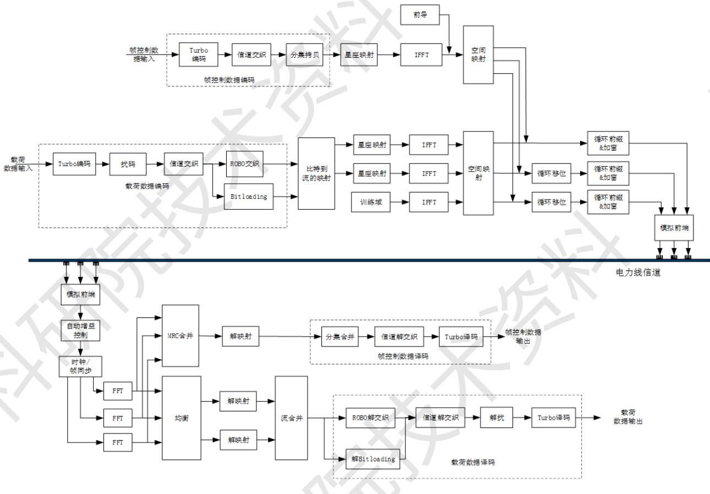
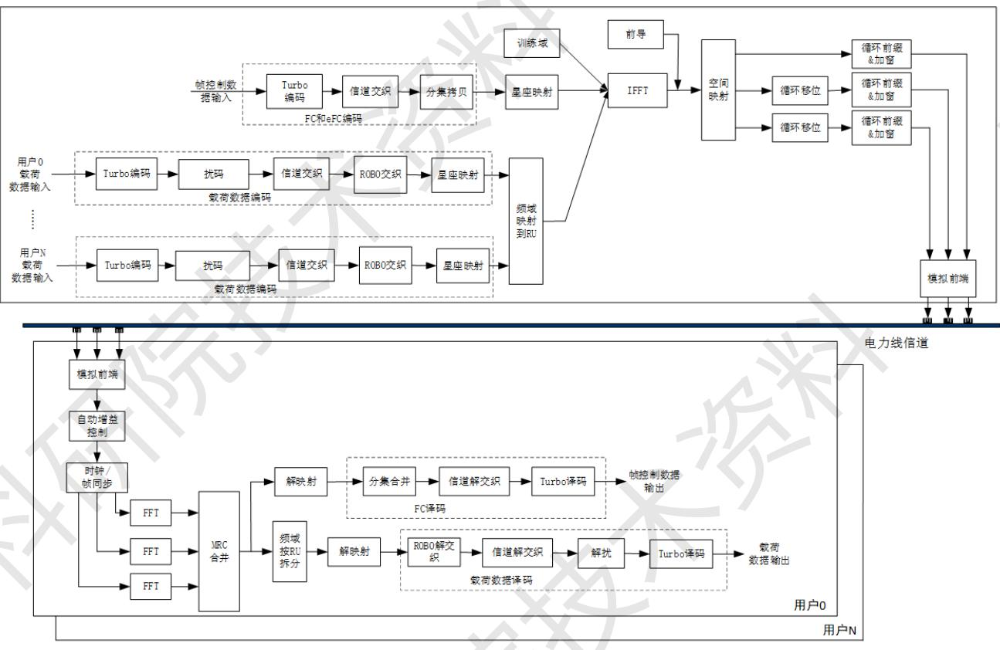
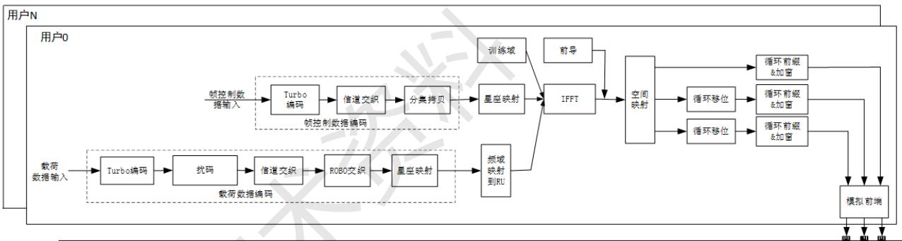
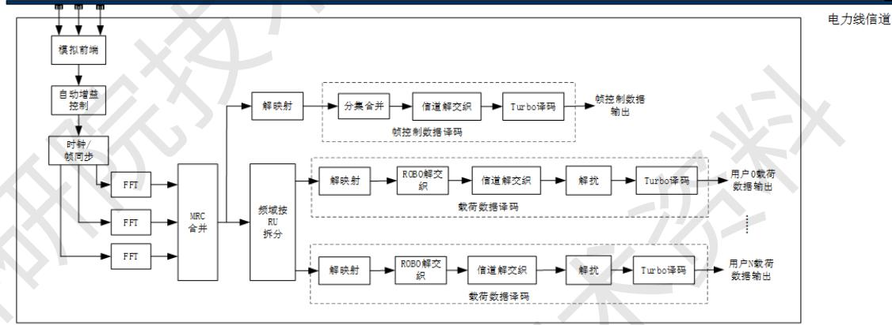
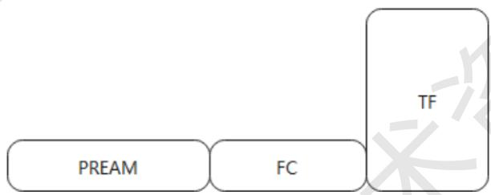
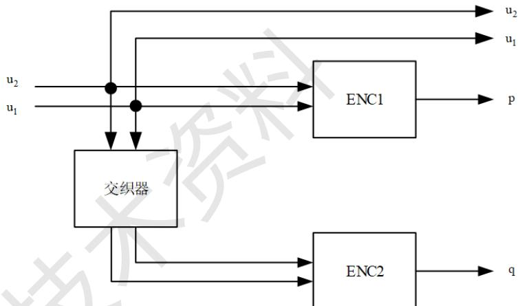
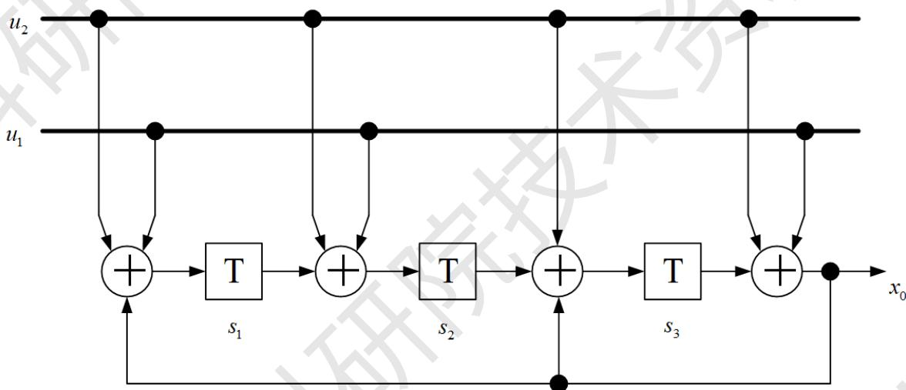
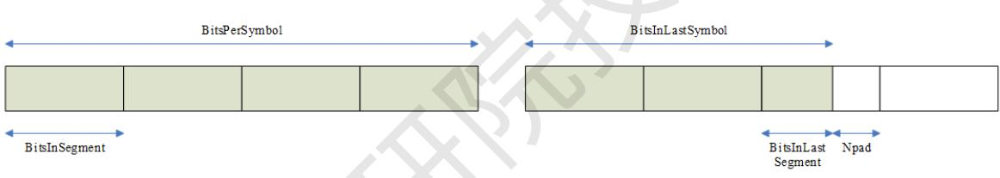
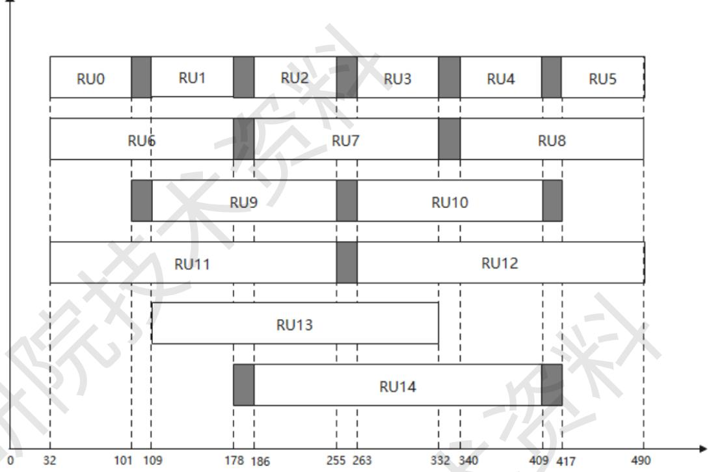

通感一体化低压电力线宽带载波通信（SPLC）规约

第3部分：物理层通信协议

(试行)

## 目 次

1 范围..  
2 规范性引用文件..  
3 术语和定义..  
4 缩略语....  
5 物理层一般要求和定义...  
6 物理层性能要求... 23  
7 物理层数据服务... 24  
附录A （规范性附录）变量运算.. .27  
附录B （规范性附录）CYCLICSHIFT参数运算. 28  
附录C （规范性附录） ROBO映射. 29

## 前 言

为全面规范南方电网公司通感一体化低压电力线宽带载波通信技术总体要求、通信协议、检验规范、网络管理及电鸿操作系统等内容，制定《通感一体化低压电力线宽带载波通信技术规约》系列文件。该系列文件分为8个部分：

——第1部分：总则

——第2部分：技术要求

——第3部分：物理层通信协议

——第4部分：数据链路层通信协议

——第5部分：应用层通信协议

——第6部分：检验规范

——第7部分：网络管理

——第8部分：电鸿操作系统

本文件是《通感一体化低压电力线宽带载波通信技术规约》系列文件第3部分：物理层通信协议，包括物理层一般要求和定义、物理层性能要求、物理层数据服务等内容，制定本部分。

请注意本文件的某些内容可能涉及专利。本文件的发布机构不承担识别这些专利的责任。

本文件由中国南方电网有限责任公司生产技术部提出、归口管理并负责解释。

本文件主编单位：

本文件主要起草人：

本文件为首次发布。

# 通感一体化低压电力线宽带载波通信（SPLC）规约

# 第3部分：物理层通信协议（试行）

## 1 范围

本文件规定了南方电网公司通感一体化低压电力线宽带载波通信物理层通信协议及其相关要求。

本文件适用于南方电网公司通感一体化低压电力线宽带载波通信单元制造、性能检测、数据交换、运行维护和验收。 X

## 2 规范性引用文件

下列文件对于本文件的应用是必不可少的。凡是注日期的引用文件，仅注明日期的版本适用于本文件；凡是不注日期的引用文件，其最新版本（包括所有的修改单）适用于本文件。

Q/CSG1204111.3-2022 低压电力线宽带载波通信规约 第3部分：物理层通信协议

## 3 术语和定义

下列术语和定义适用于本文件。

## 3.1

通感一体化低压电力线宽带载波通信 Integrated Sensingand Communication over Low-Voltage Broadband Power Line Communication

面向新型电力系统低压侧“通感算控”一体化需求，基于低压电力线宽带载波通信、双模通信技术演进形成的新一代载波通信技术。

## 3.2

## 中央协调器 Central Coordinator

通信网络中的主节点，负责完成组网控制、网络维护管理等功能，其对应的设备实体为安装在台区终端的本地通信模块，其载波通信支持MIMO与SISO制式。▲

## 3.3

## 站点 Station

通信网络中的从节点，其对应的设备实体包括电能表通信模块、Ⅱ型采集器、分支开关或量测断路器、新能源接入单元等，分为MIMO与SISO制式。 CV

## 3.4

多输入多输出 Multiple-Input Multiple-Output

在发送端和接收端都使用多端口，在收发之间构成多个信道的通信模式。

## 3.5

单输入单输出 Single-Input Single-Output

在发送端和接收端都使用单一端口，在收发之间构成单个信道的通信模式。

## 3.6

比特加载表 Bitloading Table

多载波调制系统中使用的配置数据结构，用于定义每个子载波上调制的比特数。

## 4 缩略语

以下缩略语适用于本文件。

<table><tr><td>AGC</td><td>Automatic Gain Control</td><td>自动增益控制</td></tr><tr><td>BPLC</td><td>Broadband Power Line Communication</td><td>宽带载波通信</td></tr><tr><td>DL</td><td>Down Link</td><td>下行</td></tr><tr><td>eFC</td><td>extended Frame Control</td><td>扩展帧控制</td></tr><tr><td>FC</td><td>Frame Control</td><td>帧控制</td></tr><tr><td>FFT</td><td>Fast Fourier Transformation</td><td>快速傅里叶变换</td></tr><tr><td>IFFT</td><td>Inverse Fast Fourier Transformation</td><td>快速傅里叶逆变换</td></tr><tr><td>MAC</td><td>Media Access Control</td><td>媒介访问控制</td></tr><tr><td>MIMO</td><td>Multiple Input Multiple Output</td><td>多输入多输出</td></tr><tr><td>MRC</td><td>Maximum Ratio Combining</td><td>最大比合并</td></tr><tr><td>OFDM</td><td>Orthogonal Frequency Division Multiplexing</td><td>正交频分复用</td></tr><tr><td>OFDMA</td><td>Orthogonal Frequency Division Multiple</td><td>正交频分多址接入</td></tr><tr><td></td><td>Access</td><td></td></tr><tr><td>PB</td><td>PHY Block</td><td>物理块</td></tr><tr><td>PL</td><td>Payload</td><td>载荷</td></tr><tr><td>PLC</td><td>Power Line Communication</td><td>电力线通信</td></tr><tr><td>PPDU</td><td>Physical Layer Protocol Data Unit</td><td>物理层协议数据单元</td></tr><tr><td>PREAM</td><td>Preamble</td><td>前导</td></tr><tr><td>ROBO</td><td>Robust OFDM</td><td>鲁棒正交频分复用</td></tr><tr><td>RU</td><td>Resource Unit</td><td>资源单位</td></tr><tr><td></td><td></td><td></td></tr><tr><td>SACK</td><td>Selective Acknowledgement</td><td>选择确认</td></tr><tr><td>SISO</td><td>Single Input Single Output</td><td>单输入单输出</td></tr><tr><td>SNR</td><td>Signal-to-Noise Ratio Integrated Sensing and Communication over</td><td>信噪比</td></tr><tr><td>SPLC</td><td>Low-Voltage Broadband Power Line</td><td>通感一体化低压电力线 宽带载波通信</td></tr><tr><td>TEI</td><td>Communication Terminal Equipment Identifier</td><td>终端设备标识</td></tr><tr><td>TF</td><td>Training Field</td><td>训练域</td></tr><tr><td></td><td></td><td></td></tr><tr><td>TMI</td><td>Tone Map Index</td><td>载波映射表索引</td></tr><tr><td></td><td></td><td></td></tr><tr><td></td><td></td><td></td></tr><tr><td>UL</td><td>Up Link</td><td>上行</td></tr></table>

## 5 物理层一般要求和定义

## 5.1 概述

本章定义了基于OFDM的 SPLC 物理层技术。物理层包括发送端和接收端。

发送端：从数据链路层接收数据，经过系列的信号处理和变换，以OFDM调制方式将信号发送到电力线；

接收端：从电力线检测到信号后，做相应的反向处理，最终将电力线上的载波信号还原为数据，送到数据链路层。 EXD

## 5.2 物理层整体架构

## 5.2.1 MIMO 物理层架构

SPLC支持在多个端口（相线）上同时发送和接收，其架构如图1所示。

  
图 1 MIMO 物理层架构

SPLC物理层采用基于Turbo码的信道编解码技术。在发射端，物理层接收来自MAC层的输入，帧控制数据经过Turbo编码、信道交织、分集拷贝形成比特流；载荷数据经过Turbo编码、加扰、信道交织，再经过ROBO交织或比特加载（Bitloading）形成待发送比特。这些待发送比特经过流映射形成流数据，其中帧控制固定为1流，载荷可支持1流或2流。流数据映射到星座点后，添加训练域和前导，经过IFFT转换为时域信号，经过空间映射转换为单个（即SISO系统）或多个发射通道（即MIMO系统），然后在时域添加循环前缀并进行加窗处理，最终生成OFDM的PPDU信号进入模拟前端。

在接收端，从模拟前端接收到数据协同采用AGC和时间同步分别对帧控制和载荷数据进行调整，  
并对帧控制和载荷数据进行1024点FFT后，进入MRC合并或均衡模块、再经过解映射、解交织、解  
扰、译码等模块，最终恢复出帧控制的原始数据与载荷的原始数据。1

ROBO模式和 Bitloading模式都可以使用MIMO，支持1个或2个数据流。在 ROBO模式中，每个子载波的调制方式是相同的，由ROBOTMI编号决定。而在Bitloading模式中，每个子载波的部分流或所有流是否发送以及发送时所使用的调制方式可能不同，由比特加载表决定。

## 5.2.2 OFDMA 物理层架构

## 5.2.2.1 DL-0FDMA 架构

DL-OFDMA支持一个站点向多个站点以OFDMA的方式同时发送。给多个站点发送的前导和帧控制数据相同，且占用相同的频段，站点间的训练域和载荷数据占用的带宽互不重叠（对应不同的RU）。接收站点解调出扩展帧控制之后，从中获取本站点对应的RU、TMI、PB个数和大小等信息，然后在对应的RU上解调出发送给本站点的数据，其架构如图2所示。

OFDMA可以与MIMO结合，但考虑到多站点调度的复杂度，每个站点仅支持单流。当发送端有多个发射端口时，可以使用5.8.9中的空间映射方式发送单流数据。当接收端有多个接收端口时，可以将多个端口接收到的信号合并，从中解调出单流数据。

  
图 2 DL-OFDMA 物理层架构

## 5.2.2.2 UL-0FDMA 架构

UL-OFDMA支持多个站点以被调度的方式向一个站点以OFDMA的方式同时发送。多个站点发送的前导和帧控制数据相同，站点间的训练域和载荷数据所占用的带宽互不重叠（对应不同的RU）。接收端根据各站点发送的训练域分别做信道估计，解调出各站点发送的载荷数据。其架构如图3所示。



  
图 3 UL-OFDMA 物理层架构

OFDMA可以与MIMO结合，但考虑到多站点调度的复杂度，每个站点仅支持单流。当发送端有多个发射端口时，可以使用5.8.9中的空间映射方式发送单流数据。当接收端有多个接收端口时，可以将多个端口接收到的信号合并，从中解调出单流数据。

## 5.3 物理层数据结构

## 5.3.1 物理层帧结构

SPLC物理层帧结构除了支持Q/CSG1204111.3-2022 《低压电力线宽带载波通信规约 第3 部分：物理层通信协议（试行）》5.3.物理层数据结构外，新增了多种帧类型，如表1所示：

表 1 SPLC 物理层新增帧类型
<table><tr><td rowspan=1 colspan=1>物理层帧类型</td><td rowspan=1 colspan=1>结构</td><td rowspan=1 colspan=1>说明</td></tr><tr><td rowspan=1 colspan=1>MIMO 训练帧</td><td rowspan=1 colspan=1>PREAM, FC, TF</td><td rowspan=1 colspan=1>信道探测，可用频段探测，RU SNR评估</td></tr><tr><td rowspan=1 colspan=1>MIMO 数据帧</td><td rowspan=1 colspan=1>PREAM, FC, TF, PL</td><td rowspan=1 colspan=1>数据传输，PL每个子载波的调制方式相同，支持1流或2流。PL 符号数不大于 511 个。</td></tr><tr><td rowspan=1 colspan=1>Bitloading 训练帧</td><td rowspan=1 colspan=1>PREAM, FC, TF, PL</td><td rowspan=1 colspan=1>PL数据为预定义的伪随机BPSK序列，支持1 流或 2 流</td></tr><tr><td rowspan=1 colspan=1>Bitloading 数据帧</td><td rowspan=1 colspan=1>PREAM, FC, TF, PL</td><td rowspan=1 colspan=1>PL中每个子载波的加载比特数不同，支持1流或2流。PL 符号数不大于 511 个。</td></tr><tr><td rowspan=1 colspan=1>DL-OFDMA 帧</td><td rowspan=1 colspan=1>PREAM, FC, eFC, TF, PL</td><td rowspan=1 colspan=1>下行OFDMA帧，一个站点同时给多个站点发送，只支持单流</td></tr><tr><td rowspan=1 colspan=1>UL-OFDMA trigger 帧</td><td rowspan=1 colspan=1>PREAM, FC, eFC</td><td rowspan=1 colspan=1>触发多个 STA上行发送，FC2 中携带调度信息</td></tr><tr><td rowspan=1 colspan=1>UL-OFDMA 帧</td><td rowspan=1 colspan=1>PREAM, FC, TF, PL</td><td rowspan=1 colspan=1>上行OFDMA 帧，多个站点同时给一个站点发送，每个站点只支持单流</td></tr><tr><td rowspan=1 colspan=1>UL-OFDMA sack 帧</td><td rowspan=1 colspan=1>PREAM, FC, eFC</td><td rowspan=1 colspan=1>对UL-OFDMA 的 sack 帧</td></tr></table>

为了提供与BPLC节点共存的能力，SPLC的 PREAM和FC占用相同的频段(兼容 BPLC的频段)，TF 和 PL 可扩展到更宽的频段，TF 和 PL 占用的频段在 FC 中指示。重新定义 SPLC 帧的 FC 字段内容以携带MIMO 训练帧/数据帧、Bitloading 训练帧/数据帧和 OFDMA 帧所需的控制信息。DL-OFDMA数据帧和UL-OFDMA触发帧还带有扩展帧控制，携带多站点信息。

发射端可以在多个端口（相线）上同时发送。多个端口同时发送前导和帧控制时，第2、3个端口相对于第1个端口分别有4点和8点的时域循环移位（cyclic shift diversity）。时域循环移位的具体做法是： 1

先对IFFT之后每个OFDM符号的1024个时域采样点做循环移位，即data cyclic shift[k]=data[(k-csd)%1024]，其中 k=0,1,2…1023。csd 是循环移位点数。完成循环移位之后再加循环前缀。

本节以一个端口上的帧结构为例画出示意图，其余端口上的帧结构是相同的。图4到图10中横轴方向表示时域，纵轴方向表示频域。

## 5.3.1.1 MIMO 训练帧

MIMO 训练帧的作用是 MIMO 信道探测，可用于确定 SPLC 帧的可用频段和 OFDMA 的 RU SNR。帧结构如图4所示：

  
图 4 MIMO 训练帧结构

## 5.3.1.2 MIMO 数据帧

MIMO 数据帧结构如图 5 所示：

  
图 5 MIMO 数据帧结构

PL 符号的各子载波调制方式相同，其分集拷贝模式在表 13 中定义。TF 和 PL 可以扩展到比FC更宽的频段，用FC 中的“PL频段标识”字段指示，PL可支持1流或2流。

## 5.3.1.3 Bitloading训练帧

Bitloading 训练帧结构如图 6 所示：

  
图 6 Bitloading 训练帧结构  
Bitloading 训练帧的 TF 和 PL 占用的频段由 FC 中的“PL 频段标识”指示。Bitloading 训练帧的 PL

用预定义的BPSK伪随机序列填充。PL可支持1流或2流。第1流的比特和第2流的比特分别用一个如5.6.2节所述的伪随机比特发生器产生。第1流对应的伪随机比特发生器的初始值为[1111111111]，第2流对应的伪随机比特发生器的初始值为[0000000001]。产生的伪随机比特按有效子载波频率从低到高、OFDM符号下标从小到大依次填充。

## 5.3.1.4 Bitloading 数据帧

Bitloading 帧的结构如图 7 所示：

  
图 7 Bitloading 数据帧结构

Bitloading 数据帧 PL 每个子载波的调制方式由比特加载表确定。Bitloading 数据帧的 PL 支持1 流或2流。

Bitloading 数据帧与Bitloading 训练帧的结构相同，PL承载业务数据。Bitloading 数据帧的每子载波的发射功率，和Bitloading训练帧相同。

## 5.3.1.5 DL-0FDMA 数据帧

DL-OFDMA 帧结构如图 8所示：

  
图 8 DL-OFDMA 帧结构

DL-OFDMA帧最多支持同时给4个站点发送。前导、帧控制和扩展帧控制（eFC）在BPLC的工作频段上发送，不同站点的TF和PL分别占据不同的RU。eFC中包括和多个站点相关的信息，包括RU、TMI、PB大小和个数等。DL-OFDMA帧的PL符号数为各站点根据TMI、PB大小和个数计算出的PL符号数的最大值。当某站点计算出的符号数小于该最大符号数时，剩余符号用伪随机比特填充。伪随机填充比特的产生方法见5.6.4节。

OFDMA 帧的物理块大小支持 PB72 和 PB136。

## 5.3.1.6 UL-0FDMA 触发帧

UL-OFDMA触发（trigger）帧结构如图9所示：

  
图 9 UL-OFDMA 触发帧结构

UL-OFDMA触发帧在eFC中携带对应多个站点的调度信息，包括各站点的 RU、TMI、PB大小和个数等。最多同时调度4个站点上行发送。

## 5.3.1.7 UL-0FDMA 数据帧

单个站点发送的 UL-OFDMA 帧结构如图 10 所示：

  
图 10 单个站点发送的帧

各站点在BPLC的工作频段上发送PREAM和FC。各站点依照触发帧中的调度信息，用指定的TMI、PB大小和个数，在指定的RU上发送TF和PL。UL-OFDMA帧中各站点发射的PL符号数等于触发帧的FC中指定的PL符号数。当某站点根据TMI、PB大小和个数计算出的符号个数小于触发帧的FC中指定的符号个数时，剩余符号用伪随机比特填充。伪随机填充比特的产生方法见5.6.4节。

## 5.3.2 物理层符号

参考Q/CSG1204111.3-2022《低压电力线宽带载波通信规约第3部分：物理层通信协议（试行）》5.3.2 物理层符号。

## 5.4 帧控制前向纠错码

参考Q/CSG1204111.3-2022《低压电力线宽带载波通信规约第3部分：物理层通信协议（试行）》5.4 帧控制前向纠错码。 X

## 5.4.1 帧控制 Turbo 编码

参考Q/CSG1204111.3-2022《低压电力线宽带载波通信规约第3部分：物理层通信协议（试行）》5.4.1 帧控制 Turbo 编码。

## 5.4.2 帧控制信道交织

参考Q/CSG1204111.3-2022《低压电力线宽带载波通信规约第3部分：物理层通信协议（试行）》5.4.2 帧控制信道交织。

## 5.4.3 帧控制分集拷贝

分集拷贝是为了下一步星座点映射的调制方式，将输入的256比特数据拷贝到频域子载波上。

对于频段0，帧控制的可用载波数为411，子载波编号从80到490，采用OPSK调制方式，有2个帧控制符号。第一个符号的帧控制，对于Ⅰ路来说，输入的比特流（256比特）按照顺序拷贝到对应的载波上；对于Q路来说，输入的比特流（256比特）加上一个128的偏置拷贝到对应的载波上，直至完成本次可用载波的拷贝，即在有效子载波上顺序填充的比特编号为（c+128）mod256，c的值顺序从0到255。第二个符号的帧控制，对于Ⅰ路来说，输入的比特流（256比特）加上一个64的偏置拷贝到对应的载波上；对于Q路来说，输入的比特流（256比特）加上一个192的偏置拷贝到对应的载波上。详细定义如表2所示：

表 2 帧控制分集拷贝
<table><tr><td colspan="1" rowspan="1">可用子载波编号</td><td colspan="1" rowspan="1">OFDM 符号 1I路信道交织输出比特编号</td><td colspan="1" rowspan="1">OFDM 符号1Q路信道交织输出比特编号</td><td colspan="1" rowspan="1">OFDM 符号 2I路信道交织输出比特编号</td><td colspan="1" rowspan="1">OFDM 符号 2Q路信道交织输出比特编号</td></tr><tr><td colspan="1" rowspan="1">0</td><td colspan="1" rowspan="1">0</td><td colspan="1" rowspan="1">128</td><td colspan="1" rowspan="1">64</td><td colspan="1" rowspan="1">192</td></tr><tr><td colspan="1" rowspan="1">1</td><td colspan="1" rowspan="1">1</td><td colspan="1" rowspan="1">129</td><td colspan="1" rowspan="1">65</td><td colspan="1" rowspan="1">193</td></tr><tr><td colspan="1" rowspan="1">2</td><td colspan="1" rowspan="1">2</td><td colspan="1" rowspan="1">130</td><td colspan="1" rowspan="1">66</td><td colspan="1" rowspan="1">194</td></tr><tr><td colspan="1" rowspan="1"></td><td colspan="1" rowspan="1"></td><td colspan="1" rowspan="1"></td><td colspan="1" rowspan="1"></td><td colspan="1" rowspan="1"></td></tr><tr><td colspan="1" rowspan="1">c</td><td colspan="1" rowspan="1">c mod 256</td><td colspan="1" rowspan="1">(c+128) mod 256</td><td colspan="1" rowspan="1">(c+64) mod 256</td><td colspan="1" rowspan="1">(c+192) mod 256</td></tr><tr><td colspan="1" rowspan="1"></td><td colspan="1" rowspan="1"></td><td colspan="1" rowspan="1">..</td><td colspan="1" rowspan="1"></td><td colspan="1" rowspan="1"></td></tr><tr><td colspan="1" rowspan="1">NumCarriers-1</td><td colspan="1" rowspan="1">(NumCarriers-1)mod 256</td><td colspan="1" rowspan="1">((NumCarriers-1) +128)mod 256</td><td colspan="1" rowspan="1">((NumCarriers-1) +64)mod 256</td><td colspan="1" rowspan="1">((NumCarriers-1) +192)mod 256</td></tr><tr><td colspan="5" rowspan="1">其中，NumCarriers表示每个 OFDM符号的可用子载波。</td></tr></table>

对于频段1，帧控制的可用载波数为131，子载波编号从100到230，采用OPSK调制方式，有8个帧控制符号。前两个帧控制的Ⅰ路和Q路拷贝方式与频段0一致；第三个符号的帧控制，对于Ⅰ路来说，输入的比特流加上一个32的偏置拷贝到对应的载波上，对于Q路来说，输入的比特流加上一个160的偏置拷贝到对应的载波上；第四个符号的帧控制，对于Ⅰ路来说，输入的比特流加上一个96的偏置拷贝到对应的载波上，对于Q路来说，输入的比特流加上一个224的偏置拷贝到对应的载波上；第五个符号的帧控制，对于Ⅰ路来说，输入的比特流加上一个16的偏置拷贝到对应的载波上，对于Q路来说，输入的比特流加上一个144的偏置拷贝到对应的载波上；第六个符号的帧控制，对于Ⅰ路来说，输入的比特流加上一个80的偏置拷贝到对应的载波上，对于0路来说，输入的比特流加上一个208的偏置拷贝到对应的载波上；第七个符号的帧控制，对于Ⅰ路来说，输入的比特流加上一个48的偏置拷贝到对应的载波上，对于Q路来说，输入的比特流加上一个176的偏置拷贝到对应的载波上；第八个符号的帧控制，对于Ⅰ路来说，输入的比特流加上一个112的偏置拷贝到对应的载波上，对于Q路来说，输入的比特流加上一个240的偏置拷贝到对应的载波上。

对于频段2，帧控制的可用载波数为89，子载波编号从32到120，采用QPSK调制方式，有12个帧控制符号。第一个符号的帧控制，对于Ⅰ路来说，输入的比特流不加偏置拷贝到对应的载波上，对于0路来说，输入的比特流加上一个128的偏置拷贝到对应的载波上；第二个符号的帧控制，对于Ⅰ路来说，输入的比特流加192的偏置拷贝到对应的载波上，对于0路来说，输入的比特流加上一个64的偏置拷贝到对应的载波上；第三个符号的帧控制，对于Ⅰ路来说，输入的比特流加上一个160的偏置拷贝到对应的载波上，对于Q路来说，输入的比特流加上一个32的偏置拷贝到对应的载波上；第四个符号的帧控制，对于Ⅰ路来说，输入的比特流加上一个96的偏置拷贝到对应的载波上，对于Q路来说，输入的比特流加上一个224的偏置拷贝到对应的载波上；第五个符号的帧控制，对于Ⅰ路来说，输入的比特流加上一个144的偏置拷贝到对应的载波上，对于0路来说，输入的比特流加上一个16的偏置拷贝到对应的载波上；第六个符号的帧控制，对于Ⅰ路来说，输入的比特流加上一个80的偏置拷贝到对应的载波上，对于〇路来说，输入的比特流加上一个208的偏置拷贝到对应的载波上：第七个符号的帧控制，对于Ⅰ路来说，输入的比特流加上一个48的偏置拷贝到对应的载波上，对于Q路来说，输入的比特流加上一个176的偏置拷贝到对应的载波上；第八个符号的帧控制，对于Ⅰ路来说，输入的比特流加上一个240的偏置拷贝到对应的载波上，对于Q路来说，输入的比特流加上一个112的偏置拷贝到对应的载波上。第九个符号的帧控制，对于Ⅰ路来说，输入的比特流加上一个24的偏置拷贝到对应的载波上，对于Q路来说，输入的比特流加上一个152的偏置拷贝到对应的载波上。第十个符号的帧控制，对于Ⅰ路来说，输入的比特流加上一个184的偏置拷贝到对应的载波上，对于Q路来说，输入的比特流加上一个56的偏置拷贝到对应的载波上。第十一个符号的帧控制，对于Ⅰ路来说，输入的比特流加上一个136的偏置拷贝到对应的载波上，对于Q路来说，输入的比特流加上一个8的偏置拷贝到对应的载波上。第十二个符号的帧控制，对于Ⅰ路来说，输入的比特流加上一个40的偏置拷贝到对应的载波上，对于Q路来说，输入的比特流加上一个168的偏置拷贝到对应的载波上。

对于频段3，帧控制的可用载波数为459个，子载波编号从32到490，采用QPSK调制方式，有4个帧控制符号。第一个符号的帧控制，对于Ⅰ路来说，输入的比特流不加偏置拷贝到对应的载波上，对于〇路来说，输入的比特流加上一个128的偏置拷贝到对应的载波上：第二个符号的帧控制，对于I路来说，输入的比特流加192的偏置拷贝到对应的载波上，对于Q路来说，输入的比特流加上一个64的偏置拷贝到对应的载波上；第三个符号的帧控制，对于Ⅰ路来说，输入的比特流加上一个160的偏置拷贝到对应的载波上，对于Q路来说，输入的比特流加上一个32的偏置拷贝到对应的载波上；第四个符号的帧控制，对于Ⅰ路来说，输入的比特流加上一个96的偏置拷贝到对应的载波上，对于Q路来说，输入的比特流加上一个224的偏置拷贝到对应的载波上。

对于频段4，帧控制的可用载波数为199个，子载波编号从32到230，采用QPSK调制方式，有8个帧控制符号。第一个符号的帧控制，对于路来说，输入的比特流不加偏置拷贝到对应的载波上，对于〇路来说，输入的比特流加上一个128的偏置拷贝到对应的载波上：第二个符号的帧控制，对于I路来说，输入的比特流加192的偏置拷贝到对应的载波上，对于0路来说，输入的比特流加上一个64的偏置拷贝到对应的载波上；第三个符号的帧控制，对于Ⅰ路来说，输入的比特流加上一个160的偏置拷贝到对应的载波上，对于0路来说，输入的比特流加上一个32的偏置拷贝到对应的载波上；第四个符号的帧控制，对于Ⅰ路来说，输入的比特流加上一个96的偏置拷贝到对应的载波上，对于Q路来说，输入的比特流加上一个224的偏置拷贝到对应的载波上；第五个符号的帧控制，对于Ⅰ路来说，输入的比特流加上一个144的偏置拷贝到对应的载波上，对于Q路来说，输入的比特流加上一个16的偏置拷贝到对应的载波上；第六个符号的帧控制，对于Ⅰ路来说，输入的比特流加上一个80的偏置拷贝到对应的载波上，对于Q路来说，输入的比特流加上一个208的偏置拷贝到对应的载波上；第七个符号的帧控制，对于Ⅰ路来说，输入的比特流加上一个48的偏置拷贝到对应的载波上，对于Q路来说，输入的比特流加上一个176的偏置拷贝到对应的载波上；第八个符号的帧控制，对于Ⅰ路来说，输入的比特流加上一个240的偏置拷贝到对应的载波上，对于Q路来说，输入的比特流加上一个112的偏置拷贝到对应的载波上。 X

## 5.5 扩展帧控制前向纠错码

扩展帧控制（eFC）前向纠错码和帧控制（FC）前向纠错码实现流程相同，但eFC的符号个数由FC中的“eFC符号个数”字段指示，且 eFC的符号个数不超过FC的符号个数。

## 5.6 载荷数据前向纠错码

参考Q/CSG1204111.3-2022《低压电力线宽带载波通信规约第3部分：物理层通信协议（试行）》5.5 载荷数据前向纠错码。

## 5.6.1 载荷数据 Turbo 编码

载荷数据支持PB16、PB72、PB136、PB264、PB520五种物理块大小。

## a）编码模块

Turbo编码由2个相同的分量编码器（ENC1，ENC2）组成，每输入一对信息比特 $\mathbf { \Phi } ( u _ { 1 } , \mathbf { \Phi } \ u _ { 2 } )$ ，输出系统比特 $( \mathrm { \Delta } u _ { 1 } , \mathrm { \Delta } u _ { 2 } )$ ，和校验比特 $( \ p \ , \ q )$ 。Turbo编码器架构如图 11所示。

  
图 11 Turbo 编码器架构

ENC1和ENC2使用8状态编码器，输入数据流的第一个比特位映射到 $u _ { 1 }$ ，第二个比特位映射到 $u _ { 2 }$ 9以此类推，在一个ENC中，每一对比特位对应输出一个校验位。校验 $( \mathbf { \nabla } _ { p } , \mathbf { \nabla } _ { q } )$ 的计算根据图 12确定。

  
图 12 ENC1/ENC2 编码架构

每个成员码编码器的具体算法如下：

步骤1 设置寄存器初始状态 $S 0 { = } [ S _ { \scriptscriptstyle 0 1 } , S _ { \scriptscriptstyle 0 2 } , S _ { \scriptscriptstyle 0 3 } ]$ ，为[0,0,0]。

步骤2输入信息比特至分量编码器（ENC2输入的是交织后的信息比特），直至最后一位，用于得到编码结束的末状态 $\mathrm { S N } { = } [ S _ { \mathrm { N } 1 } , ~ S _ { \mathrm { N } 2 } , ~ S _ { \mathrm { N } 3 } ]$ KK

步骤3

定义矩阵M:

PB Size为520、72、16时：

$$
M = \left[ \begin{array} { l l l } { 0 } & { 0 } & { 1 } \\ { 1 } & { 0 } & { 1 } \\ { 1 } & { 1 } & { 1 } \end{array} \right]
$$

PB\_Size为136时：

$$
M = \left[ \begin{array} { l l l } { 0 } & { 1 } & { 1 } \\ { 1 } & { 0 } & { 0 } \\ { 0 } & { 1 } & { 0 } \end{array} \right]
$$

PB\_Size为264时：

$$
M = \left[ { \begin{array} { l l l } { 1 } & { 0 } & { 1 } \\ { 1 } & { 1 } & { 1 } \\ { 1 } & { 1 } & { 0 } \end{array} } \right]
$$

$\cdot S { \cal O } ^ { \prime } { = } S N { \times } M ,$ （SN是行向量，实际中用一个查找表实现上式计算）。

步骤4将输入信息比特重新进入分量编码器，它的初始状态S0由步骤3算出，再经过一次编码后，他的末状态 $S N ^ { ' } = S 0 ^ { ' }$ ，从而可以得出输出的Turbo编码校验位。

## b）Turbo交织模块

Turbo交织器用于将原始数据交织后作为第二个成员码的输入，Turbo交织按照双比特为单位进行，交织器长度等于原始数据块长度的双比特数量，Turbo交织的参数如表3定义，不同的PB长度，采用不同的参数，有PB16、PB72、PB136、PB264、PB520五种。 \_

表 3 Turbo 交织参数表
<table><tr><td rowspan=1 colspan=1>PB Size (Bytes 数)</td><td rowspan=1 colspan=1>N值</td><td rowspan=1 colspan=1>M 值</td><td rowspan=1 colspan=1>双比特的交织长度L</td></tr><tr><td rowspan=1 colspan=1>16</td><td rowspan=1 colspan=1>8</td><td rowspan=1 colspan=1>8</td><td rowspan=1 colspan=1>64</td></tr><tr><td rowspan=1 colspan=1>72</td><td rowspan=1 colspan=1>18</td><td rowspan=1 colspan=1>16</td><td rowspan=1 colspan=1>288</td></tr><tr><td rowspan=1 colspan=1>136</td><td rowspan=1 colspan=1>34</td><td rowspan=1 colspan=1>16</td><td rowspan=1 colspan=1>544</td></tr><tr><td rowspan=1 colspan=1>264</td><td rowspan=1 colspan=1>33</td><td rowspan=1 colspan=1>32</td><td rowspan=1 colspan=1>1056</td></tr><tr><td rowspan=1 colspan=1>520</td><td rowspan=1 colspan=1>40</td><td rowspan=1 colspan=1>52</td><td rowspan=1 colspan=1>2080</td></tr></table>

首先规定Turbo交织的地址映射I(x)定义如下：

$$
I ( x ) = [ S ( { \mathrm { \small ~ x ~ \ m o d ~ } } ~ N ) - ( { \mathrm { \small ~ x ~ \ d i v ~ \ } } ~ N ) ^ { * } N + L ] ~ \mathrm { \ m o d ~ } ~ L ~ \mathrm { \ f o r ~ \ } x = 0 , 1 , . . . , L - 1
$$

其中S()是一个查找表，见表4、表 5、表 6、表7以及表 8。div表示整除，mod表示模运算。地址映射I(x)用于Turbo交织的具体算法如下：

$$
\begin{array} { r l } { i f \ x { \bmod { 2 } } = 0 } & { } \\ { I n t D a t a ( 2 \cdot x ) } & { { } = D a t a ( 2 \cdot I ( x ) + 1 ) \left[ \begin{array} { l } { } \\ { } \\ { I n t D a t a ( 2 \cdot x + 1 ) = D a t a ( 2 \cdot I ( x ) ) } \end{array} \right] f o r \ x = 0 , 1 , 2 , . . . , L - 1 } \\ { i f \ x { \bmod { 2 } } = 1 } & { { } } \\ { I n t D a t a ( 2 \cdot x ) } & { { } = D a t a ( 2 \cdot I ( x ) ) } \\ { I n t D a t a ( 2 \cdot x + 1 ) = D a t a ( 2 \cdot I ( x ) + 1 ) } \end{array}
$$

其中Data()表示交织器输入，IntData()表示交织器输出，需要注意的是，当交织器输出地址为偶数时，对应交织后的信息比特对的第0和第1比特互换。 CT

表4 PB16 的 S 查找表
<table><tr><td rowspan=1 colspan=1>X</td><td rowspan=1 colspan=1>0</td><td rowspan=1 colspan=1>1</td><td rowspan=1 colspan=1>2</td><td rowspan=1 colspan=1>3</td><td rowspan=1 colspan=1>4</td><td rowspan=1 colspan=1>5</td><td rowspan=1 colspan=1>    6</td><td rowspan=1 colspan=1>7</td></tr><tr><td rowspan=1 colspan=1>S(x)</td><td rowspan=1 colspan=1>54</td><td rowspan=1 colspan=1>23</td><td rowspan=1 colspan=1>61</td><td rowspan=1 colspan=1>12</td><td rowspan=1 colspan=1>35</td><td rowspan=1 colspan=1>2</td><td rowspan=1 colspan=1>40</td><td rowspan=1 colspan=1>25</td></tr></table>

表 5 PB72 的 S 查找表
<table><tr><td rowspan=1 colspan=1>X</td><td rowspan=1 colspan=1>0</td><td rowspan=1 colspan=1>1</td><td rowspan=1 colspan=1>2</td><td rowspan=1 colspan=1>3</td><td rowspan=1 colspan=1>4</td><td rowspan=1 colspan=1>5</td><td rowspan=1 colspan=1>6</td><td rowspan=1 colspan=1>7</td></tr><tr><td rowspan=1 colspan=1>S(x)</td><td rowspan=1 colspan=1>1</td><td rowspan=1 colspan=1>200</td><td rowspan=1 colspan=1>255</td><td rowspan=1 colspan=1>166</td><td rowspan=1 colspan=1>221</td><td rowspan=1 colspan=1>132</td><td rowspan=1 colspan=1>187</td><td rowspan=1 colspan=1>98</td></tr><tr><td rowspan=1 colspan=1>X</td><td rowspan=1 colspan=1>8</td><td rowspan=1 colspan=1>9</td><td rowspan=1 colspan=1>10</td><td rowspan=1 colspan=1>11</td><td rowspan=1 colspan=1>12</td><td rowspan=1 colspan=1>13</td><td rowspan=1 colspan=1>14</td><td rowspan=1 colspan=1>15</td></tr><tr><td rowspan=1 colspan=1>S(x)</td><td rowspan=1 colspan=1>153</td><td rowspan=1 colspan=1>64</td><td rowspan=1 colspan=1>119</td><td rowspan=1 colspan=1>30</td><td rowspan=1 colspan=1>85</td><td rowspan=1 colspan=1>284</td><td rowspan=1 colspan=1>51</td><td rowspan=1 colspan=1>250</td></tr><tr><td rowspan=1 colspan=1>X</td><td rowspan=1 colspan=1>16</td><td rowspan=1 colspan=1>17</td><td rowspan=1 colspan=1>-</td><td rowspan=1 colspan=1></td><td rowspan=1 colspan=1>-</td><td rowspan=1 colspan=1>-</td><td rowspan=1 colspan=1>-</td><td rowspan=1 colspan=1>-</td></tr><tr><td rowspan=1 colspan=1>S(x)</td><td rowspan=1 colspan=1>17</td><td rowspan=1 colspan=1>216</td><td rowspan=1 colspan=1>-</td><td rowspan=1 colspan=1></td><td rowspan=1 colspan=1>1</td><td rowspan=1 colspan=1></td><td rowspan=1 colspan=1>-</td><td rowspan=1 colspan=1>1</td></tr></table>

表 6 PB136 的 S 查找表
<table><tr><td rowspan=1 colspan=1>X</td><td rowspan=1 colspan=1>0</td><td rowspan=1 colspan=1>1</td><td rowspan=1 colspan=1>2</td><td rowspan=1 colspan=1>3</td><td rowspan=1 colspan=1>4</td><td rowspan=1 colspan=1>5</td><td rowspan=1 colspan=1>6</td><td rowspan=1 colspan=1>7</td></tr><tr><td rowspan=1 colspan=1>S(x)</td><td rowspan=1 colspan=1>369</td><td rowspan=1 colspan=1>235</td><td rowspan=1 colspan=1>338</td><td rowspan=1 colspan=1>436</td><td rowspan=1 colspan=1>169</td><td rowspan=1 colspan=1>200</td><td rowspan=1 colspan=1>397</td><td rowspan=1 colspan=1>59</td></tr><tr><td rowspan=1 colspan=1>X</td><td rowspan=1 colspan=1>8</td><td rowspan=1 colspan=1>9</td><td rowspan=1 colspan=1>10</td><td rowspan=1 colspan=1>11</td><td rowspan=1 colspan=1>12</td><td rowspan=1 colspan=1>13</td><td rowspan=1 colspan=1>14</td><td rowspan=1 colspan=1>15</td></tr><tr><td rowspan=1 colspan=1>S(x)</td><td rowspan=1 colspan=1>298</td><td rowspan=1 colspan=1>20</td><td rowspan=1 colspan=1>265</td><td rowspan=1 colspan=1>429</td><td rowspan=1 colspan=1>294</td><td rowspan=1 colspan=1>466</td><td rowspan=1 colspan=1>16</td><td rowspan=1 colspan=1>48</td></tr><tr><td rowspan=1 colspan=1>X</td><td rowspan=1 colspan=1>16</td><td rowspan=1 colspan=1>17</td><td rowspan=1 colspan=1>18</td><td rowspan=1 colspan=1>19</td><td rowspan=1 colspan=1>20</td><td rowspan=1 colspan=1>21</td><td rowspan=1 colspan=1>22</td><td rowspan=1 colspan=1>23</td></tr><tr><td rowspan=1 colspan=1>S(x)</td><td rowspan=1 colspan=1>525</td><td rowspan=1 colspan=1>461</td><td rowspan=1 colspan=1>187</td><td rowspan=1 colspan=1>86</td><td rowspan=1 colspan=1>216</td><td rowspan=1 colspan=1>387</td><td rowspan=1 colspan=1>41</td><td rowspan=1 colspan=1>142</td></tr><tr><td rowspan=1 colspan=1>X</td><td rowspan=1 colspan=1>24</td><td rowspan=1 colspan=1>25</td><td rowspan=1 colspan=1>26</td><td rowspan=1 colspan=1>27</td><td rowspan=1 colspan=1>28</td><td rowspan=1 colspan=1>29</td><td rowspan=1 colspan=1>30</td><td rowspan=1 colspan=1>31</td></tr><tr><td rowspan=1 colspan=1>S(x)</td><td rowspan=1 colspan=1>247</td><td rowspan=1 colspan=1>314</td><td rowspan=1 colspan=1>79</td><td rowspan=1 colspan=1>486</td><td rowspan=1 colspan=1>512</td><td rowspan=1 colspan=1>103</td><td rowspan=1 colspan=1>476</td><td rowspan=1 colspan=1>345</td></tr><tr><td rowspan=1 colspan=1>X</td><td rowspan=1 colspan=1>32</td><td rowspan=1 colspan=1>33</td><td rowspan=1 colspan=1></td><td rowspan=1 colspan=1>-</td><td rowspan=1 colspan=1></td><td rowspan=1 colspan=1></td><td rowspan=1 colspan=1>-</td><td rowspan=1 colspan=1>■</td></tr><tr><td rowspan=1 colspan=1>S(x)</td><td rowspan=1 colspan=1>4</td><td rowspan=1 colspan=1>105</td><td rowspan=1 colspan=1>=</td><td rowspan=1 colspan=1>■</td><td rowspan=1 colspan=1>=</td><td rowspan=1 colspan=1>1</td><td rowspan=1 colspan=1>I</td><td rowspan=1 colspan=1>一</td></tr></table>

表 7 PB264 的 S 查找表
<table><tr><td rowspan=1 colspan=1>X</td><td rowspan=1 colspan=1>0</td><td rowspan=1 colspan=1>1</td><td rowspan=1 colspan=1>2</td><td rowspan=1 colspan=1>3</td><td rowspan=1 colspan=1>4</td><td rowspan=1 colspan=1>5</td><td rowspan=1 colspan=1>6</td><td rowspan=1 colspan=1>7</td></tr><tr><td rowspan=1 colspan=1>S(x)</td><td rowspan=1 colspan=1>309</td><td rowspan=1 colspan=1>175</td><td rowspan=1 colspan=1>737</td><td rowspan=1 colspan=1>667</td><td rowspan=1 colspan=1>1024</td><td rowspan=1 colspan=1>224</td><td rowspan=1 colspan=1>622</td><td rowspan=1 colspan=1>962</td></tr><tr><td rowspan=1 colspan=1>X</td><td rowspan=1 colspan=1>8</td><td rowspan=1 colspan=1>9</td><td rowspan=1 colspan=1>10</td><td rowspan=1 colspan=1>11</td><td rowspan=1 colspan=1>12</td><td rowspan=1 colspan=1>13</td><td rowspan=1 colspan=1>14</td><td rowspan=1 colspan=1>15</td></tr><tr><td rowspan=1 colspan=1>S(x)</td><td rowspan=1 colspan=1>527</td><td rowspan=1 colspan=1>845</td><td rowspan=1 colspan=1>926</td><td rowspan=1 colspan=1>1052</td><td rowspan=1 colspan=1>366</td><td rowspan=1 colspan=1>54</td><td rowspan=1 colspan=1>249</td><td rowspan=1 colspan=1>784</td></tr><tr><td rowspan=1 colspan=1>X</td><td rowspan=1 colspan=1>16</td><td rowspan=1 colspan=1>17</td><td rowspan=1 colspan=1>18</td><td rowspan=1 colspan=1>19</td><td rowspan=1 colspan=1>20</td><td rowspan=1 colspan=1>21</td><td rowspan=1 colspan=1>22</td><td rowspan=1 colspan=1>23</td></tr><tr><td rowspan=1 colspan=1>S(x)</td><td rowspan=1 colspan=1>108</td><td rowspan=1 colspan=1>551</td><td rowspan=1 colspan=1>410</td><td rowspan=1 colspan=1>479</td><td rowspan=1 colspan=1>823</td><td rowspan=1 colspan=1>866</td><td rowspan=1 colspan=1>442</td><td rowspan=1 colspan=1>654</td></tr><tr><td rowspan=1 colspan=1>X</td><td rowspan=1 colspan=1>24</td><td rowspan=1 colspan=1>25</td><td rowspan=1 colspan=1>26</td><td rowspan=1 colspan=1>27</td><td rowspan=1 colspan=1>28</td><td rowspan=1 colspan=1>29</td><td rowspan=1 colspan=1>30</td><td rowspan=1 colspan=1>31</td></tr><tr><td rowspan=1 colspan=1>S(x)</td><td rowspan=1 colspan=1>321</td><td rowspan=1 colspan=1>33</td><td rowspan=1 colspan=1>85</td><td rowspan=1 colspan=1>610</td><td rowspan=1 colspan=1>730</td><td rowspan=1 colspan=1>765</td><td rowspan=1 colspan=1>1038</td><td rowspan=1 colspan=1>352</td></tr><tr><td rowspan=1 colspan=1>X</td><td rowspan=1 colspan=1>32</td><td rowspan=1 colspan=1>-</td><td rowspan=1 colspan=1>-</td><td rowspan=1 colspan=1></td><td rowspan=1 colspan=1></td><td rowspan=1 colspan=1>-</td><td rowspan=1 colspan=1>一</td><td rowspan=1 colspan=1>-</td></tr><tr><td rowspan=1 colspan=1>S(x)</td><td rowspan=1 colspan=1>954</td><td rowspan=1 colspan=1>–</td><td rowspan=1 colspan=1>–</td><td rowspan=1 colspan=1></td><td rowspan=1 colspan=1></td><td rowspan=1 colspan=1>1</td><td rowspan=1 colspan=1>-</td><td rowspan=1 colspan=1>–</td></tr></table>

表 8 PB520 的 S 查找表
<table><tr><td rowspan=1 colspan=1>X</td><td rowspan=1 colspan=1>0</td><td rowspan=1 colspan=1>1</td><td rowspan=1 colspan=1>2</td><td rowspan=1 colspan=1>3</td><td rowspan=1 colspan=1>4</td><td rowspan=1 colspan=1>5</td><td rowspan=1 colspan=1>6</td><td rowspan=1 colspan=1>7</td></tr><tr><td rowspan=1 colspan=1>S(x)</td><td rowspan=1 colspan=1>1558</td><td rowspan=1 colspan=1>1239</td><td rowspan=1 colspan=1>315</td><td rowspan=1 colspan=1>1114</td><td rowspan=1 colspan=1>437</td><td rowspan=1 colspan=1>956</td><td rowspan=1 colspan=1>871</td><td rowspan=1 colspan=1>790</td></tr><tr><td rowspan=1 colspan=1>X</td><td rowspan=1 colspan=1>8</td><td rowspan=1 colspan=1>9</td><td rowspan=1 colspan=1>10</td><td rowspan=1 colspan=1>11</td><td rowspan=1 colspan=1>12</td><td rowspan=1 colspan=1>13</td><td rowspan=1 colspan=1>14</td><td rowspan=1 colspan=1>15</td></tr><tr><td rowspan=1 colspan=1>S(x)</td><td rowspan=1 colspan=1>833</td><td rowspan=1 colspan=1>1152</td><td rowspan=1 colspan=1>147</td><td rowspan=1 colspan=1>506</td><td rowspan=1 colspan=1>589</td><td rowspan=1 colspan=1>388</td><td rowspan=1 colspan=1>1584</td><td rowspan=1 colspan=1>265</td></tr><tr><td rowspan=1 colspan=1>X</td><td rowspan=1 colspan=1>16</td><td rowspan=1 colspan=1>17</td><td rowspan=1 colspan=1>18</td><td rowspan=1 colspan=1>19</td><td rowspan=1 colspan=1>20</td><td rowspan=1 colspan=1>21</td><td rowspan=1 colspan=1>22</td><td rowspan=1 colspan=1>23</td></tr><tr><td rowspan=1 colspan=1>S(x)</td><td rowspan=1 colspan=1>981</td><td rowspan=1 colspan=1>220</td><td rowspan=1 colspan=1>1183</td><td rowspan=1 colspan=1>102</td><td rowspan=1 colspan=1>1258</td><td rowspan=1 colspan=1>1019</td><td rowspan=1 colspan=1>1296</td><td rowspan=1 colspan=1>737</td></tr><tr><td rowspan=1 colspan=1>X</td><td rowspan=1 colspan=1>24</td><td rowspan=1 colspan=1>25</td><td rowspan=1 colspan=1>26</td><td rowspan=1 colspan=1>27</td><td rowspan=1 colspan=1>28</td><td rowspan=1 colspan=1>29</td><td rowspan=1 colspan=1>30</td><td rowspan=1 colspan=1>31</td></tr><tr><td rowspan=1 colspan=1>S(x)</td><td rowspan=1 colspan=1>694</td><td rowspan=1 colspan=1>1495</td><td rowspan=1 colspan=1>612</td><td rowspan=1 colspan=1>453</td><td rowspan=1 colspan=1>1049</td><td rowspan=1 colspan=1>1450</td><td rowspan=1 colspan=1>531</td><td rowspan=1 colspan=1>47</td></tr><tr><td rowspan=1 colspan=1>X</td><td rowspan=1 colspan=1>32</td><td rowspan=1 colspan=1>33</td><td rowspan=1 colspan=1>34</td><td rowspan=1 colspan=1>35</td><td rowspan=1 colspan=1>36</td><td rowspan=1 colspan=1>37</td><td rowspan=1 colspan=1>38</td><td rowspan=1 colspan=1>39</td></tr><tr><td rowspan=1 colspan=1>S(x)</td><td rowspan=1 colspan=1>1368</td><td rowspan=1 colspan=1>645</td><td rowspan=1 colspan=1>166</td><td rowspan=1 colspan=1>322</td><td rowspan=1 colspan=1>1323</td><td rowspan=1 colspan=1>1404</td><td rowspan=1 colspan=1>0</td><td rowspan=1 colspan=1>881</td></tr></table>

## c）打孔模块

打孔模块就是根据所需码率，对Turbo编码比特进行打孔输出。

信息位不会被做打孔处理。打孔模块只是对ENC1和ENC2输出的p和q奇偶位做打孔处理，并按原始顺序写入到奇偶输出缓存。对于不同的码率，打孔模式如表9、表10所示。当码率为16/18时，按照编码器输出的顺序，每16个校验比特中保留前2个比特，丢弃后14个比特。

表9 码率为1/2时的打孔模式
<table><tr><td>p</td><td>1111111111111111</td></tr><tr><td>q</td><td>1111111111111111</td></tr></table>

表 10 码率为 16/18 时的打孔模式
<table><tr><td>p</td><td>1000000010000000</td></tr><tr><td>q</td><td>1000000010000000</td></tr></table>

打孔的具体算法流程：

步骤1根据码率，设置打孔模式。

步骤2根据打孔模式，对Turbo编码比特中的校验比特进行打孔处理，最后将打孔剩下的Turbo编码比特排列输出，先依次输出信息位，再输出校验位。

## 5.6.2 载荷数据扰码

参考Q/CSG1204111.1-2022 《低压电力线宽带载波通信规约第3部分：物理层通信协议》5.5.2 载荷数据扰码。

## 5.6.3 载荷数据信道交织

Turbo编码产生的数据信息位与校验位与编码前的顺序相同，并且信息位在前，校验位在后（Turbo编码产生的两个校验位是p在前，q在后）。该数据要先进行信道交织，然后作星座点映射。

下面K代表信息比特的数量，N-K代表校验比特的数量，K个信息比特会分成4个子块，每个子块的大小为K/4bits，N-K个校验比特会分成4个子块，每个子块的大小为(N-K)/4bits，信道交织的实现分为4步： 7

## a）信息位的交织

将Turbo编码输出的信息码写入矩阵存储空间中，编码器顺序输出信息比特的第一块K/4bits到Bank1中，第二块K/4bits到Bank2中，第三块K/4bits 到Bank3 中，第四块K/4bits到Bank4中，可以看作把信息比特存入一个K/4行4列的矩阵，第1列代表Bank1，第2列代表Bank2，第3列代表Bank3，第4列代表Bank4。进行交织时每行的4个比特是同时读出的。从这个矩阵读出数据时，从第0行开始，从第二次开始每次读的时候行地址加上参数 StepSize，这样第一轮读的行地址顺序为(0，StepSize，2\*StepSize，...[K/4]-StepSize)，当读了[K/4]/StepSize 行之后，就读到了矩阵的尾部，然后读下一轮的行地址初始化为1，之后每次读的时候行地址加上参数 StepSize，当读了[K/4]/StepSize行之后又到了行尾，这样第二轮读的行地址顺序为(1，1+StepSize，1+2\*StepSize，...[K/4]-StepSize+1)，然后第三轮的行地址加1为2，依次类推，经过StepSize轮之后全部行都读出完毕。

## b）校验码交织

从 Turbo 编码输出校验比特的第一块(N-K)/4bits 到 Bank1 中，第二块(N-K)/4bits 到 Bank2 中，第三块(N-K)/4bits到 Bank3中，第四块(N-K)/4bits 到 Bank4 中，可以看作把校验比特存入一个(N-K)/4 行4列的矩阵，第1列代表Bank1，第2列代表Bank2，第3列代表Bank3，第4列代表Bank4。对于1/2码率，校验比特的读法与信息比特的读法类似，不同在于校验比特第一次读从参数offset定义的行开始，步长参数还是 StepSize，定义T=(N-K)/4，第一轮读出的行的顺序为(offset，(offset+StepSize)mod T，(offset+2\*StepSize)mod T，...(T-StepSize+offset)mod T)，然后第二轮第一行的指针加 1，再重复作StepSize-1轮，最后经过一共 StepSize 轮，每轮读出了T/StepSize行数据，一共读出 T 行数据。对于16/18码率，与1/2码率不同之处在于，每轮读完不用初始化行指针为上一次初始化值的加1值，而是从开始就持续的读(offset，(offset+StepSize)mod T，(offset+2\*StepSize)mod T，..)，一直到 T 行读完。

信道交织用到的参数如表11 定义：

表 11 信道交织参数
<table><tr><td colspan="1" rowspan="1">PB Size (octets)</td><td colspan="1" rowspan="1">Code Rate</td><td colspan="1" rowspan="1">Offset (Parity)</td><td colspan="1" rowspan="1">StepSize</td></tr><tr><td colspan="1" rowspan="1">16</td><td colspan="1" rowspan="1">1/2</td><td colspan="1" rowspan="1">16</td><td colspan="1" rowspan="1">4</td></tr><tr><td colspan="1" rowspan="1">72</td><td colspan="1" rowspan="1">1/2</td><td colspan="1" rowspan="1">72</td><td colspan="1" rowspan="1">16</td></tr><tr><td colspan="1" rowspan="1">136</td><td colspan="1" rowspan="1">1/2</td><td colspan="1" rowspan="1">136</td><td colspan="1" rowspan="1">16</td></tr><tr><td colspan="1" rowspan="1">264</td><td colspan="1" rowspan="1">1/2</td><td colspan="1" rowspan="1">264</td><td colspan="1" rowspan="1">16</td></tr><tr><td colspan="1" rowspan="1">520</td><td colspan="1" rowspan="1">1/2        </td><td colspan="1" rowspan="1">520</td><td colspan="1" rowspan="1">16</td></tr><tr><td colspan="1" rowspan="1">520</td><td colspan="1" rowspan="1">16/18</td><td colspan="1" rowspan="1">60</td><td colspan="1" rowspan="1">11</td></tr></table>

## c）信息码和校验码之间的交织

对于1/2码率，输出的前4 比特为信息码，接着4 比特为校验码，以此类推。对于16/18码率，首先是3个4bits的信息比特，然后是4bits校验比特，最后是5个4bits信息比特，重复这一模式。

## d）半字节移位

半字节移位以4比特为单位进行移位，不论信息比特还是校验比特，每2个半字节调整一次顺序，规则如表12所示。

表 12 半字节移位
<table><tr><td rowspan=1 colspan=1>输出半字节序号</td><td rowspan=1 colspan=1>移位模式</td></tr><tr><td rowspan=1 colspan=1>1 or 2</td><td rowspan=1 colspan=1>b0b1b2b3</td></tr><tr><td rowspan=1 colspan=1>3 or 4</td><td rowspan=1 colspan=1>b1b2b3b0</td></tr><tr><td rowspan=1 colspan=1>5 or 6</td><td rowspan=1 colspan=1>b2b3b0b1</td></tr><tr><td rowspan=1 colspan=1>7 or 8</td><td rowspan=1 colspan=1>b3b0b1b2</td></tr><tr><td rowspan=1 colspan=1>9 or 10</td><td rowspan=1 colspan=1>b0b1b2b3</td></tr></table>

上图中 b0表示比特来自信息或者校验比特的 Bank1，b1 表示 bit来自信息或者校验比特的 Bank2，b2表示比特来自信息或者校验比特的 Bank3，b3表示比特来自信息或者校验比特的Bank4。比特串行输出时，4个比特中最左边的比特先输出，从左向右。

## 5.6.4 载荷数据 ROBO 交织

ROBO交织用于将原始信号进行拷贝和映射。

当使用Bitloading时，每个子载波的调制方式由比特加载表决定，分集拷贝次数固定为1，码率固定为1/2，只须指定物理块大小。

当不使用Bitloading时，用TMI表示这一帧的载荷中的编码码率、调制方式、ROBO拷贝方式、PB大小，如表13所示。TMI在帧控制中携带，接收机解出帧控制后就可以得到解载荷所需信息。

表 13 SPLC 载荷数据的 ROBO 模式
<table><tr><td colspan="1" rowspan="1">TMI 编号</td><td colspan="1" rowspan="1">PB大小</td><td colspan="1" rowspan="1">copy 次数</td><td colspan="1" rowspan="1">调制方式</td><td colspan="1" rowspan="1">码率</td><td colspan="1" rowspan="1">PB 块数</td></tr><tr><td colspan="1" rowspan="1">0</td><td colspan="1" rowspan="1">520</td><td colspan="1" rowspan="1">7</td><td colspan="1" rowspan="1">BPSK</td><td colspan="1" rowspan="1">1/2</td><td colspan="1" rowspan="1">1~4</td></tr><tr><td colspan="1" rowspan="1">1</td><td colspan="1" rowspan="1">520</td><td colspan="1" rowspan="1">4</td><td colspan="1" rowspan="1">BPSK</td><td colspan="1" rowspan="1">1/2</td><td colspan="1" rowspan="1">1~4</td></tr><tr><td colspan="1" rowspan="1">2</td><td colspan="1" rowspan="1">520</td><td colspan="1" rowspan="1">2</td><td colspan="1" rowspan="1">BPSK</td><td colspan="1" rowspan="1">1/2</td><td colspan="1" rowspan="1">1~4</td></tr><tr><td colspan="1" rowspan="1">3</td><td colspan="1" rowspan="1">520</td><td colspan="1" rowspan="1">1</td><td colspan="1" rowspan="1">BPSK</td><td colspan="1" rowspan="1">1/2</td><td colspan="1" rowspan="1">1~4</td></tr><tr><td colspan="1" rowspan="1">4</td><td colspan="1" rowspan="1">520</td><td colspan="1" rowspan="1">1</td><td colspan="1" rowspan="1">QPSK</td><td colspan="1" rowspan="1">1/2</td><td colspan="1" rowspan="1">1~4</td></tr><tr><td colspan="1" rowspan="1">5</td><td colspan="1" rowspan="1">520</td><td colspan="1" rowspan="1">1</td><td colspan="1" rowspan="1">16QAM</td><td colspan="1" rowspan="1">1/2</td><td colspan="1" rowspan="1">1~4</td></tr><tr><td colspan="1" rowspan="1">6</td><td colspan="1" rowspan="1">520</td><td colspan="1" rowspan="1">1</td><td colspan="1" rowspan="1">16QAM</td><td colspan="1" rowspan="1">16/18</td><td colspan="1" rowspan="1">1~4</td></tr><tr><td colspan="1" rowspan="1">7</td><td colspan="1" rowspan="1">520</td><td colspan="1" rowspan="1">1</td><td colspan="1" rowspan="1">64QAM</td><td colspan="1" rowspan="1">1/2</td><td colspan="1" rowspan="1">1~4</td></tr><tr><td colspan="1" rowspan="1">8</td><td colspan="1" rowspan="1">520</td><td colspan="1" rowspan="1">1</td><td colspan="1" rowspan="1">64QAM</td><td colspan="1" rowspan="1">16/18</td><td colspan="1" rowspan="1">1~4</td></tr><tr><td colspan="1" rowspan="1">9</td><td colspan="1" rowspan="1">264</td><td colspan="1" rowspan="1">7</td><td colspan="1" rowspan="1">BPSK</td><td colspan="1" rowspan="1">1/2</td><td colspan="1" rowspan="1">1~4</td></tr><tr><td colspan="1" rowspan="1">10</td><td colspan="1" rowspan="1">264</td><td colspan="1" rowspan="1">4</td><td colspan="1" rowspan="1">BPSK</td><td colspan="1" rowspan="1">1/2</td><td colspan="1" rowspan="1">1~4</td></tr><tr><td colspan="1" rowspan="1">11</td><td colspan="1" rowspan="1">264</td><td colspan="1" rowspan="1">2</td><td colspan="1" rowspan="1">BPSK</td><td colspan="1" rowspan="1">1/2</td><td colspan="1" rowspan="1">1~4</td></tr><tr><td colspan="1" rowspan="1">12</td><td colspan="1" rowspan="1">264</td><td colspan="1" rowspan="1">1</td><td colspan="1" rowspan="1">BPSK</td><td colspan="1" rowspan="1">1/2</td><td colspan="1" rowspan="1">1~4</td></tr><tr><td colspan="1" rowspan="1">13</td><td colspan="1" rowspan="1">264</td><td colspan="1" rowspan="1">1</td><td colspan="1" rowspan="1">QPSK</td><td colspan="1" rowspan="1">1/2</td><td colspan="1" rowspan="1">1~4</td></tr><tr><td colspan="1" rowspan="1">14</td><td colspan="1" rowspan="1">264</td><td colspan="1" rowspan="1">1</td><td colspan="1" rowspan="1">16QAM</td><td colspan="1" rowspan="1">1/2</td><td colspan="1" rowspan="1">1~4</td></tr><tr><td colspan="1" rowspan="1">15</td><td colspan="1" rowspan="1">264</td><td colspan="1" rowspan="1">1</td><td colspan="1" rowspan="1">64QAM</td><td colspan="1" rowspan="1">1/2</td><td colspan="1" rowspan="1">1~4</td></tr><tr><td colspan="1" rowspan="1">16</td><td colspan="1" rowspan="1">136</td><td colspan="1" rowspan="1">7</td><td colspan="1" rowspan="1">BPSK</td><td colspan="1" rowspan="1">1/2</td><td colspan="1" rowspan="1">1~4</td></tr><tr><td colspan="1" rowspan="1">17</td><td colspan="1" rowspan="1">136</td><td colspan="1" rowspan="1">4</td><td colspan="1" rowspan="1">BPSK</td><td colspan="1" rowspan="1">1/2</td><td colspan="1" rowspan="1">1~4</td></tr><tr><td colspan="1" rowspan="1">18</td><td colspan="1" rowspan="1">136</td><td colspan="1" rowspan="1">2</td><td colspan="1" rowspan="1">BPSK</td><td colspan="1" rowspan="1">1/2</td><td colspan="1" rowspan="1">1~4</td></tr><tr><td colspan="1" rowspan="1">19</td><td colspan="1" rowspan="1">136</td><td colspan="1" rowspan="1">1</td><td colspan="1" rowspan="1">BPSK</td><td colspan="1" rowspan="1">1/2</td><td colspan="1" rowspan="1">1~4</td></tr><tr><td colspan="1" rowspan="1">20</td><td colspan="1" rowspan="1">136</td><td colspan="1" rowspan="1">1</td><td colspan="1" rowspan="1">QPSK</td><td colspan="1" rowspan="1">1/2</td><td colspan="1" rowspan="1">1~4</td></tr><tr><td colspan="1" rowspan="1">21</td><td colspan="1" rowspan="1">72</td><td colspan="1" rowspan="1">7</td><td colspan="1" rowspan="1">BPSK</td><td colspan="1" rowspan="1">1/2</td><td colspan="1" rowspan="1">1~4</td></tr><tr><td colspan="1" rowspan="1">22</td><td colspan="1" rowspan="1">72</td><td colspan="1" rowspan="1">4</td><td colspan="1" rowspan="1">BPSK</td><td colspan="1" rowspan="1">1/2</td><td colspan="1" rowspan="1">1~4</td></tr><tr><td colspan="1" rowspan="1">23</td><td colspan="1" rowspan="1">72</td><td colspan="1" rowspan="1">2</td><td colspan="1" rowspan="1">BPSK</td><td colspan="1" rowspan="1">1/2</td><td colspan="1" rowspan="1">1~4</td></tr><tr><td colspan="1" rowspan="1">24</td><td colspan="1" rowspan="1">72</td><td colspan="1" rowspan="1">1</td><td colspan="1" rowspan="1">BPSK</td><td colspan="1" rowspan="1">1/2</td><td colspan="1" rowspan="1">1~4</td></tr><tr><td colspan="1" rowspan="1">25</td><td colspan="1" rowspan="1">72</td><td colspan="1" rowspan="1">1</td><td colspan="1" rowspan="1">QPSK</td><td colspan="1" rowspan="1">1/2</td><td colspan="1" rowspan="1">1~4</td></tr><tr><td colspan="1" rowspan="1">26</td><td colspan="1" rowspan="1">16</td><td colspan="1" rowspan="1">7</td><td colspan="1" rowspan="1">BPSK</td><td colspan="1" rowspan="1">1/2</td><td colspan="1" rowspan="1">1~4</td></tr><tr><td colspan="1" rowspan="1">27</td><td colspan="1" rowspan="1">16</td><td colspan="1" rowspan="1">4</td><td colspan="1" rowspan="1">BPSK</td><td colspan="1" rowspan="1">1/2</td><td colspan="1" rowspan="1">1~4</td></tr></table>

ROBO交织根据所选的ROBO模式不同，将原始数据拷贝的次数不同。

对于 OFDMA数据帧和拷贝次数大于1的MIMO数据帧，每个PB 单独加填充比特，每个PB 占整数个 OFDM符号。

如果Vint(i)表示信道交织器输出的比特，ROBO交织输出的比特序列Vrobo int(i)将由下面得出。x=a|表示x取值为小于等于a的最大整数，即向下取整。ROBO参数如图13所示。

  
图 13 ROB0参数的图示

## a) 变量定义

$N _ { r a w }$ 是一个PB块经过信道交织器输出的数据比特数，包括信息和校验比特。

$N _ { c a r r i e r }$ 是有效子载波数，即带宽对应的子载波个数。当用于OFDMA场景时， $N _ { c a r r i e r }$ 是分配给该站点的 RU 对应的子载波个数。如果配置了 Broadcast Tone Mask 表，则不包含被屏蔽的子载波。 。

$N _ { c a r r i e r \_ r o b o }$ 是ROBO模式实际使用的子载波数目。

$N _ { c o p i e s }$ 是数据的ROBO拷贝次数。

BPC是每子载波调制的比特数（包含1流或2流调制的总比特数）。

## b) 变量运算

具体内容请参见附录A。

c) Cyclicshift 参数运算

具体内容请参见附录B。

## d) ROBO 映射

具体内容请参见附录C。

对于拷贝次数为1的 MIMO数据帧和 Bitloading数据帧，全部 PB 经过信道交织器输出的比特依次映射到OFDM符号的子载波上，只在最后一个未填满的OFDM符号加填充比特。

定义 $N _ { r a w }$ 是全部PB块经过信道交织器输出的数据比特数，包括信息和校验比特。

$$
N _ { r a w } = P B N u m * P B S i z e * 8 / C o d e R a t e
$$

当使用Bitloading时， $\begin{array} { r } { \mathrm { B i t s P e r S y m b o l } = \sum _ { i \in I } \sum _ { j = 0 } ^ { N _ { s t r e a m } - 1 } B [ i ] [ j ] } \end{array}$ ，其中B是比特加载表， $B [ i ] [ j ]$ 表示i号子载波的j流承载的比特数， $N _ { s t r e a m }$ 为流数，I表示有效子载波的集合。

当不使用Bitloading时， $B i t s P e r S y m b o l = \mathrm { B P C } * N _ { c a r r i e r }$ ，则：

$$
\begin{array} { c } { { S y m b o l N u m = \left[ \frac { N _ { r a w } } { B i t s P e r S y m b o l } \right] } } \\ { { N _ { p a d } = S y m b o l N u m * B i t s P e r S y m b o l - N _ { r a w } } } \end{array} 
$$

$N _ { p a d }$ 个比特用伪随机比特填充。伪随机比特发生器如5.6.2所述。两个流分别对应一个伪随机比特发生器，第1流对应的伪随机比特发生器的初始状态为 $\left[ \mathbf { X } _ { 1 0 } \mathbf { X } _ { 9 } \ldots \mathbf { X } _ { 2 } \mathbf { X } _ { 1 } \right] { = } [ 1 1 1 1 1 1 1 1 1 1 1 1 ] \left[ \begin{array} { l } { } \\ { } \end{array} \right]$ ，第2流对应的伪随机比特发生器的初始状态为 $\scriptstyle \left[ \mathbf { X } _ { 1 0 } \mathbf { X } \boldsymbol { 9 } \ldots \mathbf { X } _ { 2 } \mathbf { X } _ { 1 } \right] = \left[ 0 0 0 0 0 0 0 0 0 0 0 1 \right]$ 。对于每个子载波的每个流，若当前剩余的r个数据比特已不够星座点映射，则需要填充。需要填充的比特数p=调制方式对应的比特数m-剩余数据比特数r，其中0≤r<m，m={1,2,4,6}。具体方法为：如果当前子载波承载的bit数为0，则伪随机比特发生器不移位；否则，伪随机比特发生器移动1位，从其状态寄存器中从低位到高位依次取出p个比特，和r个剩余数据比特一起构成星座点映射所需的m个比特（从低位到高位）。星座点映射和比特的对应关系如表14所示。

对于DL-OFDMA帧，当某个站点计算出的PL符号数小于FC中指定的PL符号数时（或对于UL-OFDMA帧，当某个站点计算出的PL符号数小于触发帧的FC中指定的PL符号数时），剩余PL符号用伪随机比特填充。具体方法为：伪随机比特发生器的初始状态为 $\left[ \mathbf { X } _ { 1 0 } \mathbf { X } 9 \ldots \mathbf { X } _ { 2 } \mathbf { X } _ { 1 } \right] { = } [ 1 1 1 1 1 1 1 1 1 1 1 1 1 ] = [ \mathbf { X } 1 1 1 1 1 1 1 1 1 ]$ 。对于剩余符号中的每个子载波，伪随机比特发生器移动一位，从其状态寄存器中从低位到高位依次取出与调制方式对应的m个比特，m={1,2,4,6}，映射到星座点。按照子载波序号由低到高、符号下标由小到大的顺序依次填充，直到PL符号数等于指定的PL符号数。

## 5.7 星座点映射

## 5.7.1 星座点映射表

每种映射方式对应的比特数如表15所示。其中，x0，x1，x2，x3，x4，x5比特顺序由低到高。星座图映射模块输入比特流中最先输入的比特分配给x0，其余x1，x2，x3，x4，x5依次输入。

表 14 星座点映射表
<table><tr><td rowspan=2 colspan=1>Mapped Value</td><td rowspan=2 colspan=1>64QAM $( \mathbf { \boldsymbol { x } } 2 \mathbf { \boldsymbol { x } } 1 \mathbf { \boldsymbol { x } } 0 )$ (x5x4x3)</td><td rowspan=2 colspan=1>16QAM(x1x0)(x3x2)</td><td rowspan=1 colspan=1>QPSK(x1)</td><td rowspan=2 colspan=1>BPSK(x0)(---)</td></tr><tr><td rowspan=1 colspan=1>(x0)</td></tr><tr><td rowspan=1 colspan=1>+7</td><td rowspan=1 colspan=1>110</td><td rowspan=1 colspan=1></td><td rowspan=1 colspan=1></td><td rowspan=1 colspan=1></td></tr><tr><td rowspan=1 colspan=1>+5</td><td rowspan=1 colspan=1>111</td><td rowspan=1 colspan=1></td><td rowspan=1 colspan=1></td><td rowspan=1 colspan=1></td></tr><tr><td rowspan=1 colspan=1>+3</td><td rowspan=1 colspan=1>101</td><td rowspan=1 colspan=1>11</td><td rowspan=1 colspan=1></td><td rowspan=1 colspan=1></td></tr><tr><td rowspan=1 colspan=1>+1</td><td rowspan=1 colspan=1>100</td><td rowspan=1 colspan=1>10</td><td rowspan=1 colspan=1>1</td><td rowspan=1 colspan=1></td></tr><tr><td rowspan=1 colspan=1>-1</td><td rowspan=1 colspan=1>000</td><td rowspan=1 colspan=1>00</td><td rowspan=1 colspan=1>0</td><td rowspan=1 colspan=1>0</td></tr><tr><td rowspan=1 colspan=1>-3</td><td rowspan=1 colspan=1>001</td><td rowspan=1 colspan=1>01</td><td rowspan=1 colspan=1></td><td rowspan=1 colspan=1></td></tr><tr><td rowspan=1 colspan=1>-5</td><td rowspan=1 colspan=1>011</td><td rowspan=1 colspan=1></td><td rowspan=1 colspan=1></td><td rowspan=1 colspan=1></td></tr><tr><td rowspan=1 colspan=1>-7</td><td rowspan=1 colspan=1>010</td><td rowspan=1 colspan=1></td><td rowspan=1 colspan=1></td><td rowspan=1 colspan=1></td></tr></table>

表 15 比特到 1/Q 映射的表
<table><tr><td colspan="1" rowspan="1">调制模式</td><td colspan="1" rowspan="1">输入比特</td><td colspan="1" rowspan="1">Ⅰ路</td><td colspan="1" rowspan="1">Q路</td></tr><tr><td colspan="1" rowspan="1">BPSK</td><td colspan="1" rowspan="1"> $_ { \mathrm { x 0 } }$ </td><td colspan="1" rowspan="1"> $_ { \mathrm { x 0 } }$ </td><td colspan="1" rowspan="1">-</td></tr><tr><td colspan="1" rowspan="1">QPSK</td><td colspan="1" rowspan="1">xlx0</td><td colspan="1" rowspan="1">x0</td><td colspan="1" rowspan="1">xl</td></tr><tr><td colspan="1" rowspan="1">16QAM</td><td colspan="1" rowspan="1"> $\mathrm { x } 3 \mathrm { x } 2 \mathrm { x } 1 \mathrm { x } 0$ </td><td colspan="1" rowspan="1">x1x0</td><td colspan="1" rowspan="1">x3x2</td></tr><tr><td>64QAM</td><td>x5x4x3x2x1x0</td><td>x2x1x0</td><td>x5x4x3</td></tr></table>

## 5.7.2 星座点映射相位表

参考相位用于对帧控制和载荷数据符号进行相位旋转。每一帧的帧控制与载荷使用同一张星座点相位映射表。

帧控制使用频段0和频段1时，从1号载波到511号载波的相角参考值如附录C中表C.1所示。实际的相位为对应每个载波的相角参考值乘以π/4。载荷也使用同一张表。

帧控制使用频段2、频段3和频段4时，从1号载波到511号载波的相角参考值如表附录C中表C.2所示。实际的相位为对应每个载波的相角参考值乘以π/4。载荷也使用同一张表。

## 5.7.3 功率归一化

采用归一化因子，对不同调制方式得到的星座点数据进行功率归一化，归一化因子如表16所示。

表 16 归一化因子
<table><tr><td rowspan=1 colspan=1>调制方式</td><td rowspan=1 colspan=1>归一化因子</td></tr><tr><td rowspan=1 colspan=1>BPSK</td><td rowspan=1 colspan=1>1</td></tr><tr><td rowspan=1 colspan=1>QPSK</td><td rowspan=1 colspan=1>1/√2</td></tr><tr><td rowspan=1 colspan=1>16QAM</td><td rowspan=1 colspan=1>1/√10</td></tr><tr><td rowspan=1 colspan=1>64QAM</td><td rowspan=1 colspan=1>1/√42</td></tr></table>

## 5.8 符号生成

## 5.8.1 前导

参考Q/CSG1204111.3-2022 《低压电力线宽带载波通信规约第3部分：物理层通信协议（试行）》5.7.1 前导。 1

某些场景下，前导的SYNCP个数可以减少到7.5个，以提高通信效率。站点可根据通信情况，自行选择使用由10.5个SYNCP与2.5个SYNCP组成的前导或7.5个SYNCP与2.5个SYNCM组成的前导。

## 5.8.2 前导相位表

前导参考相位用于对前导的频域数据进行相位旋转。

频段0和频段1的从1号载波到511号载波的相角参考值如附录C中表C.3所示。实际的相位为对应每 个载波的相角参考值乘以π/8。 X

频段2、频段3、频段4的从1号载波到511号载波的相角参考值如附录C中表C.4所示。实际的相位为对应每个载波的相角参考值乘以π/8。 K人

## 5.8.3 窗函数

参考Q/CSG1204111.3-2022 《低压电力线宽带载波通信规约第3部分：物理层通信协议（试行）》5.7.3 窗函数。

## 5.8.4 载波屏蔽表

宽带载波设备应能够支持载波的任意组合。载波屏蔽表定义了数据调制可使用的频段，用于前导、帧控制及载荷数据。低压集抄电力线宽带载波方案所支持的载波数最小为89个，最大为459个。其中0号载波和491\~511号载波不可用。载波屏蔽表定义为1维数组,有512个元素，对应512个子载波（编号0到编号511），载波屏蔽表的元素值为1表示对应子载波使用，值为0表示对应子载波不使用。默认载波屏蔽表中的元素值全为1，表示子载波全部使用。屏蔽掉的子载波上不发送任何信号，避免对其它通信系统的于扰。每个使用的子载波的调制方式由TMI或比特加载表决定。

## 5.8.5 通信频段

SPLC 支持的频段如表 17 所示：

表17 通信频段
<table><tr><td rowspan=1 colspan=1>SPLC 频段</td><td rowspan=1 colspan=1>频率范围（MHz）</td><td rowspan=1 colspan=1>载波编号范围</td></tr><tr><td rowspan=1 colspan=1>0</td><td rowspan=1 colspan=1>1.953~11.963</td><td rowspan=1 colspan=1>80~490</td></tr><tr><td rowspan=1 colspan=1>1</td><td rowspan=1 colspan=1>2.441~5.615</td><td rowspan=1 colspan=1>100~230</td></tr><tr><td rowspan=1 colspan=1>2</td><td rowspan=1 colspan=1>0.781~2.930</td><td rowspan=1 colspan=1>32~120</td></tr><tr><td rowspan=1 colspan=1>3</td><td rowspan=1 colspan=1>0.781~11.963</td><td rowspan=1 colspan=1>32~490</td></tr><tr><td rowspan=1 colspan=1>4</td><td rowspan=1 colspan=1>0.781~5.615</td><td rowspan=1 colspan=1>32~230</td></tr><tr><td rowspan=1 colspan=1>5</td><td rowspan=1 colspan=1>保留</td><td rowspan=1 colspan=1>1</td></tr><tr><td rowspan=1 colspan=1>6</td><td rowspan=1 colspan=1>保留</td><td rowspan=1 colspan=1>一</td></tr><tr><td rowspan=1 colspan=1>7</td><td rowspan=1 colspan=1>保留</td><td rowspan=1 colspan=1>1</td></tr></table>

## 5.8.6 相对功率

PPDU中各组成部分子载波平均能量级别如表18所示。

表18 帧控制和载荷数据相对功率表
<table><tr><td rowspan=1 colspan=1>类型</td><td rowspan=1 colspan=1>相对功率（dB）</td></tr><tr><td rowspan=1 colspan=1>前导</td><td rowspan=1 colspan=1>3</td></tr><tr><td rowspan=1 colspan=1>帧控制</td><td rowspan=1 colspan=1>3</td></tr><tr><td rowspan=1 colspan=1>训练域</td><td rowspan=1 colspan=1>3</td></tr><tr><td rowspan=1 colspan=1>载荷数据</td><td rowspan=1 colspan=1>2.2</td></tr></table>

## 5.8.7 训练域

TF符号使用当前帧的前导相位表，并做484循环移位。即TF相位表的第k项等于当帧的前导相位表的第k+484（mod512）项。

为支持多流，训练字段TF的每个符号还附加了一个BPSK数据调制，该BPSK数据调制只和TF符号的序号和流数有关，和子载波序号无关。

对于1流，所有TF符号上的调制数据全为1，如表19所示。

表 19 流数为 1 时不同 TF 符号上附加 BPSK 调制数据
<table><tr><td>TF 符号序号</td><td>流0</td></tr><tr><td>0（mod 1)</td><td>1</td></tr></table>

对于2流，不同TF符号上的调制数据如表20所示。

表 20 流数为 2 时不同 TF 符号上的附加 BPSK 调制数据
<table><tr><td rowspan=1 colspan=1>TF 符号序号</td><td rowspan=1 colspan=1>流0</td><td rowspan=1 colspan=1>流1</td></tr><tr><td rowspan=1 colspan=1>0（mod 2)</td><td rowspan=1 colspan=1>1</td><td rowspan=1 colspan=1></td></tr><tr><td rowspan=1 colspan=1>1 (mod 2)</td><td rowspan=1 colspan=1>1</td><td rowspan=1 colspan=1>-1</td></tr></table>

## 5.8.8 载荷数据的流映射

交织器输出的载荷数据比特，按照OFDM符号序号从小到大、子载波序号k（k=0,1,...511）从小到大、流序号（j=0,1）从小到大的顺序，依次映射到频域OFDM符号的每个子载波的每个流上。当使用ROBO交织时，k号子载波的j流的承载比特数由TMI定义决定；当使用Bitloading时，k号子载波的j流的承载比特数由比特加载表决定。当使用Bitloading时，每个子载波的每个流上的承载比特数可能不同。

## 5.8.9 空间映射

MIMO空间映射器将空间流映射到发射端口。包括以下方式：

a）直接映射：每个空间流的星座点直接映射到发射链上（一对一映射）。

b）空间扩展：将所有空间流的星座点向量通过矩阵乘法进行扩展，从而生成所有发射链的输入。

针对OFDM星座映射完成的符号进行空间映射处理，将输入到空间映射的符号分配模块输出到不同的发送通道上。

假设 $\mathsf { S } _ { i n , i } ^ { ( j ) }$ 表示发送端口映射模块的j号数据流上i号子载波的输入符号， $\mathrm { T } _ { o u t , i } ^ { ( x ) }$ 表示发送端口映射模块的x路输出的i号子载波的输入符号，则复用模式下符号经过空间映射到发送端口的生成方式如下：

$$
\begin{array} { r l } { \left[ \boldsymbol { \Upsilon } _ { o u t , i } ^ { ( A ) } \right] } & { = \left[ \begin{array} { l l } { S M M _ { 0 A } } & { S M M _ { 1 A } } \\ { S M M _ { 0 B } } & { S M M _ { 1 B } } \\ { S M M _ { 0 C } } & { S M M _ { 1 C } } \end{array} \right] \left[ \boldsymbol { \mathrm { S } } _ { i n , i } ^ { ( 0 ) } \right] , i = 0 , 1 , \cdots , N c a r - 1 } \\ { \left[ \boldsymbol { \mathrm { T } } _ { o u t , i } ^ { ( C ) } \right] } & { } \end{array}
$$

分集模式下符号经过空间映射到发送端口的生成方式如下，

$$
\left[ \begin{array} { c } { \mathrm { T } _ { o u t , i } ^ { ( A ) } } \\ { \mathrm { T } _ { o u t , i } ^ { ( B ) } } \\ { \mathrm { T } _ { o u t , i } ^ { ( C ) } } \end{array} \right] = \left[ \begin{array} { c } { S M M _ { 0 A } } \\ { S M M _ { 0 B } } \\ { S M M _ { 0 C } } \end{array} \right] \left[ \mathrm { S } _ { i n , i } ^ { ( 0 ) } \right] , i = 0 , 1 , \cdots , N c a r - 1
$$

其中SMM为空间映射矩阵，Ncar为可用子载波。

数据映射到三个端口发送的空间映射矩阵按照如下方式进行映射。

分集模式（含SISO）映射：

$$
\begin{array} { r } { \mathrm { S M G ~ } _ { \parallel } = \left[ \begin{array} { l } { 1 } \\ { 1 } \\ { 1 } \\ { 0 } \\ { 1 } \end{array} \right] , } \\ { \mathrm { S M } _ { \parallel } = \left[ \begin{array} { l } { 1 } \\ { 0 } \\ { 1 } \\ { 0 } \\ { 1 } \end{array} \right] , } \\ { \mathrm { S M } _ { \parallel } = \left[ \begin{array} { l } { 1 } \\ { 0 } \\ { 1 } \\ { 0 } \\ { 1 } \end{array} \right] , } \\ { \mathrm { S M } _ { \parallel } = \left[ \begin{array} { l } { 1 } \\ { 1 } \\ { 0 } \\ { 1 } \\ { 0 } \end{array} \right] , } \\ { \mathrm { S M } _ { \parallel } = \left[ \begin{array} { l } { 1 } \\ { 0 } \\ { 1 } \\ { 0 } \end{array} \right] , } \\ { \mathrm { S M } _ { \parallel } = \left[ \begin{array} { l } { 1 } \\ { 0 } \\ { 1 } \\ { 0 } \end{array} \right] , } \\ { \mathrm { S M } _ { \parallel } = \left[ \begin{array} { l } { 1 } \\ { 0 } \\ { 1 } \\ { 0 } \end{array} \right] , } \\ { \mathrm { S M } _ { \parallel } = \left[ \begin{array} { l } { 1 } \\ { 0 } \\ { 1 } \\ { 1 } \end{array} \right] . } \end{array}
$$

MIMO复用模式三端口映射：

$$
\begin{array} { r } { S M M _ { 7 } = \left[ \begin{array} { l l } { 1 } & { 0 } \\ { 0 } & { 1 } \\ { 1 } & { 0 } \end{array} \right] } \\ { S M M _ { 8 } = \left[ \begin{array} { l l } { 1 } & { 0 } \\ { 1 } & { 0 } \\ { 0 } & { 1 } \end{array} \right] } \\ { S M M _ { 9 } = \left[ \begin{array} { l l } { 0 } & { 1 } \\ { 1 } & { 0 } \\ { 1 } & { 0 } \end{array} \right] } \end{array}
$$

MIMO复用模式两端口映射：

$$
\begin{array} { r } { { S M M } _ { 1 0 } = \left[ \begin{array} { l l } { 1 } & { 0 } \\ { 0 } & { 0 } \\ { 0 } & { 1 } \end{array} \right] } \\ { { S M M } _ { 1 1 } = \left[ \begin{array} { l l } { 1 } & { 0 } \\ { 0 } & { 1 } \\ { 0 } & { 0 } \end{array} \right] } \\ { { S M M } _ { 1 2 } = \left[ \begin{array} { l l } { 0 } & { 0 } \\ { 1 } & { 0 } \\ { 0 } & { 1 } \end{array} \right] } \end{array}
$$

帧控制与载荷数据同时根据所配置的index选择映射矩阵进行端口映射，端口映射表如表21所示。

表 21 端口映射表
<table><tr><td rowspan=1 colspan=1>模式</td><td rowspan=1 colspan=1>端口数</td><td rowspan=1 colspan=1>index</td><td rowspan=1 colspan=1> $\mathbf { S M M _ { 0 A } }$ </td><td rowspan=1 colspan=1> $\mathrm { S M M } _ { 0 \mathrm { B } }$ </td><td rowspan=1 colspan=1> $\mathrm { S M M _ { 0 C } }$ </td><td rowspan=1 colspan=1> $\mathrm { S M M } _ { 1 \mathrm { A } }$ </td><td rowspan=1 colspan=1> $\mathsf { S M M } _ { 1 \mathtt { B } }$ </td><td rowspan=1 colspan=1> $\mathrm { S M M } _ { \mathrm { 1 c } }$ </td></tr><tr><td rowspan=4 colspan=1>MIMO 分集</td><td rowspan=1 colspan=1>三端口</td><td rowspan=1 colspan=1>0</td><td rowspan=1 colspan=1>1</td><td rowspan=1 colspan=1>1</td><td rowspan=1 colspan=1>1</td><td rowspan=1 colspan=1>1</td><td rowspan=1 colspan=1></td><td rowspan=1 colspan=1>1</td></tr><tr><td rowspan=3 colspan=1>两端口</td><td rowspan=1 colspan=1>1</td><td rowspan=1 colspan=1>1</td><td rowspan=1 colspan=1>1</td><td rowspan=1 colspan=1>0</td><td rowspan=1 colspan=1></td><td rowspan=1 colspan=1></td><td rowspan=1 colspan=1></td></tr><tr><td rowspan=1 colspan=1>2</td><td rowspan=1 colspan=1>1</td><td rowspan=1 colspan=1>0</td><td rowspan=1 colspan=1>1</td><td rowspan=1 colspan=1>一</td><td rowspan=1 colspan=1></td><td rowspan=1 colspan=1>-</td></tr><tr><td rowspan=1 colspan=1>3</td><td rowspan=1 colspan=1>0</td><td rowspan=1 colspan=1>1</td><td rowspan=1 colspan=1>1</td><td rowspan=1 colspan=1></td><td rowspan=1 colspan=1></td><td rowspan=1 colspan=1>=</td></tr><tr><td rowspan=3 colspan=1>SISO</td><td rowspan=3 colspan=1>单端口</td><td rowspan=1 colspan=1>4</td><td rowspan=1 colspan=1>1</td><td rowspan=1 colspan=1>0</td><td rowspan=1 colspan=1>0</td><td rowspan=1 colspan=1></td><td rowspan=1 colspan=1></td><td rowspan=1 colspan=1>1</td></tr><tr><td rowspan=1 colspan=1>5</td><td rowspan=1 colspan=1>0</td><td rowspan=1 colspan=1>1</td><td rowspan=1 colspan=1>0</td><td rowspan=1 colspan=1></td><td rowspan=1 colspan=1></td><td rowspan=1 colspan=1>I</td></tr><tr><td rowspan=1 colspan=1>6</td><td rowspan=1 colspan=1>0</td><td rowspan=1 colspan=1>0</td><td rowspan=1 colspan=1>1</td><td rowspan=1 colspan=1></td><td rowspan=1 colspan=1>■</td><td rowspan=1 colspan=1>■</td></tr><tr><td rowspan=6 colspan=1>MIMO 复用</td><td rowspan=3 colspan=1>三端口</td><td rowspan=1 colspan=1>7</td><td rowspan=1 colspan=1>1</td><td rowspan=1 colspan=1>0</td><td rowspan=1 colspan=1>1</td><td rowspan=1 colspan=1>0</td><td rowspan=1 colspan=1>1</td><td rowspan=1 colspan=1>0</td></tr><tr><td rowspan=1 colspan=1>8</td><td rowspan=1 colspan=1>1</td><td rowspan=1 colspan=1>1</td><td rowspan=1 colspan=1></td><td rowspan=1 colspan=1>0</td><td rowspan=1 colspan=1>0</td><td rowspan=1 colspan=1>1</td></tr><tr><td rowspan=1 colspan=1>9</td><td rowspan=1 colspan=1>0</td><td rowspan=1 colspan=1>1</td><td rowspan=1 colspan=1>1</td><td rowspan=1 colspan=1>1</td><td rowspan=1 colspan=1>0</td><td rowspan=1 colspan=1>0</td></tr><tr><td rowspan=3 colspan=1>两端口</td><td rowspan=1 colspan=1>10</td><td rowspan=1 colspan=1>1</td><td rowspan=1 colspan=1>0</td><td rowspan=1 colspan=1>0</td><td rowspan=1 colspan=1>0</td><td rowspan=1 colspan=1>0</td><td rowspan=1 colspan=1>1</td></tr><tr><td rowspan=1 colspan=1>11</td><td rowspan=1 colspan=1>1</td><td rowspan=1 colspan=1>0</td><td rowspan=1 colspan=1>0</td><td rowspan=1 colspan=1>0</td><td rowspan=1 colspan=1>1</td><td rowspan=1 colspan=1>0</td></tr><tr><td rowspan=1 colspan=1>12</td><td rowspan=1 colspan=1>0</td><td rowspan=1 colspan=1></td><td rowspan=1 colspan=1>0</td><td rowspan=1 colspan=1>0</td><td rowspan=1 colspan=1>0</td><td rowspan=1 colspan=1>1</td></tr></table>

## 5.8.10 OFDMA RU 定义

SPLC OFDMA机制把PLC 最大可用频段0.7\~12MHz（对应子载波编号 32\~490）划分成最小资源单位(Resource Unit，简称 RU)，不同 RU之间留7 个子载波作为保护频段。不同的 RU 可以分配给不同的站点。RU划分如图14所示：

  
图 14 OFDMA 的 RU 划分示意图  
具体 RU 载波范围由表 22 定义。

表 22 SPLC OFDMA RU 定义
<table><tr><td rowspan=1 colspan=1>编号</td><td rowspan=1 colspan=1>起始子载波</td><td rowspan=1 colspan=1>结束子载波</td><td rowspan=1 colspan=1>起始频率/MHz</td><td rowspan=1 colspan=1>结束频率/MHz</td><td rowspan=1 colspan=1>子载波数</td><td rowspan=1 colspan=1>带宽/MHz</td></tr><tr><td rowspan=1 colspan=1>RU0</td><td rowspan=1 colspan=1>32</td><td rowspan=1 colspan=1>101</td><td rowspan=1 colspan=1>0.78</td><td rowspan=1 colspan=1>2.47</td><td rowspan=1 colspan=1>70</td><td rowspan=1 colspan=1>1.71</td></tr><tr><td rowspan=1 colspan=1>RU1</td><td rowspan=1 colspan=1>109</td><td rowspan=1 colspan=1>178</td><td rowspan=1 colspan=1>2.66</td><td rowspan=1 colspan=1>4.35</td><td rowspan=1 colspan=1>70</td><td rowspan=1 colspan=1>1.71</td></tr><tr><td rowspan=1 colspan=1>RU2</td><td rowspan=1 colspan=1>186</td><td rowspan=1 colspan=1>255</td><td rowspan=1 colspan=1>4.54</td><td rowspan=1 colspan=1>6.23</td><td rowspan=1 colspan=1>70</td><td rowspan=1 colspan=1>1.71</td></tr><tr><td rowspan=1 colspan=1>RU3</td><td rowspan=1 colspan=1>263</td><td rowspan=1 colspan=1>332</td><td rowspan=1 colspan=1>6.42</td><td rowspan=1 colspan=1>8.11</td><td rowspan=1 colspan=1>70</td><td rowspan=1 colspan=1>1.71</td></tr><tr><td rowspan=1 colspan=1>RU4</td><td rowspan=1 colspan=1>340</td><td rowspan=1 colspan=1>409</td><td rowspan=1 colspan=1>8.30</td><td rowspan=1 colspan=1>9.99</td><td rowspan=1 colspan=1>70</td><td rowspan=1 colspan=1>1.71</td></tr><tr><td rowspan=1 colspan=1>RU5</td><td rowspan=1 colspan=1>417</td><td rowspan=1 colspan=1>490</td><td rowspan=1 colspan=1>10.18</td><td rowspan=1 colspan=1>11.96</td><td rowspan=1 colspan=1>74</td><td rowspan=1 colspan=1>1.81</td></tr><tr><td rowspan=1 colspan=1>RU6</td><td rowspan=1 colspan=1>32</td><td rowspan=1 colspan=1>178</td><td rowspan=1 colspan=1>0.78</td><td rowspan=1 colspan=1>4.35</td><td rowspan=1 colspan=1>147</td><td rowspan=1 colspan=1>3.59</td></tr><tr><td rowspan=1 colspan=1>RU7</td><td rowspan=1 colspan=1>186</td><td rowspan=1 colspan=1>332</td><td rowspan=1 colspan=1>4.54</td><td rowspan=1 colspan=1>8.11</td><td rowspan=1 colspan=1>147</td><td rowspan=1 colspan=1>3.59</td></tr><tr><td rowspan=1 colspan=1>RU8</td><td rowspan=1 colspan=1>340</td><td rowspan=1 colspan=1>490</td><td rowspan=1 colspan=1>8.30</td><td rowspan=1 colspan=1>11.96</td><td rowspan=1 colspan=1>151</td><td rowspan=1 colspan=1>3.69</td></tr><tr><td rowspan=1 colspan=1>RU9</td><td rowspan=1 colspan=1>109</td><td rowspan=1 colspan=1>255</td><td rowspan=1 colspan=1>2.66</td><td rowspan=1 colspan=1>6.23</td><td rowspan=1 colspan=1>147</td><td rowspan=1 colspan=1>3.59</td></tr><tr><td rowspan=1 colspan=1>RU10</td><td rowspan=1 colspan=1>263</td><td rowspan=1 colspan=1>409</td><td rowspan=1 colspan=1>6.42</td><td rowspan=1 colspan=1>9.99</td><td rowspan=1 colspan=1>147</td><td rowspan=1 colspan=1>3.59</td></tr><tr><td rowspan=1 colspan=1>RU11</td><td rowspan=1 colspan=1>32</td><td rowspan=1 colspan=1>255</td><td rowspan=1 colspan=1>0.78</td><td rowspan=1 colspan=1>6.23</td><td rowspan=1 colspan=1>224</td><td rowspan=1 colspan=1>5.47</td></tr><tr><td rowspan=1 colspan=1>RU12</td><td rowspan=1 colspan=1>263</td><td rowspan=1 colspan=1>490</td><td rowspan=1 colspan=1>6.42</td><td rowspan=1 colspan=1>11.96</td><td rowspan=1 colspan=1>228</td><td rowspan=1 colspan=1>5.57</td></tr><tr><td rowspan=1 colspan=1>RU13</td><td rowspan=1 colspan=1>109</td><td rowspan=1 colspan=1>332</td><td rowspan=1 colspan=1>2.66</td><td rowspan=1 colspan=1>8.11</td><td rowspan=1 colspan=1>224</td><td rowspan=1 colspan=1>5.47</td></tr><tr><td rowspan=1 colspan=1>RU14</td><td rowspan=1 colspan=1>186</td><td rowspan=1 colspan=1>409</td><td rowspan=1 colspan=1>4.54</td><td rowspan=1 colspan=1>9.99</td><td rowspan=1 colspan=1>224</td><td rowspan=1 colspan=1>5.47</td></tr></table>

## 5.8.11 比特加载表

Bitloading技术根据不同子载波的信噪比不同，为其指定不同的调制方式。Bitloading支持1流或2流。 XA

接收端根据已知的PL符号可以评估各子载波上的信道情况，并决定每个子载波上的调制方式。接收端根据子载波分组大小，形成一张比特加载表，其中包括分组中单个子载波的承载比特数。接收端将该比特加载表存储在本地，并向发射端反馈，发射端后续可使用该表发送Bitloading数据帧。

对子载波进行分组，每个分组内的子载波使用相同的调制方式。每一帧只能使用一种分组方式，支持的分组大小为1、2、4、8。

从子载波下标计算子载波分组下标的方式为： $\begin{array} { r } { \mathrm { G r o u p I n d e x } = \left\lfloor \frac { \mathrm { C a r r i e r I n d e x } } { \mathrm { G r o u p S i z e } } \right\rfloor } \end{array}$ 频段中第一个子载波对应的分组记为FirstGrou $\mathrm { \ p I n d e x } = \left\lfloor \frac { \mathrm { F i r s t C a r r i e r I n d e x } } { \mathrm { G r o u p S i z e } } \right\rfloor$ ，频段中最后一个子载波对应的分组记为 $\begin{array} { r } { \mathrm { L a s t G r o u p I n d e x } = \left\lfloor \frac { \mathrm { L a s t C a r r i e r I n d e x } } { \mathrm { G r o u p S i z e } } \right\rfloor } \end{array}$

流数为1时，比特加载表的内容如表 23所示：

表 23 流数为 1 时的比特加载表
<table><tr><td colspan="2">表项编号</td><td>流0上承载的比特数</td></tr><tr><td>0</td><td></td><td>B[FirstGroupIndex][0]</td></tr><tr><td>1</td><td></td><td>B[FirstGroupIndex+1][0]</td></tr><tr><td>2</td><td></td><td>B[FirstGroupIndex+2][0]</td></tr><tr><td></td><td></td><td></td></tr><tr><td>GroupNum-1</td><td></td><td>B[LastGroupIndex][0]</td></tr></table>

流数为2时，比特加载表的内容如表24所示：

表 24 流数为 2时的比特加载表
<table><tr><td rowspan=1 colspan=1>表项编号</td><td rowspan=1 colspan=1>流0上承载的比特数</td><td rowspan=1 colspan=1>流1上承载的比特数</td></tr><tr><td rowspan=1 colspan=1>0</td><td rowspan=1 colspan=1>B[FirstGroupIndex][0]</td><td rowspan=1 colspan=1>B[FirstGroupIndex][1]</td></tr><tr><td rowspan=1 colspan=1>1</td><td rowspan=1 colspan=1>B[FirstGroupIndex+1][0]</td><td rowspan=1 colspan=1>B[FirstGroupIndex+1][1]</td></tr><tr><td rowspan=1 colspan=1>2</td><td rowspan=1 colspan=1>B[FirstGroupIndex+2][0]</td><td rowspan=1 colspan=1>B[FirstGroupIndex+2][1]</td></tr><tr><td rowspan=1 colspan=1></td><td rowspan=1 colspan=1></td><td rowspan=1 colspan=1></td></tr><tr><td rowspan=1 colspan=1>GroupNum-1</td><td rowspan=1 colspan=1>B[LastGroupIndex][0]</td><td rowspan=1 colspan=1>B[LastGroupIndex][1]</td></tr></table>

其中B[i[i]表示属于i号分组的子载波在j流上承载的比特数。收/发端根据以上比特加载表和频段标识，即可获得每个子载波、每个流的承载比特数。具体方法为：按照有效子载波频率从低到高的顺序，频段内的第一个有效子载波上的第一个流承载B[FirstGroupIndex][0]个比特，第二个流承载B[FirstGroupIndex][1]个比特，依此类推，频段内的最后一个有效子载波上的第一个流承载B[LastGroupIndex][0]个比特，第二个流承载B[LastGroupIndex][1]个比特。

BPSK/QPSK/16QAM/64QAM调制，分别对应比特数1/2/4/6。比特数为0则表示对应的子载波和流不加载比特。

## 6 物理层数据服务

> **转换注记（源件目次与正文编号不一致）**：本规约扫描件**目次**列「5 物理层一般要求和定义 / 6 物理层性能要求 / 7 物理层数据服务」，但**正文**实际只有 `5 物理层一般要求和定义` 与 `6 物理层数据服务` 两章（无独立「物理层性能要求」章，其内容并入 5.8 等小节）。经 PDF 逐页像素核实（印刷页 25，PDF p29）：正文小节号确为 **6.3.1 功能描述 / 6.3.2 功能信息字段定义 / 6.3.2.1 信道估计信息 / 6.3.2.2 应用层获取时戳的功能** —— **正文编号 = 6**，转换忠实于正文；**目次编号（7）系源件自身笔误**，此处按正文为准保留，未改写。
> 原件目次原文（保留）：`5 物理层一般要求和定义... / 6 物理层性能要求... 23 / 7 物理层数据服务... 24`

## 6.1 物理层服务参考模型

参考Q/CSG1204111.3-2022《低压电力线宽带载波通信规约第3部分：物理层通信协议（试行）》7.1物理层服务参考模型。

## 6.2 物理层基本服务接口

## 6.2.1 发射机信号开始发送状态原语

参考Q/CSG1204111.3-2022 《低压电力线宽带载波通信规约第3部分：物理层通信协议（试行）》7.2.1发射机信号开始发送状态原语。

## 6.2.2 发射机信号发送完成状态原语

参考Q/CSG1204111.3-2022 《低压电力线宽带载波通信规约第3部分：物理层通信协议（试行）》7.2.2 发射机信号发送完成状态原语。

## 6.2.3 接收机信号接收开始状态原语

参考Q/CSG1204111.3-2022 《低压电力线宽带载波通信规约第3部分：物理层通信协议（试行）》7.2.3 接收机信号接收开始状态原语。

## 6.2.4 接收机帧控制接收完成原语

参考Q/CSG1204111.3-2022 《低压电力线宽带载波通信规约第3部分：物理层通信协议（试行）》7.2.4 接收机帧控制接收完成原语。

## 6.2.5 接收机帧载荷数据接收完成原语

参考Q/CSG1204111.3-2022 《低压电力线宽带载波通信规约第3部分：物理层通信协议（试行）》7.2.5接收机帧载荷数据接收完成原语。

## 6.2.6 噪声功率原语

统计网络空闲或静默时的噪声功率，上报给MAC层，原语格式如表 25所示。

表 25 噪声功率原语
<table><tr><td rowspan=1 colspan=1>名称</td><td rowspan=1 colspan=1>类型</td><td rowspan=1 colspan=1>有效范围</td><td rowspan=1 colspan=1>描述</td></tr><tr><td rowspan=1 colspan=1>噪声功率</td><td rowspan=1 colspan=1>1字节</td><td rowspan=1 colspan=1>-128~127</td><td rowspan=1 colspan=1>噪声功率，单位 dBm</td></tr></table>

## 6.2.7 信号功率

获取信号在两个站点间传输过程的信道衰减，上报给MAC层，原语格式如表 26所示。  
在OFDMA多站点场景下，最多支撑同时4个站点的信号功率上报。

表 26 信号传输衰减原语
<table><tr><td rowspan=1 colspan=1>名称</td><td rowspan=1 colspan=1>类型</td><td rowspan=1 colspan=1>有效范围</td><td rowspan=1 colspan=1>描述</td></tr><tr><td rowspan=1 colspan=1>信号功率（站点1）</td><td rowspan=1 colspan=1>1字节</td><td rowspan=1 colspan=1>-128~1271</td><td rowspan=1 colspan=1>接收信号功率，单位 dBm</td></tr><tr><td rowspan=1 colspan=1>信号功率（站点2）</td><td rowspan=1 colspan=1>1字节</td><td rowspan=1 colspan=1>-128~127</td><td rowspan=1 colspan=1>接收信号功率，单位dBm</td></tr><tr><td rowspan=1 colspan=1>信号功率（站点3）</td><td rowspan=1 colspan=1>1字节</td><td rowspan=1 colspan=1>-128~127</td><td rowspan=1 colspan=1>接收信号功率，单位 dBm</td></tr><tr><td rowspan=1 colspan=1>信号功率（站点4）</td><td rowspan=1 colspan=1>1字节</td><td rowspan=1 colspan=1>-128~127</td><td rowspan=1 colspan=1>接收信号功率，单位 dBm</td></tr></table>

## 6.2.8 信噪比/平均信噪比原语

通过前导序列在频域上计算载波上信号与噪声功率之比，可以得到每个可用载波上的信噪比(SNR)，并计算出平均信噪比，同时上报，原语格式如表27所示。

在OFDMA多站点场景下，平均信噪比按照多站点带宽各自计算，即平均信噪比=站点带宽内的信号总功率/站点带宽内的噪声总功率，最多支撑同时4个站点的平均信噪比上报。

表 27 信噪比/平均信噪比原语
<table><tr><td rowspan=1 colspan=1>名称</td><td rowspan=1 colspan=1>类型</td><td rowspan=1 colspan=1>有效范围</td><td rowspan=1 colspan=1>描述</td></tr><tr><td rowspan=1 colspan=1>平均信噪比（站点1）</td><td rowspan=1 colspan=1>1 字节</td><td rowspan=1 colspan=1>-16~47</td><td rowspan=1 colspan=1>通信使用载波范围的平均信噪比，单位dB</td></tr><tr><td rowspan=1 colspan=1>平均信噪比（站点2）</td><td rowspan=1 colspan=1>1 字节</td><td rowspan=1 colspan=1>-16~47</td><td rowspan=1 colspan=1>通信使用载波范围的平均信噪比，单位dB</td></tr><tr><td rowspan=1 colspan=1>平均信噪比（站点3）</td><td rowspan=1 colspan=1>1字节</td><td rowspan=1 colspan=1>-16~47</td><td rowspan=1 colspan=1>通信使用载波范围的平均信噪比，单位 dB</td></tr><tr><td rowspan=1 colspan=1>平均信噪比（站点4）</td><td rowspan=1 colspan=1>1字节</td><td rowspan=1 colspan=1>-16~47</td><td rowspan=1 colspan=1>通信使用载波范围的平均信噪比，单位 dB</td></tr><tr><td rowspan=1 colspan=1>每个载波的信噪比</td><td rowspan=1 colspan=1>512字节</td><td rowspan=1 colspan=1></td><td rowspan=1 colspan=1>每个载波的信噪比，单位dB</td></tr></table>

## 6.2.9 时钟偏差估计结果原语

参考Q/CSG1204111.3-2022 《低压电力线宽带载波通信规约第3部分：物理层通信协议（试行）》7.2.9时钟偏差估计结果原语。

## 6.3 物理层服务扩展接口

## 6.3.1 功能描述

芯片物理层应通过消息交互，允许应用层获取物理层数据信息。包括收包的时戳信息、收到报文中的时戳信息、收包的信道估计信息等。可以由应用层指定TEI和报文类型，物理层上报这些信息。由于按照现行标准，报文内部时戳只有信标会携带，所以要满足应用需求（如测距、信道情况识别等）需要定义额外的报文类型。 7

## 6.3.2 功能信息字段定义

功能信息字段定义如表 28所示：

表28 应用层下发物理层收包信息获取指令接口
<table><tr><td rowspan=1 colspan=1>名称</td><td rowspan=1 colspan=1>类型</td><td rowspan=1 colspan=1>有效范围</td><td rowspan=1 colspan=1>描述</td></tr><tr><td rowspan=1 colspan=1>源站点 TEI</td><td rowspan=1 colspan=1>2字节</td><td rowspan=1 colspan=1>0~2048</td><td rowspan=1 colspan=1>数据包发送站点TEI</td></tr><tr><td rowspan=1 colspan=1>报文类型</td><td rowspan=1 colspan=1>1字节</td><td rowspan=1 colspan=1></td><td rowspan=1 colspan=1>自定义报文类型，应避免使用协议已经定义的0~3；</td></tr><tr><td rowspan=1 colspan=1>接收上送数据地址</td><td rowspan=1 colspan=1>4字节</td><td rowspan=1 colspan=1>0~0xFFFFFFFF</td><td rowspan=1 colspan=1>应用层为物理层数据上报预留的共享内存地址起始位置。</td></tr></table>

信息上送接口如表 29 所示：

表 29 物理层收包信息上送接口
<table><tr><td rowspan=1 colspan=1>名称</td><td rowspan=1 colspan=1>类型</td><td rowspan=1 colspan=1>有效范围</td><td rowspan=1 colspan=1>描述</td></tr><tr><td rowspan=1 colspan=1>源站点 TEI</td><td rowspan=1 colspan=1>2字节</td><td rowspan=1 colspan=1>0~2048</td><td rowspan=1 colspan=1>数据包发送站点 TEI</td></tr><tr><td rowspan=1 colspan=1>信道估计数据类型</td><td rowspan=1 colspan=1>1字节</td><td rowspan=1 colspan=1>0，</td><td rowspan=1 colspan=1>0：频域数据；1：时域冲击响应；</td></tr><tr><td rowspan=1 colspan=1>信道估计原始数据数量</td><td rowspan=1 colspan=1>1字节</td><td rowspan=1 colspan=1>1~12</td><td rowspan=1 colspan=1>上送的信道估计原始数据块数量</td></tr><tr><td rowspan=1 colspan=1>收包本地时戳</td><td rowspan=1 colspan=1>4字节</td><td rowspan=1 colspan=1>0~0xFFFFFFFF</td><td rowspan=1 colspan=1>收到数据包的 FC 符号的起始点</td></tr><tr><td rowspan=1 colspan=1>报文中携带的时戳</td><td rowspan=1 colspan=1>4字节</td><td rowspan=1 colspan=1>0~0xFFFFFFFF</td><td rowspan=1 colspan=1>数据包内容中的时戳信息（发送站点时戳信息，依赖于新的专属报文类型的定义)</td></tr><tr><td rowspan=1 colspan=1>信道估计数据</td><td rowspan=1 colspan=1>2048字节</td><td rowspan=1 colspan=1>-32768~32767</td><td rowspan=1 colspan=1>频域数据：每个频点的信道估计原始数据，每个频点数据为有符号复数，2字节实部、2字节虚部，共512个频点。</td></tr></table>

## 6.3.2.1 信道估计信息

应用层给物理层下发获取信道信息的消息，并携带相应的源TEI信息。物理层应根据TEI信息进行匹配，将接收到的对应TEI的报文的信道估计平均后的数据通过共享内存的形式上报给应用层（物理层将获得的信道估计信息存储在共享内存的指定位置，存储完成后，通知应用层读取）。

考虑到物理层与应用层交互速率可能慢于数据包到来的速率，为了避免上报数据被覆盖的风险，该消息指令是一次性触发式的，即应用层下发一次消息，物理层只上报一次信息。

频域数据：

信道估计数据为复数，实部和虚部分别是16bit有符号数。

时域冲击响应：

通过信道估计换算得到的时域冲击响应；

数据为纯实数，共256个时域点，每个时域点为16bit有符号数。

## 6.3.2.2 应用层获取时戳的功能

应用层给物理层下发消息，获取指定源TEI的收包时刻信息。该信息可以和指定信道估计信息同时获取并上报。物理层可以通过消息或共享内存方式上报给应用层。

收包时戳为收到这包数据的FC起始点的时刻的本地时间。

时间精度为40ns，即25MHz时钟的时间周期。发送和接收模块的工作频率偏差应在±1ppm以内。

该时戳的时间准确度取决于同步精度，与通信环境有关，存在随机性偏差。但不应存在软件读写延迟上的随机性偏差。

# 附录A (规范性附录)

变量运算

```matlab
$$
N _ { c a r r i e r \_ r o b o } = N _ { c o p i e s } \left\lfloor \frac { N _ { c a r r i e r } } { N _ { c o p i e s } } \right\rfloor
$$

$$
C a r r i e r s I n S e g m e n t = \left\lfloor \frac { N _ { c a r r i e r } } { N _ { c o p i e s } } \right\rfloor
$$

BitsPerSymbol=BPC\*Ncarrier\_robo

BitsInSegment=BPC\*CarriersInSegment

BitsInLastSymbol = Nraw − BitsPerSymbol [BitsPerSymbol] Nraw

if BitsInLastSymbol == 0

BitsInLastSymbol = BitsPerSymbol

BitsInLastSegment = BitsInSegment

else

$$
\mathrm { B i t s I n L a s t S e g m e n t } = \mathrm { B i t s I n L a s t S y m b o l } \mathrm { - B i t s I n S e g m e n t } .
$$

BitsInLastSymbol –1

end

Npad=BitsInSegment-BitsInLastSegment

```

# 附录B (规范性附录)

Cyclicshift 参数运算

```matlab
if Ncopies==1
CyclicShift(0)=(0);
elseif Ncopies==2
if BitsInLastSymbol<=BitsInSegment
CyclicShift(0, 1)=(0, 0);
else
CyclicShift(0， 1)=(0， 1);
end
elseif Ncopies==4
if BitsInLastSymbol<=BitsInSegment
CyclicShift(0, 1, 2, 3)=(0, 0, 0, 0):
elseif BitsInLastSymbol<=2·BitsInSegment
CyclicShift(0, 1, 2, 3)=(0, 0, 1, 1);
elseif BitsInLastSymbol<=3·BitsInSegment 技术资料
CyclicShift(0, 1, 2, 3)=(0, 0, 0, 0);
else
CyclicShift(0, 1, 2, 3)=(0, 1, 2, 3);
End
elseif Ncopies==5
if BitsInLastSymbol <= 4·BitsInSegment
CyclicShift(0, 1, 2, 3, 4)=(0， 0, 0， 0, 0);
else
CyclicShift(0, 1, 2, 3, 4)=(0, 1， 2, 3, 4);
end
end
elseif Ncopies==7
if BitsInLastSymbol <= 6·BitsInSegment
else CyclicShift(0, 1, 2, 3, 4, 5, 6)=(0, 0, 0, 0, 0, 0, 0) 研院技术
CyclicShift(0, 1, 2, 3, 4, 5, 6)=(0, 1, 2, 3, 4, 5, 6);
end
end
elseif Ncopies==11
if BitsInLastSymbol <= 10·BitsInSegment
CyclicShift(0, 1, 2, 3, 4, 5, 6, 7, 8, 9, 10)=(0, 0, 0, 0, 0, 0, 0, 0, 0, 0, 0);
else
CyclicShift(0, 1, 2, 3, 4, 5, 6, 7, 8, 9, 10)=(0, 1, 2, 3, 4, 5, 6, 7, 8, 9, 10);
end
end
```

# 附录C (规范性附录)

ROBO映射   

```matlab
for k=0: Ncopies-1   
if CyclicShift(k)==0   
for i=1:Nraw   
Vrobo int(i+k(Nraw+Npad))=Vint(i)   
end   
for i=1:Npad   
Vrobo\_int(Nraw+i+k(Nraw+Npad))=Vint(i)   
end   
end   
if CyclicShift(k)>0   
NumberBitsShifted=(CyclicShift(k)-1)·BitsInSegment+BitsInLastSegment   
for i=1:NumberBitsShifted   
Vrobo int(i+k(Nraw+Npad))=Vint(Nraw-NumberBitsShifted+i)   
end   
for i=1:Npad   
Vrobo\_int(i+ NumberBitsShifted +k(Nraw+Npad))=Vint(i)   
end   
for i=1:Nraw-NumberBitsShifted   
Vrobo\_int(i+NumberBitsShifted+Npad+k(Nraw+Npad))=Vint(i)   
end   
end   
end

```

表C.1频段0 和频段1 的帧控制和载荷数据映射相位表
<table><tr><td colspan="1" rowspan="1">载波号</td><td colspan="1" rowspan="1">载波频率(MHz)</td><td colspan="1" rowspan="1">相位编号</td><td colspan="1" rowspan="1">载波号</td><td colspan="1" rowspan="1">载波频率(MHz)</td><td colspan="1" rowspan="1">相位编号</td><td colspan="1" rowspan="1">载波号</td><td colspan="1" rowspan="1">载波频率(MHz)</td><td colspan="1" rowspan="1">相位编号</td><td colspan="1" rowspan="1">载波号</td><td colspan="1" rowspan="1">载波频率(MHz)</td><td colspan="1" rowspan="1">相位编号</td></tr><tr><td colspan="1" rowspan="1">--</td><td colspan="1" rowspan="1"></td><td colspan="1" rowspan="1">-</td><td colspan="1" rowspan="1">128</td><td colspan="1" rowspan="1">3.125000</td><td colspan="1" rowspan="1">5</td><td colspan="1" rowspan="1">256</td><td colspan="1" rowspan="1">6.250000</td><td colspan="1" rowspan="1">4</td><td colspan="1" rowspan="1">384</td><td colspan="1" rowspan="1">9.375000</td><td colspan="1" rowspan="1">2</td></tr><tr><td colspan="1" rowspan="1">1</td><td colspan="1" rowspan="1">0.024414</td><td colspan="1" rowspan="1">0</td><td colspan="1" rowspan="1">129</td><td colspan="1" rowspan="1">3.149414</td><td colspan="1" rowspan="1">5</td><td colspan="1" rowspan="1">257</td><td colspan="1" rowspan="1">6.274414</td><td colspan="1" rowspan="1">3</td><td colspan="1" rowspan="1">385</td><td colspan="1" rowspan="1">9.399414</td><td colspan="1" rowspan="1">7</td></tr><tr><td colspan="1" rowspan="1">2</td><td colspan="1" rowspan="1">0.048828</td><td colspan="1" rowspan="1">0</td><td colspan="1" rowspan="1">130</td><td colspan="1" rowspan="1">3.173828</td><td colspan="1" rowspan="1">4</td><td colspan="1" rowspan="1">258</td><td colspan="1" rowspan="1">6.298828</td><td colspan="1" rowspan="1">2</td><td colspan="1" rowspan="1">386</td><td colspan="1" rowspan="1">9.423828</td><td colspan="1" rowspan="1">5</td></tr><tr><td colspan="1" rowspan="1">3</td><td colspan="1" rowspan="1">0.073242</td><td colspan="1" rowspan="1">0</td><td colspan="1" rowspan="1">131</td><td colspan="1" rowspan="1">3.198242</td><td colspan="1" rowspan="1">4</td><td colspan="1" rowspan="1">259</td><td colspan="1" rowspan="1">6.323242</td><td colspan="1" rowspan="1">0</td><td colspan="1" rowspan="1">387</td><td colspan="1" rowspan="1">9.448242</td><td colspan="1" rowspan="1">3</td></tr><tr><td colspan="1" rowspan="1">4</td><td colspan="1" rowspan="1">0.097656</td><td colspan="1" rowspan="1">0</td><td colspan="1" rowspan="1">132</td><td colspan="1" rowspan="1">3.222656</td><td colspan="1" rowspan="1">4</td><td colspan="1" rowspan="1">260</td><td colspan="1" rowspan="1">6.347656</td><td colspan="1" rowspan="1">7</td><td colspan="1" rowspan="1">388</td><td colspan="1" rowspan="1">9.472656</td><td colspan="1" rowspan="1">1</td></tr><tr><td colspan="1" rowspan="1">5</td><td colspan="1" rowspan="1">0.122070</td><td colspan="1" rowspan="1">0</td><td colspan="1" rowspan="1">133</td><td colspan="1" rowspan="1">3.247070</td><td colspan="1" rowspan="1">3</td><td colspan="1" rowspan="1">261</td><td colspan="1" rowspan="1">6.372070</td><td colspan="1" rowspan="1">6</td><td colspan="1" rowspan="1">389</td><td colspan="1" rowspan="1">9.497070</td><td colspan="1" rowspan="1">7</td></tr><tr><td colspan="1" rowspan="1">6</td><td colspan="1" rowspan="1">0.146484</td><td colspan="1" rowspan="1">0</td><td colspan="1" rowspan="1">134</td><td colspan="1" rowspan="1">3.271484</td><td colspan="1" rowspan="1">3</td><td colspan="1" rowspan="1">262</td><td colspan="1" rowspan="1">6.396484</td><td colspan="1" rowspan="1">4</td><td colspan="1" rowspan="1">390</td><td colspan="1" rowspan="1">9.521484</td><td colspan="1" rowspan="1">5</td></tr><tr><td colspan="1" rowspan="1">7</td><td colspan="1" rowspan="1">0.170898</td><td colspan="1" rowspan="1">0</td><td colspan="1" rowspan="1">135</td><td colspan="1" rowspan="1">3.295898</td><td colspan="1" rowspan="1">2</td><td colspan="1" rowspan="1">263</td><td colspan="1" rowspan="1">6.420898</td><td colspan="1" rowspan="1">3</td><td colspan="1" rowspan="1">391</td><td colspan="1" rowspan="1">9.545898</td><td colspan="1" rowspan="1">2</td></tr><tr><td colspan="1" rowspan="1">8</td><td colspan="1" rowspan="1">0.195313</td><td colspan="1" rowspan="1">0</td><td colspan="1" rowspan="1">136</td><td colspan="1" rowspan="1">3.320313</td><td colspan="1" rowspan="1">2</td><td colspan="1" rowspan="1">264</td><td colspan="1" rowspan="1">6.445313</td><td colspan="1" rowspan="1">2</td><td colspan="1" rowspan="1">392</td><td colspan="1" rowspan="1">9.570313</td><td colspan="1" rowspan="1">0</td></tr><tr><td colspan="1" rowspan="1">9</td><td colspan="1" rowspan="1">0.219727</td><td colspan="1" rowspan="1">0</td><td colspan="1" rowspan="1">137</td><td colspan="1" rowspan="1">3.344727</td><td colspan="1" rowspan="1">2</td><td colspan="1" rowspan="1">265</td><td colspan="1" rowspan="1">6.469727</td><td colspan="1" rowspan="1">0</td><td colspan="1" rowspan="1">393</td><td colspan="1" rowspan="1">9.594727</td><td colspan="1" rowspan="1">6</td></tr><tr><td colspan="1" rowspan="1">10</td><td colspan="1" rowspan="1">0.244141</td><td colspan="1" rowspan="1">0</td><td colspan="1" rowspan="1">138</td><td colspan="1" rowspan="1">3.369141</td><td colspan="1" rowspan="1">1</td><td colspan="1" rowspan="1">266</td><td colspan="1" rowspan="1">6.494141</td><td colspan="1" rowspan="1">7</td><td colspan="1" rowspan="1">394</td><td colspan="1" rowspan="1">9.619141</td><td colspan="1" rowspan="1">4</td></tr><tr><td colspan="1" rowspan="1">11</td><td colspan="1" rowspan="1">0.268555</td><td colspan="1" rowspan="1">0</td><td colspan="1" rowspan="1">139</td><td colspan="1" rowspan="1">3.393555</td><td colspan="1" rowspan="1">1</td><td colspan="1" rowspan="1">267</td><td colspan="1" rowspan="1">6.518555</td><td colspan="1" rowspan="1">6</td><td colspan="1" rowspan="1">395</td><td colspan="1" rowspan="1">9.643555</td><td colspan="1" rowspan="1">2</td></tr><tr><td colspan="1" rowspan="1">12</td><td colspan="1" rowspan="1">0.292969</td><td colspan="1" rowspan="1">0</td><td colspan="1" rowspan="1">140</td><td colspan="1" rowspan="1">3.417969</td><td colspan="1" rowspan="1">0</td><td colspan="1" rowspan="1">268</td><td colspan="1" rowspan="1">6.542969</td><td colspan="1" rowspan="1">4</td><td colspan="1" rowspan="1">396</td><td colspan="1" rowspan="1">9.667969</td><td colspan="1" rowspan="1">7</td></tr><tr><td colspan="1" rowspan="1">13</td><td colspan="1" rowspan="1">0.317383</td><td colspan="1" rowspan="1">0</td><td colspan="1" rowspan="1">141</td><td colspan="1" rowspan="1">3.442383</td><td colspan="1" rowspan="1">0</td><td colspan="1" rowspan="1">269</td><td colspan="1" rowspan="1">6.567383</td><td colspan="1" rowspan="1">3</td><td colspan="1" rowspan="1">397</td><td colspan="1" rowspan="1">9.692383</td><td colspan="1" rowspan="1">5</td></tr><tr><td colspan="1" rowspan="1">14</td><td colspan="1" rowspan="1">0.341797</td><td colspan="1" rowspan="1">0</td><td colspan="1" rowspan="1">142</td><td colspan="1" rowspan="1">3.466797</td><td colspan="1" rowspan="1">7</td><td colspan="1" rowspan="1">270</td><td colspan="1" rowspan="1">6.591797</td><td colspan="1" rowspan="1">2</td><td colspan="1" rowspan="1">398</td><td colspan="1" rowspan="1">9.716797</td><td colspan="1" rowspan="1">3</td></tr><tr><td colspan="1" rowspan="1">15</td><td colspan="1" rowspan="1">0.366211</td><td colspan="1" rowspan="1">0</td><td colspan="1" rowspan="1">143</td><td colspan="1" rowspan="1">3.491211</td><td colspan="1" rowspan="1">7</td><td colspan="1" rowspan="1">271</td><td colspan="1" rowspan="1">6.616211</td><td colspan="1" rowspan="1">0</td><td colspan="1" rowspan="1">399</td><td colspan="1" rowspan="1">9.741211</td><td colspan="1" rowspan="1">1</td></tr><tr><td colspan="1" rowspan="1">16</td><td colspan="1" rowspan="1">0.390625</td><td colspan="1" rowspan="1">0</td><td colspan="1" rowspan="1">144</td><td colspan="1" rowspan="1">3.515625</td><td colspan="1" rowspan="1">6</td><td colspan="1" rowspan="1">272</td><td colspan="1" rowspan="1">6.640625</td><td colspan="1" rowspan="1">7</td><td colspan="1" rowspan="1">400</td><td colspan="1" rowspan="1">9.765625</td><td colspan="1" rowspan="1">6</td></tr><tr><td colspan="1" rowspan="1">17</td><td colspan="1" rowspan="1">0.415039</td><td colspan="1" rowspan="1">0</td><td colspan="1" rowspan="1">145</td><td colspan="1" rowspan="1">3.540039</td><td colspan="1" rowspan="1">6</td><td colspan="1" rowspan="1">273</td><td colspan="1" rowspan="1">6.665039</td><td colspan="1" rowspan="1">6</td><td colspan="1" rowspan="1">401</td><td colspan="1" rowspan="1">9.790039</td><td colspan="1" rowspan="1">4</td></tr><tr><td colspan="1" rowspan="1">18</td><td colspan="1" rowspan="1">0.439453</td><td colspan="1" rowspan="1">0</td><td colspan="1" rowspan="1">146</td><td colspan="1" rowspan="1">3.564453</td><td colspan="1" rowspan="1">5</td><td colspan="1" rowspan="1">274</td><td colspan="1" rowspan="1">6.689453</td><td colspan="1" rowspan="1">4</td><td colspan="1" rowspan="1">402</td><td colspan="1" rowspan="1">9.814453</td><td colspan="1" rowspan="1">2</td></tr><tr><td colspan="1" rowspan="1">19</td><td colspan="1" rowspan="1">0.463867</td><td colspan="1" rowspan="1">0</td><td colspan="1" rowspan="1">147</td><td colspan="1" rowspan="1">3.588867</td><td colspan="1" rowspan="1">5</td><td colspan="1" rowspan="1">275</td><td colspan="1" rowspan="1">6.713867</td><td colspan="1" rowspan="1">3</td><td colspan="1" rowspan="1">403</td><td colspan="1" rowspan="1">9.838867</td><td colspan="1" rowspan="1">0</td></tr><tr><td colspan="1" rowspan="1">20</td><td colspan="1" rowspan="1">0.488281</td><td colspan="1" rowspan="1">0</td><td colspan="1" rowspan="1">148</td><td colspan="1" rowspan="1">3.613281</td><td colspan="1" rowspan="1">4</td><td colspan="1" rowspan="1">276</td><td colspan="1" rowspan="1">6.738281</td><td colspan="1" rowspan="1">1</td><td colspan="1" rowspan="1">404</td><td colspan="1" rowspan="1">9.863281</td><td colspan="1" rowspan="1">5</td></tr><tr><td colspan="1" rowspan="1">21</td><td colspan="1" rowspan="1">0.512695</td><td colspan="1" rowspan="1">0</td><td colspan="1" rowspan="1">149</td><td colspan="1" rowspan="1">3.637695</td><td colspan="1" rowspan="1">4</td><td colspan="1" rowspan="1">277</td><td colspan="1" rowspan="1">6.762695</td><td colspan="1" rowspan="1">0</td><td colspan="1" rowspan="1">405</td><td colspan="1" rowspan="1">9.887695</td><td colspan="1" rowspan="1">3</td></tr><tr><td colspan="1" rowspan="1">22</td><td colspan="1" rowspan="1">0.537109</td><td colspan="1" rowspan="1">0</td><td colspan="1" rowspan="1">150</td><td colspan="1" rowspan="1">3.662109</td><td colspan="1" rowspan="1">3</td><td colspan="1" rowspan="1">278</td><td colspan="1" rowspan="1">6.787109</td><td colspan="1" rowspan="1">7</td><td colspan="1" rowspan="1">406</td><td colspan="1" rowspan="1">9.912109</td><td colspan="1" rowspan="1">1</td></tr><tr><td colspan="1" rowspan="1">23</td><td colspan="1" rowspan="1">0.561523</td><td colspan="1" rowspan="1">0</td><td colspan="1" rowspan="1">151</td><td colspan="1" rowspan="1">3.686523</td><td colspan="1" rowspan="1">3</td><td colspan="1" rowspan="1">279</td><td colspan="1" rowspan="1">6.811523</td><td colspan="1" rowspan="1">5</td><td colspan="1" rowspan="1">407</td><td colspan="1" rowspan="1">9.936523</td><td colspan="1" rowspan="1">6</td></tr><tr><td colspan="1" rowspan="1">24</td><td colspan="1" rowspan="1">0.585938</td><td colspan="1" rowspan="1">0</td><td colspan="1" rowspan="1">152</td><td colspan="1" rowspan="1">3.710938</td><td colspan="1" rowspan="1">2</td><td colspan="1" rowspan="1">280</td><td colspan="1" rowspan="1">6.835938</td><td colspan="1" rowspan="1">4</td><td colspan="1" rowspan="1">408</td><td colspan="1" rowspan="1">9.960938</td><td colspan="1" rowspan="1">4</td></tr><tr><td colspan="1" rowspan="1">25</td><td colspan="1" rowspan="1">0.610352</td><td colspan="1" rowspan="1">0</td><td colspan="1" rowspan="1">153</td><td colspan="1" rowspan="1">3.735352</td><td colspan="1" rowspan="1">2</td><td colspan="1" rowspan="1">281</td><td colspan="1" rowspan="1">6.860352</td><td colspan="1" rowspan="1">2</td><td colspan="1" rowspan="1">409</td><td colspan="1" rowspan="1">9.985352</td><td colspan="1" rowspan="1">2</td></tr><tr><td colspan="1" rowspan="1">26</td><td colspan="1" rowspan="1">0.634766</td><td colspan="1" rowspan="1">0</td><td colspan="1" rowspan="1">154</td><td colspan="1" rowspan="1">3.759766</td><td colspan="1" rowspan="1">1</td><td colspan="1" rowspan="1">282</td><td colspan="1" rowspan="1">6.884766</td><td colspan="1" rowspan="1">1</td><td colspan="1" rowspan="1">410</td><td colspan="1" rowspan="1">10.009766</td><td colspan="1" rowspan="1">7</td></tr><tr><td colspan="1" rowspan="1">27</td><td colspan="1" rowspan="1">0.659180</td><td colspan="1" rowspan="1">0</td><td colspan="1" rowspan="1">155</td><td colspan="1" rowspan="1">3.784180</td><td colspan="1" rowspan="1">0</td><td colspan="1" rowspan="1">283</td><td colspan="1" rowspan="1">6.909180</td><td colspan="1" rowspan="1">0</td><td colspan="1" rowspan="1">411</td><td colspan="1" rowspan="1">10.034180</td><td colspan="1" rowspan="1">5</td></tr><tr><td colspan="1" rowspan="1">28</td><td colspan="1" rowspan="1">0.683594</td><td colspan="1" rowspan="1">0</td><td colspan="1" rowspan="1">156</td><td colspan="1" rowspan="1">3.808594</td><td colspan="1" rowspan="1">0</td><td colspan="1" rowspan="1">284</td><td colspan="1" rowspan="1">6.933594</td><td colspan="1" rowspan="1">6</td><td colspan="1" rowspan="1">412</td><td colspan="1" rowspan="1">10.058594</td><td colspan="1" rowspan="1">3</td></tr><tr><td colspan="1" rowspan="1">29</td><td colspan="1" rowspan="1">0.708008</td><td colspan="1" rowspan="1">0</td><td colspan="1" rowspan="1">157</td><td colspan="1" rowspan="1">3.833008</td><td colspan="1" rowspan="1">7</td><td colspan="1" rowspan="1">285</td><td colspan="1" rowspan="1">6.958008</td><td colspan="1" rowspan="1">5</td><td colspan="1" rowspan="1">413</td><td colspan="1" rowspan="1">10.083008</td><td colspan="1" rowspan="1">0</td></tr><tr><td colspan="1" rowspan="1">30</td><td colspan="1" rowspan="1">0.732422</td><td colspan="1" rowspan="1">0</td><td colspan="1" rowspan="1">158</td><td colspan="1" rowspan="1">3.857422</td><td colspan="1" rowspan="1">7</td><td colspan="1" rowspan="1">286</td><td colspan="1" rowspan="1">6.982422</td><td colspan="1" rowspan="1">3</td><td colspan="1" rowspan="1">414</td><td colspan="1" rowspan="1">10.107422</td><td colspan="1" rowspan="1">6</td></tr><tr><td colspan="1" rowspan="1">31</td><td colspan="1" rowspan="1">0.756836</td><td colspan="1" rowspan="1">0</td><td colspan="1" rowspan="1">159</td><td colspan="1" rowspan="1">3.881836</td><td colspan="1" rowspan="1">6</td><td colspan="1" rowspan="1">287</td><td colspan="1" rowspan="1">7.006836</td><td colspan="1" rowspan="1">2</td><td colspan="1" rowspan="1">415</td><td colspan="1" rowspan="1">10.131836</td><td colspan="1" rowspan="1">4</td></tr><tr><td colspan="1" rowspan="1">32</td><td colspan="1" rowspan="1">0.781250</td><td colspan="1" rowspan="1">0</td><td colspan="1" rowspan="1">160</td><td colspan="1" rowspan="1">3.906250</td><td colspan="1" rowspan="1">6</td><td colspan="1" rowspan="1">288</td><td colspan="1" rowspan="1">7.031250</td><td colspan="1" rowspan="1">0</td><td colspan="1" rowspan="1">416</td><td colspan="1" rowspan="1">10.156250</td><td colspan="1" rowspan="1">1</td></tr><tr><td colspan="1" rowspan="1">33</td><td colspan="1" rowspan="1">0.805664</td><td colspan="1" rowspan="1">0</td><td colspan="1" rowspan="1">161</td><td colspan="1" rowspan="1">3.930664</td><td colspan="1" rowspan="1">5</td><td colspan="1" rowspan="1">289</td><td colspan="1" rowspan="1">7.055664</td><td colspan="1" rowspan="1">7</td><td colspan="1" rowspan="1">417</td><td colspan="1" rowspan="1">10.180664</td><td colspan="1" rowspan="1">7</td></tr><tr><td colspan="1" rowspan="1">34</td><td colspan="1" rowspan="1">0.830078</td><td colspan="1" rowspan="1">0</td><td colspan="1" rowspan="1">162</td><td colspan="1" rowspan="1">3.955078</td><td colspan="1" rowspan="1">4</td><td colspan="1" rowspan="1">290</td><td colspan="1" rowspan="1">7.080078</td><td colspan="1" rowspan="1">5</td><td colspan="1" rowspan="1">418</td><td colspan="1" rowspan="1">10.205078</td><td colspan="1" rowspan="1">4</td></tr><tr><td colspan="1" rowspan="1">35</td><td colspan="1" rowspan="1">0.854492</td><td colspan="1" rowspan="1">0</td><td colspan="1" rowspan="1">163</td><td colspan="1" rowspan="1">3.979492</td><td colspan="1" rowspan="1">4</td><td colspan="1" rowspan="1">291</td><td colspan="1" rowspan="1">7.104492</td><td colspan="1" rowspan="1">4</td><td colspan="1" rowspan="1">419</td><td colspan="1" rowspan="1">10.229492</td><td colspan="1" rowspan="1">2</td></tr><tr><td colspan="1" rowspan="1">36</td><td colspan="1" rowspan="1">0.878906</td><td colspan="1" rowspan="1">0</td><td colspan="1" rowspan="1">164</td><td colspan="1" rowspan="1">4.003906</td><td colspan="1" rowspan="1">3</td><td colspan="1" rowspan="1">292</td><td colspan="1" rowspan="1">7.128906</td><td colspan="1" rowspan="1">2</td><td colspan="1" rowspan="1">420</td><td colspan="1" rowspan="1">10.253906</td><td colspan="1" rowspan="1">0</td></tr><tr><td colspan="1" rowspan="1">37</td><td colspan="1" rowspan="1">0.903320</td><td colspan="1" rowspan="1">0</td><td colspan="1" rowspan="1">165</td><td colspan="1" rowspan="1">4.028320</td><td colspan="1" rowspan="1">3</td><td colspan="1" rowspan="1">293</td><td colspan="1" rowspan="1">7.153320</td><td colspan="1" rowspan="1">1</td><td colspan="1" rowspan="1">421</td><td colspan="1" rowspan="1">10.278320</td><td colspan="1" rowspan="1">5</td></tr><tr><td colspan="1" rowspan="1">38</td><td colspan="1" rowspan="1">0.927734</td><td colspan="1" rowspan="1">0</td><td colspan="1" rowspan="1">166</td><td colspan="1" rowspan="1">4.052734</td><td colspan="1" rowspan="1">2</td><td colspan="1" rowspan="1">294</td><td colspan="1" rowspan="1">7.177734</td><td colspan="1" rowspan="1">7</td><td colspan="1" rowspan="1">422</td><td colspan="1" rowspan="1">10.302734</td><td colspan="1" rowspan="1">3</td></tr><tr><td colspan="1" rowspan="1">39</td><td colspan="1" rowspan="1">0.952148</td><td colspan="1" rowspan="1">0</td><td colspan="1" rowspan="1">167</td><td colspan="1" rowspan="1">4.077148</td><td colspan="1" rowspan="1">1</td><td colspan="1" rowspan="1">295</td><td colspan="1" rowspan="1">7.202148</td><td colspan="1" rowspan="1">6</td><td colspan="1" rowspan="1">423</td><td colspan="1" rowspan="1">10.327148</td><td colspan="1" rowspan="1">0</td></tr><tr><td colspan="1" rowspan="1">40</td><td colspan="1" rowspan="1">0.976563</td><td colspan="1" rowspan="1">0</td><td colspan="1" rowspan="1">168</td><td colspan="1" rowspan="1">4.101563</td><td colspan="1" rowspan="1">1</td><td colspan="1" rowspan="1">296</td><td colspan="1" rowspan="1">7.226563</td><td colspan="1" rowspan="1">4</td><td colspan="1" rowspan="1">424</td><td colspan="1" rowspan="1">10.351563</td><td colspan="1" rowspan="1">6</td></tr><tr><td colspan="1" rowspan="1">41</td><td colspan="1" rowspan="1">1.000977</td><td colspan="1" rowspan="1">0</td><td colspan="1" rowspan="1">169</td><td colspan="1" rowspan="1">4.125977</td><td colspan="1" rowspan="1">0</td><td colspan="1" rowspan="1">297</td><td colspan="1" rowspan="1">7.250977</td><td colspan="1" rowspan="1">3</td><td colspan="1" rowspan="1">425</td><td colspan="1" rowspan="1">10.375977</td><td colspan="1" rowspan="1">4</td></tr><tr><td colspan="1" rowspan="1">42</td><td colspan="1" rowspan="1">1.025391</td><td colspan="1" rowspan="1">0</td><td colspan="1" rowspan="1">170</td><td colspan="1" rowspan="1">4.150391</td><td colspan="1" rowspan="1">7</td><td colspan="1" rowspan="1">298</td><td colspan="1" rowspan="1">7.275391</td><td colspan="1" rowspan="1">1</td><td colspan="1" rowspan="1">426</td><td colspan="1" rowspan="1">10.400391</td><td colspan="1" rowspan="1">1</td></tr><tr><td colspan="1" rowspan="1">43</td><td colspan="1" rowspan="1">1.049805</td><td colspan="1" rowspan="1">0</td><td colspan="1" rowspan="1">171</td><td colspan="1" rowspan="1">4.174805</td><td colspan="1" rowspan="1">7</td><td colspan="1" rowspan="1">299</td><td colspan="1" rowspan="1">7.299805</td><td colspan="1" rowspan="1">7</td><td colspan="1" rowspan="1">427</td><td colspan="1" rowspan="1">10.424805</td><td colspan="1" rowspan="1">7</td></tr><tr><td colspan="1" rowspan="1">44</td><td colspan="1" rowspan="1">1.074219</td><td colspan="1" rowspan="1">0</td><td colspan="1" rowspan="1">172</td><td colspan="1" rowspan="1">4.199219</td><td colspan="1" rowspan="1">6</td><td colspan="1" rowspan="1">300</td><td colspan="1" rowspan="1">7.324219</td><td colspan="1" rowspan="1">6</td><td colspan="1" rowspan="1">428</td><td colspan="1" rowspan="1">10.449219</td><td colspan="1" rowspan="1">4</td></tr><tr><td colspan="1" rowspan="1">45</td><td colspan="1" rowspan="1">1.098633</td><td colspan="1" rowspan="1">0</td><td colspan="1" rowspan="1">173</td><td colspan="1" rowspan="1">4.223633</td><td colspan="1" rowspan="1">5</td><td colspan="1" rowspan="1">301</td><td colspan="1" rowspan="1">7.348633</td><td colspan="1" rowspan="1">4</td><td colspan="1" rowspan="1">429</td><td colspan="1" rowspan="1">10.473633</td><td colspan="1" rowspan="1">2</td></tr><tr><td colspan="1" rowspan="1">46</td><td colspan="1" rowspan="1">1.123047</td><td colspan="1" rowspan="1">0</td><td colspan="1" rowspan="1">174</td><td colspan="1" rowspan="1">4.248047</td><td colspan="1" rowspan="1">5</td><td colspan="1" rowspan="1">302</td><td colspan="1" rowspan="1">7.373047</td><td colspan="1" rowspan="1">3</td><td colspan="1" rowspan="1">430</td><td colspan="1" rowspan="1">10.498047</td><td colspan="1" rowspan="1">7</td></tr><tr><td colspan="1" rowspan="1">47</td><td colspan="1" rowspan="1">1.147461</td><td colspan="1" rowspan="1">0</td><td colspan="1" rowspan="1">175</td><td colspan="1" rowspan="1">4.272461</td><td colspan="1" rowspan="1">4</td><td colspan="1" rowspan="1">303</td><td colspan="1" rowspan="1">7.397461</td><td colspan="1" rowspan="1">1</td><td colspan="1" rowspan="1">431</td><td colspan="1" rowspan="1">10.522461</td><td colspan="1" rowspan="1">5</td></tr><tr><td colspan="1" rowspan="1">48</td><td colspan="1" rowspan="1">1.171875</td><td colspan="1" rowspan="1">0</td><td colspan="1" rowspan="1">176</td><td colspan="1" rowspan="1">4.296875</td><td colspan="1" rowspan="1">3</td><td colspan="1" rowspan="1">304</td><td colspan="1" rowspan="1">7.421875</td><td colspan="1" rowspan="1">0</td><td colspan="1" rowspan="1">432</td><td colspan="1" rowspan="1">10.546875</td><td colspan="1" rowspan="1">2</td></tr><tr><td colspan="1" rowspan="1">49</td><td colspan="1" rowspan="1">1.196289</td><td colspan="1" rowspan="1">0</td><td colspan="1" rowspan="1">177</td><td colspan="1" rowspan="1">4.321289</td><td colspan="1" rowspan="1">2</td><td colspan="1" rowspan="1">305</td><td colspan="1" rowspan="1">7.446289</td><td colspan="1" rowspan="1">6</td><td colspan="1" rowspan="1">433</td><td colspan="1" rowspan="1">10.571289</td><td colspan="1" rowspan="1">0</td></tr><tr><td colspan="1" rowspan="1">50</td><td colspan="1" rowspan="1">1.220703</td><td colspan="1" rowspan="1">0</td><td colspan="1" rowspan="1">178</td><td colspan="1" rowspan="1">4.345703</td><td colspan="1" rowspan="1">2</td><td colspan="1" rowspan="1">306</td><td colspan="1" rowspan="1">7.470703</td><td colspan="1" rowspan="1">4</td><td colspan="1" rowspan="1">434</td><td colspan="1" rowspan="1">10.595703</td><td colspan="1" rowspan="1">5</td></tr><tr><td colspan="1" rowspan="1">51</td><td colspan="1" rowspan="1">1.245117</td><td colspan="1" rowspan="1">0</td><td colspan="1" rowspan="1">179</td><td colspan="1" rowspan="1">4.370117</td><td colspan="1" rowspan="1">1</td><td colspan="1" rowspan="1">307</td><td colspan="1" rowspan="1">7.495117</td><td colspan="1" rowspan="1">3</td><td colspan="1" rowspan="1">435</td><td colspan="1" rowspan="1">10.620117</td><td colspan="1" rowspan="1">3</td></tr><tr><td colspan="1" rowspan="1">52</td><td colspan="1" rowspan="1">1.269531</td><td colspan="1" rowspan="1">0</td><td colspan="1" rowspan="1">180</td><td colspan="1" rowspan="1">4.394531</td><td colspan="1" rowspan="1">0</td><td colspan="1" rowspan="1">308</td><td colspan="1" rowspan="1">7.519531</td><td colspan="1" rowspan="1">1</td><td colspan="1" rowspan="1">436</td><td colspan="1" rowspan="1">10.644531</td><td colspan="1" rowspan="1">0</td></tr><tr><td colspan="1" rowspan="1">53</td><td colspan="1" rowspan="1">1.293945</td><td colspan="1" rowspan="1">0</td><td colspan="1" rowspan="1">181</td><td colspan="1" rowspan="1">4.418945</td><td colspan="1" rowspan="1">7</td><td colspan="1" rowspan="1">309</td><td colspan="1" rowspan="1">7.543945</td><td colspan="1" rowspan="1">7</td><td colspan="1" rowspan="1">437</td><td colspan="1" rowspan="1">10.668945</td><td colspan="1" rowspan="1">6</td></tr><tr><td colspan="1" rowspan="1">54</td><td colspan="1" rowspan="1">1.318359</td><td colspan="1" rowspan="1">0</td><td colspan="1" rowspan="1">182</td><td colspan="1" rowspan="1">4.443359</td><td colspan="1" rowspan="1">7</td><td colspan="1" rowspan="1">310</td><td colspan="1" rowspan="1">7.568359</td><td colspan="1" rowspan="1">6</td><td colspan="1" rowspan="1">438</td><td colspan="1" rowspan="1">10.693359</td><td colspan="1" rowspan="1">3</td></tr><tr><td colspan="1" rowspan="1">55</td><td colspan="1" rowspan="1">1.342773</td><td colspan="1" rowspan="1">0</td><td colspan="1" rowspan="1">183</td><td colspan="1" rowspan="1">4.467773</td><td colspan="1" rowspan="1">6</td><td colspan="1" rowspan="1">311</td><td colspan="1" rowspan="1">7.592773</td><td colspan="1" rowspan="1">4</td><td colspan="1" rowspan="1">439</td><td colspan="1" rowspan="1">10.717773</td><td colspan="1" rowspan="1">1</td></tr><tr><td colspan="1" rowspan="1">56</td><td colspan="1" rowspan="1">1.367188</td><td colspan="1" rowspan="1">0</td><td colspan="1" rowspan="1">184</td><td colspan="1" rowspan="1">4.492188</td><td colspan="1" rowspan="1">5</td><td colspan="1" rowspan="1">312</td><td colspan="1" rowspan="1">7.617188</td><td colspan="1" rowspan="1">3</td><td colspan="1" rowspan="1">440</td><td colspan="1" rowspan="1">10.742188</td><td colspan="1" rowspan="1">6</td></tr><tr><td colspan="1" rowspan="1">57</td><td colspan="1" rowspan="1">1.391602</td><td colspan="1" rowspan="1">0</td><td colspan="1" rowspan="1">185</td><td colspan="1" rowspan="1">4.516602</td><td colspan="1" rowspan="1">4</td><td colspan="1" rowspan="1">313</td><td colspan="1" rowspan="1">7.641602</td><td colspan="1" rowspan="1">1</td><td colspan="1" rowspan="1">441</td><td colspan="1" rowspan="1">10.766602</td><td colspan="1" rowspan="1">4</td></tr><tr><td colspan="1" rowspan="1">58</td><td colspan="1" rowspan="1">1.416016</td><td colspan="1" rowspan="1">0</td><td colspan="1" rowspan="1">186</td><td colspan="1" rowspan="1">4.541016</td><td colspan="1" rowspan="1">4</td><td colspan="1" rowspan="1">314</td><td colspan="1" rowspan="1">7.666016</td><td colspan="1" rowspan="1">7</td><td colspan="1" rowspan="1">442</td><td colspan="1" rowspan="1">10.791016</td><td colspan="1" rowspan="1">1</td></tr><tr><td colspan="1" rowspan="1">59</td><td colspan="1" rowspan="1">1.440430</td><td colspan="1" rowspan="1">0</td><td colspan="1" rowspan="1">187</td><td colspan="1" rowspan="1">4.565430</td><td colspan="1" rowspan="1">3</td><td colspan="1" rowspan="1">315</td><td colspan="1" rowspan="1">7.690430</td><td colspan="1" rowspan="1">6</td><td colspan="1" rowspan="1">443</td><td colspan="1" rowspan="1">10.815430</td><td colspan="1" rowspan="1">7</td></tr><tr><td colspan="1" rowspan="1">60</td><td colspan="1" rowspan="1">1.464844</td><td colspan="1" rowspan="1">0</td><td colspan="1" rowspan="1">188</td><td colspan="1" rowspan="1">4.589844</td><td colspan="1" rowspan="1">2</td><td colspan="1" rowspan="1">316</td><td colspan="1" rowspan="1">7.714844</td><td colspan="1" rowspan="1">4</td><td colspan="1" rowspan="1">444</td><td colspan="1" rowspan="1">10.839844</td><td colspan="1" rowspan="1">4</td></tr><tr><td colspan="1" rowspan="1">61</td><td colspan="1" rowspan="1">1.489258</td><td colspan="1" rowspan="1">0</td><td colspan="1" rowspan="1">189</td><td colspan="1" rowspan="1">4.614258</td><td colspan="1" rowspan="1">1</td><td colspan="1" rowspan="1">317</td><td colspan="1" rowspan="1">7.739258</td><td colspan="1" rowspan="1">2</td><td colspan="1" rowspan="1">445</td><td colspan="1" rowspan="1">10.864258</td><td colspan="1" rowspan="1">2</td></tr><tr><td colspan="1" rowspan="1">62</td><td colspan="1" rowspan="1">1.513672</td><td colspan="1" rowspan="1">0</td><td colspan="1" rowspan="1">190</td><td colspan="1" rowspan="1">4.638672</td><td colspan="1" rowspan="1">0</td><td colspan="1" rowspan="1">318</td><td colspan="1" rowspan="1">7.763672</td><td colspan="1" rowspan="1">0</td><td colspan="1" rowspan="1">446</td><td colspan="1" rowspan="1">10.888672</td><td colspan="1" rowspan="1">7</td></tr><tr><td colspan="1" rowspan="1">63</td><td colspan="1" rowspan="1">1.538086</td><td colspan="1" rowspan="1">0</td><td colspan="1" rowspan="1">191</td><td colspan="1" rowspan="1">4.663086</td><td colspan="1" rowspan="1">0</td><td colspan="1" rowspan="1">319</td><td colspan="1" rowspan="1">7.788086</td><td colspan="1" rowspan="1">7</td><td colspan="1" rowspan="1">447</td><td colspan="1" rowspan="1">10.913086</td><td colspan="1" rowspan="1">4</td></tr><tr><td colspan="1" rowspan="1">64</td><td colspan="1" rowspan="1">1.562500</td><td colspan="1" rowspan="1">0</td><td colspan="1" rowspan="1">192</td><td colspan="1" rowspan="1">4.687500</td><td colspan="1" rowspan="1">7</td><td colspan="1" rowspan="1">320</td><td colspan="1" rowspan="1">7.812500</td><td colspan="1" rowspan="1">5</td><td colspan="1" rowspan="1">448</td><td colspan="1" rowspan="1">10.937500</td><td colspan="1" rowspan="1">2</td></tr><tr><td colspan="1" rowspan="1">65</td><td colspan="1" rowspan="1">1.586914</td><td colspan="1" rowspan="1">0</td><td colspan="1" rowspan="1">193</td><td colspan="1" rowspan="1">4.711914</td><td colspan="1" rowspan="1">6</td><td colspan="1" rowspan="1">321</td><td colspan="1" rowspan="1">7.836914</td><td colspan="1" rowspan="1">3</td><td colspan="1" rowspan="1">449</td><td colspan="1" rowspan="1">10.961914</td><td colspan="1" rowspan="1">7</td></tr><tr><td colspan="1" rowspan="1">66</td><td colspan="1" rowspan="1">1.611328</td><td colspan="1" rowspan="1">0</td><td colspan="1" rowspan="1">194</td><td colspan="1" rowspan="1">4.736328</td><td colspan="1" rowspan="1">5</td><td colspan="1" rowspan="1">322</td><td colspan="1" rowspan="1">7.861328</td><td colspan="1" rowspan="1">2</td><td colspan="1" rowspan="1">450</td><td colspan="1" rowspan="1">10.986328</td><td colspan="1" rowspan="1">5</td></tr><tr><td colspan="1" rowspan="1">67</td><td colspan="1" rowspan="1">1.635742</td><td colspan="1" rowspan="1">0</td><td colspan="1" rowspan="1">195</td><td colspan="1" rowspan="1">4.760742</td><td colspan="1" rowspan="1">4</td><td colspan="1" rowspan="1">323</td><td colspan="1" rowspan="1">7.885742</td><td colspan="1" rowspan="1">0</td><td colspan="1" rowspan="1">451</td><td colspan="1" rowspan="1">11.010742</td><td colspan="1" rowspan="1">2</td></tr><tr><td colspan="1" rowspan="1">68</td><td colspan="1" rowspan="1">1.660156</td><td colspan="1" rowspan="1">0</td><td colspan="1" rowspan="1">196</td><td colspan="1" rowspan="1">4.785156</td><td colspan="1" rowspan="1">4</td><td colspan="1" rowspan="1">324</td><td colspan="1" rowspan="1">7.910156</td><td colspan="1" rowspan="1">6</td><td colspan="1" rowspan="1">452</td><td colspan="1" rowspan="1">11.035156</td><td colspan="1" rowspan="1">7</td></tr><tr><td colspan="1" rowspan="1">69</td><td colspan="1" rowspan="1">1.684570</td><td colspan="1" rowspan="1">0</td><td colspan="1" rowspan="1">197</td><td colspan="1" rowspan="1">4.809570</td><td colspan="1" rowspan="1">3</td><td colspan="1" rowspan="1">325</td><td colspan="1" rowspan="1">7.934570</td><td colspan="1" rowspan="1">4</td><td colspan="1" rowspan="1">453</td><td colspan="1" rowspan="1">11.059570</td><td colspan="1" rowspan="1">5</td></tr><tr><td colspan="1" rowspan="1">70</td><td colspan="1" rowspan="1">1.708984</td><td colspan="1" rowspan="1">0</td><td colspan="1" rowspan="1">198</td><td colspan="1" rowspan="1">4.833984</td><td colspan="1" rowspan="1">2</td><td colspan="1" rowspan="1">326</td><td colspan="1" rowspan="1">7.958984</td><td colspan="1" rowspan="1">3</td><td colspan="1" rowspan="1">454</td><td colspan="1" rowspan="1">11.083984</td><td colspan="1" rowspan="1">2</td></tr><tr><td colspan="1" rowspan="1">71</td><td colspan="1" rowspan="1">1.733398</td><td colspan="1" rowspan="1">0</td><td colspan="1" rowspan="1">199</td><td colspan="1" rowspan="1">4.858398</td><td colspan="1" rowspan="1">1</td><td colspan="1" rowspan="1">327</td><td colspan="1" rowspan="1">7.983398</td><td colspan="1" rowspan="1">1</td><td colspan="1" rowspan="1">455</td><td colspan="1" rowspan="1">11.108398</td><td colspan="1" rowspan="1">7</td></tr><tr><td colspan="1" rowspan="1">72</td><td colspan="1" rowspan="1">1.757813</td><td colspan="1" rowspan="1">0</td><td colspan="1" rowspan="1">200</td><td colspan="1" rowspan="1">4.882813</td><td colspan="1" rowspan="1">0</td><td colspan="1" rowspan="1">328</td><td colspan="1" rowspan="1">8.007813</td><td colspan="1" rowspan="1">7</td><td colspan="1" rowspan="1">456</td><td colspan="1" rowspan="1">11.132813</td><td colspan="1" rowspan="1">5</td></tr><tr><td colspan="1" rowspan="1">73</td><td colspan="1" rowspan="1">1.782227</td><td colspan="1" rowspan="1">0</td><td colspan="1" rowspan="1">201</td><td colspan="1" rowspan="1">4.907227</td><td colspan="1" rowspan="1">7</td><td colspan="1" rowspan="1">329</td><td colspan="1" rowspan="1">8.032227</td><td colspan="1" rowspan="1">5</td><td colspan="1" rowspan="1">457</td><td colspan="1" rowspan="1">11.157227</td><td colspan="1" rowspan="1">2</td></tr><tr><td colspan="1" rowspan="1">74</td><td colspan="1" rowspan="1">1.806641</td><td colspan="1" rowspan="1">0</td><td colspan="1" rowspan="1">202</td><td colspan="1" rowspan="1">4.931641</td><td colspan="1" rowspan="1">6</td><td colspan="1" rowspan="1">330</td><td colspan="1" rowspan="1">8.056641</td><td colspan="1" rowspan="1">4</td><td colspan="1" rowspan="1">458</td><td colspan="1" rowspan="1">11.181641</td><td colspan="1" rowspan="1">0</td></tr><tr><td colspan="1" rowspan="1">75</td><td colspan="1" rowspan="1">1.831055</td><td colspan="1" rowspan="1">7</td><td colspan="1" rowspan="1">203</td><td colspan="1" rowspan="1">4.956055</td><td colspan="1" rowspan="1">5</td><td colspan="1" rowspan="1">331</td><td colspan="1" rowspan="1">8.081055</td><td colspan="1" rowspan="1">2</td><td colspan="1" rowspan="1">459</td><td colspan="1" rowspan="1">11.206055</td><td colspan="1" rowspan="1">5</td></tr><tr><td colspan="1" rowspan="1">76</td><td colspan="1" rowspan="1">1.855469</td><td colspan="1" rowspan="1">7</td><td colspan="1" rowspan="1">204</td><td colspan="1" rowspan="1">4.980469</td><td colspan="1" rowspan="1">5</td><td colspan="1" rowspan="1">332</td><td colspan="1" rowspan="1">8.105469</td><td colspan="1" rowspan="1">0</td><td colspan="1" rowspan="1">460</td><td colspan="1" rowspan="1">11.230469</td><td colspan="1" rowspan="1">2</td></tr><tr><td colspan="1" rowspan="1">77</td><td colspan="1" rowspan="1">1.879883</td><td colspan="1" rowspan="1">7</td><td colspan="1" rowspan="1">205</td><td colspan="1" rowspan="1">5.004883</td><td colspan="1" rowspan="1">4</td><td colspan="1" rowspan="1">333</td><td colspan="1" rowspan="1">8.129883</td><td colspan="1" rowspan="1">6</td><td colspan="1" rowspan="1">461</td><td colspan="1" rowspan="1">11.254883</td><td colspan="1" rowspan="1">7</td></tr><tr><td colspan="1" rowspan="1">78</td><td colspan="1" rowspan="1">1.904297</td><td colspan="1" rowspan="1">1</td><td colspan="1" rowspan="1">206</td><td colspan="1" rowspan="1">5.029297</td><td colspan="1" rowspan="1">3</td><td colspan="1" rowspan="1">334</td><td colspan="1" rowspan="1">8.154297</td><td colspan="1" rowspan="1">4</td><td colspan="1" rowspan="1">462</td><td colspan="1" rowspan="1">11.279297</td><td colspan="1" rowspan="1">5</td></tr><tr><td colspan="1" rowspan="1">79</td><td colspan="1" rowspan="1">1.928711</td><td colspan="1" rowspan="1">7</td><td colspan="1" rowspan="1">207</td><td colspan="1" rowspan="1">5.053711</td><td colspan="1" rowspan="1">2</td><td colspan="1" rowspan="1">335</td><td colspan="1" rowspan="1">8.178711</td><td colspan="1" rowspan="1">3</td><td colspan="1" rowspan="1">463</td><td colspan="1" rowspan="1">11.303711</td><td colspan="1" rowspan="1">2</td></tr><tr><td colspan="1" rowspan="1">80</td><td colspan="1" rowspan="1">1.953125</td><td colspan="1" rowspan="1">7</td><td colspan="1" rowspan="1">208</td><td colspan="1" rowspan="1">5.078125</td><td colspan="1" rowspan="1">1</td><td colspan="1" rowspan="1">336</td><td colspan="1" rowspan="1">8.203125</td><td colspan="1" rowspan="1">1</td><td colspan="1" rowspan="1">464</td><td colspan="1" rowspan="1">11.328125</td><td colspan="1" rowspan="1">7</td></tr><tr><td colspan="1" rowspan="1">81</td><td colspan="1" rowspan="1">1.977539</td><td colspan="1" rowspan="1">7</td><td colspan="1" rowspan="1">209</td><td colspan="1" rowspan="1">5.102539</td><td colspan="1" rowspan="1">0</td><td colspan="1" rowspan="1">337</td><td colspan="1" rowspan="1">8.227539</td><td colspan="1" rowspan="1">7</td><td colspan="1" rowspan="1">465</td><td colspan="1" rowspan="1">11.352539</td><td colspan="1" rowspan="1">5</td></tr><tr><td colspan="1" rowspan="1">82</td><td colspan="1" rowspan="1">2.001953</td><td colspan="1" rowspan="1">7</td><td colspan="1" rowspan="1">210</td><td colspan="1" rowspan="1">5.126953</td><td colspan="1" rowspan="1">7</td><td colspan="1" rowspan="1">338</td><td colspan="1" rowspan="1">8.251953</td><td colspan="1" rowspan="1">5</td><td colspan="1" rowspan="1">466</td><td colspan="1" rowspan="1">11.376953</td><td colspan="1" rowspan="1">2</td></tr><tr><td colspan="1" rowspan="1">83</td><td colspan="1" rowspan="1">2.026367</td><td colspan="1" rowspan="1">7</td><td colspan="1" rowspan="1">211</td><td colspan="1" rowspan="1">5.151367</td><td colspan="1" rowspan="1">6</td><td colspan="1" rowspan="1">339</td><td colspan="1" rowspan="1">8.276367</td><td colspan="1" rowspan="1">3</td><td colspan="1" rowspan="1">467</td><td colspan="1" rowspan="1">11.401367</td><td colspan="1" rowspan="1">7</td></tr><tr><td colspan="1" rowspan="1">84</td><td colspan="1" rowspan="1">2.050781</td><td colspan="1" rowspan="1">7</td><td colspan="1" rowspan="1">212</td><td colspan="1" rowspan="1">5.175781</td><td colspan="1" rowspan="1">5</td><td colspan="1" rowspan="1">340</td><td colspan="1" rowspan="1">8.300781</td><td colspan="1" rowspan="1">2</td><td colspan="1" rowspan="1">468</td><td colspan="1" rowspan="1">11.425781</td><td colspan="1" rowspan="1">5</td></tr><tr><td colspan="1" rowspan="1">85</td><td colspan="1" rowspan="1">2.075195</td><td colspan="1" rowspan="1">7</td><td colspan="1" rowspan="1">213</td><td colspan="1" rowspan="1">5.200195</td><td colspan="1" rowspan="1">4</td><td colspan="1" rowspan="1">341</td><td colspan="1" rowspan="1">8.325195</td><td colspan="1" rowspan="1">0</td><td colspan="1" rowspan="1">469</td><td colspan="1" rowspan="1">11.450195</td><td colspan="1" rowspan="1">2</td></tr><tr><td colspan="1" rowspan="1">86</td><td colspan="1" rowspan="1">2.099609</td><td colspan="1" rowspan="1">7</td><td colspan="1" rowspan="1">214</td><td colspan="1" rowspan="1">5.224609</td><td colspan="1" rowspan="1">3</td><td colspan="1" rowspan="1">342</td><td colspan="1" rowspan="1">8.349609</td><td colspan="1" rowspan="1">6</td><td colspan="1" rowspan="1">470</td><td colspan="1" rowspan="1">11.474609</td><td colspan="1" rowspan="1">7</td></tr><tr><td colspan="1" rowspan="1">87</td><td colspan="1" rowspan="1">2.124023</td><td colspan="1" rowspan="1">7</td><td colspan="1" rowspan="1">215</td><td colspan="1" rowspan="1">5.249023</td><td colspan="1" rowspan="1">2</td><td colspan="1" rowspan="1">343</td><td colspan="1" rowspan="1">8.374023</td><td colspan="1" rowspan="1">4</td><td colspan="1" rowspan="1">471</td><td colspan="1" rowspan="1">11.499023</td><td colspan="1" rowspan="1">4</td></tr><tr><td colspan="1" rowspan="1">88</td><td colspan="1" rowspan="1">2.148438</td><td colspan="1" rowspan="1">7</td><td colspan="1" rowspan="1">216</td><td colspan="1" rowspan="1">5.273438</td><td colspan="1" rowspan="1">1</td><td colspan="1" rowspan="1">344</td><td colspan="1" rowspan="1">8.398438</td><td colspan="1" rowspan="1">2</td><td colspan="1" rowspan="1">472</td><td colspan="1" rowspan="1">11.523438</td><td colspan="1" rowspan="1">2</td></tr><tr><td colspan="1" rowspan="1">89</td><td colspan="1" rowspan="1">2.172852</td><td colspan="1" rowspan="1">7</td><td colspan="1" rowspan="1">217</td><td colspan="1" rowspan="1">5.297852</td><td colspan="1" rowspan="1">0</td><td colspan="1" rowspan="1">345</td><td colspan="1" rowspan="1">8.422852</td><td colspan="1" rowspan="1">0</td><td colspan="1" rowspan="1">473</td><td colspan="1" rowspan="1">11.547852</td><td colspan="1" rowspan="1">7</td></tr><tr><td colspan="1" rowspan="1">90</td><td colspan="1" rowspan="1">2.197266</td><td colspan="1" rowspan="1">7</td><td colspan="1" rowspan="1">218</td><td colspan="1" rowspan="1">5.322266</td><td colspan="1" rowspan="1">7</td><td colspan="1" rowspan="1">346</td><td colspan="1" rowspan="1">8.447266</td><td colspan="1" rowspan="1">6</td><td colspan="1" rowspan="1">474</td><td colspan="1" rowspan="1">11.572266</td><td colspan="1" rowspan="1">4</td></tr><tr><td colspan="1" rowspan="1">91</td><td colspan="1" rowspan="1">2.221680</td><td colspan="1" rowspan="1">6</td><td colspan="1" rowspan="1">219</td><td colspan="1" rowspan="1">5.346680</td><td colspan="1" rowspan="1">6</td><td colspan="1" rowspan="1">347</td><td colspan="1" rowspan="1">8.471680</td><td colspan="1" rowspan="1">4</td><td colspan="1" rowspan="1">475</td><td colspan="1" rowspan="1">11.596680</td><td colspan="1" rowspan="1">1</td></tr><tr><td colspan="1" rowspan="1">92</td><td colspan="1" rowspan="1">2.246094</td><td colspan="1" rowspan="1">6</td><td colspan="1" rowspan="1">220</td><td colspan="1" rowspan="1">5.371094</td><td colspan="1" rowspan="1">5</td><td colspan="1" rowspan="1">348</td><td colspan="1" rowspan="1">8.496094</td><td colspan="1" rowspan="1">3</td><td colspan="1" rowspan="1">476</td><td colspan="1" rowspan="1">11.621094</td><td colspan="1" rowspan="1">6</td></tr><tr><td colspan="1" rowspan="1">93</td><td colspan="1" rowspan="1">2.270508</td><td colspan="1" rowspan="1">6</td><td colspan="1" rowspan="1">221</td><td colspan="1" rowspan="1">5.395508</td><td colspan="1" rowspan="1">4</td><td colspan="1" rowspan="1">349</td><td colspan="1" rowspan="1">8.520508</td><td colspan="1" rowspan="1">1</td><td colspan="1" rowspan="1">477</td><td colspan="1" rowspan="1">11.645508</td><td colspan="1" rowspan="1">4</td></tr><tr><td colspan="1" rowspan="1">94</td><td colspan="1" rowspan="1">2.294922</td><td colspan="1" rowspan="1">6</td><td colspan="1" rowspan="1">222</td><td colspan="1" rowspan="1">5.419922</td><td colspan="1" rowspan="1">3</td><td colspan="1" rowspan="1">350</td><td colspan="1" rowspan="1">8.544922</td><td colspan="1" rowspan="1">7</td><td colspan="1" rowspan="1">478</td><td colspan="1" rowspan="1">11.669922</td><td colspan="1" rowspan="1">1</td></tr><tr><td colspan="1" rowspan="1">95</td><td colspan="1" rowspan="1">2.319336</td><td colspan="1" rowspan="1">6</td><td colspan="1" rowspan="1">223</td><td colspan="1" rowspan="1">5.444336</td><td colspan="1" rowspan="1">2</td><td colspan="1" rowspan="1">351</td><td colspan="1" rowspan="1">8.569336</td><td colspan="1" rowspan="1">5</td><td colspan="1" rowspan="1">479</td><td colspan="1" rowspan="1">11.694336</td><td colspan="1" rowspan="1">6</td></tr><tr><td colspan="1" rowspan="1">96</td><td colspan="1" rowspan="1">2.343750</td><td colspan="1" rowspan="1">6</td><td colspan="1" rowspan="1">224</td><td colspan="1" rowspan="1">5.468750</td><td colspan="1" rowspan="1">1</td><td colspan="1" rowspan="1">352</td><td colspan="1" rowspan="1">8.593750</td><td colspan="1" rowspan="1">3</td><td colspan="1" rowspan="1">480</td><td colspan="1" rowspan="1">11.718750</td><td colspan="1" rowspan="1">3</td></tr><tr><td colspan="1" rowspan="1">97</td><td colspan="1" rowspan="1">2.368164</td><td colspan="1" rowspan="1">6</td><td colspan="1" rowspan="1">225</td><td colspan="1" rowspan="1">5.493164</td><td colspan="1" rowspan="1">0</td><td colspan="1" rowspan="1">353</td><td colspan="1" rowspan="1">8.618164</td><td colspan="1" rowspan="1">1</td><td colspan="1" rowspan="1">481</td><td colspan="1" rowspan="1">11.743164</td><td colspan="1" rowspan="1">0</td></tr><tr><td colspan="1" rowspan="1">98</td><td colspan="1" rowspan="1">2.392578</td><td colspan="1" rowspan="1">5</td><td colspan="1" rowspan="1">226</td><td colspan="1" rowspan="1">5.517578</td><td colspan="1" rowspan="1">7</td><td colspan="1" rowspan="1">354</td><td colspan="1" rowspan="1">8.642578</td><td colspan="1" rowspan="1">7</td><td colspan="1" rowspan="1">482</td><td colspan="1" rowspan="1">11.767578</td><td colspan="1" rowspan="1">6</td></tr><tr><td colspan="1" rowspan="1">99</td><td colspan="1" rowspan="1">2.416992</td><td colspan="1" rowspan="1">5</td><td colspan="1" rowspan="1">227</td><td colspan="1" rowspan="1">5.541992</td><td colspan="1" rowspan="1">6</td><td colspan="1" rowspan="1">355</td><td colspan="1" rowspan="1">8.666992</td><td colspan="1" rowspan="1">5</td><td colspan="1" rowspan="1">483</td><td colspan="1" rowspan="1">11.791992</td><td colspan="1" rowspan="1">3</td></tr><tr><td colspan="1" rowspan="1">100</td><td colspan="1" rowspan="1">2.441406</td><td colspan="1" rowspan="1">5</td><td colspan="1" rowspan="1">228</td><td colspan="1" rowspan="1">5.566406</td><td colspan="1" rowspan="1">5</td><td colspan="1" rowspan="1">356</td><td colspan="1" rowspan="1">8.691406</td><td colspan="1" rowspan="1">3</td><td colspan="1" rowspan="1">484</td><td colspan="1" rowspan="1">11.816406</td><td colspan="1" rowspan="1">0</td></tr><tr><td colspan="1" rowspan="1">101</td><td colspan="1" rowspan="1">2.465820</td><td colspan="1" rowspan="1">5</td><td colspan="1" rowspan="1">229</td><td colspan="1" rowspan="1">5.590820</td><td colspan="1" rowspan="1">4</td><td colspan="1" rowspan="1">357</td><td colspan="1" rowspan="1">8.715820</td><td colspan="1" rowspan="1">1</td><td colspan="1" rowspan="1">485</td><td colspan="1" rowspan="1">11.840820</td><td colspan="1" rowspan="1">5</td></tr><tr><td colspan="1" rowspan="1">102</td><td colspan="1" rowspan="1">2.490234</td><td colspan="1" rowspan="1">5</td><td colspan="1" rowspan="1">230</td><td colspan="1" rowspan="1">5.615234</td><td colspan="1" rowspan="1">3</td><td colspan="1" rowspan="1">358</td><td colspan="1" rowspan="1">8.740234</td><td colspan="1" rowspan="1">7</td><td colspan="1" rowspan="1">486</td><td colspan="1" rowspan="1">11.865234</td><td colspan="1" rowspan="1">2</td></tr><tr><td colspan="1" rowspan="1">103</td><td colspan="1" rowspan="1">2.514648</td><td colspan="1" rowspan="1">4</td><td colspan="1" rowspan="1">231</td><td colspan="1" rowspan="1">5.639648</td><td colspan="1" rowspan="1">2</td><td colspan="1" rowspan="1">359</td><td colspan="1" rowspan="1">8.764648</td><td colspan="1" rowspan="1">5</td><td colspan="1" rowspan="1">487</td><td colspan="1" rowspan="1">11.889648</td><td colspan="1" rowspan="1">7</td></tr><tr><td colspan="1" rowspan="1">104</td><td colspan="1" rowspan="1">2.539063</td><td colspan="1" rowspan="1">4</td><td colspan="1" rowspan="1">232</td><td colspan="1" rowspan="1">5.664063</td><td colspan="1" rowspan="1">0</td><td colspan="1" rowspan="1">360</td><td colspan="1" rowspan="1">8.789063</td><td colspan="1" rowspan="1">3</td><td colspan="1" rowspan="1">488</td><td colspan="1" rowspan="1">11.914063</td><td colspan="1" rowspan="1">4</td></tr><tr><td colspan="1" rowspan="1">105</td><td colspan="1" rowspan="1">2.563477</td><td colspan="1" rowspan="1">4</td><td colspan="1" rowspan="1">233</td><td colspan="1" rowspan="1">5.688477</td><td colspan="1" rowspan="1">7</td><td colspan="1" rowspan="1">361</td><td colspan="1" rowspan="1">8.813477</td><td colspan="1" rowspan="1">1</td><td colspan="1" rowspan="1">489</td><td colspan="1" rowspan="1">11.938477</td><td colspan="1" rowspan="1">2</td></tr><tr><td colspan="1" rowspan="1">106</td><td colspan="1" rowspan="1">2.587891</td><td colspan="1" rowspan="1">4</td><td colspan="1" rowspan="1">234</td><td colspan="1" rowspan="1">5.712891</td><td colspan="1" rowspan="1">6</td><td colspan="1" rowspan="1">362</td><td colspan="1" rowspan="1">8.837891</td><td colspan="1" rowspan="1">7</td><td colspan="1" rowspan="1">490</td><td colspan="1" rowspan="1">11.962891</td><td colspan="1" rowspan="1">7</td></tr><tr><td colspan="1" rowspan="1">107</td><td colspan="1" rowspan="1">2.612305</td><td colspan="1" rowspan="1">4</td><td colspan="1" rowspan="1">235</td><td colspan="1" rowspan="1">5.737305</td><td colspan="1" rowspan="1">5</td><td colspan="1" rowspan="1">363</td><td colspan="1" rowspan="1">8.862305</td><td colspan="1" rowspan="1">5</td><td colspan="1" rowspan="1">491</td><td colspan="1" rowspan="1">11.987305</td><td colspan="1" rowspan="1">4</td></tr><tr><td colspan="1" rowspan="1">108</td><td colspan="1" rowspan="1">2.636719</td><td colspan="1" rowspan="1">3</td><td colspan="1" rowspan="1">236</td><td colspan="1" rowspan="1">5.761719</td><td colspan="1" rowspan="1">4</td><td colspan="1" rowspan="1">364</td><td colspan="1" rowspan="1">8.886719</td><td colspan="1" rowspan="1">3</td><td colspan="1" rowspan="1">492</td><td colspan="1" rowspan="1">12.011719</td><td colspan="1" rowspan="1">1</td></tr><tr><td colspan="1" rowspan="1">109</td><td colspan="1" rowspan="1">2.661133</td><td colspan="1" rowspan="1">3</td><td colspan="1" rowspan="1">237</td><td colspan="1" rowspan="1">5.786133</td><td colspan="1" rowspan="1">3</td><td colspan="1" rowspan="1">365</td><td colspan="1" rowspan="1">8.911133</td><td colspan="1" rowspan="1">1</td><td colspan="1" rowspan="1">493</td><td colspan="1" rowspan="1">12.036133</td><td colspan="1" rowspan="1">6</td></tr><tr><td colspan="1" rowspan="1">110</td><td colspan="1" rowspan="1">2.685547</td><td colspan="1" rowspan="1">3</td><td colspan="1" rowspan="1">238</td><td colspan="1" rowspan="1">5.810547</td><td colspan="1" rowspan="1">2</td><td colspan="1" rowspan="1">366</td><td colspan="1" rowspan="1">8.935547</td><td colspan="1" rowspan="1">7</td><td colspan="1" rowspan="1">494</td><td colspan="1" rowspan="1">12.060547</td><td colspan="1" rowspan="1">3</td></tr><tr><td colspan="1" rowspan="1">111</td><td colspan="1" rowspan="1">2.709961</td><td colspan="1" rowspan="1">3</td><td colspan="1" rowspan="1">239</td><td colspan="1" rowspan="1">5.834961</td><td colspan="1" rowspan="1">1</td><td colspan="1" rowspan="1">367</td><td colspan="1" rowspan="1">8.959961</td><td colspan="1" rowspan="1">5</td><td colspan="1" rowspan="1">495</td><td colspan="1" rowspan="1">12.084961</td><td colspan="1" rowspan="1">0</td></tr><tr><td colspan="1" rowspan="1">112</td><td colspan="1" rowspan="1">2.734375</td><td colspan="1" rowspan="1">2</td><td colspan="1" rowspan="1">240</td><td colspan="1" rowspan="1">5.859375</td><td colspan="1" rowspan="1">7</td><td colspan="1" rowspan="1">368</td><td colspan="1" rowspan="1">8.984375</td><td colspan="1" rowspan="1">3</td><td colspan="1" rowspan="1">496</td><td colspan="1" rowspan="1">12.109375</td><td colspan="1" rowspan="1">5</td></tr><tr><td colspan="1" rowspan="1">113</td><td colspan="1" rowspan="1">2.758789</td><td colspan="1" rowspan="1">2</td><td colspan="1" rowspan="1">241</td><td colspan="1" rowspan="1">5.883789</td><td colspan="1" rowspan="1">6</td><td colspan="1" rowspan="1">369</td><td colspan="1" rowspan="1">9.008789</td><td colspan="1" rowspan="1">1</td><td colspan="1" rowspan="1">497</td><td colspan="1" rowspan="1">12.133789</td><td colspan="1" rowspan="1">2</td></tr><tr><td colspan="1" rowspan="1">114</td><td colspan="1" rowspan="1">2.783203</td><td colspan="1" rowspan="1">2</td><td colspan="1" rowspan="1">242</td><td colspan="1" rowspan="1">5.908203</td><td colspan="1" rowspan="1">5</td><td colspan="1" rowspan="1">370</td><td colspan="1" rowspan="1">9.033203</td><td colspan="1" rowspan="1">7</td><td colspan="1" rowspan="1">498</td><td colspan="1" rowspan="1">12.158203</td><td colspan="1" rowspan="1">7</td></tr><tr><td colspan="1" rowspan="1">115</td><td colspan="1" rowspan="1">2.807617</td><td colspan="1" rowspan="1">2</td><td colspan="1" rowspan="1">243</td><td colspan="1" rowspan="1">5.932617</td><td colspan="1" rowspan="1">4</td><td colspan="1" rowspan="1">371</td><td colspan="1" rowspan="1">9.057617</td><td colspan="1" rowspan="1">5</td><td colspan="1" rowspan="1">499</td><td colspan="1" rowspan="1">12.182617</td><td colspan="1" rowspan="1">4</td></tr><tr><td colspan="1" rowspan="1">116</td><td colspan="1" rowspan="1">2.832031</td><td colspan="1" rowspan="1">1</td><td colspan="1" rowspan="1">244</td><td colspan="1" rowspan="1">5.957031</td><td colspan="1" rowspan="1">3</td><td colspan="1" rowspan="1">372</td><td colspan="1" rowspan="1">9.082031</td><td colspan="1" rowspan="1">3</td><td colspan="1" rowspan="1">500</td><td colspan="1" rowspan="1">12.207031</td><td colspan="1" rowspan="1">2</td></tr><tr><td colspan="1" rowspan="1">117</td><td colspan="1" rowspan="1">2.856445</td><td colspan="1" rowspan="1">1</td><td colspan="1" rowspan="1">245</td><td colspan="1" rowspan="1">5.981445</td><td colspan="1" rowspan="1">2</td><td colspan="1" rowspan="1">373</td><td colspan="1" rowspan="1">9.106445</td><td colspan="1" rowspan="1">1</td><td colspan="1" rowspan="1">501</td><td colspan="1" rowspan="1">12.231445</td><td colspan="1" rowspan="1">7</td></tr><tr><td colspan="1" rowspan="1">118</td><td colspan="1" rowspan="1">2.880859</td><td colspan="1" rowspan="1">1</td><td colspan="1" rowspan="1">246</td><td colspan="1" rowspan="1">6.005859</td><td colspan="1" rowspan="1">0</td><td colspan="1" rowspan="1">374</td><td colspan="1" rowspan="1">9.130859</td><td colspan="1" rowspan="1">7</td><td colspan="1" rowspan="1">502</td><td colspan="1" rowspan="1">12.255859</td><td colspan="1" rowspan="1">4</td></tr><tr><td colspan="1" rowspan="1">119</td><td colspan="1" rowspan="1">2.905273</td><td colspan="1" rowspan="1">0</td><td colspan="1" rowspan="1">247</td><td colspan="1" rowspan="1">6.030273</td><td colspan="1" rowspan="1">7</td><td colspan="1" rowspan="1">375</td><td colspan="1" rowspan="1">9.155273</td><td colspan="1" rowspan="1">5</td><td colspan="1" rowspan="1">503</td><td colspan="1" rowspan="1">12.280273</td><td colspan="1" rowspan="1">1</td></tr><tr><td colspan="1" rowspan="1">120</td><td colspan="1" rowspan="1">2.929688</td><td colspan="1" rowspan="1">0</td><td colspan="1" rowspan="1">248</td><td colspan="1" rowspan="1">6.054688</td><td colspan="1" rowspan="1">6</td><td colspan="1" rowspan="1">376</td><td colspan="1" rowspan="1">9.179688</td><td colspan="1" rowspan="1">3</td><td colspan="1" rowspan="1">504</td><td colspan="1" rowspan="1">12.304688</td><td colspan="1" rowspan="1">6</td></tr><tr><td colspan="1" rowspan="1">121</td><td colspan="1" rowspan="1">2.954102</td><td colspan="1" rowspan="1">0</td><td colspan="1" rowspan="1">249</td><td colspan="1" rowspan="1">6.079102</td><td colspan="1" rowspan="1">5</td><td colspan="1" rowspan="1">377</td><td colspan="1" rowspan="1">9.204102</td><td colspan="1" rowspan="1">0</td><td colspan="1" rowspan="1">505</td><td colspan="1" rowspan="1">12.329102</td><td colspan="1" rowspan="1">3</td></tr><tr><td colspan="1" rowspan="1">122</td><td colspan="1" rowspan="1">2.978516</td><td colspan="1" rowspan="1">7</td><td colspan="1" rowspan="1">250</td><td colspan="1" rowspan="1">6.103516</td><td colspan="1" rowspan="1">4</td><td colspan="1" rowspan="1">378</td><td colspan="1" rowspan="1">9.228516</td><td colspan="1" rowspan="1">6</td><td colspan="1" rowspan="1">506</td><td colspan="1" rowspan="1">12.353516</td><td colspan="1" rowspan="1">0</td></tr><tr><td colspan="1" rowspan="1">123</td><td colspan="1" rowspan="1">3.002930</td><td colspan="1" rowspan="1">7</td><td colspan="1" rowspan="1">251</td><td colspan="1" rowspan="1">6.127930</td><td colspan="1" rowspan="1">2</td><td colspan="1" rowspan="1">379</td><td colspan="1" rowspan="1">9.252930</td><td colspan="1" rowspan="1">4</td><td colspan="1" rowspan="1">507</td><td colspan="1" rowspan="1">12.377930</td><td colspan="1" rowspan="1">5</td></tr><tr><td colspan="1" rowspan="1">124</td><td colspan="1" rowspan="1">3.027344</td><td colspan="1" rowspan="1">7</td><td colspan="1" rowspan="1">252</td><td colspan="1" rowspan="1">6.152344</td><td colspan="1" rowspan="1">1</td><td colspan="1" rowspan="1">380</td><td colspan="1" rowspan="1">9.277344</td><td colspan="1" rowspan="1">2</td><td colspan="1" rowspan="1">508</td><td colspan="1" rowspan="1">12.402344</td><td colspan="1" rowspan="1">2</td></tr><tr><td colspan="1" rowspan="1">125</td><td colspan="1" rowspan="1">3.051758</td><td colspan="1" rowspan="1">6</td><td colspan="1" rowspan="1">253</td><td colspan="1" rowspan="1">6.176758</td><td colspan="1" rowspan="1">0</td><td colspan="1" rowspan="1">381</td><td colspan="1" rowspan="1">9.301758</td><td colspan="1" rowspan="1">0</td><td colspan="1" rowspan="1">509</td><td colspan="1" rowspan="1">12.426758</td><td colspan="1" rowspan="1">7</td></tr><tr><td colspan="1" rowspan="1">126</td><td colspan="1" rowspan="1">3.076172</td><td colspan="1" rowspan="1">6</td><td colspan="1" rowspan="1">254</td><td colspan="1" rowspan="1">6.201172</td><td colspan="1" rowspan="1">7</td><td colspan="1" rowspan="1">382</td><td colspan="1" rowspan="1">9.326172</td><td colspan="1" rowspan="1">6</td><td colspan="1" rowspan="1">510</td><td colspan="1" rowspan="1">12.451172</td><td colspan="1" rowspan="1">4</td></tr><tr><td colspan="1" rowspan="1">127</td><td colspan="1" rowspan="1">3.100586</td><td colspan="1" rowspan="1">6</td><td colspan="1" rowspan="1">255</td><td colspan="1" rowspan="1">6.225586</td><td colspan="1" rowspan="1">5</td><td colspan="1" rowspan="1">383</td><td colspan="1" rowspan="1">9.350586</td><td colspan="1" rowspan="1">4</td><td colspan="1" rowspan="1">511</td><td colspan="1" rowspan="1">12.475586</td><td colspan="1" rowspan="1">1</td></tr></table>

表C.2频段2、频段3和频段4的帧控制和载荷数据映射相位表
<table><tr><td colspan="1" rowspan="1">载波号</td><td colspan="1" rowspan="1">载波频率(MHz)</td><td colspan="1" rowspan="1">相位编号</td><td colspan="1" rowspan="1">载波号</td><td colspan="1" rowspan="1">载波频率(MHz)</td><td colspan="1" rowspan="1">相位编</td><td colspan="1" rowspan="1">载波号</td><td colspan="1" rowspan="1">载波频率(MHz)</td><td colspan="1" rowspan="1">相位编</td><td colspan="1" rowspan="1">载波号</td><td colspan="1" rowspan="1">载波频率(MHz)</td><td colspan="1" rowspan="1">相位编</td></tr><tr><td colspan="1" rowspan="1"></td><td colspan="1" rowspan="1"></td><td colspan="1" rowspan="1"></td><td colspan="1" rowspan="1"></td><td colspan="1" rowspan="1"></td><td colspan="1" rowspan="1">号</td><td colspan="1" rowspan="1"></td><td colspan="1" rowspan="1"></td><td colspan="1" rowspan="1">号</td><td colspan="1" rowspan="1"></td><td colspan="1" rowspan="1"></td><td colspan="1" rowspan="1">号</td></tr><tr><td colspan="1" rowspan="1">--</td><td colspan="1" rowspan="1">--</td><td colspan="1" rowspan="1">7</td><td colspan="1" rowspan="1">128</td><td colspan="1" rowspan="1">3.125000</td><td colspan="1" rowspan="1">5</td><td colspan="1" rowspan="1">256</td><td colspan="1" rowspan="1">6.250000</td><td colspan="1" rowspan="1">1</td><td colspan="1" rowspan="1">384</td><td colspan="1" rowspan="1">9.375000</td><td colspan="1" rowspan="1">6</td></tr><tr><td colspan="1" rowspan="1">1</td><td colspan="1" rowspan="1">0.024414</td><td colspan="1" rowspan="1">6</td><td colspan="1" rowspan="1">129</td><td colspan="1" rowspan="1">3.149414</td><td colspan="1" rowspan="1">1</td><td colspan="1" rowspan="1">257</td><td colspan="1" rowspan="1">6.274414</td><td colspan="1" rowspan="1">2</td><td colspan="1" rowspan="1">385</td><td colspan="1" rowspan="1">9.399414</td><td colspan="1" rowspan="1">4</td></tr><tr><td colspan="1" rowspan="1">2</td><td colspan="1" rowspan="1">0.048828</td><td colspan="1" rowspan="1">5</td><td colspan="1" rowspan="1">130</td><td colspan="1" rowspan="1">3.173828</td><td colspan="1" rowspan="1">4</td><td colspan="1" rowspan="1">258</td><td colspan="1" rowspan="1">6.298828</td><td colspan="1" rowspan="1">3</td><td colspan="1" rowspan="1">386</td><td colspan="1" rowspan="1">9.423828</td><td colspan="1" rowspan="1">1</td></tr><tr><td colspan="1" rowspan="1">3</td><td colspan="1" rowspan="1">0.073242</td><td colspan="1" rowspan="1">4</td><td colspan="1" rowspan="1">131</td><td colspan="1" rowspan="1">3.198242</td><td colspan="1" rowspan="1">2</td><td colspan="1" rowspan="1">259</td><td colspan="1" rowspan="1">6.323242</td><td colspan="1" rowspan="1">0</td><td colspan="1" rowspan="1">387</td><td colspan="1" rowspan="1">9.448242</td><td colspan="1" rowspan="1">5</td></tr><tr><td colspan="1" rowspan="1">4</td><td colspan="1" rowspan="1">0.097656</td><td colspan="1" rowspan="1">3</td><td colspan="1" rowspan="1">132</td><td colspan="1" rowspan="1">3.222656</td><td colspan="1" rowspan="1">4</td><td colspan="1" rowspan="1">260</td><td colspan="1" rowspan="1">6.347656</td><td colspan="1" rowspan="1">0</td><td colspan="1" rowspan="1">388</td><td colspan="1" rowspan="1">9.472656</td><td colspan="1" rowspan="1">6</td></tr><tr><td colspan="1" rowspan="1">5</td><td colspan="1" rowspan="1">0.122070</td><td colspan="1" rowspan="1">2</td><td colspan="1" rowspan="1">133</td><td colspan="1" rowspan="1">3.247070</td><td colspan="1" rowspan="1">0</td><td colspan="1" rowspan="1">261</td><td colspan="1" rowspan="1">6.372070</td><td colspan="1" rowspan="1">4</td><td colspan="1" rowspan="1">389</td><td colspan="1" rowspan="1">9.497070</td><td colspan="1" rowspan="1">4</td></tr><tr><td colspan="1" rowspan="1">6</td><td colspan="1" rowspan="1">0.146484</td><td colspan="1" rowspan="1">1</td><td colspan="1" rowspan="1">134</td><td colspan="1" rowspan="1">3.271484</td><td colspan="1" rowspan="1">4</td><td colspan="1" rowspan="1">262</td><td colspan="1" rowspan="1">6.396484</td><td colspan="1" rowspan="1">0</td><td colspan="1" rowspan="1">390</td><td colspan="1" rowspan="1">9.521484</td><td colspan="1" rowspan="1">6</td></tr><tr><td colspan="1" rowspan="1">7</td><td colspan="1" rowspan="1">0.170898</td><td colspan="1" rowspan="1">0</td><td colspan="1" rowspan="1">135</td><td colspan="1" rowspan="1">3.295898</td><td colspan="1" rowspan="1">5</td><td colspan="1" rowspan="1">263</td><td colspan="1" rowspan="1">6.420898</td><td colspan="1" rowspan="1">4</td><td colspan="1" rowspan="1">391</td><td colspan="1" rowspan="1">9.545898</td><td colspan="1" rowspan="1">6</td></tr><tr><td colspan="1" rowspan="1">8</td><td colspan="1" rowspan="1">0.195313</td><td colspan="1" rowspan="1">7</td><td colspan="1" rowspan="1">136</td><td colspan="1" rowspan="1">3.320313</td><td colspan="1" rowspan="1">3</td><td colspan="1" rowspan="1">264</td><td colspan="1" rowspan="1">6.445313</td><td colspan="1" rowspan="1">4</td><td colspan="1" rowspan="1">392</td><td colspan="1" rowspan="1">9.570313</td><td colspan="1" rowspan="1">6</td></tr><tr><td colspan="1" rowspan="1">9</td><td colspan="1" rowspan="1">0.219727</td><td colspan="1" rowspan="1">5</td><td colspan="1" rowspan="1">137</td><td colspan="1" rowspan="1">3.344727</td><td colspan="1" rowspan="1">5</td><td colspan="1" rowspan="1">265</td><td colspan="1" rowspan="1">6.469727</td><td colspan="1" rowspan="1">5</td><td colspan="1" rowspan="1">393</td><td colspan="1" rowspan="1">9.594727</td><td colspan="1" rowspan="1">2</td></tr><tr><td colspan="1" rowspan="1">10</td><td colspan="1" rowspan="1">0.244141</td><td colspan="1" rowspan="1">4</td><td colspan="1" rowspan="1">138</td><td colspan="1" rowspan="1">3.369141</td><td colspan="1" rowspan="1">5</td><td colspan="1" rowspan="1">266</td><td colspan="1" rowspan="1">6.494141</td><td colspan="1" rowspan="1">2</td><td colspan="1" rowspan="1">394</td><td colspan="1" rowspan="1">9.619141</td><td colspan="1" rowspan="1">2</td></tr><tr><td colspan="1" rowspan="1">11</td><td colspan="1" rowspan="1">0.268555</td><td colspan="1" rowspan="1">3</td><td colspan="1" rowspan="1">139</td><td colspan="1" rowspan="1">3.393555</td><td colspan="1" rowspan="1">1</td><td colspan="1" rowspan="1">267</td><td colspan="1" rowspan="1">6.518555</td><td colspan="1" rowspan="1">7</td><td colspan="1" rowspan="1">395</td><td colspan="1" rowspan="1">9.643555</td><td colspan="1" rowspan="1">7</td></tr><tr><td colspan="1" rowspan="1">12</td><td colspan="1" rowspan="1">0.292969</td><td colspan="1" rowspan="1">2</td><td colspan="1" rowspan="1">140</td><td colspan="1" rowspan="1">3.417969</td><td colspan="1" rowspan="1">5</td><td colspan="1" rowspan="1">268</td><td colspan="1" rowspan="1">6.542969</td><td colspan="1" rowspan="1">4</td><td colspan="1" rowspan="1">396</td><td colspan="1" rowspan="1">9.667969</td><td colspan="1" rowspan="1">3</td></tr><tr><td colspan="1" rowspan="1">13</td><td colspan="1" rowspan="1">0.317383</td><td colspan="1" rowspan="1">1</td><td colspan="1" rowspan="1">141</td><td colspan="1" rowspan="1">3.442383</td><td colspan="1" rowspan="1">1</td><td colspan="1" rowspan="1">269</td><td colspan="1" rowspan="1">6.567383</td><td colspan="1" rowspan="1">5</td><td colspan="1" rowspan="1">397</td><td colspan="1" rowspan="1">9.692383</td><td colspan="1" rowspan="1">0</td></tr><tr><td colspan="1" rowspan="1">14</td><td colspan="1" rowspan="1">0.341797</td><td colspan="1" rowspan="1">6</td><td colspan="1" rowspan="1">142</td><td colspan="1" rowspan="1">3.466797</td><td colspan="1" rowspan="1">5</td><td colspan="1" rowspan="1">270</td><td colspan="1" rowspan="1">6.591797</td><td colspan="1" rowspan="1">6</td><td colspan="1" rowspan="1">398</td><td colspan="1" rowspan="1">9.716797</td><td colspan="1" rowspan="1">6</td></tr><tr><td colspan="1" rowspan="1">15</td><td colspan="1" rowspan="1">0.366211</td><td colspan="1" rowspan="1">4</td><td colspan="1" rowspan="1">143</td><td colspan="1" rowspan="1">3.491211</td><td colspan="1" rowspan="1">5</td><td colspan="1" rowspan="1">271</td><td colspan="1" rowspan="1">6.616211</td><td colspan="1" rowspan="1">7</td><td colspan="1" rowspan="1">399</td><td colspan="1" rowspan="1">9.741211</td><td colspan="1" rowspan="1">5</td></tr><tr><td colspan="1" rowspan="1">16</td><td colspan="1" rowspan="1">0.390625</td><td colspan="1" rowspan="1">3</td><td colspan="1" rowspan="1">144</td><td colspan="1" rowspan="1">3.515625</td><td colspan="1" rowspan="1">2</td><td colspan="1" rowspan="1">272</td><td colspan="1" rowspan="1">6.640625</td><td colspan="1" rowspan="1">0</td><td colspan="1" rowspan="1">400</td><td colspan="1" rowspan="1">9.765625</td><td colspan="1" rowspan="1">1</td></tr><tr><td colspan="1" rowspan="1">17</td><td colspan="1" rowspan="1">0.415039</td><td colspan="1" rowspan="1">2</td><td colspan="1" rowspan="1">145</td><td colspan="1" rowspan="1">3.540039</td><td colspan="1" rowspan="1">4</td><td colspan="1" rowspan="1">273</td><td colspan="1" rowspan="1">6.665039</td><td colspan="1" rowspan="1">1</td><td colspan="1" rowspan="1">401</td><td colspan="1" rowspan="1">9.790039</td><td colspan="1" rowspan="1">6</td></tr><tr><td colspan="1" rowspan="1">18</td><td colspan="1" rowspan="1">0.439453</td><td colspan="1" rowspan="1">1</td><td colspan="1" rowspan="1">146</td><td colspan="1" rowspan="1">3.564453</td><td colspan="1" rowspan="1">2</td><td colspan="1" rowspan="1">274</td><td colspan="1" rowspan="1">6.689453</td><td colspan="1" rowspan="1">3</td><td colspan="1" rowspan="1">402</td><td colspan="1" rowspan="1">9.814453</td><td colspan="1" rowspan="1">0</td></tr><tr><td colspan="1" rowspan="1">19</td><td colspan="1" rowspan="1">0.463867</td><td colspan="1" rowspan="1">7</td><td colspan="1" rowspan="1">147</td><td colspan="1" rowspan="1">3.588867</td><td colspan="1" rowspan="1">2</td><td colspan="1" rowspan="1">275</td><td colspan="1" rowspan="1">6.713867</td><td colspan="1" rowspan="1">1</td><td colspan="1" rowspan="1">403</td><td colspan="1" rowspan="1">9.838867</td><td colspan="1" rowspan="1">7</td></tr><tr><td colspan="1" rowspan="1">20</td><td colspan="1" rowspan="1">0.488281</td><td colspan="1" rowspan="1">5</td><td colspan="1" rowspan="1">148</td><td colspan="1" rowspan="1">3.613281</td><td colspan="1" rowspan="1">3</td><td colspan="1" rowspan="1">276</td><td colspan="1" rowspan="1">6.738281</td><td colspan="1" rowspan="1">7</td><td colspan="1" rowspan="1">404</td><td colspan="1" rowspan="1">9.863281</td><td colspan="1" rowspan="1">0</td></tr><tr><td colspan="1" rowspan="1">21</td><td colspan="1" rowspan="1">0.512695</td><td colspan="1" rowspan="1">4</td><td colspan="1" rowspan="1">149</td><td colspan="1" rowspan="1">3.637695</td><td colspan="1" rowspan="1">1</td><td colspan="1" rowspan="1">277</td><td colspan="1" rowspan="1">6.762695</td><td colspan="1" rowspan="1">5</td><td colspan="1" rowspan="1">405</td><td colspan="1" rowspan="1">9.887695</td><td colspan="1" rowspan="1">1</td></tr><tr><td colspan="1" rowspan="1">22</td><td colspan="1" rowspan="1">0.537109</td><td colspan="1" rowspan="1">3</td><td colspan="1" rowspan="1">150</td><td colspan="1" rowspan="1">3.662109</td><td colspan="1" rowspan="1">3</td><td colspan="1" rowspan="1">278</td><td colspan="1" rowspan="1">6.787109</td><td colspan="1" rowspan="1">0</td><td colspan="1" rowspan="1">406</td><td colspan="1" rowspan="1">9.912109</td><td colspan="1" rowspan="1">0</td></tr><tr><td colspan="1" rowspan="1">23</td><td colspan="1" rowspan="1">0.561523</td><td colspan="1" rowspan="1">2</td><td colspan="1" rowspan="1">151</td><td colspan="1" rowspan="1">3.686523</td><td colspan="1" rowspan="1">7</td><td colspan="1" rowspan="1">279</td><td colspan="1" rowspan="1">6.811523</td><td colspan="1" rowspan="1">7</td><td colspan="1" rowspan="1">407</td><td colspan="1" rowspan="1">9.936523</td><td colspan="1" rowspan="1">5</td></tr><tr><td colspan="1" rowspan="1">24</td><td colspan="1" rowspan="1">0.585938</td><td colspan="1" rowspan="1">1</td><td colspan="1" rowspan="1">152</td><td colspan="1" rowspan="1">3.710938</td><td colspan="1" rowspan="1">0</td><td colspan="1" rowspan="1">280</td><td colspan="1" rowspan="1">6.835938</td><td colspan="1" rowspan="1">6</td><td colspan="1" rowspan="1">408</td><td colspan="1" rowspan="1">9.960938</td><td colspan="1" rowspan="1">5</td></tr><tr><td colspan="1" rowspan="1">25</td><td colspan="1" rowspan="1">0.610352</td><td colspan="1" rowspan="1">0</td><td colspan="1" rowspan="1">153</td><td colspan="1" rowspan="1">3.735352</td><td colspan="1" rowspan="1">3</td><td colspan="1" rowspan="1">281</td><td colspan="1" rowspan="1">6.860352</td><td colspan="1" rowspan="1">5</td><td colspan="1" rowspan="1">409</td><td colspan="1" rowspan="1">9.985352</td><td colspan="1" rowspan="1">2</td></tr><tr><td colspan="1" rowspan="1">26</td><td colspan="1" rowspan="1">0.634766</td><td colspan="1" rowspan="1">7</td><td colspan="1" rowspan="1">154</td><td colspan="1" rowspan="1">3.759766</td><td colspan="1" rowspan="1">7</td><td colspan="1" rowspan="1">282</td><td colspan="1" rowspan="1">6.884766</td><td colspan="1" rowspan="1">1</td><td colspan="1" rowspan="1">410</td><td colspan="1" rowspan="1">10.009766</td><td colspan="1" rowspan="1">6</td></tr><tr><td colspan="1" rowspan="1">27</td><td colspan="1" rowspan="1">0.659180</td><td colspan="1" rowspan="1">5</td><td colspan="1" rowspan="1">155</td><td colspan="1" rowspan="1">3.784180</td><td colspan="1" rowspan="1">1</td><td colspan="1" rowspan="1">283</td><td colspan="1" rowspan="1">6.909180</td><td colspan="1" rowspan="1">2</td><td colspan="1" rowspan="1">411</td><td colspan="1" rowspan="1">10.034180</td><td colspan="1" rowspan="1">5</td></tr><tr><td colspan="1" rowspan="1">28</td><td colspan="1" rowspan="1">0.683594</td><td colspan="1" rowspan="1">3</td><td colspan="1" rowspan="1">156</td><td colspan="1" rowspan="1">3.808594</td><td colspan="1" rowspan="1">2</td><td colspan="1" rowspan="1">284</td><td colspan="1" rowspan="1">6.933594</td><td colspan="1" rowspan="1">7</td><td colspan="1" rowspan="1">412</td><td colspan="1" rowspan="1">10.058594</td><td colspan="1" rowspan="1">4</td></tr><tr><td colspan="1" rowspan="1">29</td><td colspan="1" rowspan="1">0.708008</td><td colspan="1" rowspan="1">2</td><td colspan="1" rowspan="1">157</td><td colspan="1" rowspan="1">3.833008</td><td colspan="1" rowspan="1">6</td><td colspan="1" rowspan="1">285</td><td colspan="1" rowspan="1">6.958008</td><td colspan="1" rowspan="1">4</td><td colspan="1" rowspan="1">413</td><td colspan="1" rowspan="1">10.083008</td><td colspan="1" rowspan="1">2</td></tr><tr><td colspan="1" rowspan="1">30</td><td colspan="1" rowspan="1">0.732422</td><td colspan="1" rowspan="1">1</td><td colspan="1" rowspan="1">158</td><td colspan="1" rowspan="1">3.857422</td><td colspan="1" rowspan="1">0</td><td colspan="1" rowspan="1">286</td><td colspan="1" rowspan="1">6.982422</td><td colspan="1" rowspan="1">6</td><td colspan="1" rowspan="1">414</td><td colspan="1" rowspan="1">10.107422</td><td colspan="1" rowspan="1">7</td></tr><tr><td colspan="1" rowspan="1">31</td><td colspan="1" rowspan="1">0.756836</td><td colspan="1" rowspan="1">0</td><td colspan="1" rowspan="1">159</td><td colspan="1" rowspan="1">3.881836</td><td colspan="1" rowspan="1">4</td><td colspan="1" rowspan="1">287</td><td colspan="1" rowspan="1">7.006836</td><td colspan="1" rowspan="1">2</td><td colspan="1" rowspan="1">415</td><td colspan="1" rowspan="1">10.131836</td><td colspan="1" rowspan="1">5</td></tr><tr><td colspan="1" rowspan="1">32</td><td colspan="1" rowspan="1">0.781250</td><td colspan="1" rowspan="1">6</td><td colspan="1" rowspan="1">160</td><td colspan="1" rowspan="1">3.906250</td><td colspan="1" rowspan="1">1</td><td colspan="1" rowspan="1">288</td><td colspan="1" rowspan="1">7.031250</td><td colspan="1" rowspan="1">6</td><td colspan="1" rowspan="1">416</td><td colspan="1" rowspan="1">10.156250</td><td colspan="1" rowspan="1">1</td></tr><tr><td colspan="1" rowspan="1">33</td><td colspan="1" rowspan="1">0.805664</td><td colspan="1" rowspan="1">4</td><td colspan="1" rowspan="1">161</td><td colspan="1" rowspan="1">3.930664</td><td colspan="1" rowspan="1">6</td><td colspan="1" rowspan="1">289</td><td colspan="1" rowspan="1">7.055664</td><td colspan="1" rowspan="1">2</td><td colspan="1" rowspan="1">417</td><td colspan="1" rowspan="1">10.180664</td><td colspan="1" rowspan="1">7</td></tr><tr><td colspan="1" rowspan="1">34</td><td colspan="1" rowspan="1">0.830078</td><td colspan="1" rowspan="1">2</td><td colspan="1" rowspan="1">162</td><td colspan="1" rowspan="1">3.955078</td><td colspan="1" rowspan="1">3</td><td colspan="1" rowspan="1">290</td><td colspan="1" rowspan="1">7.080078</td><td colspan="1" rowspan="1">3</td><td colspan="1" rowspan="1">418</td><td colspan="1" rowspan="1">10.205078</td><td colspan="1" rowspan="1">1</td></tr><tr><td colspan="1" rowspan="1">35</td><td colspan="1" rowspan="1">0.854492</td><td colspan="1" rowspan="1">7</td><td colspan="1" rowspan="1">163</td><td colspan="1" rowspan="1">3.979492</td><td colspan="1" rowspan="1">3</td><td colspan="1" rowspan="1">291</td><td colspan="1" rowspan="1">7.104492</td><td colspan="1" rowspan="1">3</td><td colspan="1" rowspan="1">419</td><td colspan="1" rowspan="1">10.229492</td><td colspan="1" rowspan="1">3</td></tr><tr><td colspan="1" rowspan="1">36</td><td colspan="1" rowspan="1">0.878906</td><td colspan="1" rowspan="1">5</td><td colspan="1" rowspan="1">164</td><td colspan="1" rowspan="1">4.003906</td><td colspan="1" rowspan="1">2</td><td colspan="1" rowspan="1">292</td><td colspan="1" rowspan="1">7.128906</td><td colspan="1" rowspan="1">0</td><td colspan="1" rowspan="1">420</td><td colspan="1" rowspan="1">10.253906</td><td colspan="1" rowspan="1">6</td></tr><tr><td colspan="1" rowspan="1">37</td><td colspan="1" rowspan="1">0.903320</td><td colspan="1" rowspan="1">3</td><td colspan="1" rowspan="1">165</td><td colspan="1" rowspan="1">4.028320</td><td colspan="1" rowspan="1">0</td><td colspan="1" rowspan="1">293</td><td colspan="1" rowspan="1">7.153320</td><td colspan="1" rowspan="1">1</td><td colspan="1" rowspan="1">421</td><td colspan="1" rowspan="1">10.278320</td><td colspan="1" rowspan="1">3</td></tr><tr><td colspan="1" rowspan="1">38</td><td colspan="1" rowspan="1">0.927734</td><td colspan="1" rowspan="1">1</td><td colspan="1" rowspan="1">166</td><td colspan="1" rowspan="1">4.052734</td><td colspan="1" rowspan="1">1</td><td colspan="1" rowspan="1">294</td><td colspan="1" rowspan="1">7.177734</td><td colspan="1" rowspan="1">7</td><td colspan="1" rowspan="1">422</td><td colspan="1" rowspan="1">10.302734</td><td colspan="1" rowspan="1">3</td></tr><tr><td colspan="1" rowspan="1">39</td><td colspan="1" rowspan="1">0.952148</td><td colspan="1" rowspan="1">7</td><td colspan="1" rowspan="1">167</td><td colspan="1" rowspan="1">4.077148</td><td colspan="1" rowspan="1">3</td><td colspan="1" rowspan="1">295</td><td colspan="1" rowspan="1">7.202148</td><td colspan="1" rowspan="1">1</td><td colspan="1" rowspan="1">423</td><td colspan="1" rowspan="1">10.327148</td><td colspan="1" rowspan="1">2</td></tr><tr><td colspan="1" rowspan="1">40</td><td colspan="1" rowspan="1">0.976563</td><td colspan="1" rowspan="1">6</td><td colspan="1" rowspan="1">168</td><td colspan="1" rowspan="1">4.101563</td><td colspan="1" rowspan="1">6</td><td colspan="1" rowspan="1">296</td><td colspan="1" rowspan="1">7.226563</td><td colspan="1" rowspan="1">2</td><td colspan="1" rowspan="1">424</td><td colspan="1" rowspan="1">10.351563</td><td colspan="1" rowspan="1">3</td></tr><tr><td colspan="1" rowspan="1">41</td><td colspan="1" rowspan="1">1.000977</td><td colspan="1" rowspan="1">5</td><td colspan="1" rowspan="1">169</td><td colspan="1" rowspan="1">4.125977</td><td colspan="1" rowspan="1">1</td><td colspan="1" rowspan="1">297</td><td colspan="1" rowspan="1">7.250977</td><td colspan="1" rowspan="1">7</td><td colspan="1" rowspan="1">425</td><td colspan="1" rowspan="1">10.375977</td><td colspan="1" rowspan="1">4</td></tr><tr><td colspan="1" rowspan="1">42</td><td colspan="1" rowspan="1">1.025391</td><td colspan="1" rowspan="1">3</td><td colspan="1" rowspan="1">170</td><td colspan="1" rowspan="1">4.150391</td><td colspan="1" rowspan="1">7</td><td colspan="1" rowspan="1">298</td><td colspan="1" rowspan="1">7.275391</td><td colspan="1" rowspan="1">1</td><td colspan="1" rowspan="1">426</td><td colspan="1" rowspan="1">10.400391</td><td colspan="1" rowspan="1">2</td></tr><tr><td colspan="1" rowspan="1">43</td><td colspan="1" rowspan="1">1.049805</td><td colspan="1" rowspan="1">2</td><td colspan="1" rowspan="1">171</td><td colspan="1" rowspan="1">4.174805</td><td colspan="1" rowspan="1">6</td><td colspan="1" rowspan="1">299</td><td colspan="1" rowspan="1">7.299805</td><td colspan="1" rowspan="1">4</td><td colspan="1" rowspan="1">427</td><td colspan="1" rowspan="1">10.424805</td><td colspan="1" rowspan="1">3</td></tr><tr><td colspan="1" rowspan="1">44</td><td colspan="1" rowspan="1">1.074219</td><td colspan="1" rowspan="1">1</td><td colspan="1" rowspan="1">172</td><td colspan="1" rowspan="1">4.199219</td><td colspan="1" rowspan="1">1</td><td colspan="1" rowspan="1">300</td><td colspan="1" rowspan="1">7.324219</td><td colspan="1" rowspan="1">5</td><td colspan="1" rowspan="1">428</td><td colspan="1" rowspan="1">10.449219</td><td colspan="1" rowspan="1">6</td></tr><tr><td colspan="1" rowspan="1">45</td><td colspan="1" rowspan="1">1.098633</td><td colspan="1" rowspan="1">4</td><td colspan="1" rowspan="1">173</td><td colspan="1" rowspan="1">4.223633</td><td colspan="1" rowspan="1">3</td><td colspan="1" rowspan="1">301</td><td colspan="1" rowspan="1">7.348633</td><td colspan="1" rowspan="1">7</td><td colspan="1" rowspan="1">429</td><td colspan="1" rowspan="1">10.473633</td><td colspan="1" rowspan="1">2</td></tr><tr><td colspan="1" rowspan="1">46</td><td colspan="1" rowspan="1">1.123047</td><td colspan="1" rowspan="1">2</td><td colspan="1" rowspan="1">174</td><td colspan="1" rowspan="1">4.248047</td><td colspan="1" rowspan="1">7</td><td colspan="1" rowspan="1">302</td><td colspan="1" rowspan="1">7.373047</td><td colspan="1" rowspan="1">2</td><td colspan="1" rowspan="1">430</td><td colspan="1" rowspan="1">10.498047</td><td colspan="1" rowspan="1">5</td></tr><tr><td colspan="1" rowspan="1">47</td><td colspan="1" rowspan="1">1.147461</td><td colspan="1" rowspan="1">0</td><td colspan="1" rowspan="1">175</td><td colspan="1" rowspan="1">4.272461</td><td colspan="1" rowspan="1">7</td><td colspan="1" rowspan="1">303</td><td colspan="1" rowspan="1">7.397461</td><td colspan="1" rowspan="1">3</td><td colspan="1" rowspan="1">431</td><td colspan="1" rowspan="1">10.522461</td><td colspan="1" rowspan="1">6</td></tr><tr><td colspan="1" rowspan="1">48</td><td colspan="1" rowspan="1">1.171875</td><td colspan="1" rowspan="1">7</td><td colspan="1" rowspan="1">176</td><td colspan="1" rowspan="1">4.296875</td><td colspan="1" rowspan="1">4</td><td colspan="1" rowspan="1">304</td><td colspan="1" rowspan="1">7.421875</td><td colspan="1" rowspan="1">6</td><td colspan="1" rowspan="1">432</td><td colspan="1" rowspan="1">10.546875</td><td colspan="1" rowspan="1">0</td></tr><tr><td colspan="1" rowspan="1">49</td><td colspan="1" rowspan="1">1.196289</td><td colspan="1" rowspan="1">5</td><td colspan="1" rowspan="1">177</td><td colspan="1" rowspan="1">4.321289</td><td colspan="1" rowspan="1">1</td><td colspan="1" rowspan="1">305</td><td colspan="1" rowspan="1">7.446289</td><td colspan="1" rowspan="1">1</td><td colspan="1" rowspan="1">433</td><td colspan="1" rowspan="1">10.571289</td><td colspan="1" rowspan="1">5</td></tr><tr><td colspan="1" rowspan="1">50</td><td colspan="1" rowspan="1">1.220703</td><td colspan="1" rowspan="1">3</td><td colspan="1" rowspan="1">178</td><td colspan="1" rowspan="1">4.345703</td><td colspan="1" rowspan="1">0</td><td colspan="1" rowspan="1">306</td><td colspan="1" rowspan="1">7.470703</td><td colspan="1" rowspan="1">1</td><td colspan="1" rowspan="1">434</td><td colspan="1" rowspan="1">10.595703</td><td colspan="1" rowspan="1">1</td></tr><tr><td colspan="1" rowspan="1">51</td><td colspan="1" rowspan="1">1.245117</td><td colspan="1" rowspan="1">2</td><td colspan="1" rowspan="1">179</td><td colspan="1" rowspan="1">4.370117</td><td colspan="1" rowspan="1">6</td><td colspan="1" rowspan="1">307</td><td colspan="1" rowspan="1">7.495117</td><td colspan="1" rowspan="1">4</td><td colspan="1" rowspan="1">435</td><td colspan="1" rowspan="1">10.620117</td><td colspan="1" rowspan="1">0</td></tr><tr><td colspan="1" rowspan="1">52</td><td colspan="1" rowspan="1">1.269531</td><td colspan="1" rowspan="1">0</td><td colspan="1" rowspan="1">180</td><td colspan="1" rowspan="1">4.394531</td><td colspan="1" rowspan="1">2</td><td colspan="1" rowspan="1">308</td><td colspan="1" rowspan="1">7.519531</td><td colspan="1" rowspan="1">2</td><td colspan="1" rowspan="1">436</td><td colspan="1" rowspan="1">10.644531</td><td colspan="1" rowspan="1">3</td></tr><tr><td colspan="1" rowspan="1">53</td><td colspan="1" rowspan="1">1.293945</td><td colspan="1" rowspan="1">7</td><td colspan="1" rowspan="1">181</td><td colspan="1" rowspan="1">4.418945</td><td colspan="1" rowspan="1">2</td><td colspan="1" rowspan="1">309</td><td colspan="1" rowspan="1">7.543945</td><td colspan="1" rowspan="1">6</td><td colspan="1" rowspan="1">437</td><td colspan="1" rowspan="1">10.668945</td><td colspan="1" rowspan="1">3</td></tr><tr><td colspan="1" rowspan="1">54</td><td colspan="1" rowspan="1">1.318359</td><td colspan="1" rowspan="1">6</td><td colspan="1" rowspan="1">182</td><td colspan="1" rowspan="1">4.443359</td><td colspan="1" rowspan="1">3</td><td colspan="1" rowspan="1">310</td><td colspan="1" rowspan="1">7.568359</td><td colspan="1" rowspan="1">0</td><td colspan="1" rowspan="1">438</td><td colspan="1" rowspan="1">10.693359</td><td colspan="1" rowspan="1">3</td></tr><tr><td colspan="1" rowspan="1">55</td><td colspan="1" rowspan="1">1.342773</td><td colspan="1" rowspan="1">5</td><td colspan="1" rowspan="1">183</td><td colspan="1" rowspan="1">4.467773</td><td colspan="1" rowspan="1">5</td><td colspan="1" rowspan="1">311</td><td colspan="1" rowspan="1">7.592773</td><td colspan="1" rowspan="1">6</td><td colspan="1" rowspan="1">439</td><td colspan="1" rowspan="1">10.717773</td><td colspan="1" rowspan="1">5</td></tr><tr><td colspan="1" rowspan="1">56</td><td colspan="1" rowspan="1">1.367188</td><td colspan="1" rowspan="1">4</td><td colspan="1" rowspan="1">184</td><td colspan="1" rowspan="1">4.492188</td><td colspan="1" rowspan="1">1</td><td colspan="1" rowspan="1">312</td><td colspan="1" rowspan="1">7.617188</td><td colspan="1" rowspan="1">5</td><td colspan="1" rowspan="1">440</td><td colspan="1" rowspan="1">10.742188</td><td colspan="1" rowspan="1">1</td></tr><tr><td colspan="1" rowspan="1">57</td><td colspan="1" rowspan="1">1.391602</td><td colspan="1" rowspan="1">3</td><td colspan="1" rowspan="1">185</td><td colspan="1" rowspan="1">4.516602</td><td colspan="1" rowspan="1">6</td><td colspan="1" rowspan="1">313</td><td colspan="1" rowspan="1">7.641602</td><td colspan="1" rowspan="1">4</td><td colspan="1" rowspan="1">441</td><td colspan="1" rowspan="1">10.766602</td><td colspan="1" rowspan="1">3</td></tr><tr><td colspan="1" rowspan="1">58</td><td colspan="1" rowspan="1">1.416016</td><td colspan="1" rowspan="1">2</td><td colspan="1" rowspan="1">186</td><td colspan="1" rowspan="1">4.541016</td><td colspan="1" rowspan="1">4</td><td colspan="1" rowspan="1">314</td><td colspan="1" rowspan="1">7.666016</td><td colspan="1" rowspan="1">1</td><td colspan="1" rowspan="1">442</td><td colspan="1" rowspan="1">10.791016</td><td colspan="1" rowspan="1">0</td></tr><tr><td colspan="1" rowspan="1">59</td><td colspan="1" rowspan="1">1.440430</td><td colspan="1" rowspan="1">1</td><td colspan="1" rowspan="1">187</td><td colspan="1" rowspan="1">4.565430</td><td colspan="1" rowspan="1">5</td><td colspan="1" rowspan="1">315</td><td colspan="1" rowspan="1">7.690430</td><td colspan="1" rowspan="1">7</td><td colspan="1" rowspan="1">443</td><td colspan="1" rowspan="1">10.815430</td><td colspan="1" rowspan="1">6</td></tr><tr><td colspan="1" rowspan="1">60</td><td colspan="1" rowspan="1">1.464844</td><td colspan="1" rowspan="1">0</td><td colspan="1" rowspan="1">188</td><td colspan="1" rowspan="1">4.589844</td><td colspan="1" rowspan="1">7</td><td colspan="1" rowspan="1">316</td><td colspan="1" rowspan="1">7.714844</td><td colspan="1" rowspan="1">1</td><td colspan="1" rowspan="1">444</td><td colspan="1" rowspan="1">10.839844</td><td colspan="1" rowspan="1">1</td></tr><tr><td colspan="1" rowspan="1">61</td><td colspan="1" rowspan="1">1.489258</td><td colspan="1" rowspan="1">6</td><td colspan="1" rowspan="1">189</td><td colspan="1" rowspan="1">4.614258</td><td colspan="1" rowspan="1">0</td><td colspan="1" rowspan="1">317</td><td colspan="1" rowspan="1">7.739258</td><td colspan="1" rowspan="1">6</td><td colspan="1" rowspan="1">445</td><td colspan="1" rowspan="1">10.864258</td><td colspan="1" rowspan="1">6</td></tr><tr><td colspan="1" rowspan="1">62</td><td colspan="1" rowspan="1">1.513672</td><td colspan="1" rowspan="1">5</td><td colspan="1" rowspan="1">190</td><td colspan="1" rowspan="1">4.638672</td><td colspan="1" rowspan="1">6</td><td colspan="1" rowspan="1">318</td><td colspan="1" rowspan="1">7.763672</td><td colspan="1" rowspan="1">7</td><td colspan="1" rowspan="1">446</td><td colspan="1" rowspan="1">10.888672</td><td colspan="1" rowspan="1">3</td></tr><tr><td colspan="1" rowspan="1">63</td><td colspan="1" rowspan="1">1.538086</td><td colspan="1" rowspan="1">4</td><td colspan="1" rowspan="1">191</td><td colspan="1" rowspan="1">4.663086</td><td colspan="1" rowspan="1">0</td><td colspan="1" rowspan="1">319</td><td colspan="1" rowspan="1">7.788086</td><td colspan="1" rowspan="1">7</td><td colspan="1" rowspan="1">447</td><td colspan="1" rowspan="1">10.913086</td><td colspan="1" rowspan="1">1</td></tr><tr><td colspan="1" rowspan="1">64</td><td colspan="1" rowspan="1">1.562500</td><td colspan="1" rowspan="1">2</td><td colspan="1" rowspan="1">192</td><td colspan="1" rowspan="1">4.687500</td><td colspan="1" rowspan="1">4</td><td colspan="1" rowspan="1">320</td><td colspan="1" rowspan="1">7.812500</td><td colspan="1" rowspan="1">7</td><td colspan="1" rowspan="1">448</td><td colspan="1" rowspan="1">10.937500</td><td colspan="1" rowspan="1">6</td></tr><tr><td colspan="1" rowspan="1">65</td><td colspan="1" rowspan="1">1.586914</td><td colspan="1" rowspan="1">1</td><td colspan="1" rowspan="1">193</td><td colspan="1" rowspan="1">4.711914</td><td colspan="1" rowspan="1">1</td><td colspan="1" rowspan="1">321</td><td colspan="1" rowspan="1">7.836914</td><td colspan="1" rowspan="1">3</td><td colspan="1" rowspan="1">449</td><td colspan="1" rowspan="1">10.961914</td><td colspan="1" rowspan="1">7</td></tr><tr><td colspan="1" rowspan="1">66</td><td colspan="1" rowspan="1">1.611328</td><td colspan="1" rowspan="1">7</td><td colspan="1" rowspan="1">194</td><td colspan="1" rowspan="1">4.736328</td><td colspan="1" rowspan="1">4</td><td colspan="1" rowspan="1">322</td><td colspan="1" rowspan="1">7.861328</td><td colspan="1" rowspan="1">3</td><td colspan="1" rowspan="1">450</td><td colspan="1" rowspan="1">10.986328</td><td colspan="1" rowspan="1">6</td></tr><tr><td colspan="1" rowspan="1">67</td><td colspan="1" rowspan="1">1.635742</td><td colspan="1" rowspan="1">6</td><td colspan="1" rowspan="1">195</td><td colspan="1" rowspan="1">4.760742</td><td colspan="1" rowspan="1">4</td><td colspan="1" rowspan="1">323</td><td colspan="1" rowspan="1">7.885742</td><td colspan="1" rowspan="1">0</td><td colspan="1" rowspan="1">451</td><td colspan="1" rowspan="1">11.010742</td><td colspan="1" rowspan="1">1</td></tr><tr><td colspan="1" rowspan="1">68</td><td colspan="1" rowspan="1">1.660156</td><td colspan="1" rowspan="1">5</td><td colspan="1" rowspan="1">196</td><td colspan="1" rowspan="1">4.785156</td><td colspan="1" rowspan="1">1</td><td colspan="1" rowspan="1">324</td><td colspan="1" rowspan="1">7.910156</td><td colspan="1" rowspan="1">6</td><td colspan="1" rowspan="1">452</td><td colspan="1" rowspan="1">11.035156</td><td colspan="1" rowspan="1">4</td></tr><tr><td colspan="1" rowspan="1">69</td><td colspan="1" rowspan="1">1.684570</td><td colspan="1" rowspan="1">3</td><td colspan="1" rowspan="1">197</td><td colspan="1" rowspan="1">4.809570</td><td colspan="1" rowspan="1">0</td><td colspan="1" rowspan="1">325</td><td colspan="1" rowspan="1">7.934570</td><td colspan="1" rowspan="1">4</td><td colspan="1" rowspan="1">453</td><td colspan="1" rowspan="1">11.059570</td><td colspan="1" rowspan="1">0</td></tr><tr><td colspan="1" rowspan="1">70</td><td colspan="1" rowspan="1">1.708984</td><td colspan="1" rowspan="1">0</td><td colspan="1" rowspan="1">198</td><td colspan="1" rowspan="1">4.833984</td><td colspan="1" rowspan="1">4</td><td colspan="1" rowspan="1">326</td><td colspan="1" rowspan="1">7.958984</td><td colspan="1" rowspan="1">1</td><td colspan="1" rowspan="1">454</td><td colspan="1" rowspan="1">11.083984</td><td colspan="1" rowspan="1">4</td></tr><tr><td colspan="1" rowspan="1">71</td><td colspan="1" rowspan="1">1.733398</td><td colspan="1" rowspan="1">7</td><td colspan="1" rowspan="1">199</td><td colspan="1" rowspan="1">4.858398</td><td colspan="1" rowspan="1">2</td><td colspan="1" rowspan="1">327</td><td colspan="1" rowspan="1">7.983398</td><td colspan="1" rowspan="1">7</td><td colspan="1" rowspan="1">455</td><td colspan="1" rowspan="1">11.108398</td><td colspan="1" rowspan="1">4</td></tr><tr><td colspan="1" rowspan="1">72</td><td colspan="1" rowspan="1">1.757813</td><td colspan="1" rowspan="1">6</td><td colspan="1" rowspan="1">200</td><td colspan="1" rowspan="1">4.882813</td><td colspan="1" rowspan="1">1</td><td colspan="1" rowspan="1">328</td><td colspan="1" rowspan="1">8.007813</td><td colspan="1" rowspan="1">5</td><td colspan="1" rowspan="1">456</td><td colspan="1" rowspan="1">11.132813</td><td colspan="1" rowspan="1">5</td></tr><tr><td colspan="1" rowspan="1">73</td><td colspan="1" rowspan="1">1.782227</td><td colspan="1" rowspan="1">4</td><td colspan="1" rowspan="1">201</td><td colspan="1" rowspan="1">4.907227</td><td colspan="1" rowspan="1">4</td><td colspan="1" rowspan="1">329</td><td colspan="1" rowspan="1">8.032227</td><td colspan="1" rowspan="1">3</td><td colspan="1" rowspan="1">457</td><td colspan="1" rowspan="1">11.157227</td><td colspan="1" rowspan="1">6</td></tr><tr><td colspan="1" rowspan="1">74</td><td colspan="1" rowspan="1">1.806641</td><td colspan="1" rowspan="1">1</td><td colspan="1" rowspan="1">202</td><td colspan="1" rowspan="1">4.931641</td><td colspan="1" rowspan="1">5</td><td colspan="1" rowspan="1">330</td><td colspan="1" rowspan="1">8.056641</td><td colspan="1" rowspan="1">4</td><td colspan="1" rowspan="1">458</td><td colspan="1" rowspan="1">11.181641</td><td colspan="1" rowspan="1">3</td></tr><tr><td colspan="1" rowspan="1">75</td><td colspan="1" rowspan="1">1.831055</td><td colspan="1" rowspan="1">3</td><td colspan="1" rowspan="1">203</td><td colspan="1" rowspan="1">4.956055</td><td colspan="1" rowspan="1">6</td><td colspan="1" rowspan="1">331</td><td colspan="1" rowspan="1">8.081055</td><td colspan="1" rowspan="1">2</td><td colspan="1" rowspan="1">459</td><td colspan="1" rowspan="1">11.206055</td><td colspan="1" rowspan="1">2</td></tr><tr><td colspan="1" rowspan="1">76</td><td colspan="1" rowspan="1">1.855469</td><td colspan="1" rowspan="1">4</td><td colspan="1" rowspan="1">204</td><td colspan="1" rowspan="1">4.980469</td><td colspan="1" rowspan="1">5</td><td colspan="1" rowspan="1">332</td><td colspan="1" rowspan="1">8.105469</td><td colspan="1" rowspan="1">5</td><td colspan="1" rowspan="1">460</td><td colspan="1" rowspan="1">11.230469</td><td colspan="1" rowspan="1">6</td></tr><tr><td colspan="1" rowspan="1">77</td><td colspan="1" rowspan="1">1.879883</td><td colspan="1" rowspan="1">2</td><td colspan="1" rowspan="1">205</td><td colspan="1" rowspan="1">5.004883</td><td colspan="1" rowspan="1">5</td><td colspan="1" rowspan="1">333</td><td colspan="1" rowspan="1">8.129883</td><td colspan="1" rowspan="1">1</td><td colspan="1" rowspan="1">461</td><td colspan="1" rowspan="1">11.254883</td><td colspan="1" rowspan="1">2</td></tr><tr><td colspan="1" rowspan="1">78</td><td colspan="1" rowspan="1">1.904297</td><td colspan="1" rowspan="1">5</td><td colspan="1" rowspan="1">206</td><td colspan="1" rowspan="1">5.029297</td><td colspan="1" rowspan="1">5</td><td colspan="1" rowspan="1">334</td><td colspan="1" rowspan="1">8.154297</td><td colspan="1" rowspan="1">0</td><td colspan="1" rowspan="1">462</td><td colspan="1" rowspan="1">11.279297</td><td colspan="1" rowspan="1">3</td></tr><tr><td colspan="1" rowspan="1">79</td><td colspan="1" rowspan="1">1.928711</td><td colspan="1" rowspan="1">3</td><td colspan="1" rowspan="1">207</td><td colspan="1" rowspan="1">5.053711</td><td colspan="1" rowspan="1">2</td><td colspan="1" rowspan="1">335</td><td colspan="1" rowspan="1">8.178711</td><td colspan="1" rowspan="1">3</td><td colspan="1" rowspan="1">463</td><td colspan="1" rowspan="1">11.303711</td><td colspan="1" rowspan="1">6</td></tr><tr><td colspan="1" rowspan="1">80</td><td colspan="1" rowspan="1">1.953125</td><td colspan="1" rowspan="1">3</td><td colspan="1" rowspan="1">208</td><td colspan="1" rowspan="1">5.078125</td><td colspan="1" rowspan="1">7</td><td colspan="1" rowspan="1">336</td><td colspan="1" rowspan="1">8.203125</td><td colspan="1" rowspan="1">4</td><td colspan="1" rowspan="1">464</td><td colspan="1" rowspan="1">11.328125</td><td colspan="1" rowspan="1">2</td></tr><tr><td colspan="1" rowspan="1">81</td><td colspan="1" rowspan="1">1.977539</td><td colspan="1" rowspan="1">7</td><td colspan="1" rowspan="1">209</td><td colspan="1" rowspan="1">5.102539</td><td colspan="1" rowspan="1">6</td><td colspan="1" rowspan="1">337</td><td colspan="1" rowspan="1">8.227539</td><td colspan="1" rowspan="1">6</td><td colspan="1" rowspan="1">465</td><td colspan="1" rowspan="1">11.352539</td><td colspan="1" rowspan="1">7</td></tr><tr><td colspan="1" rowspan="1">82</td><td colspan="1" rowspan="1">2.001953</td><td colspan="1" rowspan="1">6</td><td colspan="1" rowspan="1">210</td><td colspan="1" rowspan="1">5.126953</td><td colspan="1" rowspan="1">1</td><td colspan="1" rowspan="1">338</td><td colspan="1" rowspan="1">8.251953</td><td colspan="1" rowspan="1">3</td><td colspan="1" rowspan="1">466</td><td colspan="1" rowspan="1">11.376953</td><td colspan="1" rowspan="1">1</td></tr><tr><td colspan="1" rowspan="1">83</td><td colspan="1" rowspan="1">2.026367</td><td colspan="1" rowspan="1">0</td><td colspan="1" rowspan="1">211</td><td colspan="1" rowspan="1">5.151367</td><td colspan="1" rowspan="1">7</td><td colspan="1" rowspan="1">339</td><td colspan="1" rowspan="1">8.276367</td><td colspan="1" rowspan="1">7</td><td colspan="1" rowspan="1">467</td><td colspan="1" rowspan="1">11.401367</td><td colspan="1" rowspan="1">1</td></tr><tr><td colspan="1" rowspan="1">84</td><td colspan="1" rowspan="1">2.050781</td><td colspan="1" rowspan="1">6</td><td colspan="1" rowspan="1">212</td><td colspan="1" rowspan="1">5.175781</td><td colspan="1" rowspan="1">5</td><td colspan="1" rowspan="1">340</td><td colspan="1" rowspan="1">8.300781</td><td colspan="1" rowspan="1">6</td><td colspan="1" rowspan="1">468</td><td colspan="1" rowspan="1">11.425781</td><td colspan="1" rowspan="1">4</td></tr><tr><td colspan="1" rowspan="1">85</td><td colspan="1" rowspan="1">2.075195</td><td colspan="1" rowspan="1">3</td><td colspan="1" rowspan="1">213</td><td colspan="1" rowspan="1">5.200195</td><td colspan="1" rowspan="1">3</td><td colspan="1" rowspan="1">341</td><td colspan="1" rowspan="1">8.325195</td><td colspan="1" rowspan="1">3</td><td colspan="1" rowspan="1">469</td><td colspan="1" rowspan="1">11.450195</td><td colspan="1" rowspan="1">5</td></tr><tr><td colspan="1" rowspan="1">86</td><td colspan="1" rowspan="1">2.099609</td><td colspan="1" rowspan="1">0</td><td colspan="1" rowspan="1">214</td><td colspan="1" rowspan="1">5.224609</td><td colspan="1" rowspan="1">6</td><td colspan="1" rowspan="1">342</td><td colspan="1" rowspan="1">8.349609</td><td colspan="1" rowspan="1">4</td><td colspan="1" rowspan="1">470</td><td colspan="1" rowspan="1">11.474609</td><td colspan="1" rowspan="1">3</td></tr><tr><td colspan="1" rowspan="1">87</td><td colspan="1" rowspan="1">2.124023</td><td colspan="1" rowspan="1">5</td><td colspan="1" rowspan="1">215</td><td colspan="1" rowspan="1">5.249023</td><td colspan="1" rowspan="1">4</td><td colspan="1" rowspan="1">343</td><td colspan="1" rowspan="1">8.374023</td><td colspan="1" rowspan="1">7</td><td colspan="1" rowspan="1">471</td><td colspan="1" rowspan="1">11.499023</td><td colspan="1" rowspan="1">4</td></tr><tr><td colspan="1" rowspan="1">88</td><td colspan="1" rowspan="1">2.148438</td><td colspan="1" rowspan="1">1</td><td colspan="1" rowspan="1">216</td><td colspan="1" rowspan="1">5.273438</td><td colspan="1" rowspan="1">7</td><td colspan="1" rowspan="1">344</td><td colspan="1" rowspan="1">8.398438</td><td colspan="1" rowspan="1">1</td><td colspan="1" rowspan="1">472</td><td colspan="1" rowspan="1">11.523438</td><td colspan="1" rowspan="1">2</td></tr><tr><td colspan="1" rowspan="1">89</td><td colspan="1" rowspan="1">2.172852</td><td colspan="1" rowspan="1">6</td><td colspan="1" rowspan="1">217</td><td colspan="1" rowspan="1">5.297852</td><td colspan="1" rowspan="1">2</td><td colspan="1" rowspan="1">345</td><td colspan="1" rowspan="1">8.422852</td><td colspan="1" rowspan="1">7</td><td colspan="1" rowspan="1">473</td><td colspan="1" rowspan="1">11.547852</td><td colspan="1" rowspan="1">7</td></tr><tr><td colspan="1" rowspan="1">90</td><td colspan="1" rowspan="1">2.197266</td><td colspan="1" rowspan="1">7</td><td colspan="1" rowspan="1">218</td><td colspan="1" rowspan="1">5.322266</td><td colspan="1" rowspan="1">4</td><td colspan="1" rowspan="1">346</td><td colspan="1" rowspan="1">8.447266</td><td colspan="1" rowspan="1">2</td><td colspan="1" rowspan="1">474</td><td colspan="1" rowspan="1">11.572266</td><td colspan="1" rowspan="1">2</td></tr><tr><td colspan="1" rowspan="1">91</td><td colspan="1" rowspan="1">2.221680</td><td colspan="1" rowspan="1">3</td><td colspan="1" rowspan="1">219</td><td colspan="1" rowspan="1">5.346680</td><td colspan="1" rowspan="1">5</td><td colspan="1" rowspan="1">347</td><td colspan="1" rowspan="1">8.471680</td><td colspan="1" rowspan="1">2</td><td colspan="1" rowspan="1">475</td><td colspan="1" rowspan="1">11.596680</td><td colspan="1" rowspan="1">5</td></tr><tr><td colspan="1" rowspan="1">92</td><td colspan="1" rowspan="1">2.246094</td><td colspan="1" rowspan="1">1</td><td colspan="1" rowspan="1">220</td><td colspan="1" rowspan="1">5.371094</td><td colspan="1" rowspan="1">6</td><td colspan="1" rowspan="1">348</td><td colspan="1" rowspan="1">8.496094</td><td colspan="1" rowspan="1">0</td><td colspan="1" rowspan="1">476</td><td colspan="1" rowspan="1">11.621094</td><td colspan="1" rowspan="1">3</td></tr><tr><td colspan="1" rowspan="1">93</td><td colspan="1" rowspan="1">2.270508</td><td colspan="1" rowspan="1">4</td><td colspan="1" rowspan="1">221</td><td colspan="1" rowspan="1">5.395508</td><td colspan="1" rowspan="1">7</td><td colspan="1" rowspan="1">349</td><td colspan="1" rowspan="1">8.520508</td><td colspan="1" rowspan="1">5</td><td colspan="1" rowspan="1">477</td><td colspan="1" rowspan="1">11.645508</td><td colspan="1" rowspan="1">3</td></tr><tr><td colspan="1" rowspan="1">94</td><td colspan="1" rowspan="1">2.294922</td><td colspan="1" rowspan="1">2</td><td colspan="1" rowspan="1">222</td><td colspan="1" rowspan="1">5.419922</td><td colspan="1" rowspan="1">7</td><td colspan="1" rowspan="1">350</td><td colspan="1" rowspan="1">8.544922</td><td colspan="1" rowspan="1">5</td><td colspan="1" rowspan="1">478</td><td colspan="1" rowspan="1">11.669922</td><td colspan="1" rowspan="1">7</td></tr><tr><td colspan="1" rowspan="1">95</td><td colspan="1" rowspan="1">2.319336</td><td colspan="1" rowspan="1">3</td><td colspan="1" rowspan="1">223</td><td colspan="1" rowspan="1">5.444336</td><td colspan="1" rowspan="1">3</td><td colspan="1" rowspan="1">351</td><td colspan="1" rowspan="1">8.569336</td><td colspan="1" rowspan="1">6</td><td colspan="1" rowspan="1">479</td><td colspan="1" rowspan="1">11.694336</td><td colspan="1" rowspan="1">0</td></tr><tr><td colspan="1" rowspan="1">96</td><td colspan="1" rowspan="1">2.343750</td><td colspan="1" rowspan="1">6</td><td colspan="1" rowspan="1">224</td><td colspan="1" rowspan="1">5.468750</td><td colspan="1" rowspan="1">2</td><td colspan="1" rowspan="1">352</td><td colspan="1" rowspan="1">8.593750</td><td colspan="1" rowspan="1">7</td><td colspan="1" rowspan="1">480</td><td colspan="1" rowspan="1">11.718750</td><td colspan="1" rowspan="1">7</td></tr><tr><td colspan="1" rowspan="1">97</td><td colspan="1" rowspan="1">2.368164</td><td colspan="1" rowspan="1">0</td><td colspan="1" rowspan="1">225</td><td colspan="1" rowspan="1">5.493164</td><td colspan="1" rowspan="1">6</td><td colspan="1" rowspan="1">353</td><td colspan="1" rowspan="1">8.618164</td><td colspan="1" rowspan="1">6</td><td colspan="1" rowspan="1">481</td><td colspan="1" rowspan="1">11.743164</td><td colspan="1" rowspan="1">5</td></tr><tr><td colspan="1" rowspan="1">98</td><td colspan="1" rowspan="1">2.392578</td><td colspan="1" rowspan="1">2</td><td colspan="1" rowspan="1">226</td><td colspan="1" rowspan="1">5.517578</td><td colspan="1" rowspan="1">1</td><td colspan="1" rowspan="1">354</td><td colspan="1" rowspan="1">8.642578</td><td colspan="1" rowspan="1">4</td><td colspan="1" rowspan="1">482</td><td colspan="1" rowspan="1">11.767578</td><td colspan="1" rowspan="1">6</td></tr><tr><td colspan="1" rowspan="1">99</td><td colspan="1" rowspan="1">2.416992</td><td colspan="1" rowspan="1">1</td><td colspan="1" rowspan="1">227</td><td colspan="1" rowspan="1">5.541992</td><td colspan="1" rowspan="1">7</td><td colspan="1" rowspan="1">355</td><td colspan="1" rowspan="1">8.666992</td><td colspan="1" rowspan="1">0</td><td colspan="1" rowspan="1">483</td><td colspan="1" rowspan="1">11.791992</td><td colspan="1" rowspan="1">2</td></tr><tr><td colspan="1" rowspan="1">100</td><td colspan="1" rowspan="1">2.441406</td><td colspan="1" rowspan="1">6</td><td colspan="1" rowspan="1">228</td><td colspan="1" rowspan="1">5.566406</td><td colspan="1" rowspan="1">7</td><td colspan="1" rowspan="1">356</td><td colspan="1" rowspan="1">8.691406</td><td colspan="1" rowspan="1">1</td><td colspan="1" rowspan="1">484</td><td colspan="1" rowspan="1">11.816406</td><td colspan="1" rowspan="1">4</td></tr><tr><td colspan="1" rowspan="1">101</td><td colspan="1" rowspan="1">2.465820</td><td colspan="1" rowspan="1">4</td><td colspan="1" rowspan="1">229</td><td colspan="1" rowspan="1">5.590820</td><td colspan="1" rowspan="1">4</td><td colspan="1" rowspan="1">357</td><td colspan="1" rowspan="1">8.715820</td><td colspan="1" rowspan="1">6</td><td colspan="1" rowspan="1">485</td><td colspan="1" rowspan="1">11.840820</td><td colspan="1" rowspan="1">0</td></tr><tr><td colspan="1" rowspan="1">102</td><td colspan="1" rowspan="1">2.490234</td><td colspan="1" rowspan="1">4</td><td colspan="1" rowspan="1">230</td><td colspan="1" rowspan="1">5.615234</td><td colspan="1" rowspan="1">0</td><td colspan="1" rowspan="1">358</td><td colspan="1" rowspan="1">8.740234</td><td colspan="1" rowspan="1">1</td><td colspan="1" rowspan="1">486</td><td colspan="1" rowspan="1">11.865234</td><td colspan="1" rowspan="1">1</td></tr><tr><td colspan="1" rowspan="1">103</td><td colspan="1" rowspan="1">2.514648</td><td colspan="1" rowspan="1">4</td><td colspan="1" rowspan="1">231</td><td colspan="1" rowspan="1">5.639648</td><td colspan="1" rowspan="1">6</td><td colspan="1" rowspan="1">359</td><td colspan="1" rowspan="1">8.764648</td><td colspan="1" rowspan="1">5</td><td colspan="1" rowspan="1">487</td><td colspan="1" rowspan="1">11.889648</td><td colspan="1" rowspan="1">1</td></tr><tr><td colspan="1" rowspan="1">104</td><td colspan="1" rowspan="1">2.539063</td><td colspan="1" rowspan="1">1</td><td colspan="1" rowspan="1">232</td><td colspan="1" rowspan="1">5.664063</td><td colspan="1" rowspan="1">2</td><td colspan="1" rowspan="1">360</td><td colspan="1" rowspan="1">8.789063</td><td colspan="1" rowspan="1">7</td><td colspan="1" rowspan="1">488</td><td colspan="1" rowspan="1">11.914063</td><td colspan="1" rowspan="1">4</td></tr><tr><td colspan="1" rowspan="1">105</td><td colspan="1" rowspan="1">2.563477</td><td colspan="1" rowspan="1">4</td><td colspan="1" rowspan="1">233</td><td colspan="1" rowspan="1">5.688477</td><td colspan="1" rowspan="1">6</td><td colspan="1" rowspan="1">361</td><td colspan="1" rowspan="1">8.813477</td><td colspan="1" rowspan="1">5</td><td colspan="1" rowspan="1">489</td><td colspan="1" rowspan="1">11.938477</td><td colspan="1" rowspan="1">7</td></tr><tr><td colspan="1" rowspan="1">106</td><td colspan="1" rowspan="1">2.587891</td><td colspan="1" rowspan="1">6</td><td colspan="1" rowspan="1">234</td><td colspan="1" rowspan="1">5.712891</td><td colspan="1" rowspan="1">6</td><td colspan="1" rowspan="1">362</td><td colspan="1" rowspan="1">8.837891</td><td colspan="1" rowspan="1">7</td><td colspan="1" rowspan="1">490</td><td colspan="1" rowspan="1">11.962891</td><td colspan="1" rowspan="1">6</td></tr><tr><td colspan="1" rowspan="1">107</td><td colspan="1" rowspan="1">2.612305</td><td colspan="1" rowspan="1">5</td><td colspan="1" rowspan="1">235</td><td colspan="1" rowspan="1">5.737305</td><td colspan="1" rowspan="1">7</td><td colspan="1" rowspan="1">363</td><td colspan="1" rowspan="1">8.862305</td><td colspan="1" rowspan="1">1</td><td colspan="1" rowspan="1">491</td><td colspan="1" rowspan="1">11.987305</td><td colspan="1" rowspan="1">7</td></tr><tr><td colspan="1" rowspan="1">108</td><td colspan="1" rowspan="1">2.636719</td><td colspan="1" rowspan="1">7</td><td colspan="1" rowspan="1">236</td><td colspan="1" rowspan="1">5.761719</td><td colspan="1" rowspan="1">1</td><td colspan="1" rowspan="1">364</td><td colspan="1" rowspan="1">8.886719</td><td colspan="1" rowspan="1">7</td><td colspan="1" rowspan="1">492</td><td colspan="1" rowspan="1">12.011719</td><td colspan="1" rowspan="1">6</td></tr><tr><td colspan="1" rowspan="1">109</td><td colspan="1" rowspan="1">2.661133</td><td colspan="1" rowspan="1">0</td><td colspan="1" rowspan="1">237</td><td colspan="1" rowspan="1">5.786133</td><td colspan="1" rowspan="1">5</td><td colspan="1" rowspan="1">365</td><td colspan="1" rowspan="1">8.911133</td><td colspan="1" rowspan="1">6</td><td colspan="1" rowspan="1">493</td><td colspan="1" rowspan="1">12.036133</td><td colspan="1" rowspan="1">3</td></tr><tr><td colspan="1" rowspan="1">110</td><td colspan="1" rowspan="1">2.685547</td><td colspan="1" rowspan="1">2</td><td colspan="1" rowspan="1">238</td><td colspan="1" rowspan="1">5.810547</td><td colspan="1" rowspan="1">2</td><td colspan="1" rowspan="1">366</td><td colspan="1" rowspan="1">8.935547</td><td colspan="1" rowspan="1">5</td><td colspan="1" rowspan="1">494</td><td colspan="1" rowspan="1">12.060547</td><td colspan="1" rowspan="1">6</td></tr><tr><td colspan="1" rowspan="1">111</td><td colspan="1" rowspan="1">2.709961</td><td colspan="1" rowspan="1">3</td><td colspan="1" rowspan="1">239</td><td colspan="1" rowspan="1">5.834961</td><td colspan="1" rowspan="1">7</td><td colspan="1" rowspan="1">367</td><td colspan="1" rowspan="1">8.959961</td><td colspan="1" rowspan="1">2</td><td colspan="1" rowspan="1">495</td><td colspan="1" rowspan="1">12.084961</td><td colspan="1" rowspan="1">0</td></tr><tr><td colspan="1" rowspan="1">112</td><td colspan="1" rowspan="1">2.734375</td><td colspan="1" rowspan="1">1</td><td colspan="1" rowspan="1">240</td><td colspan="1" rowspan="1">5.859375</td><td colspan="1" rowspan="1">7</td><td colspan="1" rowspan="1">368</td><td colspan="1" rowspan="1">8.984375</td><td colspan="1" rowspan="1">4</td><td colspan="1" rowspan="1">496</td><td colspan="1" rowspan="1">12.109375</td><td colspan="1" rowspan="1">7</td></tr><tr><td colspan="1" rowspan="1">113</td><td colspan="1" rowspan="1">2.758789</td><td colspan="1" rowspan="1">3</td><td colspan="1" rowspan="1">241</td><td colspan="1" rowspan="1">5.883789</td><td colspan="1" rowspan="1">7</td><td colspan="1" rowspan="1">369</td><td colspan="1" rowspan="1">9.008789</td><td colspan="1" rowspan="1">5</td><td colspan="1" rowspan="1">497</td><td colspan="1" rowspan="1">12.133789</td><td colspan="1" rowspan="1">7</td></tr><tr><td colspan="1" rowspan="1">114</td><td colspan="1" rowspan="1">2.783203</td><td colspan="1" rowspan="1">1</td><td colspan="1" rowspan="1">242</td><td colspan="1" rowspan="1">5.908203</td><td colspan="1" rowspan="1">0</td><td colspan="1" rowspan="1">370</td><td colspan="1" rowspan="1">9.033203</td><td colspan="1" rowspan="1">2</td><td colspan="1" rowspan="1">498</td><td colspan="1" rowspan="1">12.158203</td><td colspan="1" rowspan="1">5</td></tr><tr><td colspan="1" rowspan="1">115</td><td colspan="1" rowspan="1">2.807617</td><td colspan="1" rowspan="1">6</td><td colspan="1" rowspan="1">243</td><td colspan="1" rowspan="1">5.932617</td><td colspan="1" rowspan="1">5</td><td colspan="1" rowspan="1">371</td><td colspan="1" rowspan="1">9.057617</td><td colspan="1" rowspan="1">1</td><td colspan="1" rowspan="1">499</td><td colspan="1" rowspan="1">12.182617</td><td colspan="1" rowspan="1">6</td></tr><tr><td colspan="1" rowspan="1">116</td><td colspan="1" rowspan="1">2.832031</td><td colspan="1" rowspan="1">7</td><td colspan="1" rowspan="1">244</td><td colspan="1" rowspan="1">5.957031</td><td colspan="1" rowspan="1">6</td><td colspan="1" rowspan="1">372</td><td colspan="1" rowspan="1">9.082031</td><td colspan="1" rowspan="1">5</td><td colspan="1" rowspan="1">500</td><td colspan="1" rowspan="1">12.207031</td><td colspan="1" rowspan="1">6</td></tr><tr><td colspan="1" rowspan="1">117</td><td colspan="1" rowspan="1">2.856445</td><td colspan="1" rowspan="1">0</td><td colspan="1" rowspan="1">245</td><td colspan="1" rowspan="1">5.981445</td><td colspan="1" rowspan="1">0</td><td colspan="1" rowspan="1">373</td><td colspan="1" rowspan="1">9.106445</td><td colspan="1" rowspan="1">4</td><td colspan="1" rowspan="1">501</td><td colspan="1" rowspan="1">12.231445</td><td colspan="1" rowspan="1">5</td></tr><tr><td colspan="1" rowspan="1">118</td><td colspan="1" rowspan="1">2.880859</td><td colspan="1" rowspan="1">0</td><td colspan="1" rowspan="1">246</td><td colspan="1" rowspan="1">6.005859</td><td colspan="1" rowspan="1">5</td><td colspan="1" rowspan="1">374</td><td colspan="1" rowspan="1">9.130859</td><td colspan="1" rowspan="1">0</td><td colspan="1" rowspan="1">502</td><td colspan="1" rowspan="1">12.255859</td><td colspan="1" rowspan="1">0</td></tr><tr><td colspan="1" rowspan="1">119</td><td colspan="1" rowspan="1">2.905273</td><td colspan="1" rowspan="1">6</td><td colspan="1" rowspan="1">247</td><td colspan="1" rowspan="1">6.030273</td><td colspan="1" rowspan="1">7</td><td colspan="1" rowspan="1">375</td><td colspan="1" rowspan="1">9.155273</td><td colspan="1" rowspan="1">6</td><td colspan="1" rowspan="1">503</td><td colspan="1" rowspan="1">12.280273</td><td colspan="1" rowspan="1">4</td></tr><tr><td colspan="1" rowspan="1">120</td><td colspan="1" rowspan="1">2.929688</td><td colspan="1" rowspan="1">1</td><td colspan="1" rowspan="1">248</td><td colspan="1" rowspan="1">6.054688</td><td colspan="1" rowspan="1">5</td><td colspan="1" rowspan="1">376</td><td colspan="1" rowspan="1">9.179688</td><td colspan="1" rowspan="1">7</td><td colspan="1" rowspan="1">504</td><td colspan="1" rowspan="1">12.304688</td><td colspan="1" rowspan="1">6</td></tr><tr><td colspan="1" rowspan="1">121</td><td colspan="1" rowspan="1">2.954102</td><td colspan="1" rowspan="1">1</td><td colspan="1" rowspan="1">249</td><td colspan="1" rowspan="1">6.079102</td><td colspan="1" rowspan="1">7</td><td colspan="1" rowspan="1">377</td><td colspan="1" rowspan="1">9.204102</td><td colspan="1" rowspan="1">0</td><td colspan="1" rowspan="1">505</td><td colspan="1" rowspan="1">12.329102</td><td colspan="1" rowspan="1">4</td></tr><tr><td colspan="1" rowspan="1">122</td><td colspan="1" rowspan="1">2.978516</td><td colspan="1" rowspan="1">3</td><td colspan="1" rowspan="1">250</td><td colspan="1" rowspan="1">6.103516</td><td colspan="1" rowspan="1">4</td><td colspan="1" rowspan="1">378</td><td colspan="1" rowspan="1">9.228516</td><td colspan="1" rowspan="1">5</td><td colspan="1" rowspan="1">506</td><td colspan="1" rowspan="1">12.353516</td><td colspan="1" rowspan="1">7</td></tr><tr><td colspan="1" rowspan="1">123</td><td colspan="1" rowspan="1">3.002930</td><td colspan="1" rowspan="1">7</td><td colspan="1" rowspan="1">251</td><td colspan="1" rowspan="1">6.127930</td><td colspan="1" rowspan="1">7</td><td colspan="1" rowspan="1">379</td><td colspan="1" rowspan="1">9.252930</td><td colspan="1" rowspan="1">0</td><td colspan="1" rowspan="1">507</td><td colspan="1" rowspan="1">12.377930</td><td colspan="1" rowspan="1">1</td></tr><tr><td colspan="1" rowspan="1">124</td><td colspan="1" rowspan="1">3.027344</td><td colspan="1" rowspan="1">7</td><td colspan="1" rowspan="1">252</td><td colspan="1" rowspan="1">6.152344</td><td colspan="1" rowspan="1">2</td><td colspan="1" rowspan="1">380</td><td colspan="1" rowspan="1">9.277344</td><td colspan="1" rowspan="1">0</td><td colspan="1" rowspan="1">508</td><td colspan="1" rowspan="1">12.402344</td><td colspan="1" rowspan="1">4</td></tr><tr><td colspan="1" rowspan="1">125</td><td colspan="1" rowspan="1">3.051758</td><td colspan="1" rowspan="1">0</td><td colspan="1" rowspan="1">253</td><td colspan="1" rowspan="1">6.176758</td><td colspan="1" rowspan="1">5</td><td colspan="1" rowspan="1">381</td><td colspan="1" rowspan="1">9.301758</td><td colspan="1" rowspan="1">5</td><td colspan="1" rowspan="1">509</td><td colspan="1" rowspan="1">12.426758</td><td colspan="1" rowspan="1">2</td></tr><tr><td colspan="1" rowspan="1">126</td><td colspan="1" rowspan="1">3.076172</td><td colspan="1" rowspan="1">3</td><td colspan="1" rowspan="1">254</td><td colspan="1" rowspan="1">6.201172</td><td colspan="1" rowspan="1">4</td><td colspan="1" rowspan="1">382</td><td colspan="1" rowspan="1">9.326172</td><td colspan="1" rowspan="1">1</td><td colspan="1" rowspan="1">510</td><td colspan="1" rowspan="1">12.451172</td><td colspan="1" rowspan="1">4</td></tr><tr><td colspan="1" rowspan="1">127</td><td colspan="1" rowspan="1">3.100586</td><td colspan="1" rowspan="1">7</td><td colspan="1" rowspan="1">255</td><td colspan="1" rowspan="1">6.225586</td><td colspan="1" rowspan="1">4</td><td colspan="1" rowspan="1">383</td><td colspan="1" rowspan="1">9.350586</td><td colspan="1" rowspan="1">0</td><td colspan="1" rowspan="1">511</td><td colspan="1" rowspan="1">12.475586</td><td colspan="1" rowspan="1">1</td></tr><tr><td colspan="1" rowspan="1">载波号</td><td colspan="1" rowspan="1">载波频率(MHz)</td><td colspan="1" rowspan="1">相位编号</td><td colspan="1" rowspan="1">载波号</td><td colspan="1" rowspan="1">载波频率(MHz)</td><td colspan="1" rowspan="1">相位编号</td><td colspan="1" rowspan="1">载波号</td><td colspan="1" rowspan="1">载波频率（MHz）</td><td colspan="1" rowspan="1">相位编号</td><td colspan="1" rowspan="1">载波号</td><td colspan="1" rowspan="1">载波频率（MHz）</td><td colspan="1" rowspan="1">相位编号</td></tr><tr><td colspan="1" rowspan="1">--</td><td colspan="1" rowspan="1">--</td><td colspan="1" rowspan="1">--</td><td colspan="1" rowspan="1">128</td><td colspan="1" rowspan="1">3.125000</td><td colspan="1" rowspan="1">8</td><td colspan="1" rowspan="1">256</td><td colspan="1" rowspan="1">6.250000</td><td colspan="1" rowspan="1">15</td><td colspan="1" rowspan="1">384</td><td colspan="1" rowspan="1">9.375000</td><td colspan="1" rowspan="1">11</td></tr><tr><td colspan="1" rowspan="1">1</td><td colspan="1" rowspan="1">0.024414</td><td colspan="1" rowspan="1">0</td><td colspan="1" rowspan="1">129</td><td colspan="1" rowspan="1">3.149414</td><td colspan="1" rowspan="1">1</td><td colspan="1" rowspan="1">257</td><td colspan="1" rowspan="1">6.274414</td><td colspan="1" rowspan="1">1</td><td colspan="1" rowspan="1">385</td><td colspan="1" rowspan="1">9.399414</td><td colspan="1" rowspan="1">12</td></tr><tr><td colspan="1" rowspan="1">2</td><td colspan="1" rowspan="1">0.048828</td><td colspan="1" rowspan="1">0</td><td colspan="1" rowspan="1">130</td><td colspan="1" rowspan="1">3.173828</td><td colspan="1" rowspan="1">7</td><td colspan="1" rowspan="1">258</td><td colspan="1" rowspan="1">6.298828</td><td colspan="1" rowspan="1">0</td><td colspan="1" rowspan="1">386</td><td colspan="1" rowspan="1">9.423828</td><td colspan="1" rowspan="1">6</td></tr><tr><td colspan="1" rowspan="1">3</td><td colspan="1" rowspan="1">0.073242</td><td colspan="1" rowspan="1">0</td><td colspan="1" rowspan="1">131</td><td colspan="1" rowspan="1">3.198242</td><td colspan="1" rowspan="1">0</td><td colspan="1" rowspan="1">259</td><td colspan="1" rowspan="1">6.323242</td><td colspan="1" rowspan="1">11</td><td colspan="1" rowspan="1">387</td><td colspan="1" rowspan="1">9.448242</td><td colspan="1" rowspan="1">5</td></tr><tr><td colspan="1" rowspan="1">4</td><td colspan="1" rowspan="1">0.097656</td><td colspan="1" rowspan="1">0</td><td colspan="1" rowspan="1">132</td><td colspan="1" rowspan="1">3.222656</td><td colspan="1" rowspan="1">12</td><td colspan="1" rowspan="1">260</td><td colspan="1" rowspan="1">6.347656</td><td colspan="1" rowspan="1">12</td><td colspan="1" rowspan="1">388</td><td colspan="1" rowspan="1">9.472656</td><td colspan="1" rowspan="1">13</td></tr><tr><td colspan="1" rowspan="1">5</td><td colspan="1" rowspan="1">0.122070</td><td colspan="1" rowspan="1">0</td><td colspan="1" rowspan="1">133</td><td colspan="1" rowspan="1">3.247070</td><td colspan="1" rowspan="1">13</td><td colspan="1" rowspan="1">261</td><td colspan="1" rowspan="1">6.372070</td><td colspan="1" rowspan="1">8</td><td colspan="1" rowspan="1">389</td><td colspan="1" rowspan="1">9.497070</td><td colspan="1" rowspan="1">2</td></tr><tr><td colspan="1" rowspan="1">6</td><td colspan="1" rowspan="1">0.146484</td><td colspan="1" rowspan="1">0</td><td colspan="1" rowspan="1">134</td><td colspan="1" rowspan="1">3.271484</td><td colspan="1" rowspan="1">0</td><td colspan="1" rowspan="1">262</td><td colspan="1" rowspan="1">6.396484</td><td colspan="1" rowspan="1">15</td><td colspan="1" rowspan="1">390</td><td colspan="1" rowspan="1">9.521484</td><td colspan="1" rowspan="1">9</td></tr><tr><td colspan="1" rowspan="1">7</td><td colspan="1" rowspan="1">0.170898</td><td colspan="1" rowspan="1">0</td><td colspan="1" rowspan="1">135</td><td colspan="1" rowspan="1">3.295898</td><td colspan="1" rowspan="1">1</td><td colspan="1" rowspan="1">263</td><td colspan="1" rowspan="1">6.420898</td><td colspan="1" rowspan="1">14</td><td colspan="1" rowspan="1">391</td><td colspan="1" rowspan="1">9.545898</td><td colspan="1" rowspan="1">11</td></tr><tr><td colspan="1" rowspan="1">8</td><td colspan="1" rowspan="1">0.195313</td><td colspan="1" rowspan="1">0</td><td colspan="1" rowspan="1">136</td><td colspan="1" rowspan="1">3.320313</td><td colspan="1" rowspan="1">1</td><td colspan="1" rowspan="1">264</td><td colspan="1" rowspan="1">6.445313</td><td colspan="1" rowspan="1">5</td><td colspan="1" rowspan="1">392</td><td colspan="1" rowspan="1">9.570313</td><td colspan="1" rowspan="1">14</td></tr><tr><td colspan="1" rowspan="1">9</td><td colspan="1" rowspan="1">0.219727</td><td colspan="1" rowspan="1">0</td><td colspan="1" rowspan="1">137</td><td colspan="1" rowspan="1">3.344727</td><td colspan="1" rowspan="1">15</td><td colspan="1" rowspan="1">265</td><td colspan="1" rowspan="1">6.469727</td><td colspan="1" rowspan="1">14</td><td colspan="1" rowspan="1">393</td><td colspan="1" rowspan="1">9.594727</td><td colspan="1" rowspan="1">4</td></tr><tr><td colspan="1" rowspan="1">10</td><td colspan="1" rowspan="1">0.244141</td><td colspan="1" rowspan="1">15</td><td colspan="1" rowspan="1">138</td><td colspan="1" rowspan="1">3.369141</td><td colspan="1" rowspan="1">11</td><td colspan="1" rowspan="1">266</td><td colspan="1" rowspan="1">6.494141</td><td colspan="1" rowspan="1">13</td><td colspan="1" rowspan="1">394</td><td colspan="1" rowspan="1">9.619141</td><td colspan="1" rowspan="1">9</td></tr><tr><td colspan="1" rowspan="1">11</td><td colspan="1" rowspan="1">0.268555</td><td colspan="1" rowspan="1">1</td><td colspan="1" rowspan="1">139</td><td colspan="1" rowspan="1">3.393555</td><td colspan="1" rowspan="1">12</td><td colspan="1" rowspan="1">267</td><td colspan="1" rowspan="1">6.518555</td><td colspan="1" rowspan="1">10</td><td colspan="1" rowspan="1">395</td><td colspan="1" rowspan="1">9.643555</td><td colspan="1" rowspan="1">5</td></tr><tr><td colspan="1" rowspan="1">12</td><td colspan="1" rowspan="1">0.292969</td><td colspan="1" rowspan="1">0</td><td colspan="1" rowspan="1">140</td><td colspan="1" rowspan="1">3.417969</td><td colspan="1" rowspan="1">6</td><td colspan="1" rowspan="1">268</td><td colspan="1" rowspan="1">6.542969</td><td colspan="1" rowspan="1">4</td><td colspan="1" rowspan="1">396</td><td colspan="1" rowspan="1">9.667969</td><td colspan="1" rowspan="1">8</td></tr><tr><td colspan="1" rowspan="1">13</td><td colspan="1" rowspan="1">0.317383</td><td colspan="1" rowspan="1">11</td><td colspan="1" rowspan="1">141</td><td colspan="1" rowspan="1">3.442383</td><td colspan="1" rowspan="1">5</td><td colspan="1" rowspan="1">269</td><td colspan="1" rowspan="1">6.567383</td><td colspan="1" rowspan="1">0</td><td colspan="1" rowspan="1">397</td><td colspan="1" rowspan="1">9.692383</td><td colspan="1" rowspan="1">8</td></tr><tr><td colspan="1" rowspan="1">14</td><td colspan="1" rowspan="1">0.341797</td><td colspan="1" rowspan="1">12</td><td colspan="1" rowspan="1">142</td><td colspan="1" rowspan="1">3.466797</td><td colspan="1" rowspan="1">13</td><td colspan="1" rowspan="1">270</td><td colspan="1" rowspan="1">6.591797</td><td colspan="1" rowspan="1">0</td><td colspan="1" rowspan="1">398</td><td colspan="1" rowspan="1">9.716797</td><td colspan="1" rowspan="1">9</td></tr><tr><td colspan="1" rowspan="1">15</td><td colspan="1" rowspan="1">0.366211</td><td colspan="1" rowspan="1">8</td><td colspan="1" rowspan="1">143</td><td colspan="1" rowspan="1">3.491211</td><td colspan="1" rowspan="1">2</td><td colspan="1" rowspan="1">271</td><td colspan="1" rowspan="1">6.616211</td><td colspan="1" rowspan="1">15</td><td colspan="1" rowspan="1">399</td><td colspan="1" rowspan="1">9.741211</td><td colspan="1" rowspan="1">9</td></tr><tr><td colspan="1" rowspan="1">16</td><td colspan="1" rowspan="1">0.390625</td><td colspan="1" rowspan="1">15</td><td colspan="1" rowspan="1">144</td><td colspan="1" rowspan="1">3.515625</td><td colspan="1" rowspan="1">9</td><td colspan="1" rowspan="1">272</td><td colspan="1" rowspan="1">6.640625</td><td colspan="1" rowspan="1">15</td><td colspan="1" rowspan="1">400</td><td colspan="1" rowspan="1">9.765625</td><td colspan="1" rowspan="1">0</td></tr><tr><td colspan="1" rowspan="1">17</td><td colspan="1" rowspan="1">0.415039</td><td colspan="1" rowspan="1">14</td><td colspan="1" rowspan="1">145</td><td colspan="1" rowspan="1">3.540039</td><td colspan="1" rowspan="1">11</td><td colspan="1" rowspan="1">273</td><td colspan="1" rowspan="1">6.665039</td><td colspan="1" rowspan="1">14</td><td colspan="1" rowspan="1">401</td><td colspan="1" rowspan="1">9.790039</td><td colspan="1" rowspan="1">0</td></tr><tr><td colspan="1" rowspan="1">18</td><td colspan="1" rowspan="1">0.439453</td><td colspan="1" rowspan="1">5</td><td colspan="1" rowspan="1">146</td><td colspan="1" rowspan="1">3.564453</td><td colspan="1" rowspan="1">14</td><td colspan="1" rowspan="1">274</td><td colspan="1" rowspan="1">6.689453</td><td colspan="1" rowspan="1">13</td><td colspan="1" rowspan="1">402</td><td colspan="1" rowspan="1">9.814453</td><td colspan="1" rowspan="1">0</td></tr><tr><td colspan="1" rowspan="1">19</td><td colspan="1" rowspan="1">0.463867</td><td colspan="1" rowspan="1">14</td><td colspan="1" rowspan="1">147</td><td colspan="1" rowspan="1">3.588867</td><td colspan="1" rowspan="1">4</td><td colspan="1" rowspan="1">275</td><td colspan="1" rowspan="1">6.713867</td><td colspan="1" rowspan="1">12</td><td colspan="1" rowspan="1">403</td><td colspan="1" rowspan="1">9.838867</td><td colspan="1" rowspan="1">0</td></tr><tr><td colspan="1" rowspan="1">20</td><td colspan="1" rowspan="1">0.488281</td><td colspan="1" rowspan="1">13</td><td colspan="1" rowspan="1">148</td><td colspan="1" rowspan="1">3.613281</td><td colspan="1" rowspan="1">9</td><td colspan="1" rowspan="1">276</td><td colspan="1" rowspan="1">6.738281</td><td colspan="1" rowspan="1">11</td><td colspan="1" rowspan="1">404</td><td colspan="1" rowspan="1">9.863281</td><td colspan="1" rowspan="1">0</td></tr><tr><td colspan="1" rowspan="1">21</td><td colspan="1" rowspan="1">0.512695</td><td colspan="1" rowspan="1">10</td><td colspan="1" rowspan="1">149</td><td colspan="1" rowspan="1">3.637695</td><td colspan="1" rowspan="1">5</td><td colspan="1" rowspan="1">277</td><td colspan="1" rowspan="1">6.762695</td><td colspan="1" rowspan="1">9</td><td colspan="1" rowspan="1">405</td><td colspan="1" rowspan="1">9.887695</td><td colspan="1" rowspan="1">0</td></tr><tr><td colspan="1" rowspan="1">22</td><td colspan="1" rowspan="1">0.537109</td><td colspan="1" rowspan="1">4</td><td colspan="1" rowspan="1">150</td><td colspan="1" rowspan="1">3.662109</td><td colspan="1" rowspan="1">8</td><td colspan="1" rowspan="1">278</td><td colspan="1" rowspan="1">6.787109</td><td colspan="1" rowspan="1">7</td><td colspan="1" rowspan="1">406</td><td colspan="1" rowspan="1">9.912109</td><td colspan="1" rowspan="1">0</td></tr><tr><td colspan="1" rowspan="1">23</td><td colspan="1" rowspan="1">0.561523</td><td colspan="1" rowspan="1">0</td><td colspan="1" rowspan="1">151</td><td colspan="1" rowspan="1">3.686523</td><td colspan="1" rowspan="1">8</td><td colspan="1" rowspan="1">279</td><td colspan="1" rowspan="1">6.811523</td><td colspan="1" rowspan="1">6</td><td colspan="1" rowspan="1">407</td><td colspan="1" rowspan="1">9.936523</td><td colspan="1" rowspan="1">0</td></tr><tr><td colspan="1" rowspan="1">24</td><td colspan="1" rowspan="1">0.585938</td><td colspan="1" rowspan="1">0</td><td colspan="1" rowspan="1">152</td><td colspan="1" rowspan="1">3.710938</td><td colspan="1" rowspan="1">9</td><td colspan="1" rowspan="1">280</td><td colspan="1" rowspan="1">6.835938</td><td colspan="1" rowspan="1">3</td><td colspan="1" rowspan="1">408</td><td colspan="1" rowspan="1">9.960938</td><td colspan="1" rowspan="1">4</td></tr><tr><td colspan="1" rowspan="1">25</td><td colspan="1" rowspan="1">0.610352</td><td colspan="1" rowspan="1">15</td><td colspan="1" rowspan="1">153</td><td colspan="1" rowspan="1">3.735352</td><td colspan="1" rowspan="1">9</td><td colspan="1" rowspan="1">281</td><td colspan="1" rowspan="1">6.860352</td><td colspan="1" rowspan="1">1</td><td colspan="1" rowspan="1">409</td><td colspan="1" rowspan="1">9.985352</td><td colspan="1" rowspan="1">7</td></tr><tr><td colspan="1" rowspan="1">26</td><td colspan="1" rowspan="1">0.634766</td><td colspan="1" rowspan="1">15</td><td colspan="1" rowspan="1">154</td><td colspan="1" rowspan="1">3.759766</td><td colspan="1" rowspan="1">0</td><td colspan="1" rowspan="1">282</td><td colspan="1" rowspan="1">6.884766</td><td colspan="1" rowspan="1">15</td><td colspan="1" rowspan="1">410</td><td colspan="1" rowspan="1">10.009766</td><td colspan="1" rowspan="1">11</td></tr><tr><td colspan="1" rowspan="1">27</td><td colspan="1" rowspan="1">0.659180</td><td colspan="1" rowspan="1">14</td><td colspan="1" rowspan="1">155</td><td colspan="1" rowspan="1">3.784180</td><td colspan="1" rowspan="1">0</td><td colspan="1" rowspan="1">283</td><td colspan="1" rowspan="1">6.909180</td><td colspan="1" rowspan="1">12</td><td colspan="1" rowspan="1">411</td><td colspan="1" rowspan="1">10.034180</td><td colspan="1" rowspan="1">14</td></tr><tr><td colspan="1" rowspan="1">28</td><td colspan="1" rowspan="1">0.683594</td><td colspan="1" rowspan="1">13</td><td colspan="1" rowspan="1">156</td><td colspan="1" rowspan="1">3.808594</td><td colspan="1" rowspan="1">0</td><td colspan="1" rowspan="1">284</td><td colspan="1" rowspan="1">6.933594</td><td colspan="1" rowspan="1">9</td><td colspan="1" rowspan="1">412</td><td colspan="1" rowspan="1">10.058594</td><td colspan="1" rowspan="1">2</td></tr><tr><td colspan="1" rowspan="1">29</td><td colspan="1" rowspan="1">0.708008</td><td colspan="1" rowspan="1">12</td><td colspan="1" rowspan="1">157</td><td colspan="1" rowspan="1">3.833008</td><td colspan="1" rowspan="1">0</td><td colspan="1" rowspan="1">285</td><td colspan="1" rowspan="1">6.958008</td><td colspan="1" rowspan="1">6</td><td colspan="1" rowspan="1">413</td><td colspan="1" rowspan="1">10.083008</td><td colspan="1" rowspan="1">5</td></tr><tr><td colspan="1" rowspan="1">30</td><td colspan="1" rowspan="1">0.732422</td><td colspan="1" rowspan="1">11</td><td colspan="1" rowspan="1">158</td><td colspan="1" rowspan="1">3.857422</td><td colspan="1" rowspan="1">0</td><td colspan="1" rowspan="1">286</td><td colspan="1" rowspan="1">6.982422</td><td colspan="1" rowspan="1">3</td><td colspan="1" rowspan="1">414</td><td colspan="1" rowspan="1">10.107422</td><td colspan="1" rowspan="1">9</td></tr><tr><td colspan="1" rowspan="1">31</td><td colspan="1" rowspan="1">0.756836</td><td colspan="1" rowspan="1">9</td><td colspan="1" rowspan="1">159</td><td colspan="1" rowspan="1">3.881836</td><td colspan="1" rowspan="1">0</td><td colspan="1" rowspan="1">287</td><td colspan="1" rowspan="1">7.006836</td><td colspan="1" rowspan="1">15</td><td colspan="1" rowspan="1">415</td><td colspan="1" rowspan="1">10.131836</td><td colspan="1" rowspan="1">12</td></tr><tr><td colspan="1" rowspan="1">32</td><td colspan="1" rowspan="1">0.781250</td><td colspan="1" rowspan="1">7</td><td colspan="1" rowspan="1">160</td><td colspan="1" rowspan="1">3.906250</td><td colspan="1" rowspan="1">0</td><td colspan="1" rowspan="1">288</td><td colspan="1" rowspan="1">7.031250</td><td colspan="1" rowspan="1">12</td><td colspan="1" rowspan="1">416</td><td colspan="1" rowspan="1">10.156250</td><td colspan="1" rowspan="1">0</td></tr><tr><td colspan="1" rowspan="1">33</td><td colspan="1" rowspan="1">0.805664</td><td colspan="1" rowspan="1">6</td><td colspan="1" rowspan="1">161</td><td colspan="1" rowspan="1">3.930664</td><td colspan="1" rowspan="1">0</td><td colspan="1" rowspan="1">289</td><td colspan="1" rowspan="1">7.055664</td><td colspan="1" rowspan="1">8</td><td colspan="1" rowspan="1">417</td><td colspan="1" rowspan="1">10.180664</td><td colspan="1" rowspan="1">7</td></tr><tr><td colspan="1" rowspan="1">34</td><td colspan="1" rowspan="1">0.830078</td><td colspan="1" rowspan="1">3</td><td colspan="1" rowspan="1">162</td><td colspan="1" rowspan="1">3.955078</td><td colspan="1" rowspan="1">4</td><td colspan="1" rowspan="1">290</td><td colspan="1" rowspan="1">7.080078</td><td colspan="1" rowspan="1">4</td><td colspan="1" rowspan="1">418</td><td colspan="1" rowspan="1">10.205078</td><td colspan="1" rowspan="1">14</td></tr><tr><td colspan="1" rowspan="1">35</td><td colspan="1" rowspan="1">0.854492</td><td colspan="1" rowspan="1">1</td><td colspan="1" rowspan="1">163</td><td colspan="1" rowspan="1">3.979492</td><td colspan="1" rowspan="1">7</td><td colspan="1" rowspan="1">291</td><td colspan="1" rowspan="1">7.104492</td><td colspan="1" rowspan="1">0</td><td colspan="1" rowspan="1">419</td><td colspan="1" rowspan="1">10.229492</td><td colspan="1" rowspan="1">5</td></tr><tr><td colspan="1" rowspan="1">36</td><td colspan="1" rowspan="1">0.878906</td><td colspan="1" rowspan="1">15</td><td colspan="1" rowspan="1">164</td><td colspan="1" rowspan="1">4.003906</td><td colspan="1" rowspan="1">11</td><td colspan="1" rowspan="1">292</td><td colspan="1" rowspan="1">7.128906</td><td colspan="1" rowspan="1">11</td><td colspan="1" rowspan="1">420</td><td colspan="1" rowspan="1">10.253906</td><td colspan="1" rowspan="1">12</td></tr><tr><td colspan="1" rowspan="1">37</td><td colspan="1" rowspan="1">0.903320</td><td colspan="1" rowspan="1">12</td><td colspan="1" rowspan="1">165</td><td colspan="1" rowspan="1">4.028320</td><td colspan="1" rowspan="1">14</td><td colspan="1" rowspan="1">293</td><td colspan="1" rowspan="1">7.153320</td><td colspan="1" rowspan="1">7</td><td colspan="1" rowspan="1">421</td><td colspan="1" rowspan="1">10.278320</td><td colspan="1" rowspan="1">4</td></tr><tr><td colspan="1" rowspan="1">38</td><td colspan="1" rowspan="1">0.927734</td><td colspan="1" rowspan="1">9</td><td colspan="1" rowspan="1">166</td><td colspan="1" rowspan="1">4.052734</td><td colspan="1" rowspan="1">2</td><td colspan="1" rowspan="1">294</td><td colspan="1" rowspan="1">7.177734</td><td colspan="1" rowspan="1">2</td><td colspan="1" rowspan="1">422</td><td colspan="1" rowspan="1">10.302734</td><td colspan="1" rowspan="1">11</td></tr><tr><td colspan="1" rowspan="1">39</td><td colspan="1" rowspan="1">0.952148</td><td colspan="1" rowspan="1">6</td><td colspan="1" rowspan="1">167</td><td colspan="1" rowspan="1">4.077148</td><td colspan="1" rowspan="1">5</td><td colspan="1" rowspan="1">295</td><td colspan="1" rowspan="1">7.202148</td><td colspan="1" rowspan="1">13</td><td colspan="1" rowspan="1">423</td><td colspan="1" rowspan="1">10.327148</td><td colspan="1" rowspan="1">2</td></tr><tr><td colspan="1" rowspan="1">40</td><td colspan="1" rowspan="1">0.976563</td><td colspan="1" rowspan="1">3</td><td colspan="1" rowspan="1">168</td><td colspan="1" rowspan="1">4.101563</td><td colspan="1" rowspan="1">9</td><td colspan="1" rowspan="1">296</td><td colspan="1" rowspan="1">7.226563</td><td colspan="1" rowspan="1">8</td><td colspan="1" rowspan="1">424</td><td colspan="1" rowspan="1">10.351563</td><td colspan="1" rowspan="1">9</td></tr><tr><td colspan="1" rowspan="1">41</td><td colspan="1" rowspan="1">1.000977</td><td colspan="1" rowspan="1">15</td><td colspan="1" rowspan="1">169</td><td colspan="1" rowspan="1">4.125977</td><td colspan="1" rowspan="1">12</td><td colspan="1" rowspan="1">297</td><td colspan="1" rowspan="1">7.250977</td><td colspan="1" rowspan="1">3</td><td colspan="1" rowspan="1">425</td><td colspan="1" rowspan="1">10.375977</td><td colspan="1" rowspan="1">0</td></tr><tr><td colspan="1" rowspan="1">42</td><td colspan="1" rowspan="1">1.025391</td><td colspan="1" rowspan="1">12</td><td colspan="1" rowspan="1">170</td><td colspan="1" rowspan="1">4.150391</td><td colspan="1" rowspan="1">0</td><td colspan="1" rowspan="1">298</td><td colspan="1" rowspan="1">7.275391</td><td colspan="1" rowspan="1">13</td><td colspan="1" rowspan="1">426</td><td colspan="1" rowspan="1">10.400391</td><td colspan="1" rowspan="1">11</td></tr><tr><td colspan="1" rowspan="1">43</td><td colspan="1" rowspan="1">1.049805</td><td colspan="1" rowspan="1">8</td><td colspan="1" rowspan="1">171</td><td colspan="1" rowspan="1">4.174805</td><td colspan="1" rowspan="1">7</td><td colspan="1" rowspan="1">299</td><td colspan="1" rowspan="1">7.299805</td><td colspan="1" rowspan="1">7</td><td colspan="1" rowspan="1">427</td><td colspan="1" rowspan="1">10.424805</td><td colspan="1" rowspan="1">5</td></tr><tr><td colspan="1" rowspan="1">44</td><td colspan="1" rowspan="1">1.074219</td><td colspan="1" rowspan="1">4</td><td colspan="1" rowspan="1">172</td><td colspan="1" rowspan="1">4.199219</td><td colspan="1" rowspan="1">14</td><td colspan="1" rowspan="1">300</td><td colspan="1" rowspan="1">7.324219</td><td colspan="1" rowspan="1">2</td><td colspan="1" rowspan="1">428</td><td colspan="1" rowspan="1">10.449219</td><td colspan="1" rowspan="1">0</td></tr><tr><td colspan="1" rowspan="1">45</td><td colspan="1" rowspan="1">1.098633</td><td colspan="1" rowspan="1">0</td><td colspan="1" rowspan="1">173</td><td colspan="1" rowspan="1">4.223633</td><td colspan="1" rowspan="1">5</td><td colspan="1" rowspan="1">301</td><td colspan="1" rowspan="1">7.348633</td><td colspan="1" rowspan="1">11</td><td colspan="1" rowspan="1">429</td><td colspan="1" rowspan="1">10.473633</td><td colspan="1" rowspan="1">11</td></tr><tr><td colspan="1" rowspan="1">46</td><td colspan="1" rowspan="1">1.123047</td><td colspan="1" rowspan="1">11</td><td colspan="1" rowspan="1">174</td><td colspan="1" rowspan="1">4.248047</td><td colspan="1" rowspan="1">12</td><td colspan="1" rowspan="1">302</td><td colspan="1" rowspan="1">7.373047</td><td colspan="1" rowspan="1">5</td><td colspan="1" rowspan="1">430</td><td colspan="1" rowspan="1">10.498047</td><td colspan="1" rowspan="1">5</td></tr><tr><td colspan="1" rowspan="1">47</td><td colspan="1" rowspan="1">1.147461</td><td colspan="1" rowspan="1">7</td><td colspan="1" rowspan="1">175</td><td colspan="1" rowspan="1">4.272461</td><td colspan="1" rowspan="1">4</td><td colspan="1" rowspan="1">303</td><td colspan="1" rowspan="1">7.397461</td><td colspan="1" rowspan="1">15</td><td colspan="1" rowspan="1">431</td><td colspan="1" rowspan="1">10.522461</td><td colspan="1" rowspan="1">0</td></tr><tr><td colspan="1" rowspan="1">48</td><td colspan="1" rowspan="1">1.171875</td><td colspan="1" rowspan="1">2</td><td colspan="1" rowspan="1">176</td><td colspan="1" rowspan="1">4.296875</td><td colspan="1" rowspan="1">11</td><td colspan="1" rowspan="1">304</td><td colspan="1" rowspan="1">7.421875</td><td colspan="1" rowspan="1">8</td><td colspan="1" rowspan="1">432</td><td colspan="1" rowspan="1">10.546875</td><td colspan="1" rowspan="1">11</td></tr><tr><td colspan="1" rowspan="1">49</td><td colspan="1" rowspan="1">1.196289</td><td colspan="1" rowspan="1">13</td><td colspan="1" rowspan="1">177</td><td colspan="1" rowspan="1">4.321289</td><td colspan="1" rowspan="1">2</td><td colspan="1" rowspan="1">305</td><td colspan="1" rowspan="1">7.446289</td><td colspan="1" rowspan="1">1</td><td colspan="1" rowspan="1">433</td><td colspan="1" rowspan="1">10.571289</td><td colspan="1" rowspan="1">5</td></tr><tr><td colspan="1" rowspan="1">50</td><td colspan="1" rowspan="1">1.220703</td><td colspan="1" rowspan="1">8</td><td colspan="1" rowspan="1">178</td><td colspan="1" rowspan="1">4.345703</td><td colspan="1" rowspan="1">9</td><td colspan="1" rowspan="1">306</td><td colspan="1" rowspan="1">7.470703</td><td colspan="1" rowspan="1">10</td><td colspan="1" rowspan="1">434</td><td colspan="1" rowspan="1">10.595703</td><td colspan="1" rowspan="1">0</td></tr><tr><td colspan="1" rowspan="1">51</td><td colspan="1" rowspan="1">1.245117</td><td colspan="1" rowspan="1">3</td><td colspan="1" rowspan="1">179</td><td colspan="1" rowspan="1">4.370117</td><td colspan="1" rowspan="1">0</td><td colspan="1" rowspan="1">307</td><td colspan="1" rowspan="1">7.495117</td><td colspan="1" rowspan="1">3</td><td colspan="1" rowspan="1">435</td><td colspan="1" rowspan="1">10.620117</td><td colspan="1" rowspan="1">14</td></tr><tr><td colspan="1" rowspan="1">52</td><td colspan="1" rowspan="1">1.269531</td><td colspan="1" rowspan="1">13</td><td colspan="1" rowspan="1">180</td><td colspan="1" rowspan="1">4.394531</td><td colspan="1" rowspan="1">11</td><td colspan="1" rowspan="1">308</td><td colspan="1" rowspan="1">7.519531</td><td colspan="1" rowspan="1">11</td><td colspan="1" rowspan="1">436</td><td colspan="1" rowspan="1">10.644531</td><td colspan="1" rowspan="1">12</td></tr><tr><td colspan="1" rowspan="1">53</td><td colspan="1" rowspan="1">1.293945</td><td colspan="1" rowspan="1">7</td><td colspan="1" rowspan="1">181</td><td colspan="1" rowspan="1">4.418945</td><td colspan="1" rowspan="1">5</td><td colspan="1" rowspan="1">309</td><td colspan="1" rowspan="1">7.543945</td><td colspan="1" rowspan="1">4</td><td colspan="1" rowspan="1">437</td><td colspan="1" rowspan="1">10.668945</td><td colspan="1" rowspan="1">11</td></tr><tr><td colspan="1" rowspan="1">54</td><td colspan="1" rowspan="1">1.318359</td><td colspan="1" rowspan="1">2</td><td colspan="1" rowspan="1">182</td><td colspan="1" rowspan="1">4.443359</td><td colspan="1" rowspan="1">0</td><td colspan="1" rowspan="1">310</td><td colspan="1" rowspan="1">7.568359</td><td colspan="1" rowspan="1">12</td><td colspan="1" rowspan="1">438</td><td colspan="1" rowspan="1">10.693359</td><td colspan="1" rowspan="1">9</td></tr><tr><td colspan="1" rowspan="1">55</td><td colspan="1" rowspan="1">1.342773</td><td colspan="1" rowspan="1">11</td><td colspan="1" rowspan="1">183</td><td colspan="1" rowspan="1">4.467773</td><td colspan="1" rowspan="1">11</td><td colspan="1" rowspan="1">311</td><td colspan="1" rowspan="1">7.592773</td><td colspan="1" rowspan="1">4</td><td colspan="1" rowspan="1">439</td><td colspan="1" rowspan="1">10.717773</td><td colspan="1" rowspan="1">7</td></tr><tr><td colspan="1" rowspan="1">56</td><td colspan="1" rowspan="1">1.367188</td><td colspan="1" rowspan="1">5</td><td colspan="1" rowspan="1">184</td><td colspan="1" rowspan="1">4.492188</td><td colspan="1" rowspan="1">5</td><td colspan="1" rowspan="1">312</td><td colspan="1" rowspan="1">7.617188</td><td colspan="1" rowspan="1">12</td><td colspan="1" rowspan="1">440</td><td colspan="1" rowspan="1">10.742188</td><td colspan="1" rowspan="1">5</td></tr><tr><td colspan="1" rowspan="1">57</td><td colspan="1" rowspan="1">1.391602</td><td colspan="1" rowspan="1">15</td><td colspan="1" rowspan="1">185</td><td colspan="1" rowspan="1">4.516602</td><td colspan="1" rowspan="1">0</td><td colspan="1" rowspan="1">313</td><td colspan="1" rowspan="1">7.641602</td><td colspan="1" rowspan="1">3</td><td colspan="1" rowspan="1">441</td><td colspan="1" rowspan="1">10.766602</td><td colspan="1" rowspan="1">4</td></tr><tr><td colspan="1" rowspan="1">58</td><td colspan="1" rowspan="1">1.416016</td><td colspan="1" rowspan="1">8</td><td colspan="1" rowspan="1">186</td><td colspan="1" rowspan="1">4.541016</td><td colspan="1" rowspan="1">11</td><td colspan="1" rowspan="1">314</td><td colspan="1" rowspan="1">7.666016</td><td colspan="1" rowspan="1">11</td><td colspan="1" rowspan="1">442</td><td colspan="1" rowspan="1">10.791016</td><td colspan="1" rowspan="1">2</td></tr><tr><td colspan="1" rowspan="1">59</td><td colspan="1" rowspan="1">1.440430</td><td colspan="1" rowspan="1">1</td><td colspan="1" rowspan="1">187</td><td colspan="1" rowspan="1">4.565430</td><td colspan="1" rowspan="1">5</td><td colspan="1" rowspan="1">315</td><td colspan="1" rowspan="1">7.690430</td><td colspan="1" rowspan="1">2</td><td colspan="1" rowspan="1">443</td><td colspan="1" rowspan="1">10.815430</td><td colspan="1" rowspan="1">0</td></tr><tr><td colspan="1" rowspan="1">60</td><td colspan="1" rowspan="1">1.464844</td><td colspan="1" rowspan="1">10</td><td colspan="1" rowspan="1">188</td><td colspan="1" rowspan="1">4.589844</td><td colspan="1" rowspan="1">0</td><td colspan="1" rowspan="1">316</td><td colspan="1" rowspan="1">7.714844</td><td colspan="1" rowspan="1">9</td><td colspan="1" rowspan="1">444</td><td colspan="1" rowspan="1">10.839844</td><td colspan="1" rowspan="1">2</td></tr><tr><td colspan="1" rowspan="1">61</td><td colspan="1" rowspan="1">1.489258</td><td colspan="1" rowspan="1">3</td><td colspan="1" rowspan="1">189</td><td colspan="1" rowspan="1">4.614258</td><td colspan="1" rowspan="1">14</td><td colspan="1" rowspan="1">317</td><td colspan="1" rowspan="1">7.739258</td><td colspan="1" rowspan="1">0</td><td colspan="1" rowspan="1">445</td><td colspan="1" rowspan="1">10.864258</td><td colspan="1" rowspan="1">4</td></tr><tr><td colspan="1" rowspan="1">62</td><td colspan="1" rowspan="1">1.513672</td><td colspan="1" rowspan="1">11</td><td colspan="1" rowspan="1">190</td><td colspan="1" rowspan="1">4.638672</td><td colspan="1" rowspan="1">12</td><td colspan="1" rowspan="1">318</td><td colspan="1" rowspan="1">7.763672</td><td colspan="1" rowspan="1">7</td><td colspan="1" rowspan="1">446</td><td colspan="1" rowspan="1">10.888672</td><td colspan="1" rowspan="1">5</td></tr><tr><td colspan="1" rowspan="1">63</td><td colspan="1" rowspan="1">1.538086</td><td colspan="1" rowspan="1">4</td><td colspan="1" rowspan="1">191</td><td colspan="1" rowspan="1">4.663086</td><td colspan="1" rowspan="1">11</td><td colspan="1" rowspan="1">319</td><td colspan="1" rowspan="1">7.788086</td><td colspan="1" rowspan="1">13</td><td colspan="1" rowspan="1">447</td><td colspan="1" rowspan="1">10.913086</td><td colspan="1" rowspan="1">7</td></tr><tr><td colspan="1" rowspan="1">64</td><td colspan="1" rowspan="1">1.562500</td><td colspan="1" rowspan="1">12</td><td colspan="1" rowspan="1">192</td><td colspan="1" rowspan="1">4.687500</td><td colspan="1" rowspan="1">9</td><td colspan="1" rowspan="1">320</td><td colspan="1" rowspan="1">7.812500</td><td colspan="1" rowspan="1">3</td><td colspan="1" rowspan="1">448</td><td colspan="1" rowspan="1">10.937500</td><td colspan="1" rowspan="1">9</td></tr><tr><td colspan="1" rowspan="1">65</td><td colspan="1" rowspan="1">1.586914</td><td colspan="1" rowspan="1">4</td><td colspan="1" rowspan="1">193</td><td colspan="1" rowspan="1">4.711914</td><td colspan="1" rowspan="1">7</td><td colspan="1" rowspan="1">321</td><td colspan="1" rowspan="1">7.836914</td><td colspan="1" rowspan="1">10</td><td colspan="1" rowspan="1">449</td><td colspan="1" rowspan="1">10.961914</td><td colspan="1" rowspan="1">11</td></tr><tr><td colspan="1" rowspan="1">66</td><td colspan="1" rowspan="1">1.611328</td><td colspan="1" rowspan="1">12</td><td colspan="1" rowspan="1">194</td><td colspan="1" rowspan="1">4.736328</td><td colspan="1" rowspan="1">5</td><td colspan="1" rowspan="1">322</td><td colspan="1" rowspan="1">7.861328</td><td colspan="1" rowspan="1">15</td><td colspan="1" rowspan="1">450</td><td colspan="1" rowspan="1">10.986328</td><td colspan="1" rowspan="1">12</td></tr><tr><td colspan="1" rowspan="1">67</td><td colspan="1" rowspan="1">1.635742</td><td colspan="1" rowspan="1">3</td><td colspan="1" rowspan="1">195</td><td colspan="1" rowspan="1">4.760742</td><td colspan="1" rowspan="1">4</td><td colspan="1" rowspan="1">323</td><td colspan="1" rowspan="1">7.885742</td><td colspan="1" rowspan="1">5</td><td colspan="1" rowspan="1">451</td><td colspan="1" rowspan="1">11.010742</td><td colspan="1" rowspan="1">14</td></tr><tr><td colspan="1" rowspan="1">68</td><td colspan="1" rowspan="1">1.660156</td><td colspan="1" rowspan="1">11</td><td colspan="1" rowspan="1">196</td><td colspan="1" rowspan="1">4.785156</td><td colspan="1" rowspan="1">2</td><td colspan="1" rowspan="1">324</td><td colspan="1" rowspan="1">7.910156</td><td colspan="1" rowspan="1">11</td><td colspan="1" rowspan="1">452</td><td colspan="1" rowspan="1">11.035156</td><td colspan="1" rowspan="1">0</td></tr><tr><td colspan="1" rowspan="1">69</td><td colspan="1" rowspan="1">1.684570</td><td colspan="1" rowspan="1">2</td><td colspan="1" rowspan="1">197</td><td colspan="1" rowspan="1">4.809570</td><td colspan="1" rowspan="1">0</td><td colspan="1" rowspan="1">325</td><td colspan="1" rowspan="1">7.934570</td><td colspan="1" rowspan="1">0</td><td colspan="1" rowspan="1">453</td><td colspan="1" rowspan="1">11.059570</td><td colspan="1" rowspan="1">5</td></tr><tr><td colspan="1" rowspan="1">70</td><td colspan="1" rowspan="1">1.708984</td><td colspan="1" rowspan="1">9</td><td colspan="1" rowspan="1">198</td><td colspan="1" rowspan="1">4.833984</td><td colspan="1" rowspan="1">2</td><td colspan="1" rowspan="1">326</td><td colspan="1" rowspan="1">7.958984</td><td colspan="1" rowspan="1">5</td><td colspan="1" rowspan="1">454</td><td colspan="1" rowspan="1">11.083984</td><td colspan="1" rowspan="1">11</td></tr><tr><td colspan="1" rowspan="1">71</td><td colspan="1" rowspan="1">1.733398</td><td colspan="1" rowspan="1">0</td><td colspan="1" rowspan="1">199</td><td colspan="1" rowspan="1">4.858398</td><td colspan="1" rowspan="1">4</td><td colspan="1" rowspan="1">327</td><td colspan="1" rowspan="1">7.983398</td><td colspan="1" rowspan="1">10</td><td colspan="1" rowspan="1">455</td><td colspan="1" rowspan="1">11.108398</td><td colspan="1" rowspan="1">0</td></tr><tr><td colspan="1" rowspan="1">72</td><td colspan="1" rowspan="1">1.757813</td><td colspan="1" rowspan="1">7</td><td colspan="1" rowspan="1">200</td><td colspan="1" rowspan="1">4.882813</td><td colspan="1" rowspan="1">5</td><td colspan="1" rowspan="1">328</td><td colspan="1" rowspan="1">8.007813</td><td colspan="1" rowspan="1">15</td><td colspan="1" rowspan="1">456</td><td colspan="1" rowspan="1">11.132813</td><td colspan="1" rowspan="1">5</td></tr><tr><td colspan="1" rowspan="1">73</td><td colspan="1" rowspan="1">1.782227</td><td colspan="1" rowspan="1">13</td><td colspan="1" rowspan="1">201</td><td colspan="1" rowspan="1">4.907227</td><td colspan="1" rowspan="1">7</td><td colspan="1" rowspan="1">329</td><td colspan="1" rowspan="1">8.032227</td><td colspan="1" rowspan="1">3</td><td colspan="1" rowspan="1">457</td><td colspan="1" rowspan="1">11.157227</td><td colspan="1" rowspan="1">11</td></tr><tr><td colspan="1" rowspan="1">74</td><td colspan="1" rowspan="1">1.806641</td><td colspan="1" rowspan="1">3</td><td colspan="1" rowspan="1">202</td><td colspan="1" rowspan="1">4.931641</td><td colspan="1" rowspan="1">9</td><td colspan="1" rowspan="1">330</td><td colspan="1" rowspan="1">8.056641</td><td colspan="1" rowspan="1">8</td><td colspan="1" rowspan="1">458</td><td colspan="1" rowspan="1">11.181641</td><td colspan="1" rowspan="1">0</td></tr><tr><td colspan="1" rowspan="1">75</td><td colspan="1" rowspan="1">1.831055</td><td colspan="1" rowspan="1">10</td><td colspan="1" rowspan="1">203</td><td colspan="1" rowspan="1">4.956055</td><td colspan="1" rowspan="1">11</td><td colspan="1" rowspan="1">331</td><td colspan="1" rowspan="1">8.081055</td><td colspan="1" rowspan="1">12</td><td colspan="1" rowspan="1">459</td><td colspan="1" rowspan="1">11.206055</td><td colspan="1" rowspan="1">5</td></tr><tr><td colspan="1" rowspan="1">76</td><td colspan="1" rowspan="1">1.855469</td><td colspan="1" rowspan="1">15</td><td colspan="1" rowspan="1">204</td><td colspan="1" rowspan="1">4.980469</td><td colspan="1" rowspan="1">12</td><td colspan="1" rowspan="1">332</td><td colspan="1" rowspan="1">8.105469</td><td colspan="1" rowspan="1">0</td><td colspan="1" rowspan="1">460</td><td colspan="1" rowspan="1">11.230469</td><td colspan="1" rowspan="1">11</td></tr><tr><td colspan="1" rowspan="1">77</td><td colspan="1" rowspan="1">1.879883</td><td colspan="1" rowspan="1">5</td><td colspan="1" rowspan="1">205</td><td colspan="1" rowspan="1">5.004883</td><td colspan="1" rowspan="1">14</td><td colspan="1" rowspan="1">333</td><td colspan="1" rowspan="1">8.129883</td><td colspan="1" rowspan="1">4</td><td colspan="1" rowspan="1">461</td><td colspan="1" rowspan="1">11.254883</td><td colspan="1" rowspan="1">0</td></tr><tr><td colspan="1" rowspan="1">78</td><td colspan="1" rowspan="1">1.904297</td><td colspan="1" rowspan="1">11</td><td colspan="1" rowspan="1">206</td><td colspan="1" rowspan="1">5.029297</td><td colspan="1" rowspan="1">0</td><td colspan="1" rowspan="1">334</td><td colspan="1" rowspan="1">8.154297</td><td colspan="1" rowspan="1">7</td><td colspan="1" rowspan="1">462</td><td colspan="1" rowspan="1">11.279297</td><td colspan="1" rowspan="1">9</td></tr><tr><td colspan="1" rowspan="1">79</td><td colspan="1" rowspan="1">1.928711</td><td colspan="1" rowspan="1">0</td><td colspan="1" rowspan="1">207</td><td colspan="1" rowspan="1">5.053711</td><td colspan="1" rowspan="1">5</td><td colspan="1" rowspan="1">335</td><td colspan="1" rowspan="1">8.178711</td><td colspan="1" rowspan="1">11</td><td colspan="1" rowspan="1">463</td><td colspan="1" rowspan="1">11.303711</td><td colspan="1" rowspan="1">2</td></tr><tr><td colspan="1" rowspan="1">80</td><td colspan="1" rowspan="1">1.953125</td><td colspan="1" rowspan="1">5</td><td colspan="1" rowspan="1">208</td><td colspan="1" rowspan="1">5.078125</td><td colspan="1" rowspan="1">11</td><td colspan="1" rowspan="1">336</td><td colspan="1" rowspan="1">8.203125</td><td colspan="1" rowspan="1">14</td><td colspan="1" rowspan="1">464</td><td colspan="1" rowspan="1">11.328125</td><td colspan="1" rowspan="1">11</td></tr><tr><td colspan="1" rowspan="1">81</td><td colspan="1" rowspan="1">1.977539</td><td colspan="1" rowspan="1">10</td><td colspan="1" rowspan="1">209</td><td colspan="1" rowspan="1">5.102539</td><td colspan="1" rowspan="1">0</td><td colspan="1" rowspan="1">337</td><td colspan="1" rowspan="1">8.227539</td><td colspan="1" rowspan="1">1</td><td colspan="1" rowspan="1">465</td><td colspan="1" rowspan="1">11.352539</td><td colspan="1" rowspan="1">4</td></tr><tr><td colspan="1" rowspan="1">82</td><td colspan="1" rowspan="1">2.001953</td><td colspan="1" rowspan="1">15</td><td colspan="1" rowspan="1">210</td><td colspan="1" rowspan="1">5.126953</td><td colspan="1" rowspan="1">5</td><td colspan="1" rowspan="1">338</td><td colspan="1" rowspan="1">8.251953</td><td colspan="1" rowspan="1">4</td><td colspan="1" rowspan="1">466</td><td colspan="1" rowspan="1">11.376953</td><td colspan="1" rowspan="1">12</td></tr><tr><td colspan="1" rowspan="1">83</td><td colspan="1" rowspan="1">2.026367</td><td colspan="1" rowspan="1">3</td><td colspan="1" rowspan="1">211</td><td colspan="1" rowspan="1">5.151367</td><td colspan="1" rowspan="1">11</td><td colspan="1" rowspan="1">339</td><td colspan="1" rowspan="1">8.276367</td><td colspan="1" rowspan="1">7</td><td colspan="1" rowspan="1">467</td><td colspan="1" rowspan="1">11.401367</td><td colspan="1" rowspan="1">5</td></tr><tr><td colspan="1" rowspan="1">84</td><td colspan="1" rowspan="1">2.050781</td><td colspan="1" rowspan="1">8</td><td colspan="1" rowspan="1">212</td><td colspan="1" rowspan="1">5.175781</td><td colspan="1" rowspan="1">0</td><td colspan="1" rowspan="1">340</td><td colspan="1" rowspan="1">8.300781</td><td colspan="1" rowspan="1">9</td><td colspan="1" rowspan="1">468</td><td colspan="1" rowspan="1">11.425781</td><td colspan="1" rowspan="1">14</td></tr><tr><td colspan="1" rowspan="1">85</td><td colspan="1" rowspan="1">2.075195</td><td colspan="1" rowspan="1">12</td><td colspan="1" rowspan="1">213</td><td colspan="1" rowspan="1">5.200195</td><td colspan="1" rowspan="1">5</td><td colspan="1" rowspan="1">341</td><td colspan="1" rowspan="1">8.325195</td><td colspan="1" rowspan="1">11</td><td colspan="1" rowspan="1">469</td><td colspan="1" rowspan="1">11.450195</td><td colspan="1" rowspan="1">7</td></tr><tr><td colspan="1" rowspan="1">86</td><td colspan="1" rowspan="1">2.099609</td><td colspan="1" rowspan="1">0</td><td colspan="1" rowspan="1">214</td><td colspan="1" rowspan="1">5.224609</td><td colspan="1" rowspan="1">11</td><td colspan="1" rowspan="1">342</td><td colspan="1" rowspan="1">8.349609</td><td colspan="1" rowspan="1">14</td><td colspan="1" rowspan="1">470</td><td colspan="1" rowspan="1">11.474609</td><td colspan="1" rowspan="1">0</td></tr><tr><td colspan="1" rowspan="1">87</td><td colspan="1" rowspan="1">2.124023</td><td colspan="1" rowspan="1">4</td><td colspan="1" rowspan="1">215</td><td colspan="1" rowspan="1">5.249023</td><td colspan="1" rowspan="1">0</td><td colspan="1" rowspan="1">343</td><td colspan="1" rowspan="1">8.374023</td><td colspan="1" rowspan="1">15</td><td colspan="1" rowspan="1">471</td><td colspan="1" rowspan="1">11.499023</td><td colspan="1" rowspan="1">12</td></tr><tr><td colspan="1" rowspan="1">88</td><td colspan="1" rowspan="1">2.148438</td><td colspan="1" rowspan="1">7</td><td colspan="1" rowspan="1">216</td><td colspan="1" rowspan="1">5.273438</td><td colspan="1" rowspan="1">9</td><td colspan="1" rowspan="1">344</td><td colspan="1" rowspan="1">8.398438</td><td colspan="1" rowspan="1">1</td><td colspan="1" rowspan="1">472</td><td colspan="1" rowspan="1">11.523438</td><td colspan="1" rowspan="1">9</td></tr><tr><td colspan="1" rowspan="1">89</td><td colspan="1" rowspan="1">2.172852</td><td colspan="1" rowspan="1">11</td><td colspan="1" rowspan="1">217</td><td colspan="1" rowspan="1">5.297852</td><td colspan="1" rowspan="1">2</td><td colspan="1" rowspan="1">345</td><td colspan="1" rowspan="1">8.422852</td><td colspan="1" rowspan="1">3</td><td colspan="1" rowspan="1">473</td><td colspan="1" rowspan="1">11.547852</td><td colspan="1" rowspan="1">5</td></tr><tr><td colspan="1" rowspan="1">90</td><td colspan="1" rowspan="1">2.197266</td><td colspan="1" rowspan="1">14</td><td colspan="1" rowspan="1">218</td><td colspan="1" rowspan="1">5.322266</td><td colspan="1" rowspan="1">11</td><td colspan="1" rowspan="1">346</td><td colspan="1" rowspan="1">8.447266</td><td colspan="1" rowspan="1">4</td><td colspan="1" rowspan="1">474</td><td colspan="1" rowspan="1">11.572266</td><td colspan="1" rowspan="1">2</td></tr><tr><td colspan="1" rowspan="1">91</td><td colspan="1" rowspan="1">2.221680</td><td colspan="1" rowspan="1">1</td><td colspan="1" rowspan="1">219</td><td colspan="1" rowspan="1">5.346680</td><td colspan="1" rowspan="1">4</td><td colspan="1" rowspan="1">347</td><td colspan="1" rowspan="1">8.471680</td><td colspan="1" rowspan="1">5</td><td colspan="1" rowspan="1">475</td><td colspan="1" rowspan="1">11.596680</td><td colspan="1" rowspan="1">14</td></tr><tr><td colspan="1" rowspan="1">92</td><td colspan="1" rowspan="1">2.246094</td><td colspan="1" rowspan="1">4</td><td colspan="1" rowspan="1">220</td><td colspan="1" rowspan="1">5.371094</td><td colspan="1" rowspan="1">12</td><td colspan="1" rowspan="1">348</td><td colspan="1" rowspan="1">8.496094</td><td colspan="1" rowspan="1">6</td><td colspan="1" rowspan="1">476</td><td colspan="1" rowspan="1">11.621094</td><td colspan="1" rowspan="1">11</td></tr><tr><td colspan="1" rowspan="1">93</td><td colspan="1" rowspan="1">2.270508</td><td colspan="1" rowspan="1">7</td><td colspan="1" rowspan="1">221</td><td colspan="1" rowspan="1">5.395508</td><td colspan="1" rowspan="1">5</td><td colspan="1" rowspan="1">349</td><td colspan="1" rowspan="1">8.520508</td><td colspan="1" rowspan="1">7</td><td colspan="1" rowspan="1">477</td><td colspan="1" rowspan="1">11.645508</td><td colspan="1" rowspan="1">7</td></tr><tr><td colspan="1" rowspan="1">94</td><td colspan="1" rowspan="1">2.294922</td><td colspan="1" rowspan="1">9</td><td colspan="1" rowspan="1">222</td><td colspan="1" rowspan="1">5.419922</td><td colspan="1" rowspan="1">14</td><td colspan="1" rowspan="1">350</td><td colspan="1" rowspan="1">8.544922</td><td colspan="1" rowspan="1">7</td><td colspan="1" rowspan="1">478</td><td colspan="1" rowspan="1">11.669922</td><td colspan="1" rowspan="1">4</td></tr><tr><td colspan="1" rowspan="1">95</td><td colspan="1" rowspan="1">2.319336</td><td colspan="1" rowspan="1">11</td><td colspan="1" rowspan="1">223</td><td colspan="1" rowspan="1">5.444336</td><td colspan="1" rowspan="1">7</td><td colspan="1" rowspan="1">351</td><td colspan="1" rowspan="1">8.569336</td><td colspan="1" rowspan="1">8</td><td colspan="1" rowspan="1">479</td><td colspan="1" rowspan="1">11.694336</td><td colspan="1" rowspan="1">0</td></tr><tr><td colspan="1" rowspan="1">96</td><td colspan="1" rowspan="1">2.343750</td><td colspan="1" rowspan="1">14</td><td colspan="1" rowspan="1">224</td><td colspan="1" rowspan="1">5.468750</td><td colspan="1" rowspan="1">0</td><td colspan="1" rowspan="1">352</td><td colspan="1" rowspan="1">8.593750</td><td colspan="1" rowspan="1">8</td><td colspan="1" rowspan="1">480</td><td colspan="1" rowspan="1">11.718750</td><td colspan="1" rowspan="1">0</td></tr><tr><td colspan="1" rowspan="1">97</td><td colspan="1" rowspan="1">2.368164</td><td colspan="1" rowspan="1">15</td><td colspan="1" rowspan="1">225</td><td colspan="1" rowspan="1">5.493164</td><td colspan="1" rowspan="1">12</td><td colspan="1" rowspan="1">353</td><td colspan="1" rowspan="1">8.618164</td><td colspan="1" rowspan="1">3</td><td colspan="1" rowspan="1">481</td><td colspan="1" rowspan="1">11.743164</td><td colspan="1" rowspan="1">0</td></tr><tr><td colspan="1" rowspan="1">98</td><td colspan="1" rowspan="1">2.392578</td><td colspan="1" rowspan="1">1</td><td colspan="1" rowspan="1">226</td><td colspan="1" rowspan="1">5.517578</td><td colspan="1" rowspan="1">9</td><td colspan="1" rowspan="1">354</td><td colspan="1" rowspan="1">8.642578</td><td colspan="1" rowspan="1">15</td><td colspan="1" rowspan="1">482</td><td colspan="1" rowspan="1">11.767578</td><td colspan="1" rowspan="1">0</td></tr><tr><td colspan="1" rowspan="1">99</td><td colspan="1" rowspan="1">2.416992</td><td colspan="1" rowspan="1">3</td><td colspan="1" rowspan="1">227</td><td colspan="1" rowspan="1">5.541992</td><td colspan="1" rowspan="1">5</td><td colspan="1" rowspan="1">355</td><td colspan="1" rowspan="1">8.666992</td><td colspan="1" rowspan="1">4</td><td colspan="1" rowspan="1">483</td><td colspan="1" rowspan="1">11.791992</td><td colspan="1" rowspan="1">0</td></tr><tr><td colspan="1" rowspan="1">100</td><td colspan="1" rowspan="1">2.441406</td><td colspan="1" rowspan="1">4</td><td colspan="1" rowspan="1">228</td><td colspan="1" rowspan="1">5.566406</td><td colspan="1" rowspan="1">2</td><td colspan="1" rowspan="1">356</td><td colspan="1" rowspan="1">8.691406</td><td colspan="1" rowspan="1">10</td><td colspan="1" rowspan="1">484</td><td colspan="1" rowspan="1">11.816406</td><td colspan="1" rowspan="1">0</td></tr><tr><td colspan="1" rowspan="1">101</td><td colspan="1" rowspan="1">2.465820</td><td colspan="1" rowspan="1">5</td><td colspan="1" rowspan="1">229</td><td colspan="1" rowspan="1">5.590820</td><td colspan="1" rowspan="1">14</td><td colspan="1" rowspan="1">357</td><td colspan="1" rowspan="1">8.715820</td><td colspan="1" rowspan="1">13</td><td colspan="1" rowspan="1">485</td><td colspan="1" rowspan="1">11.840820</td><td colspan="1" rowspan="1">0</td></tr><tr><td colspan="1" rowspan="1">102</td><td colspan="1" rowspan="1">2.490234</td><td colspan="1" rowspan="1">6</td><td colspan="1" rowspan="1">230</td><td colspan="1" rowspan="1">5.615234</td><td colspan="1" rowspan="1">11</td><td colspan="1" rowspan="1">358</td><td colspan="1" rowspan="1">8.740234</td><td colspan="1" rowspan="1">15</td><td colspan="1" rowspan="1">486</td><td colspan="1" rowspan="1">11.865234</td><td colspan="1" rowspan="1">0</td></tr><tr><td colspan="1" rowspan="1">103</td><td colspan="1" rowspan="1">2.514648</td><td colspan="1" rowspan="1">7</td><td colspan="1" rowspan="1">231</td><td colspan="1" rowspan="1">5.639648</td><td colspan="1" rowspan="1">7</td><td colspan="1" rowspan="1">359</td><td colspan="1" rowspan="1">8.764648</td><td colspan="1" rowspan="1">6</td><td colspan="1" rowspan="1">487</td><td colspan="1" rowspan="1">11.889648</td><td colspan="1" rowspan="1">0</td></tr><tr><td colspan="1" rowspan="1">104</td><td colspan="1" rowspan="1">2.539063</td><td colspan="1" rowspan="1">7</td><td colspan="1" rowspan="1">232</td><td colspan="1" rowspan="1">5.664063</td><td colspan="1" rowspan="1">4</td><td colspan="1" rowspan="1">360</td><td colspan="1" rowspan="1">8.789063</td><td colspan="1" rowspan="1">11</td><td colspan="1" rowspan="1">488</td><td colspan="1" rowspan="1">11.914063</td><td colspan="1" rowspan="1">0</td></tr><tr><td colspan="1" rowspan="1">105</td><td colspan="1" rowspan="1">2.563477</td><td colspan="1" rowspan="1">8</td><td colspan="1" rowspan="1">233</td><td colspan="1" rowspan="1">5.688477</td><td colspan="1" rowspan="1">0</td><td colspan="1" rowspan="1">361</td><td colspan="1" rowspan="1">8.813477</td><td colspan="1" rowspan="1">3</td><td colspan="1" rowspan="1">489</td><td colspan="1" rowspan="1">11.938477</td><td colspan="1" rowspan="1">4</td></tr><tr><td colspan="1" rowspan="1">106</td><td colspan="1" rowspan="1">2.587891</td><td colspan="1" rowspan="1">8</td><td colspan="1" rowspan="1">234</td><td colspan="1" rowspan="1">5.712891</td><td colspan="1" rowspan="1">0</td><td colspan="1" rowspan="1">362</td><td colspan="1" rowspan="1">8.837891</td><td colspan="1" rowspan="1">2</td><td colspan="1" rowspan="1">490</td><td colspan="1" rowspan="1">11.962891</td><td colspan="1" rowspan="1">7</td></tr><tr><td colspan="1" rowspan="1">107</td><td colspan="1" rowspan="1">2.612305</td><td colspan="1" rowspan="1">3</td><td colspan="1" rowspan="1">235</td><td colspan="1" rowspan="1">5.737305</td><td colspan="1" rowspan="1">0</td><td colspan="1" rowspan="1">363</td><td colspan="1" rowspan="1">8.862305</td><td colspan="1" rowspan="1">12</td><td colspan="1" rowspan="1">491</td><td colspan="1" rowspan="1">11.987305</td><td colspan="1" rowspan="1">11</td></tr><tr><td colspan="1" rowspan="1">108</td><td colspan="1" rowspan="1">2.636719</td><td colspan="1" rowspan="1">15</td><td colspan="1" rowspan="1">236</td><td colspan="1" rowspan="1">5.761719</td><td colspan="1" rowspan="1">0</td><td colspan="1" rowspan="1">364</td><td colspan="1" rowspan="1">8.886719</td><td colspan="1" rowspan="1">13</td><td colspan="1" rowspan="1">492</td><td colspan="1" rowspan="1">12.011719</td><td colspan="1" rowspan="1">14</td></tr><tr><td colspan="1" rowspan="1">109</td><td colspan="1" rowspan="1">2.661133</td><td colspan="1" rowspan="1">4</td><td colspan="1" rowspan="1">237</td><td colspan="1" rowspan="1">5.786133</td><td colspan="1" rowspan="1">0</td><td colspan="1" rowspan="1">365</td><td colspan="1" rowspan="1">8.911133</td><td colspan="1" rowspan="1">9</td><td colspan="1" rowspan="1">493</td><td colspan="1" rowspan="1">12.036133</td><td colspan="1" rowspan="1">2</td></tr><tr><td colspan="1" rowspan="1">110</td><td colspan="1" rowspan="1">2.685547</td><td colspan="1" rowspan="1">10</td><td colspan="1" rowspan="1">238</td><td colspan="1" rowspan="1">5.810547</td><td colspan="1" rowspan="1">0</td><td colspan="1" rowspan="1">366</td><td colspan="1" rowspan="1">8.935547</td><td colspan="1" rowspan="1">7</td><td colspan="1" rowspan="1">494</td><td colspan="1" rowspan="1">12.060547</td><td colspan="1" rowspan="1">5</td></tr><tr><td colspan="1" rowspan="1">111</td><td colspan="1" rowspan="1">2.709961</td><td colspan="1" rowspan="1">13</td><td colspan="1" rowspan="1">239</td><td colspan="1" rowspan="1">5.834961</td><td colspan="1" rowspan="1">0</td><td colspan="1" rowspan="1">367</td><td colspan="1" rowspan="1">8.959961</td><td colspan="1" rowspan="1">7</td><td colspan="1" rowspan="1">495</td><td colspan="1" rowspan="1">12.084961</td><td colspan="1" rowspan="1">9</td></tr><tr><td colspan="1" rowspan="1">112</td><td colspan="1" rowspan="1">2.734375</td><td colspan="1" rowspan="1">15</td><td colspan="1" rowspan="1">240</td><td colspan="1" rowspan="1">5.859375</td><td colspan="1" rowspan="1">0</td><td colspan="1" rowspan="1">368</td><td colspan="1" rowspan="1">8.984375</td><td colspan="1" rowspan="1">8</td><td colspan="1" rowspan="1">496</td><td colspan="1" rowspan="1">12.109375</td><td colspan="1" rowspan="1">12</td></tr><tr><td colspan="1" rowspan="1">113</td><td colspan="1" rowspan="1">2.758789</td><td colspan="1" rowspan="1">6</td><td colspan="1" rowspan="1">241</td><td colspan="1" rowspan="1">5.883789</td><td colspan="1" rowspan="1">0</td><td colspan="1" rowspan="1">369</td><td colspan="1" rowspan="1">9.008789</td><td colspan="1" rowspan="1">11</td><td colspan="1" rowspan="1">497</td><td colspan="1" rowspan="1">12.133789</td><td colspan="1" rowspan="1">0</td></tr><tr><td colspan="1" rowspan="1">114</td><td colspan="1" rowspan="1">2.783203</td><td colspan="1" rowspan="1">11</td><td colspan="1" rowspan="1">242</td><td colspan="1" rowspan="1">5.908203</td><td colspan="1" rowspan="1">0</td><td colspan="1" rowspan="1">370</td><td colspan="1" rowspan="1">9.033203</td><td colspan="1" rowspan="1">12</td><td colspan="1" rowspan="1">498</td><td colspan="1" rowspan="1">12.158203</td><td colspan="1" rowspan="1">7</td></tr><tr><td colspan="1" rowspan="1">115</td><td colspan="1" rowspan="1">2.807617</td><td colspan="1" rowspan="1">3</td><td colspan="1" rowspan="1">243</td><td colspan="1" rowspan="1">5.932617</td><td colspan="1" rowspan="1">4</td><td colspan="1" rowspan="1">371</td><td colspan="1" rowspan="1">9.057617</td><td colspan="1" rowspan="1">8</td><td colspan="1" rowspan="1">499</td><td colspan="1" rowspan="1">12.182617</td><td colspan="1" rowspan="1">14</td></tr><tr><td colspan="1" rowspan="1">116</td><td colspan="1" rowspan="1">2.832031</td><td colspan="1" rowspan="1">2</td><td colspan="1" rowspan="1">244</td><td colspan="1" rowspan="1">5.957031</td><td colspan="1" rowspan="1">7</td><td colspan="1" rowspan="1">372</td><td colspan="1" rowspan="1">9.082031</td><td colspan="1" rowspan="1">1</td><td colspan="1" rowspan="1">500</td><td colspan="1" rowspan="1">12.207031</td><td colspan="1" rowspan="1">5</td></tr><tr><td colspan="1" rowspan="1">117</td><td colspan="1" rowspan="1">2.856445</td><td colspan="1" rowspan="1">12</td><td colspan="1" rowspan="1">245</td><td colspan="1" rowspan="1">5.981445</td><td colspan="1" rowspan="1">11</td><td colspan="1" rowspan="1">373</td><td colspan="1" rowspan="1">9.106445</td><td colspan="1" rowspan="1">7</td><td colspan="1" rowspan="1">501</td><td colspan="1" rowspan="1">12.231445</td><td colspan="1" rowspan="1">12</td></tr><tr><td colspan="1" rowspan="1">118</td><td colspan="1" rowspan="1">2.880859</td><td colspan="1" rowspan="1">13</td><td colspan="1" rowspan="1">246</td><td colspan="1" rowspan="1">6.005859</td><td colspan="1" rowspan="1">14</td><td colspan="1" rowspan="1">374</td><td colspan="1" rowspan="1">9.130859</td><td colspan="1" rowspan="1">8</td><td colspan="1" rowspan="1">502</td><td colspan="1" rowspan="1">12.255859</td><td colspan="1" rowspan="1">0</td></tr><tr><td colspan="1" rowspan="1">119</td><td colspan="1" rowspan="1">2.905273</td><td colspan="1" rowspan="1">9</td><td colspan="1" rowspan="1">247</td><td colspan="1" rowspan="1">6.030273</td><td colspan="1" rowspan="1">2</td><td colspan="1" rowspan="1">375</td><td colspan="1" rowspan="1">9.155273</td><td colspan="1" rowspan="1">1</td><td colspan="1" rowspan="1">503</td><td colspan="1" rowspan="1">12.280273</td><td colspan="1" rowspan="1">0</td></tr><tr><td colspan="1" rowspan="1">120</td><td colspan="1" rowspan="1">2.929688</td><td colspan="1" rowspan="1">7</td><td colspan="1" rowspan="1">248</td><td colspan="1" rowspan="1">6.054688</td><td colspan="1" rowspan="1">5</td><td colspan="1" rowspan="1">376</td><td colspan="1" rowspan="1">9.179688</td><td colspan="1" rowspan="1">7</td><td colspan="1" rowspan="1">504</td><td colspan="1" rowspan="1">12.304688</td><td colspan="1" rowspan="1">0</td></tr><tr><td colspan="1" rowspan="1">121</td><td colspan="1" rowspan="1">2.954102</td><td colspan="1" rowspan="1">7</td><td colspan="1" rowspan="1">249</td><td colspan="1" rowspan="1">6.079102</td><td colspan="1" rowspan="1">9</td><td colspan="1" rowspan="1">377</td><td colspan="1" rowspan="1">9.204102</td><td colspan="1" rowspan="1">0</td><td colspan="1" rowspan="1">505</td><td colspan="1" rowspan="1">12.329102</td><td colspan="1" rowspan="1">0</td></tr><tr><td colspan="1" rowspan="1">122</td><td colspan="1" rowspan="1">2.978516</td><td colspan="1" rowspan="1">8</td><td colspan="1" rowspan="1">250</td><td colspan="1" rowspan="1">6.103516</td><td colspan="1" rowspan="1">12</td><td colspan="1" rowspan="1">378</td><td colspan="1" rowspan="1">9.228516</td><td colspan="1" rowspan="1">12</td><td colspan="1" rowspan="1">506</td><td colspan="1" rowspan="1">12.353516</td><td colspan="1" rowspan="1">0</td></tr><tr><td colspan="1" rowspan="1">123</td><td colspan="1" rowspan="1">3.002930</td><td colspan="1" rowspan="1">11</td><td colspan="1" rowspan="1">251</td><td colspan="1" rowspan="1">6.127930</td><td colspan="1" rowspan="1">0</td><td colspan="1" rowspan="1">379</td><td colspan="1" rowspan="1">9.252930</td><td colspan="1" rowspan="1">13</td><td colspan="1" rowspan="1">507</td><td colspan="1" rowspan="1">12.377930</td><td colspan="1" rowspan="1">0</td></tr><tr><td colspan="1" rowspan="1">124</td><td colspan="1" rowspan="1">3.027344</td><td colspan="1" rowspan="1">12</td><td colspan="1" rowspan="1">252</td><td colspan="1" rowspan="1">6.152344</td><td colspan="1" rowspan="1">7</td><td colspan="1" rowspan="1">380</td><td colspan="1" rowspan="1">9.277344</td><td colspan="1" rowspan="1">0</td><td colspan="1" rowspan="1">508</td><td colspan="1" rowspan="1">12.402344</td><td colspan="1" rowspan="1">0</td></tr><tr><td colspan="1" rowspan="1">125</td><td colspan="1" rowspan="1">3.051758</td><td colspan="1" rowspan="1">8</td><td colspan="1" rowspan="1">253</td><td colspan="1" rowspan="1">6.176758</td><td colspan="1" rowspan="1">14</td><td colspan="1" rowspan="1">381</td><td colspan="1" rowspan="1">9.301758</td><td colspan="1" rowspan="1">1</td><td colspan="1" rowspan="1">509</td><td colspan="1" rowspan="1">12.426758</td><td colspan="1" rowspan="1">0</td></tr><tr><td colspan="1" rowspan="1">126</td><td colspan="1" rowspan="1">3.076172</td><td colspan="1" rowspan="1">1</td><td colspan="1" rowspan="1">254</td><td colspan="1" rowspan="1">6.201172</td><td colspan="1" rowspan="1">5</td><td colspan="1" rowspan="1">382</td><td colspan="1" rowspan="1">9.326172</td><td colspan="1" rowspan="1">1</td><td colspan="1" rowspan="1">510</td><td colspan="1" rowspan="1">12.451172</td><td colspan="1" rowspan="1">0</td></tr><tr><td colspan="1" rowspan="1">127</td><td colspan="1" rowspan="1">3.100586</td><td colspan="1" rowspan="1">7</td><td colspan="1" rowspan="1">255</td><td colspan="1" rowspan="1">6.225586</td><td colspan="1" rowspan="1">12</td><td colspan="1" rowspan="1">383</td><td colspan="1" rowspan="1">9.350586</td><td colspan="1" rowspan="1">15</td><td colspan="1" rowspan="1">511</td><td colspan="1" rowspan="1">12.475586</td><td colspan="1" rowspan="1">0</td></tr></table>

表C.3 频段0 和频段 1的前导相位表

表C.4 频段2、频段3和频段4的前导相位表
<table><tr><td colspan="1" rowspan="1">载波号</td><td colspan="1" rowspan="1">载波频率(MHz)</td><td colspan="1" rowspan="1">相位编号</td><td colspan="1" rowspan="1">载波号</td><td colspan="1" rowspan="1">载波频率(MHz)</td><td colspan="1" rowspan="1">相位编号</td><td colspan="1" rowspan="1">载波号</td><td colspan="1" rowspan="1">载波频率(MHz)</td><td colspan="1" rowspan="1">相位编号</td><td colspan="1" rowspan="1">载波号</td><td colspan="1" rowspan="1">载波频率(MHz)</td><td colspan="1" rowspan="1">相位编号</td></tr><tr><td colspan="1" rowspan="1"></td><td colspan="1" rowspan="1">--</td><td colspan="1" rowspan="1">0</td><td colspan="1" rowspan="1">128</td><td colspan="1" rowspan="1">3.125000</td><td colspan="1" rowspan="1">3</td><td colspan="1" rowspan="1">256</td><td colspan="1" rowspan="1">6.250000</td><td colspan="1" rowspan="1">12</td><td colspan="1" rowspan="1">384</td><td colspan="1" rowspan="1">9.375000</td><td colspan="1" rowspan="1">1</td></tr><tr><td colspan="1" rowspan="1">1</td><td colspan="1" rowspan="1">0.024414</td><td colspan="1" rowspan="1">7</td><td colspan="1" rowspan="1">129</td><td colspan="1" rowspan="1">3.149414</td><td colspan="1" rowspan="1">13</td><td colspan="1" rowspan="1">257</td><td colspan="1" rowspan="1">6.274414</td><td colspan="1" rowspan="1">13</td><td colspan="1" rowspan="1">385</td><td colspan="1" rowspan="1">9.399414</td><td colspan="1" rowspan="1">10</td></tr><tr><td colspan="1" rowspan="1">2</td><td colspan="1" rowspan="1">0.048828</td><td colspan="1" rowspan="1">10</td><td colspan="1" rowspan="1">130</td><td colspan="1" rowspan="1">3.173828</td><td colspan="1" rowspan="1">4</td><td colspan="1" rowspan="1">258</td><td colspan="1" rowspan="1">6.298828</td><td colspan="1" rowspan="1">15</td><td colspan="1" rowspan="1">386</td><td colspan="1" rowspan="1">9.423828</td><td colspan="1" rowspan="1">9</td></tr><tr><td colspan="1" rowspan="1">3</td><td colspan="1" rowspan="1">0.073242</td><td colspan="1" rowspan="1">15</td><td colspan="1" rowspan="1">131</td><td colspan="1" rowspan="1">3.198242</td><td colspan="1" rowspan="1">6</td><td colspan="1" rowspan="1">259</td><td colspan="1" rowspan="1">6.323242</td><td colspan="1" rowspan="1">0</td><td colspan="1" rowspan="1">387</td><td colspan="1" rowspan="1">9.448242</td><td colspan="1" rowspan="1">10</td></tr><tr><td colspan="1" rowspan="1">4</td><td colspan="1" rowspan="1">0.097656</td><td colspan="1" rowspan="1">11</td><td colspan="1" rowspan="1">132</td><td colspan="1" rowspan="1">3.222656</td><td colspan="1" rowspan="1">7</td><td colspan="1" rowspan="1">260</td><td colspan="1" rowspan="1">6.347656</td><td colspan="1" rowspan="1">12</td><td colspan="1" rowspan="1">388</td><td colspan="1" rowspan="1">9.472656</td><td colspan="1" rowspan="1">12</td></tr><tr><td colspan="1" rowspan="1">5</td><td colspan="1" rowspan="1">0.122070</td><td colspan="1" rowspan="1">9</td><td colspan="1" rowspan="1">133</td><td colspan="1" rowspan="1">3.247070</td><td colspan="1" rowspan="1">0</td><td colspan="1" rowspan="1">261</td><td colspan="1" rowspan="1">6.372070</td><td colspan="1" rowspan="1">11</td><td colspan="1" rowspan="1">389</td><td colspan="1" rowspan="1">9.497070</td><td colspan="1" rowspan="1">13</td></tr><tr><td colspan="1" rowspan="1">6</td><td colspan="1" rowspan="1">0.146484</td><td colspan="1" rowspan="1">2</td><td colspan="1" rowspan="1">134</td><td colspan="1" rowspan="1">3.271484</td><td colspan="1" rowspan="1">2</td><td colspan="1" rowspan="1">262</td><td colspan="1" rowspan="1">6.396484</td><td colspan="1" rowspan="1">7</td><td colspan="1" rowspan="1">390</td><td colspan="1" rowspan="1">9.521484</td><td colspan="1" rowspan="1">12</td></tr><tr><td colspan="1" rowspan="1">7</td><td colspan="1" rowspan="1">0.170898</td><td colspan="1" rowspan="1">5</td><td colspan="1" rowspan="1">135</td><td colspan="1" rowspan="1">3.295898</td><td colspan="1" rowspan="1">14</td><td colspan="1" rowspan="1">263</td><td colspan="1" rowspan="1">6.420898</td><td colspan="1" rowspan="1">6</td><td colspan="1" rowspan="1">391</td><td colspan="1" rowspan="1">9.545898</td><td colspan="1" rowspan="1">10</td></tr><tr><td colspan="1" rowspan="1">8</td><td colspan="1" rowspan="1">0.195313</td><td colspan="1" rowspan="1">10</td><td colspan="1" rowspan="1">136</td><td colspan="1" rowspan="1">3.320313</td><td colspan="1" rowspan="1">11</td><td colspan="1" rowspan="1">264</td><td colspan="1" rowspan="1">6.445313</td><td colspan="1" rowspan="1">5</td><td colspan="1" rowspan="1">392</td><td colspan="1" rowspan="1">9.570313</td><td colspan="1" rowspan="1">9</td></tr><tr><td colspan="1" rowspan="1">9</td><td colspan="1" rowspan="1">0.219727</td><td colspan="1" rowspan="1">2</td><td colspan="1" rowspan="1">137</td><td colspan="1" rowspan="1">3.344727</td><td colspan="1" rowspan="1">9</td><td colspan="1" rowspan="1">265</td><td colspan="1" rowspan="1">6.469727</td><td colspan="1" rowspan="1">2</td><td colspan="1" rowspan="1">393</td><td colspan="1" rowspan="1">9.594727</td><td colspan="1" rowspan="1">10</td></tr><tr><td colspan="1" rowspan="1">10</td><td colspan="1" rowspan="1">0.244141</td><td colspan="1" rowspan="1">15</td><td colspan="1" rowspan="1">138</td><td colspan="1" rowspan="1">3.369141</td><td colspan="1" rowspan="1">7</td><td colspan="1" rowspan="1">266</td><td colspan="1" rowspan="1">6.494141</td><td colspan="1" rowspan="1">13</td><td colspan="1" rowspan="1">394</td><td colspan="1" rowspan="1">9.619141</td><td colspan="1" rowspan="1">11</td></tr><tr><td colspan="1" rowspan="1">11</td><td colspan="1" rowspan="1">0.268555</td><td colspan="1" rowspan="1">11</td><td colspan="1" rowspan="1">139</td><td colspan="1" rowspan="1">3.393555</td><td colspan="1" rowspan="1">6</td><td colspan="1" rowspan="1">267</td><td colspan="1" rowspan="1">6.518555</td><td colspan="1" rowspan="1">12</td><td colspan="1" rowspan="1">395</td><td colspan="1" rowspan="1">9.643555</td><td colspan="1" rowspan="1">10</td></tr><tr><td colspan="1" rowspan="1">12</td><td colspan="1" rowspan="1">0.292969</td><td colspan="1" rowspan="1">13</td><td colspan="1" rowspan="1">140</td><td colspan="1" rowspan="1">3.417969</td><td colspan="1" rowspan="1">8</td><td colspan="1" rowspan="1">268</td><td colspan="1" rowspan="1">6.542969</td><td colspan="1" rowspan="1">1</td><td colspan="1" rowspan="1">396</td><td colspan="1" rowspan="1">9.667969</td><td colspan="1" rowspan="1">8</td></tr><tr><td colspan="1" rowspan="1">13</td><td colspan="1" rowspan="1">0.317383</td><td colspan="1" rowspan="1">0</td><td colspan="1" rowspan="1">141</td><td colspan="1" rowspan="1">3.442383</td><td colspan="1" rowspan="1">2</td><td colspan="1" rowspan="1">269</td><td colspan="1" rowspan="1">6.567383</td><td colspan="1" rowspan="1">6</td><td colspan="1" rowspan="1">397</td><td colspan="1" rowspan="1">9.692383</td><td colspan="1" rowspan="1">7</td></tr><tr><td colspan="1" rowspan="1">14</td><td colspan="1" rowspan="1">0.341797</td><td colspan="1" rowspan="1">13</td><td colspan="1" rowspan="1">142</td><td colspan="1" rowspan="1">3.466797</td><td colspan="1" rowspan="1">9</td><td colspan="1" rowspan="1">270</td><td colspan="1" rowspan="1">6.591797</td><td colspan="1" rowspan="1">11</td><td colspan="1" rowspan="1">398</td><td colspan="1" rowspan="1">9.716797</td><td colspan="1" rowspan="1">8</td></tr><tr><td colspan="1" rowspan="1">15</td><td colspan="1" rowspan="1">0.366211</td><td colspan="1" rowspan="1">14</td><td colspan="1" rowspan="1">143</td><td colspan="1" rowspan="1">3.491211</td><td colspan="1" rowspan="1">8</td><td colspan="1" rowspan="1">271</td><td colspan="1" rowspan="1">6.616211</td><td colspan="1" rowspan="1">0</td><td colspan="1" rowspan="1">399</td><td colspan="1" rowspan="1">9.741211</td><td colspan="1" rowspan="1">9</td></tr><tr><td colspan="1" rowspan="1">16</td><td colspan="1" rowspan="1">0.390625</td><td colspan="1" rowspan="1">13</td><td colspan="1" rowspan="1">144</td><td colspan="1" rowspan="1">3.515625</td><td colspan="1" rowspan="1">10</td><td colspan="1" rowspan="1">272</td><td colspan="1" rowspan="1">6.640625</td><td colspan="1" rowspan="1">1</td><td colspan="1" rowspan="1">400</td><td colspan="1" rowspan="1">9.765625</td><td colspan="1" rowspan="1">8</td></tr><tr><td colspan="1" rowspan="1">17</td><td colspan="1" rowspan="1">0.415039</td><td colspan="1" rowspan="1">12</td><td colspan="1" rowspan="1">145</td><td colspan="1" rowspan="1">3.540039</td><td colspan="1" rowspan="1">14</td><td colspan="1" rowspan="1">273</td><td colspan="1" rowspan="1">6.665039</td><td colspan="1" rowspan="1">7</td><td colspan="1" rowspan="1">401</td><td colspan="1" rowspan="1">9.790039</td><td colspan="1" rowspan="1">13</td></tr><tr><td colspan="1" rowspan="1">18</td><td colspan="1" rowspan="1">0.439453</td><td colspan="1" rowspan="1">7</td><td colspan="1" rowspan="1">146</td><td colspan="1" rowspan="1">3.564453</td><td colspan="1" rowspan="1">2</td><td colspan="1" rowspan="1">274</td><td colspan="1" rowspan="1">6.689453</td><td colspan="1" rowspan="1">10</td><td colspan="1" rowspan="1">402</td><td colspan="1" rowspan="1">9.814453</td><td colspan="1" rowspan="1">9</td></tr><tr><td colspan="1" rowspan="1">19</td><td colspan="1" rowspan="1">0.463867</td><td colspan="1" rowspan="1">9</td><td colspan="1" rowspan="1">147</td><td colspan="1" rowspan="1">3.588867</td><td colspan="1" rowspan="1">14</td><td colspan="1" rowspan="1">275</td><td colspan="1" rowspan="1">6.713867</td><td colspan="1" rowspan="1">7</td><td colspan="1" rowspan="1">403</td><td colspan="1" rowspan="1">9.838867</td><td colspan="1" rowspan="1">12</td></tr><tr><td colspan="1" rowspan="1">20</td><td colspan="1" rowspan="1">0.488281</td><td colspan="1" rowspan="1">14</td><td colspan="1" rowspan="1">148</td><td colspan="1" rowspan="1">3.613281</td><td colspan="1" rowspan="1">6</td><td colspan="1" rowspan="1">276</td><td colspan="1" rowspan="1">6.738281</td><td colspan="1" rowspan="1">4</td><td colspan="1" rowspan="1">404</td><td colspan="1" rowspan="1">9.863281</td><td colspan="1" rowspan="1">0</td></tr><tr><td colspan="1" rowspan="1">21</td><td colspan="1" rowspan="1">0.512695</td><td colspan="1" rowspan="1">7</td><td colspan="1" rowspan="1">149</td><td colspan="1" rowspan="1">3.637695</td><td colspan="1" rowspan="1">10</td><td colspan="1" rowspan="1">277</td><td colspan="1" rowspan="1">6.762695</td><td colspan="1" rowspan="1">8</td><td colspan="1" rowspan="1">405</td><td colspan="1" rowspan="1">9.887695</td><td colspan="1" rowspan="1">6</td></tr><tr><td colspan="1" rowspan="1">22</td><td colspan="1" rowspan="1">0.537109</td><td colspan="1" rowspan="1">8</td><td colspan="1" rowspan="1">150</td><td colspan="1" rowspan="1">3.662109</td><td colspan="1" rowspan="1">12</td><td colspan="1" rowspan="1">278</td><td colspan="1" rowspan="1">6.787109</td><td colspan="1" rowspan="1">0</td><td colspan="1" rowspan="1">406</td><td colspan="1" rowspan="1">9.912109</td><td colspan="1" rowspan="1">7</td></tr><tr><td colspan="1" rowspan="1">23</td><td colspan="1" rowspan="1">0.561523</td><td colspan="1" rowspan="1">5</td><td colspan="1" rowspan="1">151</td><td colspan="1" rowspan="1">3.686523</td><td colspan="1" rowspan="1">7</td><td colspan="1" rowspan="1">279</td><td colspan="1" rowspan="1">6.811523</td><td colspan="1" rowspan="1">11</td><td colspan="1" rowspan="1">407</td><td colspan="1" rowspan="1">9.936523</td><td colspan="1" rowspan="1">6</td></tr><tr><td colspan="1" rowspan="1">24</td><td colspan="1" rowspan="1">0.585938</td><td colspan="1" rowspan="1">0</td><td colspan="1" rowspan="1">152</td><td colspan="1" rowspan="1">3.710938</td><td colspan="1" rowspan="1">11</td><td colspan="1" rowspan="1">280</td><td colspan="1" rowspan="1">6.835938</td><td colspan="1" rowspan="1">1</td><td colspan="1" rowspan="1">408</td><td colspan="1" rowspan="1">9.960938</td><td colspan="1" rowspan="1">1</td></tr><tr><td colspan="1" rowspan="1">25</td><td colspan="1" rowspan="1">0.610352</td><td colspan="1" rowspan="1">11</td><td colspan="1" rowspan="1">153</td><td colspan="1" rowspan="1">3.735352</td><td colspan="1" rowspan="1">7</td><td colspan="1" rowspan="1">281</td><td colspan="1" rowspan="1">6.860352</td><td colspan="1" rowspan="1">8</td><td colspan="1" rowspan="1">409</td><td colspan="1" rowspan="1">9.985352</td><td colspan="1" rowspan="1">14</td></tr><tr><td colspan="1" rowspan="1">26</td><td colspan="1" rowspan="1">0.634766</td><td colspan="1" rowspan="1">6</td><td colspan="1" rowspan="1">154</td><td colspan="1" rowspan="1">3.759766</td><td colspan="1" rowspan="1">11</td><td colspan="1" rowspan="1">282</td><td colspan="1" rowspan="1">6.884766</td><td colspan="1" rowspan="1">0</td><td colspan="1" rowspan="1">410</td><td colspan="1" rowspan="1">10.009766</td><td colspan="1" rowspan="1">9</td></tr><tr><td colspan="1" rowspan="1">27</td><td colspan="1" rowspan="1">0.659180</td><td colspan="1" rowspan="1">2</td><td colspan="1" rowspan="1">155</td><td colspan="1" rowspan="1">3.784180</td><td colspan="1" rowspan="1">12</td><td colspan="1" rowspan="1">283</td><td colspan="1" rowspan="1">6.909180</td><td colspan="1" rowspan="1">7</td><td colspan="1" rowspan="1">411</td><td colspan="1" rowspan="1">10.034180</td><td colspan="1" rowspan="1">2</td></tr><tr><td colspan="1" rowspan="1">28</td><td colspan="1" rowspan="1">0.683594</td><td colspan="1" rowspan="1">15</td><td colspan="1" rowspan="1">156</td><td colspan="1" rowspan="1">3.808594</td><td colspan="1" rowspan="1">15</td><td colspan="1" rowspan="1">284</td><td colspan="1" rowspan="1">6.933594</td><td colspan="1" rowspan="1">11</td><td colspan="1" rowspan="1">412</td><td colspan="1" rowspan="1">10.058594</td><td colspan="1" rowspan="1">11</td></tr><tr><td colspan="1" rowspan="1">29</td><td colspan="1" rowspan="1">0.708008</td><td colspan="1" rowspan="1">1</td><td colspan="1" rowspan="1">157</td><td colspan="1" rowspan="1">3.833008</td><td colspan="1" rowspan="1">5</td><td colspan="1" rowspan="1">285</td><td colspan="1" rowspan="1">6.958008</td><td colspan="1" rowspan="1">0</td><td colspan="1" rowspan="1">413</td><td colspan="1" rowspan="1">10.083008</td><td colspan="1" rowspan="1">12</td></tr><tr><td colspan="1" rowspan="1">30</td><td colspan="1" rowspan="1">0.732422</td><td colspan="1" rowspan="1">12</td><td colspan="1" rowspan="1">158</td><td colspan="1" rowspan="1">3.857422</td><td colspan="1" rowspan="1">6</td><td colspan="1" rowspan="1">286</td><td colspan="1" rowspan="1">6.982422</td><td colspan="1" rowspan="1">2</td><td colspan="1" rowspan="1">414</td><td colspan="1" rowspan="1">10.107422</td><td colspan="1" rowspan="1">4</td></tr><tr><td colspan="1" rowspan="1">31</td><td colspan="1" rowspan="1">0.756836</td><td colspan="1" rowspan="1">6</td><td colspan="1" rowspan="1">159</td><td colspan="1" rowspan="1">3.881836</td><td colspan="1" rowspan="1">10</td><td colspan="1" rowspan="1">287</td><td colspan="1" rowspan="1">7.006836</td><td colspan="1" rowspan="1">12</td><td colspan="1" rowspan="1">415</td><td colspan="1" rowspan="1">10.131836</td><td colspan="1" rowspan="1">5</td></tr><tr><td colspan="1" rowspan="1">32</td><td colspan="1" rowspan="1">0.781250</td><td colspan="1" rowspan="1">0</td><td colspan="1" rowspan="1">160</td><td colspan="1" rowspan="1">3.906250</td><td colspan="1" rowspan="1">5</td><td colspan="1" rowspan="1">288</td><td colspan="1" rowspan="1">7.031250</td><td colspan="1" rowspan="1">4</td><td colspan="1" rowspan="1">416</td><td colspan="1" rowspan="1">10.156250</td><td colspan="1" rowspan="1">1</td></tr><tr><td colspan="1" rowspan="1">33</td><td colspan="1" rowspan="1">0.805664</td><td colspan="1" rowspan="1">9</td><td colspan="1" rowspan="1">161</td><td colspan="1" rowspan="1">3.930664</td><td colspan="1" rowspan="1">14</td><td colspan="1" rowspan="1">289</td><td colspan="1" rowspan="1">7.055664</td><td colspan="1" rowspan="1">9</td><td colspan="1" rowspan="1">417</td><td colspan="1" rowspan="1">10.180664</td><td colspan="1" rowspan="1">8</td></tr><tr><td colspan="1" rowspan="1">34</td><td colspan="1" rowspan="1">0.830078</td><td colspan="1" rowspan="1">13</td><td colspan="1" rowspan="1">162</td><td colspan="1" rowspan="1">3.955078</td><td colspan="1" rowspan="1">6</td><td colspan="1" rowspan="1">290</td><td colspan="1" rowspan="1">7.080078</td><td colspan="1" rowspan="1">0</td><td colspan="1" rowspan="1">418</td><td colspan="1" rowspan="1">10.205078</td><td colspan="1" rowspan="1">13</td></tr><tr><td colspan="1" rowspan="1">35</td><td colspan="1" rowspan="1">0.854492</td><td colspan="1" rowspan="1">6</td><td colspan="1" rowspan="1">163</td><td colspan="1" rowspan="1">3.979492</td><td colspan="1" rowspan="1">12</td><td colspan="1" rowspan="1">291</td><td colspan="1" rowspan="1">7.104492</td><td colspan="1" rowspan="1">5</td><td colspan="1" rowspan="1">419</td><td colspan="1" rowspan="1">10.229492</td><td colspan="1" rowspan="1">2</td></tr><tr><td colspan="1" rowspan="1">36</td><td colspan="1" rowspan="1">0.878906</td><td colspan="1" rowspan="1">15</td><td colspan="1" rowspan="1">164</td><td colspan="1" rowspan="1">4.003906</td><td colspan="1" rowspan="1">3</td><td colspan="1" rowspan="1">292</td><td colspan="1" rowspan="1">7.128906</td><td colspan="1" rowspan="1">10</td><td colspan="1" rowspan="1">420</td><td colspan="1" rowspan="1">10.253906</td><td colspan="1" rowspan="1">9</td></tr><tr><td colspan="1" rowspan="1">37</td><td colspan="1" rowspan="1">0.903320</td><td colspan="1" rowspan="1">7</td><td colspan="1" rowspan="1">165</td><td colspan="1" rowspan="1">4.028320</td><td colspan="1" rowspan="1">12</td><td colspan="1" rowspan="1">293</td><td colspan="1" rowspan="1">7.153320</td><td colspan="1" rowspan="1">15</td><td colspan="1" rowspan="1">421</td><td colspan="1" rowspan="1">10.278320</td><td colspan="1" rowspan="1">7</td></tr><tr><td colspan="1" rowspan="1">38</td><td colspan="1" rowspan="1">0.927734</td><td colspan="1" rowspan="1">0</td><td colspan="1" rowspan="1">166</td><td colspan="1" rowspan="1">4.052734</td><td colspan="1" rowspan="1">3</td><td colspan="1" rowspan="1">294</td><td colspan="1" rowspan="1">7.177734</td><td colspan="1" rowspan="1">7</td><td colspan="1" rowspan="1">422</td><td colspan="1" rowspan="1">10.302734</td><td colspan="1" rowspan="1">6</td></tr><tr><td colspan="1" rowspan="1">39</td><td colspan="1" rowspan="1">0.952148</td><td colspan="1" rowspan="1">2</td><td colspan="1" rowspan="1">167</td><td colspan="1" rowspan="1">4.077148</td><td colspan="1" rowspan="1">11</td><td colspan="1" rowspan="1">295</td><td colspan="1" rowspan="1">7.202148</td><td colspan="1" rowspan="1">10</td><td colspan="1" rowspan="1">423</td><td colspan="1" rowspan="1">10.327148</td><td colspan="1" rowspan="1">5</td></tr><tr><td colspan="1" rowspan="1">40</td><td colspan="1" rowspan="1">0.976563</td><td colspan="1" rowspan="1">12</td><td colspan="1" rowspan="1">168</td><td colspan="1" rowspan="1">4.101563</td><td colspan="1" rowspan="1">8</td><td colspan="1" rowspan="1">296</td><td colspan="1" rowspan="1">7.226563</td><td colspan="1" rowspan="1">1</td><td colspan="1" rowspan="1">424</td><td colspan="1" rowspan="1">10.351563</td><td colspan="1" rowspan="1">1</td></tr><tr><td colspan="1" rowspan="1">41</td><td colspan="1" rowspan="1">1.000977</td><td colspan="1" rowspan="1">4</td><td colspan="1" rowspan="1">169</td><td colspan="1" rowspan="1">4.125977</td><td colspan="1" rowspan="1">6</td><td colspan="1" rowspan="1">297</td><td colspan="1" rowspan="1">7.250977</td><td colspan="1" rowspan="1">5</td><td colspan="1" rowspan="1">425</td><td colspan="1" rowspan="1">10.375977</td><td colspan="1" rowspan="1">8</td></tr><tr><td colspan="1" rowspan="1">42</td><td colspan="1" rowspan="1">1.025391</td><td colspan="1" rowspan="1">3</td><td colspan="1" rowspan="1">170</td><td colspan="1" rowspan="1">4.150391</td><td colspan="1" rowspan="1">3</td><td colspan="1" rowspan="1">298</td><td colspan="1" rowspan="1">7.275391</td><td colspan="1" rowspan="1">10</td><td colspan="1" rowspan="1">426</td><td colspan="1" rowspan="1">10.400391</td><td colspan="1" rowspan="1">14</td></tr><tr><td colspan="1" rowspan="1">43</td><td colspan="1" rowspan="1">1.049805</td><td colspan="1" rowspan="1">4</td><td colspan="1" rowspan="1">171</td><td colspan="1" rowspan="1">4.174805</td><td colspan="1" rowspan="1">1</td><td colspan="1" rowspan="1">299</td><td colspan="1" rowspan="1">7.299805</td><td colspan="1" rowspan="1">15</td><td colspan="1" rowspan="1">427</td><td colspan="1" rowspan="1">10.424805</td><td colspan="1" rowspan="1">4</td></tr><tr><td colspan="1" rowspan="1">44</td><td colspan="1" rowspan="1">1.074219</td><td colspan="1" rowspan="1">9</td><td colspan="1" rowspan="1">172</td><td colspan="1" rowspan="1">4.199219</td><td colspan="1" rowspan="1">0</td><td colspan="1" rowspan="1">300</td><td colspan="1" rowspan="1">7.324219</td><td colspan="1" rowspan="1">5</td><td colspan="1" rowspan="1">428</td><td colspan="1" rowspan="1">10.449219</td><td colspan="1" rowspan="1">12</td></tr><tr><td colspan="1" rowspan="1">45</td><td colspan="1" rowspan="1">1.098633</td><td colspan="1" rowspan="1">11</td><td colspan="1" rowspan="1">173</td><td colspan="1" rowspan="1">4.223633</td><td colspan="1" rowspan="1">11</td><td colspan="1" rowspan="1">301</td><td colspan="1" rowspan="1">7.348633</td><td colspan="1" rowspan="1">14</td><td colspan="1" rowspan="1">429</td><td colspan="1" rowspan="1">10.473633</td><td colspan="1" rowspan="1">6</td></tr><tr><td colspan="1" rowspan="1">46</td><td colspan="1" rowspan="1">1.123047</td><td colspan="1" rowspan="1">8</td><td colspan="1" rowspan="1">174</td><td colspan="1" rowspan="1">4.248047</td><td colspan="1" rowspan="1">10</td><td colspan="1" rowspan="1">302</td><td colspan="1" rowspan="1">7.373047</td><td colspan="1" rowspan="1">8</td><td colspan="1" rowspan="1">430</td><td colspan="1" rowspan="1">10.498047</td><td colspan="1" rowspan="1">15</td></tr><tr><td colspan="1" rowspan="1">47</td><td colspan="1" rowspan="1">1.147461</td><td colspan="1" rowspan="1">14</td><td colspan="1" rowspan="1">175</td><td colspan="1" rowspan="1">4.272461</td><td colspan="1" rowspan="1">11</td><td colspan="1" rowspan="1">303</td><td colspan="1" rowspan="1">7.397461</td><td colspan="1" rowspan="1">14</td><td colspan="1" rowspan="1">431</td><td colspan="1" rowspan="1">10.522461</td><td colspan="1" rowspan="1">1</td></tr><tr><td colspan="1" rowspan="1">48</td><td colspan="1" rowspan="1">1.171875</td><td colspan="1" rowspan="1">9</td><td colspan="1" rowspan="1">176</td><td colspan="1" rowspan="1">4.296875</td><td colspan="1" rowspan="1">13</td><td colspan="1" rowspan="1">304</td><td colspan="1" rowspan="1">7.421875</td><td colspan="1" rowspan="1">7</td><td colspan="1" rowspan="1">432</td><td colspan="1" rowspan="1">10.546875</td><td colspan="1" rowspan="1">0</td></tr><tr><td colspan="1" rowspan="1">49</td><td colspan="1" rowspan="1">1.196289</td><td colspan="1" rowspan="1">3</td><td colspan="1" rowspan="1">177</td><td colspan="1" rowspan="1">4.321289</td><td colspan="1" rowspan="1">3</td><td colspan="1" rowspan="1">305</td><td colspan="1" rowspan="1">7.446289</td><td colspan="1" rowspan="1">14</td><td colspan="1" rowspan="1">433</td><td colspan="1" rowspan="1">10.571289</td><td colspan="1" rowspan="1">14</td></tr><tr><td colspan="1" rowspan="1">50</td><td colspan="1" rowspan="1">1.220703</td><td colspan="1" rowspan="1">9</td><td colspan="1" rowspan="1">178</td><td colspan="1" rowspan="1">4.345703</td><td colspan="1" rowspan="1">5</td><td colspan="1" rowspan="1">306</td><td colspan="1" rowspan="1">7.470703</td><td colspan="1" rowspan="1">7</td><td colspan="1" rowspan="1">434</td><td colspan="1" rowspan="1">10.595703</td><td colspan="1" rowspan="1">15</td></tr><tr><td colspan="1" rowspan="1">51</td><td colspan="1" rowspan="1">1.245117</td><td colspan="1" rowspan="1">1</td><td colspan="1" rowspan="1">179</td><td colspan="1" rowspan="1">4.370117</td><td colspan="1" rowspan="1">3</td><td colspan="1" rowspan="1">307</td><td colspan="1" rowspan="1">7.495117</td><td colspan="1" rowspan="1">0</td><td colspan="1" rowspan="1">435</td><td colspan="1" rowspan="1">10.620117</td><td colspan="1" rowspan="1">10</td></tr><tr><td colspan="1" rowspan="1">52</td><td colspan="1" rowspan="1">1.269531</td><td colspan="1" rowspan="1">14</td><td colspan="1" rowspan="1">180</td><td colspan="1" rowspan="1">4.394531</td><td colspan="1" rowspan="1">4</td><td colspan="1" rowspan="1">308</td><td colspan="1" rowspan="1">7.519531</td><td colspan="1" rowspan="1">5</td><td colspan="1" rowspan="1">436</td><td colspan="1" rowspan="1">10.644531</td><td colspan="1" rowspan="1">11</td></tr><tr><td colspan="1" rowspan="1">53</td><td colspan="1" rowspan="1">1.293945</td><td colspan="1" rowspan="1">7</td><td colspan="1" rowspan="1">181</td><td colspan="1" rowspan="1">4.418945</td><td colspan="1" rowspan="1">1</td><td colspan="1" rowspan="1">309</td><td colspan="1" rowspan="1">7.543945</td><td colspan="1" rowspan="1">8</td><td colspan="1" rowspan="1">437</td><td colspan="1" rowspan="1">10.668945</td><td colspan="1" rowspan="1">12</td></tr><tr><td colspan="1" rowspan="1">54</td><td colspan="1" rowspan="1">1.318359</td><td colspan="1" rowspan="1">15</td><td colspan="1" rowspan="1">182</td><td colspan="1" rowspan="1">4.443359</td><td colspan="1" rowspan="1">12</td><td colspan="1" rowspan="1">310</td><td colspan="1" rowspan="1">7.568359</td><td colspan="1" rowspan="1">6</td><td colspan="1" rowspan="1">438</td><td colspan="1" rowspan="1">10.693359</td><td colspan="1" rowspan="1">11</td></tr><tr><td colspan="1" rowspan="1">55</td><td colspan="1" rowspan="1">1.342773</td><td colspan="1" rowspan="1">5</td><td colspan="1" rowspan="1">183</td><td colspan="1" rowspan="1">4.467773</td><td colspan="1" rowspan="1">11</td><td colspan="1" rowspan="1">311</td><td colspan="1" rowspan="1">7.592773</td><td colspan="1" rowspan="1">11</td><td colspan="1" rowspan="1">439</td><td colspan="1" rowspan="1">10.717773</td><td colspan="1" rowspan="1">12</td></tr><tr><td colspan="1" rowspan="1">56</td><td colspan="1" rowspan="1">1.367188</td><td colspan="1" rowspan="1">11</td><td colspan="1" rowspan="1">184</td><td colspan="1" rowspan="1">4.492188</td><td colspan="1" rowspan="1">15</td><td colspan="1" rowspan="1">312</td><td colspan="1" rowspan="1">7.617188</td><td colspan="1" rowspan="1">15</td><td colspan="1" rowspan="1">440</td><td colspan="1" rowspan="1">10.742188</td><td colspan="1" rowspan="1">2</td></tr><tr><td colspan="1" rowspan="1">57</td><td colspan="1" rowspan="1">1.391602</td><td colspan="1" rowspan="1">3</td><td colspan="1" rowspan="1">185</td><td colspan="1" rowspan="1">4.516602</td><td colspan="1" rowspan="1">7</td><td colspan="1" rowspan="1">313</td><td colspan="1" rowspan="1">7.641602</td><td colspan="1" rowspan="1">11</td><td colspan="1" rowspan="1">441</td><td colspan="1" rowspan="1">10.766602</td><td colspan="1" rowspan="1">4</td></tr><tr><td colspan="1" rowspan="1">58</td><td colspan="1" rowspan="1">1.416016</td><td colspan="1" rowspan="1">8</td><td colspan="1" rowspan="1">186</td><td colspan="1" rowspan="1">4.541016</td><td colspan="1" rowspan="1">15</td><td colspan="1" rowspan="1">314</td><td colspan="1" rowspan="1">7.666016</td><td colspan="1" rowspan="1">6</td><td colspan="1" rowspan="1">442</td><td colspan="1" rowspan="1">10.791016</td><td colspan="1" rowspan="1">5</td></tr><tr><td colspan="1" rowspan="1">59</td><td colspan="1" rowspan="1">1.440430</td><td colspan="1" rowspan="1">11</td><td colspan="1" rowspan="1">187</td><td colspan="1" rowspan="1">4.565430</td><td colspan="1" rowspan="1">2</td><td colspan="1" rowspan="1">315</td><td colspan="1" rowspan="1">7.690430</td><td colspan="1" rowspan="1">4</td><td colspan="1" rowspan="1">443</td><td colspan="1" rowspan="1">10.815430</td><td colspan="1" rowspan="1">6</td></tr><tr><td colspan="1" rowspan="1">60</td><td colspan="1" rowspan="1">1.464844</td><td colspan="1" rowspan="1">10</td><td colspan="1" rowspan="1">188</td><td colspan="1" rowspan="1">4.589844</td><td colspan="1" rowspan="1">5</td><td colspan="1" rowspan="1">316</td><td colspan="1" rowspan="1">7.714844</td><td colspan="1" rowspan="1">7</td><td colspan="1" rowspan="1">444</td><td colspan="1" rowspan="1">10.839844</td><td colspan="1" rowspan="1">10</td></tr><tr><td colspan="1" rowspan="1">61</td><td colspan="1" rowspan="1">1.489258</td><td colspan="1" rowspan="1">9</td><td colspan="1" rowspan="1">189</td><td colspan="1" rowspan="1">4.614258</td><td colspan="1" rowspan="1">13</td><td colspan="1" rowspan="1">317</td><td colspan="1" rowspan="1">7.739258</td><td colspan="1" rowspan="1">8</td><td colspan="1" rowspan="1">445</td><td colspan="1" rowspan="1">10.864258</td><td colspan="1" rowspan="1">12</td></tr><tr><td colspan="1" rowspan="1">62</td><td colspan="1" rowspan="1">1.513672</td><td colspan="1" rowspan="1">7</td><td colspan="1" rowspan="1">190</td><td colspan="1" rowspan="1">4.638672</td><td colspan="1" rowspan="1">5</td><td colspan="1" rowspan="1">318</td><td colspan="1" rowspan="1">7.763672</td><td colspan="1" rowspan="1">11</td><td colspan="1" rowspan="1">446</td><td colspan="1" rowspan="1">10.888672</td><td colspan="1" rowspan="1">13</td></tr><tr><td colspan="1" rowspan="1">63</td><td colspan="1" rowspan="1">1.538086</td><td colspan="1" rowspan="1">0</td><td colspan="1" rowspan="1">191</td><td colspan="1" rowspan="1">4.663086</td><td colspan="1" rowspan="1">12</td><td colspan="1" rowspan="1">319</td><td colspan="1" rowspan="1">7.788086</td><td colspan="1" rowspan="1">15</td><td colspan="1" rowspan="1">447</td><td colspan="1" rowspan="1">10.913086</td><td colspan="1" rowspan="1">14</td></tr><tr><td colspan="1" rowspan="1">64</td><td colspan="1" rowspan="1">1.562500</td><td colspan="1" rowspan="1">13</td><td colspan="1" rowspan="1">192</td><td colspan="1" rowspan="1">4.687500</td><td colspan="1" rowspan="1">1</td><td colspan="1" rowspan="1">320</td><td colspan="1" rowspan="1">7.812500</td><td colspan="1" rowspan="1">11</td><td colspan="1" rowspan="1">448</td><td colspan="1" rowspan="1">10.937500</td><td colspan="1" rowspan="1">5</td></tr><tr><td colspan="1" rowspan="1">65</td><td colspan="1" rowspan="1">1.586914</td><td colspan="1" rowspan="1">1</td><td colspan="1" rowspan="1">193</td><td colspan="1" rowspan="1">4.711914</td><td colspan="1" rowspan="1">6</td><td colspan="1" rowspan="1">321</td><td colspan="1" rowspan="1">7.836914</td><td colspan="1" rowspan="1">4</td><td colspan="1" rowspan="1">449</td><td colspan="1" rowspan="1">10.961914</td><td colspan="1" rowspan="1">13</td></tr><tr><td colspan="1" rowspan="1">66</td><td colspan="1" rowspan="1">1.611328</td><td colspan="1" rowspan="1">4</td><td colspan="1" rowspan="1">194</td><td colspan="1" rowspan="1">4.736328</td><td colspan="1" rowspan="1">11</td><td colspan="1" rowspan="1">322</td><td colspan="1" rowspan="1">7.861328</td><td colspan="1" rowspan="1">9</td><td colspan="1" rowspan="1">450</td><td colspan="1" rowspan="1">10.986328</td><td colspan="1" rowspan="1">15</td></tr><tr><td colspan="1" rowspan="1">67</td><td colspan="1" rowspan="1">1.635742</td><td colspan="1" rowspan="1">15</td><td colspan="1" rowspan="1">195</td><td colspan="1" rowspan="1">4.760742</td><td colspan="1" rowspan="1">13</td><td colspan="1" rowspan="1">323</td><td colspan="1" rowspan="1">7.885742</td><td colspan="1" rowspan="1">15</td><td colspan="1" rowspan="1">451</td><td colspan="1" rowspan="1">11.010742</td><td colspan="1" rowspan="1">4</td></tr><tr><td colspan="1" rowspan="1">68</td><td colspan="1" rowspan="1">1.660156</td><td colspan="1" rowspan="1">5</td><td colspan="1" rowspan="1">196</td><td colspan="1" rowspan="1">4.785156</td><td colspan="1" rowspan="1">1</td><td colspan="1" rowspan="1">324</td><td colspan="1" rowspan="1">7.910156</td><td colspan="1" rowspan="1">12</td><td colspan="1" rowspan="1">452</td><td colspan="1" rowspan="1">11.035156</td><td colspan="1" rowspan="1">1</td></tr><tr><td colspan="1" rowspan="1">69</td><td colspan="1" rowspan="1">1.684570</td><td colspan="1" rowspan="1">11</td><td colspan="1" rowspan="1">197</td><td colspan="1" rowspan="1">4.809570</td><td colspan="1" rowspan="1">3</td><td colspan="1" rowspan="1">325</td><td colspan="1" rowspan="1">7.934570</td><td colspan="1" rowspan="1">4</td><td colspan="1" rowspan="1">453</td><td colspan="1" rowspan="1">11.059570</td><td colspan="1" rowspan="1">15</td></tr><tr><td colspan="1" rowspan="1">70</td><td colspan="1" rowspan="1">1.708984</td><td colspan="1" rowspan="1">3</td><td colspan="1" rowspan="1">198</td><td colspan="1" rowspan="1">4.833984</td><td colspan="1" rowspan="1">5</td><td colspan="1" rowspan="1">326</td><td colspan="1" rowspan="1">7.958984</td><td colspan="1" rowspan="1">15</td><td colspan="1" rowspan="1">454</td><td colspan="1" rowspan="1">11.083984</td><td colspan="1" rowspan="1">6</td></tr><tr><td colspan="1" rowspan="1">71</td><td colspan="1" rowspan="1">1.733398</td><td colspan="1" rowspan="1">4</td><td colspan="1" rowspan="1">199</td><td colspan="1" rowspan="1">4.858398</td><td colspan="1" rowspan="1">15</td><td colspan="1" rowspan="1">327</td><td colspan="1" rowspan="1">7.983398</td><td colspan="1" rowspan="1">7</td><td colspan="1" rowspan="1">455</td><td colspan="1" rowspan="1">11.108398</td><td colspan="1" rowspan="1">4</td></tr><tr><td colspan="1" rowspan="1">72</td><td colspan="1" rowspan="1">1.757813</td><td colspan="1" rowspan="1">9</td><td colspan="1" rowspan="1">200</td><td colspan="1" rowspan="1">4.882813</td><td colspan="1" rowspan="1">10</td><td colspan="1" rowspan="1">328</td><td colspan="1" rowspan="1">8.007813</td><td colspan="1" rowspan="1">1</td><td colspan="1" rowspan="1">456</td><td colspan="1" rowspan="1">11.132813</td><td colspan="1" rowspan="1">0</td></tr><tr><td colspan="1" rowspan="1">73</td><td colspan="1" rowspan="1">1.782227</td><td colspan="1" rowspan="1">10</td><td colspan="1" rowspan="1">201</td><td colspan="1" rowspan="1">4.907227</td><td colspan="1" rowspan="1">6</td><td colspan="1" rowspan="1">329</td><td colspan="1" rowspan="1">8.032227</td><td colspan="1" rowspan="1">14</td><td colspan="1" rowspan="1">457</td><td colspan="1" rowspan="1">11.157227</td><td colspan="1" rowspan="1">15</td></tr><tr><td colspan="1" rowspan="1">74</td><td colspan="1" rowspan="1">1.806641</td><td colspan="1" rowspan="1">1</td><td colspan="1" rowspan="1">202</td><td colspan="1" rowspan="1">4.931641</td><td colspan="1" rowspan="1">2</td><td colspan="1" rowspan="1">330</td><td colspan="1" rowspan="1">8.056641</td><td colspan="1" rowspan="1">15</td><td colspan="1" rowspan="1">458</td><td colspan="1" rowspan="1">11.181641</td><td colspan="1" rowspan="1">7</td></tr><tr><td colspan="1" rowspan="1">75</td><td colspan="1" rowspan="1">1.831055</td><td colspan="1" rowspan="1">10</td><td colspan="1" rowspan="1">203</td><td colspan="1" rowspan="1">4.956055</td><td colspan="1" rowspan="1">1</td><td colspan="1" rowspan="1">331</td><td colspan="1" rowspan="1">8.081055</td><td colspan="1" rowspan="1">1</td><td colspan="1" rowspan="1">459</td><td colspan="1" rowspan="1">11.206055</td><td colspan="1" rowspan="1">9</td></tr><tr><td colspan="1" rowspan="1">76</td><td colspan="1" rowspan="1">1.855469</td><td colspan="1" rowspan="1">0</td><td colspan="1" rowspan="1">204</td><td colspan="1" rowspan="1">4.980469</td><td colspan="1" rowspan="1">8</td><td colspan="1" rowspan="1">332</td><td colspan="1" rowspan="1">8.105469</td><td colspan="1" rowspan="1">2</td><td colspan="1" rowspan="1">460</td><td colspan="1" rowspan="1">11.230469</td><td colspan="1" rowspan="1">15</td></tr><tr><td colspan="1" rowspan="1">77</td><td colspan="1" rowspan="1">1.879883</td><td colspan="1" rowspan="1">9</td><td colspan="1" rowspan="1">205</td><td colspan="1" rowspan="1">5.004883</td><td colspan="1" rowspan="1">9</td><td colspan="1" rowspan="1">333</td><td colspan="1" rowspan="1">8.129883</td><td colspan="1" rowspan="1">11</td><td colspan="1" rowspan="1">461</td><td colspan="1" rowspan="1">11.254883</td><td colspan="1" rowspan="1">8</td></tr><tr><td colspan="1" rowspan="1">78</td><td colspan="1" rowspan="1">1.904297</td><td colspan="1" rowspan="1">1</td><td colspan="1" rowspan="1">206</td><td colspan="1" rowspan="1">5.029297</td><td colspan="1" rowspan="1">5</td><td colspan="1" rowspan="1">334</td><td colspan="1" rowspan="1">8.154297</td><td colspan="1" rowspan="1">9</td><td colspan="1" rowspan="1">462</td><td colspan="1" rowspan="1">11.279297</td><td colspan="1" rowspan="1">5</td></tr><tr><td colspan="1" rowspan="1">79</td><td colspan="1" rowspan="1">1.928711</td><td colspan="1" rowspan="1">0</td><td colspan="1" rowspan="1">207</td><td colspan="1" rowspan="1">5.053711</td><td colspan="1" rowspan="1">8</td><td colspan="1" rowspan="1">335</td><td colspan="1" rowspan="1">8.178711</td><td colspan="1" rowspan="1">11</td><td colspan="1" rowspan="1">463</td><td colspan="1" rowspan="1">11.303711</td><td colspan="1" rowspan="1">2</td></tr><tr><td colspan="1" rowspan="1">80</td><td colspan="1" rowspan="1">1.953125</td><td colspan="1" rowspan="1">5</td><td colspan="1" rowspan="1">208</td><td colspan="1" rowspan="1">5.078125</td><td colspan="1" rowspan="1">10</td><td colspan="1" rowspan="1">336</td><td colspan="1" rowspan="1">8.203125</td><td colspan="1" rowspan="1">1</td><td colspan="1" rowspan="1">464</td><td colspan="1" rowspan="1">11.328125</td><td colspan="1" rowspan="1">0</td></tr><tr><td colspan="1" rowspan="1">81</td><td colspan="1" rowspan="1">1.977539</td><td colspan="1" rowspan="1">3</td><td colspan="1" rowspan="1">209</td><td colspan="1" rowspan="1">5.102539</td><td colspan="1" rowspan="1">6</td><td colspan="1" rowspan="1">337</td><td colspan="1" rowspan="1">8.227539</td><td colspan="1" rowspan="1">5</td><td colspan="1" rowspan="1">465</td><td colspan="1" rowspan="1">11.352539</td><td colspan="1" rowspan="1">1</td></tr><tr><td colspan="1" rowspan="1">82</td><td colspan="1" rowspan="1">2.001953</td><td colspan="1" rowspan="1">0</td><td colspan="1" rowspan="1">210</td><td colspan="1" rowspan="1">5.126953</td><td colspan="1" rowspan="1">8</td><td colspan="1" rowspan="1">338</td><td colspan="1" rowspan="1">8.251953</td><td colspan="1" rowspan="1">10</td><td colspan="1" rowspan="1">466</td><td colspan="1" rowspan="1">11.376953</td><td colspan="1" rowspan="1">2</td></tr><tr><td colspan="1" rowspan="1">83</td><td colspan="1" rowspan="1">2.026367</td><td colspan="1" rowspan="1">1</td><td colspan="1" rowspan="1">211</td><td colspan="1" rowspan="1">5.151367</td><td colspan="1" rowspan="1">9</td><td colspan="1" rowspan="1">339</td><td colspan="1" rowspan="1">8.276367</td><td colspan="1" rowspan="1">6</td><td colspan="1" rowspan="1">467</td><td colspan="1" rowspan="1">11.401367</td><td colspan="1" rowspan="1">4</td></tr><tr><td colspan="1" rowspan="1">84</td><td colspan="1" rowspan="1">2.050781</td><td colspan="1" rowspan="1">13</td><td colspan="1" rowspan="1">212</td><td colspan="1" rowspan="1">5.175781</td><td colspan="1" rowspan="1">7</td><td colspan="1" rowspan="1">340</td><td colspan="1" rowspan="1">8.300781</td><td colspan="1" rowspan="1">5</td><td colspan="1" rowspan="1">468</td><td colspan="1" rowspan="1">11.425781</td><td colspan="1" rowspan="1">5</td></tr><tr><td colspan="1" rowspan="1">85</td><td colspan="1" rowspan="1">2.075195</td><td colspan="1" rowspan="1">6</td><td colspan="1" rowspan="1">213</td><td colspan="1" rowspan="1">5.200195</td><td colspan="1" rowspan="1">15</td><td colspan="1" rowspan="1">341</td><td colspan="1" rowspan="1">8.325195</td><td colspan="1" rowspan="1">4</td><td colspan="1" rowspan="1">469</td><td colspan="1" rowspan="1">11.450195</td><td colspan="1" rowspan="1">6</td></tr><tr><td colspan="1" rowspan="1">86</td><td colspan="1" rowspan="1">2.099609</td><td colspan="1" rowspan="1">8</td><td colspan="1" rowspan="1">214</td><td colspan="1" rowspan="1">5.224609</td><td colspan="1" rowspan="1">8</td><td colspan="1" rowspan="1">342</td><td colspan="1" rowspan="1">8.349609</td><td colspan="1" rowspan="1">0</td><td colspan="1" rowspan="1">470</td><td colspan="1" rowspan="1">11.474609</td><td colspan="1" rowspan="1">8</td></tr><tr><td colspan="1" rowspan="1">87</td><td colspan="1" rowspan="1">2.124023</td><td colspan="1" rowspan="1">11</td><td colspan="1" rowspan="1">215</td><td colspan="1" rowspan="1">5.249023</td><td colspan="1" rowspan="1">4</td><td colspan="1" rowspan="1">343</td><td colspan="1" rowspan="1">8.374023</td><td colspan="1" rowspan="1">10</td><td colspan="1" rowspan="1">471</td><td colspan="1" rowspan="1">11.499023</td><td colspan="1" rowspan="1">4</td></tr><tr><td colspan="1" rowspan="1">88</td><td colspan="1" rowspan="1">2.148438</td><td colspan="1" rowspan="1">1</td><td colspan="1" rowspan="1">216</td><td colspan="1" rowspan="1">5.273438</td><td colspan="1" rowspan="1">3</td><td colspan="1" rowspan="1">344</td><td colspan="1" rowspan="1">8.398438</td><td colspan="1" rowspan="1">14</td><td colspan="1" rowspan="1">472</td><td colspan="1" rowspan="1">11.523438</td><td colspan="1" rowspan="1">3</td></tr><tr><td colspan="1" rowspan="1">89</td><td colspan="1" rowspan="1">2.172852</td><td colspan="1" rowspan="1">10</td><td colspan="1" rowspan="1">217</td><td colspan="1" rowspan="1">5.297852</td><td colspan="1" rowspan="1">13</td><td colspan="1" rowspan="1">345</td><td colspan="1" rowspan="1">8.422852</td><td colspan="1" rowspan="1">0</td><td colspan="1" rowspan="1">473</td><td colspan="1" rowspan="1">11.547852</td><td colspan="1" rowspan="1">1</td></tr><tr><td colspan="1" rowspan="1">90</td><td colspan="1" rowspan="1">2.197266</td><td colspan="1" rowspan="1">8</td><td colspan="1" rowspan="1">218</td><td colspan="1" rowspan="1">5.322266</td><td colspan="1" rowspan="1">14</td><td colspan="1" rowspan="1">346</td><td colspan="1" rowspan="1">8.447266</td><td colspan="1" rowspan="1">7</td><td colspan="1" rowspan="1">474</td><td colspan="1" rowspan="1">11.572266</td><td colspan="1" rowspan="1">14</td></tr><tr><td colspan="1" rowspan="1">91</td><td colspan="1" rowspan="1">2.221680</td><td colspan="1" rowspan="1">14</td><td colspan="1" rowspan="1">219</td><td colspan="1" rowspan="1">5.346680</td><td colspan="1" rowspan="1">3</td><td colspan="1" rowspan="1">347</td><td colspan="1" rowspan="1">8.471680</td><td colspan="1" rowspan="1">11</td><td colspan="1" rowspan="1">475</td><td colspan="1" rowspan="1">11.596680</td><td colspan="1" rowspan="1">4</td></tr><tr><td colspan="1" rowspan="1">92</td><td colspan="1" rowspan="1">2.246094</td><td colspan="1" rowspan="1">13</td><td colspan="1" rowspan="1">220</td><td colspan="1" rowspan="1">5.371094</td><td colspan="1" rowspan="1">0</td><td colspan="1" rowspan="1">348</td><td colspan="1" rowspan="1">8.496094</td><td colspan="1" rowspan="1">15</td><td colspan="1" rowspan="1">476</td><td colspan="1" rowspan="1">11.621094</td><td colspan="1" rowspan="1">2</td></tr><tr><td colspan="1" rowspan="1">93</td><td colspan="1" rowspan="1">2.270508</td><td colspan="1" rowspan="1">12</td><td colspan="1" rowspan="1">221</td><td colspan="1" rowspan="1">5.395508</td><td colspan="1" rowspan="1">4</td><td colspan="1" rowspan="1">349</td><td colspan="1" rowspan="1">8.520508</td><td colspan="1" rowspan="1">6</td><td colspan="1" rowspan="1">477</td><td colspan="1" rowspan="1">11.645508</td><td colspan="1" rowspan="1">8</td></tr><tr><td colspan="1" rowspan="1">94</td><td colspan="1" rowspan="1">2.294922</td><td colspan="1" rowspan="1">8</td><td colspan="1" rowspan="1">222</td><td colspan="1" rowspan="1">5.419922</td><td colspan="1" rowspan="1">2</td><td colspan="1" rowspan="1">350</td><td colspan="1" rowspan="1">8.544922</td><td colspan="1" rowspan="1">9</td><td colspan="1" rowspan="1">478</td><td colspan="1" rowspan="1">11.669922</td><td colspan="1" rowspan="1">0</td></tr><tr><td colspan="1" rowspan="1">95</td><td colspan="1" rowspan="1">2.319336</td><td colspan="1" rowspan="1">14</td><td colspan="1" rowspan="1">223</td><td colspan="1" rowspan="1">5.444336</td><td colspan="1" rowspan="1">0</td><td colspan="1" rowspan="1">351</td><td colspan="1" rowspan="1">8.569336</td><td colspan="1" rowspan="1">11</td><td colspan="1" rowspan="1">479</td><td colspan="1" rowspan="1">11.694336</td><td colspan="1" rowspan="1">13</td></tr><tr><td colspan="1" rowspan="1">96</td><td colspan="1" rowspan="1">2.343750</td><td colspan="1" rowspan="1">10</td><td colspan="1" rowspan="1">224</td><td colspan="1" rowspan="1">5.468750</td><td colspan="1" rowspan="1">8</td><td colspan="1" rowspan="1">352</td><td colspan="1" rowspan="1">8.593750</td><td colspan="1" rowspan="1">7</td><td colspan="1" rowspan="1">480</td><td colspan="1" rowspan="1">11.718750</td><td colspan="1" rowspan="1">5</td></tr><tr><td colspan="1" rowspan="1">97</td><td colspan="1" rowspan="1">2.368164</td><td colspan="1" rowspan="1">5</td><td colspan="1" rowspan="1">225</td><td colspan="1" rowspan="1">5.493164</td><td colspan="1" rowspan="1">6</td><td colspan="1" rowspan="1">353</td><td colspan="1" rowspan="1">8.618164</td><td colspan="1" rowspan="1">2</td><td colspan="1" rowspan="1">481</td><td colspan="1" rowspan="1">11.743164</td><td colspan="1" rowspan="1">2</td></tr><tr><td colspan="1" rowspan="1">98</td><td colspan="1" rowspan="1">2.392578</td><td colspan="1" rowspan="1">1</td><td colspan="1" rowspan="1">226</td><td colspan="1" rowspan="1">5.517578</td><td colspan="1" rowspan="1">4</td><td colspan="1" rowspan="1">354</td><td colspan="1" rowspan="1">8.642578</td><td colspan="1" rowspan="1">9</td><td colspan="1" rowspan="1">482</td><td colspan="1" rowspan="1">11.767578</td><td colspan="1" rowspan="1">13</td></tr><tr><td colspan="1" rowspan="1">99</td><td colspan="1" rowspan="1">2.416992</td><td colspan="1" rowspan="1">11</td><td colspan="1" rowspan="1">227</td><td colspan="1" rowspan="1">5.541992</td><td colspan="1" rowspan="1">13</td><td colspan="1" rowspan="1">355</td><td colspan="1" rowspan="1">8.666992</td><td colspan="1" rowspan="1">4</td><td colspan="1" rowspan="1">483</td><td colspan="1" rowspan="1">11.791992</td><td colspan="1" rowspan="1">7</td></tr><tr><td colspan="1" rowspan="1">100</td><td colspan="1" rowspan="1">2.441406</td><td colspan="1" rowspan="1">0</td><td colspan="1" rowspan="1">228</td><td colspan="1" rowspan="1">5.566406</td><td colspan="1" rowspan="1">3</td><td colspan="1" rowspan="1">356</td><td colspan="1" rowspan="1">8.691406</td><td colspan="1" rowspan="1">11</td><td colspan="1" rowspan="1">484</td><td colspan="1" rowspan="1">11.816406</td><td colspan="1" rowspan="1">11</td></tr><tr><td colspan="1" rowspan="1">101</td><td colspan="1" rowspan="1">2.465820</td><td colspan="1" rowspan="1">1</td><td colspan="1" rowspan="1">229</td><td colspan="1" rowspan="1">5.590820</td><td colspan="1" rowspan="1">8</td><td colspan="1" rowspan="1">357</td><td colspan="1" rowspan="1">8.715820</td><td colspan="1" rowspan="1">15</td><td colspan="1" rowspan="1">485</td><td colspan="1" rowspan="1">11.840820</td><td colspan="1" rowspan="1">14</td></tr><tr><td colspan="1" rowspan="1">102</td><td colspan="1" rowspan="1">2.490234</td><td colspan="1" rowspan="1">10</td><td colspan="1" rowspan="1">230</td><td colspan="1" rowspan="1">5.615234</td><td colspan="1" rowspan="1">0</td><td colspan="1" rowspan="1">358</td><td colspan="1" rowspan="1">8.740234</td><td colspan="1" rowspan="1">11</td><td colspan="1" rowspan="1">486</td><td colspan="1" rowspan="1">11.865234</td><td colspan="1" rowspan="1">8</td></tr><tr><td colspan="1" rowspan="1">103</td><td colspan="1" rowspan="1">2.514648</td><td colspan="1" rowspan="1">3</td><td colspan="1" rowspan="1">231</td><td colspan="1" rowspan="1">5.639648</td><td colspan="1" rowspan="1">12</td><td colspan="1" rowspan="1">359</td><td colspan="1" rowspan="1">8.764648</td><td colspan="1" rowspan="1">12</td><td colspan="1" rowspan="1">487</td><td colspan="1" rowspan="1">11.889648</td><td colspan="1" rowspan="1">2</td></tr><tr><td colspan="1" rowspan="1">104</td><td colspan="1" rowspan="1">2.539063</td><td colspan="1" rowspan="1">4</td><td colspan="1" rowspan="1">232</td><td colspan="1" rowspan="1">5.664063</td><td colspan="1" rowspan="1">1</td><td colspan="1" rowspan="1">360</td><td colspan="1" rowspan="1">8.789063</td><td colspan="1" rowspan="1">0</td><td colspan="1" rowspan="1">488</td><td colspan="1" rowspan="1">11.914063</td><td colspan="1" rowspan="1">8</td></tr><tr><td colspan="1" rowspan="1">105</td><td colspan="1" rowspan="1">2.563477</td><td colspan="1" rowspan="1">7</td><td colspan="1" rowspan="1">233</td><td colspan="1" rowspan="1">5.688477</td><td colspan="1" rowspan="1">7</td><td colspan="1" rowspan="1">361</td><td colspan="1" rowspan="1">8.813477</td><td colspan="1" rowspan="1">13</td><td colspan="1" rowspan="1">489</td><td colspan="1" rowspan="1">11.938477</td><td colspan="1" rowspan="1">11</td></tr><tr><td colspan="1" rowspan="1">106</td><td colspan="1" rowspan="1">2.587891</td><td colspan="1" rowspan="1">3</td><td colspan="1" rowspan="1">234</td><td colspan="1" rowspan="1">5.712891</td><td colspan="1" rowspan="1">0</td><td colspan="1" rowspan="1">362</td><td colspan="1" rowspan="1">8.837891</td><td colspan="1" rowspan="1">11</td><td colspan="1" rowspan="1">490</td><td colspan="1" rowspan="1">11.962891</td><td colspan="1" rowspan="1">2</td></tr><tr><td colspan="1" rowspan="1">107</td><td colspan="1" rowspan="1">2.612305</td><td colspan="1" rowspan="1">11</td><td colspan="1" rowspan="1">235</td><td colspan="1" rowspan="1">5.737305</td><td colspan="1" rowspan="1">2</td><td colspan="1" rowspan="1">363</td><td colspan="1" rowspan="1">8.862305</td><td colspan="1" rowspan="1">9</td><td colspan="1" rowspan="1">491</td><td colspan="1" rowspan="1">11.987305</td><td colspan="1" rowspan="1">0</td></tr><tr><td colspan="1" rowspan="1">108</td><td colspan="1" rowspan="1">2.636719</td><td colspan="1" rowspan="1">3</td><td colspan="1" rowspan="1">236</td><td colspan="1" rowspan="1">5.761719</td><td colspan="1" rowspan="1">5</td><td colspan="1" rowspan="1">364</td><td colspan="1" rowspan="1">8.886719</td><td colspan="1" rowspan="1">2</td><td colspan="1" rowspan="1">492</td><td colspan="1" rowspan="1">12.011719</td><td colspan="1" rowspan="1">0</td></tr><tr><td colspan="1" rowspan="1">109</td><td colspan="1" rowspan="1">2.661133</td><td colspan="1" rowspan="1">4</td><td colspan="1" rowspan="1">237</td><td colspan="1" rowspan="1">5.786133</td><td colspan="1" rowspan="1">8</td><td colspan="1" rowspan="1">365</td><td colspan="1" rowspan="1">8.911133</td><td colspan="1" rowspan="1">9</td><td colspan="1" rowspan="1">493</td><td colspan="1" rowspan="1">12.036133</td><td colspan="1" rowspan="1">0</td></tr><tr><td colspan="1" rowspan="1">110</td><td colspan="1" rowspan="1">2.685547</td><td colspan="1" rowspan="1">2</td><td colspan="1" rowspan="1">238</td><td colspan="1" rowspan="1">5.810547</td><td colspan="1" rowspan="1">7</td><td colspan="1" rowspan="1">366</td><td colspan="1" rowspan="1">8.935547</td><td colspan="1" rowspan="1">0</td><td colspan="1" rowspan="1">494</td><td colspan="1" rowspan="1">12.060547</td><td colspan="1" rowspan="1">0</td></tr><tr><td colspan="1" rowspan="1">111</td><td colspan="1" rowspan="1">2.709961</td><td colspan="1" rowspan="1">11</td><td colspan="1" rowspan="1">239</td><td colspan="1" rowspan="1">5.834961</td><td colspan="1" rowspan="1">4</td><td colspan="1" rowspan="1">367</td><td colspan="1" rowspan="1">8.959961</td><td colspan="1" rowspan="1">5</td><td colspan="1" rowspan="1">495</td><td colspan="1" rowspan="1">12.084961</td><td colspan="1" rowspan="1">0</td></tr><tr><td colspan="1" rowspan="1">112</td><td colspan="1" rowspan="1">2.734375</td><td colspan="1" rowspan="1">0</td><td colspan="1" rowspan="1">240</td><td colspan="1" rowspan="1">5.859375</td><td colspan="1" rowspan="1">10</td><td colspan="1" rowspan="1">368</td><td colspan="1" rowspan="1">8.984375</td><td colspan="1" rowspan="1">6</td><td colspan="1" rowspan="1">496</td><td colspan="1" rowspan="1">12.109375</td><td colspan="1" rowspan="1">0</td></tr><tr><td colspan="1" rowspan="1">113</td><td colspan="1" rowspan="1">2.758789</td><td colspan="1" rowspan="1">1</td><td colspan="1" rowspan="1">241</td><td colspan="1" rowspan="1">5.883789</td><td colspan="1" rowspan="1">12</td><td colspan="1" rowspan="1">369</td><td colspan="1" rowspan="1">9.008789</td><td colspan="1" rowspan="1">11</td><td colspan="1" rowspan="1">497</td><td colspan="1" rowspan="1">12.133789</td><td colspan="1" rowspan="1">0</td></tr><tr><td colspan="1" rowspan="1">114</td><td colspan="1" rowspan="1">2.783203</td><td colspan="1" rowspan="1">15</td><td colspan="1" rowspan="1">242</td><td colspan="1" rowspan="1">5.908203</td><td colspan="1" rowspan="1">13</td><td colspan="1" rowspan="1">370</td><td colspan="1" rowspan="1">9.033203</td><td colspan="1" rowspan="1">13</td><td colspan="1" rowspan="1">498</td><td colspan="1" rowspan="1">12.158203</td><td colspan="1" rowspan="1">0</td></tr><tr><td colspan="1" rowspan="1">115</td><td colspan="1" rowspan="1">2.807617</td><td colspan="1" rowspan="1">11</td><td colspan="1" rowspan="1">243</td><td colspan="1" rowspan="1">5.932617</td><td colspan="1" rowspan="1">12</td><td colspan="1" rowspan="1">371</td><td colspan="1" rowspan="1">9.057617</td><td colspan="1" rowspan="1">2</td><td colspan="1" rowspan="1">499</td><td colspan="1" rowspan="1">12.182617</td><td colspan="1" rowspan="1">0</td></tr><tr><td colspan="1" rowspan="1">116</td><td colspan="1" rowspan="1">2.832031</td><td colspan="1" rowspan="1">6</td><td colspan="1" rowspan="1">244</td><td colspan="1" rowspan="1">5.957031</td><td colspan="1" rowspan="1">0</td><td colspan="1" rowspan="1">372</td><td colspan="1" rowspan="1">9.082031</td><td colspan="1" rowspan="1">12</td><td colspan="1" rowspan="1">500</td><td colspan="1" rowspan="1">12.207031</td><td colspan="1" rowspan="1">0</td></tr><tr><td colspan="1" rowspan="1">117</td><td colspan="1" rowspan="1">2.856445</td><td colspan="1" rowspan="1">10</td><td colspan="1" rowspan="1">245</td><td colspan="1" rowspan="1">5.981445</td><td colspan="1" rowspan="1">2</td><td colspan="1" rowspan="1">373</td><td colspan="1" rowspan="1">9.106445</td><td colspan="1" rowspan="1">10</td><td colspan="1" rowspan="1">501</td><td colspan="1" rowspan="1">12.231445</td><td colspan="1" rowspan="1">0</td></tr><tr><td colspan="1" rowspan="1">118</td><td colspan="1" rowspan="1">2.880859</td><td colspan="1" rowspan="1">14</td><td colspan="1" rowspan="1">246</td><td colspan="1" rowspan="1">6.005859</td><td colspan="1" rowspan="1">11</td><td colspan="1" rowspan="1">374</td><td colspan="1" rowspan="1">9.130859</td><td colspan="1" rowspan="1">8</td><td colspan="1" rowspan="1">502</td><td colspan="1" rowspan="1">12.255859</td><td colspan="1" rowspan="1">0</td></tr><tr><td colspan="1" rowspan="1">119</td><td colspan="1" rowspan="1">2.905273</td><td colspan="1" rowspan="1">9</td><td colspan="1" rowspan="1">247</td><td colspan="1" rowspan="1">6.030273</td><td colspan="1" rowspan="1">5</td><td colspan="1" rowspan="1">375</td><td colspan="1" rowspan="1">9.155273</td><td colspan="1" rowspan="1">11</td><td colspan="1" rowspan="1">503</td><td colspan="1" rowspan="1">12.280273</td><td colspan="1" rowspan="1">0</td></tr><tr><td colspan="1" rowspan="1">120</td><td colspan="1" rowspan="1">2.929688</td><td colspan="1" rowspan="1">12</td><td colspan="1" rowspan="1">248</td><td colspan="1" rowspan="1">6.054688</td><td colspan="1" rowspan="1">2</td><td colspan="1" rowspan="1">376</td><td colspan="1" rowspan="1">9.179688</td><td colspan="1" rowspan="1">7</td><td colspan="1" rowspan="1">504</td><td colspan="1" rowspan="1">12.304688</td><td colspan="1" rowspan="1">0</td></tr><tr><td colspan="1" rowspan="1">121</td><td colspan="1" rowspan="1">2.954102</td><td colspan="1" rowspan="1">13</td><td colspan="1" rowspan="1">249</td><td colspan="1" rowspan="1">6.079102</td><td colspan="1" rowspan="1">5</td><td colspan="1" rowspan="1">377</td><td colspan="1" rowspan="1">9.204102</td><td colspan="1" rowspan="1">11</td><td colspan="1" rowspan="1">505</td><td colspan="1" rowspan="1">12.329102</td><td colspan="1" rowspan="1">0</td></tr><tr><td colspan="1" rowspan="1">122</td><td colspan="1" rowspan="1">2.978516</td><td colspan="1" rowspan="1">1</td><td colspan="1" rowspan="1">250</td><td colspan="1" rowspan="1">6.103516</td><td colspan="1" rowspan="1">6</td><td colspan="1" rowspan="1">378</td><td colspan="1" rowspan="1">9.228516</td><td colspan="1" rowspan="1">15</td><td colspan="1" rowspan="1">506</td><td colspan="1" rowspan="1">12.353516</td><td colspan="1" rowspan="1">0</td></tr><tr><td colspan="1" rowspan="1">123</td><td colspan="1" rowspan="1">3.002930</td><td colspan="1" rowspan="1">5</td><td colspan="1" rowspan="1">251</td><td colspan="1" rowspan="1">6.127930</td><td colspan="1" rowspan="1">7</td><td colspan="1" rowspan="1">379</td><td colspan="1" rowspan="1">9.252930</td><td colspan="1" rowspan="1">9</td><td colspan="1" rowspan="1">507</td><td colspan="1" rowspan="1">12.377930</td><td colspan="1" rowspan="1">0</td></tr><tr><td colspan="1" rowspan="1">124</td><td colspan="1" rowspan="1">3.027344</td><td colspan="1" rowspan="1">11</td><td colspan="1" rowspan="1">252</td><td colspan="1" rowspan="1">6.152344</td><td colspan="1" rowspan="1">0</td><td colspan="1" rowspan="1">380</td><td colspan="1" rowspan="1">9.277344</td><td colspan="1" rowspan="1">1</td><td colspan="1" rowspan="1">508</td><td colspan="1" rowspan="1">12.402344</td><td colspan="1" rowspan="1">0</td></tr><tr><td colspan="1" rowspan="1">125</td><td colspan="1" rowspan="1">3.051758</td><td colspan="1" rowspan="1">7</td><td colspan="1" rowspan="1">253</td><td colspan="1" rowspan="1">6.176758</td><td colspan="1" rowspan="1">10</td><td colspan="1" rowspan="1">381</td><td colspan="1" rowspan="1">9.301758</td><td colspan="1" rowspan="1">10</td><td colspan="1" rowspan="1">509</td><td colspan="1" rowspan="1">12.426758</td><td colspan="1" rowspan="1">0</td></tr><tr><td colspan="1" rowspan="1">126</td><td colspan="1" rowspan="1">3.076172</td><td colspan="1" rowspan="1">0</td><td colspan="1" rowspan="1">254</td><td colspan="1" rowspan="1">6.201172</td><td colspan="1" rowspan="1">9</td><td colspan="1" rowspan="1">382</td><td colspan="1" rowspan="1">9.326172</td><td colspan="1" rowspan="1">1</td><td colspan="1" rowspan="1">510</td><td colspan="1" rowspan="1">12.451172</td><td colspan="1" rowspan="1">0</td></tr><tr><td colspan="1" rowspan="1">127</td><td colspan="1" rowspan="1">3.100586</td><td colspan="1" rowspan="1">10</td><td colspan="1" rowspan="1">255</td><td colspan="1" rowspan="1">6.225586</td><td colspan="1" rowspan="1">11</td><td colspan="1" rowspan="1">383</td><td colspan="1" rowspan="1">9.350586</td><td colspan="1" rowspan="1">9</td><td colspan="1" rowspan="1">511</td><td colspan="1" rowspan="1">12.475586</td><td colspan="1" rowspan="1">0</td></tr></table>