# 通感一体化低压电力线宽带载波通信（SPLC）规约

# 第4部分：数据链路层通信协议

(试行)

# 目次

1范围. 1   
2规范性引用文件 1  
3.3术语、定义和缩略语 1  
4 总体概述 3  
5 SPLC 与高速无线双模数据链路层 ..... 3  
6 低速率无线物联通信接入协议数据链路层 ..... 116

附录A. 143

附录B. 144

附录C. 145

# 前言

为全面规范南方电网公司通感一体化低压电力线宽带载波通信技术总体要求、通信协议、检验规范、网络管理及电鸿操作系统等内容，制定《通感一体化低压电力线宽带载波通信技术规约》系列文件。该系列文件分为8个部分：

——第1部分：总则

——第2部分：技术要求

——第3部分：物理层通信协议

——第4部分：数据链路层通信协议

——第5部分：应用层通信协议

——第6部分：检验规范

——第7部分：网络管理

——第8部分：电鸿操作系统

本文件是《通感一体化低压电力线宽带载波通信技术规约》系列文件第4部分：数据链路层通信协议，包括数数据链路层概述、帧格式、MAC子层功能描述、网络管理子层功能描述、数据链路层服务等内容。

请注意本文件的某些内容可能涉及专利。本文件的发布机构不承担识别这些专利的责任。

本文件由中国南方电网有限责任公司生产技术部提出、归口管理并负责解释。

本文件主编单位：

本文件主要起草人：

# 通感一体化低压电力线宽带载波通信（SPLC）规约

# 第4部分：数据链路层通信协议（试行）

# 1 范围

本文件规定了380V/220V低压配电网通感一体化电力线宽带载波通信网络的数据链路层技术，包括帧结构定义、MAC子层功能机制、网络管理子层功能机制以及数据链路层服务内容。

本文件适用于南方电网公司380V/220V低压电力线宽带载波双模通信单元制造、性能检测、数据交换、运行维护和验收。

# 2 规范性引用文件

下列文件对于本规定的应用是必不可少的。凡是注日期的引用文件，仅注明日期的版本适用于本规定；凡是不注明日期的引用文件，其最新版本（包括所有的修改单）适用于本规定。

Q/CSG 1209021-2019

中国南方电网有限责任公司计量自动化终端本地通信模块接口协议

Q/CSG1204111.4-2022

中国南方电网有限责任公司低压电力线宽带载波通信规约第4部分：物理层通信协议（试行）

Q/CSG1204111.5-2022

中国南方电网有限责任公司低压电力线宽带载波通信规约第5部分：数据链路层通信协议（试行）

# 3 术语、定义和缩略语

下列术语和定义适用于本文件。

# 3.1

通感一体化低压电力线宽带载波通信 Integrated Sensing and Communication over Low-Voltage Broadband Power Line Communication

面向新型电力系统低压侧“通感算控”一体化需求，基于低压电力线宽带载波通信、双模通信技术演进形成的新一代载波通信技术。

# 3.2

中央协调器 Central Coordinator

通信网络中的主节点，负责完成组网控制、网络维护管理等功能，其对应的设备实体为安装在台区终端的本地通信模块，其载波通信支持MIMO与SISO制式。

# 3.3

站点 Station

通信网络中的从节点，其对应的设备实体包括电能表通信模块、II型采集器、分支开关或量测断路器、新能源接入单元等，分为MIMO与SISO制式。

# 3.4

代理协调器 Proxy Coordinator

为中央协调器与站点或者站点之间进行数据中继转发的站点，简称代理。

# 3.5

关联 Assiocation

用来在通信网络中创建成员隶属关系的一种服务。

# 3.6

协议数据单元 Protocol Data Unit

两个对等实体之间交换的数据单元。

# 3.7

# 物联终端 IoT Device

安装在传感器等物联设备上的无线通信单元。

# 3.8

# 物联网关 IoT Gateway

用于就近接入传感器等物联设备的通信单元。

# 3.9

# 白名单 White List

通信网络中设置允许接入该网络的终端设备的MAC地址列表。

# 3.10

# 短网络标识符 Short Network Identifier

短网络标识符用于标识一个宽带载波通信网络的唯一身份识别号。

# 3.11

# 抄控器

支持RF通信技术的模块，通过RF接入到网络中，用于对网络的诊断的维测设备。

# 3.12

# 信标

中央协调器、代理和站点发送的携带有网络管理和维护信息的、用于特定目的的管理消息。中央协调器发送的信标叫中央信标，代理发送的信标叫代理信标，站点发送的信标叫发现信标。

# 3.13

# 发现列表

通信网络中所有节点周期性广播发送的、携带有邻居站点列表信息的管理消息。

# 3.14

# 缩略语

以下缩略语适用于本文件。

<table><tr><td>APDU</td><td>Application Protocol Data Unit</td><td>APP层协议数据单元</td></tr><tr><td>BE</td><td>Backoff Exponent</td><td>退避指数</td></tr><tr><td>BPLC</td><td>Broadband Power Line Communication</td><td>宽带载波通信</td></tr><tr><td>CCO</td><td>Central Coordinator</td><td>中央协调器</td></tr><tr><td>CRC</td><td>Cyclic Redundancy Check</td><td>循环冗余校验</td></tr><tr><td>CSMA/CA</td><td>Carrier Sense Multiple Access with Collision Avoidance</td><td>载波侦听多路访问/冲突 避让</td></tr><tr><td>DL</td><td>Down Link</td><td>下行</td></tr><tr><td>eFC</td><td>Extended Frame Control</td><td>扩展帧控制</td></tr><tr><td>FC</td><td>Frame Control</td><td>帧控制</td></tr><tr><td>FL</td><td>Frame Length</td><td>帧长</td></tr><tr><td>MAC</td><td>Media Access Control</td><td>媒介访问控制</td></tr><tr><td>MCS</td><td>Modulation and Coding Scheme</td><td>调制编码序列</td></tr><tr><td>MIMO</td><td>Multiple Input Multiple Output</td><td>多入多出</td></tr><tr><td>MPDU</td><td>MAC Protocol Data Unit</td><td>MAC层协议数据单元</td></tr><tr><td>MSDU</td><td>MAC Service Data Unit</td><td>MAC层服务数据单元</td></tr><tr><td>NB</td><td>Number of Back</td><td>退避次数</td></tr><tr><td>OFDM</td><td>Orthogonal Frequency Division Multiplexing</td><td>正交频分复用</td></tr><tr><td>OFDMA</td><td>Orthogonal Frequency Division Multiple Access</td><td>正交频分多址接入</td></tr><tr><td>PB</td><td>PHY Block</td><td>物理块</td></tr><tr><td>PCO</td><td>Proxy Coordinator</td><td>代理协调器</td></tr><tr><td>PE</td><td>Priority Exponent</td><td>优先级指数</td></tr><tr><td>PHR</td><td>Physical header</td><td>物理帧头</td></tr><tr><td>PHY</td><td>Physical Layer</td><td>物理层</td></tr><tr><td>PL</td><td>Payload</td><td>载荷</td></tr><tr><td>PSDU</td><td>PHY Service Data Unit</td><td>物理层服务数据单元</td></tr><tr><td>RF</td><td>Radio Frequency</td><td>无线通信</td></tr><tr><td>RIFS</td><td>Response Inter Frame Space</td><td>回应帧间隔</td></tr><tr><td>RU</td><td>Resource Unit</td><td>资源单元</td></tr><tr><td>SFD</td><td>Start-of-frame Delimiter</td><td>帧起始定界符</td></tr><tr><td>SHR</td><td>Synchronization Header</td><td>同步帧头</td></tr><tr><td>SISO</td><td>Single Input Single Output</td><td>单入单出</td></tr><tr><td>SNID</td><td>Short Network Identifier</td><td>短网络标识符</td></tr><tr><td>SNR</td><td>Signal-to-Noise Ratio</td><td>信噪比</td></tr><tr><td>SOF</td><td>Start of Frame</td><td>帧起始</td></tr><tr><td></td><td>Integrated Sensing and Communication over</td><td>通感一体化低压电力线宽</td></tr><tr><td>SPLC</td><td>Low-Voltage Broadband Power Line</td><td>带载波通信</td></tr><tr><td></td><td>Communication</td><td></td></tr><tr><td>STA</td><td>Station</td><td>站点</td></tr><tr><td>TDMA</td><td>Time Division Multiple Access</td><td>时分多址</td></tr><tr><td>TEI</td><td>Terminal Equipment Identifier</td><td>终端设备标识</td></tr><tr><td>TF</td><td>Training Field</td><td>训练域</td></tr><tr><td>TMI</td><td>Tone Map Index</td><td>子载波索引</td></tr><tr><td>UL</td><td>Up Link</td><td>上行</td></tr></table>

# 4 总体概述

数据链路层分为MAC子层和网络管理子层。

a）MAC子层的主要功能是通过CSMA/CA和TDMA两种信道访问机制竞争/配置物理信道，在不同节点MAC层之间进行数据报文的可靠传输，支持节点间SISO、MIMO、Bitloading和OFDMA四种数据传输方式。MAC帧对业务数据单元MSDU进行格式封装，需要满足协议数据单元MPDU的长度要求。物理层在传输数据时，应按照物理块进行传输，数据块支持520字节、264字节、136字节、72字节、16字节种五种大小。若MAC帧长度超过MPDU的格式要求，则需要进行分片处理。  
b）网络管理子层的主要功能是完成通信网络的管理以及应用层报文的汇聚与分发，其中网络管理包括多网络网间协调、单网络组网、网络拓扑维护、路由维护、时钟同步管理等。

# 5 SPLC与高速无线双模数据链路层

# 5.1 帧格式

# 5.1.1 MSDU帧格式

# 5.1.1.1 MSDU长帧头

MSDU作为MAC层业务数据单元，可以传送业务数据，也可以传送管理消息。

MSDU长帧头出现在携带标准IP报文和管理消息报文的MSDU帧中。

MSDU长帧头格式如图1所示。

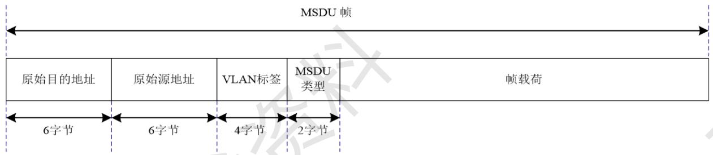  
图1MSDU长帧头格式

MSDU长帧头的字段如表1所示。

表 1 MSDU 长帧头格式  

<table><tr><td>字段</td><td>字节号</td><td>比特位</td><td>字段大小(比特)</td></tr><tr><td>原始目的地址</td><td>0-5</td><td>0-7</td><td>48</td></tr><tr><td>原始源地址</td><td>6-11</td><td>0-7</td><td>48</td></tr><tr><td>VLAN 标签</td><td>12-15</td><td>0-7</td><td>32</td></tr><tr><td>MSDU 类型</td><td>16-17</td><td>0-7</td><td>16</td></tr></table>

# 5.1.1.1.1 原始目的地址

原始目的地址是48比特的字段，指MSDU帧的最终目的站点的MAC地址。

广播报文中原始目的地址为FF-FF-FF-FF-FF。地址00-00-00-00-00-00为保留地址。

# 5.1.1.1.2 原始源地址

原始源地址是48比特的字段，指最初产生MSDU帧的站点的MAC地址。

# 5.1.1.1.3 VLAN标签

VLAN标签用于报文分类和划分优先级。详细定义参照5.3.2.17 报文分类规则。

# 5.1.1.1.4 MSDU类型

MSDU类型字段用于指示MSDU帧的类型。详细定义参照5.3.2.17 报文分类规则。

# 5.1.1.2 MSDU 短帧头

携带应用层报文的MSDU帧应采用MSDU短帧头，应用层报文可动态选择BPLC或SPLC发送。MSDU短帧头格式如图2所示。

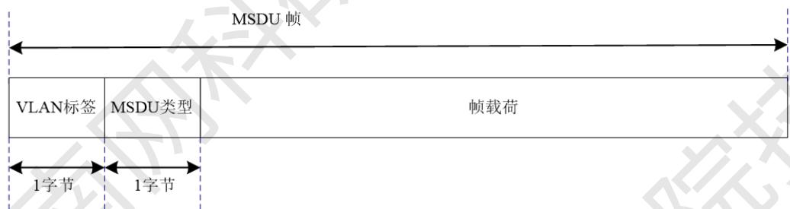  
图2MSDU短帧头格式

MSDU短帧头的字段如表2所示。

表 2 MSDU 短帧头格式  

<table><tr><td>字段</td><td>字节号</td><td>比特位</td><td>字段大小
(比特)</td></tr><tr><td>VLAN 标签</td><td>0</td><td>0-7</td><td>8</td></tr><tr><td>MSDU 类型</td><td>1</td><td>0-7</td><td>8</td></tr></table>

# 5.1.1.2.1 VLAN标签

VLAN标签用于报文分类和划分优先级。详细定义参照5.3.2.17 报文分类规则。

# 5.1.1.2.2 MSDU类型

MSDU类型字段用于指示MSDU帧的类型。详细定义参照5.3.2.17 报文分类规则。

# 5.1.2 MAC帧格式

MAC帧是不同站点的MAC层之间进行数据传送的基本传输单元。

一个MAC帧由MAC帧头、MAC业务数据单元和完整性校验值组成。MAC帧的帧头有32字节或12字节长短两种格式，根据选用的MSDU发送原语来使用。使用长MSDU发送原语时，则数据链路层使用长MAC帧头的MAC帧来传输MSDU；使用短MSDU发送原语时，则数据链路层使用短MAC帧头的MAC帧来传输MSDU。

MAC帧的基本格式如图3所示。

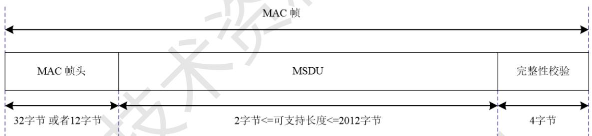  
图3MAC帧格式

无线MAC帧的基本格式如图4所示。

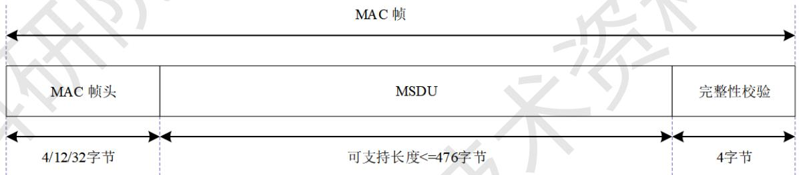  
图4无线MAC帧格式

# 5.1.2.1 MAC 帧头固定部分

MAC帧头固定部分如表3所示。

表 3 MAC 帧头固定域字段  

<table><tr><td>字段</td><td>字节号</td><td>比特位</td><td>字段大小(比特)</td></tr><tr><td>帧头类型</td><td>0</td><td>0</td><td>1</td></tr><tr><td>版本</td><td>0</td><td>1-2</td><td>2</td></tr><tr><td>可变区域</td><td></td><td></td><td>变长</td></tr></table>

帧头类型所代表的含义如表4所示。

表 4 帧头类型  

<table><tr><td>值</td><td>定义</td><td>使用场景</td></tr><tr><td>0</td><td>MAC 帧头是 32 字节长帧头</td><td>长 MSDU 时使用</td></tr><tr><td>1</td><td>MAC 帧头是 12 字节短帧头</td><td>短 MSDU 时使用</td></tr></table>

版本字段的含义如表5所示。

表5版本  

<table><tr><td>值</td><td>定义</td></tr><tr><td>0</td><td>保留</td></tr><tr><td>1</td><td>标准帧协议</td></tr><tr><td>2</td><td>单跳帧协议(此时帧头类型无意义)</td></tr><tr><td>3</td><td>保留</td></tr></table>

载波和无线信道可使用的版本如表6所示。

表 6 版本与信道对应关系

表 7 MAC 长帧头格式  

<table><tr><td>值</td><td>定义</td><td>载波</td><td>无线</td></tr><tr><td>1</td><td>标准帧协议</td><td>支持</td><td>支持</td></tr><tr><td>2</td><td>单跳帧协议</td><td>不支持</td><td>支持</td></tr></table>

# 5.1.2.2 MAC长帧头

MAC长帧头格式如表7所示。

<table><tr><td>字段</td><td>字节号</td><td>比特位</td><td>字段大小(比特)</td><td>备注</td></tr><tr><td>帧头类型</td><td>0</td><td>0</td><td>1</td><td>0:32字节长帧头1:12字节短帧头</td></tr><tr><td>版本</td><td>0</td><td>1-2</td><td>2</td><td>0:保留1:标准帧协议2:单跳帧协议</td></tr><tr><td>短网络标识高位</td><td>0</td><td>3</td><td>1</td><td>短网络标识的高1bit</td></tr><tr><td rowspan="2">发送序号</td><td>0</td><td>4-7</td><td rowspan="2">12</td><td rowspan="2">当前源站点在组网频段上发送SOF帧的序号(含重传帧)</td></tr><tr><td>1</td><td>0-7</td></tr><tr><td rowspan="2">MSDU长度</td><td>2</td><td>0-7</td><td rowspan="2">16</td><td rowspan="2">MAC帧中携带的MSDU的长度,单位:字节</td></tr><tr><td>3</td><td>0-7</td></tr><tr><td rowspan="2">原始目的TEI</td><td>4</td><td>0-7</td><td rowspan="2">12</td><td rowspan="2">MSDU的最终目的终端设备的标识</td></tr><tr><td>5</td><td>0-3</td></tr><tr><td rowspan="2">原始源TEI</td><td>5</td><td>4-7</td><td rowspan="2">12</td><td rowspan="2">创建该报文站点的TEI</td></tr><tr><td>6</td><td>0-7</td></tr><tr><td>短网络标识低位</td><td>7</td><td>0-3</td><td>4</td><td>短网络标识的低4bit部分</td></tr><tr><td>重启次数</td><td>7</td><td>4-7</td><td>4</td><td>站点重启次数</td></tr><tr><td>路由跳数</td><td>8</td><td>0-3</td><td>4</td><td>MAC帧可以被转发的最大跳数</td></tr><tr><td>广播方向</td><td>8</td><td>4-7</td><td>4</td><td>0:保留1:下行广播2:上行广播其他:保留</td></tr><tr><td>发送类型</td><td>9</td><td>0-2</td><td>3</td><td>0:单播,需要确认回应1:全网广播(仅代理站点转发),不需要确认回应2:本地广播,不需要确认回应3:全网广播(仅代理站点转发),需要确认回应4:本地广播,需要确认回应其他:保留</td></tr><tr><td>发送次数限值</td><td>9</td><td>3-7</td><td>5</td><td>报文最大发送次数,若为0,则可以使用本地默认重发次数</td></tr><tr><td rowspan="2">MSDU序列号</td><td>10</td><td>0-7</td><td rowspan="2">16</td><td rowspan="2">产生MSDU的原始设备分配给该MSDU的递增序列号</td></tr><tr><td>11</td><td>0-7</td></tr><tr><td>目的MAC地址</td><td>12-17</td><td>0-7</td><td>48</td><td>报文的原始目的MAC地址</td></tr><tr><td>保留</td><td>18-21</td><td>0-7</td><td>32</td><td>-</td></tr><tr><td>保留</td><td>22-31</td><td>0-7</td><td>80</td><td>-</td></tr></table>

TEI的字节排序遵循“低字节在前，低位在前”的原则，如表8所示。

表 8 TEI 的字节排序规律  

<table><tr><td>字段</td><td>字节号</td><td>比特位</td><td>字段大小(比特)</td></tr><tr><td rowspan="2">原始目的 TEI</td><td>4</td><td>0-7: b0-b7</td><td rowspan="2">12</td></tr><tr><td>5</td><td>0-3:b8-b11</td></tr><tr><td rowspan="2">原始源 TEI</td><td>5</td><td>4-7:b0-b3</td><td rowspan="2">12</td></tr><tr><td>6</td><td>0--7:b4-b11</td></tr></table>

例：假如原始目的TEI为0x123，原始源TEI为0x456，则第4字节为0x23，第5字节为0x61，第6字节为0x45。

# 5.1.2.2.1 短网络标识高位

短网络标识的高1bit部分，与短网络标识低位共同构成5bit的短网络标识。

# 5.1.2.2.2 发送序号

当前源站点在组网频段上发送SOF帧的序号（含重传帧）。

# 5.1.2.2.3 MSDU长度

MAC帧中携带的MSDU的长度。

# 5.1.2.2.4 原始目的TEI

MSDU的最终目的终端设备的标识，即最终需要处理MSDU的目的终端设备的TEI。

# 5.1.2.2.5 原始源TEI

MSDU的原始源终端设备的标识，即最初产生MSDU的源终端设备的TEI。当STA认为自己离线时，源TEI填写为0。

# 5.1.2.2.6 短网络标识低位

短网络标识的低4bit部分，短网络标识共5bit，有效取值为1-31。

短网络标识，用于区分不同的宽带载波通信网络。

每个宽带载波通信网络都应有一个唯一的SNID。

# 5.1.2.2.7 重启次数

指站点的重启次数。当一个站点初次上电时，重启次数的值缺省为0，此后，每次站点重新上电，该值加1，仅用于MAC帧唯一性辅助判断。该值在0-15的范围内变化，达到最大值时，从0开始重新递增。

# 5.1.2.2.8 路由跳数

路由跳数指MAC帧可以被转发的最大跳数。用于指示广播报文的转发跳数，每个站点确定需要转发时，需要对该值减1。当该值减为0时，则该报文不能再进行转发。

本地广播时，路由跳数为1；单播时，路由跳数为0；全网广播时，路由跳数按实际填写。

# 5.1.2.2.9 广播方向

广播报文的传输方向，含义如表9所示。

表 9 广播方向  

<table><tr><td>值</td><td>定义</td></tr><tr><td>0x0</td><td>保留</td></tr><tr><td>0x1</td><td>下行广播（从CCO发起广播至STA）</td></tr><tr><td>0x2</td><td>上行广播（从STA发起广播至CCO）</td></tr><tr><td>其他</td><td>保留</td></tr></table>

同级站点收到广播报文后，需根据传输方向转发。对于下行广播，上级站点不需要转发；对于上行广播，下级站点不需要转发。

# 5.1.2.2.10 发送类型

报文发送的类型，含义如表10所示。

表 10 发送类型  

<table><tr><td>值</td><td>定义</td></tr><tr><td>0</td><td>单播，需要确认回应</td></tr><tr><td>1</td><td>全网广播（仅代理站点转发），不需要回应</td></tr><tr><td>2</td><td>本地广播，不需要回应</td></tr><tr><td>3</td><td>全网广播（仅代理站点转发），需要确认回应</td></tr><tr><td>4</td><td>本地广播，需要确认回应</td></tr><tr><td>其他</td><td>保留</td></tr></table>

注：当发送类型需要确认回应时，要求接收端MAC层发送点对点的ACK确认。

# 5.1.2.2.11 发送次数限值

报文最大发送次数，该值为零时，则可以使用本地默认重发次数。

发送次数限值为1时，表示仅发送1次，不重发。

需要确认回应的报文，如果接收到确认回应报文，则不需要继续重发。

不需要确认回应的报文，则报文的总发送次数应达到发送次数限值。

# 5.1.2.2.12 MSDU序列号

指产生MSDU的原始设备分配给该MSDU的递增序列号。

# 5.1.2.2.13 目的MAC地址

指报文的原始目的MAC地址。

# 5.1.2.3 MAC短帧头

MAC短帧头的格式如表11所示。

表 11 MAC 短帧头  

<table><tr><td>字段</td><td>字节号</td><td>比特位</td><td>字段大小(比特)</td><td>备注</td></tr><tr><td>帧头类型</td><td>0</td><td>0</td><td>1</td><td>0:32字节长帧头1:12字节短帧头</td></tr><tr><td>版本</td><td>0</td><td>1-2</td><td>2</td><td>0:保留1:标准帧协议2:单跳帧协议</td></tr><tr><td>短网络标识高位</td><td>0</td><td>3</td><td>1</td><td>短网络标识的高1bit</td></tr><tr><td rowspan="2">发送序号</td><td>0</td><td>4-7</td><td rowspan="2">12</td><td rowspan="2">当前源站点在组网频段上发送SOF帧的序号</td></tr><tr><td>1</td><td>0-7</td></tr><tr><td rowspan="2">MSDU长度</td><td>2</td><td>0-7</td><td rowspan="2">16</td><td rowspan="2">MAC帧中携带的MSDU的长度</td></tr><tr><td>3</td><td>0-7</td></tr><tr><td rowspan="2">原始目的TEI</td><td>4</td><td>0-7</td><td rowspan="2">12</td><td rowspan="2">MSDU的最终目的终端设备的标识</td></tr><tr><td>5</td><td>0-3</td></tr><tr><td rowspan="2">原始源TEI</td><td>5</td><td>4-7</td><td rowspan="2">12</td><td rowspan="2">创建该报文站点的TEI</td></tr><tr><td>6</td><td>0-7</td></tr><tr><td>短网络标识低位</td><td>7</td><td>0-3</td><td>4</td><td>短网络标识的低4bit部分</td></tr><tr><td>重启次数</td><td>7</td><td>4-7</td><td>4</td><td>站点重启次数</td></tr><tr><td>路由跳数</td><td>8</td><td>0-3</td><td>4</td><td>MAC帧可以被转发的最大跳数</td></tr><tr><td>广播方向</td><td>8</td><td>4-7</td><td>4</td><td>0:保留1:下行广播2:上行广播其他:保留</td></tr><tr><td>发送类型</td><td>9</td><td>0-2</td><td>3</td><td>0:单播,需要确认回应1:全网广播(仅代理站点转发),不需要确认回应2:本地广播,不需要确认回应3:全网广播(仅代理站点转发),需要确认回应4:本地广播,需要确认回应其他:保留</td></tr><tr><td>发送次数限值</td><td>9</td><td>3-7</td><td>5</td><td>报文最大发送次数,若为0,则可以使用本地默认重发次数</td></tr><tr><td rowspan="2">MSDU序列号</td><td>10</td><td>0-7</td><td rowspan="2">16</td><td rowspan="2">产生MSDU的原始设备分配给该MSDU的递增序列号</td></tr><tr><td>11</td><td>0-7</td></tr></table>

相比MAC长帧头，MAC短帧头的字段减少了目的MAC地址字段和两个保留字段，其他保持一致。

# 5.1.2.4 单跳MAC头

单跳MAC帧头格式如表12所示。单跳MAC帧见用于无线信道。

表 12 单跳 MAC 帧头格式  

<table><tr><td>字段</td><td>字节号</td><td>比特位</td><td>字段大小(比特)</td></tr><tr><td>帧头类型</td><td>0</td><td>0</td><td>1</td></tr><tr><td>版本</td><td>0</td><td>1-2</td><td>2</td></tr><tr><td>保留</td><td>0</td><td>3-7</td><td>5</td></tr><tr><td>MSDU 类型</td><td>1</td><td>0-7</td><td>8</td></tr><tr><td rowspan="2">MSDU 长度</td><td>2</td><td>0-7</td><td rowspan="2">16</td></tr><tr><td>3</td><td>0-7</td></tr></table>

MSDU类型如表13所示。

表 13 MSDU 类型  

<table><tr><td>值</td><td>定义</td></tr><tr><td>0</td><td>保留</td></tr><tr><td>1</td><td>应用层报文</td></tr><tr><td>2</td><td>无线发现列表消息</td></tr><tr><td>3-127</td><td>保留（用于管理消息类型扩展）</td></tr><tr><td>128</td><td>IP 报文</td></tr><tr><td>其他</td><td>保留</td></tr></table>

# 5.1.2.5 MSDU

MAC层业务数据单元，可以是需要传送的业务数据，也可以是管理消息。

# 5.1.2.6 完整性校验

完整性校验是针对MAC帧计算的循环冗余校验值。计算完整性校验值时，不包括MAC帧头。

完整性校验使用的是32比特的循环冗余校验算法。

# 5.1.3 MPDU帧格式

MPDU是MAC层协议数据单元，由MAC子层提供给物理层，在不同站点的物理层之间传送数据的基本传输单元。

带有载荷的MPDU称为长MPDU，否则称为短MPDU。MPDU帧格式如图5所示。

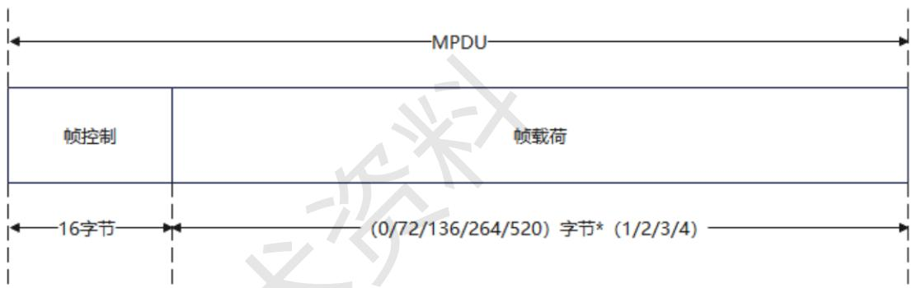  
图5MPDU帧格式

无线信道上仅支持1个物理块载荷的MPDU。无线MPDU帧格式如图6所示。

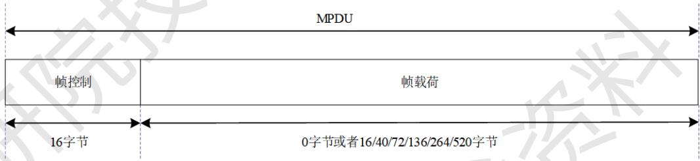  
图6无线MPDU帧格式

# 5.1.3.1 MPDU帧控制格式

MPDU的帧控制字段长度为16字节。

MPDU帧控制字段的格式如表14所示。

表 14 MPDU 帧控制字段  

<table><tr><td>字段</td><td>字节号</td><td>比特位</td><td>字段大小(比特)</td><td>说明</td></tr><tr><td>定界符类型</td><td rowspan="3">0</td><td>0-2</td><td>3</td><td>用来指示MPDU的帧类型0:信标帧1:SOF帧2:选择确认帧3:网间协调帧其他:保留</td></tr><tr><td>接入指示</td><td>3</td><td>1</td><td>用于指示发送MPDU的站点所在的网络类型0:保留1:MPDU在宽带载波通信接入网络中传输</td></tr><tr><td>短网络标识低位</td><td>4-7</td><td>4</td><td>用于区分不同的宽带载波通信网络。短网络标识的低4bit部分,短网络标识共5bit,有效取值为1-31,其中高1bit在帧控制的可变区域,每个宽带载波通信网络都应有一个唯一的SNID。</td></tr><tr><td rowspan="2">可变区域</td><td>1-11</td><td>0-7</td><td rowspan="2">92</td><td rowspan="2">由定界符类型决定。</td></tr><tr><td>12</td><td>0-3</td></tr><tr><td>标准版本号</td><td>12</td><td>4-7</td><td>4</td><td>0:保留1:BPLC2:SPLC</td></tr><tr><td>帧控制校验序列</td><td>13-15</td><td>0-7</td><td>24</td><td>-</td></tr></table>

# 5.1.3.1.1 定界符类型

定界符类型长度为3比特，用来指示MPDU的帧类型。MPDU帧类型的不同，可变区域也不同。定界符类型的取值如表15所示。

# 表 15 定界符类型

<table><tr><td>值</td><td>说明</td></tr><tr><td>0b000</td><td>信标帧</td></tr><tr><td>0b001</td><td>SOF 帧</td></tr><tr><td>0b010</td><td>选择确认帧</td></tr><tr><td>0b011</td><td>网间协调帧</td></tr><tr><td>0b100-0b111</td><td>保留</td></tr></table>

# 5.1.3.1.2 接入指示

接入指示的长度为1比特，用于指示发送MPDU的站点所在的网络类型。接入指示的取值和所代表的含义如表16所示。

表 16 接入指示  

<table><tr><td>接入字段</td><td>解释说明</td></tr><tr><td>0b0</td><td>保留</td></tr><tr><td>0b1</td><td>MPDU在宽带载波通信接入网络中传输</td></tr></table>

# 5.1.3.1.3 短网络标识低位

短网络标识的低4bit部分，短网络标识共5bit，有效取值为1-31，其中高1bit在帧控制的可变区域，指短网络标识，用于区分不同的宽带载波通信网络。

每个宽带载波通信网络都应有一个唯一的SNID。

# 5.1.3.1.4 标准版本号

标准版本号是一个4比特字段，用来表示标准演进的不同版本。标准版本号用以识别发送报文站点或者网络所使用的标准版本，如表17所示。

表 17 标准版本号  

<table><tr><td>值</td><td>定义</td></tr><tr><td>0</td><td>保留</td></tr><tr><td>1</td><td>BPLC 版本</td></tr><tr><td>2</td><td>SPLC 版本</td></tr><tr><td>其他</td><td>保留</td></tr></table>

# 5.1.3.1.5 帧控制校验序列

帧控制校验序列为帧控制的末尾24比特，校验计算帧控制中除帧控制校验序列以外的字段。  
帧控制校验序列采用的是24比特的循环冗余校验算法。

# 5.1.3.1.6 可变区域

可变区域的内容由定界符类型决定。

# 5.1.3.1.7 信标帧的可变区域

信标帧用于CCO进行网络管理。

信标帧的可变区域的格式如表18所示。

表 18 信标帧的可变区域  

<table><tr><td>字段</td><td>字节号</td><td>比特位</td><td>字段大小（比特）</td></tr><tr><td rowspan="4">信标时间戳</td><td>1</td><td>0-7</td><td rowspan="4">32</td></tr><tr><td>2</td><td>0-7</td></tr><tr><td>3</td><td>0-7</td></tr><tr><td>4</td><td>0-7</td></tr><tr><td rowspan="4">信标周期计数</td><td>5</td><td>0-7</td><td rowspan="4">32</td></tr><tr><td>6</td><td>0-7</td></tr><tr><td>7</td><td>0-7</td></tr><tr><td>8</td><td>0-7</td></tr><tr><td rowspan="2">源TEI</td><td>9</td><td>0-7</td><td rowspan="2">12</td></tr><tr><td rowspan="2">10</td><td>0-3</td></tr><tr><td>载波映射表索引</td><td>4-7</td><td>4</td></tr><tr><td rowspan="2">符号数</td><td>11</td><td>0-7</td><td rowspan="2">9</td></tr><tr><td rowspan="3">12</td><td>0</td></tr><tr><td>短网络标识高位</td><td>1</td><td>1</td></tr><tr><td>相线</td><td>2-3</td><td>2</td></tr></table>

# 5.1.3.1.7.1 信标时间戳

信标时间戳是发送信标的设备在发送信标时标记的网络基准时间。网络基准时间由CCO维护，全网站点需要和CCO的网络基准时间保持同步。

1）在中央信标中，信标时间戳是网络基准时间。  
2) 在代理信标中，信标时间戳是由PCO评估出的网络基准时间。  
3) 在发现信标中，信标时间戳是由STA评估出的网络基准时间。

# 5.1.3.1.7.2 信标周期计数

信标周期计数是由CCO维护的信标周期的递增计数。CCO每安排一个信标周期，则信标周期计数递增。

# 5.1.3.1.7.3 源TEI

表示发送信标的站点的TEI。

# 5.1.3.1.7.4 载波映射表索引

载波映射表索引，即信标帧发送时采用的载波映射表索引，参照《低压电力线宽带载波通信规约第4部分物理层》5.5.4载荷数据ROBO交织表11ROBO基本模式。

# 5.1.3.1.7.5 符号数

指OFDM符号数量，表示在信标帧的载荷中包含的OFDM符号的个数。

# 5.1.3.1.7.6 短网络标识高位

与MPDU帧控制固定字段的短网络标识低位共同构成5bit的短网络标识。

# 5.1.3.1.7.7 相线

相线标识，表示信标帧需要发送到的目的相线。

相线的取值和所代表的含义如表19所示。

表 19 相线取值  

<table><tr><td>值</td><td>定义</td></tr><tr><td>0</td><td>表示全相线</td></tr><tr><td>1</td><td>表示A相线</td></tr><tr><td>2</td><td>表示B相线</td></tr><tr><td>3</td><td>表示C相线</td></tr></table>

# 5.1.3.1.8 SOF帧的可变区域

# 5.1.3.1.8.1 BPLCSOF帧可变区域

SOF帧主要用于设备之间传输数据。标准版本BPLC时，表示当前SOF帧为BPLC版本，其SOF帧的可变区域内容如表20所示。

表 20 SOF 帧的可变区域  

<table><tr><td>字段</td><td>字节号</td><td>比特位</td><td>字段大小（比特）</td></tr><tr><td rowspan="2">源TEI</td><td>1</td><td>0-7</td><td rowspan="2">12</td></tr><tr><td rowspan="2">2</td><td>0-3</td></tr><tr><td rowspan="2">目的TEI</td><td>4-7</td><td rowspan="2">12</td></tr><tr><td>3</td><td>0-7</td></tr><tr><td>链路标识符</td><td>4</td><td>0-7</td><td>8</td></tr><tr><td>短网络标识高位</td><td>5</td><td>0</td><td>1</td></tr><tr><td rowspan="2">保留</td><td>5</td><td>1-7</td><td rowspan="2">15</td></tr><tr><td>6</td><td>0-7</td></tr><tr><td>物理块个数</td><td rowspan="2">7</td><td>0-3</td><td>4</td></tr><tr><td>载波映射表索引</td><td>4-7</td><td>4</td></tr><tr><td rowspan="2">帧长</td><td>8</td><td>0-7</td><td rowspan="2">12</td></tr><tr><td rowspan="2">9</td><td>0-3</td></tr><tr><td rowspan="2">保留</td><td>4-7</td><td rowspan="2">9</td></tr><tr><td rowspan="4">10</td><td>0-4</td></tr><tr><td>TEI过滤标志位</td><td>5</td><td>1</td></tr><tr><td>重传标志位</td><td>6</td><td>1</td></tr><tr><td rowspan="2">符号数</td><td>7</td><td rowspan="2">9</td></tr><tr><td>11</td><td>0-7</td></tr><tr><td>扩展载波映射表索引</td><td>12</td><td>0-3</td><td>4</td></tr></table>

# a） 源TEI

表示发送SOF帧的源设备站点的TEI。

# Q/XXXXXXXXX-XXX

# b) 目的 TEI

表示SOF帧的目的设备站点的TEI。

SOF帧的目的设备在接收到SOF帧后，如果发现目的TEI是本站点的TEI，则需要对SOF帧进行应答，发送选择确认帧给SOF帧的发送设备。

# c) 链路标识符

表示不同的优先级或者不同的业务分类。详细见5.2.8.5 优先级。

# d) 短网络标识高位

与MPDU帧控制固定字段的短网络标识低位共同构成5bit的短网络标识。

# e) 物理块个数

表示SOF帧的帧载荷中携带的物理块数量。

物理块的大小可以是136字节或者是520字节。SOF帧缺省只支持一个136字节和一个520字节的物理块；可扩展支持4个520字节的物理块的传输。

# f) 载波映射表索引

载波映射表索引是一个4比特字段。该字段表示SOF帧的帧载荷调制使用的载波映射表索引。同时，载波映射表索引也指示了SOF帧的物理传输块大小。不同载波映射表索引可支持的物理块数量不同。载波映射表索引的取值和所代表的含义参照《低压电力线宽带载波通信规约第4部分：物理层通信协议》5.5.4 载荷数据ROBO交织。

# g) 帧长

指示SOF帧的传送过程以及帧间隔等所要占用的信道的时长，单位，10微秒。

帧长的主要场景有以下两种：

# 1)SOF帧单帧传输、不需要选择确认的场景。

帧长包括SOF帧的帧载荷传输时间和竞争帧间隔时间，定义如图7所示。

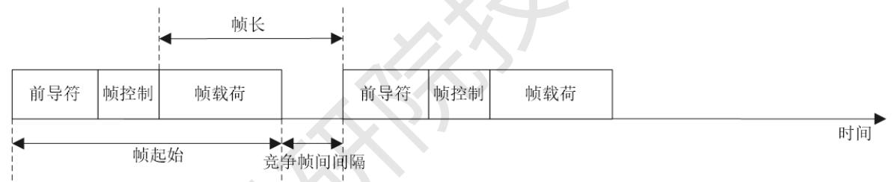  
图7无选择确认的单帧传输

# 2)SOF帧单帧传输、且需要选择确认的场景

帧长包括SOF帧的帧载荷传输时间、应答帧帧间隔时间、选择确认传输时间以及竞争帧间隔时间，定义如图8所示。

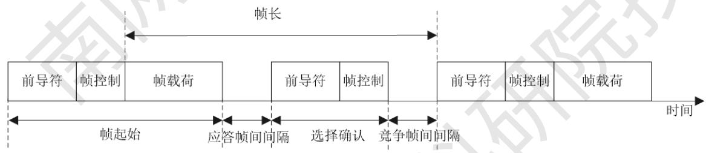  
图8带选择确认的单帧传输

# h) TEI 过滤标志位

表示物理层是否过滤该SOF帧，含义如表21所示。

表 21 TEI 过滤标志位  

<table><tr><td>值</td><td>说明</td></tr><tr><td>0b0</td><td>物理层检查报文 TEI，丢弃目的 TEI 不是自己的报文</td></tr><tr><td>0b1</td><td>物理层不检查报文 TEI，将报文交给数据链路层处理</td></tr></table>

本规约的TEI过滤标志位取值固定为1。

# i) 重传标志位

表示该SOF帧是否为重传报文，含义如表22所示。

表 22 重传标志位  

<table><tr><td>值</td><td>说明</td></tr><tr><td>0b0</td><td>非重传报文</td></tr><tr><td>0b1</td><td>重传报文</td></tr></table>

# j) 符号数

表示在SOF帧的载荷部分包含的OFDM符号个数。

# k) 扩展载波映射表索引

扩展载波映射表索引是一个4比特字段，其基本含义与载波映射表索引没有区别。用法和载波映射表索引有关联，当载波映射表索引的值为0xD时，表示本SOF帧的载荷是使用扩展载波映射表索引调制，接收方需要解析本字段，获取对载荷进行译码的载波映射表索引。扩展载波映射表索引的取值和所代表的含义参照《低压电力线宽带载波通信规约第4部分物理层》5.5.4 载荷数据ROBO交织表12ROBO扩展模式。

# 5.1.3.1.8.2 SPLC SOF 帧可变区域

标准版本为SPLC版本时，表示当前SOF帧为SPLC版本，其SOF帧的可变区域根据“多站点帧标识”和“训练帧标识”字段的不同取值分为多种情况，以支持不同的帧类型。

# a) 单站点帧数据帧的可变域

当“多站点帧”标识为0且“训练帧标识”为0时，表示当前SOF帧是数据帧。

数据帧的可变域定义如表23所示。

表 23 数据帧的 FC 可变域定义  

<table><tr><td>字段</td><td>字节号</td><td>比特位</td><td>字段大小(比特)</td><td>说明</td></tr><tr><td rowspan="2">源TEI</td><td>1</td><td>0-7</td><td rowspan="2">12</td><td rowspan="2">-</td></tr><tr><td>2</td><td>0-3</td></tr><tr><td rowspan="2">目的TEI</td><td>2</td><td>4-7</td><td rowspan="2">12</td><td rowspan="2">-</td></tr><tr><td>3</td><td>0-7</td></tr><tr><td>多站点帧标识</td><td>4</td><td>0</td><td>1</td><td>0:单站点帧1:多站点帧(OFDMA帧)</td></tr><tr><td>训练帧标识</td><td>4</td><td>1</td><td>1</td><td>0:数据帧1:训练帧</td></tr><tr><td>物理块个数</td><td>4</td><td>2-5</td><td>4</td><td>1:1个物理块2:2个物理块3:3个物理块4:4个物理块</td></tr><tr><td>流数</td><td>4</td><td>6-7</td><td>2</td><td>0:1流1:2流</td></tr><tr><td>TF符号数</td><td>5</td><td>0-2</td><td>3</td><td>实际符号数为(配置值+1)*2</td></tr><tr><td>PL频段标识</td><td>5</td><td>3-5</td><td>3</td><td>指示PL使用的频段,具体定义见《通感一体化低压电力线宽带载波通信规约第3部分:物理层通信协议》5.1.9.5 通信频段表17通信频段</td></tr><tr><td>TF扩展频段指示</td><td>5</td><td>6</td><td>1</td><td>0:TF与PL频段相同1:TF扩展到0.7~12M</td></tr><tr><td>保留</td><td>5</td><td>7</td><td>1</td><td>-</td></tr><tr><td>Bitloading标识</td><td>6</td><td>0</td><td>1</td><td>1:使用Bitloading0:使用TMI</td></tr><tr><td>TMI编号</td><td>6</td><td>1-5</td><td>5</td><td>当Bitloading标识=0时为TMI编号,TMI具体定义见《通感一体化低压电力线宽带载波通信规约第3部分:物理层通信协议》5.1.7.4载荷数据ROBO交织表13 SPLC载荷数据的ROBO模式。当Bitloading标识=1时表示物理块</td></tr><tr><td></td><td></td><td></td><td></td><td>大小。
0: 136
1: 520
2: 72
3: 264</td></tr><tr><td>保留</td><td>6</td><td>6-7</td><td>2</td><td>-</td></tr><tr><td>保留</td><td>7</td><td>0-7</td><td>8</td><td>-</td></tr><tr><td rowspan="2">帧长</td><td>8</td><td>0-7</td><td rowspan="2">12</td><td rowspan="2">指示SOF帧传送和确认过程所要占用信道的时长，单位10us</td></tr><tr><td>9</td><td>0-3</td></tr><tr><td>保留</td><td>9</td><td>4-7</td><td>4</td><td>-</td></tr><tr><td>保留</td><td>10-11</td><td>0-7</td><td>16</td><td>-</td></tr><tr><td>短网络标识高位</td><td>12</td><td>0</td><td>1</td><td>短网络标识的高1bit</td></tr><tr><td>保留</td><td>12</td><td>1-3</td><td>3</td><td>-</td></tr></table>

# b) 单站点帧训练帧的可变域

当“多站点帧标识”为0且“训练帧标识”为1时，表示当前帧是训练帧。

训练帧类型为1时，表示当前训练帧为Bitloading训练帧。训练帧类型为0时，表示当前训练帧为MIMO训练帧。

MIMO训练帧的可变域如表24所示。

表 24 MIMO 训练帧的 FC 可变域定义  

<table><tr><td>字段</td><td>字节号</td><td>比特位</td><td>字段大小(比特)</td><td>说明</td></tr><tr><td rowspan="2">源TEI</td><td>1</td><td>0-7</td><td rowspan="2">12</td><td rowspan="2">报文发送站点的TEI</td></tr><tr><td>2</td><td>0-3</td></tr><tr><td rowspan="2">目的TEI</td><td>2</td><td>4-7</td><td rowspan="2">12</td><td rowspan="2">报文接收站点的TEI</td></tr><tr><td>3</td><td>0-7</td></tr><tr><td>多站点帧标识</td><td>4</td><td>0</td><td>1</td><td>0:单站点帧1:多站点帧(OFDMA帧)</td></tr><tr><td>训练帧标识</td><td>4</td><td>1</td><td>1</td><td>0:数据帧1:训练帧</td></tr><tr><td>PL符号数</td><td>4</td><td>2-7</td><td>6</td><td>MIMO训练帧,PL符号数固定填0</td></tr><tr><td>训练帧类型</td><td>5</td><td>0</td><td>1</td><td>0:MIMO训练帧1:Bitloading训练帧</td></tr><tr><td>TF符号数</td><td>5</td><td>1-3</td><td>3</td><td>实际TF符号数为(配置值+1)*2</td></tr><tr><td>子载波分组大小</td><td>5</td><td>4-5</td><td>2</td><td>MIMO训练帧该字段无效,默认填0;</td></tr><tr><td>流数</td><td>5</td><td>6-7</td><td>2</td><td>训练帧流数0:1流1:2流</td></tr><tr><td>TF频段标识</td><td>6</td><td>0-2</td><td>3</td><td>指示TF使用的频段,具体定义见《通感一体化低压电力线宽带载波通信规约 第3部分:物理层通信协议》5.1.9.5通信频段表17通信频段。</td></tr><tr><td>RU信噪比估计标识</td><td>6</td><td>3</td><td>1</td><td>MIMO训练帧,该字段固定为1</td></tr><tr><td>保留</td><td>6</td><td>4-7</td><td>4</td><td>-</td></tr><tr><td>保留</td><td>7</td><td>0-7</td><td>8</td><td>-</td></tr><tr><td rowspan="2">帧长</td><td>8</td><td>0-7</td><td rowspan="2">12</td><td rowspan="2">指示SOF帧的传送和确认过程所要占用信道的时长,单位10us</td></tr><tr><td>9</td><td>0-3</td></tr><tr><td>保留</td><td>9</td><td>4-7</td><td>4</td><td>-</td></tr><tr><td>保留</td><td>10-11</td><td>0-7</td><td>16</td><td>-</td></tr><tr><td>短网络标识高位</td><td>12</td><td>0</td><td>1</td><td>短网络标识的高1bit</td></tr><tr><td>保留</td><td>12</td><td>1-3</td><td>3</td><td>-</td></tr></table>

Bitloading训练帧的可变域如表25所示。

表 25 Bitloading 训练帧的 FC 可变域定义  

<table><tr><td>字段</td><td>字节号</td><td>比特位</td><td>字段大小(比特)</td><td>说明</td></tr><tr><td rowspan="2">源TEI</td><td>1</td><td>0-7</td><td rowspan="2">12</td><td rowspan="2">报文发送站点的TEI</td></tr><tr><td>2</td><td>0-3</td></tr><tr><td rowspan="2">目的TEI</td><td>2</td><td>4-7</td><td rowspan="2">12</td><td rowspan="2">报文接收站点的TEI</td></tr><tr><td>3</td><td>0-7</td></tr><tr><td>多站点帧标识</td><td>4</td><td>0</td><td>1</td><td>0:单站点帧1:多站点帧(OFDMA帧)</td></tr><tr><td>训练帧标识</td><td>4</td><td>1</td><td>1</td><td>0:数据帧1:训练帧</td></tr><tr><td>PL符号数</td><td>4</td><td>2-7</td><td>6</td><td>Bitloading训练帧的PL符号数,实际符号数是(2*配置值+1)</td></tr><tr><td>训练帧类型</td><td>5</td><td>0</td><td>1</td><td>0:MIMO训练帧1:Bitloading训练帧</td></tr><tr><td>TF符号数</td><td>5</td><td>1-3</td><td>3</td><td>实际TF符号数为(配置值+1)*2</td></tr><tr><td>子载波分组大小</td><td>5</td><td>4-5</td><td>2</td><td>0:1个子载波为一组1:2个子载波为一组2:4个子载波为一组3:8个子载波为一组</td></tr><tr><td>流数</td><td>5</td><td>6-7</td><td>2</td><td>训练帧流数0:1流1:2流</td></tr><tr><td>PL频段标识</td><td>6</td><td>0-2</td><td>3</td><td>指示PL使用的频段,具体定义见物理层协议。在Bitloading训练帧中,TF使用的频段与PL一致。</td></tr><tr><td>RU信噪比估计标识</td><td>6</td><td>3</td><td>1</td><td>0:指示接收端不根据当前帧估计频段范围内各RU的平均信噪比1:指示接收端根据当前帧估计频段范围内各RU的平均信噪比</td></tr><tr><td>保留</td><td>6</td><td>4-7</td><td>4</td><td>-</td></tr><tr><td>保留</td><td>7</td><td>0-7</td><td>8</td><td>-</td></tr><tr><td rowspan="2">帧长</td><td>8</td><td>0-7</td><td rowspan="2">12</td><td rowspan="2">指示SOF帧的传送和确认过程所要占用信道的时长,单位10us</td></tr><tr><td>9</td><td>0-3</td></tr><tr><td>保留</td><td>9</td><td>4-7</td><td>4</td><td>-</td></tr><tr><td>保留</td><td>10-11</td><td>0-7</td><td>16</td><td>-</td></tr><tr><td>短网络标识高位</td><td>12</td><td>0</td><td>1</td><td>短网络标识的高1bit</td></tr><tr><td>保留</td><td>12</td><td>1-3</td><td>3</td><td>-</td></tr></table>

# c) 多站点帧（OFDMA 帧）的可变域

当“多站点帧标识”为1时，表示当前帧是多站点帧（OFDMA帧）。OFDMA帧的可变域定义如表26所示。

表 26 OFDMA 帧的 FC 可变域定义  

<table><tr><td>字段</td><td>字节号</td><td>比特位</td><td>字段大小（比特）</td><td>说明</td></tr><tr><td rowspan="2">源TEI</td><td>1</td><td>0-7</td><td rowspan="2">12</td><td rowspan="2">DL-OFDMA帧、UL-OFDMA帧的 trigger 帧和 UL-OFDMA帧的SACK 帧为报文发送站点的 TEI; UL-OFDMA帧(DL-OFDMA的SACK 帧)为广播 TEI: 0xFFFF。</td></tr><tr><td>2</td><td>0-3</td></tr><tr><td rowspan="2">目的TEI</td><td>2</td><td>4-7</td><td rowspan="2">12</td><td rowspan="2">报文发送目的站点的 TEI; 若目的站点为多个则填广播 TEI: 0xFFFF。</td></tr><tr><td>3</td><td>0-7</td></tr><tr><td>多站点帧标识</td><td>4</td><td>0</td><td>1</td><td>0: 单站点帧 1: 多站点帧 (OFDMA 帧)</td></tr><tr><td>OFDMA帧类型</td><td>4</td><td>1-2</td><td>2</td><td>OFDMA帧类型:0:DL-OFDMA帧1:DL-OFDMA帧的SACK帧/UL-OFDMA帧2:UL-OFDMA帧的trigger帧3:UL-OFDMA帧的SACK帧</td></tr><tr><td>频段标识</td><td>4</td><td>3-5</td><td>3</td><td>指示PL频段,频段定义见《通感一体化低压电力线宽带载波通信规约第3部分:物理层通信协议》5.1.9.5通信频段 表17通信频段</td></tr><tr><td>站点数</td><td>4</td><td>6-7</td><td>2</td><td>0:1个站点1:2个站点2:3个站点3:4个站点当前帧是DL-OFDMA和UL-OFDMA帧的trigger帧时,站点数根据实际调度的站点数填写;当前帧是UL-OFDMA时,站点数根据trigger帧或DL_ OFDMA帧中携带的站点数填写;当前帧是UL-OFDMA帧的SACK帧时,站点数根据trigger帧携带的站点数填写。</td></tr><tr><td>eFC符号个数</td><td>5</td><td>0-1</td><td>2</td><td>0:2个符号1:4个符号2:8个符号3:12个符号当前帧是UL-OFDMA帧时,没有eFc,该字段无效,默认填0。</td></tr><tr><td>保留</td><td>5</td><td>2-7</td><td>6</td><td>-</td></tr><tr><td rowspan="2">PL符号数</td><td>6</td><td>0-7</td><td rowspan="2">9</td><td rowspan="2">当前帧是trigger帧时,表示UL-OFDMA帧的上行符号数,取多个站点的最大符号数;当前帧是DL-OFDMA或UL-OFDMA帧时,表示当前帧的符号数,取多个站点的最大符号数;当前帧是UL-OFDMA的SACK帧时,填0。</td></tr><tr><td>7</td><td>0</td></tr><tr><td>保留</td><td>7</td><td>1-7</td><td>7</td><td>-</td></tr><tr><td rowspan="2">帧长</td><td>8</td><td>0-7</td><td rowspan="2">12</td><td rowspan="2">指示SOF帧的传送过程以及帧间隔等占用信道的时长,单位10us。BPLC站点可根据此字段退避。</td></tr><tr><td>9</td><td>0-3</td></tr><tr><td>保留</td><td>9</td><td>4-7</td><td>4</td><td>-</td></tr><tr><td>保留</td><td>10-11</td><td>0-7</td><td>16</td><td>-</td></tr><tr><td>短网络标识高位</td><td>12</td><td>0</td><td>1</td><td>短网络标识的高1bit</td></tr><tr><td>保留</td><td>12</td><td>1-3</td><td>3</td><td>-</td></tr></table>

其中，OFDMA帧类型不同，携带的eFC内容不同。

当OFDMA帧类型值为1表示DL-OFDMA帧的SACK帧或者UL-OFDMA帧，不携带eFC。

当为DL-OFDMA的SACK帧时，其帧载荷内容承载SACK数据，物理块使用单个物理块传输，且采用固定TMI26传输。

当为UL-OFDMA帧时，其帧载荷内容承载数据帧数据，物理块的TMI由UL-OFDMA的trigger帧的eFC中的TMI指示。

a) DL-OFDMA数据帧的eFC

当OFDMA帧类型值为0时，表示DL-OFDMA帧，其eFC定义如表27所示。

表 27 DL-OFDMA 帧 eFC 定义  

<table><tr><td>字段</td><td>字节号</td><td>比特位</td><td>字段大小（比特）</td><td>说明</td></tr><tr><td>TF个数</td><td>0</td><td>0-1</td><td>2</td><td>当前DL-OFDMA帧和后续上行SACK帧的TF个数实际TF个数是（配置值+1）*2</td></tr><tr><td>站点0 PB个数</td><td>0</td><td>2</td><td>1</td><td>-</td></tr><tr><td rowspan="2">站点0 TEI</td><td>0</td><td>3-7</td><td rowspan="2">12</td><td rowspan="2">-</td></tr><tr><td>1</td><td>0-6</td></tr><tr><td rowspan="2">站点0 TMI</td><td>1</td><td>7</td><td rowspan="2">5</td><td rowspan="2">具体定义见《通感一体化低压电力线宽带载波通信规约 第3部分：物理层通信协议》5.1.7.4载荷数据</td></tr><tr><td>2</td><td>0-3</td></tr><tr><td></td><td></td><td></td><td></td><td>ROBO交织表13 SPLC载荷数据的ROBO模式。</td></tr><tr><td>站点0 RU</td><td>2</td><td>4-7</td><td>4</td><td>-</td></tr><tr><td>站点0 SACK RU</td><td>3</td><td>0-2</td><td>3</td><td>站点0回复SACK使用的RU, RU选择范围: RU0~RU5。</td></tr><tr><td>站点1 PB个数</td><td>3</td><td>3</td><td>1</td><td>以下为站点1的信息,字段定义与站点0相同</td></tr><tr><td rowspan="2">站点1 TEI</td><td>3</td><td>4-7</td><td rowspan="2">12</td><td rowspan="2">-</td></tr><tr><td>4</td><td>0-7</td></tr><tr><td>站点1 TMI</td><td>5</td><td>0-4</td><td>5</td><td>-</td></tr><tr><td rowspan="2">站点1 RU</td><td>5</td><td>5-7</td><td rowspan="2">4</td><td rowspan="2">-</td></tr><tr><td>6</td><td>0</td></tr><tr><td>站点1 SACK RU</td><td>6</td><td>1-3</td><td>3</td><td>-</td></tr><tr><td>站点2 PB个数</td><td>6</td><td>4</td><td>1</td><td>以下为站点2的信息,字段定义与站点0相同</td></tr><tr><td rowspan="3">站点2 TEI</td><td>6</td><td>5-7</td><td rowspan="3">12</td><td rowspan="3">-</td></tr><tr><td>7</td><td>0-7</td></tr><tr><td>8</td><td>0</td></tr><tr><td>站点2 TMI</td><td>8</td><td>1-5</td><td>5</td><td>-</td></tr><tr><td rowspan="2">站点2 RU</td><td>8</td><td>6-7</td><td rowspan="2">4</td><td rowspan="2">-</td></tr><tr><td>9</td><td>0-1</td></tr><tr><td>站点2 SACK RU</td><td>9</td><td>2-4</td><td>3</td><td>-</td></tr><tr><td>站点3 PB个数</td><td>9</td><td>5</td><td>1</td><td>以下为站点3的信息,字段定义与站点0相同</td></tr><tr><td rowspan="3">站点3 TEI</td><td>9</td><td>6-7</td><td rowspan="3">12</td><td rowspan="3">-</td></tr><tr><td>10</td><td>0-7</td></tr><tr><td>11</td><td>0-1</td></tr><tr><td>站点3 TMI</td><td>11</td><td>2-6</td><td>5</td><td>-</td></tr><tr><td rowspan="2">站点3 RU</td><td>11</td><td>7</td><td rowspan="2">4</td><td rowspan="2">-</td></tr><tr><td>12</td><td>0-2</td></tr><tr><td>站点3 SACK RU</td><td>12</td><td>3-5</td><td>3</td><td>-</td></tr><tr><td>保留</td><td>12</td><td>6-7</td><td>2</td><td>-</td></tr><tr><td>CRC校验</td><td>13-15</td><td>0-3</td><td>24</td><td>-</td></tr></table>

b) UL-OFDMA帧的trigger帧eFC   
当OFDMA帧类型值为2时，表示UL-OFDMA帧的trigger帧，其eFC定义如表28所示。

表 28 UL-OFDMA 帧的 trigger 帧 eFC 定义  

<table><tr><td>字段</td><td>字节号</td><td>比特位</td><td>字段大小(比特)</td><td>说明</td></tr><tr><td>TF个数</td><td>0</td><td>0-1</td><td>2</td><td>每个站点的上行OFDMA帧的TF个数实际TF个数是(配置值+1)*2</td></tr><tr><td>站点0 PB个数</td><td>0</td><td>2</td><td>1</td><td>0:1个PB块;1:2个PB块;</td></tr><tr><td rowspan="2">站点0 TEI</td><td>0</td><td>3-7</td><td rowspan="2">12</td><td rowspan="2">目的站点的TEI</td></tr><tr><td>1</td><td>0-6</td></tr><tr><td rowspan="2">站点0 TMI</td><td>1</td><td>7</td><td rowspan="2">5</td><td rowspan="2">具体定义见《通感一体化低压电力线宽带载波通信规约 第3部分:物理层通信协议》5.1.7.4载荷数据ROBO交织表13 SPLC载荷数据的ROBO模式。</td></tr><tr><td>2</td><td>0-3</td></tr><tr><td>站点0 RU</td><td>2</td><td>4-7</td><td>4</td><td>分配给站点0的RU,RU定义见《通感一体化低压电力线宽带载波通信规约 第3部分:物理层通信协议》5.1.12 OFDMA RU定义 表22 SPLC OFDMA RU定义。</td></tr><tr><td>站点0 Tx功率回退</td><td>3</td><td>0-2</td><td>3</td><td>站点0发射功率相对最大发射功率回退0:回退0dB1:回退4dB2:回退8dB</td></tr><tr><td></td><td></td><td></td><td></td><td>3:回退12dB4:回退16dB5:回退20dB6:回退24dB7:回退28dB</td></tr><tr><td>站点1 PB个数</td><td>3</td><td>3</td><td>1</td><td>-</td></tr><tr><td rowspan="2">站点1 TEI</td><td>3</td><td>4-7</td><td rowspan="2">12</td><td rowspan="2">-</td></tr><tr><td>4</td><td>0-7</td></tr><tr><td>站点1 TMI</td><td>5</td><td>0-4</td><td>5</td><td>-</td></tr><tr><td rowspan="2">站点1 RU</td><td>5</td><td>5-7</td><td rowspan="2">4</td><td rowspan="2">-</td></tr><tr><td>6</td><td>0</td></tr><tr><td>站点1 Tx功率回退</td><td>6</td><td>1-3</td><td>3</td><td>-</td></tr><tr><td>站点2 PB个数</td><td>6</td><td>4</td><td>1</td><td>-</td></tr><tr><td rowspan="3">站点2 TEI</td><td>6</td><td>5-7</td><td rowspan="3">12</td><td>-</td></tr><tr><td>7</td><td>0-7</td><td>-</td></tr><tr><td>8</td><td>0</td><td>-</td></tr><tr><td>站点2 TMI</td><td>8</td><td>1-5</td><td>5</td><td>-</td></tr><tr><td rowspan="2">站点2 RU</td><td>8</td><td>6-7</td><td rowspan="2">4</td><td rowspan="2">-</td></tr><tr><td>9</td><td>0-1</td></tr><tr><td>站点2 Tx功率回退</td><td>9</td><td>2-4</td><td>3</td><td>-</td></tr><tr><td>站点3 PB个数</td><td>9</td><td>5</td><td>1</td><td>-</td></tr><tr><td rowspan="3">站点3 TEI</td><td>9</td><td>6-7</td><td rowspan="3">12</td><td rowspan="3">-</td></tr><tr><td>10</td><td>0-7</td></tr><tr><td>11</td><td>0-1</td></tr><tr><td>站点3 TMI</td><td>11</td><td>2-6</td><td>5</td><td>-</td></tr><tr><td rowspan="2">站点3 RU</td><td>11</td><td>7</td><td rowspan="2">4</td><td rowspan="2">-</td></tr><tr><td>12</td><td>0-2</td></tr><tr><td>站点3 Tx功率回退</td><td>12</td><td>3-5</td><td>3</td><td>-</td></tr><tr><td>保留</td><td>12</td><td>6-7</td><td>2</td><td>-</td></tr><tr><td>CRC校验</td><td>13-15</td><td>0-7</td><td>24</td><td>-</td></tr></table>

# c) UL-OFDMA帧的SACK帧的eFC

当OFDMA帧类型值为3时，表示UL-OFDMA帧的SACK帧，其eFC定义如表29所示。

表 29 UL-OFDMA 帧的 SACK 帧 eFC 定义  

<table><tr><td>字段</td><td>字节号</td><td>比特位</td><td>字段大小(比特)</td><td>说明</td></tr><tr><td rowspan="2">站点0 TEI</td><td>0</td><td>0-7</td><td rowspan="2">12</td><td rowspan="2">-</td></tr><tr><td>1</td><td>0-3</td></tr><tr><td>站点0接收状态</td><td>1</td><td>4-7</td><td>4</td><td>站点0每个PB的接收成功标志,比特0表示序列号为0的物理块的校验结果,比特1表示序列号为1的物理块的校验结果,比特2和比特3保留,默认填0</td></tr><tr><td>保留</td><td>2</td><td>0-3</td><td>8</td><td>-</td></tr><tr><td rowspan="2">站点1 TEI</td><td>3</td><td>0-7</td><td rowspan="2">12</td><td rowspan="2">-</td></tr><tr><td>4</td><td>0-3</td></tr><tr><td>站点1接收状态</td><td>4</td><td>4-7</td><td>4</td><td>站点1每个PB的接收成功标志,比特0表示序列号为0的物理块的校验结果,比特1表示序列号为1的物理块的校验结果,比特2和比特3保留,默认填0</td></tr><tr><td>保留</td><td>5</td><td>0-8</td><td>8</td><td>-</td></tr><tr><td rowspan="2">站点2 TEI</td><td>6</td><td>0-7</td><td rowspan="2">12</td><td rowspan="2">-</td></tr><tr><td>7</td><td>0-3</td></tr><tr><td>站点2接收状态</td><td>7</td><td>4-7</td><td>4</td><td>站点2每个PB的接收成功标志,比特0表示序列号为0的物理块的校验结果,比特1表示序列号为1的物理块的校验结果,比特2和比特3保留,默认填0</td></tr><tr><td>保留</td><td>8</td><td>0-7</td><td>8</td><td>-</td></tr><tr><td rowspan="2">站点3 TEI</td><td>9</td><td>0-8</td><td rowspan="2">12</td><td rowspan="2">-</td></tr><tr><td>10</td><td>0-3</td></tr><tr><td>站点3接收状态</td><td>10</td><td>4-7</td><td>4</td><td>站点3每个PB的接收成功标志,比特0表示序列号为0的物理块的校验结果,比特1表示序列号为1的物理块的校验结果,比特2和比特3保留,默认填0</td></tr><tr><td>保留</td><td>11-12</td><td>0-7</td><td>16</td><td>-</td></tr><tr><td>CRC校验</td><td>13-15</td><td>0-7</td><td>24</td><td>-</td></tr></table>

# 5.1.3.1.9 选择确认帧的可变区域

选择确认帧是接收设备用来向发送设备反馈SOF帧的接收情况。接收SOF帧的设备，如果判断需要回复选择确认帧时，则发送选择确认帧。

选择确认帧的可变区域定义如表30所示。

表 30 选择确认的可变区域  

<table><tr><td>字段</td><td>字节号</td><td>比特位</td><td>字段大小(比特)</td><td>说明</td></tr><tr><td>接收结果</td><td rowspan="2">1</td><td>0-3</td><td>4</td><td>SOF帧的接收结果0:全部接收成功1:sof帧的物理块存在循环冗余校验失败的场景其他:保留</td></tr><tr><td>接收状态</td><td>4-7</td><td>4</td><td>接收状态是一个4比特的字段,用来表示普通模式时,SOF帧的物理块的校验结果。一个SOF帧最多可以携带4个物理块,每一个比特,表示一个物理块是否校验成功。比特0表示序列号为0的物理块的校验结果,比特1表示序列号为1的物理块的校验结果,其余类推。接收状态的比特位为0时,则表示对应的物理块校验失败;比特位为1时,则表示对应的物理块校验成功。</td></tr><tr><td rowspan="2">目的TEI</td><td>2</td><td>0-7</td><td rowspan="2">12</td><td rowspan="2">选择确认帧的目的终端的TEI</td></tr><tr><td rowspan="2">3</td><td>0-3</td></tr><tr><td>接收物理块个数</td><td>4-7</td><td>4</td><td>接收的物理块个数,包括解析错误的物理块个数</td></tr><tr><td>短网络标识高位</td><td rowspan="3">4</td><td>0</td><td>1</td><td>短网络标识高位,与MPDU帧控制固定字段的短网络标识低位共同构成5bit的短网络标识</td></tr><tr><td>SNR类型</td><td>1-2</td><td>2</td><td>0:不携带snr信息1:接收当前帧的SNR信息2:反馈TF评估的基础RU信息3:保留站点评估出与邻居站点的SNR或RU_SNR后,通过与该站点业务交互流程中的SACK帧反馈SNR或RU_SNR信息</td></tr><tr><td>保留</td><td>3-7</td><td>5</td><td>-</td></tr><tr><td rowspan="2">SNR评估信息</td><td>5-7</td><td>0-7</td><td rowspan="2">30</td><td rowspan="2">SNR类型为1时,此字段填充5Bit当前帧SNR信息;SNR类型为2时,此字段依次表示基础RU0-RU5的SNR信息,共30Bit;SNR类型为其他值时,此字段保留;5bit SNR表示的数据范围为0~31。</td></tr><tr><td>8</td><td>0-5</td></tr><tr><td>保留</td><td>8</td><td>6-7</td><td>2</td><td></td></tr><tr><td>保留</td><td>9-11</td><td>0-7</td><td>24</td><td>-</td></tr><tr><td>扩展帧类型</td><td>12</td><td>0-3</td><td>4</td><td>-</td></tr></table>

# 5.1.3.1.9.1 接收结果

表示SOF帧的接收结果。接收结果的取值和解释如表31所示。

表 31 接收结果值  

<table><tr><td>值</td><td>说明</td></tr><tr><td>0x0</td><td>表示SOF帧全部接收成功。</td></tr><tr><td>0x1</td><td>表示SOF帧的物理块存在循环冗余校验失败的情形。</td></tr><tr><td>0x2-0xF</td><td>保留</td></tr></table>

# 5.1.3.1.9.2 接收状态

接收状态是一个4比特的字段，用来表示普通模式时，SOF帧的物理块的校验结果。一个SOF帧最多可以携带4个物理块，每一个比特，表示一个物理块是否校验成功。

比特0表示序列号为0的物理块的校验结果，比特1表示序列号为1的物理块的校验结果，其余类推。

接收状态的比特位为0时，则表示对应的物理块校验失败；比特位为1时，则表示对应的物理块校验成功。

# 5.1.3.1.9.3 目的TEI

目的TEI 是一个12比特字段，表示为选择确认帧的目的终端的TEI。

# 5.1.3.1.9.4 接收物理块个数

接收的物理块个数，包括解析错误的物理块个数。

# 5.1.3.1.9.5 短网络标识高位

短网络标识高位，与MPDU帧控制固定字段的短网络标识低位共同构成5bit的短网络标识。

# 5.1.3.1.9.6 SNR类型

SNR类型，指示SNR评估信息携带的信息内容。

SNR类型的取值如表32所示。

表 32 SNR 类型值  

<table><tr><td>值</td><td>说明</td></tr><tr><td>0x0</td><td>不携带SNR信息</td></tr><tr><td>0x1</td><td>接收当前帧的SNR信息</td></tr><tr><td>0x2</td><td>反馈TF评估的基础RU信息</td></tr><tr><td>0x3</td><td>保留</td></tr></table>

# 5.1.3.1.9.7 SNR评估信息

SNR评估信息，表示站点评估出与邻居站点的SNR或RU_SNR后，通过与该站点业务交互流程中的SACK帧反馈SNR或RU_SNR信息。

当SNR类型值为1时，此字段填充5Bit当前帧SNR信息；5bit SNR表示的数据范围为0~31。

当SNR类型为2时，此字段依次表示基础RU0-RU5的SNR信息，共30Bit；

当SNR类型为其他值时，此字段保留。

# 5.1.3.1.9.8 扩展帧类型

扩展帧类型如表33所示。

表 33 扩展帧类型  

<table><tr><td>值</td><td>说明</td></tr><tr><td>0</td><td>表示为选择确认帧</td></tr><tr><td>1</td><td>网络搜索帧（抄控器）</td></tr><tr><td>2</td><td>同步帧（抄控器）</td></tr><tr><td>3</td><td>Bitloading 扩展帧</td></tr><tr><td>其他</td><td>保留</td></tr></table>

# 5.1.3.1.9.9 Bitloading扩展帧的可变区域

当扩展帧类型值为3时，表示为Bitloading扩展帧，其可变区域定义如表 34所示，

表 34 Bitloading 扩展帧的可变区域  

<table><tr><td>字段</td><td>字节号</td><td>比特位</td><td>字段大小(比特)</td><td>说明</td></tr><tr><td rowspan="2">源 TEI</td><td>1</td><td>0-7</td><td rowspan="2">12</td><td rowspan="2">-</td></tr><tr><td rowspan="2">2</td><td>0-3</td></tr><tr><td rowspan="2">目的 TEI</td><td>4-7</td><td rowspan="2">12</td><td rowspan="2">-</td></tr><tr><td>3</td><td>0-7</td></tr><tr><td>短网络标识高位</td><td>4</td><td>0</td><td>1</td><td>短网络标识的高 1bit</td></tr><tr><td>Bitloading 帧类型</td><td>4</td><td>1-3</td><td>3</td><td>0: 训练指示;1: 训练指示拒绝;2: 训练请求;3: 训练请求拒绝;4: 训练取消请求;5: 训练取消确认;</td></tr><tr><td></td><td></td><td></td><td></td><td>其他:保留</td></tr><tr><td rowspan="2">可变区域</td><td>4</td><td>4-7</td><td rowspan="2">60</td><td>-</td></tr><tr><td>5-11</td><td>0-7</td><td>-</td></tr><tr><td>扩展帧类型</td><td rowspan="2">12</td><td>0-3</td><td>4</td><td>3: Bitloading 扩展帧</td></tr><tr><td>标准版本号</td><td>4-7</td><td>4</td><td>-</td></tr><tr><td>帧控制校验序列</td><td>13-15</td><td>0-7</td><td>24</td><td>-</td></tr></table>

当Bitloading帧类型值为0时，表示为训练指示帧，训练评估发送站点通过训练指示报文通知训练评估接收站点启动训练流程。训练指示报文的可变区域如表35所示，

表 35 训练指示数据格式  

<table><tr><td>字段</td><td>字节号</td><td>比特位</td><td>字段大小(比特)</td><td>说明</td></tr><tr><td>训练控制帧类型</td><td>4</td><td>1-3</td><td>3</td><td>固定填0，表示发端站点主动启动训练</td></tr><tr><td>保留</td><td>4</td><td>4-7</td><td>4</td><td>-</td></tr><tr><td>保留</td><td>5-11</td><td>0-7</td><td>56</td><td>-</td></tr></table>

当Bitloading帧类型值为1时，表示为训练指示拒绝帧，当站点由于当前正在与其他站点训练，或训练资源已满，则回复训练指示拒绝报文。训练指示拒绝报文的可变区域如表36所示，

表 36 训练指示拒绝数据格式  

<table><tr><td>字段</td><td>字节号</td><td>比特位</td><td>字段大小(比特)</td><td>说明</td></tr><tr><td>训练控制帧类型</td><td>4</td><td>1-3</td><td>3</td><td>固定填1，表示训练指示拒绝</td></tr><tr><td>拒绝原因</td><td>4</td><td>4-7</td><td>4</td><td>1:站点正在训练2:训练站点已满其他:保留</td></tr><tr><td>保留</td><td>5-11</td><td>0-7</td><td>56</td><td>-</td></tr></table>

当Bitloading帧类型值为2时，表示为训练请求帧，训练评估接收站点，在选定训练评估发送站点后，向其发送训练请求报文，训练请求帧的可变区域如表37所示。

表 37 训练请求帧的可变区域  

<table><tr><td>字段</td><td>字节号</td><td>比特位</td><td>字段大小(比特)</td><td>说明</td></tr><tr><td>训练控制帧类型</td><td>4</td><td>1-3</td><td>3</td><td>固定填2,表示收端站点主动启动训练</td></tr><tr><td>流数</td><td>4</td><td>4</td><td>1</td><td>0:单流1:双流</td></tr><tr><td>子载波分组大小</td><td>4</td><td>5-6</td><td>2</td><td>0:1个子载波一组1:2个子载波一组2:4个子载波一组3:8个子载波一组</td></tr><tr><td>保留</td><td>4</td><td>7</td><td>1</td><td>-</td></tr><tr><td>保留</td><td>5-11</td><td>0-7</td><td>56</td><td>-</td></tr></table>

当Bitloading帧类型值为3时，表示为训练请求拒绝帧。为了保证训练有序，站点同一时间仅允许与一个邻居站点进行训练。如果站点收到训练请求，但当前不满足训练条件，可以拒绝训练，并发送训练请求拒绝报文。若允许训练，则不发送训练请求拒绝帧，直接发送训练帧。训练请求拒绝帧的可变区域格式如表38所示，

表 38 训练请求拒绝的可变区域  

<table><tr><td>字段</td><td>字节号</td><td>比特位</td><td>字段大小(比特)</td><td>说明</td></tr><tr><td>训练控制帧类型</td><td>4</td><td>1-3</td><td>3</td><td>固定填3，表示训练请求拒绝</td></tr><tr><td>拒绝原因</td><td>4</td><td>4-7</td><td>4</td><td>0:站点正在训练
1:训练站点已满
其他:保留</td></tr><tr><td>保留</td><td>5-11</td><td>0-7</td><td>56</td><td>-</td></tr></table>

当Bitloading帧类型值为4时，表示为训练取消请求帧。训练评估接收站点判定需要与某个选定的训练评估发送站点取消训练关系时，向其发送训练取消请求帧。训练取消请求帧的可变区域如表39所示，

表 39 训练取消请求帧的可变区域  

<table><tr><td>字段</td><td>字节号</td><td>比特位</td><td>字段大小(比特)</td><td>说明</td></tr><tr><td>训练控制帧类型</td><td>4</td><td>1-3</td><td>3</td><td>固定填4，表示训练取消请求</td></tr><tr><td>保留</td><td>4</td><td>4-7</td><td>4</td><td>-</td></tr><tr><td>保留</td><td>5-11</td><td>0-7</td><td>56</td><td>-</td></tr></table>

当Bitloading帧类型值为5时，表示为训练取消确认帧。训练评估发送站点收到训练评估接收站点的训练取消请求时，向其回复训练取消确认，训练取消确认帧的可变区域如

表40所示，

表 40 训练取消确认帧的可变区域  

<table><tr><td>字段</td><td>字节号</td><td>比特位</td><td>字段大小(比特)</td><td>说明</td></tr><tr><td>训练控制帧类型</td><td>4</td><td>1-3</td><td>3</td><td>固定填5，表示训练取消确认</td></tr><tr><td>保留</td><td>4</td><td>4-7</td><td>4</td><td>-</td></tr><tr><td>保留</td><td>5-11</td><td>0-7</td><td>56</td><td>-</td></tr></table>

# 5.1.3.1.10 网间协调帧的可变区域

网间协调帧用于CCO进行网间时隙的竞争协调，一般用于在多个宽带载波通信网络共存的场景中，CCO之间进行带宽协商。

网间协调帧的可变区域定义如表41所示。

表 41 网间协调的可变区域  

<table><tr><td>字段</td><td>字节号</td><td>比特位</td><td>字段大小(比特)</td></tr><tr><td rowspan="2">邻居网络比特图1</td><td>1</td><td>0-7</td><td rowspan="2">16</td></tr><tr><td>2</td><td>0-7</td></tr><tr><td>本网络无线信道编号</td><td>3</td><td>0-7</td><td>8</td></tr><tr><td rowspan="3">邻居网络比特图2</td><td>4</td><td>0-7</td><td rowspan="2">10</td></tr><tr><td rowspan="2">5</td><td>0-1</td></tr><tr><td>2-7</td><td rowspan="2">14</td></tr><tr><td>持续时间</td><td>6</td><td>0-7</td></tr><tr><td>邻居网络比特图3</td><td>7</td><td>0</td><td>1</td></tr><tr><td>带宽结束标志位</td><td>7</td><td>1</td><td>1</td></tr><tr><td>本网络无线 option</td><td>7</td><td>2-3</td><td>2</td></tr><tr><td>邻居网络比特图4</td><td>7</td><td>4-7</td><td>4</td></tr><tr><td rowspan="2">带宽结束偏移</td><td>8</td><td>0-7</td><td rowspan="2">16</td></tr><tr><td>9</td><td>0-7</td></tr><tr><td rowspan="2">带宽开始偏移</td><td>10</td><td>0-7</td><td rowspan="2">16</td></tr><tr><td>11</td><td>0-7</td></tr><tr><td>短网络标识高位</td><td>12</td><td>0</td><td>1</td></tr><tr><td>保留</td><td>12</td><td>1-3</td><td>3</td></tr></table>

# 5.1.3.1.10.1 邻居网络比特图

邻居网络比特图1~4共同构成一个31bit的字段，每一个bit对应1个SNID，邻居网络比特图1的比特0标识短网络标识为1的宽带载波通信网络，比特1表示短网络标识为2的网络，依次类推，邻居网络比特图1的比特15标识短网络标识为16的网络；邻居网络比特图2的比特0表示短网络标识为17的网络；短网络标识比特图3的比特0表示短网络标识为27的网络；邻居网络比特图4的比特0标识短网络标识为28的网络。

a） 本网络无线信道编号

告知邻居本网络使用的无线信道编号。

b) 持续时间

持续时间是一个14比特的字段，表示本网络需要申请占用的时隙长度。单位：40ms。

c) 带宽结束标志位

带宽结束标志位是1比特的字段，表示本网络上个带宽时隙是否已经结束。比特位的值为1，表示上个带宽时隙已经结束；值为0，则表示上个带宽时隙未结束。

d) 带宽结束偏移

上个带宽时隙结束时刻的时间偏移，单位：4ms。

当上个带宽时隙已经结束时（带宽结束标志位为1），该偏移时间表示从上个带宽时隙结束时刻，到当前时刻的时间偏移。

当上个带宽时隙未结束时（带宽结束标志位为0），该偏移时间表示从当前时刻到当前带宽时隙结束时刻的时间偏移。

e) 带宽开始偏移

下个带宽时隙开始时刻的时间偏移，单位：4ms。

当下个带宽时隙未开始时，该偏移时间表示从当前时刻，到下个带宽时隙开始时刻的时间偏移。  
当下个带宽时隙已经开始时，该偏移时间的值为0。

f) 本网络无线 option

告知邻居本网络使用的无线信道option。

g) 短网络标识高位

短网络标识高位，与MPDU帧控制固定字段的短网络标识低位共同构成5bit的短网络标识。

# 5.1.3.1.11 无线可变域

可变区域的内容由定界符类型决定。

# 5.1.3.1.11.1 无线信标帧可变域

信标帧用于CCO进行网络管理。信标帧的可变区域的格式如表42所示。

表 42 无线信标可变域  

<table><tr><td>字段</td><td>字节号</td><td>比特位</td><td>字段大小（比特）</td></tr><tr><td rowspan="4">信标时间戳</td><td>1</td><td>0-7</td><td rowspan="4">32</td></tr><tr><td>2</td><td>0-7</td></tr><tr><td>3</td><td>0-7</td></tr><tr><td>4</td><td>0-7</td></tr><tr><td rowspan="4">信标周期计数</td><td>5</td><td>0-7</td><td rowspan="4">32</td></tr><tr><td>6</td><td>0-7</td></tr><tr><td>7</td><td>0-7</td></tr><tr><td>8</td><td>0-7</td></tr><tr><td rowspan="2">源TEI</td><td>9</td><td>0-7</td><td rowspan="2">12</td></tr><tr><td rowspan="2">10</td><td>0-3</td></tr><tr><td>MCS</td><td>4-7</td><td>4</td></tr><tr><td>载荷PB大小</td><td rowspan="2">11</td><td>0-3</td><td>4</td></tr><tr><td>保留</td><td>4-7</td><td>4</td></tr><tr><td>短网络标识高位</td><td rowspan="2">12</td><td>0</td><td>1</td></tr><tr><td>保留</td><td>1-3</td><td>3</td></tr></table>

a）信标时间戳、信标计数周期、源TEI、短网络标识高位相关含义同载波定义。  
b) MCS

MCS表示载荷采用的调制、编码以及拷贝方式，MCS取值和所代表的含义如表43所示。

c) 载荷PB大小

载荷PB块大小表示载荷PB的长度。取值和所代表的含义如表44所示。

表 43 MCS 取值  

<table><tr><td>MCS值</td><td>分集次数</td><td>调制方式</td><td>码率</td></tr><tr><td>0</td><td>4</td><td>BPSK</td><td>1/2</td></tr><tr><td>1</td><td>2</td><td>BPSK</td><td>1/2</td></tr><tr><td>2</td><td>2</td><td>QPSK</td><td>1/2</td></tr><tr><td>3</td><td>1</td><td>QPSK</td><td>1/2</td></tr><tr><td>4</td><td>1</td><td>QPSK</td><td>4/5</td></tr><tr><td>5</td><td>1</td><td>16QAM</td><td>1/2</td></tr><tr><td>6</td><td>1</td><td>16QAM</td><td>4/5</td></tr><tr><td>其他</td><td>保留</td><td>保留</td><td>保留</td></tr></table>

表 44 载荷 PB 大小

表 45 无线 SOF 帧可变域  

<table><tr><td>值</td><td>PB 大小</td></tr><tr><td>0</td><td>16</td></tr><tr><td>1</td><td>40</td></tr><tr><td>2</td><td>72</td></tr><tr><td>3</td><td>136</td></tr><tr><td>4</td><td>264</td></tr><tr><td>5</td><td>520</td></tr><tr><td>其他</td><td>保留</td></tr></table>

# 5.1.3.1.11.2 无线SOF帧可变域

SOF帧主要用于设备之间传输数据。SOF帧的可变区域内容如表45所示。

<table><tr><td>字段</td><td>字节号</td><td>比特位</td><td>字段大小（比特）</td></tr><tr><td rowspan="2">源 TEI</td><td>1</td><td>0-7</td><td rowspan="2">12</td></tr><tr><td rowspan="2">2</td><td>0-3</td></tr><tr><td rowspan="2">目的 TEI</td><td>4-7</td><td rowspan="2">12</td></tr><tr><td>3</td><td>0-7</td></tr><tr><td>链路标识符</td><td>4</td><td>0-7</td><td>8</td></tr><tr><td rowspan="2">帧长</td><td>5</td><td>0-7</td><td rowspan="2">12</td></tr><tr><td rowspan="2">6</td><td>0-3</td></tr><tr><td>载荷PB大小</td><td>4-7</td><td>4</td></tr><tr><td>MCS</td><td rowspan="4">7</td><td>0-3</td><td>4</td></tr><tr><td>TEI过滤标志位</td><td>4</td><td>1</td></tr><tr><td>重传标志位</td><td>5</td><td>1</td></tr><tr><td>保留</td><td>6-7</td><td>2</td></tr><tr><td>保留</td><td>8-11</td><td>0-7</td><td>32</td></tr><tr><td>短网络标识高位</td><td rowspan="2">12</td><td>0</td><td>1</td></tr><tr><td>保留</td><td>1-3</td><td>3</td></tr></table>

a）源TEI、目的TEI、链路标识符、TEI过滤标志位、重传标志位、短网络标识高位相关含义同载波定义。  
b) 帧长

相关含义同载波定义，但单位为100微秒。

c) MCS

MCS表示载荷采用的调制、编码以及拷贝方式，MCS取值和所代表的含义如表43所示。

d) 载荷PB大小

载荷PB块大小表示载荷PB的长度。取值和所代表的含义如表44所示。

# 5.1.3.1.11.3 无线选择确认帧可变域

选择确认帧是接收设备用来向发送设备反馈SOF帧的接收情况。接收SOF帧的设备，如果判断需要回复选择确认帧时，则发送选择确认帧。选择确认帧的可变区域内容表46所示。

表 46 无线选择确认帧可变域  

<table><tr><td>字段</td><td>字节号</td><td>比特位</td><td>字段大小（比特）</td></tr><tr><td>接收结果</td><td rowspan="3">1</td><td>0-3</td><td>4</td></tr><tr><td>短网络标识高位</td><td>4</td><td>1</td></tr><tr><td>保留</td><td>5-7</td><td>3</td></tr><tr><td rowspan="2">目的TEI</td><td>2</td><td>0-7</td><td rowspan="2">12</td></tr><tr><td rowspan="2">3</td><td>0-3</td></tr><tr><td>保留</td><td>4-7</td><td>4</td></tr><tr><td>保留</td><td>4-11</td><td>0-7</td><td>64</td></tr><tr><td>扩展帧类型</td><td>12</td><td>0-3</td><td>4</td></tr></table>

a) 接收结果、目的 TEI、扩展帧类型、短网络标识高位

相关含义同载波定义。

# 5.1.3.2 SOF帧MPDU帧载荷格式

# 5.1.3.2.1 物理块格式

当标准版本号为BPLC版本时，载荷的物理块格式有两种，136字节大小的物理块和520字节大小的物理块。当标准版本号为SPLC版本时，载荷的物理块格式有五种，16字节、72字节、136字节、264字节和520字节的物理块。

每个物理块适配到单个物理层前向纠错编码块。每个物理块包含一个物理块头、物理块体，保留字节和物理块检查序列。物理块头为4个字节，物理块检查序列为3个字节。当物理块是520字节长度时，物理块体长度是512字节；当物理块是264字节时，物理块体是256字节；当物理块是136字节时，物理块体是128字节；当物理块是72字节时，物理块体是64字节；当物理块是16字节时，物理块体是8字节。物理块的格式如图9所示。

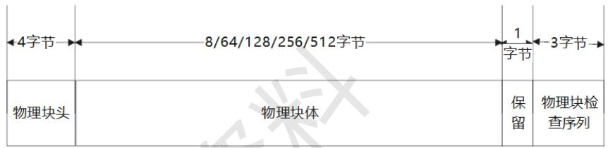  
图9SOF帧物理块格式

物理块体中的信息可以由多个MAC帧聚合得到，若物理块体使用聚合帧方式，单物理块聚合格式如图10所示。

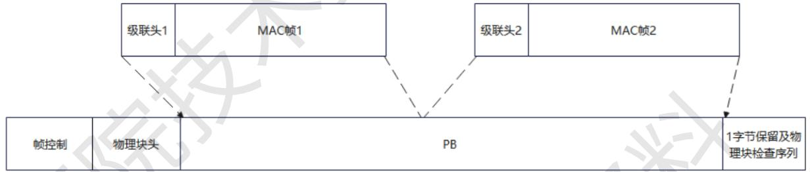  
图10单物理块聚合示意图

多物理块聚合格式如图11所示。

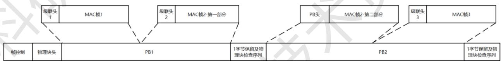  
图11多物理块聚合示意图

无线载荷的物理块格式有6种，物理块的大小可选为16/40/72/136/264/520字节。

每个物理块适配到单个物理层前向纠错编码块。每个物理块包含一个物理块头、物理块体，保留字节和物理块检查序列。物理块头为4个字节，物理块检查序列为3个字节。当物理块是520字节长度时，物理块体长度是512字节；当物理块是264字节长度时，物理块体长度是256字节；当物理块是136字节时，物理块体长度是128字节；当物理块是72字节长度时，物理块体长度是64字节；当物理块是40字节长度时，物理块体长度是32字节；当物理块是16字节长度时，物理块体长度是8字节。

无线物理块的格式如

图12所示。

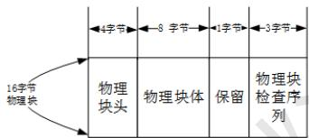

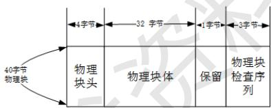

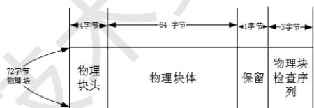

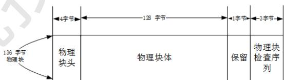

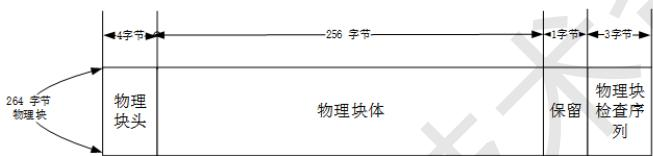

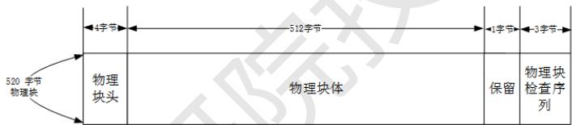  
图12 无线SOF帧物理块格式

# 5.1.3.2.1.1 物理块头

物理块头包含物理块体的属性信息。物理块头的格式如表 47所示。

表 47 物理块头的格式  

<table><tr><td>字段</td><td>字节号</td><td>比特位</td><td>字段大小(比特数)</td></tr><tr><td rowspan="2">序列号</td><td>0</td><td>0-7</td><td rowspan="2">16</td></tr><tr><td>1</td><td>0-7</td></tr><tr><td>聚合标志</td><td>2</td><td>0</td><td>1</td></tr><tr><td rowspan="2">保留</td><td>2</td><td>1-7</td><td rowspan="2">15</td></tr><tr><td>3</td><td>0-7</td></tr></table>

# a) 序列号

序列号是一个16比特的字段，初始值为0，表示MPDU的载荷中物理块的序号。

例如，一个MPDU中，携带了3个物理块，则第一个物理块的物理块头中，序列号的值是0；第二个物理块的物理块头中，序列号的值是1；第三个物理块的物理块头中，序列号的值是2。

# b) 聚合标志

在物理块头中增加“聚合标志”字段，用于指示物理块载荷是否为聚合帧载荷格式。

0表示物理块中只有一个MAC帧，物理块体中没有“级联头”。

1表示物理块中有多个MAC帧，物理块体中有“级联头”。

# 5.1.3.2.1.2 级联头

级联头包含聚合报文中一个MAC帧的属性信息。级联头的格式如表48所示。

表 48 级联头的格式  

<table><tr><td>字段</td><td>字节号</td><td>比特位</td><td>字段大小(比特数)</td></tr><tr><td rowspan="2">级联数据块长度</td><td>0</td><td>0-7</td><td rowspan="2">12</td></tr><tr><td>1</td><td>0-3</td></tr><tr><td>级联块起始标识</td><td>1</td><td>4</td><td>1</td></tr><tr><td>级联块结束标识</td><td>1</td><td>5</td><td>1</td></tr><tr><td>保留</td><td>1</td><td>6-7</td><td>2</td></tr></table>

a) 级联数据块长度

用于表示级联头后的一个MAC帧的总长度，单位：字节。

b) 级联块起始标识

聚合报文中的第一个级联数据块，需设置本字段的值为1；否则，需设置本字段的值为0。

c) 级联块结束标识

聚合报文中的最后一个级联数据块，需设置本字段的值为1；否则，需设置本地址段的值为0。

# 5.1.3.2.1.3 物理块体

物理块体中携带由MSDU所组成的MAC帧的分段，大小为128字节或者512字节。

物理块体中携带由MSDU所组成的MAC帧的分段，当标准版本号为BPLC时，物理块体大小为128字节或者512字节；当标准版本号为SPLC时，物理块体大小为8字节、64字节、128字节、256字节或者512字节，其中16字节物理块定义如表49所示。

表 4916 字节物理块的格式  

<table><tr><td>字段</td><td>字节号</td><td>比特位</td><td>字段大小(比特数)</td><td>说明</td></tr><tr><td rowspan="2">序列号</td><td>0</td><td>0-7</td><td rowspan="2">16</td><td rowspan="2">-</td></tr><tr><td>1</td><td>0-7</td></tr><tr><td rowspan="2">保留</td><td>2</td><td>0-7</td><td rowspan="2">16</td><td rowspan="2">-</td></tr><tr><td>3</td><td>0-7</td></tr><tr><td>报文ID</td><td>4</td><td>0-3</td><td>4</td><td>用于指示物理块体承载的业务数据类型0:DL-OFDMA数据帧的SACK帧其他:保留</td></tr><tr><td rowspan="2">报文内容</td><td>4</td><td>4-7</td><td rowspan="2">60</td><td></td></tr><tr><td>5-11</td><td>0-7</td><td>-</td></tr><tr><td>保留</td><td>12</td><td>0-7</td><td>8</td><td>-</td></tr><tr><td>物理块检查序列</td><td>13-15</td><td>0-7</td><td>24</td><td>物理块检查序列是一个24比特的字段。校验时,以物理块头和物理块体以及保留字节三部分为目标,使用24比特的循环冗余校验算法,进行校验,校验值填充在物理块检查序列的位置。</td></tr></table>

当报文ID为0时，表示DL-OFDMA数据帧的SACK帧，那么其报文内容格式如表50所示。

表 50 DL OFDMA 数据帧的 SACK 帧的报文内容格式  

<table><tr><td>字段</td><td>字节号</td><td>比特位</td><td>字段大小(比特数)</td><td>说明</td></tr><tr><td rowspan="2">源TEI</td><td>4</td><td>4-7</td><td rowspan="2">12</td><td rowspan="2">发送SACK帧的源站点TEI</td></tr><tr><td>5</td><td>0-7</td></tr><tr><td>接收状态</td><td>6</td><td>0-1</td><td>2</td><td>接收状态是一个2比特的字段,用来表示DL_OFDMA数据帧的物理块的校验结果。比特0表示第一个PB块的接收状态,比特1表示第二个PB块的接收状态,其中接收状态的含义:0表示物理块校验失败,1表示物理块校验成功。</td></tr><tr><td>保留</td><td>6</td><td>2-7</td><td rowspan="2">46</td><td>-</td></tr><tr><td>保留</td><td>7-11</td><td>0-7</td><td>-</td></tr></table>

# 5.1.3.2.1.4 物理块检查序列

# Q/XXXXXXXXX-XXX

物理块检查序列是一个24比特的字段。校验时，以物理块头和物理块体以及保留字节三部分为目标，使用24比特的循环冗余校验算法，进行校验，校验值填充在物理块检查序列的位置。

MPDU被接收后，使用每个物理块的物理块检查序列来作校验，校验成功的物理块说明物理传输成功，否则说明物理传输失败。

# 5.1.3.3 信标MPDU帧载荷格式

# 5.1.3.3.1 物理块格式

信标帧的载荷支持一个136字节或者一个520字节长度的物理块。

物理块格式如图13所示。

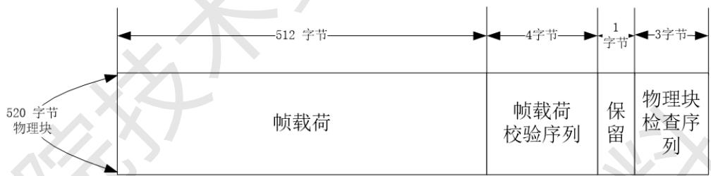

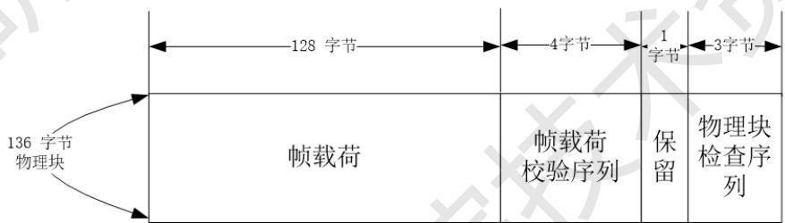  
图13物理块格式

其中，帧载荷校验序列是信标帧载荷内容的校验值，校验的范围是信标物理块的前128字节或者前512字节的内容。帧载荷校验序列使用的是32比特的循环冗余校验算法。

物理块检查序列是一个24比特的字段。校验时，以帧载荷和帧载荷校验序列以及保留字节三部分为目标，使用24比特的循环冗余校验算法，进行校验，校验值填充在物理块检查序列的位置。

无线信标帧的载荷支持一个40字节或者一个136字节或者一个520字节长度的物理块。

物理块格式如图14所示。

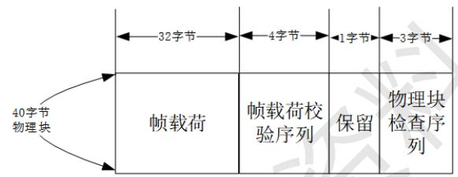

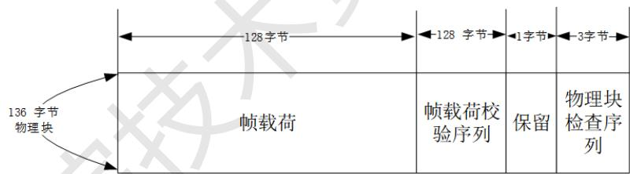

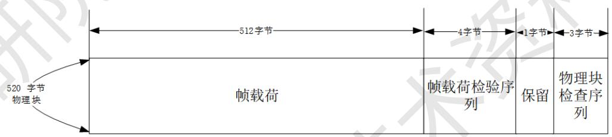  
图14 无线物理块格式

其中，帧载荷校验序列是信标帧载荷内容的校验值，校验的范围是信标物理块的前32字节或者前128字节或者前512字节的内容。帧载荷校验序列使用的是32比特的循环冗余校验算法。

物理块检查序列是一个24比特的字段。校验时，以帧载荷和帧载荷校验序列以及保留字节三部分为目标，使用24比特的循环冗余校验算法，进行校验，校验值填充在物理块检查序列的位置。

# 5.1.3.3.2 帧载荷格式

不同大小的信标帧载荷，采用的调制方式载波映射索引不同。信标帧载荷的发送持续时间依赖于信标帧载荷的OFDM符号数量。信标帧载荷字段的格式如表51所示。

表 51 信标帧载荷字段  

<table><tr><td>字段</td><td>字节号</td><td>比特位</td><td>字段大小（比特）</td><td>说明</td></tr><tr><td>信标类型</td><td>0</td><td>0-2</td><td>3</td><td>0:发现信标1:代理信标2:中央信标其他:保留</td></tr><tr><td>组网标志位</td><td>0</td><td>3</td><td>1</td><td>0:组网未完成1:组网完成</td></tr><tr><td>精简信标标志</td><td>0</td><td>4</td><td>1</td><td>0:标准信标帧1:精简信标帧</td></tr><tr><td>多网络优选功能开关</td><td>0</td><td>5</td><td>1</td><td>0:未使能网络评估1:使能网络评估</td></tr><tr><td>开始关联标志位</td><td>0</td><td>6</td><td>1</td><td>0:不允许站点发起关联请求1:允许站点发起关联请求</td></tr><tr><td>短网络标识高位</td><td>0</td><td>7</td><td>1</td><td>短网络标识的高1bit</td></tr><tr><td>组网序列号</td><td>1</td><td>0-7</td><td>8</td><td>-</td></tr><tr><td>短网络标识低位</td><td>2</td><td>0-3</td><td>4</td><td>短网络标识的低4bit</td></tr><tr><td>本网络无线 option</td><td>2</td><td>4-5</td><td>2</td><td>-</td></tr><tr><td>PLC能力指示</td><td>2</td><td>6~7</td><td>2</td><td>0:本站点支持BPLC;1:本站点支持BPLC和SPLC;其他:保留</td></tr><tr><td>本网络无线信道编号</td><td>3</td><td>0-7</td><td>8</td><td>-</td></tr><tr><td>通道数</td><td>4</td><td>0</td><td>1</td><td>0:本站点为单通道模块;1:本站点为多通道通信模块;</td></tr><tr><td>网络版本号</td><td>4</td><td>1-3</td><td>3</td><td>0:本网络运行BPLC版本协议;1:本网络运行SPLC版本协议;其他:保留</td></tr><tr><td>信标机制状态</td><td>4</td><td>4</td><td>1</td><td>0:集中信标机制1:分散信标机制</td></tr><tr><td>发现信标发送使能标志</td><td>4</td><td>5</td><td>1</td><td>0:分散信标机制下不允许发送发现信标1:分散信标机制下允许发送发现信标</td></tr><tr><td rowspan="2">保留</td><td>4</td><td>6-7</td><td rowspan="2">10</td><td>-</td></tr><tr><td>5</td><td>0-7</td><td>-</td></tr><tr><td>信标管理信息</td><td>6-127或6-511</td><td>0-7</td><td>可变长</td><td>与《计量自动化系统双模通信技术规范第2部分:无线通信接入协议》一致</td></tr><tr><td>帧载荷校验序列</td><td>128-13或512-515</td><td>0-7</td><td>32</td><td>信标帧载荷的32位循环冗余计算结果,循环冗余计算不包括信标帧载荷校验序列</td></tr></table>

# 5.1.3.3.2.1 信标类型

信标类型是一个3比特的字段，标识信标的类型。信标类型的取值和含义如表52所示。

表 52 信标类型  

<table><tr><td>信标类型取值</td><td>定义说明</td></tr><tr><td>0b000</td><td>发现信标</td></tr><tr><td>0b001</td><td>代理信标</td></tr><tr><td>0b010</td><td>中央信标</td></tr><tr><td>0b011-0b111</td><td>保留</td></tr></table>

# 5.1.3.3.2.2 组网标志位

组网标志位是一个1比特字段，标识自组网是否完成。CCO中有STA站点加入网络后，将信标中的组网完成标志设置为未完成。直到没有新的STA站点加入，CCO等待 $4\sim 6$ 个信标周期后，将该标志位设置为组网完成。组网标志位的取值和含义如表53所示。

表 53 组网标志位  

<table><tr><td>组网标志位取值</td><td>定义说明</td></tr><tr><td>0b0</td><td>组网未完成</td></tr><tr><td>0b1</td><td>组网完成</td></tr></table>

# 5.1.3.3.2.3 精简信标标志

精简信标标志是一个1比特字段，标识信标帧的是否为精简信标帧，精简信标标志的取值和含义如表54所示。

表 54 精简信标标志  

<table><tr><td>值</td><td>定义</td></tr><tr><td>0</td><td>标志信标帧</td></tr><tr><td>1</td><td>精简信标帧</td></tr></table>

# 5.1.3.3.2.4 多网络优选标志位

多网络优选标志位是一个1比特字段，表示该宽带载波通信网络中的STA终端在入网时，是否可以进行网络评估，选择信号好的网络加入。

未使用的时候，不进行网络评估，直接向首先发现的网络发起入网申请。使用的时候，STA在入网时可以优先选择此前曾经加入成功过的网络，如果没有，则可选择信号更好的网络加入。多网络优选标志位的取值和含义如表55所示。

表 55 多网络优选标志位  

<table><tr><td>多网络优选标志位取值</td><td>说明</td></tr><tr><td>0b0</td><td>未使能网络评估</td></tr><tr><td>0b1</td><td>使能网络评估</td></tr></table>

# 5.1.3.3.2.5 开始关联标志位

开始关联标志位是一个1比特的字段，表示当前阶段是否允许站点发起关联请求。开始关联标志位的取值和含义如表56所示。

表 56 开始关联标志位  

<table><tr><td>开始关联标志位取值</td><td>说明</td></tr><tr><td>0b0</td><td>不允许站点发起关联请求</td></tr><tr><td>0b1</td><td>允许站点发起关联请求</td></tr></table>

注：本规约的开始关联标志位取值固定为1。

# 5.1.3.3.2.6 短网络标识高位

短网络标识的高1bit部分，与短网络标识低位共同构成5bit的短网络标识。

# 5.1.3.3.2.7 组网序列号

组网序列号是一个8比特的字段，表示当前组网的序列号。该值为顺序递加的值，CCO每次重启后都需要自动加1。

# 5.1.3.3.2.8 短网络标识低位

短网络标识的低4bit部分，短网络标识共5bit，有效取值为1-31，

指短网络标识，用于区分不同的宽带载波通信网络。

每个宽带载波通信网络都应有一个唯一的SNID。

# 5.1.3.3.2.9 本网络无线 option

本网络无线信道编号是指网络中采用的无线option，无线信道编号由CCO决定。

# 5.1.3.3.2.10 本网络无线信道编号

本网络无线信道编号是指网络中采用的无线信道编号，无线信道编号由CCO决定。

# 5.1.3.3.2.11 信标管理信息

信标管理信息是信标帧的可变长字段。信标管理信息字段的格式如表57所示。

表 57 信标管理信息格式  

<table><tr><td>字段</td><td>字节号</td><td>字段大小(字节)</td><td>定义</td></tr><tr><td>信标条目数</td><td>0</td><td>1</td><td>Beacon 条目数</td></tr><tr><td>信标条目头 1</td><td>1</td><td>1</td><td>第一个 Beacon 条目头</td></tr><tr><td>信标条目长度 1</td><td>2</td><td>1</td><td>第一个 Beacon 条目长度 =N(1)</td></tr><tr><td>信标条目 1</td><td></td><td>N(1)</td><td>第一个 Beacon 条目</td></tr><tr><td>信标条目头 L</td><td></td><td>1</td><td>第 L 个 Beacon 条目头</td></tr><tr><td>信标条目长度 L</td><td></td><td>1</td><td>第 L 个 Beacon 条目长度 = N(L)</td></tr><tr><td>信标条目 L</td><td></td><td>N(L)</td><td>第 L 个 Beacon 条目</td></tr></table>

# a) 信标条目数

信标条目数是一个1字节的字段，标识信标帧载荷中存在的总信标条目数。信标条目数的取值和含义如表58所示。

表 58 信标条目数  

<table><tr><td>信标条目数取值</td><td>说明</td></tr><tr><td>0x00-0x02</td><td>保留</td></tr><tr><td>0x03</td><td>存在3个信标条目，如此类推</td></tr></table>

# b) 信标条目头

信标条目头是一个1字节的字段，指示信标条目的类型。信标条目头的取值和格式如表59所示。

表 59 信标条目头  

<table><tr><td>信标条目头的值</td><td>说明</td><td>对应信标条目长度字段大小</td></tr><tr><td>0x00</td><td>非法值</td><td></td></tr><tr><td>0x01</td><td>站点能力条目</td><td>1</td></tr><tr><td>0x02</td><td>时隙分配条目</td><td>2</td></tr><tr><td>0x03</td><td>保留</td><td></td></tr><tr><td>0x04</td><td>保留</td><td></td></tr><tr><td>0x05</td><td>保留</td><td></td></tr><tr><td>0x06</td><td>路由参数条目</td><td>1</td></tr><tr><td>0x07</td><td>频段变更条目</td><td>1</td></tr><tr><td>0x08</td><td>保留</td><td>2</td></tr><tr><td>0x09</td><td>保留</td><td>1</td></tr><tr><td>0x0A</td><td>频段探测条目</td><td>1</td></tr><tr><td>0x0B</td><td>万年历同步条目</td><td>1</td></tr><tr><td>0x0C</td><td>无线路由参数条目</td><td>1</td></tr><tr><td>0x0D</td><td>无线信道变更条目</td><td>1</td></tr><tr><td>0x0E</td><td>精简信标站点信息及时隙条目</td><td>1</td></tr><tr><td>0x0F</td><td>信标机制切换条目</td><td>1</td></tr><tr><td>0x010</td><td>代理角色条目</td><td>2</td></tr><tr><td>0x11-0x7F</td><td>保留</td><td></td></tr><tr><td>0x80-0xEF</td><td>厂家自定义</td><td>1</td></tr><tr><td>0xF0-0xFF</td><td>保留</td><td></td></tr></table>

# c) 信标条目长度

信标条目长度，表示信标条目的长度，单位是字节。根据条目类型的不同，信标条目长度字段的大小不一样，在下文的条目内容中，同时描述了条目头和条目长度字段，条目长度字段的大小会各自描述。信标条目长度的取值和含义如表60所示。

表 60 信标条目长度  

<table><tr><td>信标条目长度取值</td><td>说明</td></tr><tr><td>0x00</td><td>长度为0，如此类推</td></tr></table>

# d) 信标条目

信标条目内容由信标条目头决定。各种信标条目的格式在以下章节分别描述。

# 1）站点能力条目

站点能力条目的格式如表61所示。

表 61 站点能力条目  

<table><tr><td>字段</td><td>字节号</td><td>比特位</td><td>字段大小（比特）</td><td>定义说明</td></tr><tr><td>信标条目头</td><td>0</td><td>0-7</td><td>8</td><td>0x01</td></tr><tr><td>信标条目长度</td><td>1</td><td>0-7</td><td>8</td><td>条目长度，单位byte。固定值：0x16</td></tr><tr><td>层级数</td><td rowspan="2">2</td><td>0-5</td><td>6</td><td>层级数
层级数不大于15</td></tr><tr><td>相线</td><td>6-7</td><td>2</td><td>站点所属相线
相线定义：
0x0: 全相线
0x1: A相线
0x2: B相线
0x3: C相线</td></tr><tr><td rowspan="2">TEI</td><td>3</td><td>0-7</td><td>8</td><td rowspan="2">站点TEI</td></tr><tr><td rowspan="2">4</td><td>0-3</td><td>4</td></tr><tr><td>角色</td><td>4-7</td><td>4</td><td>站点角色
角色定义：
0x0: 未知
0x1: STA
0x2: PCO</td></tr><tr><td></td><td></td><td></td><td></td><td>0x4: CCO
其他: 保留</td></tr><tr><td>信标使用标志位</td><td>5</td><td>0-7</td><td>8</td><td>使用信标评估信道。
值定义:
0x0: 不使用
0x1: 使用</td></tr><tr><td rowspan="6">发送信标站点 MAC 地址</td><td>6</td><td>0-7</td><td rowspan="6">48</td><td rowspan="6">信标发送站点 MAC 地址</td></tr><tr><td>7</td><td>0-7</td></tr><tr><td>8</td><td>0-7</td></tr><tr><td>9</td><td>0-7</td></tr><tr><td>10</td><td>0-7</td></tr><tr><td>11</td><td>0-7</td></tr><tr><td rowspan="2">代理站点 TEI</td><td>12</td><td>0-7</td><td rowspan="2">12</td><td rowspan="2">发送信标站点的代理站点
TEI</td></tr><tr><td rowspan="2">13</td><td>0-3</td></tr><tr><td>链路上 RF 跳数</td><td>4-7</td><td>4</td><td></td></tr><tr><td rowspan="4">路径最低通信成功率</td><td>14</td><td>0-7</td><td rowspan="4">32</td><td rowspan="4">站点到 CCO 整个路径的最
低通信成功率。CCO 时,成
功率为 100%</td></tr><tr><td>15</td><td>0-7</td></tr><tr><td>16</td><td>0-7</td></tr><tr><td>17</td><td>0-7</td></tr><tr><td rowspan="4">保留</td><td>18</td><td>0-7</td><td rowspan="4">32</td><td rowspan="4">保留</td></tr><tr><td>19</td><td>0-7</td></tr><tr><td>20</td><td>0-7</td></tr><tr><td>21</td><td>0-7</td></tr></table>

# 2）时隙分配条目

时隙分配条目的格式如表62所示。

表 62 时隙分配条目  

<table><tr><td>字段</td><td>字节号</td><td>比特位</td><td>字段大小(比特)</td><td>定义说明</td></tr><tr><td>时隙分配条目头</td><td>0</td><td>0-7</td><td>8</td><td>0x02</td></tr><tr><td rowspan="2">时隙分配条目长度</td><td>1</td><td>0-7</td><td rowspan="2">16</td><td rowspan="2">时隙分配条目总长度,单位:字节。可变大小,范围:3-512</td></tr><tr><td>2</td><td>0-7</td></tr><tr><td>非中央信标时隙总数</td><td>3</td><td>0-7</td><td>8</td><td>非中央信标时隙总数</td></tr><tr><td>中央信标时隙总数</td><td>4</td><td>0-7</td><td>8</td><td>中央信标时隙总数</td></tr><tr><td>CSMA时隙支持的相线个数</td><td>5</td><td>0-7</td><td>8</td><td>CSMA时隙支持的相线个数。取值范围:1-3</td></tr><tr><td>代理信标时隙总数</td><td>6</td><td>0-7</td><td>8</td><td>代理信标时隙总数</td></tr><tr><td rowspan="2">信标时隙长度</td><td>7</td><td>0-7</td><td rowspan="2">16</td><td rowspan="2">每个信标时隙占用的时隙长度。单位:100微秒</td></tr><tr><td>8</td><td>0-7</td></tr><tr><td>CSMA时隙大小</td><td>9</td><td>0-7</td><td>8</td><td>CSMA时隙分片的大小。单位:10毫秒</td></tr><tr><td>绑定CSMA时隙相线个数</td><td>10</td><td>0-7</td><td>8</td><td>绑定CSMA时隙支持的相线个数。取值范围:0-3</td></tr><tr><td>绑定CSMA时隙链路标识符</td><td>11</td><td>0-7</td><td>8</td><td>绑定CSMA时隙支持的业务报文lid。</td></tr><tr><td rowspan="2">TDMA时隙长度</td><td>12</td><td>0-7</td><td rowspan="2">16</td><td rowspan="2">TDMA时隙长度。单位:100微秒</td></tr><tr><td>13</td><td>0-7</td></tr><tr><td>TDMA时隙链路标识符</td><td>14</td><td>0-7</td><td>8</td><td>TDMA时隙支持的业务报文lid</td></tr><tr><td rowspan="4">信标周期起始网络基准时</td><td>15</td><td>0-7</td><td rowspan="4">32</td><td rowspan="4">信标周期的开始时刻NTB值。</td></tr><tr><td>16</td><td>0-7</td></tr><tr><td>17</td><td>0-7</td></tr><tr><td>18</td><td>0-7</td></tr><tr><td rowspan="4">信标周期长度</td><td>19</td><td>0-7</td><td rowspan="4">32</td><td rowspan="4">信标周期的时间长度单位:100微秒</td></tr><tr><td>20</td><td>0-7</td></tr><tr><td>21</td><td>0-7</td></tr><tr><td>22</td><td>0-7</td></tr><tr><td rowspan="2">RF信标时隙长度</td><td>22</td><td>0-7</td><td rowspan="2">10</td><td rowspan="2">RF链路上信标时隙长度单位:1毫秒</td></tr><tr><td>23</td><td>0-1</td></tr><tr><td>保留</td><td>23</td><td>2-7</td><td>6</td><td>保留</td></tr><tr><td></td><td>24-26</td><td>0-7</td><td>16</td><td></td></tr><tr><td>非中央信标信息</td><td>可变长</td><td>可变长</td><td></td><td>代理信标和发现信标的信息字段。字段大小是可变长度，根据NonCentralBeaconSlotCount计算字段占用总大小。信息的字段定义，如表63所示。</td></tr><tr><td>CSMA时隙信息</td><td>可变长</td><td>可变长</td><td></td><td>CSMA时隙的信息字段。字段大小是可变长度，根据CsmaSlotPhaseCount计算字段占用总大小。信息字段的定义，如表64所示。</td></tr><tr><td>绑定CSMA时隙信息</td><td>可变长</td><td>可变长</td><td></td><td>绑定CSMA时隙的信息字段。字段大小是可变长度，根据BindCsmaSlotPhaseCout计算字段占用总大小。信息字段的定义，如表65所示。</td></tr></table>

非中央信标信息字段的格式如表63所示。

表 63 非中央信标信息字段  

<table><tr><td>字段</td><td>字节号</td><td>比特位</td><td>字段大小(比特)</td><td>定义说明</td></tr><tr><td rowspan="2">TEI</td><td>0</td><td>0-7</td><td>8</td><td rowspan="2">指定发送信标的站点的 TEI</td></tr><tr><td rowspan="2">1</td><td>0-3</td><td>4</td></tr><tr><td>信标类型</td><td>4</td><td>1</td><td>信标类型0x0: 发现信标0x1: 代理信标</td></tr><tr><td>无线信标标志</td><td></td><td>5-7</td><td>3</td><td>RF 信标发送类型0x00: 仅发送 PLC 信标0x01: 仅发送 RF 标准信标0x02: 发送 PLC 信标,并在该时隙结束后发送 RF 标准信标0x03: 发送 PLC 信标,并在该时隙结束后发送 RF 精简信标0x04: 发送 PLC 信标,并在 CSMA时隙发送 RF 精简信标0x05: 发送 PLC 信标,并在该时隙同步发送 RF 标准信标0x06: 发送 PLC 信标,并在该时隙同步发送 RF 精简信标</td></tr></table>

注：非中央信标信息字段，指明了代理站点和发现站点发送信标的时隙；在中央信标和代理信标中，包含了本字段；  
在发现信标中，为节省报文空间，省略了该字段；省略该字段，不会影响时隙的计算。

CSMA时隙信息字段的格式如表64所示。

表 64 CSMA 时隙信息字段  

<table><tr><td>字段</td><td>字节数</td><td>位数</td><td>字段大小</td><td>定义说明</td></tr><tr><td rowspan="3">CSMA时隙长度</td><td>0</td><td>0-7</td><td rowspan="3">24</td><td rowspan="3">CSMA时隙的长度。单位:100微秒</td></tr><tr><td>1</td><td>0-7</td></tr><tr><td>2</td><td>0-7</td></tr><tr><td>相线</td><td>3</td><td>0-7</td><td>8</td><td>CSMA时隙的相线</td></tr></table>

绑定CSMA时隙信息字段的格式如表65所示。

表 65 绑定 CSMA 时隙信息字段  

<table><tr><td>字段</td><td>字节号</td><td>比特位</td><td>字段大小(比特)</td><td>定义说明</td></tr><tr><td rowspan="3">绑定CSMA时隙长度</td><td>0</td><td>0-7</td><td rowspan="3">24</td><td rowspan="3">绑定CSMA时隙的长度。单位:100微秒</td></tr><tr><td>1</td><td>0-7</td></tr><tr><td>2</td><td>0-7</td></tr><tr><td>相线</td><td>3</td><td>0-7</td><td>8</td><td>绑定CSMA时隙的相线</td></tr></table>

# 3）路由参数通知条目

路由参数通知条目的格式如表66所示。

表 66 路由参数通知条目  

<table><tr><td>字段</td><td>字节号</td><td>比特位</td><td>字段大小(比特)</td><td>定义说明</td></tr><tr><td>路由参数通知条目头</td><td>0</td><td>0-7</td><td>8</td><td>0x06</td></tr><tr><td>路由参数通知条目长度</td><td>1</td><td>0-7</td><td>8</td><td>条目长度,单位byte固定值:0x22</td></tr><tr><td rowspan="2">路由周期</td><td>2</td><td>0-7</td><td rowspan="2">16</td><td rowspan="2">路由周期。表示用于路由评估的时间周期。单位:秒</td></tr><tr><td>3</td><td>0-7</td></tr><tr><td rowspan="2">保留</td><td>4</td><td>0-7</td><td rowspan="2">16</td><td rowspan="2">保留</td></tr><tr><td>5</td><td>0-7</td></tr><tr><td rowspan="2">路由评估剩余时间</td><td>6</td><td>0-7</td><td rowspan="2">16</td><td rowspan="2">距离下次路由评估的剩余时间。单位:秒</td></tr><tr><td>7</td><td>0-7</td></tr><tr><td>保留</td><td>8-27</td><td>0-7</td><td>160</td><td>保留</td></tr><tr><td rowspan="6">CCOMAC 地址</td><td>28</td><td>0-7</td><td rowspan="6">48</td><td rowspan="6">本网络 CCO 的 MAC 地址</td></tr><tr><td>29</td><td>0-7</td></tr><tr><td>30</td><td>0-7</td></tr><tr><td>31</td><td>0-7</td></tr><tr><td>32</td><td>0-7</td></tr><tr><td>33</td><td>0-7</td></tr></table>

# 4）频段变更条目

频段变更条目的格式如表67所示。

表 67 频段变更条目  

<table><tr><td>字段</td><td>字节号</td><td>比特位</td><td>字段大小(比特)</td><td>定义说明</td></tr><tr><td>频段变更条目头</td><td>0</td><td>0-7</td><td>8</td><td>0x07</td></tr><tr><td>频段变更条目长度</td><td>1</td><td>0-7</td><td>8</td><td>条目长度,单位byte固定值:0x07</td></tr><tr><td>目标频段</td><td>2</td><td>0-7</td><td>8</td><td>需要切换到的目标频段值定义:0x00:频段00x01:频段10x02:频段20x03:频段30x04:频段4。其他:保留具体值参考《通感一体化低压电力线宽带载波通信规约第3部分:物理层通信协议》5.1.9.5通信频段表17通信频段</td></tr><tr><td rowspan="4">频段切换剩余时间</td><td>3</td><td>0-7</td><td rowspan="4">32</td><td rowspan="4">距离实施频段切换,剩余的时间长度。单位:毫秒</td></tr><tr><td>4</td><td>0-7</td></tr><tr><td>5</td><td>0-7</td></tr><tr><td>6</td><td>0-7</td></tr></table>

# 5）万年历同步条目

万年历同步条目的格式如表68所示。

表 68 万年历同步条目  

<table><tr><td>字段</td><td>字节号</td><td>比特位</td><td>字段大小(比特)</td><td>定义说明</td></tr><tr><td>时钟同步条目头</td><td>0</td><td>0-7</td><td>8</td><td>0x0B</td></tr><tr><td>时钟同步条目长度</td><td>1</td><td>0-7</td><td>8</td><td>条目总长度,单位:字节,固定长度:0x0A</td></tr><tr><td>CCO万年历</td><td>2-5</td><td>0-31</td><td>32</td><td>以2000年1月1日00:00:00为计数起始点的秒数(BIN)</td></tr><tr><td>CCO万年历NTB</td><td>6-9</td><td>0-31</td><td>32</td><td>CCO万年历对应的NTB</td></tr></table>

# 6）无线路由参数条目

无线路由参数条目的格式如表69所示。

表 69 无线路由参数条目  

<table><tr><td>字段</td><td>字节号</td><td>比特位</td><td>字段大小(比特)</td><td>定义说明</td></tr><tr><td>信标条目头</td><td>0</td><td>0-7</td><td>8</td><td>0x09</td></tr><tr><td>信标条目长度</td><td>1</td><td>0-7</td><td>8</td><td>条目长度,单位byte。固定值:0x04</td></tr><tr><td>无线发现列表周期</td><td>2</td><td>0-7</td><td>8</td><td>无线上发现列表周期长度,单位:1秒。</td></tr><tr><td>无线接收率老化周期个数</td><td>3</td><td>0-7</td><td>8</td><td>无线接收率老化周期个数,单位:无线发现列表周期。</td></tr></table>

# 7） 无线信道变更条目

无线信道变更条目的格式如表70所示。

表 70 无线信道变更条目  

<table><tr><td>字段</td><td>字节号</td><td>比特位</td><td>字段大小(比特)</td><td>定义说明</td></tr><tr><td>信标条目头</td><td>0</td><td>0-7</td><td>8</td><td>0x0A</td></tr><tr><td>信标条目长度</td><td>1</td><td>0-7</td><td>8</td><td>条目长度,单位byte。固定值:0x08</td></tr><tr><td>目标信道编号</td><td>2</td><td>0-7</td><td>8</td><td>需要切换到的目标信道号</td></tr><tr><td>目标信道 option</td><td rowspan="2">3</td><td>0-1</td><td>2</td><td>需要切换到的目标信道 option</td></tr><tr><td>保留</td><td>2-7</td><td>6</td><td>-</td></tr><tr><td>信道切换剩余时间</td><td>4-7</td><td>0-7</td><td>32</td><td>距离实施信道切换的剩余时间,单位:1毫秒。</td></tr></table>

# 8) 信标机制切换条目

信标机制切换条目格式如表71所示。

用于CCO指示全网STA在同一时刻切换至集中信标机制或分散信标机制。当CCO需要进行信标机制切换时，在信标帧中携带信标机制切换条目，约定全网站点在统一时刻进行信标机制切换，信标机制切换条目格式如表71所示。

表 71 信标机制切换条目  

<table><tr><td>字段</td><td>字节号</td><td>比特位</td><td>字段大小(比特)</td><td>定义说明</td></tr><tr><td>信标机制切换条目头</td><td>0</td><td>0-7</td><td>8</td><td>0x0F</td></tr><tr><td>信标机制切换条目长度</td><td>1</td><td>0-7</td><td>8</td><td>条目长度,单位byte固定值:0x7</td></tr><tr><td>切换目标机制ID</td><td>2</td><td>0-7</td><td>8</td><td>0: 集中信标机制1: 分散信标机制其他: 保留</td></tr><tr><td rowspan="4">切换NTB时刻</td><td>3</td><td>0-7</td><td>8</td><td rowspan="4">预定进行切换的NTB时刻</td></tr><tr><td>4</td><td>0-7</td><td>8</td></tr><tr><td>5</td><td>0-7</td><td>8</td></tr><tr><td>6</td><td>0-7</td><td>8</td></tr></table>

# 9）代理角色条目

用于CCO在分散信标机制下，告知全网STA当前代理站点的TEI信息。在分散信标机制下，CCO通过代理角色条目通知网络内代理站点的信息，当网络内代理角色发生变更后，CCO通过信标携带最新的代理角色信息，代理角色条目格式如表72所示。

表 72 代理角色条目  

<table><tr><td>字段</td><td>字节号</td><td>比特位</td><td>字段大小(比特)</td><td>定义说明</td></tr><tr><td>代理角色条目头</td><td>0</td><td>0-7</td><td>8</td><td>0x10</td></tr><tr><td>代理角色条目长度</td><td>1</td><td>0-7</td><td>16</td><td>代理站点刷新条目总长度，单位：字节</td></tr><tr><td></td><td>2</td><td>0-7</td><td></td><td>可变大小</td></tr><tr><td rowspan="2">代理节点1TEI</td><td>3</td><td>0-7</td><td rowspan="2">12</td><td rowspan="2">代理站点1的TEI</td></tr><tr><td>4</td><td>0-3</td></tr><tr><td rowspan="2">代理节点2TEI</td><td>4</td><td>4-7</td><td rowspan="2">12</td><td rowspan="2">代理站点2的TEI</td></tr><tr><td>5</td><td>0-7</td></tr><tr><td>......</td><td></td><td></td><td></td><td>-</td></tr><tr><td rowspan="2">代理节点NTEI</td><td>可变字节</td><td>0-7</td><td>12</td><td rowspan="2">代理站点N的TEI</td></tr><tr><td>可变字节</td><td>0-3</td><td></td></tr><tr><td>保留</td><td>可变字节</td><td>4-7</td><td>4</td><td>若总的代理站点个数为偶数个,则无此保 留位</td></tr></table>

# 5.1.3.3.3 精简信标帧载荷格式

精简信标帧载荷字段的格式如表73所示。信标类型、组网标志位、精简信标标志位、开始关联标志位、信标使用标志位、组网序列号、CCOMAC地址、信标周期计数、信标管理信息字段与标准信标一致。

表 73 精简信标帧载荷字段  

<table><tr><td>字段</td><td>字节号</td><td>比特位</td><td>字段大小(比特)</td></tr><tr><td>信标类型</td><td rowspan="6">0</td><td>0-2</td><td>3</td></tr><tr><td>组网标志位</td><td>3</td><td>1</td></tr><tr><td>精简信标标志</td><td>4</td><td>1</td></tr><tr><td>保留</td><td>5</td><td>1</td></tr><tr><td>开始关联标志位</td><td>6</td><td>1</td></tr><tr><td>信标使用标志位</td><td>7</td><td>1</td></tr><tr><td>组网序列号</td><td>1</td><td>0-7</td><td>8</td></tr><tr><td rowspan="6">CCO MAC 地址</td><td>2</td><td>0-7</td><td rowspan="6">48</td></tr><tr><td>3</td><td>0-7</td></tr><tr><td>4</td><td>0-7</td></tr><tr><td>5</td><td>0-7</td></tr><tr><td>6</td><td>0-7</td></tr><tr><td>7</td><td>0-7</td></tr><tr><td rowspan="4">信标周期计数</td><td>8</td><td>0-7</td><td rowspan="4">32</td></tr><tr><td>9</td><td>0-7</td></tr><tr><td>10</td><td>0-7</td></tr><tr><td>11</td><td>0-7</td></tr><tr><td>信标管理信息</td><td>12-31</td><td>0-7</td><td>可变长</td></tr><tr><td>帧载荷校验序列</td><td>32-35</td><td>0-7</td><td>32</td></tr></table>

精简信标帧载荷中仅定义了精简信标站点信息及时隙条目，格式如表74所示。

表 74 站点能力及时隙条目  

<table><tr><td>字段</td><td>字节号</td><td>比特位</td><td>字段大小(比特)</td><td>定义说明</td></tr><tr><td>信标条目头</td><td>0</td><td>0-7</td><td>8</td><td>0x0E</td></tr><tr><td>信标条目长度</td><td>1</td><td>0-7</td><td>8</td><td>条目长度,单位byte固定值:19</td></tr><tr><td rowspan="2">TEI</td><td>2</td><td>0-7</td><td rowspan="2">12</td><td rowspan="2">发送信标站点的TEI</td></tr><tr><td rowspan="2">3</td><td>0-3</td></tr><tr><td rowspan="2">代理站点 TEI</td><td>4-7</td><td rowspan="2">12</td><td rowspan="2">发送信标站点PCO的TEI</td></tr><tr><td>4</td><td>0-7</td></tr><tr><td>角色</td><td rowspan="2">5</td><td>0-3</td><td>4</td><td>站点角色:0x0:未知;0x1:STA;0x2:PCO;0x4:CCO;其他:保留</td></tr><tr><td>层级数</td><td>4-7</td><td>4</td><td>发送信标站点层级数</td></tr><tr><td rowspan="6">发送信标站点 MAC 地址</td><td>6</td><td>0-7</td><td rowspan="6">48</td><td rowspan="6">发送信标站点 MAC 地址</td></tr><tr><td>7</td><td>0-7</td></tr><tr><td>8</td><td>0-7</td></tr><tr><td>9</td><td>0-7</td></tr><tr><td>10</td><td>0-7</td></tr><tr><td>11</td><td>0-7</td></tr><tr><td>链路上RF跳数</td><td rowspan="3">12</td><td>0-3</td><td>4</td><td>发送信标站点到CCO间的RF链路数</td></tr><tr><td>载波频段</td><td>4-5</td><td>2</td><td>0x00:频段00x01:频段10x02:频段20x03:频段30x04:频段4。其他:保留具体值参考《通感一体化低压电力线宽带载波通信规约第3部分:物理层通信协议》5.1.9.5通信频段表17通信频段</td></tr><tr><td>保留</td><td>6-7</td><td>2</td><td>-</td></tr><tr><td rowspan="4">CSMA时隙开始时间</td><td>13</td><td>0-7</td><td rowspan="4">32</td><td rowspan="4">csma时隙开始时间,单位NTB</td></tr><tr><td>14</td><td>0-7</td></tr><tr><td>15</td><td>0-7</td></tr><tr><td>16</td><td>0-7</td></tr><tr><td rowspan="2">CSMA时隙长度</td><td>17</td><td>0-7</td><td rowspan="2">16</td><td rowspan="2">csma时隙持续时间,单位1ms</td></tr><tr><td>18</td><td>0-7</td></tr></table>

其中载波频段定义如表75所示。

表 75 载波频段  

<table><tr><td>值</td><td>定义</td></tr><tr><td>0</td><td>1.953~11.96</td></tr><tr><td>1</td><td>2.441~5.615</td></tr><tr><td>2</td><td>0.781~2.930</td></tr><tr><td>3</td><td>0.781~11.963</td></tr><tr><td>4</td><td>0.781~5.615</td></tr><tr><td>5</td><td>保留</td></tr><tr><td>6</td><td>保留</td></tr><tr><td>7</td><td>保留</td></tr></table>

# 5.1.3.3.4 信标帧载荷校验序列

信标帧载荷校验序列是一个32比特的字段，用来检查信标帧载荷的完整性。信标帧载荷校验序列是信标帧载荷的32位循环冗余计算结果，循环冗余计算不包括信标帧载荷校验序列。

# 5.1.3.3.5 物理块校验序列

物理块检验序列是一个24比特的字段。校验时，覆盖帧载荷和BPCS信标帧载荷校验序列和保留字节三部分在内，计算出24位循环冗余的校验值，填充在物理块检查序列的最后24比特的位置。一旦MPDU被发送到目的地，每个物理块的物理块检查序列被用来进行校验，校验成功的物理块说明物理传输成功，否则说明物理传输失败。

# 5.1.4 管理消息帧格式

MAC层的管理消息报文，使用长帧头格式的MSDU进行封装，使用BPLC发送。

管理消息报文头的定义如表76所示。

表 76 管理消息报文头格式

表 77 管理消息类型  

<table><tr><td>字段</td><td>字节号</td><td>字段大小(字节)</td></tr><tr><td>原始目的地址</td><td>0-5</td><td>6</td></tr><tr><td>原始源地址</td><td>6-11</td><td>6</td></tr><tr><td>虚拟局域网标签</td><td>12-15</td><td>4</td></tr><tr><td>MSDU帧类型</td><td>16-17</td><td>2</td></tr><tr><td>管理消息版本</td><td>18</td><td>1</td></tr><tr><td>管理消息类型</td><td>19-20</td><td>2</td></tr><tr><td>保留</td><td>21-23</td><td>3</td></tr></table>

管理消息类型（MMTYPE）的定义如表77所示。

<table><tr><td>管理消息名称</td><td>管理消息类型标识符</td></tr><tr><td>关联请求（MMeAssocReq）</td><td>0x0030</td></tr><tr><td>关联确认（MMeAssocCnf）</td><td>0x0031</td></tr><tr><td>代理变更请求（MMeChangeProxyReq）</td><td>0x0032</td></tr><tr><td>关联指示（MMeAssocInd）</td><td>0x0034</td></tr><tr><td>代理变更确认（MMeChangeProxyCnf）</td><td>0x0037</td></tr><tr><td>关联汇总指示（MMeAssocGatherInd）</td><td>0x003A</td></tr><tr><td>代理变更确认（MMeChangeProxyBitMapCnf）</td><td>0x003B</td></tr><tr><td>离线指示（MMeLeaveInd）</td><td>0x0049</td></tr><tr><td>心跳检测（MMeHeartBeatCheck）</td><td>0x0051</td></tr><tr><td>发现列表（MMeDiscoverNodeList）</td><td>0x0055</td></tr><tr><td>延迟离线指示（MMeDelayLeaveInd）</td><td>0x005D</td></tr><tr><td>通信成功率上报（MMeSuccessRateReport）</td><td>0x005E</td></tr><tr><td>网络冲突上报报文（MMeNetworkConflictReport）</td><td>0x005F</td></tr><tr><td>过零NTB采集指示（MMeZeroCrossNTBCollectInd）</td><td>0x0062</td></tr><tr><td>过零NTB上报（MMeZeroCrossNTBReport）</td><td>0x0063</td></tr><tr><td>网络诊断报文（MMeDiagnose）</td><td>0x0064</td></tr><tr><td>无线信道冲突上报（MMeRFChannelConflictReport）</td><td>0x0070</td></tr><tr><td>Bitloading训练结果更新请求</td><td>0x0080</td></tr><tr><td>Bitloading训练结果更新确认</td><td>0x0081</td></tr><tr><td>RU_SNR信息告知</td><td>0x0082</td></tr><tr><td>站点TEI列表请求</td><td>0x0083</td></tr><tr><td>站点TEI列表回复</td><td>0x0084</td></tr><tr><td>扩展网络冲突上报报文</td><td>0x0085</td></tr></table>

# 5.1.4.1 关联请求报文

关联请求报文（MMeAssocReq）格式的定义如表78所示。

表 78 关联请求报文格式  

<table><tr><td>字段</td><td>字节号</td><td>字段大小(比特)</td><td>说明</td></tr><tr><td>站点MAC地址</td><td>0-5</td><td>48</td><td>-</td></tr><tr><td rowspan="5">代理TEI</td><td>6-7</td><td>16</td><td>-</td></tr><tr><td>8-9</td><td>16</td><td>-</td></tr><tr><td>10-11</td><td>16</td><td>-</td></tr><tr><td>12-13</td><td>16</td><td>-</td></tr><tr><td>14-15</td><td>16</td><td>-</td></tr><tr><td rowspan="3">相线</td><td>16</td><td>8</td><td>-</td></tr><tr><td>17</td><td>8</td><td>-</td></tr><tr><td>18</td><td>8</td><td>-</td></tr><tr><td>设备类型</td><td>19</td><td>8</td><td>-</td></tr><tr><td>保留</td><td>20</td><td>8</td><td>-</td></tr><tr><td>扩展特性标识</td><td>21</td><td>8</td><td>bit0置1:指示模块支持应用层多帧抄读;其他:保留;</td></tr><tr><td>MAC地址类型</td><td>22</td><td>8</td><td>-</td></tr><tr><td>模块类型</td><td rowspan="7">23</td><td>2</td><td>-</td></tr><tr><td>候选代理0链路类型</td><td>1</td><td>-</td></tr><tr><td>候选代理1链路类型</td><td>1</td><td>-</td></tr><tr><td>候选代理2链路类型</td><td>1</td><td>-</td></tr><tr><td>候选代理3链路类型</td><td>1</td><td>-</td></tr><tr><td>候选代理4链路类型</td><td>1</td><td>-</td></tr><tr><td>保留</td><td>1</td><td>-</td></tr><tr><td>站点关联随机数</td><td>24-27</td><td>32</td><td>-</td></tr><tr><td>厂家附加数据</td><td>28-45</td><td>144</td><td>-</td></tr><tr><td>版本信息</td><td>46-55</td><td>80</td><td>-</td></tr><tr><td>硬复位累积次数</td><td>56-57</td><td>16</td><td>-</td></tr><tr><td>软复位累积次数</td><td>58-59</td><td>16</td><td>-</td></tr><tr><td>代理类型</td><td>60</td><td>8</td><td>-</td></tr><tr><td>组网序列号</td><td>61</td><td>8</td><td>-</td></tr><tr><td>保留</td><td rowspan="4">62</td><td>1</td><td>-</td></tr><tr><td>管理消息版本</td><td>4</td><td>-</td></tr><tr><td>PLC能力指示</td><td>2</td><td>0:本站点支持BPLC版本;1:本站点支持BPLC版本和SPLC版本;其他:保留</td></tr><tr><td>通道数</td><td>1</td><td>0:单通道;1:多通道;</td></tr><tr><td>支持频段标识</td><td rowspan="2">63</td><td>2</td><td>-</td></tr><tr><td>保留</td><td>6</td><td>-</td></tr><tr><td>端到端序列号</td><td>64-67</td><td>32</td><td>-</td></tr></table>

# 5.1.4.1.1 站点MAC地址

表示发起关联请求的终端设备地址，长度为6字节。

# 5.1.4.1.2 代理TEI

包含了候选代理站点列表，最多支持携带5个候选代理站点的TEI。

# 5.1.4.1.3 链路类型

表示发送关联请求站点与候选代理的通信链路类型，链路类型值定义如表79所示。

表 79 链路类型值  

<table><tr><td>值</td><td>定义</td></tr><tr><td>0</td><td>高速载波链路</td></tr><tr><td>1</td><td>无线链路</td></tr></table>

# 5.1.4.1.4 相线

表示本站点的所属相线的评估结果，最低字节存放评估出的所属相线，其他字节依次填入可能的备选相位，相线的值定义如表80所示。

表 80 相线值  

<table><tr><td>值</td><td>定义</td></tr><tr><td>0</td><td>表示未知相线</td></tr><tr><td>1</td><td>表示A相线</td></tr><tr><td>2</td><td>表示B相线</td></tr><tr><td>3</td><td>表示C相线</td></tr></table>

# 5.1.4.1.5 设备类型

表示设备的类型，定义如表81所示。

表 81 设备类型字段  

<table><tr><td>值</td><td>定义</td></tr><tr><td>0x01</td><td>抄控器</td></tr><tr><td>0x02</td><td>集中器通信模块</td></tr><tr><td>0x03</td><td>单相电表通信模块</td></tr><tr><td>0x04</td><td>中继器</td></tr><tr><td>0x05</td><td>II型采集器</td></tr><tr><td>0x06</td><td>I型采集器</td></tr><tr><td>0x07</td><td>三相表通信模块</td></tr><tr><td>0x08-0xFF</td><td>保留</td></tr></table>

# 5.1.4.1.6 扩展特性版本号

表示节点支持的扩展特性，定义如表82所示。

表 82 扩展特性版本号字段

表 83 MAC 地址类型字段  

<table><tr><td>值</td><td>定义</td></tr><tr><td>其它</td><td>保留</td></tr><tr><td>0x1</td><td>指示模块支持应用层多帧抄读;</td></tr></table>

# 5.1.4.1.7 MAC地址类型

表示关联入网时使用的MAC地址的来源，定义如表83所示。

<table><tr><td>值</td><td>定义</td></tr><tr><td>0x0</td><td>电能表地址作为入网MAC地址，应用于电表场景；</td></tr><tr><td>0x1</td><td>通信模块本身的MAC地址作为入网MAC地址，应用于其他异常场景，如获取电表地址失败。</td></tr><tr><td>0x2</td><td>采集器地址作为入网MAC地址，应用于I型采集器及II型采集器场景。</td></tr></table>

# 5.1.4.1.8 模块类型

表示发送关联请求站点通信模块的类型，定义如表 84所示。

表 84 模块类型值  

<table><tr><td>值</td><td>定义</td></tr><tr><td>0</td><td>HPLC单模模块</td></tr><tr><td>1</td><td>双模HPLC和RF模块</td></tr><tr><td>2</td><td>无线单模模块</td></tr></table>

# 5.1.4.1.9 站点关联随机数

表示模块关联入网的随机数，设备出厂后，初次上电时会自动获取一个32比特的随机值作为关联随机数，后续掉电后再上电，不再重新获取。

# 5.1.4.1.10 版本信息

表示站点的软硬件版本信息，定义如表85所示。

表 85 站点版本信息字段  

<table><tr><td>字段</td><td>字节号</td><td>字段大小(字节)</td></tr><tr><td>系统启动原因</td><td>0</td><td>1</td></tr><tr><td>BOOT 版本号</td><td>1</td><td>1</td></tr><tr><td>软件版本号</td><td>2-3</td><td>2</td></tr><tr><td>版本时间</td><td>4-5</td><td>2</td></tr><tr><td>厂商代码</td><td>6-7</td><td>2</td></tr><tr><td>芯片代码</td><td>8-9</td><td>2</td></tr></table>

# 5.1.4.1.10.1 系统启动原因

系统启动原因定义如表86所示。

表 86 系统启动原因  

<table><tr><td>值</td><td>定义</td></tr><tr><td>0x0</td><td>正常重启</td></tr><tr><td>其他</td><td>保留</td></tr></table>

# 5.1.4.1.10.2 BOOT 版本号

BOOT版本号使用BCD码表示。

# 5.1.4.1.10.3 软件版本号

软件版本号使用BCD码表示。

# 5.1.4.1.10.4 版本时间

版本时间，使用BIN码表示，具体表示方法如表87所示。

表 87 版本时间  

<table><tr><td>字段</td><td>字节号</td><td>比特号</td><td>字段大小(比特)</td></tr><tr><td>年</td><td>0</td><td>0-6</td><td>7</td></tr><tr><td rowspan="2">月</td><td>0</td><td>7</td><td rowspan="2">4</td></tr><tr><td>1</td><td>0-2</td></tr><tr><td>日</td><td>1</td><td>3-7</td><td>5</td></tr></table>

# 5.1.4.1.10.5 厂商代码

厂商代码，使用ASCII码表示。

# 5.1.4.1.10.6 芯片代码

芯片代码，使用ASCII码表示。

# 5.1.4.1.11 硬复位累积次数

记录设备的硬件复位的累计次数。

# 5.1.4.1.12 软复位累积次数

记录设备的软件复位的累计次数。

# 5.1.4.1.13 代理类型

表示代理站点的类型，定义如表88所示。

表 88 代理类型  

<table><tr><td>值</td><td>定义</td></tr><tr><td>0x1</td><td>保留。</td></tr><tr><td>0x2</td><td>表示是站点自己动态选择的代理。</td></tr></table>

# 5.1.4.1.14 组网序列号

表示关联请求报文产生时的组网序列号。

# 5.1.4.1.15 管理消息版本

表示网络管理消息的版本号。

本版本的管理消息版本号固定为1。

# 5.1.4.1.16 PLC能力指示

表示本节点支持的PLC版本。定义如表89所示，

表 89 PLC 能力指示类型  

<table><tr><td>值</td><td>定义</td></tr><tr><td>0x0</td><td>本站点支持BPLC版本</td></tr><tr><td>0x1</td><td>本站点支持BPLC版本和SPLC版本</td></tr></table>

# 5.1.4.1.17 通道数

表示本节点支持的通道个数。定义如表 90所示。

表 90 通道数类型  

<table><tr><td>值</td><td>定义</td></tr><tr><td>0x0</td><td>单通道</td></tr><tr><td>0x1</td><td>多通道</td></tr></table>

# 5.1.4.1.18 支持频段标识

支持频段如表91所示。

表 91 频段标识  

<table><tr><td>值</td><td>定义</td></tr><tr><td>0x0</td><td>表示仅支持频段0和频段1。</td></tr><tr><td>0x1</td><td>PLC能力指示类型为0时,表示支持频段0、频段1、频段2。PLC能力指示类型为1时,表示支持频段0、频段1、频段2、频段3、频段4。</td></tr></table>

# 5.1.4.1.19 端到端序列号

表示端到端的管理消息序列号。请求入网的站点，在产生关联请求报文时，需要获取一个序列号，CCO在确认关联入网时，需要在确认报文中携带关联请求报文中的端到端管理报文序列号。

# 5.1.4.2 关联确认报文

关联确认报文（MMeAssocCnf）格式的定义如表92所示。

表 92 关联确认报文格式  

<table><tr><td>字段</td><td>字节号</td><td>字段大小(字节)</td></tr><tr><td>站点MAC地址</td><td>0-5</td><td>6</td></tr><tr><td>结果</td><td>6</td><td>1</td></tr><tr><td>站点层级</td><td>7</td><td>1</td></tr><tr><td>站点TEI</td><td>8-9</td><td>2</td></tr><tr><td>代理TEI</td><td>10-11</td><td>2</td></tr><tr><td>总分包数</td><td>12</td><td>1</td></tr><tr><td>分包序号</td><td>13</td><td>1</td></tr><tr><td>最后一个分包标识</td><td>14</td><td>1</td></tr><tr><td>链路类型</td><td rowspan="3">15</td><td>1bit</td></tr><tr><td>载波频段</td><td>3bit</td></tr><tr><td>保留</td><td>4bis</td></tr><tr><td>站点关联随机数</td><td>16-19</td><td>4</td></tr><tr><td>重新关联时间</td><td>20-23</td><td>4</td></tr><tr><td>端到端序列号</td><td>24-27</td><td>4</td></tr><tr><td>路径序号</td><td>28-31</td><td>4</td></tr><tr><td>组网序列号</td><td>32</td><td>1</td></tr><tr><td>管理消息版本</td><td rowspan="3">33</td><td>bit0-bit3</td></tr><tr><td>探测频段标识符</td><td>bit4</td></tr><tr><td>保留</td><td>bit5-bit7</td></tr><tr><td rowspan="2">保留</td><td>34</td><td>2</td></tr><tr><td>35</td><td></td></tr><tr><td>路由表信息</td><td>可变</td><td>可变长</td></tr></table>

# 5.1.4.2.1 站点MAC地址

用来标识关联确认报文的目的终端设备地址。

# 5.1.4.2.2 结果

关联请求的确认结果，定义如表93所示。

表 93 关联请求的确认结果  

<table><tr><td>值</td><td>定义</td></tr><tr><td>0x00</td><td>表示关联请求成功</td></tr><tr><td>0x01</td><td>表示该站点不在白名单中</td></tr><tr><td>0x02</td><td>保留</td></tr><tr><td>0x03</td><td>表示加入的站点个数超过上限</td></tr><tr><td>0x04</td><td>表示没有设置白名单列表</td></tr><tr><td>0x05</td><td>表示代理站点个数超过上限</td></tr><tr><td>0x06</td><td>表示子站点个数超过上限</td></tr><tr><td>0x07</td><td>保留</td></tr><tr><td>0x08</td><td>表示重复的MAC地址</td></tr><tr><td>0x09</td><td>表示超过拓扑层级</td></tr><tr><td>0x0A</td><td>表示站点再次关联请求入网成功</td></tr><tr><td>0x0B</td><td>表示新的站点试图以自己的子站点为代理来入网</td></tr><tr><td>0x0C</td><td>表示组网拓扑中存在环路</td></tr><tr><td>0x0D</td><td>表示CCO端未知原因出错</td></tr></table>

# 5.1.4.2.3 站点层级

表示新入网站点所属的网络层级。

# 5.1.4.2.4 站点TEI

CCO在确认该站点可以入网后，为该站点分配的设备标识TEI。

# 5.1.4.2.5 链路类型

表示代理与关联确认目标站点的通信链路类型，链路类型值定义如表94所示。

表 94 链路类型值  

<table><tr><td>值</td><td>定义</td></tr><tr><td>0</td><td>高速载波链路</td></tr><tr><td>1</td><td>无线链路</td></tr></table>

# 5.1.4.2.6 载波频段

表示网络采用的载波频段，载波频段值定义如表95所示。

表 95 载波频段值  

<table><tr><td>值</td><td>定义</td></tr><tr><td>0</td><td>1.953~11.96</td></tr><tr><td>1</td><td>2.441~5.615</td></tr><tr><td>2</td><td>0.781~2.930</td></tr><tr><td>3</td><td>0.781~11.963</td></tr><tr><td>4</td><td>0.781~5.615</td></tr><tr><td>5</td><td>保留</td></tr><tr><td>6</td><td>保留</td></tr><tr><td>7</td><td>保留</td></tr></table>

# 5.1.4.2.7 代理TEI

CCO为该站点选定的代理站点的设备标识TEI。

# 5.1.4.2.8 总分包数

表示关联回复消息报文分包后，分包的总个数。

# 5.1.4.2.9 分包序号

表示关联确认报文分包的索引值。当关联确认报文需要分割发送时，每个分割后的分包都被分配一个递增的索引值，第一个分包的索引值为1。

# 5.1.4.2.10 最后一个分包标识

表示当前报文，是否为最后一个分包报文，定义如表96所示。

表 96 最后一个分包标识字段  

<table><tr><td>值</td><td>定义</td></tr><tr><td>0</td><td>不是最后一个分包</td></tr><tr><td>1</td><td>是最后一个分包</td></tr></table>

# 5.1.4.2.11 站点关联随机数

表示站点关联请求随机数，是请求入网的站点在发送的关联请求报文中携带的站点关联随机数。

# 5.1.4.2.12 重新关联时间

表示STA站点可以重新发起关联请求的时间间隔。当STA的关联请求被CCO拒绝后，CCO会通知STA站点下次可以重新向本网络发起关联请求的间隔时间。单位：毫秒。

# 5.1.4.2.13 端到端序列号

表示端到端管理报文序列号，当STA向CCO发起一次入网关联请求时，获取一个端到端管理报文序列号。

CCO在处理入网关联请求时，在发送的关联确认报文中，需要携带原始关联请求报文的端到端管理报文序列号。

# 5.1.4.2.14 路径序号

表示路径通知序列号。

在关联确认报文中，会携带路由路径信息。CCO每次发送关联确认报文时，需要获取一个路径通知序列号，获取的路径序列号是递加的。如发送第一个关联确认报文时，取值为0，则发送第二个关联确认报文时，取值为1，以此类推。

代理站点或者STA，在刷新路由表项时，需要判断路径序列号是否为最新的。

# 5.1.4.2.15 组网序列号

表示组网序列号，携带的是本关联确认消息所回应的关联请求消息中的组网序列号。

# 5.1.4.2.16 管理消息版本

表示网络管理消息的版本号。本版本的管理消息版本号固定为1。

# 5.1.4.2.17 探测频段标识符

表示关联指示是否在探测频段上发送，0表示非探测频段，即关联指示在工作频段上发送，1.表示探测频段，即关联指示在探测频段上发送。

关联节点选择的代理节点接收到“关联确认报文”后，若“探测频段标识符”为1，则生成“关联指示报文”后，在频段1上发送“关联指示报文”。

注：若不支持频段2的节点，在探测频段上发起关联，并且该节点不在网络白名单中，当前的协议不支持CCO回复拒绝，会导致该节点需要关联超时后，才能选择其他网络接入，影响关联效率。

# 5.1.4.2.18 路由表信息

CCO在关联确认报文中会携带与关联入网站点相关的路由信息。该信息中包括新入网站点的所有直连STA站点和直连代理站点以及代理站点的所有子站点。路由表信息字段的定义如表97所示。

表 97 路由信息字段  

<table><tr><td>字段</td><td>字节号</td><td>字段大小(字节)</td><td>定义</td></tr><tr><td>直连站点数</td><td>0-1</td><td>2</td><td>新入网站点的直连STA站点个数</td></tr><tr><td>直连代理数</td><td>2-3</td><td>2</td><td>新入网站点的直连代理站点个数</td></tr><tr><td>路由表大小</td><td>4-5</td><td>2</td><td>路由信息表大小，取值为路由表总长度/2</td></tr><tr><td>保留</td><td>6-7</td><td>2</td><td>保留位</td></tr><tr><td>路由表</td><td>可变</td><td>可变长</td><td>记录直连子站点信息总长度可变，具体参照Table</td></tr><tr><td></td><td></td><td></td><td>定义。</td></tr></table>

路由表的定义如表98所示。

表 98 子站点表  

<table><tr><td>字段</td><td>字节号</td><td>字段大小(字节)</td><td>定义</td></tr><tr><td rowspan="2">直连站点[0]</td><td>0</td><td rowspan="2">12bit</td><td rowspan="2">直连 STA 的 TEI</td></tr><tr><td rowspan="3">1</td></tr><tr><td>链路类型</td><td>1bit</td><td>与直连站点的链路类型</td></tr><tr><td>保留</td><td>3bit</td><td>保留</td></tr><tr><td rowspan="2">直连站点[1]</td><td>2</td><td>12bit</td><td>直连 STA 的 TEI</td></tr><tr><td rowspan="2">3</td><td>1bit</td><td>与直连站点的链路类型</td></tr><tr><td>链路类型</td><td>3bit</td><td>保留</td></tr><tr><td>...</td><td>...</td><td>2</td><td>直连 STA 的 TEI</td></tr><tr><td>直连站点[N-1]</td><td>2(N-1)-(2N-1)</td><td>2</td><td>直连 STA 的 TEI。N=直连站点数。</td></tr><tr><td>链路类型</td><td></td><td>1bit</td><td>与直连站点的链路类型</td></tr><tr><td>保留</td><td></td><td>3bit</td><td>保留</td></tr><tr><td rowspan="2">直连代理[0]</td><td>0</td><td>12bit</td><td>直连代理 PCO 的 TEI</td></tr><tr><td rowspan="2">1</td><td>1bit</td><td>与直连代理的链路类型</td></tr><tr><td>链路类型</td><td>3bit</td><td>保留</td></tr><tr><td>...</td><td>...</td><td>2</td><td>该PCO下所有子站点的个数。</td></tr><tr><td>子站点[0]</td><td></td><td></td><td>该PCO下子站点的TEI。</td></tr><tr><td>子站点[1]</td><td></td><td></td><td>该PCO下子站点的TEI。</td></tr><tr><td>...</td><td>...</td><td>...</td><td>该PCO下子站点的TEI。</td></tr><tr><td>子站点[M0-1]</td><td></td><td></td><td>该PCO下子站点的TEI。</td></tr><tr><td rowspan="2">直连代理[1]</td><td>0</td><td>12bit</td><td>直连代理 PCO 的 TEI</td></tr><tr><td rowspan="2">1</td><td>1bit</td><td>与直连代理的链路类型</td></tr><tr><td>链路类型</td><td>3bit</td><td>保留</td></tr><tr><td>...</td><td>...</td><td>...</td><td>该PCO下所有子站点的个数。</td></tr><tr><td>子站点[0]</td><td></td><td></td><td>该PCO下子站点的TEI。</td></tr><tr><td>子站点[1]</td><td></td><td></td><td>该PCO下子站点的TEI。</td></tr><tr><td>...</td><td>...</td><td>...</td><td>该PCO下子站点的TEI。</td></tr><tr><td>子站点[M1-1]</td><td></td><td></td><td>该PCO下子站点的TEI。</td></tr><tr><td>...</td><td>...</td><td>...</td><td>...</td></tr><tr><td rowspan="2">直连代理[S]</td><td>0</td><td rowspan="2">12bit</td><td rowspan="2">直连代理 PCO 的 TEIS = 直连代理站点数</td></tr><tr><td rowspan="3">1</td></tr><tr><td>链路类型</td><td>1bit</td><td>与直连代理的链路类型</td></tr><tr><td>保留</td><td>3bit</td><td>保留</td></tr><tr><td>该代理下子站点数</td><td>2-3</td><td>2</td><td>该PCO下所有子站点的个数。</td></tr><tr><td>子站点[0]</td><td></td><td></td><td>该PCO下子站点的TEI。</td></tr><tr><td>子站点[1]</td><td></td><td></td><td>该PCO下子站点的TEI。</td></tr><tr><td>...</td><td>...</td><td>...</td><td>该PCO下子站点的TEI。</td></tr><tr><td>子站点[MS-1]</td><td></td><td></td><td>该PCO下子站点的TEI。</td></tr></table>

注：M0，M1，...，MS，分别指直连代理[0]、直连代理[1]、...、直连代理[S]在本包中携带的所有子站点（包括STA和PCO）个数。  
当路由表过大，不能在一个报文中完成传输时，需要对路由表进行分包传输。  
分包规则：  
每个分包中都有一个路由信息字段和子站点表，路由信息字段的内容指的是当前分包中的子站点表的信息，每一个分包的路由表项都要保证能够无歧义解析。

所有分包中，需要顺序先传输直连子站点，直连子站点未满一个分包，可继续传输直连代理子站点及其子站点；如果一个代理站点的子站点数量过大，需要多个分包时，每个分包的第一个表项应填写该代理子站点，第二表项填写该分包中该代理站点子站点的数量，即所有分包中传输直连代理站点及其子站点时，应保证如下格式顺序：直连代理站点TEI，该代理站点下子站点数量，子站点TEI。

为了提高通信可靠性，需按单个PB块进行分包，不允许一个分包出现多个PB块。

# 5.1.4.3 关联指示报文

关联指示报文（MMeAssocInd）格式的定义如表99所示。

表 99 关联指示报文格式  

<table><tr><td>字段</td><td>字节号</td><td>字段大小(字节)</td></tr><tr><td>结果</td><td>0</td><td>1</td></tr><tr><td>站点层级</td><td>1</td><td>1</td></tr><tr><td>站点MAC地址</td><td>2-7</td><td>6</td></tr><tr><td>CCOMAC地址</td><td>8-13</td><td>6</td></tr><tr><td>站点TEI</td><td>14-15</td><td>2</td></tr><tr><td>代理TEI</td><td>16-17</td><td>2</td></tr><tr><td>链路类型</td><td rowspan="3">18</td><td>1bit</td></tr><tr><td>载波频段</td><td>3bit</td></tr><tr><td>保留</td><td>4bit</td></tr><tr><td rowspan="2">保留</td><td>19</td><td rowspan="2">2</td></tr><tr><td>20</td></tr><tr><td>分包序号</td><td>21</td><td>1</td></tr><tr><td>总分包数</td><td>22</td><td>1</td></tr><tr><td>最后一个分包标识</td><td>23</td><td>1</td></tr><tr><td>站点关联随机数</td><td>24-27</td><td>4</td></tr><tr><td>保留</td><td>28-44</td><td>17</td></tr><tr><td>组网序列号</td><td>45</td><td>1</td></tr><tr><td rowspan="2">保留</td><td>46</td><td rowspan="2">2</td></tr><tr><td>47</td></tr><tr><td>重新关联时间</td><td>48-51</td><td>4</td></tr><tr><td>端到端序列号</td><td>52-55</td><td>4</td></tr><tr><td>保留</td><td>56-63</td><td>8</td></tr><tr><td>路由表信息</td><td>可变</td><td>可变长</td></tr></table>

关联指示报文的MAC帧的目的TEI应填写目的站点的TEI。未入网STA需处理目的MAC地址与其一致的单播关联指示报文。

# 5.1.4.3.1 结果

关联请求的确认结果，确认结果定义如表100所示。

表 100 关联请求的确认结果  

<table><tr><td>值</td><td>定义</td></tr><tr><td>0x00</td><td>表示关联请求成功</td></tr><tr><td>0x01</td><td>表示该站点不在白名单中</td></tr><tr><td>0x02</td><td>保留</td></tr><tr><td>0x03</td><td>表示加入的站点个数超过上限</td></tr><tr><td>0x04</td><td>表示没有设置白名单列表</td></tr><tr><td>0x05</td><td>表示代理站点个数超过上限</td></tr><tr><td>0x06</td><td>表示子站点个数超过上限</td></tr><tr><td>0x07</td><td>表示没有回复</td></tr><tr><td>0x08</td><td>表示重复的MAC地址</td></tr><tr><td>0x09</td><td>表示超过拓扑层级</td></tr><tr><td>0x0A</td><td>表示曾经入网的站点再次入网</td></tr><tr><td>0x0B</td><td>表示新的站点试图以自己的子站点为代理来入网</td></tr><tr><td>0x0C</td><td>表示组网拓扑中存在环路</td></tr><tr><td>0x0D</td><td>表示CCO端未知原因出错</td></tr></table>

# 5.1.4.3.2 站点层级

表示新入网站点所属的网络层级。

# 5.1.4.3.3 站点MAC地址

表示新入网站点的MAC地址。

# 5.1.4.3.4 CC0 MAC 地址

表示本网络的CCO的MAC地址。

# 5.1.4.3.5 站点TEI

表示STA站点的设备标识，是在CCO确认该STA可以入网后，由CCO分配的TEI。

# 5.1.4.3.6 代理TEI

表示代理站点的设备标识，为该新入网STA站点的代理站点的TEI。

# 5.1.4.3.7 分包序号

表示关联指示消息的分包索引。当关联指示报文需要分割发送时，每个分割后的分包都被分配一个递增的索引值，第一个分包的索引值为1。

# 5.1.4.3.8 总分包数

表示关联指示报文的总的分包数。

# 5.1.4.3.9 最后一个分包标识

指示当前分包报文是否为所有分包中的最后一个分包报文，定义如表101所示。

表 101 最后一个分包标识字段  

<table><tr><td>值</td><td>定义</td></tr><tr><td>0x0</td><td>不是最后一个分包</td></tr><tr><td>0x1</td><td>是最后一个分包</td></tr></table>

# 5.1.4.3.10 站点关联随机数

表示站点关联请求随机数，是请求入网的站点在关联请求报文中携带的站点关联随机数。

# 5.1.4.3.11 组网序列号

表示组网序列号，是关联确认报文所回应的关联请求报文中的组网序列号。

# 5.1.4.3.12 重新关联时间

表示STA站点可以重新发起关联请求的时间间隔。当STA的关联请求被CCO拒绝后，CCO会通知STA站点下次可以重新发起关联请求的间隔时间。单位：毫秒。

# 5.1.4.3.13 端到端序列号

表示端到端管理报文序列号。当STA向CCO发起一次入网关联请求时，获取一个端到端管理报文序列号。PCO在发送的关联指示报文中，需要携带原始关联请求报文的端到端管理报文序列号。

# 5.1.4.3.14 路由表信息

参照5.1.4.2.18 路由表信息。

# 5.1.4.4 关联汇总指示报文

关联汇总指示报文（MMeAssocGatherInd）格式的定义如表102所示。

表 102 关联汇总指示报文格式  

<table><tr><td>字段</td><td>字节号</td><td>字段大小(字节)</td></tr><tr><td>结果</td><td>0</td><td>1</td></tr><tr><td>站点层级</td><td>1</td><td>1</td></tr><tr><td>CCOMAC地址</td><td>2-7</td><td>6</td></tr><tr><td rowspan="2">代理TEI</td><td>8</td><td rowspan="2">2</td></tr><tr><td>9</td></tr><tr><td>组网序列号</td><td>10</td><td>1</td></tr><tr><td>汇总站点数</td><td>11</td><td>1</td></tr><tr><td>载波频段</td><td rowspan="2">12</td><td>3bit</td></tr><tr><td>保留</td><td>5bit</td></tr><tr><td>保留</td><td>13-27</td><td>15</td></tr><tr><td>站点信息</td><td>可变长</td><td>可变长</td></tr></table>

# 5.1.4.4.1 结果

表示关联请求的结果，固定值为0，表示允许加入网络。

# 5.1.4.4.2 站点层级

表示所有新入网站点所处的网络层级。

# 5.1.4.4.3 CC0 MAC 地址

表示本网络中CCO的设备地址。

# 5.1.4.4.4 代理TEI

表示代理站点的设备标识，为所通知的所有新入网站点的代理站点的TEI。

# 5.1.4.4.5 组网序列号

表示组网序列号，携带的是本关联汇总指示报文所回应的关联请求报文中的组网序列号。

# 5.1.4.4.6 汇总站点数

表示关联汇总指示报文中通知的新入网站点的个数。

最大可支持到53。

# 5.1.4.4.7 站点信息

表示关联汇总指示报文中，所有新入网站点的信息。

站点信息字段的定义如表103所示。

表 103 站点信息字段  

<table><tr><td>字段</td><td>字节号</td><td>字段大小(字节)</td><td>定义</td></tr><tr><td>站点MAC地址1</td><td>0-5</td><td>6</td><td>站点的MAC地址</td></tr><tr><td>站点TEI1</td><td>6-7</td><td>2</td><td>分配给站点的TEI</td></tr><tr><td>站点MAC地址2</td><td>8-13</td><td>6</td><td>站点的MAC地址</td></tr><tr><td>站点TEI2</td><td>14-15</td><td>2</td><td>分配给站点的TEI</td></tr><tr><td>...</td><td>...</td><td>...</td><td>...</td></tr><tr><td>站点MAC地址N</td><td>8(N-1)-8(N-1)+5</td><td>6</td><td>站点的MAC地址N=汇总站点数</td></tr><tr><td>站点TEIN</td><td>8(N-1)+68(N-1+7)</td><td>2</td><td>分配给站点的TEIN=汇总站点数</td></tr></table>

# 5.1.4.5 代理变更请求报文

代理变更请求报文（MMeChangeProxyReq）格式的定义如表104所示。

表 104 代理变更请求报文格式

表 105 代理类型  

<table><tr><td>字段</td><td>字节号</td><td>字段大小(字节)</td></tr><tr><td>站点 TEI</td><td>0-1</td><td>2</td></tr><tr><td rowspan="2">新代理 TEI0</td><td>2</td><td rowspan="2">2</td></tr><tr><td>3</td></tr><tr><td>...</td><td>...</td><td>...</td></tr><tr><td rowspan="2">新代理 TEI4</td><td>10</td><td rowspan="2">2</td></tr><tr><td>11</td></tr><tr><td>旧代理 TEI</td><td>12-13</td><td>2</td></tr><tr><td>代理类型</td><td>14</td><td>1</td></tr><tr><td>原因</td><td>15</td><td>1</td></tr><tr><td rowspan="3">站点相线</td><td>16</td><td>1</td></tr><tr><td>17</td><td>1</td></tr><tr><td>18</td><td>1</td></tr><tr><td>新代理0链路类型</td><td rowspan="6">19</td><td>1bit</td></tr><tr><td>新代理1链路类型</td><td>1bit</td></tr><tr><td>新代理2链路类型</td><td>1bit</td></tr><tr><td>新代理3链路类型</td><td>1bit</td></tr><tr><td>新代理4链路类型</td><td>1bit</td></tr><tr><td>保留</td><td>3bit</td></tr><tr><td>端到端序列号</td><td>20-23</td><td>4</td></tr><tr><td>组网序列号</td><td>24</td><td>1</td></tr><tr><td>保留</td><td>25-39</td><td>15</td></tr></table>

# 5.1.4.5.1 站点TEI

表示申请进行代理变更站点的设备标识。

# 5.1.4.5.2 新代理TEI

表示候选代理站点的设备标识。每2个字节可携带一个设备标识，最多可携带5个。由发起代理变更请求的站点，向CCO提出的候选代理站点，最多支持5个。CCO会在候选代理中，指定该站点的新代理。

# 5.1.4.5.3 旧代理TEI

表示申请代理变更站点的原代理站点的设备标识。

# 5.1.4.5.4 代理类型

表示申请代理变更站点的原代理类型，定义如表105所示。

<table><tr><td>值</td><td>定义</td></tr><tr><td>0x1</td><td>保留</td></tr><tr><td>0x2</td><td>表示动态代理</td></tr></table>

# 5.1.4.5.5 原因

表示站点发起代理变更原因，定义如表106所示。

表 106 代理变更原因  

<table><tr><td>值</td><td>定义</td></tr><tr><td>0x1</td><td>表示周期代理变更</td></tr><tr><td>0x2</td><td>表示快速代理变更(周期内快速变更)</td></tr><tr><td>0x3~0x4</td><td>保留</td></tr></table>

# 5.1.4.5.6 站点相线

表示发起代理变更请求站点的相线信息，最低字节存放评估出的所属相线，其他字节依次填入可能的备选相位，相线的值定义如表107所示。

表 107 相线评估信息  

<table><tr><td>值</td><td>定义</td></tr><tr><td>0</td><td>表示未知相线</td></tr><tr><td>1</td><td>表示A相线</td></tr><tr><td>2</td><td>表示B相线</td></tr><tr><td>3</td><td>表示C相线</td></tr></table>

# 5.1.4.5.7 端到端序列号

表示端到端的报文序列号。

请求代理变更的站点，在产生代理变更请求报文时，需要获取一个序列号，CCO在确认代理变更时，需要在确认报文中携带代理变更请求报文中的端到端报文序列号。

该序列号由发起请求的站点维护。

# 5.1.4.6 代理变更请求确认报文

代理变更请求确认报文（MMeChangeProxyCnf）格式的定义如表108所示。

表 108 代理变更请求确认报文格式  

<table><tr><td>字段</td><td>字节号</td><td>字段大小(字节)</td></tr><tr><td>结果</td><td>0-3</td><td>4</td></tr><tr><td>总分包数</td><td>4</td><td>1</td></tr><tr><td>分包序号</td><td>5</td><td>1</td></tr><tr><td>站点 TEI</td><td>6-7</td><td>2</td></tr><tr><td>代理 TEI</td><td>8-9</td><td>2</td></tr><tr><td>子站点数</td><td>10-11</td><td>2</td></tr><tr><td>保留</td><td>12</td><td>1</td></tr><tr><td>组网序列号</td><td>13</td><td>1</td></tr><tr><td>链路类型</td><td rowspan="2">14</td><td>1bit</td></tr><tr><td>保留</td><td>7bit</td></tr><tr><td>保留</td><td>15</td><td>1</td></tr><tr><td>端到端序列号</td><td>16-19</td><td>4</td></tr><tr><td>路径序号</td><td>20-23</td><td>4</td></tr><tr><td rowspan="2">保留</td><td>24-27</td><td>8</td></tr><tr><td>28-31</td><td></td></tr><tr><td>子站点条目</td><td>Var</td><td>可变</td></tr></table>

# 5.1.4.6.1 结果

表示代理变更结果，定义如表109所示。

表 109 代理变更结果  

<table><tr><td>值</td><td>定义</td></tr><tr><td>0x0</td><td>表示变更成功</td></tr></table>

# 5.1.4.6.2 总分包数

表示代理变更请求确认报文的总的分包数。当报文超过传输限制时，可以分包进行传输。

# 5.1.4.6.3 分包序号

表示代理变更请求确认报文的分包索引。当代理变更请求确认报文需要分割发送时，每个分割后的分包都被分配一个递增的索引值，第一个分包的索引值为1，之后每一个分包的索引值都在前一个分包的索引值基础上加1。

# 5.1.4.6.4 站点TEI

表示申请代理变更的站点的TEI。

# 5.1.4.6.5 代理TEI

表示申请代理变更站点的新代理站点的TEI。

# 5.1.4.6.6 子站点数

表示申请代理变更站点的所有子站点的数目。

# 5.1.4.6.7 组网序列号

表示代理变更请求发起时，该网络的组网序列号。

# 5.1.4.6.8 端到端序列号

表示端到端的报文序列号。请求代理变更的站点，在产生代理变更请求报文时，需要获取一个序列号，CCO在确认代理变更时，需要在代理变更请求确认报文中携带代理变更请求报文中的端到端报文序列号。

# 5.1.4.6.9 路径序号

表示路径通知序列号。在代理变更请求确认报文中，会携带路由路径信息。每次代理变更请求确认报文的发送，CCO会获取一个路径通知序列号，获取的路径序列号是递加的。代理站点或者STA站点，在刷新路由表项时，需要判断路径序列号是否为最新的。

# 5.1.4.6.10 子站点条目

包含子站点信息，即代理变更请求发起站点的所有子站点的TEI，定义如表110所示。

表 110 子站点条目  

<table><tr><td>字段</td><td>字节号</td><td>字段大小(字节)</td><td>定义</td></tr><tr><td>TEI[0]</td><td>0-1</td><td>2</td><td>子站点的 TEI</td></tr><tr><td>TEI[1]</td><td>2-3</td><td>2</td><td>子站点的 TEI</td></tr><tr><td>...</td><td>...</td><td>2</td><td>子站点的 TEI</td></tr><tr><td>TEI[N-1]</td><td>(2N-2) - (2N-1)</td><td>2</td><td>子站点的 TEI
N=子站点数</td></tr></table>

# 5.1.4.7 代理变更请求确认报文（位图版）

代理变更请求确认报文（位图版）（MMeChangeProxyBitMapCnf）格式的定义如表111所示。

表 111 代理变更请求确认报文 (位图版) 格式  

<table><tr><td>字段</td><td>字节号</td><td>字段大小(字节)</td></tr><tr><td>结果</td><td>0-3</td><td>4</td></tr><tr><td>站点 TEI</td><td>4-5</td><td>2</td></tr><tr><td>代理 TEI</td><td>6-7</td><td>2</td></tr><tr><td>组网序列号</td><td>8</td><td>1</td></tr><tr><td>子站点位图</td><td>9-138</td><td>130</td></tr><tr><td>链路类型</td><td rowspan="2">139</td><td>1bit</td></tr><tr><td>保留</td><td>7bit</td></tr><tr><td>端到端序列号</td><td>140-143</td><td>4</td></tr><tr><td>路径序号</td><td>144-147</td><td>4</td></tr></table>

# 5.1.4.7.1 结果

表示代理变更结果，定义如表112所示。

表 112 代理变更结果  

<table><tr><td>值</td><td>定义</td></tr><tr><td>0x0</td><td>表示变更成功</td></tr></table>

# 5.1.4.7.2 站点TEI

表示申请代理变更的站点的TEI。

# 5.1.4.7.3 代理TEI

表示申请代理变更站点的新代理站点的TEI。

# 5.1.4.7.4 组网序列号

表示代理变更请求发起时，该网络的组网序列号。

# 5.1.4.7.5 子站点位图

采用位图表示代理变更请求发起站点的所有子站点的TEI。根据TEI大小在比特图中相应的位置上填写标志，当比特位的值为1时，表示对应的TEI有效。如第0字节的第1比特值为1，表示的TEI为1的站点为此次发起代理变更的站点的子站点；第1字节的第0比特值为1，表示的TEI为8的站点为此次发起代理变更的站点的子站点。

# 5.1.4.7.6 端到端序列号

表示端到端的报文序列号。请求代理变更的站点，在产生代理变更请求报文时，需要获取一个序列号，CCO在确认代理变更时，需要在代理变更请求确认报文中携带代理变更请求报文中的端到端报文序列号。

# 5.1.4.7.7 路径序号

表示路径通知序列号。在代理变更请求确认报文中，会携带路由路径信息。每次代理变更请求确认报文的发送，CCO会获取一个路径通知序列号，获取的路径序列号是递加的。代理站点或者STA站点，在刷新路由表项时，需要判断路径序列号是否为最新的。

# 5.1.4.8 离线指示报文

离线指示报文（MMeLeaveInd）格式的定义如表113所示。

表 113 离线指示报文格式  

<table><tr><td>字段</td><td>字节号</td><td>字段大小(字节)</td></tr><tr><td>站点 TEI</td><td>0-1</td><td>2</td></tr><tr><td>原因</td><td>2-3</td><td>2</td></tr><tr><td>站点 MAC 地址</td><td>4-9</td><td>6</td></tr><tr><td>代理 TEI</td><td>10-11</td><td>2</td></tr><tr><td>保留</td><td>12-19</td><td>8</td></tr></table>

# 5.1.4.8.1 站点TEI

表示离线站点的设备标识。对于需要离线的站点，CCO会发送离线指示报文通知。

# 5.1.4.8.2 原因

表示离线原因，CCO告知的离线原因，定义如表114所示。

表 114 原因字段  

<table><tr><td>值</td><td>定义</td></tr><tr><td>0x0</td><td>CCO判定站点未入网，但是接收到来自站点的除关联请求之外的报文。</td></tr><tr><td>0x1</td><td>保留。</td></tr><tr><td>0x2</td><td>CCO判断网络拓扑的层级超过上限。</td></tr><tr><td>0x4</td><td>CCO通知站点立即离线</td></tr><tr><td>0x5</td><td>第三方设备认证失败，收到该离线指示后，站点60分钟内，不应再请求该网络</td></tr><tr><td>0x6</td><td>第三方设备认证超时</td></tr><tr><td>其他</td><td>保留</td></tr></table>

*第三方设备：非电网统一管理，统一制定形式规范、技术要求的第三方设备。

# 5.1.4.8.3 站点MAC地址

表示需要离线的站点的MAC地址。

# 5.1.4.8.4 代理TEI

表示需要离线站点的代理站点的TEI。

# 5.1.4.9 延迟离线指示报文

延迟离线指示报文（MMeDelayLeaveInd）格式的定义如表115所示。

表 115 延迟离线支持报文格式  

<table><tr><td>字段</td><td>字段大小(字节)</td></tr><tr><td>原因</td><td>2</td></tr><tr><td>站点总数</td><td>2</td></tr><tr><td>延迟时间</td><td>2</td></tr><tr><td>保留</td><td>10</td></tr><tr><td>站点MAC地址</td><td>可变长</td></tr></table>

# 5.1.4.9.1 原因

表示CCO告知站点需要离线的原因，定义如表116所示。

表 116 原因字段  

<table><tr><td>值</td><td>定义</td></tr><tr><td>0x3</td><td>CCO判断站点不在最新的白名单中</td></tr><tr><td>其他</td><td>保留</td></tr></table>

# 5.1.4.9.2 站点总数

表示CCO告知的需要离线的站点个数。

# 5.1.4.9.3 延迟时间

表示需要离线的站点可以在延迟时间到期后离线。

单位为秒。

# 5.1.4.9.4 站点MAC地址

包含离线站点的MAC地址，是可变长度字段，根据离线站点数目的不同，长度可变。定义如表117所示。

表 117 站点 MAC 地址字段  

<table><tr><td>字段</td><td>字节号</td><td>字段大小byte)</td><td>定义</td></tr><tr><td>MAC[0]</td><td>0 - 5</td><td>6</td><td>需要离线站点的 MAC</td></tr><tr><td>MAC[1]</td><td>6 - 11</td><td>6</td><td>需要离线站点的 MAC</td></tr><tr><td>...</td><td>...</td><td>...</td><td>需要离线站点的 MAC</td></tr><tr><td>MAC[N-1]</td><td>(6* (N-1)) - (6* (N-1) +5)</td><td>6</td><td>需要离线站点的 MAC N=站点总数</td></tr></table>

# 5.1.4.10 心跳检测报文

心跳检测报文（MMeHeartBeatCheck）格式的定义如表118所示。

表 118 心跳检测报文格式  

<table><tr><td>字段</td><td>字节号</td><td>字段大小(字节)</td></tr><tr><td>原始源 TEI</td><td>0-1</td><td>2</td></tr><tr><td>发现站点数最大的站点 TEI</td><td>2-3</td><td>2</td></tr><tr><td>最大的发现站点数</td><td>4-7</td><td>4</td></tr><tr><td>可发现站点 TEI</td><td>8-137</td><td>130</td></tr><tr><td>保留</td><td>138</td><td>1</td></tr></table>

# 5.1.4.10.1 原始源TEI

设置为初始产生心跳检测报文的站点的TEI，该报文被各级代理转发时，OSTEI不变更。

# 5.1.4.10.2 发现站点数最大的站点TEI

表示发现站点数量最多的站点的TEI。心跳检测报文被转发给CCO时，本字段记录的是沿途转发站点中，发现周围站点数量最多的站点的TEI。

# 5.1.4.10.3 最大的发现站点数

表示最大的发现站点数量。心跳检测报文被转发给CCO时，本字段记录的是沿途转发站点中，发现站点数最大的站点所发现的周围站点的数量。

# 5.1.4.10.4 可发现站点TEI

表示可发现的站点的TEI，按照位图的形式表示。这里的可发现站点，是心跳报文传输过程中，对各个站点的发现站点的汇总表示。

根据TEI大小在位图中相应的位置上填写标志，当比特位的值为1时，表示对应的TEI有效。

如第0字节的第1比特值为1，表示可以发现TEI为1的站点；第1字节的第0比特值为1，表示可以发现TEI为8的站点。

# 5.1.4.11 发现列表报文

发现列表报文（MMeDiscoverNodeList）格式的定义如表119所示。

表 119 发现列表报文格式  

<table><tr><td>字段</td><td>字节号</td><td>字段大小(比特)</td><td>说明</td></tr><tr><td>TEI</td><td>0-1</td><td>16</td><td>-</td></tr><tr><td>角色</td><td>2</td><td>8</td><td>-</td></tr><tr><td>层级</td><td>3</td><td>8</td><td>-</td></tr><tr><td>MAC 地址</td><td>4-9</td><td>48</td><td>-</td></tr><tr><td>代理 TEI</td><td>10-11</td><td>16</td><td>-</td></tr><tr><td>PLC 能力指示</td><td>12</td><td>2</td><td>0: 本站点支持BPLC 版本;1: 本站点支持BPLC 版本和SPLC 版本;其他: 保留</td></tr><tr><td>通道数</td><td>12</td><td>1</td><td>0: 单通道;1: 多通道;</td></tr><tr><td>保留</td><td>12-15</td><td>28</td><td>-</td></tr><tr><td>与代理站点通信成功率计算完成标志</td><td>15</td><td>1</td><td>-</td></tr><tr><td>与代理站点通信成功率</td><td>16-19</td><td>32</td><td>-</td></tr><tr><td>与代理站点下行通信成功率</td><td>20-23</td><td>32</td><td>-</td></tr><tr><td>站点总数</td><td>24-25</td><td>16</td><td>-</td></tr><tr><td>发送发现列表报文个数</td><td>26-27</td><td>16</td><td>-</td></tr><tr><td>上行路由条目总数</td><td>28-29</td><td>16</td><td>-</td></tr><tr><td>接收发现列表信息条目长度</td><td>30</td><td>8</td><td>-</td></tr><tr><td>保留</td><td>31-32</td><td>16</td><td>-</td></tr><tr><td>路由周期到期剩余时间</td><td>33-34</td><td>16</td><td>-</td></tr><tr><td>相线</td><td>35</td><td>8</td><td>-</td></tr><tr><td>最小通信成功率</td><td>36</td><td>8</td><td>-</td></tr><tr><td>与代理的 RU_SNR评估信息</td><td>37-40</td><td>32</td><td></td></tr><tr><td>保留</td><td>41</td><td>8</td><td>-</td></tr><tr><td>上行路由条目信息</td><td>可变长</td><td>可变长</td><td>-</td></tr><tr><td>发现站点列表位图</td><td>起始字节可变</td><td>128*8</td><td>-</td></tr><tr><td>接收发现列表信息</td><td>可变</td><td>可变长</td><td>-</td></tr></table>

# 5.1.4.11.1 TEI

表示发送发现列表报文的站点的终端设备标识TEI。

# 5.1.4.11.2 角色

表示发送发现列表报文的站点的角色。

# 5.1.4.11.3 层级

表示发送发现列表报文的站点的网络层级。

# 5.1.4.11.4 MAC地址

表示发送发现列表报文的站点的MAC地址。

# 5.1.4.11.5 代理TEI

表示发送发现列表报文的站点的代理站点的TEI。

# 5.1.4.11.6 PLC能力指示

表示本节点支持的PLC版本。定义如表120所示，

表 120 PLC 能力指示类型

表 121 通道数类型  

<table><tr><td>值</td><td>定义</td></tr><tr><td>0x0</td><td>本站点支持BPLC版本</td></tr><tr><td>0x1</td><td>本站点支持BPLC版本和SPLC版本</td></tr></table>

# 5.1.4.11.7 通道数

表示本节点支持的通道个数。定义如表121所示

<table><tr><td>值</td><td>定义</td></tr><tr><td>0x0</td><td>单通道</td></tr><tr><td>0x1</td><td>多通道</td></tr></table>

# 5.1.4.11.8 与代理站点通信成功率计算完成标志

“1”表示完成计算，“0”表示未完成计算。完成情况以当前路由周期内是否完成上一个路由周期内的通信成功率计算为判断依据。

# 5.1.4.11.9 与代理站点通信成功率

表示发送发现列表报文的站点，与其代理站点之间的上下行通信成功率。

本规约的通信成功率取值范围为0-100，超出此范围为无效值。

# 5.1.4.11.10 与代理站点下行通信成功率

表示发送发现列表报文的站点，接收其代理站点的下行报文的成功率。

# 5.1.4.11.11 站点总数

表示发送发现列表报文的站点，在发现列表报文中，携带了发现站点信息的站点数量。

# 5.1.4.11.12 上行路由条目总数

表示发送发现列表报文的站点到达CCO的上行路由表项数目，最大支持4条路由表项。

# 5.1.4.11.13 发送发现列表报文个数

表示发送发现列表报文的站点在上个路由周期内发送的发现列表报文的总数。若信标帧中“信标使用标志位”为1，发送发现列表报文个数包含站点在上个路由周期内发送的信标帧的个数。

# 5.1.4.11.14 接收发现列表信息条目长度

表示发现列表报文中，携带的上行路由表中单个表项的大小，单位比特。该字段的值为固定值，为8，表示8比特。

# 5.1.4.11.15 路由周期到期剩余时间

表示发送发现列表报文的站点，计算出的距离当前路由周期到期的剩余时间，单位：秒。

# 5.1.4.11.16 相线

表示发送发现列表报文的站点，评估出的本站点的所属相线，按照优先顺序填写。其中第一相线表示是本站点最有可能所属的相线。站点相线信息，需要根据接收的信标帧中的相线信息进行评估，定义如表122所示。

表 122 相线评估信息字段  

<table><tr><td>字段</td><td>比特位号</td><td>字段大小(比特)</td><td>定义</td></tr><tr><td>相线3</td><td>0-1</td><td>2</td><td>评估出的第三相线</td></tr><tr><td>相线2</td><td>2-3</td><td>2</td><td>评估出的第二相线</td></tr><tr><td>相线1</td><td>4-5</td><td>2</td><td>评估出的第一相线</td></tr><tr><td>保留</td><td>6-7</td><td>2</td><td>保留</td></tr></table>

# 5.1.4.11.17 最小通信成功率

表示发送发现列表报文的站点到CCO的整个路径节点中，最小的通信成功率。

# 5.1.4.11.18 与代理的RU_SNR评估信息

与代理的RUSNR评估信息如表123所示。

表 123 与代理的 RUSNR 信息  

<table><tr><td>字段</td><td>字节号</td><td>比特位</td><td>载波范围</td></tr><tr><td>RU0_SNR</td><td>37</td><td>0-4</td><td>32-101</td></tr><tr><td rowspan="2">RU1_SNR</td><td>37</td><td>5-7</td><td rowspan="2">109-178</td></tr><tr><td>38</td><td>0-1</td></tr><tr><td>RU2_SNR</td><td>38</td><td>2-6</td><td>186-255</td></tr><tr><td rowspan="2">RU3_SNR</td><td>38</td><td>7</td><td rowspan="2">263-332</td></tr><tr><td>39</td><td>0-3</td></tr><tr><td rowspan="2">RU4_SNR</td><td>39</td><td>4-7</td><td rowspan="2">340-409</td></tr><tr><td>40</td><td>0</td></tr><tr><td>RU5_SNR</td><td>40</td><td>1-5</td><td>417-490</td></tr><tr><td>保留</td><td>40</td><td>6-7</td><td>-</td></tr></table>

# 5.1.4.11.19 上行路由条目信息

表示发送发现列表的站点，到达CCO的上行路由表项信息。表项信息中应包含代理主路径。表项的长度是 $3^{*}$ 上行路由条目总数字节，定义如表124所示。

表 124 上行路由信息字段  

<table><tr><td>字段</td><td>字节号</td><td>字段大小(字节)</td><td>定义</td></tr><tr><td>下一跳站点 TEI0</td><td>0-1</td><td>2</td><td>下一跳地址 TEI</td></tr><tr><td>路由类型 0</td><td>2</td><td>1</td><td>路由类型</td></tr><tr><td>下一跳站点 TEI1</td><td>3-4</td><td>2</td><td>下一跳地址 TEI</td></tr><tr><td>路由类型 1</td><td>5</td><td>1</td><td>路由类型</td></tr><tr><td>...</td><td>...</td><td>...</td><td>...</td></tr><tr><td>下一跳站点 TEI3</td><td>9-10</td><td>2</td><td>下一跳地址 TEI</td></tr><tr><td>路由类型 3</td><td>11</td><td>1</td><td>路由类型</td></tr></table>

路由类型定义如表125所示。

表 125 路由类型字段  

<table><tr><td>值</td><td>定义</td></tr><tr><td>0x00</td><td>表示错误的路由类型</td></tr><tr><td>0x01</td><td>表示同级备份路由类型</td></tr><tr><td>0x02</td><td>表示上级备份路由类型</td></tr><tr><td>0x03</td><td>表示代理主路径路由类型</td></tr><tr><td>0x04</td><td>表示上上级路由类型</td></tr></table>

# 5.1.4.11.20 发现站点列表位图

表示发现站点列表的位域图，比特位的值为1表示该比特位对应的TEI站点，是可被发现的。并且本报文中，也携带了对应的发现站点信息。

如0字节的1比特值为1，表示的TEI为1；1字节的0比特值为1，表示的TEI为8。

# 5.1.4.11.21 接收发现列表信息

表示发送发现列表报文的站点，在上个路由周期中，接收到其他站点的发现列表报文的总数。

其中，接收发现列表数0字段，记录的是发现站点列表位图域中，从0字节开始，第一个有效的TEI站点的值。其他的依次类推。

比如，发现站点列表位图域中，从0字节开始，第一个为1的比特位是1字节的0比特，那么接收发现列表数0字段的值，就是指接收TEI为8的站点的发现报文数量。

接收发现列表信息字段如表126所示。

表 126 接收发现列表信息字段  

<table><tr><td>字段</td><td>字节号</td><td>字段大小(字节)</td><td>定义</td></tr><tr><td>接收发现列表数0</td><td>0</td><td>1</td><td>接收的发现列表报文数量</td></tr><tr><td>接收发现列表数1</td><td>1</td><td>1</td><td>接收的发现列表报文数量</td></tr><tr><td>...</td><td>...</td><td>...</td><td>接收的发现列表报文数量</td></tr><tr><td>接收发现列表数N</td><td>N</td><td>1</td><td>接收的发现列表报文数量</td></tr></table>

# 5.1.4.12 通信成功率上报报文

通信成功率上报报文（MMeSuccessRateReport）格式的定义如表127所示。

本报文只需要由代理站点发送。

表 127 通信成功率上报报文格式

表 128 成功率信息  

<table><tr><td>字段</td><td>字节号</td><td>字段大小(字节)</td></tr><tr><td>TEI</td><td>0-1</td><td>2</td></tr><tr><td>站点总数</td><td>2-3</td><td>2</td></tr><tr><td>通信成功率信息</td><td>可变长</td><td>可变长</td></tr></table>

# 5.1.4.12.1 TEI

表示代理站点自身的设备标识TEI。通信成功率报文，由代理站点发送。

# 5.1.4.12.2 站点总数

表示代理站点的子站点个数。同时也是通信成功率信息字段中STA表项的数目。

# 5.1.4.12.3 通信成功率信息

表示通信成功率信息，包含了代理站点的每个子站点的通信成功率。通信成功率信息字段中，每个STA成功率信息的定义如表128所示。

<table><tr><td>字段</td><td>字节数</td><td>字段大小(字节)</td><td>定义</td></tr><tr><td>站点的 TEI</td><td>0-1</td><td>2</td><td>站点的 TEI</td></tr><tr><td>下行通信成功率</td><td>2</td><td>1</td><td>下行通信成功率</td></tr><tr><td>上行通信成功率</td><td>3</td><td>1</td><td>上行通信成功率</td></tr></table>

# 5.1.4.12.4 站点的TEI

表示子站点的设备标识。

# 5.1.4.12.5 下行通信成功率（DownCommRate）

表示代理站点到子站点的下行通信成功率。

# 5.1.4.12.6 上行通信成功率（UpCommRate）

表示子站点到代理站点的上行通信成功率。

# 5.1.4.13 网络冲突上报报文

网络冲突上报报文（MMeNetworkConflictReport）格式的定义如表129所示。该报文在STA识别出存在NID重复后，上报至CCO，CCO可根据冲突网络信息进行NID调整。

表 129 网络冲突上报报文  

<table><tr><td>字段</td><td>字节号</td><td>字段大小（字节）</td></tr><tr><td rowspan="6">冲突网络 CCO MAC 地址</td><td>0</td><td rowspan="6">6</td></tr><tr><td>1</td></tr><tr><td>2</td></tr><tr><td>3</td></tr><tr><td>4</td></tr><tr><td>5</td></tr><tr><td>邻居网络个数</td><td>6</td><td>1</td></tr><tr><td>邻居网络 SNID 位图</td><td>7-8</td><td>2</td></tr></table>

# 5.1.4.13.1 CC0 MAC 地址

表示与本网络发生冲突的邻居网络的CCOMAC地址。

# 5.1.4.13.2 邻居网络个数

周边可见邻居网络的个数。

# 5.1.4.13.3 邻居网络SNID位图

周边可见邻居SNID占用情况构成的位图，例如1bit置位，表明可探测到周边SNID为1的网络。

# 5.1.4.14 过零NTB采集指示报文

过零NTB采集指示报文（MMeZeroCrossNTBCollectInd）格式的定义如表130所示。

本报文由CCO创建发送。

表 130 过零 NTB 采集指示报文格式  

<table><tr><td>字段</td><td>字节号</td><td>字段大小(字节)</td></tr><tr><td>站点 TEI</td><td>0-1</td><td>2</td></tr><tr><td>站点类型</td><td>2</td><td>1</td></tr><tr><td>采集周期</td><td>3</td><td>1</td></tr><tr><td>采集数量</td><td>4</td><td>1</td></tr></table>

# 5.1.4.14.1 站点TEI

需要进行过零NTB采集的站点TEI。

“站点TEI”只在“站点类型”为单站点采集时有效。当站点类型为全网站点时，站点TEI填写为0xFFFF。

# 5.1.4.14.2 站点类型

指示需要进行过零NTB采集的站点，定义如表131所示。

表 131 过零 NTB 采集站点类型

表 132 过零 NTB 采集周期  

<table><tr><td>值</td><td>定义</td></tr><tr><td>0</td><td>单站点</td></tr><tr><td>1</td><td>全网站点</td></tr><tr><td>其他</td><td>保留</td></tr></table>

# 5.1.4.14.3 采集周期

指示采集过零NTB的周期。

定义如表132所示。

<table><tr><td>值</td><td>定义</td></tr><tr><td>0</td><td>半个电力线周期</td></tr><tr><td>1</td><td>一个电力线周期</td></tr><tr><td>其他</td><td>保留</td></tr></table>

注：在50Hz的电力线上，一个电力线周期是指一个正弦波的周期20ms。采集的过零NTB的时刻，与理论过零时刻的偏差，应保证在 $\pm 1.2\mathrm{ms}$ 以内。半个电力线周期即每次过零均需采集NTB值，一个电力线周期即每两次过零采集一次NTB值。

# 5.1.4.14.4 采集数量

表示需要采集过零NTB值的数量。

在指示报文下发后，所指定的站点，需要连续采集指定数量的过零点NTB值。

# 5.1.4.15 过零NTB上报报文

过零NTB上报报文（MMeZeroCrossNTBReport）格式的定义如表133所示。

本报文由STA站点创建发送。

表 133 过零 NTB 上报报文格式  

<table><tr><td>字段</td><td>字节号</td><td>字段大小(字节)</td></tr><tr><td>站点 TEI</td><td>0-1</td><td>2</td></tr><tr><td>上报数量</td><td>2</td><td>1</td></tr><tr><td>保留</td><td>3</td><td>1</td></tr><tr><td>基准 NTB 值</td><td>4-7</td><td>4</td></tr><tr><td>过零 NTB 差值</td><td>可变长</td><td>可变长</td></tr></table>

# 5.1.4.15.1 站点TEI

表示上报过零NTB信息的站点TEI。

# 5.1.4.15.2 上报数量

表示站点上报的过零NTB的数量。

# 5.1.4.15.3 基准NTB

表示站点上报的基准NTB。

该NTB是站点上报的第一个过零点NTB值。

该字段保存的NTB值，是采集的过零点NTB值原始32比特位数据，右移8位之后的数据，相当于原始数据的高24比特位数据。

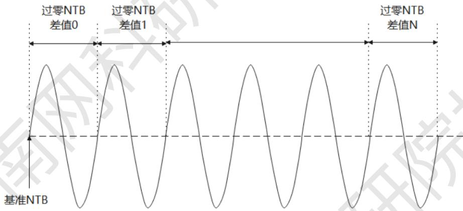  
图15基准NTB和过零NTB差值示意图

# 5.1.4.15.4 过零NTB差值

表示过零NTB与上一个过零NTB的差值。

过零NTB差值的计算方法：以基准NTB为开始，后续的每一个过零NTB，与上一个过零NTB做差值计算；将计算得到的差值数据右移8位，再取低12位作为过零NTB差值。按照时间顺序，存入“过零NTB差值”字段，上报CCO。

过零NTB差值存储的定义如表134所示。

表 134 过零 NTB 差值格式  

<table><tr><td>字段</td><td>字节号</td><td>比特号</td><td>字段大小(比特)</td><td>定义</td></tr><tr><td>过零NTB差值[0]</td><td>0</td><td>0-7</td><td>8</td><td>过零NTB差值[0]低8位</td></tr><tr><td></td><td rowspan="2">1</td><td>0-3</td><td>4</td><td>过零NTB差值[0]高4位</td></tr><tr><td rowspan="2">过零NTB差值[1]</td><td>4-7</td><td>4</td><td>过零NTB差值[1]低4位</td></tr><tr><td>2</td><td>0-7</td><td>8</td><td>过零NTB差值[1]高8位</td></tr><tr><td rowspan="2">过零NTB差值[2]</td><td>3</td><td>0-7</td><td>8</td><td>过零NTB差值[2]低8位</td></tr><tr><td rowspan="2">4</td><td>0-3</td><td>4</td><td>过零NTB差值[2]高4位</td></tr><tr><td rowspan="2">过零NTB差值[3]</td><td>4-7</td><td>4</td><td>过零NTB差值[3]低4位</td></tr><tr><td>5</td><td>0-7</td><td>8</td><td>过零NTB差值[3]高8位</td></tr><tr><td>...</td><td>...</td><td>...</td><td>...</td><td>...</td></tr></table>

# 5.1.4.16 网络诊断报文

网络诊断报文（MMeDiagnose）为各厂商非标准的自定义报文，供各厂商对网络的故障进行定位使用，对格式不做统一要求。

表 135 网络诊断报文格式  

<table><tr><td>字段</td><td>字节号</td><td>字段大小（比特）</td></tr><tr><td>芯片厂商 ID</td><td>0-1</td><td>16</td></tr><tr><td>厂家自定义</td><td>可变长</td><td>可变长</td></tr></table>

表 136 芯片厂商 ID 定义  

<table><tr><td>芯片厂商</td><td>ID值</td></tr><tr><td>0x0000</td><td>保留</td></tr><tr><td>0x0001</td><td>HS</td></tr><tr><td>0x0002</td><td>ES</td></tr><tr><td>0x0003</td><td>TC</td></tr><tr><td>0x0004</td><td>LH</td></tr><tr><td>0x0005</td><td>HT</td></tr><tr><td>0x0006</td><td>RS</td></tr><tr><td>0x0007</td><td>SW</td></tr><tr><td>0x0008</td><td>SC</td></tr><tr><td>0x0009-0xFFFF</td><td>待扩展</td></tr></table>

# 5.1.4.17 无线信道冲突上报报文

无线信道冲突上报报文（MMeRFChannelConflictReport）的格式定义如表137所示。

表 137 无线信道冲突上报报文格式  

<table><tr><td>字段</td><td>字节号</td><td>比特位</td><td>字段大小(字节)</td></tr><tr><td>冲突网络CCOMAC地址</td><td>0-5</td><td>0-7</td><td>6</td></tr><tr><td>邻居网络个数</td><td>6</td><td>0-7</td><td>1</td></tr><tr><td>邻居网络条目</td><td>可变</td><td>0-7</td><td>L（可变长）</td></tr></table>

# 5.1.4.17.1 CCO MAC 地址

表示与本网络发生冲突的邻居网络的CCOMAC地址。

# 5.1.4.17.2 邻居网络个数

周边可见邻居网络的个数。

# 5.1.4.17.3 邻居网络条目

邻居网络信息，具体如表138所示。

表 138 邻居网络条目

表 139 无线发现列表报文格式  

<table><tr><td>字段</td><td>字节号</td><td>字段大小（字节）</td></tr><tr><td>邻居网络（0）无线信道号</td><td>0</td><td>1</td></tr><tr><td>邻居网络（0）无线 option</td><td rowspan="2">1</td><td>2bit</td></tr><tr><td>保留</td><td>6bit</td></tr><tr><td>邻居网络（1）无线信道号</td><td>2</td><td>1</td></tr><tr><td>邻居网络（1）无线 option</td><td rowspan="2">3</td><td>2bit</td></tr><tr><td>保留</td><td>6bit</td></tr><tr><td>……</td><td>……</td><td>……</td></tr><tr><td>邻居网络（N）无线信道号</td><td>2(N-1)</td><td>1</td></tr><tr><td>邻居网络（N）无线 option</td><td rowspan="2">2N-1</td><td>2bit</td></tr><tr><td>保留</td><td>6bit</td></tr></table>

# 5.1.4.18 无线发现列表报文

无线发现列表报文（MMeRF DiscoverNodeList）格式定义如表139所示。

<table><tr><td>字段</td><td>字节号</td><td>比特位</td><td>字段大小(字节)</td></tr><tr><td>站点MAC地址</td><td>0-5</td><td>0-7</td><td>6</td></tr><tr><td>统计序号</td><td>6</td><td>0-7</td><td>1</td></tr><tr><td>信息单元1类型</td><td rowspan="2">7</td><td>0-6</td><td>7bit</td></tr><tr><td>信息单元1长度类型</td><td>7</td><td>1bit</td></tr><tr><td>信息单元1长度</td><td>8/9</td><td>0-7</td><td>1/2</td></tr><tr><td>信息单元1内容</td><td>可变</td><td>0-7</td><td>L（可变长）</td></tr><tr><td>……</td><td>……</td><td>……</td><td>L（可变长）</td></tr><tr><td>信息单元N类型</td><td>可变</td><td>0-6</td><td>7bit</td></tr><tr><td>信息单元N长度类型</td><td>可变</td><td>7</td><td>1bit</td></tr><tr><td>信息单元N长度</td><td>可变</td><td>0-7</td><td>1/2</td></tr><tr><td>信息单元N内容</td><td>可变</td><td>0-7</td><td>L（可变长）</td></tr></table>

# 5.1.4.18.1 站点MAC地址

发送无线发送列表报文节点的MAC地址。

# 5.1.4.18.2 统计序号

无线发现列表报文的统计序号，每次发送一个无线发送列表报文时，统计序号递增1，达到255后，环回为0。

# 5.1.4.18.3 信息单元类型

用于指示信息单元内容，信息单元类型取值如表 140所示。

表 140 信息单元类型  

<table><tr><td>值</td><td>定义</td></tr><tr><td>0</td><td>站点属性信息</td></tr><tr><td>1</td><td>站点路由信息</td></tr><tr><td>2</td><td>邻居节点信道信息非位图版</td></tr><tr><td>3</td><td>邻居节点信道信息位图版</td></tr><tr><td>其他</td><td>保留</td></tr></table>

# 5.1.4.18.4 长度类型

指示信息单元长度字段的位宽，长度类型取值如表141所示。

表 141 长度类型取值  

<table><tr><td>值</td><td>定义</td></tr><tr><td>0</td><td>信息单元长度位宽为1字节</td></tr><tr><td>1</td><td>信息单元长度位宽为2字节</td></tr></table>

# 5.1.4.18.5 信息单元长度

表示信息单元内容的长度，不包括信息单元类型、长度类型、信息单元长度的字段的内容。

# 5.1.4.18.6 站点属性信息格式

表示站点的基本属性，站点属性信息格式如表142所示。

表 142 站点属性信息  

<table><tr><td>字段</td><td>字节号</td><td>比特位</td><td>字段大小(字节)</td></tr><tr><td>CCOMAC 地址</td><td>0-5</td><td>0-7</td><td>6</td></tr><tr><td rowspan="2">代理 TEI</td><td>6</td><td>0-7</td><td rowspan="2">12bit</td></tr><tr><td rowspan="2">7</td><td>0-3</td></tr><tr><td>角色</td><td>4-7</td><td>4bit</td></tr><tr><td>层级</td><td rowspan="2">8</td><td>0-3</td><td>4bit</td></tr><tr><td>链路 RF 跳数</td><td>4-7</td><td>4bit</td></tr><tr><td>代理上行接收率</td><td>9</td><td>0-7</td><td>1</td></tr><tr><td>代理下行接收率</td><td>10</td><td>0-7</td><td>1</td></tr><tr><td>链路最小接收率</td><td>11</td><td>0-7</td><td>1</td></tr><tr><td>无线发现列表周期</td><td>12</td><td>0-7</td><td>1</td></tr><tr><td>无线接收率老化周期个数</td><td>13</td><td>0-7</td><td>1</td></tr></table>

# 5.1.4.18.7 站点路由信息格式

表示站点多路径信息，站点路由信息格式如表143所示。

表 143 站点路由信息格式  

<table><tr><td>字段</td><td>字节号</td><td>比特位</td><td>字段大小(字节)</td></tr><tr><td rowspan="2">下一跳站点 TEI[1]</td><td>0</td><td>0-7</td><td rowspan="2">12bit</td></tr><tr><td>1</td><td>0-3</td></tr><tr><td>路由类型[1]</td><td></td><td>0-4</td><td>4bit</td></tr><tr><td>......</td><td>......</td><td>......</td><td>......</td></tr><tr><td rowspan="2">下一跳站点 TEI[N]</td><td>2N-2</td><td>0-7</td><td rowspan="2">12bit</td></tr><tr><td rowspan="2">2N-1</td><td>0-3</td></tr><tr><td>路由类型[N]</td><td>4-7</td><td>4bit</td></tr></table>

路由类型定义如表125所示。同级路由，指使用与本站点层级相同站点，作为下一跳路由站点；上级路由，指使用比本站点低一个层级的站点，作为下一跳路由站点；代理主路径路由，指使用本站点的代理站点，作为下一跳路由站点；上上级路由，指使用比本站点低两个层级的站点，作为下一条路由站点。

# 5.1.4.18.8 邻居节点信道信息非位图格式

邻居节点信道信息非位图格式如表144所示。

表 144 非位图版邻居节点信道信息非位图格式  

<table><tr><td>字段</td><td>字节号</td><td>比特位</td><td>字段大小(字节)</td></tr><tr><td>信道信息组合类型</td><td>0</td><td>0-3</td><td>4bit</td></tr><tr><td>保留</td><td></td><td>4-7</td><td>4bit</td></tr><tr><td>邻居节点信道信息[1]</td><td>可变长</td><td>0-7</td><td>可变长</td></tr><tr><td>……</td><td>……</td><td>……</td><td>……</td></tr><tr><td>邻居节点信道信息[N]</td><td>可变长</td><td>0-7</td><td>可变长</td></tr></table>

信道信息组合类型取值和含义如表145所示。

表 145 信道信息组合类型取值与字段长度  

<table><tr><td>类型值</td><td>TEI长度</td><td>接收率长度</td><td>平均信噪比</td><td>信号强度</td><td>总长度（比特）</td></tr><tr><td>0</td><td>12</td><td>8</td><td>0</td><td>0</td><td>20</td></tr><tr><td>1</td><td>12</td><td>8</td><td>4</td><td>0</td><td>24</td></tr><tr><td>2</td><td>12</td><td>8</td><td>6</td><td>6</td><td>32</td></tr><tr><td>3</td><td>12</td><td>8</td><td>0</td><td>4</td><td>24</td></tr></table>

接收率长度定义如表146所示。

表 146 接收率长度定义  

<table><tr><td>接收率长度</td><td>定义</td></tr><tr><td>0</td><td>表示未携带接收率信息</td></tr><tr><td>8</td><td>接收率信息长度为8比特，报文接收率=实际接收率</td></tr></table>

接收率的合法范围为[0，100]。

平均信噪比长度定义如表147所示。

表 147 平均信噪比长度定义  

<table><tr><td>平均信噪比长度</td><td>定义</td></tr><tr><td>0</td><td>表示未携带平均信噪比信息</td></tr><tr><td>4</td><td>平均信噪比信息长度为4比特,平均信噪比的映射关系如表149所示</td></tr><tr><td>6</td><td>平均信噪比信息长度为6比特,映射关系为SNR&lt;-6dB,量化值=0,SNR≥-6dB,量化值=SNR结果+7</td></tr></table>

平均信噪比的合法范围为[0，30]。

信号强度长度定义如表148所示。

表 148 信号强度长度定义  

<table><tr><td>信号强度长度</td><td>定义</td></tr><tr><td>0</td><td>表示未携带信号强度信息</td></tr><tr><td>4</td><td>信号强度信息长度为4比特,信号强度映射关系如表149所示</td></tr><tr><td>6</td><td>信号强度信息长度为6比特,信号强度映射关系如表150所示</td></tr><tr><td>8</td><td>信号强度信息长度为8比特,信号强度映射关系为:RSSI&lt;-110 dBm时,量化值=0,RSSI≥-110 dBm时,量化值=RSSI+111</td></tr></table>

表 149 4bit 信号强度映射值  

<table><tr><td>RSSI结果</td><td>量化值</td></tr><tr><td>RSSI&lt;-105 dBm</td><td>0000</td></tr><tr><td>-105 dBm&lt;RSSI&lt;-95 dBm</td><td>0001</td></tr><tr><td>-95 dBm&lt;RSSI&lt;-86 dBm</td><td>0010</td></tr><tr><td>-86 dBm&lt;RSSI≤-80 dBm</td><td>0011</td></tr><tr><td>-80 dBm&lt;RSSI≤-74 dBm</td><td>0100</td></tr><tr><td>-74 dBm&lt;RSSI≤-68 dBm</td><td>0101</td></tr><tr><td>-68 dBm&lt;RSSI≤-62 dBm</td><td>0110</td></tr><tr><td>-62 dBm&lt;RSSI≤-56 dBm</td><td>0111</td></tr><tr><td>-56 dBm&lt;RSSI≤-48 dBm</td><td>1000</td></tr><tr><td>-48 dBm&lt;RSSI≤-42 dBm</td><td>1001</td></tr><tr><td>-42 dBm&lt;RSSI≤-36 dBm</td><td>1010</td></tr><tr><td>-36 dBm&lt;RSSI≤-30 dBm</td><td>1011</td></tr><tr><td>-30 dBm&lt;RSSI≤-20 dBm</td><td>1100</td></tr><tr><td>-20 dBm&lt;RSSI≤-10 dBm</td><td>1101</td></tr><tr><td>-10 dBm&lt;RSSI≤0 dBm</td><td>1110</td></tr><tr><td>RSSI≥0 dBm</td><td>1111</td></tr></table>

表 150 6bit 信号强度映射值  

<table><tr><td>RSSI结果</td><td>量化值</td><td>RSSI结果</td><td>量化值</td></tr><tr><td>RSSI&lt;-110 dBm</td><td>000000</td><td>-48 dBm&lt;RSSI≤-46 dBm</td><td>100000</td></tr><tr><td>-110 dBm&lt;RSSI≤-108 dBm</td><td>000001</td><td>-46 dBm&lt;RSSI≤-44 dBm</td><td>100001</td></tr><tr><td>-108 dBm&lt;RSSI≤-106 dBm</td><td>000010</td><td>-44 dBm&lt;RSSI≤-42 dBm</td><td>100010</td></tr><tr><td>-106 dBm&lt;RSSI≤-104 dBm</td><td>000011</td><td>-42 dBm&lt;RSSI≤-40 dBm</td><td>100011</td></tr><tr><td>-104 dBm&lt;RSSI≤-102 dBm</td><td>000100</td><td>-40 dBm&lt;RSSI≤-38 dBm</td><td>100100</td></tr><tr><td>-102 dBm&lt;RSSI≤-100 dBm</td><td>000101</td><td>-38 dBm&lt;RSSI≤-36 dBm</td><td>100101</td></tr><tr><td>-100 dBm&lt;RSSI≤-98 dBm</td><td>000110</td><td>-36 dBm&lt;RSSI≤-34 dBm</td><td>100110</td></tr><tr><td>-98 dBm&lt;RSSI≤-96 dBm</td><td>000111</td><td>-34 dBm&lt;RSSI≤-32 dBm</td><td>100111</td></tr><tr><td>-96 dBm&lt;RSSI≤-94 dBm</td><td>001000</td><td>-32 dBm&lt;RSSI≤-30 dBm</td><td>101000</td></tr><tr><td>-94 dBm&lt;RSSI≤-92 dBm</td><td>001001</td><td>-30 dBm&lt;RSSI≤-28 dBm</td><td>101001</td></tr><tr><td>-92 dBm&lt;RSSI≤-90 dBm</td><td>001010</td><td>-28 dBm&lt;RSSI≤-26 dBm</td><td>101010</td></tr><tr><td>-90 dBm&lt;RSSI≤-88 dBm</td><td>001011</td><td>-26 dBm&lt;RSSI≤-24 dBm</td><td>101011</td></tr><tr><td>-88 dBm&lt;RSSI≤-86 dBm</td><td>001100</td><td>-24 dBm&lt;RSSI≤-22 dBm</td><td>101100</td></tr><tr><td>-86 dBm&lt;RSSI≤-84 dBm</td><td>001101</td><td>-22 dBm&lt;RSSI≤-20 dBm</td><td>101101</td></tr><tr><td>-84 dBm&lt;RSSI≤-82 dBm</td><td>001110</td><td>-20 dBm&lt;RSSI≤-18 dBm</td><td>101110</td></tr><tr><td>-82 dBm&lt;RSSI≤-80 dBm</td><td>001111</td><td>-18 dBm&lt;RSSI≤-16 dBm</td><td>101111</td></tr><tr><td>-80 dBm&lt;RSSI≤-78 dBm</td><td>010000</td><td>-16 dBm&lt;RSSI≤-14 dBm</td><td>110000</td></tr><tr><td>-78 dBm&lt;RSSI≤-76 dBm</td><td>010001</td><td>-14 dBm&lt;RSSI≤-12 dBm</td><td>110001</td></tr><tr><td>-76 dBm&lt;RSSI≤-74 dBm</td><td>010010</td><td>-12 dBm&lt;RSSI≤-10 dBm</td><td>110010</td></tr><tr><td>-74 dBm&lt;RSSI≤-72 dBm</td><td>010011</td><td>-10 dBm&lt;RSSI≤-8 dBm</td><td>110011</td></tr><tr><td>-72 dBm&lt;RSSI≤-70 dBm</td><td>010100</td><td>-8 dBm&lt;RSSI≤-6 dBm</td><td>110100</td></tr><tr><td>-70 dBm&lt;RSSI≤-68 dBm</td><td>010101</td><td>-6 dBm&lt;RSSI≤-4 dBm</td><td>110101</td></tr><tr><td>-68 dBm&lt;RSSI≤-66 dBm</td><td>010110</td><td>-4 dBm&lt;RSSI≤-2 dBm</td><td>110110</td></tr><tr><td>-66 dBm&lt;RSSI≤-64 dBm</td><td>010111</td><td>-2 dBm&lt;RSSI≤0 dBm</td><td>110111</td></tr><tr><td>-64 dBm&lt;RSSI≤-62 dBm</td><td>011000</td><td>0 dBm&lt;RSSI≤2 dBm</td><td>111000</td></tr><tr><td>-62 dBm&lt;RSSI≤-60 dBm</td><td>011001</td><td>2 dBm&lt;RSSI≤4 dBm</td><td>111001</td></tr><tr><td>-60 dBm&lt;RSSI≤-58 dBm</td><td>011010</td><td>4 dBm&lt;RSSI≤6 dBm</td><td>111010</td></tr><tr><td>-58 dBm&lt;RSSI≤-56 dBm</td><td>011011</td><td>6 dBm&lt;RSSI≤8 dBm</td><td>111011</td></tr><tr><td>-56 dBm&lt;RSSI≤-54 dBm</td><td>011100</td><td>8 dBm&lt;RSSI≤10 dBm</td><td>111100</td></tr><tr><td>-54 dBm&lt;RSSI≤-52 dBm</td><td>011101</td><td>10 dBm&lt;RSSI≤12 dBm</td><td>111101</td></tr><tr><td>-52 dBm&lt;RSSI≤-50 dBm</td><td>011110</td><td>12 dBm&lt;RSSI≤14 dBm</td><td>111110</td></tr><tr><td>-50 dBm&lt;RSSI≤-48 dBm</td><td>011111</td><td>RSSI≥14 dBm</td><td>111111</td></tr></table>

# 5.1.4.18.9 邻居节点信道信息位图格式

邻居节点信道信息位图格式定义如表151所示，位图版信道信息组合类型如表152所示。

表 151 邻居节点信道信息位图格式  

<table><tr><td>字段</td><td>字节号</td><td>比特位</td><td>字段大小(字节)</td></tr><tr><td>信道信息组合类型</td><td rowspan="2">0</td><td>0-3</td><td>4bit</td></tr><tr><td>保留</td><td>4-7</td><td>4bit</td></tr><tr><td rowspan="2">位图起始 TEI[1]</td><td>1</td><td>0-7</td><td rowspan="2">12bit</td></tr><tr><td rowspan="2">2</td><td>0-3</td></tr><tr><td>保留</td><td>4-7</td><td>4bit</td></tr><tr><td>位图[1]大小</td><td>3</td><td>0-7</td><td>1</td></tr><tr><td>位图[1]</td><td>可变</td><td>0-7</td><td>L（可变长）</td></tr><tr><td>邻居节点信道信息[11]</td><td>可变</td><td>0-7</td><td>L（可变长）</td></tr><tr><td>……</td><td>……</td><td>……</td><td>……</td></tr><tr><td>邻居节点信道信息[N1]</td><td>可变</td><td>0-7</td><td>L（可变长）</td></tr><tr><td>……</td><td>……</td><td>……</td><td>……</td></tr><tr><td>位图起始 TEI[K]</td><td>1</td><td>0-7</td><td>12bit</td></tr><tr><td></td><td>2</td><td>0-3</td><td></td></tr><tr><td>保留</td><td></td><td>4-7</td><td>4bit</td></tr><tr><td>位图[K]大小</td><td>3</td><td>0-7</td><td>1</td></tr><tr><td>位图[K]</td><td>可变</td><td>0-7</td><td>L（可变长）</td></tr><tr><td>邻居节点信道信息[1k]</td><td>可变</td><td>0-7</td><td>L（可变长）</td></tr><tr><td>……</td><td>……</td><td>……</td><td>……</td></tr><tr><td>邻居节点信道信息[Nk]</td><td>可变</td><td>0-7</td><td>L（可变长）</td></tr></table>

表 152 位图版信道信息组合类型及字段长度  

<table><tr><td>类型值</td><td>接收率长度</td><td>平均信噪比</td><td>信号强度</td><td>总长度（比特）</td></tr><tr><td>0</td><td>8</td><td>0</td><td>0</td><td>8</td></tr><tr><td>1</td><td>8</td><td>4</td><td>0</td><td>12</td></tr><tr><td>2</td><td>8</td><td>0</td><td>8</td><td>16</td></tr><tr><td>3</td><td>8</td><td>6</td><td>6</td><td>20</td></tr><tr><td>4</td><td>8</td><td>4</td><td>4</td><td>16</td></tr><tr><td>5</td><td>8</td><td>0</td><td>4</td><td>12</td></tr></table>

# 5.1.4.19 Bitloading训练结果更新请求

接收端生成训练结果后，通过Bitloading训练结果更新请求将训练结果反馈给发端站点，Bitloading训练结果更新请求数据格式如表153所示。

表 153 Bitloading 训练结果更新请求数据格式  

<table><tr><td>字段</td><td>字节号</td><td>字段大小(比特)</td><td>说明</td></tr><tr><td rowspan="2">源 TEI</td><td>0</td><td rowspan="2">12</td><td rowspan="2">-</td></tr><tr><td rowspan="2">1</td></tr><tr><td rowspan="2">目的 TEI</td><td rowspan="2">12</td><td rowspan="2">-</td></tr><tr><td>2</td></tr><tr><td>流数</td><td>3</td><td>1</td><td>0: 单流
1: 双流</td></tr><tr><td rowspan="2">截止载波</td><td>3</td><td rowspan="2">9</td><td rowspan="2">截止载波后的载波不承载数据，字段填充载波号，例如，全带宽都可用，则填490</td></tr><tr><td>4</td></tr><tr><td>保留</td><td>4</td><td>6</td><td>-</td></tr><tr><td>保留</td><td>5</td><td>8</td><td>-</td></tr><tr><td>比特加载表长度</td><td>6-7</td><td>16</td><td>比特加载表的长度，单位字节</td></tr><tr><td>比特加载表</td><td>L</td><td>L</td><td>可变长</td></tr></table>

比特加载表，表示有效载波频段范围内每个子载波组中的每个子载波所承载的比特数。子载波组是一系列长度固定且不连续的子载波，每个子载波内组中的子载波数量可以是1、2、4或8个，子载波组内每个子载波承载的比特数相同。

单流比特加载表的数据格式见表154所示，每个子载波组占用3比特。每8个子载波组占用3字节。

表 154 单流比特加载表数据格式  

<table><tr><td>字段</td><td>字节号</td><td>字段大小(比特)</td></tr><tr><td>子载波组0的比特承载信息</td><td rowspan="3">0</td><td>3</td></tr><tr><td>子载波组1的比特承载信息</td><td>3</td></tr><tr><td rowspan="2">子载波组2的比特承载信息</td><td rowspan="2">3</td></tr><tr><td rowspan="4">1</td></tr><tr><td>子载波组3的比特承载信息</td><td>3</td></tr><tr><td>子载波组4的比特承载信息</td><td>3</td></tr><tr><td rowspan="2">子载波组5的比特承载信息</td><td rowspan="2">3</td></tr><tr><td rowspan="3">2</td></tr><tr><td>子载波组6的比特承载信息</td><td>3</td></tr><tr><td>子载波组7的比特承载信息</td><td>3</td></tr><tr><td>......</td><td></td><td></td></tr><tr><td>子载波组N的比特承载信息</td><td>(N/8)*3+0</td><td>3</td></tr></table>

双流比特加载表的数据格式如表155所示，每8个子载波组占用3字节，按照8组流 $0 + 8$ 组流1的方式排列。

表 155 双流比特加载表数据格式  

<table><tr><td>字段</td><td>字节号</td><td>字段大小(比特)</td></tr><tr><td>子载波组0流0的比特承载信息</td><td rowspan="3">0</td><td>3</td></tr><tr><td>子载波组1流0的比特承载信息</td><td>3</td></tr><tr><td rowspan="2">子载波组2流0的比特承载信息</td><td rowspan="2">3</td></tr><tr><td rowspan="4">1</td></tr><tr><td>子载波组3流0的比特承载信息</td><td>3</td></tr><tr><td>子载波组4流0的比特承载信息</td><td>3</td></tr><tr><td rowspan="2">子载波组5流0的比特承载信息</td><td rowspan="2">3</td></tr><tr><td rowspan="3">2</td></tr><tr><td>子载波组6流0的比特承载信息</td><td>3</td></tr><tr><td>子载波组7流0的比特承载信息</td><td>3</td></tr><tr><td>子载波组0流1的比特承载信息</td><td rowspan="3">3</td><td>3</td></tr><tr><td>子载波组1流1的比特承载信息</td><td>3</td></tr><tr><td rowspan="2">子载波组2流1的比特承载信息</td><td rowspan="2">3</td></tr><tr><td rowspan="4">4</td></tr><tr><td>子载波组3流1的比特承载信息</td><td>3</td></tr><tr><td>子载波组4流1的比特承载信息</td><td>3</td></tr><tr><td rowspan="2">子载波组5流1的比特承载信息</td><td rowspan="2">3</td></tr><tr><td rowspan="3">5</td></tr><tr><td>子载波组6流1的比特承载信息</td><td>3</td></tr><tr><td>子载波组7流1的比特承载信息</td><td>3</td></tr><tr><td>......</td><td></td><td></td></tr><tr><td>子载波组N流0的比特承载信息</td><td>(N/8)*6+0</td><td>3</td></tr><tr><td>......</td><td>-</td><td>-</td></tr><tr><td>子载波组N+7流0的比特承载信息</td><td rowspan="2">(N/8)*6+2</td><td>3</td></tr><tr><td>子载波组N流1的比特承载信息</td><td>3</td></tr><tr><td>......</td><td></td><td></td></tr><tr><td>子载波组N+7流1的比特承载信息</td><td>(N/8)*6+5</td><td>3</td></tr></table>

每个比特承载的信息含义如表156所示。

表 156 比特承载信息定义  

<table><tr><td>值</td><td>说明</td></tr><tr><td>0</td><td>表示不承载数据</td></tr><tr><td>1</td><td>表示承载1比特，对应BPSK</td></tr><tr><td>2</td><td>表示承载2比特，对应QPSK</td></tr><tr><td>4</td><td>表示承载4比特，对应16QAM</td></tr><tr><td>6</td><td>表示承载6比特，对应64QAM</td></tr></table>

# 5.1.4.20 Bitloading训练结果更新确认

发端站点在接收到训练结果更新请求报文后，需要向收端站点发送训练结果更新确认报文，作为回应确认，Bitloading训练结果更新确认数据格式如表157所示。

表 157 Bitloading 训练结果更新确认数据格式  

<table><tr><td>字段</td><td>字节号</td><td>字段大小(比特)</td><td>备注</td></tr><tr><td rowspan="2">源 TEI</td><td>0</td><td rowspan="2">12</td><td>-</td></tr><tr><td>1</td><td>-</td></tr><tr><td rowspan="2">目的 TEI</td><td>2</td><td rowspan="2">12</td><td>-</td></tr><tr><td>3</td><td>-</td></tr><tr><td>更新结果</td><td></td><td>1</td><td>0: 更新成功
1: 更新失败</td></tr><tr><td>保留</td><td></td><td>7</td><td>-</td></tr></table>

# 5.1.4.21 RU_SNR信息告知

RUSNR信号告知报文的数据格式如表158所示，

表 158 RU SNR 信息告知数据格式  

<table><tr><td>字段</td><td>字节号</td><td>字段大小(比特)</td><td>备注</td></tr><tr><td rowspan="2">本站点 TEI</td><td>0</td><td rowspan="2">12</td><td>-</td></tr><tr><td>1</td><td>-</td></tr><tr><td rowspan="2">邻居站点起始 TEI</td><td>1</td><td rowspan="2">12</td><td>-</td></tr><tr><td>2</td><td>-</td></tr><tr><td>RU分组 id</td><td>3</td><td>8</td><td>根据RU分组id确定告知的邻居站点RU-SNR信息结构。0:定义见“RU分组ID0信息”;其它:保留</td></tr><tr><td>告知的邻居站点总数</td><td>4-5</td><td>16</td><td>-</td></tr><tr><td>邻居站点位图长度</td><td>6-7</td><td>16</td><td>-</td></tr><tr><td>邻居站点位图</td><td>8-N</td><td>可变长</td><td>-</td></tr><tr><td>邻居站点0的RU_SNR信息</td><td>起始字节可变</td><td>可变长</td><td>根据RU分组id查找具体的信息定义;</td></tr><tr><td>......</td><td></td><td></td><td>-</td></tr><tr><td>邻居站点k的RU_SNR信息</td><td>起始字节可变</td><td>可变长</td><td>-</td></tr></table>

RU分组的ID0信息如表159所示。

表 159 RU 分组 ID 0 信息  

<table><tr><td>字段</td><td>字节号</td><td>比特位</td><td>载波范围</td></tr><tr><td>RU0_SNR</td><td>0</td><td>0-4</td><td>32-101</td></tr><tr><td rowspan="2">RU1_SNR</td><td>0</td><td>5-7</td><td rowspan="2">109-178</td></tr><tr><td>1</td><td>0-1</td></tr><tr><td>RU2_SNR</td><td>1</td><td>2-6</td><td>186-255</td></tr><tr><td rowspan="2">RU3_SNR</td><td>1</td><td>7</td><td rowspan="2">263-332</td></tr><tr><td>2</td><td>0-3</td></tr><tr><td rowspan="2">RU4_SNR</td><td>2</td><td>4-7</td><td rowspan="2">340-409</td></tr><tr><td>3</td><td>0</td></tr><tr><td>RU5_SNR</td><td>3</td><td>1-5</td><td>417-490</td></tr><tr><td>保留</td><td>3</td><td>6-7</td><td>-</td></tr></table>

# 5.1.4.22 站点TEI列表请求报文

站点TEI列表请求报文格式如表160所示，用于STA向CCO请求Mac地址在当前网络中对应的TEI。

表 160 站点 TEI 列表请求报文格式  

<table><tr><td>字段</td><td>字节号</td><td>字段大小(字节)</td></tr><tr><td>请求序号</td><td>0</td><td>1</td></tr><tr><td>发起站点MAC地址</td><td>1-6</td><td>6</td></tr><tr><td>站点数量</td><td>7</td><td>1</td></tr><tr><td>站点[0]Mac地址</td><td>8-13</td><td>6</td></tr><tr><td>...</td><td>...</td><td>...</td></tr><tr><td>站点[n]Mac地址</td><td>可变起始字节</td><td>6</td></tr></table>

# 5.1.4.22.1 请求序号

本次请求的序号，回复报文的序号需与此对应，标明一次完整应答。同一站点上电后从0开始计数，每次请求加一，复位后计数清零。

# 5.1.4.22.2 发起站点MAC地址

发起站点TEI列表请求的原始站点MAC地址。

# 5.1.4.22.3 站点数量

本次请求的站点数量，站点数量最大值为20。

# 5.1.4.22.4 站点[n]Mac地址

请求的站点Mac地址列表。

# 5.1.4.23 站点TEI列表回复报文

站点TEI列表回复报文格式如表161所示，

表 161 站点 TEI 列表回复报文格式  

<table><tr><td>字段</td><td>字节号</td><td>字段大小(字节)</td></tr><tr><td>请求序号</td><td>0</td><td>1</td></tr><tr><td>发起站点MAC地址</td><td>1-6</td><td>6</td></tr><tr><td>站点数量</td><td>7</td><td>1</td></tr><tr><td>站点TEI列表</td><td>8-N</td><td>可变长</td></tr></table>

站点TEI列表格式定义如表162所示，

表 162 站点 TEI 列表定义  

<table><tr><td>字段</td><td>字节号</td><td>比特位</td><td>字段大小(Bit)</td></tr><tr><td>站点[1]Mac 地址</td><td>0-5</td><td>0-7</td><td>48</td></tr><tr><td rowspan="2">站点[1]TEI</td><td>6</td><td>0-7</td><td rowspan="2">12</td></tr><tr><td rowspan="2">7</td><td>0-3</td></tr><tr><td>保留</td><td>4-7</td><td>4</td></tr><tr><td>...</td><td>...</td><td>...</td><td>...</td></tr><tr><td>站点[n]Mac 地址</td><td>(n-1)*8</td><td>0-7</td><td>48</td></tr><tr><td rowspan="2">站点[n]TEI</td><td>(n-1)*8 + 6</td><td>0-7</td><td rowspan="2">12</td></tr><tr><td rowspan="2">(n-1)*8 +7</td><td>0-3</td></tr><tr><td>保留</td><td>4-7</td><td>4</td></tr></table>

# 5.1.4.24 扩展网络冲突上报报文

扩展网络冲突上报报文格式的定义如表163所示，本网络运行SPLC协议时，站点通过扩展网络冲突上报报文向CCO上报邻居网络冲突情况。

表 163 网络冲突上报报文  

<table><tr><td>字段</td><td>字节号</td><td>字段大小(比特)</td><td>备注</td></tr><tr><td>冲突网络CCO MAC地址</td><td>0-5</td><td>48</td><td>表示与本网络发生冲突的邻居网络的CCO MAC地址</td></tr><tr><td>邻居网络个数</td><td>6</td><td>8</td><td>周边可见邻居网络的个数</td></tr><tr><td>邻居网络条目</td><td>可变</td><td>可变</td><td>邻居网络snid信息</td></tr></table>

表 164 邻居网络条目  

<table><tr><td>字段</td><td>字节号</td><td>字段大小(比特)</td><td>备注</td></tr><tr><td>邻居网络(0)</td><td rowspan="2">0</td><td>5</td><td>邻居网络0的snid</td></tr><tr><td>保留</td><td>3</td><td>-</td></tr><tr><td>邻居网络(1)</td><td rowspan="2">1</td><td>5</td><td>邻居网络1的snid</td></tr><tr><td>保留</td><td>3</td><td>-</td></tr><tr><td>...</td><td></td><td></td><td></td></tr><tr><td>邻居网络(N)</td><td rowspan="2">N</td><td>5</td><td>邻居网络N的snid</td></tr><tr><td>保留</td><td>3</td><td>-</td></tr></table>

# 5.2 MAC子层功能描述

# 5.2.1 基本机制

宽带载波通信网络使用基于信标帧的信道访问机制，本节描述信标周期内信道访问机制之间的关系。

CCO周期性地发送信标帧，信标帧中包含了CCO分配的信标周期内的信标时隙、CSMA时隙、TDMA时隙、绑定CSMA时隙等时隙的规划信息。宽带载波通信网络中的子节点，应遵循CCO分配的时隙，进行信道访问。

一般的，信标时隙和TDMA时隙等明确分配给CCO或具体STA使用的时隙，统称为非竞争时隙（TDMA时隙）；CSMA时隙和绑定CSMA时隙等未指明使用者的时隙，需要由有需求的STA竞争使用的时隙，统称为竞争时隙（CSMA时隙）。

在多个宽带载波通信网络通信网络并存并且相互干扰的时候，CCO之间需要进行时隙协调。

CCO在进行信道访问时，需要考虑电力线的相线因素。不同电力线相线上的STA，与CCO进行通信时，也需要考虑电力线相线的因素。可根据自身所在的相线，选择与之对应的时隙与CCO进行通信。

CCO在时隙规划时，根据业务需要，可以分配绑定CSMA时隙，由某种业务单独占有该时隙，凡是涉及该业务的STA，可以在该绑定CSMA时隙中，竞争发送该业务的报文。

信标周期的时隙划分如图16所示。

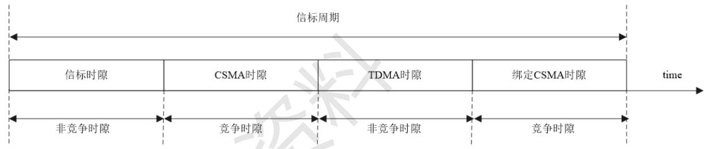  
图16时隙划分示意图

# 5.2.2 信标机制

宽带载波通信网络中有三种类型的信标帧：中央信标，代理信标和发现信标。信标帧应在信标时隙中进行发送。信标时隙由CCO进行分配，分配时需要指明具体STA可以使用的对应时隙。

其中，中央信标和代理信标在每个信标周期内都应发送。发现信标要求每一个STA站点，从加入网络后每170秒时间周期内至少发送两个信标帧。

STA在接收到信标帧后，一旦确定CCO指定其在某个时隙内发送信标帧，则应在相应的时隙内，发送相应的信标帧。

# 5.2.2.1 中央信标

由CCO生成，在中央信标中，包含当前宽带载波通信网络的网络基准时间NTB，通过信标帧中的BTS字段，实时的通知给网络中STA。

同时，中央信标中包括了CCO的时隙分配结果，这些时隙分配结果决定了网络中的STA访问信道的方式和时隙。

在单个宽带载波通信网络中，中央信标是定周期发送的，发送的周期可自定义；在多个宽带载波通信网络共存的场景中，CCO的中央信标的发送时隙（与其他类型信标时隙作为一个整体的带宽，一体协调），需要在多个宽带载波通信网络的CCO之间协调，协调的原则是尽量保证各个CCO的中央信标能够在一定偏移下按照周期发送。

中央信标发送时，可以选择在多个相线上发送，或者单个相线上发送。不同相线上发送时需要不同的中央信标时隙。

# 5.2.2.2 代理信标

代理信标由代理站点(PCO)发送，代理信标中包含了中央信标的全部时隙安排内容，并且携带了代理STA的基本属性。

代理站点应按照中央信标中指定的信标时隙，发送代理信标。

未入网的STA，在接收到代理信标后，可以根据代理信标中的时隙安排等内容，发起加入网络的请求。

# 5.2.2.3 发现信标

发现信标由STA站点发送，发现信标应在CCO指定给该STA的信标时隙内发送。

发现信标，主要用于发现周围可能的隐藏STA。信标中包含了用于隐藏STA加入网络的竞争时隙安排等内容。

未入网的STA，在接收到发现信标后，可以根据发现信标中的时隙安排等内容，发起加入网络的请求。

# 5.2.3 时隙管理

# 5.2.3.1 MIMO站点时隙管理

MIMO站点能够同时在三个相线上进行PLC报文的发送和接收，因此三相站点在发送BPLC版本的网络维护报文时使用三相同时发送，不区分时隙相线。在信标时隙安排中，与BPLC版本时隙安排方式保持一致，三相站点安排一个信标时隙。

# 5.2.3.2 时隙机制

CCO根据当前组网状态，安排全网工作在集中信标机制或分散信标机制。

# 5.2.3.2.1 集中信标机制

在组网阶段，有BPLC版本模块入网或需要绑定时隙业务的场景下，CCO安排全网工作在集中信标机制。集中信标机制与BPLC版本协议一致。信标帧应在信标时隙进行发送。信标时隙由CCO进行分配，分配时指明具体STA可以使用的对应时隙。

# 5.2.3.2.2 分散信标机制

组网完成（CCO等待4～6个信标周期没有新STA加入，认为组网完成）后，CCO可通过信标帧中的“时隙机制切换”条目进入分散信标机制下。在分散信标机制下，信标通过CSMA时隙竞争发送，信标帧的帧长包括帧载荷及竞争帧间隔，竞争帧间隔的定义与SOF帧的帧间隔定义相同。

分散信标时隙划分示意图如图17分散信标时隙划分示意图所示。

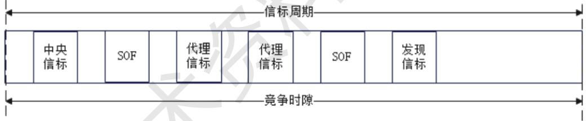  
图17分散信标时隙划分示意图

在分散信标机制下，CCO每个信标周期均创建并发送中央信标，其中信标时隙个数为0，CSMA时隙个数为1，相线为全相位。

网络内代理站点在收到新一信标周期的代理信标或中央信标后，创建并发送代理信标。

网络内发现节点，默认不发送信标，在CCO允许其发送信标时，发现站点计算自己应发送发现信标的信标周期计数值，在对应的信标周期内，若收到自己代理的信标，则在完成NTB同步后，创建并发送发现信标。

在分散信标机制下，无线信道上信标发送应遵循分散信标机制，CCO、PCO和STA根据无线信标标志的规则判断自己应发送的无线信标类型。

发现站点计算自己应发送发现信标的信标周期计数值的方法：信标周期设置为P，站点可发现的邻居发现站点总数为K，每个发现站点在170秒内至少发送两帧发现信标，每个站点计算自己应发送信标的BPC为 $170 / 2\mathrm{P}^*$ 整数倍+ceil（TEI/（K/(170/2P)）。

# 5.2.3.3 站点时隙管理算法

CCO，PCO，STA三个角色，对于信标中时隙的管理算法应保持统一。CCO将信标周期中的时隙分配，按照统一的算法，填充到信标中的时隙分配条目，通过信标发送，通知给PCO和STA等站点。PCO和STA对于信标中的时隙分配条目的解析（见5.1.3.3），也同样需要遵照统一的算法。基本的时隙划分如图16所示，具体的时隙管理算法如下：

a) 整个信标周期的长度，是由“信标周期长度”字段确定，单位是100微秒。  
b) 时隙的分配，是以相对时间计算，即分配从0时刻起，到信标周期长度的整个时间范围。  
c) 每个信标周期的起始时刻(即0时刻)，CCO都指定了其起始网络基准时间（NTB），即“信标周期起始网络基准时间”字段。  
d) 整个信标周期中，如果时隙类型齐全的话，一般会按照图 16 所示的分配顺序排列。  
e) 若STA在某一信标周期中未收到信标帧，则沿用上一信标帧的时隙安排，直到STA离线为止。

# 5.2.4 信标时隙

整个信标周期中，信标的时隙一般按照图18所示进行分割。

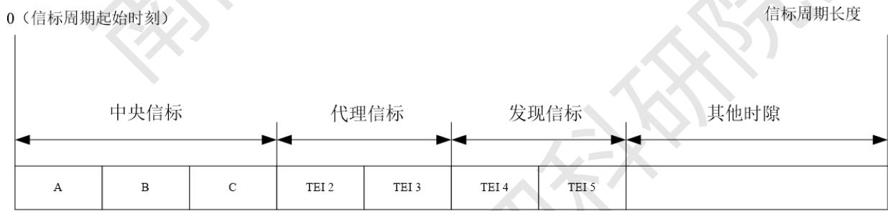  
图18 信标时隙分割示意图

# 5.2.4.1 中央信标时隙

如图18所示，中央信标时隙，应是从0时刻起分割，如果存在多个时隙，则依次按照相线进行分割，如图中的A，B，C分别指分割出来三个CCO的中央信标时隙。CCO需要在ABC三个相线上进行中央信标发送。

中央信标时隙的总数，由“中央信标时隙总数”字段确定。

每个时隙的长度，由“信标时隙长度”字段确定，单位是100微秒。

# 5.2.4.2 代理信标时隙

如图18所示，代理信标时隙在分割时，需要偏移过中央信标时隙后，开始计算。

代理信标时隙分割时，需要按照时隙安排中的“非中央信标信息”字段逐个进行分割。每个时隙对应一个“非中央信标信息”字段。该字段中定义了每个信标时隙属于哪个STA，以及该时隙应该发送的信标类型是否为代理信标。

每个时隙的长度，由“信标时隙长度”字段确定，单位是100微秒。

# 5.2.4.3 发现信标时隙

如图18所示，发现信标时隙在分割时，需要偏移过中央信标时隙和代理信标时隙之后，开始计算。

发现信标时隙分割的方法和代理信标时隙分割方法一致，需要按照时隙安排中的“非中央信标信息”字段逐个进行分割。每个时隙对应一个“非中央信标信息”字段。该字段中定义了每个信标时隙属于哪一个STA，以及该时隙应该发送的信标类型是否为发现信标。

每个时隙的长度，由“信标时隙长度”确定，单位是100微秒。

# 5.2.5 CSMA时隙

如图19所示，CSMA时隙在分割时，需要进行均衡分割。在信标时隙中通知的CSMA时隙，只指明了归属于某个相线的总的时隙长度。每个相线的时隙总长度之和，构成了整个CSMA时隙的长度。整个CSMA时隙，需要按照相线的个数，进行均衡分割。

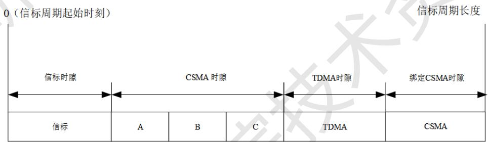  
图19CSMA时隙分割示意图

均衡分割是指，将每个相线的时隙，按照“CSMA时隙大小”的门限进行分割，将分割后的每个相线的时隙，按照一定的算法进行排列，使得最终的每个相线的时间片，在整个CSMA时隙中的分布，达到相对的均衡。

如果一个相线的CSMA时隙长度超过“CSMA时隙大小”的门限，则应以“CSMA时隙大小”为单位进行分片。

以图20为例，假设A相时隙长度为1000毫秒，B相时隙为3000毫秒，C相时隙为1000毫秒，CSMA时隙大小为500毫秒，则A相时隙可分为2片（500毫秒、500毫秒）、B相时隙可分为6片（500毫秒、500毫秒、500毫秒、500毫秒、500毫秒）、C相时隙可分为2片（500毫秒、500毫秒）。总时隙分配为10片，相位时隙排序为A、C、B。A相位时隙分片位置为0、5，C相位时隙分片位置为1、6，B相位时隙分片为2、3、4、7、8、9。

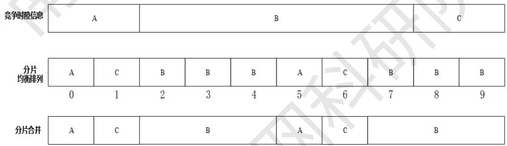  
图20CSMA时隙均衡分割排列示意图

如信标帧中“CSMA时隙大小”的值为10，三个相线的“CSMA时隙长度”分别为800、800、1200，那么“CSMA时隙大小”为100毫秒，三个相线的“CSMA时隙长度”分别为80毫秒、80毫秒、120毫秒，则三个相线的时隙可分为1、1、1片，A相分片长度为80毫秒，B相分片长度为80毫秒，C相分片长度为120毫秒。

如信标帧中“CSMA时隙大小”的值为10，三个相线的“CSMA时隙长度”分别为2200、800、3200，那么“CSMA时隙大小”为100毫秒，三个相线的“CSMA时隙长度”分别为220毫秒、80毫秒、320毫秒，则三个相线的时隙可分为2、1、3片，相位分片为BACAC，各分片长度为80毫秒、100毫秒、100毫秒、120毫秒、220毫秒。如表165所示。

表 165 CMSA 时隙排列表  

<table><tr><td rowspan="2">序号</td><td colspan="3">CSMA时隙信息字段(ms)</td><td rowspan="2">分片均衡排列</td><td>时隙大小</td></tr><tr><td>A</td><td>B</td><td>C</td><td>100ms</td></tr><tr><td>1</td><td>220</td><td>80</td><td>320</td><td>BACAC</td><td></td></tr><tr><td>2</td><td>120</td><td>80</td><td>320</td><td>BAC</td><td></td></tr></table>

具体CSMA时隙分割算法描述如下：

a）三相CSMA时隙进行排序，按照“CSMA时隙长度”从小到大排序，若两个“CSMA时隙长度”相等，则按照信标帧中CSMA时隙的原始顺序排列，信标帧中CSMA时隙严格按照A、B、C三相进行排列，并且要求每个相线上CSMA时隙不为0。  
b) 计算每个相线上CSMA时隙的分片个数，若“CSMA时隙长度”≤“CSMA时隙大小”，分片数为1，分片长度为“CSMA时隙长度”；否则分片数等于“CSMA时隙长度”/“CSMA时隙大小”，最后一个分片长度等于“CSMA时隙大小”+“CSMA时隙长度”%“CSMA时隙大小”，前面的时隙分片长度为“CSMA时隙大小”。  
c) 对分片后的CSMA时隙进行均衡排列，假设3个相线时隙分片为N1，N2，N3片， $\mathrm{N}1 \leqslant \mathrm{N}2 \leqslant \mathrm{N}3$ ，一共存在M片 $= \mathrm{N}1 + \mathrm{N}2 + \mathrm{N}3$ 。首先分配排在第一时隙分片，位置如下：0，M/N1，2M/N1，……，(N1-1)M/N1；第二时隙分片位置如下： $1,1 + \mathrm{M} / \mathrm{N}2$ ，……， $1 + (\mathrm{N}2 - 1)\mathrm{M} / \mathrm{N}2$ ，若对应位置已经存放时隙片，则往后寻找一个空位，最后一个时隙分片存放在剩余的空位中。  
d) 合并相邻的相同相线的时隙分片，若相邻时隙的相线相同，则合并为一个时隙。  
e）无线上由于没有相线的区分，因此在无线上只有一块CSMA时隙，不在根据相线对CSMA时隙进行分片。CSMA时隙如图21所示。

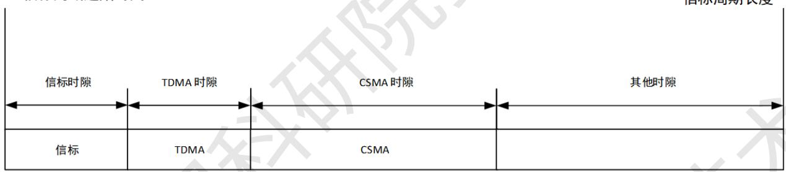  
0（信标周期起始时刻）  
图21无线CSMA时隙示意图

# 5.2.6 TDMA时隙

如图22所示，TDMA时隙分割时，指明了该时隙分配给了哪个STA使用。具体的STA序列，复用了中央信标和代理信标的STA。每个TDMA时隙的所属的STA和中央信标时隙和代理信标时隙所属CCO和STA序列保持一致。

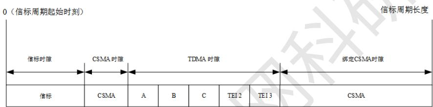  
图22TDMA时隙分割示意图

每个时隙的长度，由“TDMA时隙长度”确定，单位是100微秒。

所有TDMA时隙，只能指定给同一种业务使用，指定的业务由“TDMA时隙链路标识符”确定。

# 5.2.7 绑定CSMA时隙

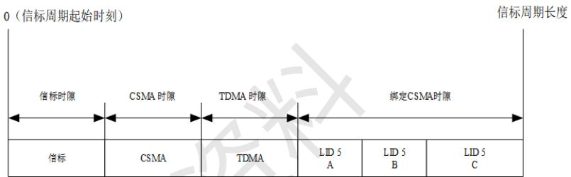  
图23 绑定CSMA时隙分割示意图

如图23所示，绑定CSMA分割时，分割算法和CSMA时隙一致，即如果存在多个时隙，每个时隙指明了所属的相线，则最终的时隙计算，需要按照CSMA时隙的均衡分割算法进行计算。

每个时隙的长度，由“绑定CSMA时隙信息”字段中的“绑定CSMA时隙长度”确定，该时隙所属的相线，由“相线”确定。无线上CSMA时隙如图24所示，无线上不需要对CSMA时隙分割。

所有绑定CSMA时隙，只能指定给同一种业务使用，指定的业务由“绑定CSMA时隙链路标识符”确定。

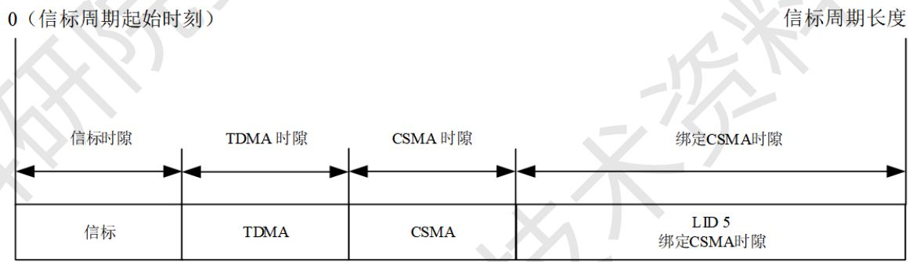  
图24 无线绑定CSMA时隙示意图

# 5.2.8 信道访问

# 5.2.8.1 载波和无线信道工作机制

载波和无线具备同时接收的能力，即载波信道接收数据时，无线信道也可以同时接收数据，两者可以并行工作。

载波在发送时，无线可以进行接收；无线在发送时，载波可以进行接收。

载波和无线两个信道具备同时发送的能力，可以根据通信模块的负载能力，选择分时发送还是同时发送。在本协议中，CCO通信模块可以在载波和无线上同时进行发送，STA通信模块上，载波和无线采用分时发送机制。

# 5.2.8.2 CSMA/CA信道访问

CSMA时隙（包括绑定CSMA）中，站点应通过信道竞争，冲突避免后，才能占用信道，进行报文发送。

在CSMA时隙中发送的报文，应保证能够在相应的CSMA时隙中传送完成，不能跨越时隙。尤其保证不能跨越到信标时隙和TDMA时隙等非竞争时隙中。

在CSMA时隙中进行信道竞争时，需要进行基本的冲突判断和避免，并且通过VCS机制对信道状态进一步预判。

# 5.2.8.3 冲突

在CSMA时隙里，导致冲突的原因基本上是多个站点，退避在一个较小甚至完全重叠的时刻，进行了报文发送，导致冲突。

一般情况下，在以下两种情形中，发送端节点在发送报文后，需要等待一个回应报文：

a) 单播的SOF帧，需要接收节点回应“选择确认”报文，  
b) 广播的SOF帧指定一个节点来回应“选择确认”。

一般情况下，可通过以下两种情形，判断出现了冲突：

a) 当报文发送完成后，在等待一个回应报文时，没有收到回应报文，或者收到一个无效的或者非预期的报文。  
b) 当SOF帧发送后，接收到的“选择确认”帧中，提示PHY对全部PB块没有解析成功。

# 5.2.8.4 VCS

虚拟载波侦听（VCS），是主要用在CSMA时隙中的一种时隙预判机制，每个节点都需要支持。VCS机制根据报文传输时间以及帧间隔确定，采用VCS定时器以及定时器到期后的信道状态实现。其中VCS定时器时长计算方法和到期后状态如表166所示。

表 166 VCS 定时器时长和状态迁移  

<table><tr><td>事件</td><td>VCS 定时器时长</td><td>VCS 定时器到期后信道状态</td></tr><tr><td>检测到冲突</td><td>扩展帧间间隔</td><td>空闲</td></tr><tr><td>检测到前导</td><td>扩展帧间间隔</td><td>空闲</td></tr><tr><td rowspan="2">解析到 SOF 的帧控制</td><td>帧长*10us（载波）</td><td rowspan="2">空闲</td></tr><tr><td>帧长*100us（无线）</td></tr><tr><td>解析到选择确认</td><td>竞争帧间间隔</td><td>空闲</td></tr></table>

# 5.2.8.5 优先级

站点在CSMA时隙中，竞争信道时，需要支持优先级。优先级高的报文，相对于优先级低的报文，应该具有更高的信道竞争能力。

报文的优先级，由分类规则确定，具体请参照5.3.2.17 报文分类规则。

# 5.2.8.6 绑定CSMA

绑定CSMA是指一段CSMA时隙，可以分配给某个优先级的业务或者某个种类的业务报文的传输。

在该时隙内，只能传输所分配的优先级或者种类的业务报文。

各个节点在绑定CSMA时隙中，需要按照一般的CSMA机制，进行信道竞争，竞争成功后，才能发送对应优先级或者种类的业务报文。

# 5.2.8.7 多相线CSMA

多相线CSMA是指分配给不同相线的电力线上站点使用的时隙。STA需要和CCO进行通信时，要按照多相线的时隙规划使用多相线时隙。不同相线的STA，只能在对应相线的时隙里，才能向CCO发送报文。

多相线CSMA时隙，是由同一相线下的所有STA竞争使用的。

# 5.2.8.8 TDMA信道访问

TDMA是指由CCO分配给指定节点的TDMA时隙。

在该时隙内，节点不需要进行信道竞争，可以独占被分配的TDMA时隙，进行报文的发送。

TMDA时隙一般分配给某个优先级的业务或者某个种类的业务，该时隙内只能传输对应的业务报文。

# 5.2.9 帧间隔

帧间隔是指线路上传输的物理层协议帧之间需要保证的最少时间间隔。

# 5.2.9.1 帧间隔类型

# 5.2.9.1.1 突发帧间隔(BIFS)

突发帧间隔（BIFS），一般指在不需要竞争的时隙中，连续发送报文时，物理层的协议帧之间需要保证的最小帧间隔。主要的应用场景有信标的连续发送等。

信标发送场景中，突发帧间隔（BIFS）如图25所示。

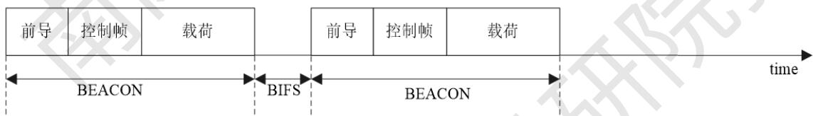  
图25突发帧间隔示意图

# 5.2.9.1.2 竞争帧间隔(CIFS)

竞争帧间隔（CIFS），一般指在需要竞争的时隙中，当站点需要发送报文时，物理层的协议帧之间需要保证的最小帧间隔。

SOF帧不等选择确认(SACK)的场景中，竞争帧间隔（CIFS）如图26所示。

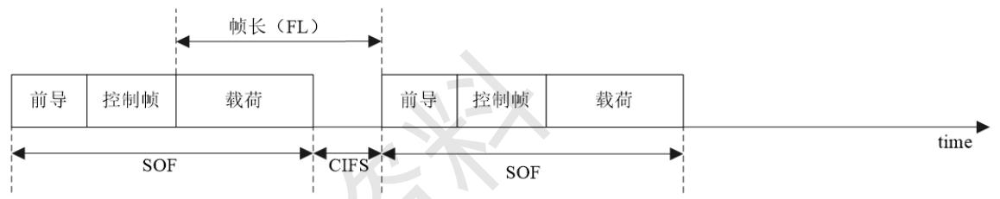  
图26竞争帧间隔示意图1

SOF帧需要等选择确认(SACK)的场景中，竞争帧间隔(CIFS)如图27所示。

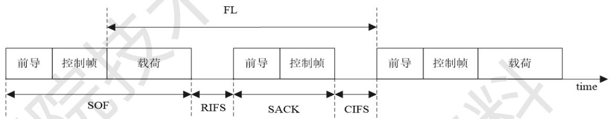  
图27 竞争帧间隔示意图2

# 5.2.9.1.3 回应帧间隔(RIFS)

回应帧间隔(RIFS)，一般指需要等待回应帧的场景中，在报文和报文的回应帧之间，物理层的协议帧之间需要保证的最小帧间隔。

SOF帧需要等选择确认(SACK)的场景中，回应帧间隔(RIFS)如图28所示。

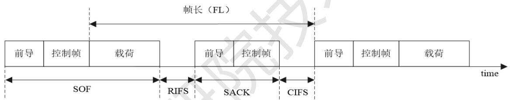  
图28 回应帧间隔示意图

# 5.2.9.1.4 扩展帧间隔(EIFS)

扩展帧间隔(EIFS)，不是一般的连续的两个帧的帧间隔，而是对于普遍的SOF帧的竞争场景的时隙间隔的预期值，主要用来在发送报文时，设置最长的退避时间间隔。

当在退避发送时，如果检测到了报文的前导，那么缺省先需要按照扩展帧间隔的时间间隔进行退避。当“帧控制”等解析成功时，可以根据“帧控制”等的具体时隙需求退避。扩展帧间隔（EIFS）如图29所示。

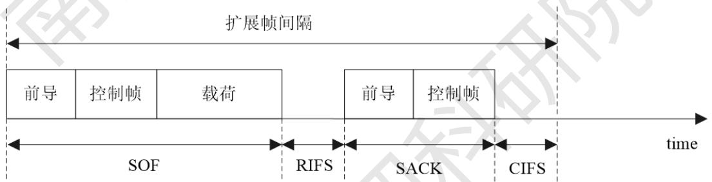  
图29 扩展帧间隔示意图

# 5.2.9.2 帧间隔的测量

在两个物理层协议帧之间的帧间隔，是通过计算在线路上最后一个OFDM的最后一个非零样本，与线路上第一个跟随帧的第一个非零样本之间的间隔时间。这种帧间隔是由传输器在发送前导时测量的，保证前导的发出时，帧间隔的测量已经完成而且足够。

实际帧间隔的测量如图30帧间隔测量示意图所示。其他种类的帧间隔也是按照同样的方式进行测量。

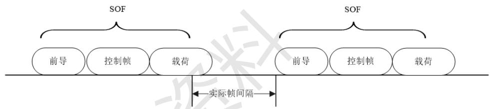  
图30 帧间隔测量示意图

# 5.2.9.3 帧间隔范围

帧间隔取值范围定义如表167所示。

表 167 帧间隔取值范围  

<table><tr><td>类型</td><td>取值范围</td></tr><tr><td>竞争帧间隔CIFS</td><td>400微秒</td></tr><tr><td>突发帧间隔BIFS</td><td>400微秒</td></tr><tr><td>回应帧间隔RIFS</td><td>400~2300微秒</td></tr><tr><td>扩展帧间隔EIFS</td><td>20毫秒</td></tr></table>

无线帧间隔取值范围定义如表168无线帧间隔取值范围所示。

表 168 无线帧间隔取值范围  

<table><tr><td>类型</td><td>取值范围</td></tr><tr><td>竞争帧间隔CIFS</td><td>800微秒</td></tr><tr><td>突发帧间隔BIFS</td><td>800微秒</td></tr><tr><td>回应帧间隔RIFS</td><td>800~2300微秒</td></tr><tr><td>扩展帧间隔EIFS</td><td>70毫秒</td></tr></table>

# 5.2.10 数据处理

MAC层处理的基本业务数据单元称作MSDU。

MAC层处理MSDU时，先将MSDU封装生成MAC帧。MAC帧是不同站点的MAC层之间进行数据传送的基本传输单元。

MAC层根据MSDU中的“原始源地址”和“原始目的地址”字段，来区分MSDU的原始源地址和原始目的地址，并且在宽带载波通信网络中传输时，使用“原始源TEI”和“原始目的TEI”与之相对应。

# 5.2.11 MAC帧生成

MSDU包含一个MSDU载荷或者一个管理消息。MAC帧是通过在每个MSDU载荷上预填充一个MAC帧头部，在尾部添加一个完整性校验值生成的，具体帧格式详见5.1.2。

MAC帧头部中MAC帧类型字段能标示出是否有到达时间戳。MAC帧头部中的“MSDU长度”被设置为MSDU载荷的长度。“完整性校验”用于验证正确的解码和接收端MSDU载荷的重组，完整性校验值的计算覆盖MSDU载荷，不包括MAC帧头部。一个MAC帧只能由一个完整的MSDU生成。

MAC帧的生成如图31所示。

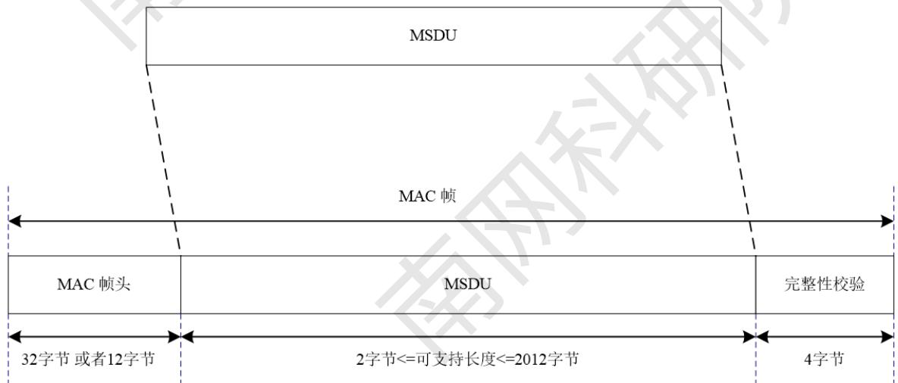

图31MAC帧生成示意图

无线MAC帧的生成如图32无线MAC帧生成示意图所示。

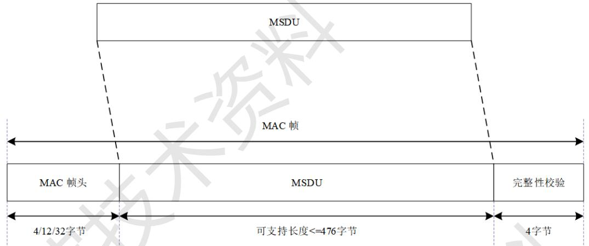  
图32 无线MAC帧生成示意图

# 5.2.12 分片

一个MAC帧由一个MSDU生成，但是一个MAC帧可能要分多片，才能使用MPDU进行传输。PHY层在传输数据时，应按照FEC块进行传输。所以MAC帧在交给PHY层传输前，应适配MPDU的格式。

在对MAC帧进行分片时，参照MPDU的物理块的格式。MAC帧分片后，每一片可以作为一个“物理块体”。BPLC“物理块体”的规格大小分为128字节和512字节两种，SPLC“物理块体”的规格大小分为16字节、136字节、264字节和520字节四种。

分片时，按照由小到大的可能进行判断，以MAC帧分完为结束。例如，如果MAC帧小于一个128字节，则不用分片，整个MAC帧作为一个“物理块体”使用；如果一个128的不能存下，一个512字节的分片能存下，则只分一个512字节的分片；大于一个512字节的，同理，继续按照512字节的单元继续分片，分完为止。

需要注意的是，一个MAC帧的所有分片，只能是一种大小格式。最后一个分片中，如果数据的大小不足时，全部以0来补充。

每一个MAC帧的分片与一个“序列号”相关联。每帧的第一个分片的“序列号”被初始化为零，一个新分片产生时进行递增。

无线仅支持一个物理块，分为为16/40/72/136/264/520字节，不支持对一个MAC帧进行分片。

# 5.2.13 长MPDU的生成

当一个MAC帧在分片后，存在多个分片时，可以使用长MPDU进行传输。

长MPDU的生成，如图33所示。

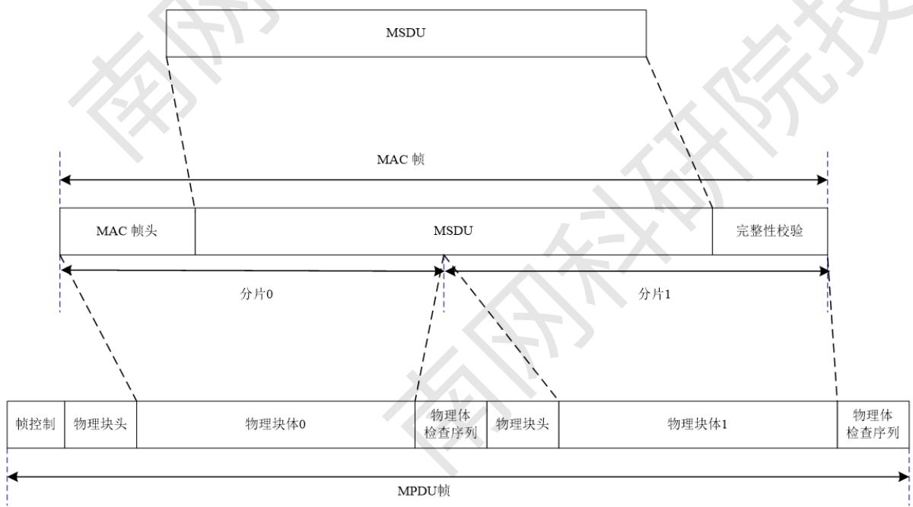

图33长MPDU生成示意图

# 5.2.14 重组

当一个MPDU的所有“物理体”被接收端接收成功后，则需要将所有的“物理块体”重组成为一个MAC帧。重组时，需要根据“物理块头”中的“序列号”，将所有的“物理块体”进行有序的重组。

重组完成后，需要进行完整性校验，以判断MAC帧的传输完整。一个重组后的MAC帧只能提取一个完整的MSDU。

MAC帧重组的过程，正好和MAC帧分片的过程相反，如图34所示。

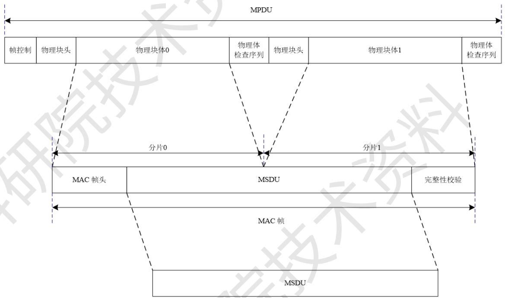  
图34MAC帧重组示意图

# 5.2.15 选择确认重传

SOF帧发送时，可以指定站点进行回应，所指定的站点，在接收到该SOF帧后，以“选择确认”(SACK)帧进行回应。“选择确认”，对于发送站点，是可选策略，对于接收站点，如果被指定回应“选择确认”，则被指定的接收站点，应回应。

回应“选择确认”帧的站点，是通过SOF帧“帧控制”中的“目的TEI”来指定，当接收站点的TEI与接收到的SOF帧的“帧控制”中的“目的TEI”一致时，则接收站点需要回复“选择确认”报文。

SOF帧的发送站点，可以根据SOF帧的接收站点回复的“选择确认”帧，判断SOF帧的接收情况。“选择确认”帧中的“接收结果”字段和“接收状态”字段，说明了接收站点对于SOF帧的“帧载荷”中具体的“物理块”的接收情况。

对于没有成功接收的“物理块”，需要将整个报文进行重传。

发送站点对于重传的报文，需要在SOF帧的“帧控制”中设置“重传标志位”字段。接收站点可以根据前一个报文的成功“物理块”，和重传报文的成功“物理块”，重组完整的MAC帧。

# 5.2.16 报文过滤

在宽带载波通信网络中，对于端到端的同一个MAC数据报文，转发站点在转发时，需要判断该报文是否为重复报文，对于重复的报文，不需要根据MPDU的触发，而进行重复的转发。

报文过滤原理如图35所示，对于同一个MAC帧MAC0，当转发站点2判断MAC0已经转发过一次，则不需要根据MPDU3的触发，而转发MAC0两次。

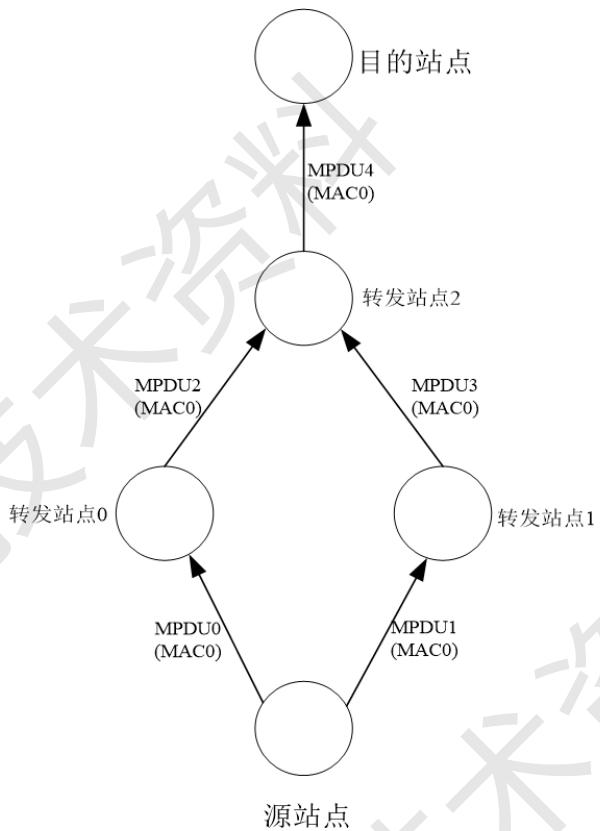  
图35报文过滤示意图

# 5.2.17 单播/广播

对于SOF帧，在宽带载波通信网络中发送时，可采用单播和广播机制，来控制报文转发的范围。单播报文和广播报文通过MAC帧头中的“发送类型”字段区别。

广播方式，是指报文发送时，通过设置“发送类型”字段为1、2、3、4来指定该报文是广播报文，接收站点在接收到广播报文时，应进行处理。

单播方式，是指报文发送时，通过SOF帧“帧控制”的“目的TEI”来指定了具体的接收站点，其他站点从线路上检出单播报文时，如果“目的TEI”不是本站点，则不需要处理。

单播报文收发的示意图如图36所示，CCO发送的报文，指定目的地址是STA1，则PCO1也在可正确接收报文的范围内，但是不需要处理。

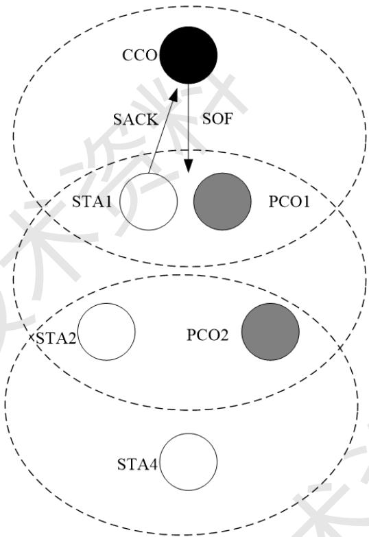  
图36单播报文收发示意图

广播方式，是指报文发送时，通过设置“TEI过滤标志位”字段为1和“目的TEI”为0xFFFF来指定该报文是广播报文，接收站点在接收到广播报文时，应进行处理。

根据处理的不同，广播报文区分为本地广播和全网广播，可根据MAC帧头中的“发送类型”字段判断该报文是本地广播还是全网广播，对于全网广播的报文，站点在处理后，还需要进一步转发，转发的方向可根据MAC帧头中的“广播方向”字段来确定。同时，广播报文在发送时，也可以指定某个站点，对该广播报文进行“选择确认”帧回应。

本地广播报文的转发如图37所示，CCO发送的本地广播报文，STA1和PCO1接收后，并不进行转发。

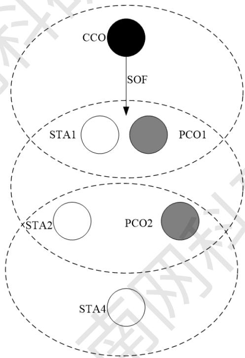  
图37本地广播收发示意图

# Q/XXXXXXXXX-XXX

全网下行广播如图38所示，CCO发送的全网下行广播报文，STA1和PCO1在接收后，由PCO1进行了转发，PCO1转发的全网广播报文，PCO2也进行了转发，达到了全网站点都能接收处理的目的。全网上行广播，并没有真正意义上全网广播，STA发起上行广播时，只有层级低的代理接收到报文进行转发。

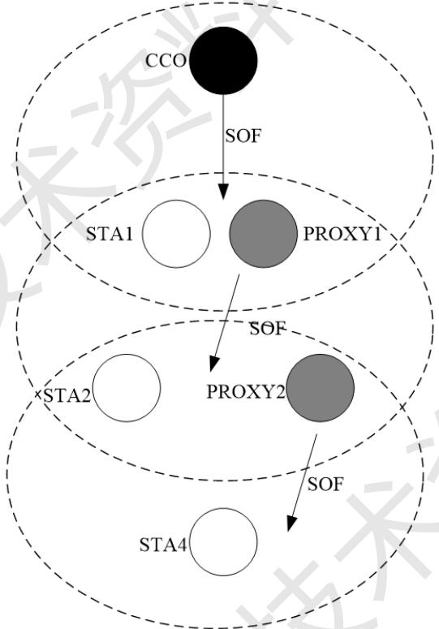  
图38全网广播收发示意图

# 5.2.18 PLC信道评估

SPLC版本数据帧中TF和PL可以扩展到比FC更宽的频段，如图39所示，用FC中的“PL频段标识”字段指示。为提高SPLC本站点之间的通信速率和通信成功率，可以通过评估不同子载波上的SNR，选择最优的PL带宽和TMI。

站点发送MIMO训练帧或Bitloading训练帧进行不同子载波的SNR评估，优先使用TF和PL为全带宽发送且PL为已知的伪随机序列的Bitloading训练帧，如图40所示。SPLC本站点收到训练帧后，可根据训练帧内容评估出全带宽中各个子载波组的SNR信息。

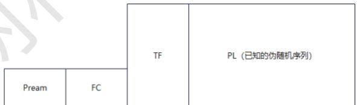

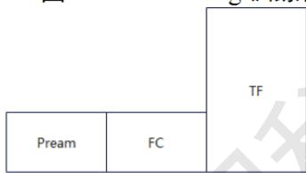  
图39 Bitloading训练帧格式  
图40 MIMO训练帧格式

本地信息统计完成后，至少每两个路由周期广播一次RU_SNR信息告知，报文的帧载荷中填充邻居站点到本站点的RU_SNR信息，通过各个站点本地广播RU_SNR信息告知报文，完成上行和下行RU_SNR信息交互流程。RU_SNR交互流程如图41所示。

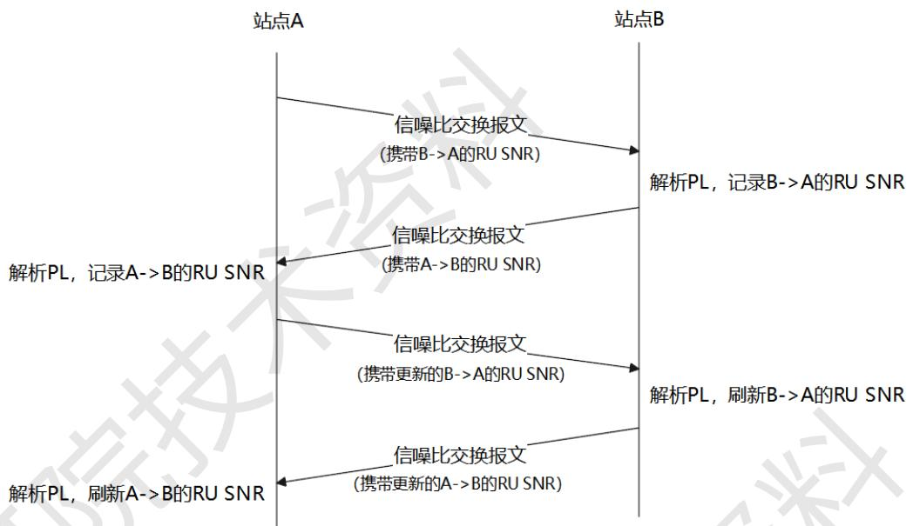  
图41RU_SNR交换流程图

# 5.2.19 报文聚合

在业务报文上行和下行交互中，若短时间内，两个站点之间有多个短报文需要传输，则可以将多个短报文聚合为长报文进行传输，报文聚合示意图如图42所示。

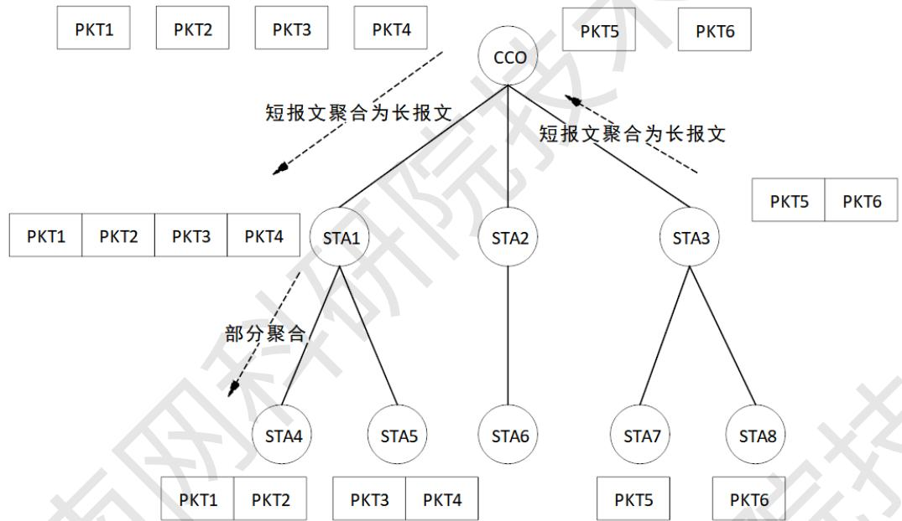  
图42 报文聚合应用示意图

# 5.2.20 Bitloading 训练

# 5.2.20.1 基本机制

站点A向站点B发送训练帧，站点B通过接收训练信息对站点A到B之间的信道进行评估，生成Bitloading表。站点B再将Bitloading表反馈给站点A。训练完成后，站点A需要向站点B发送数据报文时，可以基于Bitloading表进行调制编码，站点B收到此报文同样基于Bitloading表进行解调译码。

在Bitloading训练流程中，接收训练帧的站点简称“收端站点”，发送训练帧的站点简称“发端站点”。

# 5.2.20.2 训练站点选择

组网完成后，网络内的代理站点启动Bitloading训练，候选训练站点为邻居代理站点，并选择其中SNR最高的X（ $\mathrm{X} = 16$ ）个站点发起训练。代理站点被邻居站点选择为Bitloading训练站点，最多可接受Y（ $\mathrm{Y} = 16$ ）个邻居站点的训练请求。

# 5.2.20.3 训练基本流程

# Q/XXXXXXXXX-XXX

为了保证训练有序，站点同一时间仅允许与一个站点进行训练。训练流程示意图如下图所示。由于SNR越高，Bitloading的收益越明显，因此可根据SNR的选择训练站点。如图43所示，站点A根据SNR、站点角色和产品形态等信息选择邻居代理站点B进行训练，并向其发送训练请求帧，训练请求帧发送完成后，等待训练帧或训练请求拒绝帧的超时时间至少N秒（N的参考值为30）。站点B接收到训练请求帧时，若正在与其他站点训练或者与之训练的站点数量已达上限等，则回复训练请求拒绝帧。站点A接收到训练请求拒绝帧后，可以继续选择其他合适的站点进行训练。若站点B判断可以与之训练，则直接向站点A发送训练帧，训练帧不做重传，若训练帧发送失败，由收端站点重新发起训练。站点A接收训练帧同时根据训练结果生成比特加载表和截止载波等信息。并将这些信息通过训练结果更新请求报文发送给站点B，站点B接收到训练结果更新请求报文后，记录本次训练生成的信息，并向站点A应答训练结果更新确认报文。至此，站点B到站点A方向的训练完成。同样地，如果站点B在判断站点A满足训练条件时，也可以向站点A发起训练请求，来完成站点A到站点B方向的训练。

  
图43基本训练流程图

# 5.2.20.4 重训练

由于信道环境不是恒定不变的，因此在首次训练后，还需要进行重训练，以满足不断变化的信道环境。连续两次训练间隔不低于N小时（N的参考值为1）。触发重训练的场景参考表169。

表 169 训练场景  

<table><tr><td>触发因素</td><td>触发条件</td><td>发起方</td></tr><tr><td>周期</td><td>距上次发端到收端方向训练的时间已达某一超时时间</td><td>收端站点</td></tr><tr><td>报文成功率降低</td><td>发端到收端方向使用 Bitloading 的报文成功率持续一段时间连续低于阈值</td><td>发端站点</td></tr><tr><td>SNR 变化</td><td>发端到收端方向的 SNR 与上次训练时的差值持续一段时间连续超过阈值</td><td>收端站点</td></tr></table>

其中，根据报文成功率触发重训练是由发端站点发起的，其训练流程如图 44所示，

  
图44发端站点启动重新训练流程图

# 5.2.20.5 取消训练

在代理变更或者两站点间通信不好等场景下，收端站点可以申请训练关系取消，并释放训练资源。收端向发端发送取消请求，发端先删除站点，再应答取消确认，收端接收到取消确认后再删除站点，防止发端使用训练结果向收端发送报文时，收端已经将训练结果删除而无法正确解析报文，取消训练流程如图45所示。

  
图45取消训练流程图

训练取消请求与训练取消确认之间遵循CIFS的帧间隔定义。

若收端站点连续5次请求训练取消，未收到训练取消确认，收端站点可删除训练信息。发端站点达到训练资源上限后，可选择删除连续1小时未使用过的训练站点。

# 5.2.21 OFDMA 调度

OFDMA调度的基本机制：通过OFMDA调度可以实现一个站点同时与其他多个站点在相互不重叠的子载波上进行数据报文的收发。OFDMA调度分为下行（DL）调度和上行（UL）调度两种方式。在实际应用的场景中，即实现了代理站点（可以是CCO或PCO）与多个直连站点（关系上可以是代理站点的代理或直连子站点，角色上可以是PCO或STA）进行不同的单播SOF报文的并行接收或并行发送，其中单次并行通信的直连站点数最多为4个。

# 5.2.21.1 RU使用评估

（1）CCO\PCO\STA可以周期性发送训练帧和RU_SNR信息告知帧，用于其他站点进行RU SNR的评估及信息交换。  
（2）RUSNR的评估结果也可以在SACK帧中单点反馈。

# 5.2.21.2 DL_OFDMA 调度

当CCO或PCO有多个单播SOF报文需要向不同直连站点发送时，可用使用一帧DL-OFDMA数据报文实现同时向多个直连站点发送不同内容的单播SOF报文。发送给多个直连站点的帧载荷使用相互不重叠的RU。直连站点接收到DL-OFDMA数据报文，根据帧载荷的接收情况，在同一时刻向调度站点应答UL-OFDMA数据帧，UL-OFDMA的帧载荷中承载各个站点对DL-OFDMA数据帧的接收情况，完成对DL-OFDMA数据报文的接收确认，多个直连站点的帧载荷使用相互不重叠的RU。DL-OFDMA调度过程如图46所示。

在DL-OFDMA调度中，PCO向多个子站点发送DL-OFDMA数据帧，STA需要将其评估的接收PCO信号的RU_SNR反馈给PCO，PCO根据子站点反馈的RU_SNR选择向其发送报文使用的TMI和RU_SNR，在选择TMI时，解调门限至少预留3dB余量。

  
图46DL-OFDMA调度完整过程

DL-OFDMA数据帧的帧长包括下行数据帧的帧载荷、BIFS、ACK帧以及CIFS，帧间隔如图47所示。

  
图47DL-OFDMA帧间隔

# 5.2.21.3 UL_OFDMA 调度

当CCO或PCO有多个单播SOF报文需要从直连站点接收时，可以使用UL-OFDMA trigger帧触发多个直连站点同时向其发送UL-OFDMA数据报文，达到并行通信的目的，多个直连站点发送的帧载荷使用相互不重叠的RU。若被调度的用户无业务数据应答时，应按照trigger帧指示的信息回复无效数据。UL-OFDMA调度过程如图48所示。

在UL-OFDMA调度，PCO触发子站点发送UL-OFDMA数据帧，在trigger帧中约定了STA上报时的TMI。PCO本地评估待调度的子站点可用的TMI时，解调门限至少预留3dB余量。

图48UL-OFDMA调度完整过程

UL-OFDMA trigger帧的帧长包括trigger帧的eFc、BIFS、UL-OFDMA数据帧、RIFS、UL-OFDMA ACK帧以及CIFS，帧间隔如图49所示。

  
图49UL-OFDMA帧间隔

CCO/PCO通过Trigger帧调度多个STA节点同时上行发射，为保证能正确接收多站点上行OFDMA数据帧，对多站点的发射功率、发送时刻、频偏和功率有如下要求：

(1) 站点组网时已通过 NTB 机制实现频偏同步，要求每个站点的本地时钟和 CCO 时钟的频率偏差在 $\pm 1\mathrm{ppm}$ 以内。  
(2) 要求站点在收到 trigger 帧之后经过固定的帧间隔（BIFS）发送上行 UL-OFDMA 帧。各站点发送开始时刻在 trigger 帧的帧尾往后 BIFS $\pm 1$ us 的时间范围内。  
(3) 不同站点的发射功率按照 trigger 中的“功率回退”字段指示回退。

# 5.2.22 PHY时钟与网络时间同步

一个高速载波和无线双模通信网络中的所有设备应同步到一个共用的时钟。

CCO宜采用终端本体时间作为基准时间。一个电力线载波通信网络内的各站点与之同步，同步误差小于50us。

CCO应维护一个32位的计时器，作为网络基准时间（Network Time Base，NTB）。它的时钟由CCO的25MHz时钟提供。

NTB由在CCO在中央信标中“信标时间戳”发送，宽带载波通信网络中的每个STA设备应同步到这个NTB。

宽带载波通信网络中的所有STA设备都应该在本地维护一个32位的计时器，叫做NTB_STA，这个计时器在频率和绝对值上应该与CCO的NTB保持同步。NTB的同步通过接收CCO的中央信标，或者代理的代理信标来完成。

同步到CCO的NTB的主要作用是以此为基准，解析CCO的时隙分配，从而能够达到全网站点对时隙分配的统一理解和使用。同时NTB的同步，可以用于物理层的时钟同步，以便能够正确的发送报文信号和解析报文信号。

NTB_STA的准确性没有被明确规定，并且同步的实现可以采用任何方法，只要它满足必要的时序规定。

STA设备的晶体时钟频率应该在CCO设备的晶体时钟频率的 $\pm 25\mathrm{ppm}$ 之内。

# 5.2.23 中央信标“信标时间戳”

CCO在发送中央信标时，需要在信标帧的帧控制中，嵌入一个32位的“信标时间戳”，详见第5.1.3.1节。“信标时间戳”是中央信标发送时的NTB值，即信标传输时间(BTT)的值，BTT被定义为信标MPDU的“帧控制”的第一个非零样本出现在发射端设备的模拟输出上的那一瞬时的时间。BTS的抖动（BTS_JITTER）应该不大于0.25微秒。

BTS_JITTER，以微秒为单位，定义为：

$$
B T S _ {-} J I T T E R = \left. _ {j, k} ^ {M A X} \right| \left(B T T _ {j} - B T T _ {k}\right) - \left(B T S _ {j} - B T S _ {k}\right) / 2 5
$$

$BTT_{\mathrm{j}}$ ， $BTT_{k}$ 是任意两个信标BTT值，它们是一个可跟踪到同一个CCO的STA时钟的两次取样，以微秒为单位测得的。 $BTS_{i}$ ， $BTS_{k}$ 是相应的信标帧“帧控制”中“信标时间戳”的值。

一个信标实际发送时间的NTB值和相应“帧控制”中的“信标时间戳”相差应该不大于 $\pm 1250$ 抽样点（ $\pm 50$ 微秒）。

# 5.2.24 代理信标“信标时间戳”

代理站点在发送代理信标时，需要在本站点的NTB与CCO的NTB同步的基础之上，进行发送。发送的代理信标中，同样需要嵌入32位的“信标时间戳”。

“信标时间戳”的取值定义，以及指标偏差，和中央信标一致。

# 5.2.25 发现信标“信标时间戳”

发现站点在发送代理信标时，需要在本站点的NTB与CCO或者代理站点的NTB同步的基础之上，进行发送。发送的发现信标中，同样需要嵌入32位的“信标时间戳”。

“信标时间戳”的取值定义，以及指标偏差，和中央信标一致。

# 5.2.26 多网络的网络时钟

多个宽带载波通信网络环境中，CCO之间的NTB不需要进行同步，各自维护一个本地的NTB，并且使用该NTB作为该宽带载波通信网络的网络基准时间。

为了保证多个CCO之间能够互相通信，各个CCO的采样率应达到以下标准： $50\mathrm{MHz} \pm 5\mathrm{ppm}$ 。

# 5.3 网络管理子层功能描述

网络管理子层主要的功能是，完成宽带载波通信网络的多网络网间协调、单网络组网和网络维护，包括中继路由的生成和维护、代理变更、站点离线等。

# 5.3.1 多网络共存及协调

# 5.3.1.1 短网络标识

短网络标识(SNID)，是用于标识一个宽带载波通信网络的唯一ID。

同一个宽带载波通信网络中的站点，包括CCO，在发送报文时，都需要在MPDU的“帧控制”中指明SNID，表示当前的报文所属的宽带载波通信网络，详见5.1.3.1。

SNID的可用范围为1-31。

# 5.3.1.2 无线信道

无线分为多个信道，每一个网络使用同一个无线信道。CCO决定网络使用的无线信道号，STA上电依次在每个无线信道上扫描，发现无线信道上存在网络，则尝试在该无线信道上接入网络。

# 5.3.1.3 网间协调

当多个集中器距离较近时，很有可能形成多网络共存的环境。

在多网络环境中，CCO之间需要首先完成SNID的协商，确定各自网络的SNID，避免形成多个网络使用同一个SNID的情况发生，保证各个宽带载波通信网络能够独立稳定的组网。

同时，由于信标帧是维护一个宽带载波通信网络的关键报文。所有类型的信标帧发送时，不同的宽带载波通信网络需要各自占用不同的信标时隙。CCO之间需要进行信标时隙协商，以便各自网络在发送信标帧时，能够避免其他网络的信标帧冲突。

多网络环境中，最大支持6个宽带载波通信网络的共存和协调。

# 5.3.1.4 基本机制

CCO启动后，首先进行一段时间的网络监听（时间可为10秒），判断周围是否存在已处于工作的宽带载波通信网络。对于已处于工作的宽带载波通信网络，应周期性的发送网间协调帧，以便其他后上电的CCO进行监听。

如果CCO在监听的时间段内，接收到邻居网络的网间协调帧，则需要根据网间协调帧中携带的SNID和时隙等信息，按照一定的优先原则，进行协商。

如果CCO在监听的时间段内，没有监听到网间协调帧，则该CCO可以独立组网工作，在工作过程中，需要周期性发送网间协调帧，同时，如果在工作过程中，收到其他网络CCO发送的网间协调帧，也需要按照一定的优先原则，参与协商。

# 5.3.1.5 SNID协调过程

当CCO监听到其他网络的网间协调帧中，显示该网络的SNID，与本网络选定的SNID一致时，则表明网络SNID存在冲突，应进行协商。

协商时，CCO会首先设定一个协商缓冲期，可以是 $10\mathrm{ms}\sim 10\mathrm{s}$ 的范围内的一个随机值。CCO在这个协商缓冲期内，继续监听邻居网络的网间协调帧。如果在协商缓冲期内，发现邻居网络的SNID已经与本网络的SNID不同，则本网络的原SNID保持不变。如果直到协商缓冲期到期，发现邻居网络的SNID与本网络的SNID继续冲突，则协商缓冲期到期后，本网络CCO获取一个新的空闲的SNID作为本网络的标识。

当CCO确定启用新的SNID后，应启动本网络的重新组网。

当CCO完成一轮SNID的协商后，后来再次出现SNID冲突的情形，则需要按照同样的过程，再次协商，直到SNID不同为止。但是，多网络的SNID支持的范围是 $1\sim 31$ ，如果某个CCO监听到31个网络的网间协调帧，占用了全部 $1\sim 31$ 的SNID，则该网络协调SNID会不成功，那么该网络可不用切换SNID，直到发现一个空闲的SNID，才需要切换。

注：为了避开上电后的测试等待时间，CC0可从上电10s之后才开始SNID协调。

# 5.3.1.6 带宽协调过程

带宽协调是指信标时隙的协调，不同的网络，需要占用的信标时隙不同，所以意味着带宽也不同。协调的目的，是将不同的网络的信标时隙尽量的有序的错开，既保证信标时隙的不冲突，也要保证信标发送的周期性。

带宽协调时，CCO需要发送网间协调报文，设置为网间协调标志，通过报文中的带宽保留时长，以及带宽的起止时刻偏移等参数，声明本网络的带宽占用。其他CCO解析到该网络的带宽占用后，在声明本网络的带宽占用时，需要避开已经被占用的带宽范围。

网间协调帧的发送，在本网络的CSMA时隙中发送。

两个CCO之间的带宽协调如图50所示。

  
图50多网络带宽协商示意图

# 5.3.1.7 带宽协调原则

# 5.3.1.7.1 退避原则

如果两个CCO，A和B，当A能接收到B的网间协调帧，但是B接收不到A的网间协调帧。如果A发现要占用的带宽，B也声明要占用时，则A需要退避B，B的带宽占用生效，A需要避开B的带宽，占用其他时隙带宽。

时隙占用的声明示意图如图51所示。

  
图51带宽协商申请

单通退避原则的示意图如图52所示。

  
图52带宽协商原则1

# 5.3.1.7.2 先结束优先原则

如果两个CCO，A和B，A网络的整个带宽时隙先于B网络结束时，则A可以优先占用较近的时段。先结束优先原则的示意图如图53所示。

  
图53带宽协商原则2

# 5.3.1.7.3 小SNID优先原则

当网络A和网络B的信标周期同时结束时，如果同时申请较近的同一段时隙，则SNID较小的网络的带宽占用生效，SNID较大的网络，需要退避SNID较小网络的申请带宽。

SNID小优先原则的示意图如图54所示。

  
图54带宽协商原则3

# 5.3.1.8 无线信道协调过程

# Q/XXXXXXXXX

CCO初次上电时，随机选择一个无线信道，作为本网络的无线信道。CCO监听到其他网络采用的无线信道与本网络相同，则应进行协商。

协商时，CCO会首先设定一个协商缓冲期，可以是1s-60s的范围内一个随机值。CCO在这个协商缓冲期内，继续监听邻居网络的网间协调帧。如果在协商缓冲期内，发现邻居网络的无线信道已经与本网络的无线信道不同，则本网络保持原无线信道不变。如果协商缓冲期到期，发现本网络的无线信道与邻居网络的无线信道继续冲突，则本网络CCO在空闲的无线信道中随机选择一个无线信道作为本网络的无线信道。

当CCO确定启用新的无线信道时，则启动全网无线信道变更，在信标帧中携带无线信道变更条目，通知全网进行无线信道切换，切换倒计时默认采用300s。

当CCO通过无线信道冲突上报报文，获知存在邻居网络的无线信道与本网络相同，首先比较CCO的MAC地址，如果本网络的MAC地址大，则保持现有的无线信道不变，如果冲突状态持续30分钟，则变更本网络的无线信道；当本网络的CCOMAC地址小时，则立即变更本网络的无线信道，选择新的无线信道作为本网络的无线信道。

# 5.3.1.9 高低速无线信道协调原则

由于高低速无线协议的频率范围都定在 $470\mathrm{MHz} \sim 510\mathrm{Mhz}$ 间，那么就需要制定原则和机制，实现网络中高低速无线信道的避让，防止两个无线信道通信时相互间的干扰。其协协商需符合以下原则：

原则1：高速无线进行信道选择时，应避开低速无线接入信道周边200kHz范围。

原则2：低速无线数据传输信道避让高速无线信道，且需要依据高速无线信道的option，选择避让周边 $200\mathrm{kHz}$ 或 $500\mathrm{kHz}$ 内的任何信道。

原则3：由CCO周期发布周边网络高速无线信道使用情况，供物联网关进行冲突识别。

原则4：物联网关在选择低速无线信道时，除了通过侦听有效信息进行规避外，还要依据信道噪声水平进行优选。

原则5：物联网关间应能通过相互间的报文侦听、交互，实现低速无线信道协商，具体协商机制如下：当物联网关收到相关报文发现低速无线信道存在冲突时，分析冲突网关的MAC或TEI地址（由于报文格式选用的不同，物联网关收到的低速无线报文可能携带站点MAC或TEI），当本机MAC或TEI地址小时，本物联网关自行进行低速无线信道变更。当本机MAC或TEI大时，该站点在接入信道上单播发送“物联数传信道告知”报文至低速无线信道冲突的物联网关，触发对方进行低速无线信道变更，但若该冲突持续30分钟未得到解决，发现冲突的站点进行低速无线信道变更。

# 5.3.1.10 白名单

# 5.3.1.10.1 CCO认证STA入网

白名单是允许入网站点的MAC地址的表项集合。CCO可以通过白名单，对请求入网的站点，进行管理认证。不同的宽带载波通信网络可以有不同的白名单。

CCO收到站点的关联请求报文后，将请求入网站点的MAC地址与CCO本地存储的白名单表项进行比对，当请求入网的站点的MAC地址在CCO白名单内时，CCO允许该站点加入网络；当请求入网的站点的MAC地址不在白名单内时，CCO拒绝该站点加入，并且通知该站点在一段时间内（默认150s）不可以再次请求加入本网络。

CCO默认需要启动白名单功能，并且需要配置白名单表项。白名单功能默认启动时，如果未配置白名单具体的表项，则STA站点将不能通过白名单认证，导致无法入网。

# 5.3.1.10.2 STA选择网络加入

在多网络环境中，STA可以选择某一个网络加入，即选定该网络的SNID，然后向CCO发起关联请求。

当STA接收到关联确认报文或者关联指示报文后，如果CCO拒绝该STA加入网络，STA可以选择其他网络，切换到对应网络的SNID，向该网络的CCO发起关联请求，STA也可以根据“重新关联时间”，等待一段时间间隔后，再次尝试加入。

当只有单网络的时候，如果被CCO拒绝加入后，STA应按照CCO指示，进行一段时间的等待，不能在该时间段内再次发起关联请求。

# 5.3.1.11 单网络组网

无论是处于多网络环境还是单网络环境，每个网络的组网过程是一致的，都是一个单独网络的组网过程。

单独组网的过程，主要是CCO通过发送中央信标和安排发现信标发送，以及代理信标的发送，触发逐层级的STA的网络接入请求，来完成整个组网过程，CCO需要给已经入网的STA站点分配TEI，CCO

的TEI固定为1，广播报文TEI为0xFFFF，本文件CCO分配TEI范围为 $1\sim 1015$ ，其它地址作为保留，后续扩展使用。

# 5.3.1.11.1 CCO的组网行为

CCO上电后，首先启动邻居网络监听定时器，进行一段时间的网间协调帧的监听，以便发现是否存在邻居网络。

如果CCO在监听的时间段内，收到邻居网络的网间协调帧，则与邻居网络进行协调，协调成功后开始发送中央信标，启动组网。

如果CCO在监听的时间段内，没有接收到任何网间协调帧，则监听结束后，开始发送中央信标。

CCO在中央信标中，需要安排信标TDMA时隙和CSMA时隙。信标TDMA时隙，是用来指示CCO，PCO，或者STA发送信标。CSMA时隙，用于让CCO周围的一级站点，向CCO发起关联请求报文，请求接入网络；或者在CSMA时隙中，CCO等发送关联确认，关联指示等报文。

如果有一级站点请求接入网络，CCO需要对请求接入网络的站点，通过白名单进行身份认证。之后，CCO可以将关联请求的处理结果，通过发送关联指示报文告知给STA。

当一级站点接入网络后，CCO可以安排信标时隙，让新入网的一级站点发送发现信标。发现信标的发送，可以触发新入网站点周围的二级站点发起关联入网的请求。当二级站点入网后，CCO可以安排信标时隙，让新入网二级站点发送发现信标，触发该二级站点周围的三级站点发起关联入网请求。如此循环，以便距离CCO最远的最高层级的STA站点加入网络。CCO为0级，STA最大层级应支持到15级。

在组网过程中，每个信标周期内，CCO安排针对每个代理站点，都要安排信标时隙，让所有代理站点都发送代理信标。代理信标会将中央信标中的时隙安排等内容，逐层通知到各级代理站点和STA站点。

组网中，CCO对于一级站点的入网结果，可以通过关联指示报文，或者关联汇总指示报文进行通知。对于非一级STA站点的入网，CCO在处理该STA的关联请求后，将处理结果携带在生成的关联确认报文里，发送给该STA的代理站点，由该代理站点，通过关联指示报文，通知给入网请求的STA站点。

关联确认报文，关联指示报文，以及关联汇总指示报文，都只能在CSMA时隙中进行发送。

# 5.3.1.11.2 STA的组网行为

STA上电后，可能会收到多个网络（SNID不同）的报文，STA站点可以根据多网络优选标志，在多个网络中，选定一个信号更好的网络，作为本站点的接入目标网络，也可以选择初次发现的网络作为接入目标网络。

STA在接入网络时，首先需要通过网络报文的接收和评估，选定其代理站点，这个代理站点可以是CCO，也可以是其他STA站点。选择代理站点的原则一般是信道质量较好，到达CCO的路径较短。选定代理站点后，需要按照信标中的指示发起关联请求报文，在信标的“开始关联标志位”为1的情况下（见5.1.3.3节），才可以发起关联请求。STA的入网，是通过发送关联请求报文来通知CCO的，CCO根据关联请求报文，知道该STA的入网请求，并且进行确认回复。

STA在发送关联请求后，需要等待CCO处理关联请求报文后，CCO发送的关联指示报文或者关联汇总指示报文，或者代理站点发送的关联指示报文。STA根据指示报文中的“结果”判断是否入网成功。如果未收到指示报文，可以重新发起关联请求；如果入网请求被拒绝，则STA可以根据重新关联时间，等待一段时间间隔后，再次请求入网，也可以选择另外一个网络（切换SNID），请求加入网络。

STA收到关联指示报文后，如果确认加入网络成功，则需要将CCO分配的TEI设置为自己的终端标识。

在组网过程中，入网成功的STA，CCO会在信标中的安排该站点的信标时隙，STA站点如果解析到该时隙，则应发送发现信标，以便触发下一级站点的组网。

关联请求报文，只能在CSMA时隙中发送。

# 5.3.1.11.3 PC0的组网行为

STA在入网成功后，如果被CCO安排发送发现信标之后，该STA可能被下一级站点选择成为下一级站点的代理站点。

当一个STA被CCO确认成为代理站点后，CCO会分配该STA站点的信标时隙，指示该STA站点发送代理信标。CCO的安排通过信标帧来通知代理站点，当一个STA站点，解析信标时隙时，发现CCO安排了信标时隙，指示其发送代理信标，则该STA站点，需要设置自己的角色为PCO，并且需要按照CCO的安排时隙，进行代理信标发送。当一个站点成为PCO后，每个信标周期中，CCO都会安排其发送代理信标。

# Q/XXXXXXXXX-XXX

当一个STA站点通过代理站点入网时，CCO会将关联请求的处理结果，携带在关联确认报文中发送给STA的代理站点。该代理站点在处理完成后，需要将关联确认报文中的内容，通过关联指示报文，通知给STA站点。

关联指示报文，或者关联确认报文的转发等，只能在CSMA时隙中发送。

# 5.3.1.11.4 频段协调

由CCO决定全网的工作频段，CCO上电后，在此频段中进行组网，过程详见5.3.1.11.1。

STA自适应探测CCO的频段，上电后，在其默认频段上探测一段时间，如果在此过程中接收到报文，则按照5.3.1.11.2小节描述的过程组网；如果没有收到任何报文，则切换到下一个频段重复上述过程，如此一个个频段探测，无限循环探测所有的频段，直到入网成功为止。

当CCO扩展了本文件中定义以外的私有频段时，只有全网STA都支持该私有频段时才可以使用；若有一个STA不支持该私有频段时，则应使用本文件中定义的频段。

# 5.3.1.11.5 管理消息报文交互

关联入网管理报文的交互过程如图55所示。

  
图55关联入网管理报文交互流程图

未入网的STA站点，接收到发现信标后，根据信标中的“开始关联标志位”指示（见5.1.3.3），产生关联请求报文，将该关联请求报文发送给候选代理站点。

已经入网的站点，在接收到关联请求报文后，可以直接将该报文转发给CCO，也可以将该报文重新生成，转发给自己的代理站点。

CCO收到关联请求报文后，对该站点的关联请求进行处理，用处理结果，生成关联确认报文，并且可以将新加入站点的层级，代理，路由信息等信息填充到报文中去。CCO将关联确认报文，发送给请求入网站点的最低层级的代理，最低层级的代理处理完成后，重新生成关联确认报文，携带CCO填充的内容，发送给下一个层级的代理站点。如此，从CCO到请求入网的STA站点，沿路的所有代理站点，都需要处理关联确认报文，并且生成关联确认报文。最后一级的代理站点，处理关联确认报文后，生成关联指示报文，携带CCO填充的内容，发送给请求入网的STA站点。

一级站点申请入网时，CCO可以将所有的关联请求报文处理后，将处理结果汇总，生成关联汇总指示报文，广播发送给一级站点。CCO也可以对请求入网的一级站点，一个一个的回复关联指示报文。

关联汇总指示报文的用法如图56所示。

  
图56 关联汇总指示报文用法

# 5.3.2 网络维护

# 5.3.2.1 时隙调度

# 5.3.2.1.1 无线信标标志

无线信标标志为0时，仅安排节点在当前信标时隙开始时在载波信标上发送信标帧，不在无线上发送信标帧。比如节点为单模载波通信模块时，则不需要安排节点在无线信道上发送信标帧。

无线信标标志为1时，仅安排节点在当前信标时隙开始时，在无线信道上发送信标帧。比如节点仅为单模无线通信模块、或者无线信标帧占用时隙比较长，无法和其他节点的载波信标时隙复用时，则分配信标时隙仅用于在无线信道上发送信标帧。

无线信标标志为2时，当前信标时隙开始时在载波信道上发送信标帧，并且在下一个时隙开始时，在无线信道上发送标准信标帧。当无线信标帧可以和其他节点的载波信标时隙复用时，则指定当前信标时隙条目的无线信标标志为2，节点在当前信标时隙开始时，在载波上发送信标帧，并且复用下一个或者后面多个信标时隙在无线信道上发送标准信标帧。

无线信标标志为3时，在当前信标时隙开始时，在载波信道上发送信标帧，并且在下一个信标时隙开始时，在无线信道上发送精简信标帧。节点在无线信道上无子节点，或者未安排节点无线信道上的字节未安排发送信标帧，则可以安排节点在下一个信标时隙开始时，在无线信道上发送精简信标帧。

无线信标标志为4时，在当前信标时隙开始时，在载波信道上发送信标帧，在CSMA时隙时，在无线信道上发送精简信标帧。当需要安排节点在无线上发送精简信标，并且节点无法复用下一个信标时隙在无线信道上发送精简信标帧，则在CSMA时隙中安排节点发送精简信标帧。

# 5.3.2.1.2 时隙调度规则

规则1：RF信标帧优先复用PLC信标时隙。即在同一个时隙上，存在一个节点在PLC上发送信标，一个节点在RF上发送信标。

规则2：发现节点在RF信道上发送RF精简信标帧。

规则3：代理节点的直连子节点都可以通过PLC通信，则该代理节点在RF上发送RF精简信标帧；

规则4：节点A为节点B的代理，节点A和B之间仅能通过RF进行通信，并且在一个信标周期内，安排节点B在PLC上发送信标帧。则在排布A和B的时隙时，尽量在A和B之间安排多个仅需要在CSMA时隙发送RF精简信标的时隙，A和B之间的时隙组成一个在RF信道上发送标准信标帧的时隙，从而满足规则1；

规则5：节点A为节点B的代理，节点A和B之间仅能通过RF进行通信，并且在一个信标周期内，安排节点B在PLC上发送信标帧。若排布A和B的时隙时，无法满足规则4，则可以在A和B之间安排多个仅在RF上发送标准信标的时隙，用来满足节点A在RF上发送标准信标。

规则6：CCO存在直连RF子节点，并且在一个信标周期内安排其直连RF子节点形成的子树上节点发送信标帧，则CCO需要在RF上发送标准信标帧，其他情况，CCO发送精简信标；

规则7：RF上不分相线，CCO只需要发送一个RF信标帧。

规则8：若3个CCO时隙和1个非CCO时隙满足在RF信道上发送标准信标，则直接复用3个CCO时隙在RF信道上发送标准信标。若无法满足RF信道上一个标准信标帧的时长，存在可以复用的非CCO时隙，则复用3个CCO时隙和多个非CCO时隙，组成一个在RF信道上发送标准信标帧的时隙。若没有可复用的非CCO时隙，则给CCO安排多个时隙（最多可安排15个），用来组成一个在RF信道上发送标准信标帧的时隙。

规则9：无特殊要求，比如为了满足上述规则4或者8，信标时隙排布按网络的层级，先按照低层级的代理站点发送信标帧，然后在安排高层级的节点发送信标帧。

# 5.3.2.1.3 时隙调度示例

示例1：无线信标帧帧长小于一个信标时隙长度，同一个节点无线信标和载波信标错位发送。网络拓扑和信标时隙排布如图57所示，信标条目如表170所示。

  
图57示例1时隙调度示意图

表 170 示例 1 信标条目值  

<table><tr><td>TEI</td><td>信标类型</td><td>无线信标标志</td></tr><tr><td>2</td><td>1</td><td>3</td></tr><tr><td>3</td><td>1</td><td>3</td></tr><tr><td>4</td><td>1</td><td>3</td></tr><tr><td>5</td><td>0</td><td>3</td></tr><tr><td>6</td><td>0</td><td>3</td></tr><tr><td>7</td><td>0</td><td>4</td></tr></table>

示例2：无线时隙复用多个载波时隙。无线上标准信标帧的帧长大于1个信标时隙，则复用2个信标时隙在无线信道上发送1个标准信标帧。网络拓扑和信标时隙排布如图58所示，信标条目值如表171所示。

  
图58示例2时隙调度示意图  
表 171 示例 2 信标条目值

<table><tr><td>TEI</td><td>信标类型</td><td>无线信标标志</td></tr><tr><td>2</td><td>1</td><td>3</td></tr><tr><td>5</td><td>1</td><td>2</td></tr><tr><td>3</td><td>1</td><td>4</td></tr><tr><td>4</td><td>1</td><td>4</td></tr><tr><td>8</td><td>0</td><td>3</td></tr><tr><td>6</td><td>0</td><td>3</td></tr><tr><td>7</td><td>0</td><td>3</td></tr><tr><td>9</td><td>0</td><td>4</td></tr></table>

示例3：无法与载波复用时隙，分配多个无线信标时隙仅用于在无线上发送信标帧。网络拓扑和信标时隙排布如图59所示，信标条目值如表172所示。

  
图59示例3时隙调度示意图

表 172 示例 3 信标条目值  

<table><tr><td>TEI</td><td>信标类型</td><td>无线信标标志</td></tr><tr><td>2</td><td>1</td><td>2</td></tr><tr><td>2</td><td>1</td><td>1</td></tr><tr><td>2</td><td>1</td><td>1</td></tr><tr><td>3</td><td>1</td><td>3</td></tr><tr><td>4</td><td>0</td><td>3</td></tr><tr><td>5</td><td>0</td><td>4</td></tr></table>

示例4：1个无线标准信标帧使用多个载波信标时隙和一个无线时隙发送。网络拓扑和时隙排布如图60所示，信标时隙条目值如表173所示。

  
图60示例4时隙调度示意图  
表 173 示例 4 信标时隙条目值

<table><tr><td>TEI</td><td>信标类型</td><td>无线信标标志</td></tr><tr><td>2</td><td>1</td><td>2</td></tr><tr><td>3</td><td>1</td><td>4</td></tr><tr><td>5</td><td>1</td><td>4</td></tr><tr><td>2</td><td>1</td><td>1</td></tr><tr><td>4</td><td>1</td><td>3</td></tr><tr><td>6</td><td>0</td><td>2</td></tr><tr><td>7</td><td>0</td><td>2</td></tr><tr><td>8</td><td>0</td><td>4</td></tr></table>

示例5：CCO使用3个CCO信标时隙和1个非CCO信标时隙在无线信道上发送1个标准信标帧。网络拓扑和时隙排布如图61所示，信标时隙条目如表174所示。

  
图61示例5时隙调度示意图

表 174 示例 5 信标时隙条目值  

<table><tr><td>TEI</td><td>信标类型</td><td>无线信标标志</td></tr><tr><td>2</td><td>1</td><td>3</td></tr><tr><td>3</td><td>0</td><td>3</td></tr><tr><td>4</td><td>0</td><td>3</td></tr><tr><td>5</td><td>0</td><td>4</td></tr></table>

示例6：CCO使用3个CCO信标时隙和3个非CCO信标时隙在无线信道上发送1个标准信标帧。网络拓扑和时隙排布如图62所示，信标时隙条目如表175所示。

  
图62示例6时隙调度示意图

表 175 示例 6 信标时隙条目值  

<table><tr><td>TEI</td><td>信标类型</td><td>无线信标标志</td></tr><tr><td>2</td><td>1</td><td>4</td></tr><tr><td>3</td><td>0</td><td>4</td></tr><tr><td>4</td><td>0</td><td>4</td></tr><tr><td>5</td><td>0</td><td>4</td></tr></table>

示例7：CCO使用6个CCO信标时隙和1个非CCO信标时隙在无线信道上发送1个标准信标帧。网络拓扑和时隙排布如图63所示，信标时隙条目如表176所示。

  
图63示例7时隙调度示意图

表 176 示例 7 信标时隙条目值  

<table><tr><td>TEI</td><td>信标类型</td><td>无线信标标志</td></tr><tr><td>2</td><td>1</td><td>3</td></tr><tr><td>3</td><td>0</td><td>2</td></tr><tr><td>4</td><td>0</td><td>2</td></tr><tr><td>5</td><td>0</td><td>4</td></tr></table>

# 5.3.2.2 发现列表报文

大规模的宽带载波通信网络中，每个入网的站点，包括CCO，都存在邻居站点，邻居站点或者是CCO，或者是代理站点，或者是其他的STA站点。某个站点的邻居站点，即是与该站点能够进行载波通信的站点。

组网过程中，每个站点可以根据接收的发现信标，感知自己的邻居站点，并记录下来，形成一个发现列表。站点的中继路由，可以在自己的发现列表中进行选择。

如果每个站点将本站点的发现列表广播发布，则有利于形成更全面的网络拓扑信息，有利于站点寻找更合适的路由。发现列表报文主要用于路由评估。发现列表报文的发送周期，需要根据路由周期确定。路由周期根据网络规模的增大，可在20-420秒内逐渐增大。一个路由周期中，应至少发送10次发现列表。

组网完成后，包括CCO和所有入网的STA站点，都需要定周期的发送发现列表报文，发现列表报文中携带了本站点的发现列表等信息。

站点通过发现列表报文的接收，获得更全面的邻居站点信息，形成更详细的发现列表，以便选择更好的站点作为自己的代理站点，或者备份路由站点。

CCO对于发现列表的发送，可以通过信标的路由参数通知条目，进行周期等参数的管理，STA站点或者PCO站点需要根据CCO在信标中的路由参数通知条目，判断自己的角色，按照相应的参数进行发现列表报文的发送。

# 5.3.2.3 无线发现列表报文

同载波发现列表，每一个入网的站点，包括CCO，都可能存在无线的邻居节点，邻居节点或者是CCO，或者是代理站点，或者是其他的STA站点。某个站点的无线邻居节点，即是与该站点能够进行无线通信的站点。

组网阶段，每个节点可以根据接收到的无线信标帧、无线发现列表，感知自己的邻居站点，并记录下来，形成一个发现列表。站点根据发现列表中的选择中继路由。

每一个节点通过无线发现列表报文的广播，将本地统计的下行接收率发布出去，有利于站点形成双向的无线通信率，用于站点评估中继路由或者多路径路由。无线发现列表的发送周期由CCO根据网络规模和无线信道带宽决定，可在10-255秒内选择。

组网完成后，包括CCO和所有入网的STA站点，都需要根据无线发现列表周期参数定周期发送无线发现列表报文，发现列表中携带本站点的网络属性、接收邻居节点的下行接收率、信号强度、信噪比等信息。站点通过接收无线发现列表报文，获取与邻居节点的双向通信率、信号强度、信噪比等信息，以便站点选择更合适的中继代理、或者备份多路径。

CCO通过信标帧中的无线路由参数条目，进行无线路由参数管理，STA接收到信标帧时，按照无线路由参数条目中的参数配置本地无线路由参数。

# 5.3.2.4 心跳检测报文

CCO需要及时的感知网络中站点的在网状态，以便进行网络管理。站点是否在线的基础，是每个站点定周期的发现列表报文的发送。

# Q/XXXXXXXXX

每个站点需要定周期的发送发现列表报文，用于代理站点判断站点是否活跃在线。代理站点将本地维护的发现列表中的站点活跃信息，通过定周期的心跳检测报文，发送给CCO，以便CCO汇总全网的站点是否在线的信息。

在心跳检测报文的发送过程中，低层级的代理站点，可以通过高层级代理站点的心跳检测报文触发，产生心跳检测报文。低层级代理站点由高层级代理站点触发，而产生的心跳检测报文中，可以汇总高层级代理站点的心跳检测报文的内容，将所有能感知的活跃站点信息，汇总在一个报文里，从而节省网络维护报文的开销。

心跳检测报文的产生周期为路由周期的1/8，路由评估的周期由CCO根据网络的状态动态调整。

# 5.3.2.5 通信成功率上报报文

网络中代理站点需要定周期（4个路由周期）的上报自身与其子站点之间的通信成功率。

代理站点可通过统计接收子站点的发现列表报文，计算子站点到自己的上行通信成功率。代理站点可以通过解析子站点的发现列表报文，获知对于自身发送的发现列表报文，子站点统计的接收成功率，即为下行通信成功率。

代理站点需要将与子站点之间的上行通信成功率和下行通信成功率全部汇总，形成通信成功率上报报文，发送给CCO，由CCO维护全网拓扑的通信成功率数据。

通信成功率计算的参考方法如下：

通信成功率统计报文包括信标帧和发现列表报文；

与代理站点上行通信成功率 $= \mathbf{n}$ 个路由周期内代理站点成功接收到子站点的信标帧和发现列表报文的个数 / n 个路由周期内子站点发送的信标帧和发现列表报文的总数；

与代理站点下行通信成功率 $= \mathbf{n}$ 个路由周期内子站点接收到代理站点的信标帧和发现列表报文的个数 / n个路由周期内代理站点发送信标帧和发现列表报文的总数；

与代理站点的通信成功率 $=$ 上行通行成功率 $\times$ 下行通信成功率；

n的取值范围为 $1\sim 5$

站点实际计算得到的通信成功率与上述参考方法得到的通信成功率的误差不得超过 $10\%$

# 5.3.2.6 网络状态维护

CCO需要实时地维护网络的状态，以便回收TEI资源，根据网络规模调整信标发送等。CCO判断STA的状态有三种，已入网、离线、未入网。

# 5.3.2.7 CCO判断STA离线

代理站点周期性的发送心跳检测报文，心跳检测报文中携带该代理站点的发现站点列表信息。心跳检测报文最终被发送给CCO，由CCO进行汇总记录。

如果发送给CCO的心跳检测报文中，指示某个STA活跃，CCO则认为该STA活跃。CCO周期性的检测STA的活跃次数，如果在一个完整的心跳周期（两个路由周期）时间内，CCO发现某个STA站点的活跃次数为0，则CCO判断该STA站点离线。CCO如果接收到来自判断为离线的STA站点的报文，可重新判定该STA站点在线。

CCO的白名单如果有刷新，发现网络中的站点不在最新的白名单中，则可以创建延迟离线指示报文，通过广播报文，发送给不在白名单中的站点。这些站点收到延迟离线指示报文后，在设定的延迟离线时间到期后，执行离线动作。

如果STA站点被CCO通知离线，则STA在离线后，可以重新申请加入网络。

# 5.3.2.8 CCO判断STA未入网

如果STA站点被判断处于离线状态，并且在离线状态下，连续四个完整的心跳周期（八个路由周期）时间内，CCO接收到该STA站点的报文个数为0，则CCO判断STA处于未入网状态。

CCO如果接到来自已经判定为未入网的STA站点的报文，需要主动指示该STA站点离线，可以创建离线指示报文，将离线STA站点的信息填充到报文中，进行广播发送，通知网络中的所有站点该STA站点离线。该STA站点执行离线动作后，可再次申请入网。

# 5.3.2.8.1 STA离线与未入网区别

STA处于离线状态时，如果CCO收到该STA站点任何一个SOF帧，或其他站点携带上来的该STA的心跳报文，则CCO立即将该站点置为已入网状态（不在白名单内的站点除外）。

STA处于未入网状态时，CCO会将该STA站点的TEI等资源回收，该STA站点应重新进行关联请求才能再次入网。

# 5.3.2.8.2 STA 判断自己离线

STA站点自己也需要判断自己是否离线。如果STA判断自己离线后，则应重新申请加入网络。

在以下情形中，STA站点可判断自己离线：

a) STA站点在加入网络后，在一个完整的心跳周期（两个路由周期）内，收不到任何信标帧。  
b) STA站点在连续4个路由周期内，与代理站点的通信成功率为0。  
c) STA站点收到CCO的“组网序列号”与自身记录的“组网序列号”不同。  
d) STA站点接收到离线指示报文或者延迟离线指示报文，指示自己离线。  
e) 一级STA站点，检测到CCO的MAC地址发生变化。  
f) STA站点发现本站点的代理站点角色变为了发现站点已经连续一个路由周期。  
g） 本站点的层级超过最大层级限制（15级），站点需要离线。

# 5.3.2.9 路由维护

在组网过程中以及网络维护的过程中，全网站点最关键的目标就是维护实时的路由表项。路由表项包括STA站点到达CCO的路由，也包括从CCO或者低层级站点到达最大层级的STA站点的路由。

当各级站点中的路由表项实时可靠时，才能有效的支撑业务数据的转发。

网络拓扑图示例如图64所示。

  
图64网络拓扑图

在图64中所示的网络拓扑中，各级站点可以形成的路由表项如下：

CCO站点的路由表项如表177所示。

表 177 CCO 路由表项  

<table><tr><td>原始目的 TEI</td><td>目的 TEI</td></tr><tr><td>2</td><td>2</td></tr><tr><td>3</td><td>3</td></tr><tr><td>4</td><td>2</td></tr><tr><td>5</td><td>2</td></tr></table>

STA1站点的路由表项如表178所示。

表 178 STA1 路由表项  

<table><tr><td>原始目的 TEI</td><td>目的 TEI</td></tr><tr><td>1</td><td>1</td></tr><tr><td>4</td><td>4</td></tr><tr><td>5</td><td>4</td></tr></table>

STA2站点的路由表项如表179所示。

表 179 STA2 路由表项  

<table><tr><td>原始目的 TEI</td><td>目的 TEI</td></tr><tr><td>1</td><td>2</td></tr><tr><td>2</td><td>2</td></tr><tr><td>5</td><td>5</td></tr></table>

在上面的几个路由表项中，当原始目的TEI与目的TEI值相等时，该条路由一般叫做直连路由；当原始目的TEI与目的TEI不等时，该条路由一般叫做间接路由。

# 5.3.2.10 路由表项形成

路由的创建，主要依靠发现列表报文，关联请求报文，关联确认报文，关联指示报文，代理变更请求报文，代理变更请求确认等报文中携带的信息进行创建。

通过发现列表报文，既可以形成直连路由表项，因为能够接收到某站点的发现列表报文，意味着该站点就可能是本站点的直接邻居；也可以形成间接路由表项，因为发现列表报文中，携带着发送发现列表报文站点的所有邻居站点，这些站点未必是本站点的邻居。

通过关联请求报文，CCO可以形成到达请求入网站点的间接路由。

通过关联确认报文，各级代理站点可以形成或者刷新到达请求入网站点的间接路由，同时，也可以形成到达请求入网站点的所有子站点的间接路由，因为关联确认报文中，“路由表信息”携带了请求入网站点的所有直连站点和直连站点的子站点。关联确认报文需要逐级代理进行转发。

通过关联指示报文，新入网站点，根据CCO告知的“路由表信息”表项，可以形成所有子站点的直连路由，以及到达直连子站点的子站点的所有间接路由。

通过代理变更请求报文，代理站点可以形成到达请求变更站点的直连路由；上级代理在处理转发代理变更请求报文的过程中，也可以形成到达请求变更站点的间接路由。同理，CCO和各级代理都能形成到达请求变更站点的间接路由。

代理变更确认报文和关联确认报文的原理一样，可以使得各级代理站点形成到达其所有子站点的路由。

各级站点到达CCO的路由表项形成原理相对简单，当选定一个代理时，那么到达CCO的路由下一跳就可以缺省是代理站点，代理站点会把子站点的报文尽力的转发到CCO，通过代理站点的代理。

# 5.3.2.11 载波路由机制

# 5.3.2.11.1 载波通信率统计

载波通信率通过统计接收载波发现列表报文和载波信标帧的个数计算载波的通信率。节点为每一个邻居节点建立一个邻居节点信息表项，邻居节点载波信息表项如表180所示。

表 180 载波邻居节点表项字段  

<table><tr><td>字段名称</td><td>说明</td></tr><tr><td>CurrDownRcvCnt</td><td>当前路由周期下行接收发现列表和信标帧个数</td></tr><tr><td>LastDownRcvCnt</td><td>上一个路由周期下行接收发现列表和信标帧个数</td></tr><tr><td>LastDownSndCnt</td><td>上一个路由周期下行发送发现列表和信标帧个数</td></tr><tr><td>LastUpRcvCnt</td><td>上个路由周期上行接收发现列表和信标帧个数</td></tr></table>

每一个节点维护当前路由周期窗口发送发现列表和信标帧个数CurrUpSndCnt和上一个路由窗口发送发现列表和信标帧个数LastUpSndCnt。

载波通信率统计示例如图65所示。

  
图65载波通信率统计示意图

节点A在路由周期K接收到节点B的发现列表和信标帧个数为6，节点A发送发现列表和信标帧个数为10个。节点B在路由周期K接收节点A的发现列表和信标帧个数为7，节点B发送发现列表和信标帧个数为10个。

# 5.3.2.11.2 载波通信率交换

每个节点在一个路由周期发送的发现列表报文中，携带上一个路由周期内节点发送发现列表和信标帧个数，以及接收邻居节点发现信标和信标帧的个数。节点通过一个路由周期的交互，形成双向的通信率。如0所示，节点A在路由周期K+1的发现列表报文中携带路由周期K发送发现列表和信标帧个数为10，接收节点B的发现列表和信标帧个数为6。节点B在路由周期K+1的发现列表报文中携带路由周期K发送发现列表和信标帧个数为10，接收节点A的发现列表和信标帧个数为7。

# 5.3.2.11.3 载波通信率的计算

邻居节点下行通信率 = LastDownRcvCnt / LastDownSndCnt。

邻居节点上行通信率 $= \text{LastUpRcvCnt} / \text{LastUpSndCnt}$ 。

# 5.3.2.11.4 载波代理变更

在每一个路由周期结束，或者进入新的一个路由周期，根据已经交换形成的双向通信率，若当前代理的通信率不满足通信需求，或者存在更优的代理，则启动代理变更。路由变更示意图如图66所示。

  
图66 路由变更示意图

# 5.3.2.12 无线路由机制

# 5.3.2.12.1 无线接收率统计

无线发现列表中报文增加“统计序号”，统计序号定义为“Seq”，该序号用于对无线发现列表报文的统计。

节点为每一个邻居节点建立一个无线邻居节点信息表项，表项中包含发现列表报文接收位图，位图大小定义为K，位图更新索引为UpdateIndex。无线邻居节点信息表项如表181所示。

表 181 无线邻居节点信息表项  

<table><tr><td>字段名称</td><td>说明</td></tr><tr><td>UpdateIndex</td><td>RcvMap更新的索引</td></tr><tr><td>RcvMap</td><td>无线发现列表报文接收位图</td></tr><tr><td>UpRcvRate</td><td>上行通信率采样报文接收率，通过发现列表交换获取</td></tr><tr><td>NotUpdateCnt</td><td>上行接收率未更新的周期数</td></tr><tr><td>DownRssi</td><td>下行信号强度，通过接收邻居节点的报文获取。</td></tr><tr><td>DownSnr</td><td>下行平均信噪比，通过接收邻居节点的报文获取。</td></tr><tr><td>UpRssi</td><td>上行信道强度，通过发现列表报文交换获取。</td></tr><tr><td>UpSnr</td><td>上行平均信噪比，通过发现列表报文交换获取。</td></tr></table>

通信率统计采样报文的统计序号为8比特，表示范围为0到255，因此建议位图大小K的大小可以选择8、16、32。

接收到一个无线发现列表报文，其中统计序号为Seq，那么对应的UpdateIndex（rcv）= Seq %K。将Rcvmap中对应UpdateIndex（rcv）比特位置为1。

更新场景1：连接接收到无线发现列表报文，更新如图67所示。

条件：UpdateIndex（rcv）=（UpdateIndex+1）% K。

更新动作：UpdateIndex更新为UpdateIndex（rcv）%K

  
图67连续接收更新示意图

更新场景2：无线发现列表报文出现丢失，更新如图 68所示。

条件：UpdateIndex（rcv）>UpdateIndex + 1

更新动作：将UpdateIndex + 1到UpdateIndex（rcv）- 1之间的位图更新为0，并且将UpdateIndex更新为UpdateIndex（rcv）% K。

  
图68 丢失更新示意图

更新场景3：无线发送列表报文发送延迟，更新如图69所示。

条件：UpdateIndex（rcv）<= UpdateIndex，并且RcvMap[UpdateIndex] = 0。

更新动作：将UpdateIndex = UpdateIndex (Rcv)

  
图69 发送延迟更新示意图

更新场景4：无线发现列表报文乱序1，更新如图70所示。

条件：UpdateIndex（rcv）<UpdateIndex，并且RcvMap[UpdateIndex] = 1。

更新动作：不更新UpdateIndex。

  
图70 无线发现列表乱序1更新示意图

更新场景5：无线发现列表报文乱序2，更新如图71所示。

条件：UpdateIndex（rcv）<UpdateIndex，并且RcvMap[UpdateIndex] = 0。

更新动作：将UpdateIndex更新到最近一个RcvMap[i]等于1的值。

  
图71 无线发现列表乱序2更新示意图

# 5.3.2.12.2 无线接收率的计算

无权重接收率 = 接收无线发现列表报文个数 / 窗口大小。接收率计算示例如图 72、图 73所示。

  
图72无权重接收率窗口示意图

窗口大小为8，有5个窗口接收到无线发现列表报文，则接收率 $= 5 / 8 = 62.5\%$

有权重接收率计算：以以UpdateIndex为基准点，将接收位图划分为N个段，分别计算每段的接收率，然后各段的接收率加权求和。距离UpdateIndex最近的段的权重最大，距离UpdateIndex最远的段的权重最小。

加权接收率 $= \sum W_{i} \times Rcv_{i}$

$W_{i}$ 表示窗口段i的权重， $Rcv_{i}$ 表示窗口段i的接收率。

  
图73 有权重接收率窗口示意图

假设窗口大小为15，每5个窗口划分为1组， $\mathrm{w1 = 0.5}$ ， $\mathrm{w2 = 0.3,w3 = 0.2}$

加权接收率 $= (4 / 5 * 0.5 + 3 / 5 * 0.3 + 1 / 5 * 0.2) * 100 = 62$

无权重接收率 $= 8 / 15 * 100 = 53$

# 5.3.2.12.3 下行接收率老化机制

接收位图通过接收通信率采样报文进行滑动更新，当两个节点通信中断时，接收位图无法通过接收通信率采样报文进行更新，因此需要通过滑窗的老化机制，驱动接收位图的更新。或者两个节点信道变差，仅依靠接收通信率采样报文来更新接收位图，则会导致接收率反映信道的时间滞后，通过老化机制提升反应信道的实时性。

老化机制为：每隔一个发现列表发送周期，更新接收位图中第UpdateIndex + 1位为0，将UpdateIndex递增1。

假设接收位图的大小为4，信道中断前，接收率为100。经过4个周期的老化，下行接收率降低为0。老化示例如图74所示。

  
图74下行接收率老化示例

# 5.3.2.12.4 上行接收率老化机制

对于上行通信变差时，接收不到邻居节点报文、或者邻居节点已经判定本节点的接收率为0，不在发布本节点的接收率，则无法通过邻居节点发现列表消息更新上行接收率，因此需要一种老化机制，保证在这种场景下，能够将上行接收率的更新。

上行接收率老化机制：N个发现列表周期未对上行接收率进行更新，则将上行接收率更新为0。（上行接收率老化周期个数N由CCO选择，通过无线路由参数条目通知到网络中每一个节点）。

上行接收率老化示例1如图75所示。

  
图75上行接收率老化示例1

窗口大小为4，上行接收率老化周期数为4。从周期K+1开始，节点A到节点B可以通信，节点B到节点A通信中断。节点A和B接收率变化如表182所示。

表 182 示例 1 上行接收率交换老化表  

<table><tr><td></td><td colspan="2">A节点(统计与B节点通信率)</td><td colspan="2">B节点(统计与A节点通信率)</td></tr><tr><td>周期</td><td>下行</td><td>上行</td><td>下行</td><td>上行</td></tr><tr><td>K+1</td><td>100</td><td>100</td><td>100</td><td>100</td></tr><tr><td>K+2</td><td>75</td><td>100</td><td>100</td><td>75</td></tr><tr><td>K+3</td><td>50</td><td>100</td><td>100</td><td>50</td></tr><tr><td>K+4</td><td>25</td><td>100</td><td>100</td><td>25</td></tr><tr><td>K+5</td><td>0</td><td>0</td><td>100</td><td>0</td></tr></table>

节点A:

从 $\mathrm{K} + 1$ 周期开始，与节点B的下行接收率每个周期下降25，到 $\mathrm{K} + 5$ 周期下行接收率降低为0。由于无法接收到B的无线发现列表报文，因此无法更新上行接收率，根据上行接收率的老化机制，到 $\mathrm{K} + 5$ 周期时，节点已经连续4个周期未更新上行接收率，因此老化为0。

节点B：

与节点A的下行通信良好，因此保持不变。

上行接收率通过节点A的无线发现列表，每个周期更新一次，则到K+5周期时，更新为0。

上行接收率老化示例2如图76所示。

  
图76上行接收率老化示例2

接收率窗口为4，K+1周期到K+5周期，节点A和B通信中断，K+6周期开始节点A到B单向通信。接收率变化如表183所示。

表 183 示例 2 上行接收率老化表  

<table><tr><td></td><td colspan="2">A节点（统计与B节点通信率）</td><td colspan="3">B节点（统计与A节点通信率）</td></tr><tr><td>周期</td><td>下行</td><td>上行</td><td>下行</td><td>上行</td><td>上行（无老化）</td></tr><tr><td>K+1</td><td>100</td><td>100</td><td>75</td><td>100</td><td>100</td></tr><tr><td>K+2</td><td>75</td><td>100</td><td>50</td><td>100</td><td>100</td></tr><tr><td>K+3</td><td>50</td><td>100</td><td>25</td><td>100</td><td>100</td></tr><tr><td>K+4</td><td>25</td><td>100</td><td>0</td><td>100</td><td>100</td></tr><tr><td>K+5</td><td>0</td><td>0</td><td>0</td><td>0</td><td>100</td></tr><tr><td>K+6</td><td>0</td><td>100</td><td>25</td><td>0</td><td>100</td></tr><tr><td>K+7</td><td>0</td><td>100</td><td>50</td><td>0</td><td>100</td></tr></table>

对于节点A，从 $\mathrm{K} + 5$ 周期，统计与邻居节点B的通信率为0，则不在发现列表中携带节点的上行接收率。当 $\mathrm{K} + 6$ 周期，节点A和B之间单向通信时，节点B无法通过节点发送的无线发现列表报文更新与节点A的上行接收率。

# 5.3.2.12.5 无线接收率交换

节点创建无线发现列表报文时，根据最近接收到的无线发现列表报文计算与邻居节点的下行接收率。因此节点在无线发现列表报文中携带与邻居节点的接收率都是最近统计到的信息。交换的示意图如图77所示。

  
图77 无线接收率交换内容示意图

假设接收位图大小为8，与节点i的接收率在周期K时，统计到接收到8个节点i的通信率采样报文，则在发现列表报文中携带与节点i的接收率为100；若在周期K+1时，统计接收到7个节点i的通信率采样报文，在在周期K+1发送的发现列表报文中携带与节点i的接收率为87。发布示例如图78所示。

  
图78 无线发现列表接收率交换示意图

# 5.3.2.12.6 邻居节点发布频度

规则1：若与邻居节点的通信率变化在一定幅度内，则可以降低对该邻居节点通信率发布的频率；

规则2：若与邻居节点的通信率低于一定门限，也可以降低对该邻居节点通信率发布的频率。比如接收率低于 $10\%$ ，则以低频率发布与该节点的通信率；

规则3：若与邻居节点的下行接收率为0，则不在发布该邻居节点的通信率。

# 5.3.2.12.7 无线发现列表报文

发现列表消息采用TLV格式，可以根据策略发布不同组合的信息：

站点属性信息单元：主要包括节点与代理的通信率信息、节点网络属性；

站点路由信息单元：主要承载节点多路径的信息；

- 邻居节点信道信息单元：主要承载邻居节点信道信息，比如接收率、信号强度、平均信噪比。

在一个发现列表消息中，可以携带任意组合的信息单元。比如节点信息单元和路由信息单元中内容可能长时间不会发生变化，可以以低频率的方式发送。邻居节点信道信息单元中也可以动态选择携带的信道信息，比如以接收率信息为主，可以高频率携带接收率信息，信号强度和平均信噪比可以低频度发送。

# 5.3.2.12.8 无线代理变更

触发代理变更的有两个因素：路径变差和路径优选。

路径变差：当前路径信道差于一定门限时，需要及时启动代理评估，选择新的路径。在无线路由机制下，每隔一个发现列表周期检查当前路径是否满足通信门限，若不满足，且距离上次代理变更时间大于变更间隔，则启动代理变更。

正常代理变更示例如图79所示。

  
图79 无线正常代理变更示意图

周期1到4：路径质量良好，不启动代理变更；

周期5：检测到路径质量变差，不满足通信要求，启动代理变更；

周期6到7：代理变更中；

周期8：接收到代理变更回复报文，代理变更成功。

代理评估失败示例如图80所示。

  
图80 代理评估失败示意图

周期1到4：路径质量良好，不启动代理变更；

周期5：检测到路径质量变差，不满足通信要求，代理评估失败，不启动代理变更；

周期6：检测到路径质量变差，不满足通信要求，代理评估成功，启动代理变更；

周期7、8：代理变更中；

周期9：代理变更成功。

代理变更失败示例如图81所示。

  
图81 代理变更失败示意图

周期1：路径变差，启动代理变更；

周期2、3：代理变更中；

周期4：代理变更超时，导致变更失败；

周期5到7：不满足变更间隔；

周期8：路径变差，启动代理变更；

周期8、9：代理变更中

周期10：代理变更成功

不满足变更间隔示例如图82所示。

  
图82 不满足变更间隔示意图

周期1：路径变差，启动代理变更；

周期2、3：代理变更中；

周期4：代理变更成功；

周期5到7：路径差，不满足变更间隔；

周期8：路径变差，启动代理变更；

周期8、9：代理变更中；

周期10：代理变更成功。

路径优选：周期性触发节点进行路径优选评估，若发现更好的路径，则选择更好的代理，启动代理变更，若没有更好的路径，则维持当前路径不变。

优选周期：可以跟PLC路由周期同步，也可以自行决定路由评估周期，自行决定路由优选周期，建议以10个RF发现列表周期为一个RF优选周期。

路径优先示例如图83所示。

  
图83 路由优选变更示意图

周期1：是上次变更成功的点。

周期2到6：不满足变更间隔要求，即使发现存在更有的路径，也不允许启动代理变更。

周期7：满足代理变更间隔要求，并且发现更优的路径，则启动代理变更。

周期8、9：代理变更中。

周期10：变更成功。

# 5.3.2.12.9 信号强度和信噪比

RSSI（Received Signal Strength Indication）接收的信号强度指示，整个频带内所有子载波的功率总和，包括干扰和噪声，可以用来判定链路的质量。信噪比是与噪声的比例，信噪比是度量通信系统通信质量可靠性的一个主要指标，信噪比越大，说明信号中携带的噪声信号越小，对信号传输的影响越小。

本文件协议中建议采用一阶滞后滤波统计信号强度和信噪比。滤波系数为 $\alpha$ 。

信号强度统计： $\mathrm{RSSI} = \mathrm{RSSI}_{\mathrm{old}} \times (1 - a) + \mathrm{RSSI}_{\mathrm{new}} \times a$ 。

信噪比统计：SNR = SNRold × (1 - α) + SNRnew × α。

信号强度和信噪比可用于辅助路径的评估，主要可以使用在以下场景：

当前节点通信率统计时长不足时，可以根据信号强度和信噪比估计通信率，比如在节点加入网络时；

由于短帧评估的通信率与长帧评估的通信率在通信临界点上存在较大的差异，在路径评估时可以参考节点间的信号强度和信噪比；

在信道发生突变时，通信率反馈链路质量较慢，可以通过信号强度和信噪比来感知信道的变化。

# 5.3.2.13 动态路由维护

动态路由维护，主要是指网络中的站点，需要实时的判断周边邻居站点的信道情况，选择更好的代理站点。

在网络组网的过程中，站点可以通过判断接收信标帧的情况，来判断周围站点的信道质量；在组网完成后，网络中主要的维护报文就是发现列表报文和信标帧，各级站点可以通过判断接收邻居站点的发现列表报文和信标帧的情况，以及邻居站点的变化情况选择更好的代理。

当STA站点评估出一个新的代理站点时，可以通过代理变更请求报文，向CCO发起代理变更请求。CCO根据网络拓扑的组成，可以在STA站点申请的备选代理中指定一个站点，作为STA站点的新代理。当CCO判断变更后的网络拓扑层级会超过层级上限（最大支持15个层级）时，不会响应代理变更请求，并且不会发送代理变更请求确认报文。

当一个新代理PCO被确认后，CCO需要发送代理变更确认报文等，将STA站点以及新代理PCO的情况，通过逐级代理转发给请求代理变更的站点。逐级代理在转发代理变更确认等报文的过程中，可以通过该报文中的“子站点条目”等信息（见第6.4.6.10节），实时的刷新到达“子站点条目”中站点的间接路由。STA站点最终也可以根据“子站点条目”信息，刷新本地的直接路由和间接路由。

所以，在组网完成后，网络维护的过程中，全网站点的路由表项，主要通过代理变更的过程来完成实时刷新。

# 5.3.2.14 周期参数

在整个网络维护的机制中，存在一些周期性的参数设计，具体内容整理如表184所示。

表 184 周期参数  

<table><tr><td>名称</td><td>参数约束</td><td>动作约定</td></tr><tr><td>邻居网络监听周期</td><td>一次性周期。设置范围:小于10秒。</td><td>CCO上电后,在该周期内,监听邻居网络的网间协调帧,进行短网络标识的协商。</td></tr><tr><td>网间协调报文发送周期</td><td>连续性周期。设置范围:小于1秒</td><td>CCO确定短网络标识,开始组网后,在网络维护期间,需要每个周期内发送1个网间协调帧。</td></tr><tr><td>信标周期</td><td>连续性周期。CCO根据本网络的规模,可设置本网的信标周期。设置范围:1-15秒。</td><td>CCO在每个信标周期中,须要发送中央信标;每个代理站点在每个信标周期中,都要发送代理信标,发送时间根据中央信标的安排;每个信标周期中,部分STA站点会被CCO安排发送发现信标。</td></tr><tr><td>路由周期</td><td>连续性周期。CCO根据本网络的规模,可设置本网的路由周期。设置范围:20-420秒</td><td>STA站点,在路由周期内,评估自己的代理站点,可发起代理变更请求。</td></tr><tr><td>发现列表报文发送周期</td><td>连续性周期。根据路由周期来设置。设置范围:1个路由周期</td><td>网络中所有站点,在该周期内,至少发送10个发现列表报文。</td></tr><tr><td>心跳检测报文产生周期</td><td>连续性周期。根据路由周期来设置。设置范围:1/8个路由周期</td><td>高层级代理站点,在该周期内,产生1个心跳检测报文。</td></tr><tr><td>通信成功率上报周期</td><td>连续性周期。根据路由周期来设置。设置范围:4个路由周期</td><td>代理站点,在该周期内,需要产生1个通信成功率上报报文,发送给CCO。</td></tr><tr><td>心跳周期</td><td>一次性周期。根据路由周期来设置。设置范围:2个路由周期</td><td>CCO判断某个站点,在连续的1个心跳周期内,都不活跃,可判定其离线。CCO判断某个站点,在连续的4个心跳周期内,都不活跃,可判定其未入网。</td></tr><tr><td>无线发现列表周期</td><td>CCO根据本网络的规模,可设置本网无线发现列表周期。设置范围:10-255秒</td><td>网络中节点保证每1个无线发现列表周期发送1个无线发现列表报文。</td></tr><tr><td>无线接收率老化周期</td><td>CCO根据本网络的规模,可配置无线接收率老化周期。设置范围为:4-16个无线发现列表周期</td><td>若超过无线接收率老化周期没有更新无线上行接收率,则老化为0。</td></tr><tr><td>无线接收统计窗口</td><td>最小值为8</td><td>节点本地统计接收无线发现列表接收个数位图大小。</td></tr></table>

# 5.3.2.15 相线识别

一般的电力线网络中，存在A/B/C三个相线。

CCO一般会同时工作在A/B/C三个相线上，与A/B/C三个相线上的站点进行通信。而STA，一般情况下，只会工作在A/B/C三个相线中的一个相线上。通常情况下，属于同一个相线的站点，具有相同的过零点时刻；而不同相线的站点，过零点时刻却不相同。

本协议中，相线识别的过程是：CCO向STA站点下发“过零NTB采集指示报文”，指示STA进行过零NTB采集，与此同时，CCO开始采集本站点上A/B/C三个相线的过零点NTB；STA根据CCO的指示报文，完成过零点NTB采集后，通过“过零NTB上报报文”上报本站点采集的过零点NTB信息；CCO根据STA站点上报的过零点NTB信息，与自己的过零点NTB比对计算后，获得该STA站点的所属相线。

# 5.3.2.16 应用数据汇聚分类

网络管理子层的数据汇聚分类功能，主要是和MAC子层配合完成的。发送报文时，网络管理子层主要完成报文的分类，路由策略的确定，然后交由MAC进行发送；接收报文时，将MAC层收到的报文，转发给APP或者IP协议栈等应用层。

# 5.3.2.17 报文分类规则

对于发送给MAC的报文，网络管理子层根据报文的VLAN标签和MSDU类型，对报文进行分类，分配相应的LID，并且设置相应的过期时间。

抄表应用的MSDU，根据其VLAN标签值，可直接对应为LID的优先级。网络管理子层的报文优先级，可自定义实现。

在BPLC的SOF帧中，使用MPDU帧控制和MSDU头中的VLAN标签标识本帧报文的优先级；在SPLC的SOF帧中，使用MSDU头中的VLAN标签标识报文优先级。

报文的分类规则如表185所示。

表 185 应用报文分类规则表  

<table><tr><td>数据来源</td><td>VLAN 标签</td><td>MSDU 类型</td><td>管理消息类型</td><td>LID</td></tr><tr><td>抄表应用</td><td>0-3</td><td>0x01</td><td>不涉及</td><td>0-3</td></tr><tr><td>数据订阅应用</td><td>0-3</td><td>0x01</td><td>不涉及</td><td>0-3</td></tr><tr><td>网络管理子层</td><td>0x8100</td><td>0x88E1</td><td>30-129</td><td>0</td></tr><tr><td>IP 报文</td><td>0-3</td><td>0x80</td><td>不涉及</td><td>0-3</td></tr></table>

报文优先级值越大，报文在链路层传输优先级越高。不同业务报文使用优先级为：

(1) 网络管理报文应使用最低优先级0；  
(2）普通业务报文优先级应在0~2范围内选择；  
(3) 高优先级业务报文优先级应为3；

数据订阅业务数据转发表在应用层定义，即数据订阅控制在应用层实现。

# 5.3.3 点对点访问机制

点对点访问主要用于网络内STA之间直接进行数据交互的业务场景。

# 5.3.3.1 获取目的站点的TEI

STA需要与特定的其他STA交互时，需要通过点对点访问机制来实现，网络中的通信通常需要对应站点的TEI作为地址标识。

1) 发起点对接交互的起始STA，需要首先向CCO发送“站点TEI列表请求报文”，请求目标站点的TEI  
2) CCO收到“站点TEI列表请求报文”后，回复“站点TEI列表回复报文”，若请求站点不在网络中，则列表回复报文中不包含该站点信息。若请求中的所有站点，都不在网络中，则回复“站点数量”为0的应答报文。

# 5.3.3.2 通信转发

1) 发起站点，将目的站点的TEI填写在MAC帧头的“原始目的TEI”中，“原始源TEI”为发起站点本身的TEI。  
2) 如果“原始目的TEI”，为发起站点的直连站点，则FC中的“目的TEI”填写为“原始目的TEI”，直接发送给目的站点。  
3) 如果非直连站点，则FC中的“目的TEI”填写为发起站点PCO的TEI，发送给自身的PCO。  
4) 如果原始目的TEI的信息包含在PCO的路由表信息中，PCO按照自身路由表进行转发；如果不包含在PCO的路由表信息中，PCO将该消息给自身的PCO。重复此过程，直到消息被正确转发；或者到达CCO，CCO根据总路由表进行转发，若CCO无此路由信息，则该消息被丢弃。

5）目的站点收到报文后，如需回复，则将消息报文中的“原始源TEI”，填写在回复报文的“原始目的TEI”字段中，重复以上过程进行回复。

# 5.3.4 第三方设备组网

# 5.3.4.1 白名单管理

CCO收到关联请求报文后，根据关联请求中的设备类型，判断是否属于白名单的管理设备，如属于白名单管理的设备类型，则按照白名单规则进行管理；如属于其他类型的设备，则允许设备临时加入网络，同时将设备信息上报主站，进行身份认证，若主站拒绝或等待认证结果超时，则通知该设备离网；若CCO超时未收到设备信息上报报文，则通知该设备离网。

# 5.3.4.2 第三方设备入网地址获取

如果待接入设备，有预先定义的符合载波协议规范的地址，工作在其上的STA可以通过和该设备协商好的交互协议，获取该地址作为入网地址。

如果待接入设备，没有合载波协议规范的地址，工作在其上的STA可使用模块MAC地址，作为入网地址。

# 5.3.4.3 第三方设备认证

工作在第三方设备上的载波模块，应当能通过设备交互接口，获取以上信息。和设备集成在一起的载波模块，也可在设备出场前，提前预置相关信息。认证信息应包含表186内容

表 186 第三方设备认证信息  

<table><tr><td>名称</td><td>类型</td><td>说明</td></tr><tr><td>设备资产编码</td><td>ASCII</td><td>-</td></tr><tr><td>厂商代码</td><td>ASCII</td><td>-</td></tr><tr><td>设备类型代码</td><td>2字节整数</td><td>-</td></tr><tr><td>设备描述符</td><td>ASCII</td><td>设备的描述信息</td></tr></table>

# 5.3.4.4 第三方设备入网

第三方设备组网流程如图84所示

  
图84第三方设备组网流程示意图

# 5.4 数据链路层服务

# 5.4.1 概述

如图85所示，数据链路层为应用层提供了两个服务：数据传输和数据管理。其中数据传输服务主要用来完成CCO和STA之间的应用层数据的传输，数据管理服务主要用来供应用层查询或者设置CCO本地的数据信息或者配置本地的数据。

  
图85数据链路层服务图

# 5.4.2 数据链路层数据传输服务

数据链路层的数据传输服务原语一共有收发两组四个，如表187所示。

表 187 数据链路层数据传输服务原语  

<table><tr><td>原语名称</td><td>功能</td></tr><tr><td>长MSDU发送原语</td><td>发送长MSDU帧</td></tr><tr><td>长MSDU接收原语</td><td>接收长MSDU帧</td></tr><tr><td>短MSDU发送原语</td><td>发送短MSDU帧</td></tr><tr><td>短MSDU接收原语</td><td>接收短MSDU帧</td></tr></table>

# 5.4.2.1 长MSDU发送原语

通过长MSDU发送原语，可以将完整的长MSDU帧，交由数据链路层发送。

发送长MSDU的格式，应符合MSDU长帧头格式。

# 5.4.2.1.1 原语语义

长MSDU发送原语的语义如表188所示。

表 188 长 MSDU 发送原语  

<table><tr><td>名称</td><td>类型</td><td>有效范围</td><td>描述</td></tr><tr><td>MSDU</td><td>字节流</td><td>-</td><td>组成MSDU的字节流。</td></tr><tr><td>MSDU长度</td><td>整型</td><td>2-2012</td><td>MSDU的长度，总字节数。</td></tr></table>

# 5.4.2.1.2 数据链路层处理

数据链路层将长MSDU帧封装为MAC帧，采用MAC长帧头。

数据链路层发送长MSDU帧时，根据长MSDU中的头部的原始目的地址，原始源地址，VLAN标签，MSDU类型等字段，获取报文的目的地址，优先级等，生成MAC帧头。

数据链路层对MSDU帧内容不做修改。

# 5.4.2.2 长MSDU接收原语

数据链路层通过长MSDU接收原语，通知应用层接收长MSDU帧。

# 5.4.2.2.1 原语语义

长MSDU接收原语的语义如表189所示。

表 189 长 MSDU 接收原语  

<table><tr><td>名称</td><td>类型</td><td>有效范围</td><td>描述</td></tr><tr><td>MSDU</td><td>字节流</td><td>-</td><td>组成MSDU的字节流。</td></tr><tr><td>MSDU长度</td><td>整型</td><td>2-2012</td><td>MSDU的长度，总字节数。</td></tr></table>

# 5.4.2.2.2 数据链路层处理

数据链路层在接收到的MAC帧后，对于MAC帧进行校验解析后，可以将解析出来的长MSDU帧，通过长MSDU接收原语，交由应用层处理。

# 5.4.2.3 短MSDU发送原语

通过短MSDU发送原语，应用层可以将APDU等非长MSDU帧形式的数据，交由数据链路层进行发送。

# 5.4.2.3.1 原语语义

短MSDU发送原语的语义如表190所示。

表 190 短 MSDU 发送原语  

<table><tr><td>名称</td><td>类型</td><td>有效范围</td><td>描述</td></tr><tr><td>短MSDU</td><td>字节流</td><td>-</td><td>组成MSDU的字节流。</td></tr><tr><td>短MSDU长度</td><td>整型</td><td>2-2012</td><td>MSDU的长度，总字节数。</td></tr><tr><td>原始目的地址</td><td>6字节MAC地址</td><td>-</td><td>短MSDU帧的最终接收站点的MAC地址。</td></tr><tr><td>原始源地址</td><td>6字节MAC地址</td><td>-</td><td>短MSDU帧的初始创建站点的MAC地址。</td></tr></table>

# 5.4.2.3.2 数据链路层处理

数据链路层将短MSDU报文封装为MAC帧，采用MAC短帧头。

数据链路层发送短MSDU报文时，根据发送原语中的原始目的地址，原始源地址，以及短MSDU中的VLAN标签，MSDU类型等字段，获取报文的目的地址，优先级等，生成MAC帧头。

数据链路层对短MSDU报文内容不做修改。

# 5.4.2.4 短MSDU接收原语

数据链路层通过短MSDU接收原语，通知应用层接收短MSDU报文。

# 5.4.2.4.1 原语定义

短MSDU接收原语的语义如表191所示。

表 191 短 MSDU 接收原语  

<table><tr><td>名称</td><td>类型</td><td>有效范围</td><td>描述</td></tr><tr><td>短MSDU</td><td>字节流</td><td>-</td><td>组成MSDU的字节流。</td></tr><tr><td>短MSDU长度</td><td>整型</td><td>2-2012</td><td>MSDU的长度,总字节数。</td></tr><tr><td>原始目的地址</td><td>6字节MAC地址</td><td>-</td><td>短MSDU报文的最终接收站点的MAC地址。</td></tr><tr><td>原始源地址</td><td>6字节MAC地址</td><td>-</td><td>短MSDU报文的初始创建站点的MAC地址。</td></tr></table>

# 5.4.2.4.2 数据链路层处理

数据链路层在接收到的MAC帧后，对于MAC帧进行校验解析后，可以将解析出来的短MSDU帧，通过短MSDU接收原语，交由应用层处理。

# 5.4.3 数据链路层数据管理服务

数据链路层的数据管理服务原语一共有10个，如表192所示。

表 192 数据链路层数据管理服务原语  

<table><tr><td>原语名称</td><td>功能</td></tr><tr><td>网络拓扑查询原语</td><td>查询CCO的网络拓扑信息</td></tr><tr><td>网络拓扑上报原语</td><td>上报CCO的网络拓扑信息</td></tr><tr><td>网络SNID查询原语</td><td>查询CCO的SNID信息</td></tr><tr><td>网络SNID上报原语</td><td>上报CCO的SNID信息</td></tr><tr><td>网络SNID设置原语</td><td>设置CCO的SNID信息</td></tr><tr><td>邻居网络查询原语</td><td>查询CCO的邻居网络信息</td></tr><tr><td>邻居网络上报原语</td><td>上报CCO的邻居网络信息</td></tr><tr><td>白名单查询原语</td><td>查询CCO的白名单信息</td></tr><tr><td>白名单上报原语</td><td>上报CCO的白名单信息</td></tr><tr><td>白名单设置原语</td><td>设置CCO的白名单信息</td></tr><tr><td>无线信道组查询原语</td><td>查询CCO的无线信道组信息</td></tr><tr><td>无线信道组上报原语</td><td>上报CCO的无线信道组信息</td></tr><tr><td>无线信道组设置原语</td><td>设置CCO的无线信道组信息</td></tr><tr><td>无线信道查询原语</td><td>查询CCO的无线信道编号信息</td></tr><tr><td>无线信道上报原语</td><td>上报CCO的无线信道编号信息</td></tr><tr><td>无线信道设置原语</td><td>设置CCO的无线信道编号信息</td></tr></table>

# 5.4.3.1 网络拓扑查询原语

应用层可以通过网络拓扑查询原语，获取当前网络中入网站点的拓扑信息。

# 5.4.3.1.1 原语定义

网络拓扑查询原语的语义如表193所示。

表 193 网络拓扑查询原语  

<table><tr><td>名称</td><td>类型</td><td>有效范围</td><td>描述</td></tr><tr><td>起始序列号</td><td>2字节序号</td><td>1-1024</td><td>请求有效拓扑表项的起始序列号</td></tr><tr><td>请求表项数量</td><td>2字节数量</td><td>1-1024</td><td>本次请求的有效表项数量</td></tr></table>

# 5.4.3.1.2 数据链路层处理

数据链路层对于当前网络拓扑中的有效表项信息，根据网络查询原语的要求，使用网络拓扑上报顺序上报。

# 5.4.3.2 网络拓扑上报原语

应用层通过网络拓扑查询原语查询网络拓扑信息时，数据链路层通过网络拓扑上报原语上报网络拓扑信息。

# 5.4.3.2.1 原语定义

网络拓扑上报原语的语义如表194所示

表 194 网络拓扑上报原语  

<table><tr><td>名称</td><td>类型</td><td>有效范围</td><td>描述</td></tr><tr><td>有效表项总数</td><td>2字节数量</td><td>1-1024</td><td>网络拓扑中有效的站点表项总数</td></tr><tr><td>本次上报总数</td><td>2字节数量</td><td>1-1024</td><td>本次上报的有效表项数量</td></tr><tr><td>上报结束标志</td><td>布尔</td><td>0或者1</td><td>全部有效表项是否上报结束。1表示上报结束0表示上报未结束</td></tr><tr><td>拓扑节点信息</td><td>可变长字节流</td><td>-</td><td>网络拓扑单个表项的信息。数据总大小等于本次上报总数*单个表项大小。单个表项的数据大小请参照表“网络拓扑单个表项信息”</td></tr></table>

网络拓扑上报单个表项信息原语的语义如表195所示。

表 195 网络拓扑上报单个表项信息原语  

<table><tr><td>名称</td><td>类型</td><td>有效范围</td><td>描述</td></tr><tr><td>TEI</td><td>2字节地址</td><td>1-1024</td><td>站点的TEI</td></tr><tr><td>代理TEI</td><td>2字节地址</td><td>1-1024</td><td>站点的代理站点的TEI</td></tr><tr><td>层级</td><td>1字节</td><td>0-15</td><td>站点的所在网络层级</td></tr><tr><td>角色</td><td>1字节</td><td></td><td>站点的角色
0x0:未知
0x1:STA
0x2:PCO
0x3:保留
0x4:CCO</td></tr><tr><td>上行通信成功率</td><td>1字节</td><td>0-100</td><td>站点的上行通信成功率</td></tr><tr><td>下行通信成功率</td><td>1字节</td><td>0-100</td><td>站点的下行通信成功率</td></tr><tr><td>模块类型</td><td>1字节</td><td>0-2</td><td>0:单模电力线载波通信模块
1:双模(电力线载波和无线)通信模块
2:单模无线通信模块</td></tr><tr><td>链路类型</td><td>1字节</td><td>0-1</td><td>0:电力线载波链路
1:无线空口链路</td></tr></table>

# 5.4.3.2.2 数据链路层处理

数据链路层在接收到应用层的网络拓扑查询原语后，通过网络拓扑上报原语上报网络拓扑信息。每个查询原语，发送一个上报原语。

# 5.4.3.3 网络SNID查询原语

应用层通过网络SNID查询原语，查询CCO的网络SNID。

# 5.4.3.3.1 原语定义

网络SNID查询原语的语义如表196所示。

表 196 网络 SNID 查询原语  

<table><tr><td>名称</td><td>类型</td><td>有效范围</td><td>描述</td></tr><tr><td>-</td><td>-</td><td>-</td><td>-</td></tr></table>

# 5.4.3.3.2 数据链路层处理

数据链路层在接收到网络SNID查询原语后，需要通过网络SNID上报原语，向应用层提交本网络的SNID信息。

# 5.4.3.4 网络SNID上报原语

数据链路层通过网络SNID上报原语，向应用层上报本网络的SNID信息。

# 5.4.3.4.1 原语定义

网络SNID上报原语的语义如表197所示。

表 197 网络 SNID 上报原语  

<table><tr><td>名称</td><td>类型</td><td>有效范围</td><td>描述</td></tr><tr><td>网络SNID</td><td>1字节</td><td>1-31</td><td>本网络的SNID。</td></tr><tr><td>无线信道编号</td><td>1字节</td><td>0-255</td><td>无线信道编号</td></tr></table>

# 5.4.3.4.2 数据链路层处理

数据链路层在接收到网络SNID查询原语后，应通过网络SNID上报原语，向应用层提交本网络的SNID信息。

# 5.4.3.5 网络SNID设置原语

应用层可以通过网络SNID设置原语，要求数据链路层修改本网络的SNID。

# 5.4.3.5.1 原语定义

网络SNID设置原语的语义如表198所示。

表 198 网络 SNID 设置原语  

<table><tr><td>名称</td><td>类型</td><td>有效范围</td><td>描述</td></tr><tr><td>网络SNID</td><td>1字节</td><td>1-31</td><td>本网络的新的SNID。</td></tr></table>

# 5.4.3.5.2 数据链路层处理

数据链路层在接收网络SNID设置原语后，需要将本网络的SNID设置为网络SNID设置原语中的网络SNID。

# 5.4.3.6 邻居网络查询原语

应用层通过邻居网络查询原语，查询CCO的邻居网络信息。

# 5.4.3.6.1 原语定义

邻居网络查询原语的语义如表 199所示。

表 199 邻居网络信息查询原语  

<table><tr><td>名称</td><td>类型</td><td>有效范围</td><td>描述</td></tr><tr><td>-</td><td>-</td><td>-</td><td>-</td></tr></table>

# 5.4.3.6.2 数据链路层处理

数据链路层在接收到邻居网络查询原语后，需要通过邻居网络信息上报原语，给应用层提交本网络的邻居网络信息。

# 5.4.3.7 邻居网络上报原语

应用层通过邻居网络查询原语查询邻居网络信息时，数据链路层通过邻居网络上报原语上报邻居网络信息。

# 5.4.3.7.1 原语定义

邻居网络上报原语的语义如表200所示。

表 200 邻居网络上报原语  

<table><tr><td>名称</td><td>类型</td><td>有效范围</td><td>描述</td></tr><tr><td>表项总数</td><td>1字节数量</td><td>1-16</td><td>邻居网络信息表项总数。</td></tr><tr><td>邻居网络信息</td><td>可变长字节流</td><td>-</td><td>邻居网络单个表项的信息。
数据总大小，由表项总数*单个表项大小。
单个表项的数据大小请参照表“邻居网络单个表项信息”</td></tr></table>

网络拓扑上报单个表项原语的语义如表201所示。

表 201 网络拓扑上报单个表项信息原语  

<table><tr><td>名称</td><td>类型</td><td>有效范围</td><td>描述</td></tr><tr><td>SNID</td><td>1字节</td><td>1-31</td><td>邻居网络的短网络标识</td></tr><tr><td>单通标志</td><td>布尔</td><td>0或者1</td><td>与本网络是否为单通。
1为单通
0为双通</td></tr><tr><td>占用带宽</td><td>4字节</td><td>-</td><td>邻居网络占用的带宽。
单位ms。</td></tr></table>

# 5.4.3.7.2 数据链路层处理

数据链路层对于当前CCO中多网络有效表项，根据邻居网络查询原语的要求，使用邻居网络上报原语顺序上报。

# 5.4.3.8 白名单查询原语

应用层可以通过白名单查询原语，获取当前CCO中的白名单信息。

# 5.4.3.8.1 原语定义

白名单查询原语的语义如表202所示

表 202 白名单查询原语  

<table><tr><td>名称</td><td>类型</td><td>有效范围</td><td>描述</td></tr><tr><td>起始序列号</td><td>2字节序号</td><td>1-1024</td><td>请求有效白名单表项的起始序列号</td></tr><tr><td>请求表项数量</td><td>2字节数量</td><td>1-1024</td><td>本次请求的有效表项数量</td></tr></table>

# 5.4.3.8.2 数据链路层处理

数据链路层对于当前CCO中有效的白名单表项，根据白名单查询原语的要求，使用白名单上报原语顺序上报。

# 5.4.3.9 白名单上报原语

应用层通过白名单查询原语CCO的白名单信息时，数据链路层通过白名单上报原语上报CCO的白名单信息。

# 5.4.3.9.1 原语定义

白名单上报原语的语义如表203所示

表 203 白名单上报原语  

<table><tr><td>名称</td><td>类型</td><td>有效范围</td><td>描述</td></tr><tr><td>有效表项总数</td><td>2字节数量</td><td>1-1024</td><td>有效的白名单表项总数</td></tr><tr><td>本次上报总数</td><td>2字节数量</td><td>1-1024</td><td>本次上报的有效表项数量</td></tr><tr><td>上报结束标志</td><td>布尔</td><td>0或者1</td><td>全部有效表项是否上报结束。1表示上报结束0表示上报未结束</td></tr><tr><td>MAC地址1</td><td>6字节MAC</td><td>-</td><td>白名单中有效MAC地址</td></tr><tr><td>MAC地址2</td><td>6字节MAC</td><td>-</td><td>白名单中有效MAC地址</td></tr><tr><td>...</td><td>6字节MAC</td><td>-</td><td>白名单中有效MAC地址</td></tr><tr><td>MAC地址n</td><td>6字节MAC</td><td>-</td><td>白名单中有效MAC地址其中n为本次上报总数</td></tr></table>

# 5.4.3.9.2 数据链路层处理

数据链路层在接收到应用层的白名单查询原语后，通过白名单上报原语上报白名单信息。每个查询原语，发送一个上报原语。

# 5.4.3.10 白名单设置原语

应用层可以通过白名单设置原语，要求CCO的数据链路层更新本地的白名单表项。

# 5.4.3.10.1 原语定义

白名单上报原语的语义如表204所示

表 204 白名单上报原语  

<table><tr><td>名称</td><td>类型</td><td>有效范围</td><td>描述</td></tr><tr><td>操作标志</td><td>1字节</td><td>-</td><td>本次白名单设置的动作。0x00,关闭白名单;0x01,添加白名单;0x02,删除白名单</td></tr><tr><td>本次设置总数</td><td>2字节数量</td><td>1-1024</td><td>本次设置的白名单表项数量</td></tr><tr><td>MAC地址1</td><td>6字节MAC</td><td>-</td><td>白名单MAC地址</td></tr><tr><td>MAC地址2</td><td>6字节MAC</td><td>-</td><td>白名单MAC地址</td></tr><tr><td>...</td><td>6字节MAC</td><td>-</td><td>白名单MAC地址</td></tr><tr><td>MAC地址n</td><td>6字节MAC</td><td>-</td><td>白名单MAC地址其中n为本次设置总数</td></tr></table>

# 5.4.3.10.2 数据链路层处理

数据链路层根据白名单设置原语中的操作标志，将白名单MAC地址添加进白名单表项，或者将白名单中已经存在的表项删除。

# 5.4.3.11 无线信道组查询原语

# 5.4.3.11.1 原语定义

应用层可以通过无线信道组查询原语，获取当前CCO中的无线信道组。无线信道查询原语的定义如表205所示。

表 205 无线信道组查询原语

表 206 无线信道组上报原语  

<table><tr><td>名称</td><td>类型</td><td>有效范围</td><td>描述</td></tr><tr><td>起始序列号</td><td>2字节序号</td><td>1-255</td><td>请求有效无线信道组表项的起始序列号</td></tr><tr><td>请求表项数量</td><td>2字节数量</td><td>1-255</td><td>本次请求的有效表项数量</td></tr></table>

# 5.4.3.11.2 数据链路层处理

数据链路层接收到无线信道组查询原语，根据原语要求，使用白名单上报无线信道组表中的无线信道编号。

# 5.4.3.12 无线信道组上报原语

# 5.4.3.12.1 原语定义

应用层通过无线信道组查询原语查询CCO中可用的无线信道信息时，数据链路层通过无线信道组上报原语上报CCO中的可用无线信道组信息。无线信道组上报原语定义如表206所示。

<table><tr><td>名称</td><td>类型</td><td>有效范围</td><td>描述</td></tr><tr><td>有效表项总数</td><td>1字节数量</td><td>1-1024</td><td>有效的无线信道表项总数</td></tr><tr><td>本次上报总数</td><td>1字节数量</td><td>1-1024</td><td>本次上报的有效表项数量</td></tr><tr><td>上报结束标志</td><td>布尔</td><td>0或者1</td><td>全部有效表项是否上报结束。1表示上报结束0表示上报未结束</td></tr><tr><td>无线信道编号1</td><td>1字节</td><td>-</td><td>无线信道组中有效信道编号</td></tr><tr><td>无线信道编号2</td><td>1字节</td><td>-</td><td>无线信道组中有效信道编号</td></tr><tr><td>...</td><td>1字节</td><td>-</td><td>无线信道组中有效信道编号</td></tr><tr><td>无线信道编号n</td><td>1字节</td><td>-</td><td>无线信道组中有效信道编号其中n为本次上报总数</td></tr></table>

# 5.4.3.12.2 数据链路层处理

数据链路层接收到应用层无线信道组查询原语后，通过无线信道组上报原语上报无线信道组信息。每个查询原语，发送一个上报原语。

# 5.4.3.13 无线信道组设置原语

# 5.4.3.13.1 原语定义

应用层可以通过无线信道设置原语，要求数据链路层配置网络可使用的无线信道组。无线信道组设置原语如表207所示。

表 207 无线信道组设置原语  

<table><tr><td>名称</td><td>类型</td><td>有效范围</td><td>描述</td></tr><tr><td>操作标志</td><td>1字节</td><td>-</td><td>本次无线信道组设置动作。0. 添加无线信道1. 删除无线信道</td></tr><tr><td>无线信道组个数</td><td>1字节</td><td>1-255</td><td>本次配置无线信道的个数</td></tr><tr><td>无线信道编号1</td><td>1字节</td><td>0-255</td><td>无线信道编号</td></tr><tr><td>……</td><td>1字节</td><td>0-255</td><td>无线信道编号</td></tr><tr><td>无线信道编号n</td><td>1字节</td><td>0-255</td><td>无线信道编号其中n为本次设置总数</td></tr></table>

# 5.4.3.13.2 数据链路层处理

数据链路层根据无线信道组设置原语的操作标志，将无线信道编号添加到无线信道表项，或者将的无线信道表中已经存在的表项删掉。

# 5.4.3.14 无线信道查询原语

# 5.4.3.14.1 原语定义

应用层可以通过无线信道查询原语，获得当前CCO的无线信道编号。无线信道编号查询原语的语义定义如表208所示。

表 208 无线信道查询原语  

<table><tr><td>名称</td><td>类型</td><td>有效范围</td><td>描述</td></tr><tr><td>-</td><td>-</td><td>-</td><td>-</td></tr></table>

# 5.4.3.14.2 数据链路层处理

数据链路层在接收到无线信道查询原语后，需要通过无线信道上报原语，向应用层提交本网络的无线信道编号信息。

# 5.4.3.15 无线信道上报原语

# 5.4.3.15.1 原语定义

数据链路层通过无线信道上报原语，向应用层上报本网络的无线信道信息。无线信道上报原语的语义如表209所示。

表 209 无线信道上报原语  

<table><tr><td>名称</td><td>类型</td><td>有效范围</td><td>描述</td></tr><tr><td>无线信道编号</td><td>1字节</td><td>0-255</td><td>本网络的无线信道编号</td></tr></table>

# 5.4.3.15.2 数据链路层处理

数据链路层接收到无线信道查询原语后，应通过无线信道上报原语，向应用层提交本网络的无线信道编号信息。

# 5.4.3.16 无线信道设置原语

# 5.4.3.16.1 原语定义

应用层可以通过无线信道设置原语，要求数据链路层修改本网络的无线信道编号。无线信道设置原语的定义如表210所示。

表 210 无线信道设置原语  

<table><tr><td>名称</td><td>类型</td><td>有效范围</td><td>描述</td></tr><tr><td>无线信道编号</td><td>1字节</td><td>0-255</td><td>本网络的无线信道编号</td></tr></table>

# 5.4.3.16.2 数据链路层处理

数据链路层接收到无线信道设置原语后，需要将本网络的无线信道编号设置为无线信道设置原语中的无线信道编号。

# 6 低速率无线物联通信接入协议数据链路层

# 6.1 概述

本章定义了低速率无线接入通信无线部分链路层机制。数据链路层介于物理层和应用层之间，包含MAC子层。MAC子层的主要功能是在不同节点MAC层之间进行数据传输。MAC帧对业务数据单元MSDU进行格式封装，需要满足协议数据单元PSDU的长度要求。BPLC部分链路层机制遵循《中国南方电网有限责任公司低压电力线宽带载波通信规约第5部分：数据链路层通信协议》。

# 6.2 帧格式

# 6.2.1 无线帧格式

无线帧格式如图86所示，SHR由前导码和帧起始定界符两部分组成。PHR扩频码主要用来指示PSDU的信息，比如PSDU的帧长、RS编码等信息。

<table><tr><td>Preamble</td><td>SFD</td><td></td><td></td></tr><tr><td colspan="2">SHR</td><td>PHR</td><td>PSDU</td></tr></table>

图86 无线帧格式示意图

MAC帧由MAC帧头、MSDU、完整性校验组成，其中完整性校验计算MAC帧中除完整性校验以外的字段。其中MAC帧的长度在PHR中携带。

根据MAC帧头中的帧类型，分为控制帧和数据帧，控制帧主要用于数据链路层控制，数据帧用于承载应用层数据，或者承载TCP/IP等数据。MAC帧格式如图87所示。

  
图87PSDU物理载荷示意图

# 6.2.1.1 PHR格式

PHR的字段长度为8字节，PHR的格式如表211所示。

表 211 PHR 格式表  

<table><tr><td>字段</td><td>字节号</td><td>比特位</td><td>大小(比特)</td></tr><tr><td>帧类型</td><td rowspan="5">0</td><td>0</td><td>1</td></tr><tr><td>传输类型</td><td>1-2</td><td>2</td></tr><tr><td>RS编码</td><td>3</td><td>1</td></tr><tr><td>扩频系统模式</td><td>4-5</td><td>2</td></tr><tr><td rowspan="2">帧长</td><td>6-7</td><td rowspan="2">9</td></tr><tr><td rowspan="2">1</td><td>0-6</td></tr><tr><td>确认标志/保留</td><td>7</td><td>1</td></tr><tr><td>可变区域</td><td>2-5</td><td>0-7</td><td>32</td></tr><tr><td>PHR校验</td><td>6-7</td><td>0-7</td><td>16</td></tr></table>

# 6.2.1.1.1 帧类型

帧类型定义如表212所示。

表 212 帧类型  

<table><tr><td>值</td><td>定义</td></tr><tr><td>0</td><td>数据帧</td></tr><tr><td>1</td><td>确认帧</td></tr></table>

# 6.2.1.1.2 传输类型

传输类型定义如表213所示。

表 213 传输类型  

<table><tr><td>值</td><td>定义</td></tr><tr><td>0</td><td>物联网关到物联终端</td></tr><tr><td>1</td><td>物联终端到物联网关</td></tr><tr><td>2</td><td>物联网关到物联网关</td></tr><tr><td>3</td><td>保留</td></tr></table>

# 6.2.1.1.3 RS编码

载荷数据所采用的RS编码参数。

# 6.2.1.1.4 扩频系统模式

载荷数据所采用的扩频模式。

# 6.2.1.1.5 帧长

表示PSDU的长度。

# 6.2.1.1.6 确认标志/保留

帧类型为数据帧时，该字段为确认标志，指示是否需要回复确认帧。0.表示不需要回复确认，1.表示需要回复确认帧。

帧类型为确认帧时，该字段为保留位。

# 6.2.1.1.7 PHR校验序列

PHR校验序列为PHY帧的末尾16比特，校验计算出PHR中除了PHR校验序列以外的字段。PHR校验序列采用16比特的循环冗余校验算法。

# 6.2.1.1.8 可变区域

物联网关与物联终端的格式如表214所示。

表 214 物联网关与物联终端通信的可变区域格式  

<table><tr><td>字段</td><td>字节号</td><td>比特位</td><td>大小（比特）</td></tr><tr><td>物联接入地址</td><td>2-5</td><td>0-7</td><td>32</td></tr></table>

物联接入地址：物联终端上电时，随机产生一个地址，用于物联终端和物联网关通信之间的标识符。物联终端接收到PHR时，若物联接入地址与本地不同，则不在接收后续的PSDU。0xFFFFFFF为广播地址，所有的物联终端都要接收。

物联网关之间通信的PHR格式如表215所示。

表 215 物联网关之间通信的可变区域格式 PHR 格式  

<table><tr><td>字段</td><td>字节号</td><td>比特位</td><td>大小（比特）</td></tr><tr><td>SNID</td><td rowspan="2">2</td><td>0-3</td><td>4</td></tr><tr><td rowspan="2">STEI</td><td>4-7</td><td rowspan="2">12</td></tr><tr><td>3</td><td>0-7</td></tr><tr><td rowspan="2">DTEI</td><td>4</td><td>0-7</td><td rowspan="2">12</td></tr><tr><td rowspan="2">5</td><td>0-3</td></tr><tr><td>保留</td><td>4-7</td><td>4</td></tr></table>

SNID为宽带载波网络上的网络号，STEI为发送PHR的源物联网关地址，DTEI为接收PHR的目标物联网关地址。

# 6.2.1.2 MAC帧格式

MAC帧格式如表216所示。

表 216 MAC 帧头格式  

<table><tr><td>字段</td><td>字节号</td><td>比特位</td><td>大小（比特）</td></tr><tr><td>帧类型</td><td rowspan="4">0</td><td>0-2</td><td>3</td></tr><tr><td>目标地址类型</td><td>3-4</td><td>2</td></tr><tr><td>源地址类型</td><td>5-6</td><td>2</td></tr><tr><td>网络地址类型</td><td>7</td><td>1</td></tr><tr><td>保留</td><td rowspan="2">1</td><td>0-5</td><td>6</td></tr><tr><td>版本号</td><td>6-7</td><td>2</td></tr><tr><td>目的地址</td><td>可变</td><td>可变</td><td>0/12/48</td></tr><tr><td>网络地址</td><td>可变</td><td>可变</td><td>0/4</td></tr><tr><td>源地址</td><td>可变</td><td>可变</td><td>0/12/48</td></tr><tr><td>可变区域</td><td>可变</td><td>可变</td><td>可变</td></tr><tr><td>完整性校验</td><td>可变</td><td>0-7</td><td>24</td></tr></table>

# 6.2.1.2.1 帧类型

帧类型为3比特，用来指示MAC帧的类型。帧类型不同，可变区域也不同。帧类型取值如表217所示。

表 217 帧类型  

<table><tr><td>值</td><td>定义</td></tr><tr><td>0</td><td>控制帧</td></tr><tr><td>1</td><td>数据帧</td></tr><tr><td>其他</td><td>保留</td></tr></table>

# 6.2.1.2.2 目的地址类型

用以指示是否携带目的地址。0.表示不携带目的地址，1.表示携带12比特目的地址；2.表示携带48比特的目的地址。

# 6.2.1.2.3 源地址标志

用以指示是否携带源地址，0.表示不携带源地址，1.表示携带12比特源地址。2.表示携带48比特的源地址。

# 6.2.1.2.4 网络地址类型

用以指示是否携带载波网络号，0.表示不携带网络地址，1.表示携带网络地址。目的地址类型、网络号地址类型、源地址类型组合如表218所示。

表 218 地址组合类型  

<table><tr><td>组合类型</td><td>目标地址长度</td><td>网络地址长度</td><td>源地址长度</td><td>传输场景</td></tr><tr><td>1</td><td>12</td><td>4</td><td>48</td><td>物联终端到物联网关</td></tr><tr><td>2</td><td>48</td><td>4</td><td>12</td><td>物联网关到物联终端</td></tr><tr><td>3</td><td>12</td><td>0</td><td>12</td><td>物联网关间多跳通信</td></tr><tr><td>4</td><td>48</td><td>0</td><td>48</td><td>物联终端与物联网关</td></tr><tr><td>5</td><td>0</td><td>0</td><td>0</td><td>物联网关间单跳通信</td></tr></table>

# 6.2.1.2.5 版本号

版本号是一个2比特的字段，用来表示标准演进的不同版本。用来识别发送报文节点所使用的标准版本。含义如表 219所示。

# 表 219 版本号

<table><tr><td>值</td><td>定义</td></tr><tr><td>0</td><td>本文件</td></tr><tr><td>其他</td><td>保留</td></tr></table>

# 6.2.1.3 控制帧格式

控制帧主要用于链路层对节点的控制。控制帧格式如表220所示。

表 220 控制帧格式  

<table><tr><td>字段</td><td>字节号</td><td>比特位</td><td>大小（比特）</td></tr><tr><td>控制消息类型</td><td>0</td><td>0-7</td><td>8</td></tr><tr><td>控制消息内容</td><td>可变</td><td>0-7</td><td>可变</td></tr></table>

# 6.2.1.3.1 控制消息类型

指示控制消息内容的类型。

# 6.2.1.4 数据帧格式

数据帧格式如表221所示。

表 221 数据帧格式  

<table><tr><td>字段</td><td>字节号</td><td>比特位</td><td>大小（比特）</td></tr><tr><td>数据类型</td><td>0</td><td>0-7</td><td>8</td></tr><tr><td>数据内容</td><td>可变</td><td>0-7</td><td>可变</td></tr></table>

# 6.2.1.4.1 数据类型

指示数据内容的类型。数据类型取值如表222所示，

表 222 数据类型  

<table><tr><td>值</td><td>定义</td></tr><tr><td>0</td><td>应用层数据</td></tr><tr><td>1</td><td>BPLC的MPDU帧</td></tr><tr><td>2-50</td><td>保留</td></tr><tr><td>51</td><td>IP4报文</td></tr><tr><td>52</td><td>IP6报文</td></tr><tr><td>53-255</td><td>保留</td></tr></table>

# 6.2.2 无线MAC控制帧

控制消息类型定义如表223所示：

表 223 无线 MAC 控制帧  

<table><tr><td>值</td><td>定义</td></tr><tr><td>0</td><td>搜索物联网关请求</td></tr><tr><td>1</td><td>搜索物联网关响应</td></tr><tr><td>2</td><td>接入物联网关请求</td></tr><tr><td>3</td><td>接入物联网关响应</td></tr><tr><td>4</td><td>接入物联网关结果</td></tr><tr><td>5</td><td>数传指示</td></tr><tr><td>6</td><td>通信周期同步</td></tr><tr><td>7</td><td>创建通信通道请求</td></tr><tr><td>8</td><td>创建通信通道响应</td></tr><tr><td>9</td><td>物联数传信道告知</td></tr><tr><td>10</td><td>功率控制请求</td></tr><tr><td>11</td><td>功率控制指示</td></tr><tr><td>12</td><td>未知消息响应</td></tr></table>

# 6.2.2.1 搜索物联网关请求

搜索物联网关请求格式如表224所示

表 224 搜索物联网关请求  

<table><tr><td>字段</td><td>长度（字节）</td></tr><tr><td>搜索响应偏移</td><td>2</td></tr><tr><td>搜索响应持续时间</td><td>2</td></tr><tr><td>搜索响应延迟</td><td>1</td></tr><tr><td>响应信道编号</td><td>1</td></tr><tr><td>搜索序号</td><td>1</td></tr></table>

# 6.2.2.1.1 搜索响应偏移

用以指示物联网关发送“搜索物联网关响应”的时间，单位毫秒。

# 6.2.2.1.2 搜索响应持续时间

用以指示物联终端设备接收“搜索物联网关响应”的持续时间，单位毫秒。

# 6.2.2.1.3 搜索响应延迟

用以指示物联网关设备发送“搜索物联网关响应”的开始时间，根据接收“搜索物联网关请求”的时间 + 搜索响应偏移 + 搜索响应延迟。搜索响应延迟为了避免由于物联网关和物联终端设备的时间误差，物联网关在物联终端设备监听打开前发送“搜索物联网关响应”，单位毫秒。

# 6.2.2.1.4 响应信道编号

支持“搜索物联网关响应”通信的信道，该通信信道在数据传输信道组中选择一个可用的信道。

# 6.2.2.1.5 搜索序号

用以指示物联终端设备发送搜索的序号，减少物联网关设备重复发送“搜索物联网关响应”。

# 6.2.2.2 搜索物联网关响应

搜索物联网关响应格式如表225所示

表 225 搜索物联网关响应  

<table><tr><td>字段</td><td>长度（字节）</td></tr><tr><td>信号强度</td><td>1</td></tr><tr><td>子网规模上限</td><td>1</td></tr><tr><td>子网规模</td><td>1</td></tr><tr><td>BPLC层级</td><td>4比特</td></tr><tr><td>通信状态</td><td>4比特</td></tr></table>

# 6.2.2.2.1 信号强度

接收“搜索物联网关请求”时的信号强度。

# 6.2.2.2.2 子网规模上限

物联子网络规模的上限。

# 6.2.2.2.3 子网规模

当前物联子网络中在线节点的个数。

# 6.2.2.2.4 BPLC层级

物联网关所处的BPLC网络的层级。

# 6.2.2.2.5 通信状态

物联网关在BPLC网络中的通信状态，0-15，值越大表示通信越良好。建议采用BPLC上与代理的通信成功率/6。

# 6.2.2.3 接入物联网关请求

接入物联网关请求格式如表226所示

表 226 接入物联网关请求  

<table><tr><td>字段</td><td>长度</td></tr><tr><td>功耗类型</td><td>4比特</td></tr><tr><td>保留</td><td>4比特</td></tr><tr><td>接入序号</td><td>1字节</td></tr><tr><td>设备类型</td><td>2字节</td></tr><tr><td>最小通信间隔</td><td>2字节</td></tr><tr><td>最大通信间隔</td><td>2字节</td></tr><tr><td>持续时间</td><td>2字节</td></tr></table>

# 6.2.2.3.1 功耗类型

用以表示物联终端设备的功耗类型。0. 表示采用省电模式，1. 表示采用非连接接收。

# 6.2.2.3.2 设备类型

用以表示设备的类型，设备类型值定义如表227所示。

表 227 设备类型值定义  

<table><tr><td>值</td><td>定义</td></tr><tr><td>0</td><td>物联网关</td></tr><tr><td>1</td><td>物联终端</td></tr><tr><td>2</td><td>抄控器</td></tr><tr><td>其他</td><td>保留</td></tr></table>

# 6.2.2.3.3 接入序号

物联终端设备发起接入请求时，生成的一个序号，用于标示一次接入请求。物联终端初次上电，则随机生成接入序号，非初次上电，则递增1。

# 6.2.2.3.4 最小通信间隔

物联终端设备每次唤醒的最小间隔，单位为秒。

# 6.2.2.3.5 最大通信间隔

物联终端设备每次唤醒的最大间隔，单位为秒。

# 6.2.2.3.6 持续时间

物联终端每次唤醒后，监听的时长，单位毫秒。

# 6.2.2.4 接入物联网关响应

接入物联网关响应格式如表228所示。

表 228 接入物联网关响应  

<table><tr><td>字段</td><td>长度（字节）</td></tr><tr><td>接入结果偏移时间</td><td>2</td></tr><tr><td>接入监听时长</td><td>2</td></tr><tr><td>接入监听周期</td><td>2</td></tr><tr><td>接入周期个数</td><td>1</td></tr><tr><td>通信信道</td><td>1</td></tr></table>

# 6.2.2.4.1 接入结果偏移时间

指示计算接入监听周期的开始时间，单位毫秒。

# 6.2.2.4.2 接入监听时长

接入监听周期的监听时长，单位毫秒。

# 6.2.2.4.3 接入监听周期

接入监听周期长度，单位毫秒。

# 6.2.2.4.4 接入周期个数

本次接入结果的接入周期个数，超过接入周期的个数，物联终端设备可以重新发起接入，或者向其他物联网关发起接入。

# 6.2.2.4.5 通信信道

接入周期对应的通信信道。

# 6.2.2.5 接入物联网关结果

接入物联网关结果格式如表229所示。

表 229 接入物联网关结果  

<table><tr><td>字段</td><td>长度（字节）</td></tr><tr><td>接入结果</td><td>1</td></tr><tr><td>通信周期偏移</td><td>2</td></tr><tr><td>通信监听时长</td><td>2</td></tr><tr><td>通信周期</td><td>2</td></tr><tr><td>通信信道</td><td>1</td></tr></table>

# 6.2.2.5.1 接入结果

指示本次接入的结果，接入结果值定义如表230所示。

表 230 接入结果值定义  

<table><tr><td>值</td><td>定义</td></tr><tr><td>0</td><td>允许接入网络</td></tr><tr><td>1</td><td>白名单认证失败</td></tr><tr><td>其他</td><td>保留</td></tr></table>

# 6.2.2.5.2 通信周期偏移

在非连续接收模式下，指示第一个通信周期的开始时间，单位毫秒。

# 6.2.2.5.3 通信监听时长

一个通信周期的监听时长，单位毫秒。

# 6.2.2.5.4 通信周期

一个通信周期的长度，在一个通信周期内，物联终端设备工作时间为通信监听时长，其他时间均为休眠状态，单位秒。

# 6.2.2.5.5 通信信道

通信周期所在的通信信道，该通信信道在数据传输信道组中选择一个可用的信道。

# 6.2.2.6 数传指示

数据指示格式如表231数传指示所示：

表 231 数传指示  

<table><tr><td>字段</td><td>长度</td></tr><tr><td>数传指示标志</td><td>1 比特</td></tr><tr><td>保留</td><td>7 比特</td></tr></table>

# 6.2.2.6.1 数传指示标志

指示节点是否有数据传输。0.表示无数据传输，1表示有数据传输。

# 6.2.2.7 通信周期同步

通信周期同步格式如表232所示。

表 232 通信周期同步  

<table><tr><td>字段</td><td>长度</td></tr><tr><td>功耗类型</td><td>4 比特</td></tr><tr><td>数据指示</td><td>1 比特</td></tr><tr><td>保留</td><td>3 比特</td></tr><tr><td>通信周期偏移</td><td>2 字节</td></tr><tr><td>通信监听时长</td><td>2 字节</td></tr><tr><td>通信周期</td><td>2 字节</td></tr><tr><td>通信信道</td><td>1 字节</td></tr></table>

# 6.2.2.7.1 功耗类型

指示物联终端设备的功耗类型，0.表示非连续接收模式，1.表示省电模式。

# 6.2.2.7.2 数据指示

物联网关指示是否有报文要发送到物联终端。0.表示物联网关无下行数据发送，1.表示物联网关有下行数据发送。

# 6.2.2.7.3 通信周期偏移

在非连续接收模式下，指示第一个通信周期的开始时间，单位毫秒。

# 6.2.2.7.4 通信监听时长

一个通信周期的监听时长，单位毫秒。

# 6.2.2.7.5 通信周期

一个通信周期的长度，在一个通信周期内，物联终端设备工作时间为通信监听时长，其他时间均为休眠状态，单位秒。

# 6.2.2.7.6 通信信道

通信周期所在的通信信道，该通信信道为数据传输信道组中的一个可用的信道。

# 6.2.2.8 创建通信通道请求

创建通信通道请求格式如表233所示

表 233 创建通信通道请求  

<table><tr><td>字段</td><td>长度</td></tr><tr><td>功耗类型</td><td>4比特</td></tr><tr><td>保留</td><td>4比特</td></tr><tr><td>接入序号</td><td>1字节</td></tr><tr><td>设备类型</td><td>2字节</td></tr><tr><td>最小通信间隔</td><td>2字节</td></tr><tr><td>最大通信间隔</td><td>2字节</td></tr><tr><td>持续时间</td><td>2字节</td></tr></table>

# 6.2.2.8.1 功耗类型

用以表示物联终端设备的功耗类型。0. 表示采用省电模式，1. 表示采用非连接接收。

# 6.2.2.8.2 设备类型

用以表示设备的类型，设备类型值定义如表234所示。

表 234 设备类型值定义  

<table><tr><td>值</td><td>定义</td></tr><tr><td>0</td><td>物联网关</td></tr><tr><td>1</td><td>物联终端</td></tr><tr><td>2</td><td>抄控器</td></tr><tr><td>其他</td><td>保留</td></tr></table>

# 6.2.2.8.3 接入序号

物联终端设备发起接入请求时，生成的一个序号，用于标识一次接入请求。

# 6.2.2.8.4 最小通信间隔

物联终端设备每次唤醒的最小间隔，单位为秒。

# 6.2.2.8.5 最大通信间隔

物联终端设备每次唤醒的最大间隔，单位为秒。

# 6.2.2.8.6 持续时间

物联终端每次唤醒后，监听的时长，单位毫秒。

# 6.2.2.9 创建通信通道响应

创建通信信道响应格式如表235所示

表 235 创建通信信道响应  

<table><tr><td>字段</td><td>长度（字节）</td></tr><tr><td>创建通道结果</td><td>1</td></tr><tr><td>通信周期偏移</td><td>2</td></tr><tr><td>通信监听时长</td><td>2</td></tr><tr><td>通信周期</td><td>2</td></tr><tr><td>通信信道</td><td>1</td></tr></table>

# 6.2.2.9.1 创建通道结果

指示本次接入的结果，创建通道结果值定义如表236所示。

表 236 创建通道结果值定义  

<table><tr><td>值</td><td>定义</td></tr><tr><td>0</td><td>创建通道成功</td></tr><tr><td>1</td><td>创建通道失败，物联终端不在线</td></tr><tr><td>2</td><td>创建通道失败，物联终端不在白名单</td></tr><tr><td>其他</td><td>保留</td></tr></table>

# 6.2.2.9.2 通信周期偏移

在非连续接收模式下，指示第一个通信周期的开始时间，单位毫秒。

# 6.2.2.9.3 通信监听时长

一个通信周期的监听时长，单位毫秒。

# 6.2.2.9.4 通信周期

一个通信周期的长度，在一个通信周期内，物联终端设备工作时间为通信监听时长，其他时间均为休眠状态，单位秒。

# 6.2.2.9.5 通信信道

通信周期所在的通信信道。

# 6.2.2.10 物联数传信道告知

物联数传信道告知如表237所示。

表 237 物联数传信道告知  

<table><tr><td>字段</td><td>长度（字节）</td></tr><tr><td>告知类型</td><td>1 比特</td></tr><tr><td>保留</td><td>7 比特</td></tr><tr><td>序号</td><td>1</td></tr><tr><td>使用的信道编号</td><td>1</td></tr></table>

# 6.2.2.10.1 告知类型

告知类型用于通知接收到的物联网关是否将自己使用的无线信道发布出来。0.不需要回复，1.需要回复。

# 6.2.2.10.2 序号

物联网关发布物联数据信道告知报文的序号，一次发布，可在所有接入信道上重传多次。

# 6.2.2.10.3 使用的信道编号

物联数传信道告知物联网关采用的数传信道编号。

# 6.2.2.11 功率控制请求

功率控制请求格式如表238所示。

表 238 功率控制请求  

<table><tr><td>字段</td><td>长度（字节）</td></tr><tr><td>发射功率</td><td>1</td></tr></table>

# 6.2.2.11.1 发射功率

发射功率为请求对端调整的发射功率相对值。单位为dB，有符号表示。

# 6.2.2.12 功率控制指示

功率控制指示格式如表239所示。

表 239 功率控制指示  

<table><tr><td>字段</td><td>长度（字节）</td></tr><tr><td>最大值标志</td><td>1 比特</td></tr><tr><td>最小值标志</td><td>1 比特</td></tr><tr><td>保留</td><td>6 比特</td></tr></table>

# 6.2.2.12.1 最大值标志

最大值标志表示发射功率是否达到最大值，0表示未达到最大值，1.表示已经达到最大值。

最小值标志表示发射功率是否达到最小值，0表示未达到最小值，1表示已经达到最大值。

# 6.2.2.13 未知消息响应

未知消息响应格式如表240所示。

表 240 未知消息响应  

<table><tr><td>字段</td><td>长度（字节）</td></tr><tr><td>未知控制消息类型</td><td>1</td></tr></table>

# 6.2.2.13.1 未知控制消息类型

接收到一个控制消息后，节点不支持该功能，则回复一个未知响应。未知控制消息类型为接收到的控制消息的类型。

# 6.2.3 BPLC MAC 帧扩展

# 6.2.3.1 BPLC MAC长帧头格式

BPLC MAC长帧头格式如表241所示。

表 241 BPLC MAC 长帧头格式  

<table><tr><td>字段</td><td>字节号</td><td>比特位</td><td>字段大小(比特)</td></tr><tr><td>帧头类型</td><td>0</td><td>0</td><td>1</td></tr><tr><td>版本</td><td>0</td><td>1-2</td><td>2</td></tr><tr><td rowspan="2">保留</td><td>0</td><td>3-7</td><td rowspan="2">13</td></tr><tr><td>1</td><td>0-7</td></tr><tr><td rowspan="2">MSDU长度</td><td>2</td><td>0-7</td><td rowspan="2">16</td></tr><tr><td>3</td><td>0-7</td></tr><tr><td rowspan="2">原始目的TEI</td><td>4</td><td>0-7</td><td rowspan="2">12</td></tr><tr><td>5</td><td>0-3</td></tr><tr><td rowspan="2">原始源TEI</td><td>5</td><td>4-7</td><td rowspan="2">12</td></tr><tr><td>6</td><td>0-7</td></tr><tr><td>短网络标识</td><td>7</td><td>0-3</td><td>4</td></tr><tr><td>重启次数</td><td>7</td><td>4-7</td><td>4</td></tr><tr><td>路由跳数</td><td>8</td><td>0-3</td><td>4</td></tr><tr><td>广播方向</td><td>8</td><td>4-7</td><td>4</td></tr><tr><td>发送类型</td><td>9</td><td>0-2</td><td>3</td></tr><tr><td>发送次数限值</td><td>9</td><td>3-7</td><td>5</td></tr><tr><td rowspan="2">MSDU序列号</td><td>10</td><td>0-7</td><td rowspan="2">16</td></tr><tr><td>11</td><td>0-7</td></tr><tr><td>目的MAC地址</td><td>12-17</td><td>0-7</td><td>48</td></tr><tr><td>保留</td><td>18-21</td><td>0-7</td><td>32</td></tr><tr><td>保留</td><td>22-31</td><td>0-7</td><td>80</td></tr></table>

# 6.2.3.1.1 目的MAC地址

复用目的MAC地址为物联终端设备地址。

CCO发送给物联终端设备报文时，原始目的地址填充为物联网关的设备地址，目的地址为物联终端设备的物理地址。物联网关接收到CCO传递的报文后，若目的MAC地址不为0，则在查找子网物联终端设备表，是否存在与目的MAC地址相同的物联终端设备，若存在，则说明该报文需要转发到物联终端设备上。

物联网关将物联终端设备上报的数据转发给CCO时，目的MAC地址填充为物联终端设备地址，CCO接收到该报文时，若目的MAC地址不为零，则表示该报文由物联终端设备产生。

# 6.2.3.2 BPLC管理消息扩展

BPLC管理消息类型的定义如表242所示。

表 242 管理消息类型  

<table><tr><td>管理消息名称</td><td>管理消息类型标识符</td></tr><tr><td>关联请求（MMeAssocReq）</td><td>0x0030</td></tr><tr><td>关联回复（MMeAssocCnf）</td><td>0x0031</td></tr><tr><td>代理变更请求（MMeChangeProxyReq）</td><td>0x0032</td></tr><tr><td>关联指示（MMeAssocInd）</td><td>0x0034</td></tr><tr><td>代理变更回复（MMeChangeProxyCnf）</td><td>0x0037</td></tr><tr><td>关联汇总指示（MMeAssocGatherInd）</td><td>0x003A</td></tr><tr><td>代理变更回复（MMeChangeProxyBitMapCnf）</td><td>0x003B</td></tr><tr><td>离线指示（MMeLeaveInd）</td><td>0x0049</td></tr><tr><td>心跳检测（MMeHeartBeatCheck）</td><td>0x0051</td></tr><tr><td>发现列表（MMeDiscoverNodeList）</td><td>0x0055</td></tr><tr><td>延迟离线指示（MMeDelayLeaveInd）</td><td>0x005D</td></tr><tr><td>通信成功率上报（MMeSuccessRateReport）</td><td>0x005E</td></tr><tr><td>过零NTB采集指示（MMeZeroCrossNTBCollectInd）</td><td>0x0062</td></tr><tr><td>过零NTB上报（MMeZeroCrossNTBReport）</td><td>0x0063</td></tr><tr><td>物联终端接入请求（MMeIoTAssocReq）</td><td>0x00A0</td></tr><tr><td>物联终端接入确认（MMeIoTAssocInd）</td><td>0x00A1</td></tr><tr><td>物联终端离线指示（MMeIoTLeaveInd）</td><td>0x00A2</td></tr></table>

# 6.2.3.2.1 物联终端接入请求报文

物联终端接入请求报文格式如表243所示。

表 243 物联终端接入请求报文  

<table><tr><td>字段</td><td>字节号</td><td>比特位</td><td>字段大小(字节)</td></tr><tr><td>物联终端设备地址</td><td>0-5</td><td>0-7</td><td>6</td></tr><tr><td rowspan="2">物联网关设备地址</td><td>6</td><td>0-7</td><td rowspan="2">12 比特</td></tr><tr><td rowspan="2">7</td><td>0-3</td></tr><tr><td>保留</td><td>4-7</td><td>4 比特</td></tr><tr><td>设备类型</td><td>8</td><td>0-7</td><td>8 比特</td></tr><tr><td>功耗类型</td><td rowspan="2">9</td><td>0-3</td><td>4 比特</td></tr><tr><td>保留</td><td>4-7</td><td>4 比特</td></tr></table>

# 6.2.3.2.1.1 物联终端设备地址

申请接入网络的物联终端设备的物理地址。

# 6.2.3.2.1.2 物联网关设备地址

申请接入网络的物联终端设备地址的物联网关的TEI地址。

# 6.2.3.2.1.3 设备类型

物联终端设备的类型。

# 6.2.3.2.1.4 功耗类型

物联终端设备的功耗类型。

# 6.2.3.2.2 物联终端接入确认报文

物联终端接入确认报文格式如表244所示。

表 244 物联终端接入确认报文  

<table><tr><td>字段</td><td>字节号</td><td>比特位</td><td>字段大小(字节)</td></tr><tr><td>物联终端设备地址</td><td>0-5</td><td>0-7</td><td>6</td></tr><tr><td>接入结果</td><td>6</td><td>0-7</td><td>1</td></tr></table>

# 6.2.3.2.2.1 物联终端设备地址

申请接入网络的物联终端的物理地址。

# 6.2.3.2.2.2 接入结果

申请接入网络的结果值如表245定义。

表 245 申请接入网络的结果  

<table><tr><td>值</td><td>定义</td></tr><tr><td>0</td><td>表示允许接入网络</td></tr><tr><td>1</td><td>表示认证失败</td></tr></table>

# 6.2.3.2.3 物联终端离线指示报文

表 246 物联终端离线指示报文  

<table><tr><td>字段</td><td>字节号</td><td>比特位</td><td>字段大小(字节)</td></tr><tr><td>物联终端设备地址</td><td>0-5</td><td>0-7</td><td>6</td></tr><tr><td>离线原因</td><td>6</td><td>0-7</td><td>1</td></tr></table>

# 6.2.3.2.3.1 物联终端设备地址

离线的物联终端设备的物理地址。

# 6.2.3.2.3.2 离线原因

CCO认为物联终端离线的原因，0.表示不在认证档案中，其他保留，离线原因值如表247所示。

表 247 离线原因  

<table><tr><td>值</td><td>定义</td></tr><tr><td>0</td><td>表示CCO判定物联终端未接入网络，需要重新接入网络。</td></tr><tr><td>1</td><td>CCO判定物联终端节点不在认证名单中</td></tr><tr><td>其他</td><td>保留</td></tr></table>

# 6.3 无线数据链路层功能描述

# 6.3.1 无线信道

低速率无线接入通信无线部分工作在470-510MHz频段，频段划分30个信道。30个信道分为两组：接入信道组和数据传输信道组。物联网关和终端节点在同一时刻只能工作在一个信道上，即实际工作时，同一时间采用单一信道，不支持多信道并行接收。

接入信道组：3个信道用于物联终端和物联网关接入或者唤醒使用，分别在470-510MHz高、中、低频域上选择3个信道，避免单一信道被其他设备干扰。（对于单一的接入信道，在某些地区，或者在某些时间段内，单一的信道有可能被其他无线设备使用，导致信道被干扰）。物联网关可以选择在所有接入信道上轮流监听，也可以选择在单一信道上监听。物联终端节点在所有接入信道上向物联网关节点发送“搜索物联网关请求”或者“接入物联网关请求”。

数据传输信道组：27个信道用于物联终端和物联网关进行数据通信。数据传输信道用于物联网关和物联终端进行数据通信，以及物联网关向物联终端回复“搜索物联网关响应”和“接入物联网关结果”。由于物联终端发送“搜索物联网关请求”后，等待多个物联网关的响应，因此用于“搜索物联网关响应”的信道由物联终端节点指定，其他有单个物联网关和物联终端通信时，均由物联网关决定采用哪个数据传输信道。

表 248 信道划分表  

<table><tr><td>信道号</td><td>频点(MHz)</td><td>信道号</td><td>频点(MHz)</td><td>信道号</td><td>频点(MHz)</td><td>信道号</td><td>频点(MHz)</td><td>信道号</td><td>频点(MHz)</td></tr><tr><td>1</td><td>470.1</td><td>41</td><td>478.1</td><td>81</td><td>486.1</td><td>121</td><td>494.1</td><td>161</td><td>502.1</td></tr><tr><td>9</td><td>471.7</td><td>49</td><td>479.7</td><td>89</td><td>487.7</td><td>129</td><td>495.7</td><td>169</td><td>503.7</td></tr><tr><td>17</td><td>473.3</td><td>57</td><td>481.3</td><td>97</td><td>489.3</td><td>137</td><td>497.3</td><td>177</td><td>505.3</td></tr><tr><td>25</td><td>474.9</td><td>65</td><td>482.9</td><td>105</td><td>490.9</td><td>145</td><td>498.9</td><td>185</td><td>506.9</td></tr><tr><td>33</td><td>476.5</td><td>73</td><td>484.5</td><td>113</td><td>492.5</td><td>153</td><td>500.5</td><td>193</td><td>508.5</td></tr><tr><td>40</td><td>477.9</td><td>80</td><td>485.9</td><td>120</td><td>493.9</td><td>160</td><td>501.9</td><td>200</td><td>509.9</td></tr></table>

470-510MHz共划分为200个信道，其中1、40、41、80、81、120、121、160、161、200信号避开地面广播干扰，优先使用（共10个）；其余信道为在频域均匀分布的信道，作为备选信道（共20个）。优选信道加备选信道，共30个。信道划分表如上所示。

接入信道组：1、81、200。（分别在低、中、高频率选择1个优先的信道）

数据传输信道组：9、17、25、33、40、41、49、57、65、73、80、89、97、105、113、120、121、129、137、145、153、160、161、169、177、185、193。（27个信道，其中7个为避开地面广播干扰的信道）

# 6.3.2 物联终端链路控制

本节描述物联终端如何接入物联网络以及如何创建和释放物联通路。物联终端定义了几种状态用来支持接入物联网络和维护物联网络的通路。

物联终端的状态如图88所示。主要状态为：空闲状态、搜索状态、接入状态、连接状态。其中连接状态下又分为非连续接收模式和省电模式。

  
图88 物联终端状态图

状态切换如表249所示。

表 249 物联状态状态切换表  

<table><tr><td>当前状态</td><td>切换状态</td><td>切换原因</td></tr><tr><td>空闲状态</td><td>搜索状态</td><td>启动物联网关搜索</td></tr><tr><td>空闲状态</td><td>接入状态</td><td>启动物联网关接入</td></tr><tr><td>搜索状态</td><td>空闲状态</td><td>停止搜索
搜索超时</td></tr><tr><td>搜索状态</td><td>接入状态</td><td>搜索到物联网关，并且符合接入条件，启动物联网关的接
入</td></tr><tr><td>接入状态</td><td>连接状态</td><td>接收到物联网关接入结果，并且指示接入成功</td></tr><tr><td>接入状态</td><td>空闲状态</td><td>接入超时
接入认证失败</td></tr></table>

# 6.3.2.1 空闲状态

空闲状态为默认状态，在该状态下，设备可处于低功耗休眠模式。设备可以离开空闲状态进入搜索状态或者接入状态。设备可以从任何状态进入到空闲状态。

# 6.3.2.2 搜索状态

物联终端在所有接入信道上发送“搜索物联网关请求”消息，物联网关接收到“搜索物联网关请求”消息后，在物联终端指定的时间段和数据传输信道上发送“搜索物联网关响应”消息。

“搜索物联网关请求”消息中携带：搜索响应偏移、搜索响应延迟、搜索响应持续时间、响应信道编码，物联网关接收到“搜索物联网关请求”消息后，计算“搜索物联网关响应”的发送时间段，计算方法如下：

响应发送开始时间 = 接收“搜索物联网关请求”消息时间 + 搜索响应偏移 + 搜索响应延迟；

响应发送结束时间 = 接收“搜索物联网关请求”消息时间 + 搜索响应偏移 + 搜索响应持续时间。

物联网关在响应发送的时间段内，使用CSMA机制发送“搜索物联网关响应”消息。

物联网关发送“搜索物联网关响应”时，可指定物联终端回复确认，也可不要求物联终端回复确认。搜索物联网关响应无确认如图89所示。

  
图89 物联终端搜索物联网关-无确认示意图

搜索物联网关响应有确认如图90所示。

  
图90 物联终端搜索物联网关-确认示意图

物联网关设备未与物联终端设备通信时，周期性在3个接入信道上监听，等待物联终端设备的搜索或者通信连接。若物联网关可以确定其中1个或者2个接入信道上无干扰，物联网关也可固定在1个接入信道上监听，或者在2个接入信道上轮询监听。建议物联网关接入信道监听周期为1秒到10秒，物联终端接入信道周期为10毫秒到300毫秒。

物联网关在3个接入信道上轮流监听：

物联网关以较长的周期在3个接入信道上监听，物联终端以较短的周期连续发送搜索物联网关请求或者接入物联网关请求，这样充分保证物联网关可以接收到请求帧。物联网关和物联终端交互如图91所示。

  
图913个接入信道轮流监听示意图

物联网关在单1信道上监听：

若物联网关可以确保一个接入信道无干扰，可以长时间在一个接入信道上监听。物联网关和物联终端交互如图92所示。

  
图92 单一信道监听示意图

物联网关接入信道和数据传输信道同时存在：

物联网关与已经接入的处于非连续接收模式下的物联终端的通信时间占用整个运行周期时间很短，这样才能保证物联终端极低的功耗，从而保证物联网关大部分时间在接入信道上。物联网关和物联终端交互如图93所示。

  
图93接入信道和数据传输信道共存时接入示意图

# 6.3.2.3 发起接入

物联终端接入物联网关分为两个阶段，交互流程如图94所示。

建立接入通路：物联终端和物联网关通过“接入物联网关请求”和“接入物联网关响应”消息，建立物联终端和物联网关之间的通信通路。

接入交互：物联网关向CCO转发物联终端的接入请求，并且在数传信道上与物联终端节点交互接入结果。

  
图94 网络接入交互示意图

# 6.3.2.3.1 物联终端接入请求

通过搜索物联网关，获取到周边物联网关信息后，物联终端节点选择合适的物联网关进行接入。物联终端依次在每个接入信道发送“接入物联网关请求”消息，每发送一个“接入物联网关请求”消息后，物联终端在该接入信道等到物联网关节点的响应，若超时后，未接收到响应，则切换到下一个接入信道上发送接入请求消息。物联终端接入请求发送流程如图95所示。

  
图95 接入物联网关请求发送示意图

物联终端在一次接入请求中，依次在3个接入信道上发送“接入物联网关请求”消息，未获取到物联网关的“接入物联网关响应”，则间隔一段时间后，再次启动接入请求。接入间隔时间AccessInterval = InitAccessInterval（初始接入间隔时间），每次接入请求失败，接入间隔时间呈指数增长，AccessInterval = AccessInterval × 2，直到最大接入间隔MaxAccessInterval。物联终端在3个接入信道上发送“接入物联网关请求”消息的周期建议为10毫秒到300毫秒。

物联网关接收到“接入物联网关请求”消息后，在接收“接入物联网关请求”的信道上回复“接入物联网关响应”消息，“接入物联网关响应”消息要求物联终端回复确认帧，若物联网关未接收到确认帧，若未超出过接入监听时间，则再次发送“接收物联网关响应”消息。“接入物联网关响应”消息中，携带物联终端等到“接入物联网关结果”的周期和通信信道信息：第一个接入周期偏移、接入周期通信时间、接入周期监听时长、接收周期个数、通信信道。

第一个接入周期开始时间 = 接收“接入物联网关响应”时间 + “接入结果偏移时间”;

第一个接入周期结束时间 = 第一个接入周期开始时间 + 接入监听时长；

··

第N个接入周期开始时间 = 第N-1个接入周期开始时间 + 接入监听周期；

第N个接入周期结束时间 = 第N个接入周期开始时间 + 接入监听时长。

物联网关在物联终端指定的接入周期的通信时间内，在指定的通信信道上发送“接入物联网关结果”消息。物联网关接入结果交互如图96所示。

  
图96 接入通信示意图

物联终端和物联网关通过“接入物联网关请求”和“接入物联网关响应”建立起接入通路，物联网关在第一个接入周期向物联终端节点发送“接入物联网关结果”消息，物联终端接收到“接入物联网关结果”后，回复确认。物联终端成功接入网络，接入流程结束。

“接入物联网关结果”的通信周期建议为2秒到12秒，监听时长建议为10毫秒到400毫秒。

# 6.3.2.3.2 接入异常示例

由于无线信道的噪声干扰、无线帧的冲突等原因，会导致无线帧的传输失败，在物联终端接入交互流程中，通过对接入交互的帧进行重传，提高接入成功的概率。接入异常情况如表250所示。

表 250 接入异常情况表  

<table><tr><td>异常场景</td><td>异常处理</td></tr><tr><td>接入物联网关响应丢失</td><td>物联网关重传“接入物联网关响应”帧，直至重传成功或者达到最大次数。</td></tr><tr><td>接入物联网关响应确认丢失</td><td>物联网关重传“接入物联网关响应”帧，直至接收到确认帧或者达到最大次数。</td></tr><tr><td>接入物联网关结果丢失</td><td>物联网关重传“接入物联网关结果”帧，直至重传成功或者达到最大次数。</td></tr><tr><td>接入物联网关结果确认丢失</td><td>物联网关重传“接入物联网关结果”帧，直至接收到确认帧或者达到最大次数。</td></tr><tr><td>第一个接入周期未接收到“接入物联网关结果”</td><td>接入周期到期后，物联终端进入休眠，等待第二个接入周期到期唤醒后，继续监听等待接收“接入物联网关结果”帧。</td></tr></table>

# 6.3.2.3.3 物联终端重新接入

物联终端重新接入网络时，物联网关节点中物联终端节点状态为在线，则可以由物联网关节点可以直接回复物联终端节点“接入物联网关结果”消息。

  
图97 物联终端重新接入示意图

物联终端重新接入示例如图97所示。集中器下发新的档案后，CCO将不在档案中的物联终端置为不在线，并且通知物联网关节点，将对应的物联终端节点从网络中删除。

CCO若接收到不在线物联终端节点的数据，主动通知物联网关节点，将物联终端节点从网络中删除。

# 6.3.2.3.4 物联网关与CCO的交互

物联网关（STA）接收到物联终端发送的“物联终端接入请求”消息后，需要根据物联终端的“物联终端接收请求”消息创建BPLC上的“物联终端接入请求”，并发送到CCO端，由CCO进行物联终端设备的认证。CCO将认证结果通过“物联终端接入结果”消息，发送到物联网关（STA），然后在由物联网关转发给物联终端。物联网关与CCO的消息交互如图98所示，物联网关（STA）与CCO之间的通信遵循《中国南方电网有限责任公司低压电力线宽带载波通信规约》。

  
图98 物联网关与CCO交互示意图

# 6.3.3 连接状态

# 6.3.3.1 非连续接收

对于有实时性要求的物联终端设备，在接入网络成功后，进入非连续接收模式，即物联终端设备周期性打开接收，进入唤醒状态，等待与物联网关设备进行数据传输，而在其他时间，关闭接收机，进入睡眠状态。非连续接收周期如图99所示。

  
图99 非连续接收周期示意图

物联终端设备接入物联网关时，通过“物联网关接入请求”消息，告知物联网关设备功耗类型为“非连续接收”，由物联网关设备通过“接入结果”向物联终端设备下发非连续接收周期参数。物联网关和物联终端在指定的时间和信道上进行通信。

# 6.3.3.1.1 物联网关有数据传输，物联终端无数据传输

物联网关有数据需要传输给物联终端，物联终端无数据传输给物联网关。在物联网关和物联终端协商的通信时间段，启动物联网关与物联终端的数据传输。交互如图100所示，分为以下3个步骤：

1) 物联网关在通信窗口内，向物联终端发送“数传指示”，其中“数传指示标志”为1，表示物联网关有数据传输。物联终端接收到物联网关的“数传指示”后，向物联网关发送“数传指示”，其中“数传指示标志”为0，表示物联终端无数据向物联网关传输。  
2) 物联网关接收到物联终端的“数传指示”后，启动与物联终端的数据传输。  
3) 物联网关的数据发送完成后，向物联终端发送“数传指示”，其中“数传指示标志”为0，标志物联网关数据传输结束。物联终端接收到“数传指示”后，可向物联网关回复“数传指示”，其中“数传指示标志”为0（物联终端回复“数传指示”可选）。物联终端接收到上述“数传指示”消息后，进入低功耗状态。

  
图100 物联网关数据传输示意图

# 6.3.3.1.2 物联网关无数据传输，物联终端有数据传输

物联网关无数据需要传输给物联终端，物联终端有数据传输给物联网关。在物联网关和物联终端协商的通信时间段，启动物联网关与物联终端的数据传输协商。交互如图101所示，分为以下3个步骤：

  
图101 物联终端数据传输示意图

1) 物联网关在通信窗口内，向物联终端发送“数传指示”，其中“数传指示标志”为0，表示物联网关无数据传输。物联终端接收到物联网关的“数传指示”后，向物联网关发送“数传指示”，其中“数传指示标志”为1，表示物联终端有数据向物联网关传输。  
2) 物联终端发送“数传指示”后，启动与物联网关的数据传输。  
3) 物联终端的数据发送完成后，向物联网关发送“数传指示”，其中“数传指示标志”为0，表示物联终端数据传输结束。物联网关接收到“数传指示”后，向物联终端回复“数传指示”，其中“数传指示标志”为0。物联终端接收到上述“数传指示”消息后，进入低功耗状态。

# 6.3.3.1.3 物联网关和物联终端都有数据传输

物联网关与物联终端均有数据传输时，数据传输协商如图102所示。

  
图102 物联网关和终端分别进行数据传输示意图

1) 物联网关在通信窗口内，向物联终端发送“数传指示”，其中“数传指示标志”为1，表示物联网关有数据传输。物联终端接收到物联网关的“数传指示”后，向物联网关发送“数传指示”，其中“数传指示标志”为1，表示物联终端有数据向物联网关传输。  
2) 优先启动物联网关向物联终端的数据传输。  
3) 物联网关数据完成后，向物联终端发送“数传指示”，其中“数传指示标志”为0，表示物联网关数据传输结束，物联终端接收到“数传指示”后，向物联网关回复“数传指示”，其中“数传指示标志”为1，表示物联终端有数据向物联终端传输。  
4) 启动与“物联网关无数据传输、物联终端有数据传输”小节的数据通信流程。

# 6.3.3.1.4 物联网关和物联终端均无数据传输

物联网关和物联终端均无数据传输，物联网关在通信窗口内，向物联终端发送“数传指示”，其中“数传指示标志”为0，表示物联网关无数据传输，物联终端接收到“数传指示”后，可向物联网关回复“数传指示”（可选），其中“数传指示标志”为0，表示物联终端无数据传输。经过上述交互后，物联终端进入低功耗状态。交互如图103所示。

  
图103 物联网关和终端无数据传输示意图

非连续接收周期建议为2秒到300秒，每个周期的监听时长建议为50毫秒到500毫秒。

# 6.3.3.2 省电模式

对于实时性无要求的物联终端设备，比如一天定期唤醒2次，则物联终端设备不需要跟物联网关保持连接，每次通信时，通过接入信道与物联网关建立通信信道，然后上报数据。

物联终端在3个接入信道上，向物联网关节点发送“创建通信通道请求”，物联网关接收到后，回复“创建通信通道响应”，该消息中携带物联网关和物联终端节点之间通信的参数，如通信开始的偏移、通信间隔、通信持续时间以及采用的通信信道。省电模式交互如图104所示。

  
图104省电模式示意图

物联网关接收到物联终端的“创建通信通道请求”时，若该物网关判定该物联终端超时离线，或者CCO端下发该物联终端不在白名单，则在回复“创建通信通道响应”拒绝物联终端创建通信通道的请求，通过“创建通道结果”字段传递拒绝的原因。若物联网关回复“创建通信通道响应”中“创建通道结果”值表示为创建失败，则物联终端需要重新接入网络。

# 6.3.3.3 超时处理

物联网关：

1个数据通信周期，发送“数传开始指示”MaxDataTranReq次，无响应，判定该通信周期失败；  
连续MaxDataTranCycle个通信周期都失败，则判定与物联终端断开连接。

物联终端：

1个数据通信周期，发送“数传开始指示”MaxDataTranReq次，无响应，判定该通信周期失败；  
在通信周期内，MaxDataTranTimeout时间内，无数据交互，判定本次通信周期结束；

连续MaxDataTranCycle个通信周期都失败，则判定与物联网关断开连接。

与物联网关连接断开后，物联终端启动物联网关接入流程。

# 6.3.4 物联终端节点管理

# 6.3.4.1 物联网关侧物联终端节点管理

物联网关维护RF星型子网中所有物联终端设备的地址、通信状态、功耗类型、以及通信参数。物联终端管理表项如表251所示。

表 251 物联终端管理表项  

<table><tr><td>字段</td><td>说明</td></tr><tr><td>物联终端设备地址</td><td>48比特的物联终端设备物理地址</td></tr><tr><td>物联终端功耗类型</td><td>非连续接收或者省电模式</td></tr><tr><td>通信状态</td><td>表示物联终端通信是否可用</td></tr><tr><td>数据通信参数</td><td>与物联终端下次通信的开始时间与物联终端通信周期与物联终端通信持续时间</td></tr><tr><td>数据缓存</td><td>缓存CCO下发到物联终端的数据</td></tr></table>

# 6.3.4.1.1 物联网关侧物联终端节点唤醒周期管理

对于非连续接收的物联终端设备，由物联网关侧统一划分物联终端设备的唤醒周期和唤醒持续时间。一个RF子网下面所有的物联终端设备采用同一个数据传输信道。物联网关管理子网中物联终端节点唤醒周期如图105所示。

  
图105子网物联终端节点唤醒周期示意图

# 6.3.4.2 CC0侧物联终端节点管理

# 6.3.4.2.1 物联终端白名单

CCO端维护物联终端认证的白名单，只允许在名单内的物联终端接入网络。CCO的物联终端白名单由集中器下发。

# 6.3.4.2.2 物联终端与物联网关映射表

物联终端设备接入网络后，在CCO端维护物联终端设备与物联网关设备的映射关系。CCO需要向物联终端设备发送数据时，首先在物联终端与物联网关映射表查找物联终端设备对应的物联网关设备地址；然后CCO将数据发送到物联网关设备；最后有物联网关设备将数据转发给物联终端设备。物联网关与物联终端映射表如表252所示。

表 252 物联网关与物联终端映射表  

<table><tr><td>字段</td><td>说明</td></tr><tr><td>物联终端设备地址</td><td>物联终端设备的48比特物理地址</td></tr><tr><td>物联网关设备地址</td><td>物联网关设备的48比特的物理地址</td></tr><tr><td>物联终端功耗类型</td><td>记录物联终端设备的功耗类型</td></tr><tr><td>连接状态</td><td>当前的连接状态</td></tr><tr><td>接入时间</td><td>物联终端设备的接入时间</td></tr><tr><td>最后一次通信时间</td><td>最后一次接收到物联终端设备数据的时间，可用于判定物联终端是否在线。</td></tr></table>

# 6.3.5 通信窗口同步

# 6.3.5.1 窗口同步机制

每一个节点维护一个32位的计时器。

发送节点在发送带“通信窗口偏移”时，在发送时，计算offset（通信窗口偏移），offset = Tbegin（通信窗口开始时间）-Tsnd（发送时间），在PSDU中携带offset。

接收节点在接收每一个帧时，接收到SHR时，记录本地的接收SHR的时间Trcv。接收完PSDU时，解析获取到offset，接收端计算Tbegin = Trcv - SHR的帧长 + offset。

通信窗口同步如图106通信窗口同步示意图所示。

  
图106通信窗口同步示意图

# 6.3.5.2 通信窗口周期性同步

由于物联网关和物联终端之间的时钟频率存在偏差，因此每隔一段时间，物联网关需要对物联终端进行同步。物联网关每隔一段时间在通信窗口内，在协商的数据传输信道上向物联终端发送“通信周期同步”消息，定期同步物联网关和物联终端时间的通信周期。

# 6.3.6 物联网关之间信道协调机制（可选）

物联网关可在接入信道上发送“物联信道告知”消息，周边邻居物联网关接收到后，根据“物联信道告知”消息中的告知类型，决定是否回复“物联信道告知”消息。若发布“物联信道告知”的物联网关，发现与其他物联网关节点的数传信道冲突，则在发布结束后，根据收集到邻居物联网关的数据信道信息，选择合适的物联信道作为本节点的数传信道。

# 6.3.7 物联网关优选

物联终端检测到当前选择的物联网关不能满足通信需求，可以重新发起物联网络搜索，搜索是否存在更优的物联网关，若存在，则可选择更优的物联网关接入。

由于进行一次物联网关优选消耗的功耗比较大，不建议太频繁的进行物联网关的优选。

# 6.3.8 物联网关与物联终端的功率控制（可选）

物联网关与物联终端功率控制交互如图107功率控制交互示意图所示。

  
图107 功率控制交互示意图

物联网关可根据接收物联终端帧时的物理信道质量，判断是否需要调整物联终端的发射功率。当物联网关接收到物联终端发送的帧的物理信道质量小于下门限时，可请求物联终端提升发射功率；若大于上门限时，可请求物联终端降低发射功率。

若物联终端回复已经达到最大发射功率，或者最小发射功率时，物联网关不再重复请求。若物联终端回复“未知消息响应”消息时，物联网关不再对该物联终端进行功率控制。若物联终端回复的“功率控制指示”中最大值标志和最小值标志都为1，则表示物联终端不支持发射功率调整，则不再对该物联终端进行功率控制。

# 6.3.9 数据交互

# 6.3.9.1 上行数据交互

上行数据交互流程如图108上行数据交互流程图所示。

  
图108上行数据交互流程图

Step1：物联终端产生数据，需要上报到CCO端时，启动与物联网关建立通信连接；

Step2：物联终端与物联网关建立通信连接后，将数据发送到物联网关；

Step3：物联网关接收到物联终端的数据后，负责将数据发送到CCO端。CCO端接收到数据，需要回复确认。物联网关若一段时间后，未接收到确认，需要重传物联终端数据。

Step4：物联网关将数据上报的结果，发送给物联终端。

# 6.3.9.2 下行数据交互

下行数据交互流程如图109下行数据交互流程图所示。

  
图109下行数据交互流程图

Step1：上位机下发物联终端设备的数据，CCO接收到后，将数据发送到对应的物联网关设备，物联网关设备接收到CCO发送的物联终端设备数据，缓存在物联网关侧；

Step2：物联网关等到与物联终端设备周期性建立通信连接；

Step3：物联网关与物联终端设备建立后，启动物联网关和物联终端设备之间的数据交互；

Step4：物联网关接收到物联终端的数据后，将数据发送到CCO端。

# 6.3.10 物联网关间通信

# 6.3.10.1 停电上报

STA（物联网关）停电后，不再维护其RF星型子网络节点的连接。停电的STA在三个接入信道上广播发送停电帧。

未停电的STA，在接收到一个停电上报帧后，在60秒内，不再维护与其星型子网物联终端设备的连接，停留在接入信道，接收停电上报帧。停电上报60秒超时后，恢复对其星型子网物联终端设备的连接的维护。

# 6.3.11 抄控器的通信

抄控器主要有两个状态：物联网关搜索状态、物联网关通信状态。物联网关搜索状态时，抄控器搜索周边存在的物联网关的信息。物联网关通信状态时，抄控器与指定的物联网关建立通信通道，并使用已经建立的通信通道与物联网关进行数据交互。

# 6.3.11.1 物联网关的搜索

抄控器使用“搜索物联网关请求”和“搜索物联网关响应”完成对周边物联网关的搜索。搜索的交互流程与6.3.2.2一致。

# 6.3.11.2 与物联网关的通信

抄控器使用“创建通信通道请求”和“创建通信通道响应”，与物联网关建立通信通道。抄控器通过6.3.11.1 获取到周边物联网关的信息，选择与指定的物联网关建立通信通道，抄控器向指定的物联网关发送“创建通信通道请求”，物联网关接收到“创建通信通道请求”后，设备类型为抄控器，则给抄控器回复“创建通信通道响应”。创建通信通道的交互流程与6.3.3.2 一致。

# 6.4 无线数据链路层服务

# 6.4.1 概述

数据链路层为应用层提供两个服务：数据传输和数据管理。其中数据传输服务主要用来完成物联终端和物联网关、STA和CCO之间应用层数据的传输。数据管理服务主要用来供应用层查询或者设置CCO、物联网关本地的数据信息或者配置本地数据。

# 6.4.2 无线数据链路层数据传输服务

数据链路层的数据传输服务原语一共有2个，如表253所示。

表 253 数据链路层数据传输服务原语  

<table><tr><td>原语名称</td><td>功能</td></tr><tr><td>MSDU 发送原语</td><td>发送 MSDU 帧</td></tr><tr><td>MSDU 接收原语</td><td>接收 MSDU 帧</td></tr></table>

# 6.4.2.1 MSDU发送原语

通过MSDU发送原语，应用层可以将完整的MSDU交由数据链路层发送。

# 6.4.2.1.1 原语定义

MSDU发送原语的语义如表254所示。

表 254 MSDU 发送原语  

<table><tr><td>名称</td><td>类型</td><td>有效范围</td><td>描述</td></tr><tr><td>MSDU</td><td>字节流</td><td>-</td><td>组成MSDU的字节流</td></tr><tr><td>MSDU长度</td><td>整型</td><td>1-229</td><td>MSDU的长度，总字节数</td></tr></table>

# 6.4.2.1.2 数据链路层处理

数据链路层将MSDU帧封装为MAC帧，数据链路层不对MSDU帧内容做任何修改。

# 6.4.2.2 MSDU接收原语

数据链路层通过MSDU接收原语，通知应用层接收MSDU帧。

# 6.4.2.2.1 原语定义

MSDU接收原语的语义定义如表255所示。

表 255 MSDU 接收原语  

<table><tr><td>名称</td><td>类型</td><td>有效范围</td><td>描述</td></tr><tr><td>MSDU</td><td>字节流</td><td>-</td><td>组成MSDU的字节流</td></tr><tr><td>MSDU长度</td><td>整型</td><td>1-229</td><td>MSDU的长度，总字节数</td></tr></table>

# 6.4.2.2.2 数据链路层处理

数据链路层在接收到MAC帧后，对MAC帧进行解析后，可以将解析出来的MSDU帧，通过MSDU接收原语，交由应用层处理。

# 6.4.3 无线数据链路层管理服务

数据链路层的数据管理服务原语一共有个，如表256所示。

表 256 数据链路层数据管理服务原语  

<table><tr><td>原语名称</td><td>功能</td></tr><tr><td>接入信道参数设置原语</td><td>配置接入信道参数</td></tr><tr><td>接入信道参数查询原语</td><td>查询接入信道参数信息</td></tr><tr><td>接入信道参数上报原语</td><td>上报接入信道参数的信息</td></tr><tr><td>工作信道参数设置原语</td><td>配置工作信道参数</td></tr><tr><td>工作信道参数查询原语</td><td>查询工作信道参数信息</td></tr><tr><td>工作信道参数上报原语</td><td>上报工作信道参数信息</td></tr><tr><td>通信周期参数配置原语</td><td>配置通信周期参数</td></tr><tr><td>启动接入原语</td><td>启动物联终端的接入</td></tr><tr><td>停止接入原语</td><td>停止物联终端的接入</td></tr><tr><td>物联终端设备档案配置原语</td><td>配置物联终端设备档案</td></tr><tr><td>物联终端设备档案查询原语</td><td>查询物联终端设备档案</td></tr><tr><td>物联终端设备档案上报原语</td><td>上报物联终端设备档案</td></tr></table>

# 6.4.3.1 接入信道参数设置原语

应用层可以通过接入信道参数设置原语设置设备的接入信道。

# 6.4.3.1.1 原语定义

接入信道参数设置原语的语义定义如表257所示。

表 257 接入信道参数设置原语  

<table><tr><td>名称</td><td>类型</td><td>有效范围</td><td>描述</td></tr><tr><td>接入信道个数</td><td>1字节</td><td>1-3</td><td>接入信道的个数</td></tr><tr><td>接入信道1</td><td>1字节</td><td>-</td><td>接入信道编号</td></tr><tr><td>接入信道2</td><td>1字节</td><td>-</td><td>接入信道编号</td></tr><tr><td>接入信道3</td><td>1字节</td><td>-</td><td>接入信道编号</td></tr></table>

# 6.4.3.1.2 数据链路层处理

数据链路层根据接入信道参数设置原语中的接入信道信息，配置本地可使用的接入信道。

# 6.4.3.2 接入信道参数查询原语

应用层可以通过接入信道参数查询原语查询当前使用的接入信道。

# 6.4.3.2.1 原语定义

接入信道参数查询原语的语义如表258所示。

表 258 接入信道参数查询原语  

<table><tr><td>名称</td><td>类型</td><td>有效范围</td><td>描述</td></tr><tr><td>-</td><td>-</td><td>-</td><td>-</td></tr></table>

# 6.4.3.2.2 数据链路层处理

数据链路层接收到接入信道参数查询原语后，通过接入信道参数上报原语，向应用层上报设备使用的接入信道信息。

# 6.4.3.3 接入信道参数上报原语

数据链路层通过接入信道参数上报原语，向应用层提交设备使用的接入信道信息。

# 6.4.3.3.1 原语定义

接入信道参数上报原语的语义如表259所示。

表 259 接入信道参数上报原语  

<table><tr><td>名称</td><td>类型</td><td>有效范围</td><td>描述</td></tr><tr><td>接入信道个数</td><td>1字节</td><td>1-3</td><td>接入信道的个数</td></tr><tr><td>接入信道1</td><td>1字节</td><td>-</td><td>接入信道编号</td></tr><tr><td>接入信道2</td><td>1字节</td><td>-</td><td>接入信道编号</td></tr><tr><td>接入信道3</td><td>1字节</td><td>-</td><td>接入信道编号</td></tr></table>

# 6.4.3.3.2 数据链路层处理

数据链路层接收到接入信道参数查询原语后，通过接入信道参数上报原语，向应用层上报设备使用的接入信道信息。

# 6.4.3.4 数据传输信道参数设置原语

应用层通过数据传输信道参数设置原语设置所设置的数据传输信道。

# 6.4.3.4.1 原语定义

数据传输信道参数设置原语的语义如表260所示。

表 260 数据传输信道参数设置原语  

<table><tr><td>名称</td><td>类型</td><td>有效范围</td><td>描述</td></tr><tr><td>数据传输信道个数</td><td>1字节</td><td>大于等于1</td><td>配置数据传输信道的个数</td></tr><tr><td>信道编号1</td><td>1字节</td><td>-</td><td>信道编号</td></tr><tr><td>信道编号2</td><td>1字节</td><td>-</td><td>信道编号</td></tr><tr><td>......</td><td>1字节</td><td>-</td><td>信道编号</td></tr><tr><td>信道编号N</td><td>1字节</td><td>-</td><td>信道编号</td></tr></table>

# 6.4.3.4.2 数据链路层处理

数据链路层接收到数据传输信道设置原语后，更新本地可使用的数据传输信道参数。

# 6.4.3.5 数据传输信道参数查询原语

应用层通过数据传输信道参数查询原语，查询设备可使用的数据传输信道信息。

# 6.4.3.5.1 原语定义

数据传输信道参数查询原语的语义如表261所示。

表 261 数据传输信道参数查询原语  

<table><tr><td>名称</td><td>类型</td><td>有效范围</td><td>描述</td></tr><tr><td>-</td><td>-</td><td>-</td><td>-</td></tr></table>

# 6.4.3.5.2 数据链路层处理

数据链路层接收数据传输信道参数查询原语后，通过数据传输信道参数上报原语向应用层上报数据传输信道信息。

# 6.4.3.6 数据传输信道参数上报原语

数据链路部通过数据传输信道参数上报原语，向应用层上报本地使用的数据传输信道信息。

# 6.4.3.6.1 原语定义

数据传输信道参数上报原语的语义如表262所示。

表 262 数据传输信道参数上报原语  

<table><tr><td>名称</td><td>类型</td><td>有效范围</td><td>描述</td></tr><tr><td>数据传输信道个数</td><td>1字节</td><td>大于等于1</td><td>配置数据传输信道的个数</td></tr><tr><td>信道编号1</td><td>1字节</td><td>-</td><td>信道编号</td></tr><tr><td>信道编号2</td><td>1字节</td><td>-</td><td>信道编号</td></tr><tr><td>......</td><td>1字节</td><td>-</td><td>信道编号</td></tr><tr><td>信道编号N</td><td>1字节</td><td>-</td><td>信道编号</td></tr></table>

# 6.4.3.6.2 数据链路层处理

数据链路层接收数据传输信道参数查询原语后，通过数据传输信道参数上报原语向应用层上报数据传输信道信息。

# 6.4.3.7 通信周期参数配置原语

应用层通过通信周期参数配置原语，设置数据链路层使用的通信周期参数信息。

# 6.4.3.7.1 原语定义

通信周期参数配置原语的语义如表263所示。

表 263 通信周期参数配置原语  

<table><tr><td>名称</td><td>类型</td><td>有效范围</td><td>描述</td></tr><tr><td>最小通信间隔</td><td>2字节</td><td>-</td><td>通信周期的最小间隔</td></tr><tr><td>最大通信间隔</td><td>2字节</td><td>-</td><td>通信周期的最大间隔</td></tr><tr><td>通信周期最小持续时间</td><td>2字节</td><td>-</td><td>一个通信周期最小持续时间</td></tr><tr><td>通信周期最大持续时间</td><td>2字节</td><td>-</td><td>一个通信周期最大持续时间</td></tr></table>

# 6.4.3.7.2 数据链路层处理

数据链路层在接收到通信周期参数配置原语后，配置本地的通信周期参数。

# 6.4.3.8 启动接入原语

应用层可通过启动接入原语，配置数据链路层发起网络接入流程。

# 6.4.3.8.1 原语定义

启动接入原语的语义为空。

# 6.4.3.8.2 数据链路层处理

数据链路层接收到启动接入原语后，启动设备的接入流程。

# 6.4.3.9 停止接入原语

应用层通过停止接入原语，控制数据链路层停止网络接入。

# 6.4.3.9.1 原语定义

停止接入原语的语义定义为空。

# 6.4.3.9.2 数据链路层处理

数据链路层接收到停止接入原语后，停止网络接入流程。

# 6.4.3.10 物联终端设备档案配置原语

应用层通过物联终端设备当前配置原语，配置CCO端物联终端的白名单。

# 6.4.3.10.1 原语定义

物联终端设备档案配置原语的语义定义如表264所示。

表 264 物联终端设备档案配置原语  

<table><tr><td>名称</td><td>类型</td><td>有效范围</td><td>描述</td></tr><tr><td>物联终端设备个数</td><td>2字节</td><td>-</td><td>网络中物联终端设备个数</td></tr><tr><td>物联终端设备1</td><td>6字节</td><td>-</td><td>物联终端设备地址</td></tr><tr><td>物联终端设备2</td><td>6字节</td><td>-</td><td>物联终端设备地址</td></tr><tr><td>......</td><td>......</td><td>-</td><td>......</td></tr><tr><td>物联终端设备N</td><td>6字节</td><td>-</td><td>物联终端设备地址</td></tr></table>

# 6.4.3.10.2 数据链路层处理

数据链路层接收到物联终端设备档案配置原语后，更新本地存储的物联终端设备白名单，并通知不在档案中的物联终端设备离线。

# 6.4.3.11 物联终端设备档案查询原语

应用层通过物联终端设备档案查询原语，参数CCO维护的物联终端设备档案。

# 6.4.3.11.1 原语定义

物联终端设备档案查询原语的语义定义为空。

# 6.4.3.11.2 数据链路层处理

数据链路层接收到物联终端设备档案查询原语后，通过物联终端设备档案上报原语，将本地维护的物联终端设备档案上报到应用层。

# 6.4.3.12 物联终端设备档案上报原语

数据链路层通过物联终端设备档案上报原语，将本地维护的物联终端设备档案上报到应用层。

# 6.4.3.12.1 原语定义

物联终端设备档案上报原语的语义定义如表265所示：

表 265 物联终端设备档案上报原语  

<table><tr><td>名称</td><td>类型</td><td>有效范围</td><td>描述</td></tr><tr><td>物联终端设备个数</td><td>2字节</td><td>-</td><td>网络中物联终端设备个数</td></tr><tr><td>物联终端设备1</td><td>6字节</td><td>-</td><td>物联终端设备地址</td></tr><tr><td>物联终端设备2</td><td>6字节</td><td>-</td><td>物联终端设备地址</td></tr><tr><td>......</td><td>......</td><td>-</td><td>......</td></tr><tr><td>物联终端设备N</td><td>6字节</td><td>-</td><td>物联终端设备地址</td></tr></table>

# 6.4.3.12.2 数据链路层处理

数据链路层接收到物联终端设备档案查询原语后，通过物联终端设备档案上报原语，将本地维护的物联终端设备档案上报到应用层。

# 附录A

# （规范性附录）

# SPLC组网建议

# A. 1 兼容组网

（1）模块默认遵循BPLC链路层协议信标发送、发现列表发送、路由评估等网络维护机制，以保证BPLC模块能正常组网；  
（2）CCO安排网络的信标周期可根据网络业务状态动态调整，提升网络效率；  
（3）CCO本网络内有BPLC站点，或邻居网络为BPLC网络时，短网络标识应使用1-15范围内的值。

# A. 2 代理选择

已入网模块通过信标、发现列表向周围站点广播告知本站是否支持SPLC以及通道数能力，候选代理的角色、层级、通行成功率等条件相当的情况下，代理评估优先选择MIMO站点。

# 附录B

# （规范性附录）

# 白名单管理说明

STA通过搜索电表地址，作为自身MAC地址申请入网。当使用电表地址作为设备的MAC地址时，需要转换为网络字节序。由于集中器可以获取电表（设备）地址，从而由CCO判断允许或拒绝载波节点是否入网，可以自动完成组网，即自名单认证管理。

具体载波节点搜表策略：

a) 载波表，模块上电后，执行读取电表地址后，以该地址申请入网；  
b) 载波采集器，上电后，启动采集器搜表，以第一块电表地址申请入网。

# 附录C

# （资料性附录）

# CSMA退避流程

图B.1CSMA退避流程

CSMA/CA退避算法由以下步骤组成：

a) 初始化 NB 为 0, BE 为 minBE, PE 根据报文优先级初始化, 进入步骤 b)。  
b) 通过公式计算退避时间: BackOffTime=(Rand(2BE-1)+PE)*SLOT_TIME, 并设置 BackOffTimer, 进入步骤 c)。  
c) 若 BackOffTimer 溢出前未接到来自物理层“接收机信号接收开始状态原语”，切换物理层为发射机，启动 MPDU 帧的发送发送，进入步骤 e)，否则进入步骤 d)。  
d) 若BackOffTimer溢出前收到来自物理层的“接收机信号接收开始状态原语”，暂停BackOffTimer定时器，直到报文接收结束，然后继续 BackOffTimer 运行，并进入步骤 c)。  
e) 若该MPDU帧发送成功，则本次数据发送结束。若该MPDU帧发送失败，则NB加1，若 $\mathrm{NB} > \max \mathrm{NB}$ ，则发送失败；否则， $\mathrm{BE} = \min (\mathrm{BE} + 1$ ， $\mathrm{MaxBE})$ ，进入步骤b)。

BE取值与站点的邻居站点数有关，建议的取值如表C.1所示：

表 C.1 BE 取值范围  

<table><tr><td>邻居节点数</td><td>minBE</td><td>MaxBE</td></tr><tr><td>0~8</td><td>3</td><td>7</td></tr><tr><td>9~16</td><td>4</td><td>7</td></tr><tr><td>17~32</td><td>5</td><td>7</td></tr><tr><td>33~64</td><td>6</td><td>7</td></tr><tr><td>65~1000</td><td>7</td><td>7</td></tr></table>

报文优先级越高，PE越小，建议的取值如表C.2所示：

表 C.2 PE 取值范围  

<table><tr><td>优先级</td><td>PE</td></tr><tr><td>3</td><td>0</td></tr><tr><td>2</td><td>2</td></tr><tr><td>1</td><td>4</td></tr><tr><td>0</td><td>6</td></tr></table>

SLOT_TIME为物理层检测到信号开始接收的最小时间，建议PLC链路取值为539us，RF链路取值为615us。

# 附录D

# （规范性附录）

# 频段兼容性说明

# D. 1 概述

新增频段2后，当CCO（集中器模块）支持频段2，网络中存在不支持频段2的STA（设备）时，CCO模块选择合适的频段，以便所有的STA均能够加入网络正常工作。本附录描述频段兼容性操作规范。

频段兼容性思路：网络中所有节点定时切换到探测频段（频段1）上工作，在探测频段上发送探测信标和监听不支持频段2的STA的关联请求。

频段探测条件：若CCO工作频段为频段2，表档案中有部分节点未加入网络，则CCO定时在频段1上发起探测。建议每次探测时间持续在30分钟以内，减少对业务的影响。若CCO工作频段为1，则无需在频段2上发起探测。

频段切换的条件：若CCO工作在频段2上，在频段1上探测时，接收到不支持频段2的STA发起的关联，并且该STA归属本台区，则CCO将工作频段由频段2切换到频段1。若CCO工作在频段1，则无需切换到频段2。

频段探测机制：

CCO集中控制频段探测的启动和结束，信标帧中扩展频段探测通知条目，并且在时隙调度中划分一段绑定CSMA时隙用于频段探测。在网STA接收到频段探测启动通知后，根据在指定的绑定CSMA时隙内，切换到对应的探测频段上发送探测信标帧。探测信标帧在绑定CSMA时隙按竞争机制发送，非探测信标帧按照信标时隙发送。探测绑定CSMA时隙相线为1，CCO周期性在3个相位上进行频段探测。（注：由于探测时隙通过绑定CSMA时隙，若升级状态下使用绑定CSMA时隙时，不允许启动频段探测）。

表 D. 1 频段探测通知条目  

<table><tr><td>字段</td><td>字节号</td><td>比特位</td><td>字段大小(比特)</td><td>定义说明</td></tr><tr><td>频段探测条目头</td><td>0</td><td>0-7</td><td>8</td><td>0x0A</td></tr><tr><td>频段探测条目长度</td><td>1</td><td>0-7</td><td>8</td><td>条目长度，单位byte</td></tr><tr><td>探测频段</td><td>2</td><td>0-7</td><td>8</td><td>需要探测的频段0x1: 频段1</td></tr><tr><td>对应的绑定CSMA时隙LID</td><td>3</td><td>0-7</td><td>8</td><td>对应的绑定CSMA时隙LIDLID固定为77</td></tr></table>

  
图D.1探测状态下时隙分配示意图

探测信标帧的时隙根据主频段上的信标帧的时隙进行构造，详细构造如表D-2所示。

表 D. 2 探测信标帧中时隙分配条目表  

<table><tr><td>字段</td><td>字节号</td><td>比特位</td><td>字段大小(比特)</td><td>定义说明</td></tr><tr><td>时隙分配条目头</td><td>0</td><td>0-7</td><td>8</td><td>0x02</td></tr><tr><td rowspan="2">时隙分配条目长度</td><td>1</td><td>0-7</td><td rowspan="2">16</td><td rowspan="2">时隙分配条目总长度</td></tr><tr><td>2</td><td>0-7</td></tr><tr><td>非中央信标时隙总数</td><td>3</td><td>0-7</td><td>8</td><td>0</td></tr><tr><td>中央信标时隙总数</td><td>4</td><td>0-7</td><td>8</td><td>1</td></tr><tr><td>CSMA时隙支持的相线个数</td><td>5</td><td>0-7</td><td>8</td><td>1</td></tr><tr><td>代理信标时隙总数</td><td>6</td><td>0-7</td><td>8</td><td>0</td></tr><tr><td rowspan="2">信标时隙长度</td><td>7</td><td>0-7</td><td rowspan="2">16</td><td rowspan="2">150</td></tr><tr><td>8</td><td>0-7</td></tr><tr><td>CSMA时隙大小</td><td>9</td><td>0-7</td><td>8</td><td></td></tr><tr><td>绑定CSMA时隙相线个数</td><td>10</td><td>0-7</td><td>8</td><td>0</td></tr><tr><td>绑定CSMA时隙链路标识符</td><td>11</td><td>0-7</td><td>8</td><td>77</td></tr><tr><td rowspan="2">TDMA时隙长度</td><td>12</td><td>0-7</td><td rowspan="2">16</td><td rowspan="2">0</td></tr><tr><td>13</td><td>0-7</td></tr><tr><td>TDMA时隙链路标识符</td><td>14</td><td>0-7</td><td>8</td><td>0</td></tr><tr><td rowspan="4">信标周期起始网络基准时</td><td>15</td><td>0-7</td><td rowspan="4">32</td><td rowspan="4">绑定CSMA时隙开始的NTB</td></tr><tr><td>16</td><td>0-7</td></tr><tr><td>17</td><td>0-7</td></tr><tr><td>18</td><td>0-7</td></tr><tr><td rowspan="4">信标周期长度</td><td>19</td><td>0-7</td><td rowspan="4">32</td><td rowspan="4">绑定CSMA时隙的长度</td></tr><tr><td>20</td><td>0-7</td></tr><tr><td>21</td><td>0-7</td></tr><tr><td>22</td><td>0-7</td></tr><tr><td>保留</td><td>23-26</td><td>0-7</td><td>32</td><td>保留</td></tr><tr><td>非中央信标信息</td><td>可变长</td><td>可变长</td><td></td><td>无</td></tr><tr><td>CSMA时隙信息</td><td>可变长</td><td>可变长</td><td></td><td>单相CSMA时隙-1个信标时隙</td></tr><tr><td>绑定CSMA时隙信息</td><td>可变长</td><td>可变长</td><td></td><td>无</td></tr></table>

“绑定CSMA时隙链路标识符”设置为77，支持频段2的模块，收到频段兼容探测信标帧后，通过解析“绑定CSMA时隙链路标识符”为77且“绑定CSMA时隙相线个数”为0，判断为探测信标帧，不在探测频段上发起关联。避免支持频段2的模块在探测频段1上发起关联，提升节点加入网络的效率。

# D. 2 应用场景

CCO工作在频段2，启动频段1探测后，如果收到其他支持频段2的STA在频段1发的关联请求，不处理，会导致STA发多次请求。

a) 问题影响：网络中报文量增多，可能会影响到组网等性能。  
b) 解决方法：在新扩展的探测信标帧中，将“绑定CSMA时隙链路标识符”设置为77且“绑定CSMA时隙相线个数”为0，支持频段2的模块，收到频段兼容探测信标帧后，通过解析“绑定CSMA时隙链路标识符”为77且“绑定CSMA时隙相线个数”为0，判断为探测信标帧，不在探测频段上发起关联。  
c) 频段兼容、现状：保持现状，支持频段2的CCO收到其他支持频段2的STA在频段1发的关联

请求，不处理。

  
图D.2应用场景