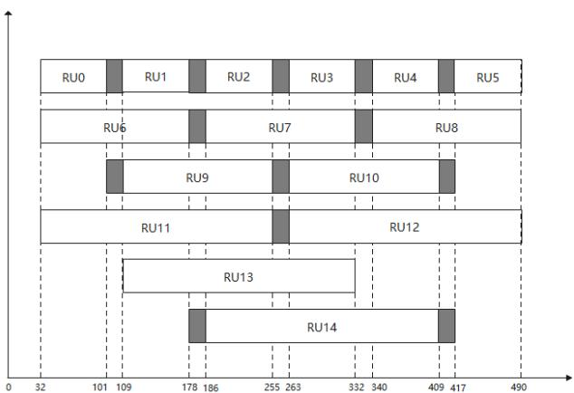

## SPLC 频段：

表 1 通信频段

<table><tr><td>SPLC 频段</td><td>频率范围(MHz)</td><td>载波编号范围</td></tr><tr><td>0</td><td>1.953~11.963</td><td>80~490</td></tr><tr><td>1</td><td>2.441~5.615</td><td>100~230</td></tr><tr><td>2</td><td>0.781~2.930</td><td>32~120</td></tr><tr><td>3</td><td>0.781~11.963</td><td>32~490</td></tr><tr><td>4</td><td>0.781~5.615</td><td>32~230</td></tr><tr><td>5</td><td>保留</td><td>/</td></tr><tr><td>6</td><td>保留</td><td>/</td></tr><tr><td>7</td><td>保留</td><td>/</td></tr></table>

## SPLC SC RU 分组：

表 2 SPLC OFDMA RU 定义

<table><tr><td>编号</td><td>起始子载波</td><td>结束子载波</td><td>起始频率/MHz</td><td>结束频率/MHz</td><td>子载波数</td><td>带宽/MHz</td></tr><tr><td>RU0</td><td>32</td><td>101</td><td>0.78</td><td>2.47</td><td>70</td><td>1.71</td></tr><tr><td>RU1</td><td>109</td><td>178</td><td>2.66</td><td>4.35</td><td>70</td><td>1.71</td></tr><tr><td>RU2</td><td>186</td><td>255</td><td>4.54</td><td>6.23</td><td>70</td><td>1.71</td></tr><tr><td>RU3</td><td>263</td><td>332</td><td>6.42</td><td>8.11</td><td>70</td><td>1.71</td></tr><tr><td>RU4</td><td>340</td><td>409</td><td>8.30</td><td>9.99</td><td>70</td><td>1.71</td></tr><tr><td>RU5</td><td>417</td><td>490</td><td>10.18</td><td>11.96</td><td>74</td><td>1.81</td></tr><tr><td>RU6</td><td>32</td><td>178</td><td>0.78</td><td>4.35</td><td>147</td><td>3.59</td></tr><tr><td>RU7</td><td>186</td><td>332</td><td>4.54</td><td>8.11</td><td>147</td><td>3.59</td></tr><tr><td>RU8</td><td>340</td><td>490</td><td>8.30</td><td>11.96</td><td>151</td><td>3.69</td></tr><tr><td>RU9</td><td>109</td><td>255</td><td>2.66</td><td>6.23</td><td>147</td><td>3.59</td></tr><tr><td>RU10</td><td>263</td><td>409</td><td>6.42</td><td>9.99</td><td>147</td><td>3.59</td></tr><tr><td>RU11</td><td>32</td><td>255</td><td>0.78</td><td>6.23</td><td>224</td><td>5.47</td></tr><tr><td>RU12</td><td>263</td><td>490</td><td>6.42</td><td>11.96</td><td>228</td><td>5.57</td></tr><tr><td>RU13</td><td>109</td><td>332</td><td>2.66</td><td>8.11</td><td>224</td><td>5.47</td></tr><tr><td>RU14</td><td>186</td><td>409</td><td>4.54</td><td>9.99</td><td>224</td><td>5.47</td></tr></table>

## SPLC 端口映射：

表 3 端口映射表

<table><tr><td>模式</td><td>端口数</td><td>index</td><td> $SMM_{0A}$ </td><td> $SMM_{0B}$ </td><td> $SMM_{0C}$ </td><td> $SMM_{1A}$ </td><td> $SMM_{1B}$ </td><td> $SMM_{1C}$ </td></tr><tr><td rowspan="4">MIMO 分集</td><td>三端口</td><td>0</td><td>1</td><td>1</td><td>1</td><td>-</td><td>-</td><td>-</td></tr><tr><td rowspan="3">两端口</td><td>1</td><td>1</td><td>1</td><td>0</td><td>-</td><td>-</td><td>-</td></tr><tr><td>2</td><td>1</td><td>0</td><td>1</td><td>-</td><td>-</td><td>-</td></tr><tr><td>3</td><td>0</td><td>1</td><td>1</td><td>-</td><td>-</td><td>-</td></tr><tr><td rowspan="3">SISO</td><td rowspan="3">单端口</td><td>4</td><td>1</td><td>0</td><td>0</td><td>-</td><td>-</td><td>-</td></tr><tr><td>5</td><td>0</td><td>1</td><td>0</td><td>-</td><td>-</td><td>-</td></tr><tr><td>6</td><td>0</td><td>0</td><td>1</td><td>-</td><td>-</td><td>-</td></tr><tr><td rowspan="6">MIMO 复用</td><td rowspan="3">三端口</td><td>7</td><td>1</td><td>0</td><td>1</td><td>0</td><td>1</td><td>0</td></tr><tr><td>8</td><td>1</td><td>1</td><td>0</td><td>0</td><td>0</td><td>1</td></tr><tr><td>9</td><td>0</td><td>1</td><td>1</td><td>1</td><td>0</td><td>0</td></tr><tr><td rowspan="3">两端口</td><td>10</td><td>1</td><td>0</td><td>0</td><td>0</td><td>0</td><td>1</td></tr><tr><td>11</td><td>1</td><td>0</td><td>0</td><td>0</td><td>1</td><td>0</td></tr><tr><td>12</td><td>0</td><td>1</td><td>0</td><td>0</td><td>0</td><td>1</td></tr></table>

## HPLC TMI：

表 11 ROB0 基本模式

<table><tr><td>TMI</td><td>ROBO 模式名称</td><td>PB 块大小</td><td>Copy 次数</td><td>调制方式</td><td>码率</td><td>PB 块数</td></tr><tr><td>0</td><td>SR ROBO 0</td><td>520</td><td>4</td><td>QPSK</td><td>1/2</td><td>1</td></tr><tr><td>1</td><td>HR ROBO 0</td><td>520</td><td>2</td><td>QPSK</td><td>1/2</td><td>1~4</td></tr><tr><td>3</td><td>MR ROBO 1</td><td>136</td><td>11</td><td>BPSK</td><td>1/2</td><td>1~4</td></tr><tr><td>4</td><td>MR ROBO 2</td><td>136</td><td>7</td><td>BPSK</td><td>1/2</td><td>1~4</td></tr><tr><td>5</td><td>MR ROBO 3</td><td>136</td><td>11</td><td>QPSK</td><td>1/2</td><td>1~4</td></tr><tr><td>6</td><td>MR ROBO 4</td><td>136</td><td>7</td><td>QPSK</td><td>1/2</td><td>1~4</td></tr><tr><td>7</td><td>SR ROBO 1</td><td>520</td><td>7</td><td>BPSK</td><td>1/2</td><td>1</td></tr><tr><td>8</td><td>SR ROBO 2</td><td>520</td><td>4</td><td>BPSK</td><td>1/2</td><td>1</td></tr><tr><td>9</td><td>SR ROBO 3</td><td>520</td><td>7</td><td>QPSK</td><td>1/2</td><td>1</td></tr><tr><td>10</td><td>HR ROBO 1</td><td>520</td><td>2</td><td>BPSK</td><td>1/2</td><td>1~4</td></tr></table>

注：PB块数默认为1，可选项为2\~4  
ROBO交织还支持扩展模式，如表12所示，TMI配置为13，再选TMIExt。

表 12 ROB0 扩展模式

<table><tr><td>TMIExt</td><td>名称</td><td>PB 块大小</td><td>Copy 次数</td><td>调制方式</td><td>码率</td><td>PB 块数</td></tr><tr><td>1</td><td>Sounding_520_1</td><td>520</td><td>1</td><td>16QAM</td><td>16/18</td><td>1~4</td></tr><tr><td>2</td><td>Sounding_520_2</td><td>520</td><td>2</td><td>16QAM</td><td>16/18</td><td>1~4</td></tr><tr><td>3</td><td>Sounding_520_3</td><td>520</td><td>1</td><td>16QAM</td><td>1/2</td><td>1~4</td></tr><tr><td>4</td><td>Sounding_520_4</td><td>520</td><td>2</td><td>16QAM</td><td>1/2</td><td>1~4</td></tr><tr><td>5</td><td>Sounding_520_5</td><td>520</td><td>4</td><td>16QAM</td><td>1/2</td><td>1~4</td></tr><tr><td>6</td><td>Sounding_520_6</td><td>520</td><td>1</td><td>QPSK</td><td>1/2</td><td>1~4</td></tr><tr><td>10</td><td>Sounding_136_1</td><td>136</td><td>5</td><td>16QAM</td><td>1/2</td><td>1~4</td></tr><tr><td>11</td><td>Sounding_136_2</td><td>136</td><td>2</td><td>QPSK</td><td>1/2</td><td>1~4</td></tr><tr><td>12</td><td>Sounding_136_3</td><td>136</td><td>2</td><td>16QAM</td><td>1/2</td><td>1~4</td></tr><tr><td>13</td><td>Sounding_136_4</td><td>136</td><td>1</td><td>QPSK</td><td>1/2</td><td>1~4</td></tr><tr><td>14</td><td>Sounding_136_5</td><td>136</td><td>1</td><td>16QAM</td><td>1/2</td><td>1~4</td></tr></table>

当使用Bitloading时，每个子载波的调制方式由比特加载表决定，分集拷贝次数固定为1，码率固定为1/2，只须指定物理块大小。

表 4 SPLC 载荷数据的 ROBO 模式

<table><tr><td>TMI 编号</td><td>PB 大小</td><td>copy 次数</td><td>调制方式</td><td>码率</td><td>PB 块数</td></tr><tr><td>0</td><td>520</td><td>7</td><td>BPSK</td><td>1/2</td><td>1~4</td></tr><tr><td>1</td><td>520</td><td>4</td><td>BPSK</td><td>1/2</td><td>1~4</td></tr><tr><td>2</td><td>520</td><td>2</td><td>BPSK</td><td>1/2</td><td>1~4</td></tr><tr><td>3</td><td>520</td><td>1</td><td>BPSK</td><td>1/2</td><td>1~4</td></tr><tr><td>4</td><td>520</td><td>1</td><td>QPSK</td><td>1/2</td><td>1~4</td></tr><tr><td>5</td><td>520</td><td>1</td><td>16QAM</td><td>1/2</td><td>1~4</td></tr><tr><td>6</td><td>520</td><td>1</td><td>16QAM</td><td>16/18</td><td>1~4</td></tr><tr><td>7</td><td>520</td><td>1</td><td>64QAM</td><td>1/2</td><td>1~4</td></tr><tr><td>8</td><td>520</td><td>1</td><td>64QAM</td><td>16/18</td><td>1~4</td></tr><tr><td>9</td><td>264</td><td>7</td><td>BPSK</td><td>1/2</td><td>1~4</td></tr><tr><td>10</td><td>264</td><td>4</td><td>BPSK</td><td>1/2</td><td>1~4</td></tr><tr><td>11</td><td>264</td><td>2</td><td>BPSK</td><td>1/2</td><td>1~4</td></tr><tr><td>12</td><td>264</td><td>1</td><td>BPSK</td><td>1/2</td><td>1~4</td></tr><tr><td>13</td><td>264</td><td>1</td><td>QPSK</td><td>1/2</td><td>1~4</td></tr><tr><td>14</td><td>264</td><td>1</td><td>16QAM</td><td>1/2</td><td>1~4</td></tr><tr><td>15</td><td>264</td><td>1</td><td>64QAM</td><td>1/2</td><td>1~4</td></tr><tr><td>16</td><td>136</td><td>7</td><td>BPSK</td><td>1/2</td><td>1~4</td></tr><tr><td>17</td><td>136</td><td>4</td><td>BPSK</td><td>1/2</td><td>1~4</td></tr><tr><td>18</td><td>136</td><td>2</td><td>BPSK</td><td>1/2</td><td>1~4</td></tr><tr><td>19</td><td>136</td><td>1</td><td>BPSK</td><td>1/2</td><td>1~4</td></tr><tr><td>20</td><td>136</td><td>1</td><td>QPSK</td><td>1/2</td><td>1~4</td></tr><tr><td>21</td><td>72</td><td>7</td><td>BPSK</td><td>1/2</td><td>1~4</td></tr><tr><td>22</td><td>72</td><td>4</td><td>BPSK</td><td>1/2</td><td>1~4</td></tr><tr><td>23</td><td>72</td><td>2</td><td>BPSK</td><td>1/2</td><td>1~4</td></tr><tr><td>24</td><td>72</td><td>1</td><td>BPSK</td><td>1/2</td><td>1~4</td></tr><tr><td>25</td><td>72</td><td>1</td><td>QPSK</td><td>1/2</td><td>1~4</td></tr><tr><td>26</td><td>16</td><td>7</td><td>BPSK</td><td>1/2</td><td>1~4</td></tr><tr><td>27</td><td>16</td><td>4</td><td>BPSK</td><td>1/2</td><td>1~4</td></tr></table>

## 5.1.7.5 通信频段

高速载波通信支持的频段如表21所示。

表 21 通信频段

<table><tr><td>频段</td><td>频段范围(MHz)</td><td>载波起始编号</td><td>载波截止编号</td></tr><tr><td>0</td><td>1.953~11.96</td><td>80</td><td>490</td></tr><tr><td>1</td><td>2.441~5.615</td><td>100</td><td>230</td></tr><tr><td>2</td><td>0.781~2.930</td><td>32</td><td>120</td></tr><tr><td>3</td><td>1.758~2.930</td><td>72</td><td>120</td></tr><tr><td>4</td><td>保留</td><td>--</td><td>--</td></tr></table>

国网 Protocol V2.0

## 5.11.2通信频段

高速载波通信支持的频段应符合表19要求。

表 19 通信频段

<table><tr><td>频段</td><td>频段范围(MHz)</td><td>可用载波起始索引</td><td>可用载波终止索引</td><td>初始相位标号m</td></tr><tr><td>0</td><td>1.953~11.96</td><td>80</td><td>490</td><td>346</td></tr><tr><td>1</td><td>2.441~5.615</td><td>100</td><td>230</td><td>0</td></tr><tr><td>2</td><td>0.781~2.930</td><td>32</td><td>120</td><td>0</td></tr><tr><td>3</td><td>保留</td><td>-</td><td>-</td><td>-</td></tr><tr><td>4</td><td>0.781~5.615</td><td>32</td><td>230</td><td>113</td></tr><tr><td>5</td><td>0.781~11.96</td><td>32</td><td>490</td><td>375</td></tr><tr><td>6</td><td>6.08~11.96</td><td>250</td><td>490</td><td>254</td></tr></table>

DL OFDMA机制应把电力线载波最大可用频段 0.7MHz\~12MHz（对应子载波编号32\~490）划分成最小基础资源单元(Basic ResourceUnit，简称BRU)，不同BRU之间无需预留保护频率间隔。系统实际使用的资源单元为RU(Resource Unit，简称 RU)，不同的RU可分配给不同的站点。基础 BRU为BRU0\~BRU7，作为信道探测基本单元使用。系统实际分配的RU应包括两个或者两个以上BRU。系统实际分配的RU应为RU0-RU15。

BRU和RU的划分应符合图 31的规定：

<table><tr><td colspan="9">RU索引和子载波索引范围</td><td></td></tr><tr><td>基础RU站点信道SNR评估</td><td>BRU0[32,79]</td><td colspan="2">BRU1[80,120]</td><td>BRU2[121,175]</td><td>BRU3[176,230]</td><td>BRU4[231,295]</td><td>BRU5[296,360]</td><td>BRU6[361,425]</td><td>BRU7[426,490]</td></tr><tr><td rowspan="7">OFDMA多站点的RU分配</td><td colspan="3">RU0[32,120]</td><td colspan="2">RU1[121,230]</td><td colspan="2">RU2[231,360]</td><td colspan="2">RU3[361,490]</td></tr><tr><td></td><td colspan="3">RU4[80,175]</td><td colspan="2">RU5[176,295]</td><td colspan="2">RU6[296,425]</td><td></td></tr><tr><td colspan="4">RU7[32,175]</td><td colspan="3">RU8[176,360]</td><td colspan="2"></td></tr><tr><td></td><td colspan="4">RU9[80,230]</td><td colspan="3">RU10[231,425]</td><td></td></tr><tr><td colspan="2"></td><td colspan="4">RU11[121,295]</td><td colspan="3">RU12[296,490]</td></tr><tr><td colspan="5">RU13[32,230]</td><td colspan="4">RU14[231,490]</td></tr><tr><td colspan="2"></td><td colspan="5">RU15[121,360]</td><td colspan="2"></td></tr></table>

其中，具体BRU载波范围应符合表 20的定义：

表 20 BRU 频率范围定义

<table><tr><td colspan="4">基础 BRU 参数表</td></tr><tr><td>BRU 索引</td><td>起始载波索引</td><td>终止载波索引</td><td>BRUSize</td></tr><tr><td>0</td><td>32</td><td>79</td><td>48</td></tr><tr><td>1</td><td>80</td><td>120</td><td>41</td></tr><tr><td>2</td><td>121</td><td>175</td><td>55</td></tr><tr><td>3</td><td>176</td><td>230</td><td>55</td></tr><tr><td>4</td><td>231</td><td>295</td><td>65</td></tr><tr><td>5</td><td>296</td><td>360</td><td>65</td></tr><tr><td>6</td><td>361</td><td>425</td><td>65</td></tr><tr><td>7</td><td>426</td><td>490</td><td>65</td></tr></table>

其中，具体RU载波范围应符合表 21的定义：

表 21 RU 频率范围定义

<table><tr><td>RU索引</td><td>起始载波索引</td><td>终止载波索引</td><td>起始频率/MHz</td><td>结束频率/MHz</td><td>子载波数</td><td>带宽/MHz</td></tr><tr><td>RU0</td><td>32</td><td>120</td><td>0.781</td><td>2.93</td><td>89</td><td>2.173</td></tr><tr><td>RU1</td><td>121</td><td>230</td><td>2.954</td><td>5.615</td><td>110</td><td>2.686</td></tr><tr><td>RU2</td><td>231</td><td>360</td><td>5.64</td><td>8.789</td><td>130</td><td>3.174</td></tr><tr><td>RU3</td><td>361</td><td>490</td><td>8.814</td><td>11.9629</td><td>130</td><td>3.174</td></tr><tr><td>RU4</td><td>80</td><td>175</td><td>1.953</td><td>4.273</td><td>96</td><td>2.344</td></tr><tr><td>RU5</td><td>176</td><td>295</td><td>4.297</td><td>7.202</td><td>120</td><td>2.930</td></tr><tr><td>RU6</td><td>296</td><td>425</td><td>7.227</td><td>10.376</td><td>130</td><td>3.174</td></tr><tr><td>RU7</td><td>32</td><td>175</td><td>0.781</td><td>4.273</td><td>144</td><td>3.516</td></tr><tr><td>RU8</td><td>176</td><td>360</td><td>4.297</td><td>8.789</td><td>185</td><td>4.517</td></tr><tr><td>RU9</td><td>80</td><td>230</td><td>1.953</td><td>5.615</td><td>151</td><td>3.687</td></tr><tr><td>RU10</td><td>231</td><td>425</td><td>5.640</td><td>10.376</td><td>195</td><td>4.761</td></tr><tr><td>RU11</td><td>121</td><td>295</td><td>2.954</td><td>7.202</td><td>175</td><td>4.272</td></tr><tr><td>RU12</td><td>296</td><td>490</td><td>7.227</td><td>11.963</td><td>195</td><td>4.761</td></tr><tr><td>RU13</td><td>32</td><td>230</td><td>0.781</td><td>5.615</td><td>199</td><td>4.858</td></tr><tr><td>RU14</td><td>231</td><td>490</td><td>5.640</td><td>11.963</td><td>260</td><td>6.348</td></tr><tr><td>RU15</td><td>121</td><td>360</td><td>2.954</td><td>8.789</td><td>240</td><td>5.859</td></tr></table>

表22 分集拷贝基本模式

<table><tr><td>模式编号</td><td>分集拷贝模式名称</td><td>物理块类型(字节)</td><td>分集次数</td><td>调制方式</td><td>码率</td><td>物理块数</td><td>推荐使用</td></tr><tr><td>0</td><td>模式0</td><td>520</td><td>4</td><td>QPSK</td><td>1/2</td><td>1~4</td><td>√</td></tr><tr><td>1</td><td>模式1</td><td>520</td><td>2</td><td>QPSK</td><td>1/2</td><td>1~4</td><td>√</td></tr><tr><td>2</td><td>模式2</td><td>136</td><td>5</td><td>QPSK</td><td>1/2</td><td>1~4</td><td></td></tr><tr><td>3</td><td>模式3</td><td>136</td><td>11</td><td>BPSK</td><td>1/2</td><td>1~4</td><td></td></tr><tr><td>4</td><td>模式4</td><td>136</td><td>7</td><td>BPSK</td><td>1/2</td><td>1~4</td><td>√</td></tr><tr><td>5</td><td>模式5</td><td>136</td><td>11</td><td>QPSK</td><td>1/2</td><td>1~4</td><td></td></tr><tr><td>6</td><td>模式6</td><td>136</td><td>7</td><td>QPSK</td><td>1/2</td><td>1~4</td><td>√</td></tr><tr><td>7</td><td>模式7</td><td>520</td><td>7</td><td>BPSK</td><td>1/2</td><td>1~3</td><td></td></tr><tr><td>8</td><td>模式8</td><td>520</td><td>4</td><td>BPSK</td><td>1/2</td><td>1~4</td><td></td></tr><tr><td>9</td><td>模式9</td><td>520</td><td>7</td><td>QPSK</td><td>1/2</td><td>1~4</td><td>√</td></tr><tr><td>10</td><td>模式10</td><td>520</td><td>2</td><td>BPSK</td><td>1/2</td><td>1~4</td><td>√</td></tr><tr><td>11</td><td>模式11</td><td>264</td><td>7</td><td>QPSK</td><td>1/2</td><td>1~4</td><td></td></tr><tr><td>12</td><td>模式12</td><td>264</td><td>7</td><td>BPSK</td><td>1/2</td><td>1~4</td><td>√</td></tr></table>

表22（续）

<table><tr><td>模式编号</td><td>分集拷贝模式名称</td><td>物理块类型(字节)</td><td>分集次数</td><td>调制方式</td><td>码率</td><td>物理块数</td><td>推荐使用</td></tr><tr><td>13</td><td>模式 13</td><td>72</td><td>7</td><td>QPSK</td><td>1/2</td><td>1~4</td><td></td></tr><tr><td>14</td><td>模式 14</td><td>72</td><td>7</td><td>BPSK</td><td>1/2</td><td>1~4</td><td>√</td></tr><tr><td colspan="8">注1:此表中物理块以全频段为例计算而得。注2:子频段物理块数应不大于4,且同时保证帧控制域符号数不超过511。</td></tr></table>

分集拷贝还支持扩展模式，如表23所示，分集拷贝模式配置为15，分集拷贝扩展模式。

表 23 分集拷贝扩展模式

<table><tr><td colspan="1" rowspan="1">扩展模式编号</td><td colspan="1" rowspan="1">名称</td><td colspan="1" rowspan="1">物理块类型(字节)</td><td colspan="1" rowspan="1">分集次数</td><td colspan="1" rowspan="1">调制方式</td><td colspan="1" rowspan="1">码率</td><td colspan="1" rowspan="1">物理块数</td></tr><tr><td colspan="1" rowspan="1">1</td><td colspan="1" rowspan="1">扩展模式 1</td><td colspan="1" rowspan="1">520</td><td colspan="1" rowspan="1">1</td><td colspan="1" rowspan="1">16QAM</td><td colspan="1" rowspan="1">16/18</td><td colspan="1" rowspan="1">1~4</td></tr><tr><td colspan="1" rowspan="1">2</td><td colspan="1" rowspan="1">扩展模式 2</td><td colspan="1" rowspan="1">520</td><td colspan="1" rowspan="1">2</td><td colspan="1" rowspan="1">16QAM</td><td colspan="1" rowspan="1">16/18</td><td colspan="1" rowspan="1">1~4</td></tr><tr><td colspan="1" rowspan="1">3</td><td colspan="1" rowspan="1">扩展模式 3</td><td colspan="1" rowspan="1">520</td><td colspan="1" rowspan="1">1</td><td colspan="1" rowspan="1">16QAM</td><td colspan="1" rowspan="1">1/2</td><td colspan="1" rowspan="1">1~4</td></tr><tr><td colspan="1" rowspan="1">4</td><td colspan="1" rowspan="1">扩展模式 4</td><td colspan="1" rowspan="1">520</td><td colspan="1" rowspan="1">2</td><td colspan="1" rowspan="1">16QAM</td><td colspan="1" rowspan="1">1/2</td><td colspan="1" rowspan="1">1~4</td></tr></table>

表23（续）

<table><tr><td>扩展模式编号</td><td>名称</td><td>物理块类型(字节)</td><td>分集次数</td><td>调制方式</td><td>码率</td><td>物理块数</td></tr><tr><td>5</td><td>扩展模式 5</td><td>520</td><td>4</td><td>16QAM</td><td> $1/2$ </td><td> $1 \sim 4$ </td></tr><tr><td>6</td><td>扩展模式 6</td><td>520</td><td>1</td><td>QPSK</td><td> $1/2$ </td><td> $1 \sim 4$ </td></tr><tr><td>10</td><td>扩展模式 10</td><td>136</td><td>5</td><td>16QAM</td><td> $1/2$ </td><td> $1 \sim 4$ </td></tr><tr><td>11</td><td>扩展模式 11</td><td>136</td><td>2</td><td>QPSK</td><td> $1/2$ </td><td> $1 \sim 4$ </td></tr><tr><td>12</td><td>扩展模式 12</td><td>136</td><td>2</td><td>16QAM</td><td> $1/2$ </td><td> $1 \sim 4$ </td></tr><tr><td>13</td><td>扩展模式 13</td><td>136</td><td>1</td><td>QPSK</td><td> $1/2$ </td><td> $1 \sim 4$ </td></tr><tr><td>14</td><td>扩展模式 14</td><td>136</td><td>1</td><td>16QAM</td><td> $1/2$ </td><td> $1 \sim 4$ </td></tr></table>

<table><tr><td>模式编号</td><td>传输模式名称</td><td>物理块类型(字节)</td><td>分集次数</td><td>调制方式</td><td>码率</td></tr><tr><td>0</td><td>模式0</td><td>520</td><td>13</td><td>BPSK</td><td>0.5</td></tr><tr><td>1</td><td>模式1</td><td>264</td><td>13</td><td>BPSK</td><td>0.5</td></tr><tr><td>2</td><td>模式2</td><td>136</td><td>13</td><td>BPSK</td><td>0.5</td></tr><tr><td>3</td><td>模式3</td><td>72</td><td>13</td><td>BPSK</td><td>0.5</td></tr><tr><td>4</td><td>模式4</td><td>520</td><td>7</td><td>BPSK</td><td>0.5</td></tr><tr><td>5</td><td>模式5</td><td>264</td><td>7</td><td>BPSK</td><td>0.5</td></tr><tr><td>6</td><td>模式6</td><td>136</td><td>7</td><td>BPSK</td><td>0.5</td></tr><tr><td>7</td><td>模式7</td><td>72</td><td>7</td><td>BPSK</td><td>0.5</td></tr><tr><td>8</td><td>模式8</td><td>520</td><td>7</td><td>QPSK</td><td>0.5</td></tr><tr><td>9</td><td>模式9</td><td>264</td><td>7</td><td>QPSK</td><td>0.5</td></tr><tr><td>10</td><td>模式10</td><td>136</td><td>7</td><td>QPSK</td><td>0.5</td></tr><tr><td>11</td><td>模式11</td><td>72</td><td>7</td><td>QPSK</td><td>0.5</td></tr><tr><td>12</td><td>模式12</td><td>520</td><td>4</td><td>QPSK</td><td>0.5</td></tr><tr><td>13</td><td>模式13</td><td>264</td><td>4</td><td>QPSK</td><td>0.5</td></tr><tr><td>14</td><td>模式14</td><td>136</td><td>4</td><td>QPSK</td><td>0.5</td></tr><tr><td>15</td><td>模式15</td><td>72</td><td>4</td><td>QPSK</td><td>0.5</td></tr><tr><td>16</td><td>模式16</td><td>520</td><td>2</td><td>QPSK</td><td>0.5</td></tr><tr><td>17</td><td>模式17</td><td>264</td><td>2</td><td>QPSK</td><td>0.5</td></tr><tr><td>18</td><td>模式18</td><td>136</td><td>2</td><td>QPSK</td><td>0.5</td></tr><tr><td>19</td><td>模式19</td><td>72</td><td>2</td><td>QPSK</td><td>0.5</td></tr><tr><td>20</td><td>模式20</td><td>520</td><td>1</td><td>QPSK</td><td>0.5</td></tr><tr><td>21</td><td>模式21</td><td>264</td><td>1</td><td>QPSK</td><td>0.5</td></tr><tr><td>22</td><td>模式22</td><td>136</td><td>1</td><td>QPSK</td><td>0.5</td></tr><tr><td>23</td><td>模式23</td><td>72</td><td>1</td><td>QPSK</td><td>0.5</td></tr><tr><td>24</td><td>模式24</td><td>520</td><td>1</td><td>16QAM</td><td>0.5</td></tr><tr><td>25</td><td>模式25</td><td>264</td><td>1</td><td>16QAM</td><td>0.5</td></tr><tr><td>26</td><td>模式26</td><td>136</td><td>1</td><td>16QAM</td><td>0.5</td></tr><tr><td>27</td><td>模式27</td><td>72</td><td>1</td><td>16QAM</td><td>0.5</td></tr><tr><td>28</td><td>模式28</td><td>520</td><td>1</td><td>16QAM</td><td>16/18</td></tr><tr><td colspan="6">注:子频段物理块数应不大于4,且同时保证载荷符号数不超过511。</td></tr></table>